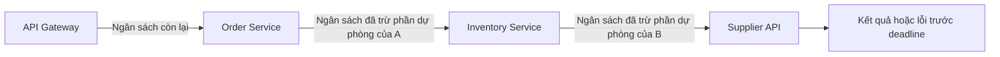

# Thiết kế ngân sách thời gian qua nhiều lớp gọi dịch vụ

Một request thường đi qua nhiều lớp: API gateway, service nghiệp vụ, service phụ thuộc, rồi một hoặc nhiều hệ thống bên ngoài. Nếu mỗi lớp tự đặt timeout độc lập mà không biết thời gian còn lại của request, tổng thời gian xử lý có thể vượt xa giới hạn mà người gọi mong đợi. TimeLimiter giúp giới hạn thời gian chờ của một thao tác; deadline và ngân sách thời gian giúp các lớp phối hợp để toàn bộ chuỗi hoàn tất trong thời hạn chung.

Với Spring Cloud CircuitBreaker và Resilience4j, cần thiết kế một deadline end-to-end rồi phân bổ phần thời gian còn lại cho từng hop. Mỗi service phải dành thời gian cho xử lý nội bộ, ghi log, serialize response và trả kết quả. Khi gọi xuống service tiếp theo, nó chỉ truyền phần ngân sách còn lại sau khi đã giữ lại khoảng dự phòng cần thiết. Retry và fallback cũng phải nằm trong ngân sách đó.

## Timeout của một hop và deadline của toàn request

**Timeout của một hop** giới hạn thời gian chờ cho một thao tác cụ thể, chẳng hạn gọi HTTP từ `order-service` sang `inventory-service`. **Deadline end-to-end** là thời điểm muộn nhất mà toàn bộ request cần hoàn tất, tính từ lúc request đi vào hệ thống.

Hai khái niệm có quan hệ nhưng không thay thế nhau:

- Nếu mỗi service đặt timeout 2 giây riêng, chuỗi ba service tuần tự có thể kéo dài gần 6 giây, chưa tính thời gian gateway và xử lý nội bộ.
- Nếu request có deadline 2,5 giây, mỗi hop phải dùng phần thời gian còn lại của deadline đó. Service ở sâu hơn không được bắt đầu lại một timeout đầy đủ 2,5 giây.
- Timeout cục bộ nên nhỏ hơn hoặc bằng ngân sách còn lại của request, đồng thời dành chỗ cho xử lý sau lời gọi và trả response.

Ví dụ chuỗi gọi tuần tự:



Deadline là giới hạn chung. Các timeout của từng hop là những giới hạn con được tính từ deadline và thời gian đã tiêu thụ.

## Phân bổ ngân sách theo từng lớp

Giả sử gateway nhận request với ngân sách tổng 2.500 ms. Gateway dùng 150 ms cho xác thực và định tuyến. `order-service` cần giữ lại 250 ms để tổng hợp dữ liệu và trả response. Vì vậy, lời gọi từ `order-service` xuống `inventory-service` có tối đa khoảng 2.100 ms.

Khi `inventory-service` nhận request, ngân sách còn lại xấp xỉ 2.100 ms. Service này giữ 250 ms cho xử lý nội bộ và trả response, nên lời gọi tiếp theo đến `supplier-api` chỉ được dùng tối đa khoảng 1.850 ms. `supplier-api` hoặc client của nó cần tiếp tục giới hạn thao tác theo phần ngân sách còn lại và dành thời gian trả kết quả. Các con số minh họa cần được điều chỉnh theo latency thực tế, nhưng nguyên tắc là không cấp cho hop con nhiều thời gian hơn deadline còn lại.

| Lớp | Ngân sách khi bắt đầu | Phần giữ lại cho xử lý và response | Giới hạn lời gọi tiếp theo |
|---|---:|---:|---:|
| Gateway | 2.500 ms | 150 ms | 2.350 ms cho toàn bộ xử lý phía sau |
| Order service | Khoảng 2.350 ms | 250 ms | Khoảng 2.100 ms đến inventory |
| Inventory service | Khoảng 2.100 ms | 250 ms | Khoảng 1.850 ms đến supplier |
| Supplier client | Khoảng 1.850 ms | Theo hợp đồng của client | Không vượt deadline còn lại |

Khi tính ngân sách, cần tính cả thời gian chờ connection pool, DNS, kết nối TCP/TLS, gửi request, chờ response, giải mã dữ liệu và backoff giữa các lần retry. Không nên cộng các timeout thành phần một cách máy móc nếu chúng chạy nối tiếp; hãy dùng deadline tổng để chặn toàn bộ thao tác và đặt timeout thành phần nhỏ hơn deadline đó.

## Truyền deadline hoặc thời gian còn lại giữa các service

Mỗi service cần biết thời điểm request phải kết thúc. Với giao thức hỗ trợ deadline, hãy dùng cơ chế deadline gốc của giao thức. Ví dụ, gRPC hỗ trợ deadline và có thể truyền thời hạn qua các lời gọi tiếp theo. Khi dùng HTTP, tổ chức có thể định nghĩa header nội bộ biểu diễn deadline hoặc thời gian còn lại, nhưng phải thống nhất đơn vị, quy tắc cập nhật và cách xử lý khi header thiếu hoặc không hợp lệ.

Một số nguyên tắc khi truyền ngân sách:

- Gateway đặt giới hạn tối đa theo SLA của API. Không cho phép client bên ngoài yêu cầu timeout vô hạn.
- Mỗi service đọc ngân sách nhận được, áp dụng giới hạn tối đa nội bộ rồi trừ thời gian dự phòng của chính nó trước khi gọi tiếp.
- Không đặt lại toàn bộ timeout mặc định ở mỗi hop; việc đó làm tổng thời gian vượt deadline ban đầu.
- Nếu truyền thời điểm tuyệt đối qua HTTP, cần tính đến sai lệch đồng hồ giữa các máy. Sau khi nhận deadline, chuyển nó thành thời lượng còn lại và dùng đồng hồ monotonic trong tiến trình để đo thời gian.
- Nếu truyền thời lượng tương đối, cần quy ước rõ thời lượng được tính từ lúc gửi hay lúc nhận và trừ hao thời gian truyền mạng; downstream luôn áp dụng giới hạn cục bộ để tránh bị yêu cầu kéo dài quá mức.
- Không tin cậy trực tiếp header deadline do người dùng gửi. Gateway phải xác thực, chuẩn hóa và giới hạn giá trị trước khi chuyển tiếp.

## Đo thời gian còn lại bằng đồng hồ monotonic

Trong một tiến trình Java, dùng `System.nanoTime()` để đo khoảng thời gian đã trôi qua. Không dùng `System.currentTimeMillis()` làm đồng hồ đếm timeout nội bộ vì đồng hồ hệ thống có thể được điều chỉnh. Có thể biểu diễn deadline cục bộ như sau:

```java
import java.time.Duration;

final class DeadlineBudget {
    private final long deadlineNanos;

    private DeadlineBudget(long deadlineNanos) {
        this.deadlineNanos = deadlineNanos;
    }

    static DeadlineBudget start(Duration budget) {
        if (budget.isZero() || budget.isNegative()) {
            throw new IllegalArgumentException("Budget phải lớn hơn 0");
        }
        return new DeadlineBudget(System.nanoTime() + budget.toNanos());
    }

    Duration remaining() {
        long nanos = deadlineNanos - System.nanoTime();
        return Duration.ofNanos(Math.max(0, nanos));
    }

    boolean isExpired() {
        return deadlineNanos - System.nanoTime() <= 0;
    }
}
```

Đoạn mã này chỉ quản lý deadline trong cùng tiến trình. Không gửi trực tiếp giá trị `deadlineNanos` sang máy khác vì `System.nanoTime()` không có mốc thời gian chung giữa các tiến trình. Khi nhận request từ mạng, hãy chuyển deadline hoặc timeout được truyền theo hợp đồng của hệ thống thành một `DeadlineBudget` mới dựa trên thời gian còn lại đã được xác thực.

## Áp dụng ngân sách vào lời gọi WebClient reactive

Với Reactor, có thể dùng `Mono.timeout(remaining)` để giới hạn publisher theo ngân sách còn lại. Đặt việc lấy thời gian còn lại bên trong `Mono.defer(...)` để giá trị được tính tại thời điểm subscription, không phải quá sớm khi xây dựng publisher.

```java
Mono<Product> callCatalog(String sku, DeadlineBudget deadline) {
    return Mono.defer(() -> {
        Duration remaining = deadline.remaining();
        if (remaining.isZero() || remaining.isNegative()) {
            return Mono.error(new java.util.concurrent.TimeoutException(
                "Đã hết ngân sách request"));
        }

        return webClient.get()
            .uri("/products/{sku}", sku)
            .retrieve()
            .bodyToMono(Product.class)
            .timeout(remaining);
    });
}
```

Khi lời gọi này được bảo vệ bởi Reactive Circuit Breaker, hãy đặt timeout bên trong publisher mà Circuit Breaker quan sát:

```java
Mono<Product> protectedCall = callCatalog(sku, deadline);

return reactiveCircuitBreakerFactory.create("catalog")
    .run(protectedCall, error -> productCache.find(sku)
        .switchIfEmpty(Mono.error(
            new CatalogUnavailableException(sku, error))));
```

Như vậy, timeout phát sinh từ `callCatalog` là một tín hiệu lỗi nằm trong ranh giới Circuit Breaker. Mạch có thể phân loại nó theo `recordExceptions`, `ignoreExceptions` và các ngưỡng failure/slow call đã cấu hình. Fallback trả về `Mono`, nên không cần chặn event-loop.

Nếu dùng `onErrorResume` để thay timeout bằng dữ liệu cache trước khi đưa publisher vào Circuit Breaker, mạch có thể chỉ nhìn thấy completion bình thường. Nếu muốn Circuit Breaker ghi nhận lỗi phụ thuộc, hãy để nó quan sát timeout trước rồi mới chuyển sang fallback ở downstream hoặc dùng fallback của `run(...)`.

## Cấu hình TimeLimiter trong Spring Cloud CircuitBreaker với Resilience4j

TimeLimiter giới hạn thời gian chờ cho một thao tác bất đồng bộ. Với backend Resilience4j, có thể khai báo timeout theo từng instance:

```yaml
resilience4j:
  timelimiter:
    instances:
      catalog:
        timeoutDuration: 1600ms
        cancelRunningFuture: true
  circuitbreaker:
    instances:
      catalog:
        slidingWindowType: COUNT_BASED
        slidingWindowSize: 20
        minimumNumberOfCalls: 10
        failureRateThreshold: 50
        slowCallDurationThreshold: 1200ms
        slowCallRateThreshold: 50
        waitDurationInOpenState: 5s
```

Trong ví dụ, TimeLimiter giới hạn thời gian chờ ở 1.600 ms; Circuit Breaker dùng cửa sổ riêng để đánh giá failure rate và slow call rate. `slowCallDurationThreshold` được đặt thấp hơn timeout để các lời gọi chậm được thống kê trước khi chạm giới hạn timeout. Cần chọn các giá trị theo deadline còn lại của request, latency percentile và thời gian dự phòng của service.

Spring Cloud CircuitBreaker cũng cho phép cấu hình `TimeLimiterConfig` qua factory customizer:

```java
import java.time.Duration;

import io.github.resilience4j.timelimiter.TimeLimiterConfig;
import org.springframework.cloud.client.circuitbreaker.Customizer;
import org.springframework.cloud.circuitbreaker.resilience4j.ReactiveResilience4JCircuitBreakerFactory;
import org.springframework.context.annotation.Bean;

@Bean
Customizer<ReactiveResilience4JCircuitBreakerFactory> catalogTimeBudget() {
    TimeLimiterConfig timeLimiter = TimeLimiterConfig.custom()
        .timeoutDuration(Duration.ofMillis(1600))
        .cancelRunningFuture(true)
        .build();

    return factory -> factory.configure(
        builder -> builder.timeLimiterConfig(timeLimiter),
        "catalog");
}
```

Ví dụ Java đặt một giá trị timeout cố định cho instance. Nếu mỗi request có ngân sách còn lại khác nhau, timeout cố định này cần nhỏ hơn giới hạn tối đa đã cam kết; dùng `Mono.timeout(remaining)` bên trong publisher khi cần áp dụng deadline động cho từng request. Tránh để TimeLimiter cố định dài hơn deadline động của request.

TimeLimiter của Resilience4j thường được dùng để giới hạn thao tác bất đồng bộ dựa trên `Future` hoặc `CompletionStage`; với reactive publisher, Spring Cloud CircuitBreaker/Resilience4j sử dụng cơ chế timeout tương ứng với Reactor. Đối với lời gọi đồng bộ đang chặn thread, không nên chỉ bọc nó trong một Future rồi giả định timeout sẽ dừng được công việc. Hãy cấu hình timeout ở HTTP/RPC client và cân nhắc cách hủy thực sự của client.

## Phối hợp TimeLimiter, Circuit Breaker và timeout của client

Ba lớp có vai trò riêng:

| Cơ chế | Vai trò | Câu hỏi cần trả lời |
|---|---|---|
| Timeout của HTTP/RPC client | Giới hạn thời gian ở các giai đoạn như lấy connection, connect, response/read | Client chờ bao lâu ở tầng transport? |
| TimeLimiter hoặc Reactor `timeout` | Giới hạn thời gian chờ của thao tác bất đồng bộ/publisher | Ứng dụng có chờ quá ngân sách của thao tác không? |
| Circuit Breaker | Theo dõi failure/slow call và ngăn tiếp tục gọi dependency khi vượt ngưỡng | Dependency có đang lỗi hoặc chậm đến mức cần mở mạch không? |

Timeout thường tạo ra exception. Nếu exception đó nằm trong publisher được Circuit Breaker bảo vệ và được cấu hình ghi nhận, mạch có thể tăng failure rate. Nếu timeout bị chuyển thành dữ liệu bình thường trước Circuit Breaker, mạch có thể không nhận ra dependency đang chậm. Hãy xác định rõ vị trí của timeout và fallback trong chuỗi operator.

Timeout ở tầng ứng dụng không đảm bảo server đã dừng xử lý. Với HTTP client, cancellation có thể đóng hoặc hủy request phía client nhưng server vẫn có thể đang thực hiện công việc. Vì vậy, các thao tác có side effect như tạo đơn hàng hoặc trừ tồn kho cần idempotency key và cơ chế xử lý kết quả không chắc chắn.

## Tính ngân sách khi có retry

Retry phải nằm trong deadline tổng. Nếu một thao tác có tối đa ba lần thử, mỗi lần tối đa 500 ms và backoff lần lượt 100 ms, 200 ms, tổng thời gian xấu nhất đã là 1.800 ms, chưa tính overhead. Nếu ngân sách còn lại chỉ 900 ms, không thể chạy đủ ba lần thử theo cấu hình đó.

Trước mỗi lần retry, hãy kiểm tra ngân sách còn lại. Chỉ retry khi:

- Exception thuộc nhóm tạm thời và có khả năng phục hồi.
- Request còn đủ thời gian cho một lần thử mới cùng phần backoff tối thiểu.
- Lần retry không tạo side effect trùng lặp hoặc client hỗ trợ idempotency.
- Circuit Breaker chưa từ chối lời gọi bằng `CallNotPermittedException`.

Ví dụ, nếu deadline còn 700 ms và mỗi lần gọi cần tối đa 500 ms, không nên ngủ backoff 300 ms rồi bắt đầu một lần thử khác. Hãy kết thúc sớm và chuyển sang fallback hoặc trả lỗi phù hợp. Retry không được kéo dài request vượt deadline của caller.

## Dành ngân sách cho fallback và xử lý sau lời gọi

Fallback cũng tiêu thụ thời gian. Nếu chờ dependency hết 2 giây rồi mới gọi cache với timeout 1 giây, request có thể mất hơn 3 giây. Hãy giữ lại một phần ngân sách cho fallback ngay từ đầu hoặc chọn fallback nhanh hơn khi deadline gần hết.

Ví dụ với deadline 2.500 ms, service có thể dành 300 ms cuối cho việc đọc cache, ghi log và trả response. Khi thời gian còn lại xuống dưới ngưỡng này, service không nên bắt đầu một lần gọi dependency mới có thể tiêu thụ hết phần dự phòng. Fallback nên có giới hạn thời gian riêng và tránh gọi lại chính dependency đang lỗi.

Nếu fallback cũng thất bại hoặc hết thời gian, hãy trả lỗi có ý nghĩa theo hợp đồng API. Không kéo dài deadline âm thầm bằng cách bắt đầu một timeout mới cho fallback.

## Theo dõi ngân sách trong production

Để hiểu request tiêu thụ thời gian ở đâu, ghi nhận deadline ban đầu, thời gian còn lại khi bắt đầu mỗi hop, thời lượng thực tế và lý do kết thúc. Không ghi dữ liệu nhạy cảm hoặc toàn bộ payload vào log.

Các metric hữu ích gồm:

- Latency theo từng dependency và từng hop, theo percentile p50, p95, p99.
- Số request hết deadline trước khi bắt đầu gọi dependency.
- Số timeout ở connection pool, connect, response/read và TimeLimiter.
- Số lần retry, thời gian backoff và số retry bị bỏ vì ngân sách không đủ.
- Số fallback thành công/thất bại và thời gian fallback.
- Số lời gọi bị Circuit Breaker từ chối, failure rate, slow call rate và số lần chuyển trạng thái.

Khi nhiều service dùng cùng một deadline, correlation ID hoặc trace ID giúp nối các span theo chuỗi gọi. Có thể thêm thuộc tính `remaining_budget_ms` vào span để thấy service nào đã tiêu thụ phần lớn ngân sách. Hãy tránh tạo metric label với deadline hoặc request ID riêng lẻ vì cardinality sẽ tăng rất nhanh; những giá trị đó phù hợp hơn với trace hoặc log có kiểm soát.

## Kiểm thử deadline end-to-end

Một bài kiểm thử nên xác nhận toàn bộ chuỗi, không chỉ kiểm tra riêng timeout của một client:

1. Đặt deadline request ở gateway, ví dụ 2.500 ms.
2. Tạo các service giả lập có độ trễ xác định để kiểm tra ngân sách còn lại được trừ qua từng hop.
3. Cho một dependency chậm hơn timeout của hop; xác nhận caller kết thúc trước deadline tổng và Circuit Breaker nhận được timeout nếu nó nằm trong ranh giới bảo vệ.
4. Cho một dependency lỗi tạm thời; xác nhận retry chỉ chạy khi còn ngân sách đủ và không retry `CallNotPermittedException`.
5. Cho dependency thất bại; xác nhận fallback có thời gian riêng và không vượt phần ngân sách còn lại.
6. Mô phỏng request đến service khi deadline đã hết; xác nhận service từ chối sớm, không bắt đầu thêm lời gọi downstream.
7. Kiểm tra cancellation ở client và xác nhận thao tác có side effect được bảo vệ bằng idempotency.

Với Reactor, dùng `StepVerifier.withVirtualTime(...)` để kiểm soát timeout và backoff mà không phải chờ thời gian thật. Với service đồng bộ hoặc HTTP client, dùng server giả lập có thể trì hoãn connect/response để xác minh từng timeout tầng transport. Ghi lại thời gian thực tế và so sánh với deadline tổng để phát hiện trường hợp timeout cục bộ cộng dồn ngoài dự kiến.

Thiết kế ngân sách thời gian tốt giúp mỗi service biết rõ mình còn bao nhiêu thời gian để hoàn thành công việc. TimeLimiter giới hạn thao tác bất đồng bộ, timeout của client kiểm soát tầng mạng, còn Circuit Breaker theo dõi sức khỏe dependency. Khi deadline được truyền và giảm dần qua từng hop, retry và fallback cùng tuân thủ một giới hạn chung, request có thể kết thúc đúng hạn và hệ thống tránh giữ tài nguyên cho những công việc đã quá muộn để trả kết quả hữu ích.
