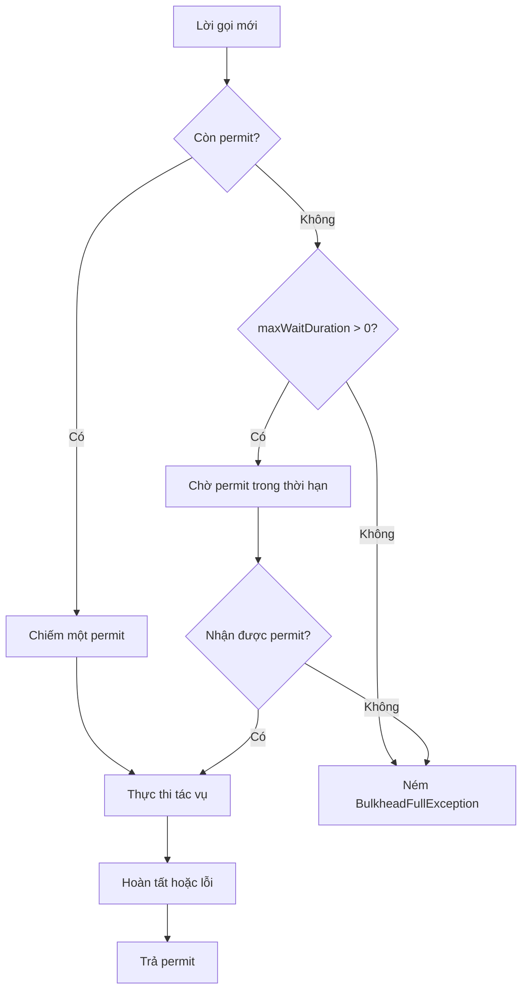

# SemaphoreBulkhead và giới hạn maxConcurrentCalls

`SemaphoreBulkhead` của Resilience4j giới hạn số lời gọi được thực thi đồng thời bằng semaphore. Mỗi lời gọi được cấp một permit trước khi chạy và trả permit khi hoàn tất. Khi tất cả permit đã được sử dụng, lời gọi mới phải chờ trong khoảng `maxWaitDuration` đã cấu hình hoặc bị từ chối bằng `BulkheadFullException`.

Thuộc tính quan trọng nhất là `maxConcurrentCalls`: số lời gọi tối đa đang được phép thực thi cùng lúc trong một instance Bulkhead. Nó kiểm soát lượng công việc đang bay (in-flight concurrency), không giới hạn số request trong một giây. Nếu mục tiêu là giới hạn tốc độ request theo thời gian, hãy dùng RateLimiter; nếu muốn ngăn lời gọi tiếp tục đi tới dịch vụ đang lỗi, hãy kết hợp CircuitBreaker.

## SemaphoreBulkhead hoạt động như thế nào

Giả sử `maxConcurrentCalls=3`. Ba lời gọi đầu tiên lấy được ba permit và được thực thi. Lời gọi thứ tư đến khi chưa có permit nào được trả lại sẽ không được phép bắt đầu ngay. Kết quả phụ thuộc `maxWaitDuration`:

- `maxWaitDuration=0`: không chờ; nếu không lấy được permit ngay, lời gọi bị từ chối.
- `maxWaitDuration` lớn hơn `0`: lời gọi chờ permit trong thời gian tối đa đã cấu hình. Nếu có lời gọi hoàn tất và trả permit trong khoảng đó, lời gọi đang chờ có thể tiếp tục; nếu hết thời gian mà vẫn không có permit, lời gọi bị từ chối.

SemaphoreBulkhead không tạo một thread pool riêng để thực thi tác vụ. Lời gọi chạy trên thread đã gọi nó; nếu cần chờ permit, thread đó có thể bị giữ trong lúc chờ. Đây là khác biệt quan trọng so với `FixedThreadPoolBulkhead`, vốn dùng thread pool và hàng đợi có giới hạn riêng.



Permit phải được trả cả khi tác vụ hoàn tất bình thường lẫn khi tác vụ kết thúc bằng lỗi. Với publisher reactive hoặc tác vụ bất đồng bộ, hãy dùng integration/operator tương ứng để permit được giữ trong suốt thời gian xử lý và được giải phóng khi chuỗi thực thi kết thúc hoặc bị hủy. Nếu chỉ bọc thao tác tạo `Mono`, `Flux` hay `CompletableFuture` bằng một supplier đồng bộ, permit có thể được trả ngay khi đối tượng bất đồng bộ được tạo ra, trước khi công việc thực sự hoàn tất.

## Cấu hình maxConcurrentCalls trong application.yml

Trong Spring Cloud Circuit Breaker tích hợp Resilience4j, có thể chọn `SemaphoreBulkhead` làm kiểu Bulkhead mặc định bằng `enableSemaphoreDefaultBulkhead`. Sau đó cấu hình giới hạn theo tên instance trong namespace `resilience4j.bulkhead`:

```yaml
spring:
  cloud:
    circuitbreaker:
      resilience4j:
        enableSemaphoreDefaultBulkhead: true

resilience4j:
  bulkhead:
    instances:
      catalog:
        maxConcurrentCalls: 12
        maxWaitDuration: 0ms
```

Trong ví dụ, instance `catalog` cho phép tối đa 12 lời gọi đồng thời. Lời gọi thứ 13 bị từ chối ngay nếu 12 permit đều đang được sử dụng. Giá trị `maxWaitDuration: 0ms` giúp thread gọi không phải chờ permit. Tên `catalog` phải khớp với ID mà ứng dụng dùng khi tạo circuit breaker, ví dụ `circuitBreakerFactory.create("catalog")`, để cấu hình instance được áp dụng đúng.

Khi `resilience4j-bulkhead` có mặt trên classpath, tích hợp Resilience4j của Spring Cloud Circuit Breaker có thể tự áp dụng Bulkhead. Nếu muốn tắt hẳn auto-configuration Bulkhead, dùng công tắc riêng `spring.cloud.circuitbreaker.bulkhead.resilience4j.enabled=false`. Công tắc này khác với `enableSemaphoreDefaultBulkhead`: một thuộc tính tắt tính năng Bulkhead, thuộc tính còn lại chọn kiểu Bulkhead mặc định khi tính năng đang được bật.

Nếu không đặt `enableSemaphoreDefaultBulkhead: true`, Spring Cloud Circuit Breaker Resilience4j mặc định sử dụng `FixedThreadPoolBulkhead` theo cấu hình của integration. Vì thế, cần xác nhận kiểu Bulkhead đang hoạt động thay vì chỉ nhìn vào các giá trị `maxConcurrentCalls` trong file cấu hình.

## Cấu hình trực tiếp bằng Java

Khi cần tạo Bulkhead độc lập ngoài factory của Spring Cloud Circuit Breaker, có thể tạo `BulkheadConfig` và dùng `Bulkhead` của Resilience4j:

```java
import io.github.resilience4j.bulkhead.Bulkhead;
import io.github.resilience4j.bulkhead.BulkheadConfig;

import java.time.Duration;
import java.util.function.Supplier;

BulkheadConfig config = BulkheadConfig.custom()
        .maxConcurrentCalls(12)
        .maxWaitDuration(Duration.ZERO)
        .build();

Bulkhead catalogBulkhead = Bulkhead.of("catalog", config);

Supplier<Product> protectedCall = Bulkhead.decorateSupplier(
        catalogBulkhead,
        () -> catalogClient.findProduct(productId)
);

Product product = protectedCall.get();
```

`Bulkhead.decorateSupplier` tạo một supplier được bảo vệ. Permit được lấy khi `protectedCall.get()` được gọi và được trả sau khi supplier hoàn tất hoặc ném exception. Nếu không còn permit, lời gọi ném `BulkheadFullException` theo cấu hình chờ đã chọn.

Không tạo một Bulkhead mới cho từng request. Các request cần chia sẻ cùng một instance Bulkhead để cùng tiêu thụ một tập permit. Trong ứng dụng Spring, hãy để factory/registry quản lý instance theo ID hoặc đăng ký một bean dùng chung phù hợp với vòng đời ứng dụng.

## Xử lý BulkheadFullException

`BulkheadFullException` cho biết ứng dụng đã chạm giới hạn concurrency cục bộ. Đây không nhất thiết là bằng chứng dịch vụ phụ thuộc trả lỗi: có thể dịch vụ vẫn hoạt động, nhưng ứng dụng đang có đủ số lời gọi đồng thời được cấp phép.

Với API đồng bộ, có thể bắt exception và ánh xạ sang kết quả phù hợp:

```java
try {
    return catalogBulkhead.executeSupplier(
            () -> catalogClient.findProduct(productId)
    );
} catch (BulkheadFullException ex) {
    return ProductView.temporarilyBusy(productId);
}
```

Kết quả `temporarilyBusy` nên thể hiện đúng trạng thái quá tải cục bộ theo hợp đồng API. Nếu không có kết quả suy giảm phù hợp, có thể ánh xạ sang HTTP `503 Service Unavailable` hoặc mã lỗi đã được quy định, kèm thông tin retry nếu hệ thống có thể đưa ra thời điểm thử lại hợp lý.

Khi kết hợp Bulkhead với CircuitBreaker, hãy quyết định rõ liệu `BulkheadFullException` có được tính là lỗi của circuit breaker hay không. Đây là lỗi từ chối do giới hạn tài nguyên ở ứng dụng; nếu nó làm tăng failure rate của breaker bảo vệ dịch vụ từ xa, breaker có thể mở dù dịch vụ phụ thuộc vẫn khỏe. Hành vi thực tế phụ thuộc thứ tự decorator và cấu hình phân loại exception (`recordExceptions`, `ignoreExceptions` hoặc predicate). Hãy kiểm tra integration đang dùng và kiểm thử tình huống đầy permit để xác nhận metric, trạng thái breaker và fallback đúng như mong muốn.

Fallback chỉ chạy nếu được cấu hình ở lớp bọc có nhận exception từ Bulkhead. Không giả định rằng mọi cách kết hợp Bulkhead và CircuitBreaker đều đưa `BulkheadFullException` tới cùng một fallback; hãy xác minh thứ tự thực thi của backend.

## Chọn maxConcurrentCalls theo năng lực dịch vụ

Không nên chọn `maxConcurrentCalls` chỉ theo số CPU hoặc đặt một giá trị thật lớn để tránh bị từ chối. Giới hạn cần phản ánh đồng thời năng lực của ứng dụng và khả năng tiếp nhận của dịch vụ phụ thuộc.

Một cách ước lượng ban đầu là dùng định luật Little:

\[
L = \lambda \times W
\]

Trong đó:

- \(L\) là số request trung bình đang được xử lý đồng thời.
- \(\lambda\) là thông lượng request trung bình (request/giây).
- \(W\) là thời gian xử lý trung bình (giây).

Ví dụ, nếu một dependency xử lý khoảng 80 request/giây và thời gian phản hồi trung bình là 0,1 giây, số request đồng thời trung bình ước tính là:

\[
L = 80 \times 0,1 = 8
\]

Có thể bắt đầu thử nghiệm với giới hạn gần 8 hoặc cao hơn một mức dự phòng nhỏ, sau đó điều chỉnh theo p95/p99 latency, burst traffic, giới hạn connection pool, CPU, bộ nhớ và quota của dependency. Công thức chỉ cho một điểm xuất phát; nó không thay thế load test hoặc số liệu vận hành.

Nếu giới hạn quá thấp, nhiều request hợp lệ bị từ chối dù dependency vẫn còn năng lực. Nếu quá cao, ứng dụng có thể tạo nhiều request hơn mức dependency chịu được, làm tăng latency và khiến nhiều request cùng timeout. Hãy đo số lời gọi đang hoạt động, số lần bị từ chối và thời gian chờ permit để chọn giới hạn có căn cứ.

## Phạm vi của giới hạn và khác biệt với các cơ chế khác

`maxConcurrentCalls` được áp dụng cho một instance Bulkhead trong một tiến trình ứng dụng. Nếu triển khai bốn replica và mỗi replica có `maxConcurrentCalls=12`, tổng số lời gọi đồng thời có thể tới khoảng 48 nếu tải được phân phối đều và mỗi replica dùng instance riêng. SemaphoreBulkhead không tự chia sẻ permit giữa các pod hoặc máy chủ. Nếu cần một giới hạn toàn cụm, cần cơ chế điều phối phân tán hoặc giới hạn ở tầng dịch vụ/ingress phù hợp.

| Cơ chế | Giới hạn điều gì | Ví dụ mục tiêu |
|---|---|---|
| `SemaphoreBulkhead` | Số lời gọi đang chạy đồng thời | Không cho một dependency chiếm quá 12 slot trong tiến trình |
| `RateLimiter` | Số lần gọi trong một khoảng thời gian | Không vượt 100 request mỗi giây |
| `CircuitBreaker` | Quyền gọi dựa trên tỷ lệ lỗi/lời gọi chậm và trạng thái | Tạm ngừng gọi dependency sau khi tỷ lệ lỗi vượt ngưỡng |
| `TimeLimiter` hoặc timeout client | Thời gian chờ một tác vụ/request | Kết thúc lời gọi không hoàn tất trong 2 giây |
| `FixedThreadPoolBulkhead` | Số tác vụ trên pool riêng và hàng đợi của pool | Cô lập công việc blocking khỏi thread gọi |

Các cơ chế có thể phối hợp, nhưng cần xác định giới hạn ở từng tầng. SemaphoreBulkhead không tự hủy request bị treo; hãy cấu hình timeout ở HTTP client hoặc TimeLimiter phù hợp để permit được giải phóng trong thời gian dự kiến.

## Lưu ý khi dùng với reactive

Trong ứng dụng WebFlux, không nên đặt `maxWaitDuration` dài trên event-loop thread. Việc chờ semaphore có thể chặn thread đang xử lý nhiều request khác, làm giảm lợi ích của mô hình reactive. Thông thường, đặt `maxWaitDuration=0` hoặc rất nhỏ, xử lý `BulkheadFullException` bằng fallback reactive và giữ pipeline bất đồng bộ.

Khi dùng `ReactiveCircuitBreakerFactory`, chọn đúng starter Reactor và cấu hình `enableSemaphoreDefaultBulkhead` nếu muốn dùng SemaphoreBulkhead. Ví dụ cách bọc publisher bằng reactive circuit breaker:

```java
public Mono<ProductView> findProduct(String productId) {
    ReactiveCircuitBreaker breaker =
            reactiveCircuitBreakerFactory.create("catalog");

    return breaker.run(
            Mono.defer(() -> catalogClient.findProduct(productId)
                    .map(ProductView::fromProduct)),
            error -> Mono.just(ProductView.temporarilyBusy(productId))
    );
}
```

Ví dụ giả định factory đã được cấu hình để tích hợp Bulkhead với SemaphoreBulkhead và `catalogClient` trả về `Mono<Product>`. Không gọi `subscribe()` trong service. Trả publisher cho WebFlux để framework quản lý subscription, cancellation và response. Hãy kiểm tra cancellation có giải phóng permit đúng lúc trong phiên bản Resilience4j đang dùng, đặc biệt khi caller ngắt kết nối.

## Kiểm thử hành vi giới hạn

Để kiểm tra `maxConcurrentCalls=2`, tạo hai tác vụ giữ permit cho đến khi test chủ động giải phóng. Khi hai tác vụ đang chạy, gọi lần thứ ba và xác nhận bị từ chối nếu `maxWaitDuration=0`.

Các trường hợp nên xác minh:

1. **Dưới giới hạn:** một lời gọi lấy permit và hoàn tất; kết quả trả về bình thường.
2. **Đạt giới hạn:** hai lời gọi đang chạy đồng thời; số permit còn lại bằng không.
3. **Vượt giới hạn với wait bằng 0:** lời gọi mới nhận `BulkheadFullException` ngay.
4. **Có thời gian chờ:** lời gọi mới được phép chờ; nếu một permit được trả trước thời hạn, lời gọi tiếp tục, nếu không sẽ bị từ chối.
5. **Lỗi trong supplier:** permit được trả sau khi supplier kết thúc bằng exception; lời gọi sau có thể sử dụng lại permit.
6. **Cancellation reactive:** hủy subscription và xác nhận permit không bị giữ vĩnh viễn.
7. **Nhiều replica:** xác nhận giới hạn là cục bộ từng instance, không phải tổng quota toàn cluster.

Khi vận hành, theo dõi số lời gọi đồng thời, số lần bị từ chối bởi Bulkhead, thời gian xử lý và timeout của dependency. Nếu rejection tăng nhưng dependency vẫn khỏe, giới hạn có thể quá thấp hoặc ứng dụng đang có burst traffic. Nếu latency và timeout tăng cùng lúc, hãy kiểm tra năng lực dependency, thời gian giữ permit và timeout trước khi tăng `maxConcurrentCalls`.
