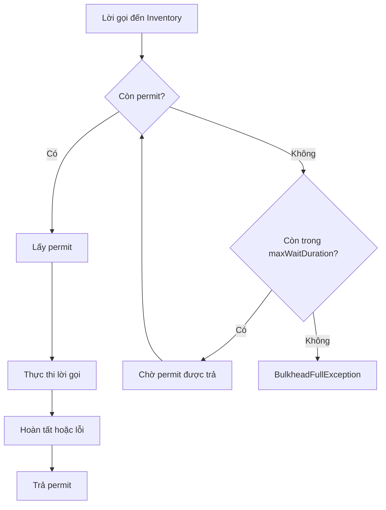

# maxWaitDuration và hành vi khi hết chỗ

Bulkhead giới hạn số lời gọi đồng thời đi đến một tài nguyên để một phụ thuộc chậm không chiếm hết luồng xử lý, kết nối hoặc worker của ứng dụng. Với Resilience4j, `maxConcurrentCalls` xác định số lời gọi được phép chạy đồng thời trong một `SemaphoreBulkhead`; `maxWaitDuration` xác định thời gian tối đa một lời gọi mới được chờ để lấy quyền khi tất cả vị trí đang bận.

Khi bulkhead đã hết chỗ, ứng dụng có thể từ chối ngay hoặc chờ trong một khoảng thời gian có giới hạn. Chọn đúng chính sách này rất quan trọng với Spring Cloud CircuitBreaker: chờ quá lâu làm tăng độ trễ và giữ tài nguyên ở phía gọi; từ chối quá sớm có thể làm caller nhận nhiều lỗi tải ngay cả khi một vị trí sắp được giải phóng.

## 1. Bulkhead giới hạn số lời gọi đồng thời

Hãy hình dung dịch vụ đặt hàng gọi dịch vụ tồn kho. Nếu dịch vụ tồn kho phản hồi chậm, nhiều request đặt hàng có thể cùng chờ. Nếu không giới hạn, số request đang chờ có thể tăng đến mức chiếm hết tài nguyên của dịch vụ đặt hàng.

Bulkhead tạo một giới hạn độc lập cho nhóm lời gọi đến phụ thuộc đó. Với `SemaphoreBulkhead`, mỗi lời gọi phải lấy một permit trước khi chạy. Khi lời gọi hoàn tất hoặc thất bại, permit được trả lại. Nếu không còn permit, lời gọi mới phải tuân theo `maxWaitDuration`.



Hai tham số có vai trò khác nhau:

| Tham số | Ý nghĩa |
|---|---|
| `maxConcurrentCalls` | Số lời gọi tối đa được thực thi đồng thời trong bulkhead instance. |
| `maxWaitDuration` | Thời gian tối đa chờ lấy permit khi không còn chỗ. |

Ví dụ, `maxConcurrentCalls: 10` cho phép tối đa 10 lời gọi cùng chạy. Lời gọi thứ 11 phải chờ hoặc bị từ chối tùy `maxWaitDuration`.

## 2. maxWaitDuration bằng 0: từ chối ngay khi hết chỗ

Nếu `maxWaitDuration` bằng `Duration.ZERO`, lời gọi không chờ permit. Khi tất cả permit đã được sử dụng, bulkhead từ chối lời gọi mới ngay bằng `BulkheadFullException`.

```yaml
resilience4j:
  bulkhead:
    instances:
      inventory:
        maxConcurrentCalls: 10
        maxWaitDuration: 0
```

Với cấu hình này, tối đa 10 lời gọi đến `inventory` chạy đồng thời. Nếu cả 10 vị trí đều bận tại thời điểm lời gọi mới đến, lời gọi đó bị từ chối ngay. Khi một lời gọi đang chạy kết thúc và trả permit, lời gọi tiếp theo có thể lấy vị trí.

Chính sách fail-fast phù hợp khi:

- Request có ngân sách độ trễ rất ngắn.
- Caller có thể trả trạng thái quá tải hoặc thử lại sau với backoff.
- Ứng dụng cần tránh giữ thêm thread chỉ để chờ tài nguyên.
- Luồng reactive chạy trên event loop và không nên bị chặn để chờ semaphore.

Fail-fast không có nghĩa dịch vụ phụ thuộc đã lỗi. `BulkheadFullException` cho biết ứng dụng không còn sức chứa theo giới hạn cục bộ tại thời điểm đó.

## 3. maxWaitDuration lớn hơn 0: chờ có giới hạn

Nếu `maxWaitDuration` lớn hơn 0, lời gọi mới có thể chờ permit được trả lại. Khi permit xuất hiện trước thời hạn, lời gọi tiếp tục thực thi. Nếu hết thời gian chờ mà vẫn không có permit, bulkhead từ chối lời gọi bằng `BulkheadFullException`.

```yaml
resilience4j:
  bulkhead:
    instances:
      inventory:
        maxConcurrentCalls: 10
        maxWaitDuration: 100ms
```

Trong ví dụ, tối đa 10 lời gọi được chạy đồng thời. Lời gọi thứ 11 có thể chờ tối đa 100 mili giây để lấy permit. Nếu một lời gọi trước đó hoàn tất sau 40 ms và trả permit, lời gọi đang chờ có thể tiếp tục. Nếu không có permit trong 100 ms, lời gọi bị từ chối.

`maxWaitDuration` là giới hạn thời gian chờ lấy chỗ, không phải thời gian thực thi lời gọi và cũng không phải timeout của HTTP client. Một lời gọi có thể chờ 80 ms rồi chạy thêm 500 ms; tổng thời gian quan sát từ phía caller có thể lớn hơn 500 ms.

Chờ có giới hạn phù hợp khi một số lời gọi thường hoàn tất rất nhanh và việc đợi ngắn giúp hấp thụ đỉnh tải nhỏ. Tuy nhiên, thời gian chờ càng dài thì càng nhiều request có thể giữ thread hoặc tài nguyên trong lúc chờ. Nếu dịch vụ phụ thuộc đã chậm kéo dài, hàng đợi chờ permit có thể làm độ trễ tăng dây chuyền.

## 4. Điều gì xảy ra khi hết chỗ?

Với `SemaphoreBulkhead`, hành vi phụ thuộc vào số permit còn lại và `maxWaitDuration`:

| Tình huống | Hành vi |
|---|---|
| Còn permit | Lấy permit và chạy supplier ngay. |
| Hết permit, `maxWaitDuration = 0` | Từ chối ngay bằng `BulkheadFullException`. |
| Hết permit, thời gian chờ dương và có permit được trả đúng hạn | Lấy permit rồi chạy supplier. |
| Hết permit, chờ quá thời hạn mà không có permit | Từ chối bằng `BulkheadFullException`. |
| Supplier hoàn tất hoặc ném lỗi sau khi đã lấy permit | Permit được giải phóng để lời gọi khác có thể sử dụng. |

Nếu caller bị từ chối, supplier không được chạy. Vì vậy, không có request mới nào được gửi đến dịch vụ tồn kho từ lần gọi bị từ chối đó. Đây là lỗi từ chối do giới hạn sức chứa cục bộ, khác với timeout hoặc lỗi kết nối xảy ra sau khi supplier đã bắt đầu.

Ở tầng API, có thể ánh xạ tình trạng này thành phản hồi quá tải hoặc tạm thời không khả dụng theo hợp đồng của hệ thống. Không nên trả một kết quả nghiệp vụ giả như tồn kho bằng 0 nếu ứng dụng chưa truy vấn được dữ liệu.

## 5. Cấu hình bằng YAML cho SemaphoreBulkhead

Ví dụ cấu hình riêng cho dịch vụ tồn kho và thanh toán:

```yaml
resilience4j:
  bulkhead:
    instances:
      inventory:
        maxConcurrentCalls: 20
        maxWaitDuration: 100ms
      payment:
        maxConcurrentCalls: 5
        maxWaitDuration: 0
```

Ý nghĩa:

- `inventory` cho phép tối đa 20 lời gọi đồng thời và chờ tối đa 100 ms khi hết permit.
- `payment` chỉ cho phép tối đa 5 lời gọi đồng thời và từ chối ngay khi đã hết chỗ.

Số lượng cần dựa trên năng lực dịch vụ đích, giới hạn connection pool, thread pool và ngân sách độ trễ của ứng dụng gọi. Ví dụ, nếu HTTP connection pool chỉ có 8 kết nối đến dịch vụ tồn kho thì đặt `maxConcurrentCalls` là 100 có thể không tăng throughput; nó chỉ làm nhiều request chờ ở các tầng khác.

Tên instance trong cấu hình phải khớp với tên bulkhead được tạo trong mã hoặc tên mà tích hợp Spring Cloud CircuitBreaker sử dụng. Hãy xác nhận loại bulkhead đang được chọn trước khi dựa vào `maxWaitDuration`.

## 6. Cấu hình trực tiếp bằng Java Duration

Khi tạo `SemaphoreBulkhead` trực tiếp bằng Resilience4j, dùng `BulkheadConfig`:

```java
import java.time.Duration;

import io.github.resilience4j.bulkhead.Bulkhead;
import io.github.resilience4j.bulkhead.BulkheadConfig;

BulkheadConfig config = BulkheadConfig.custom()
    .maxConcurrentCalls(10)
    .maxWaitDuration(Duration.ofMillis(100))
    .build();

Bulkhead inventoryBulkhead = Bulkhead.of("inventory", config);
```

Trong ví dụ, `Duration.ofMillis(100)` làm rõ rằng thời gian chờ tối đa là 100 mili giây. Có thể dùng `Duration.ZERO` để từ chối ngay khi hết permit hoặc `Duration.ofSeconds(1)` nếu nghiệp vụ thực sự cho phép chờ tối đa một giây.

Một supplier có thể được bọc bằng bulkhead:

```java
import java.util.function.Supplier;

import io.github.resilience4j.bulkhead.Bulkhead;

Supplier<Stock> protectedCall = Bulkhead.decorateSupplier(
    inventoryBulkhead,
    () -> inventoryClient.getStock("SKU-1")
);

Stock stock = protectedCall.get();
```

Nếu không lấy được permit, lời gọi được bảo vệ có thể ném `BulkheadFullException`. Trong ứng dụng thật, hãy xử lý exception này ở ranh giới phù hợp để trả phản hồi quá tải hoặc dùng fallback đã được thiết kế cho trường hợp không còn sức chứa.

## 7. Phân biệt SemaphoreBulkhead và ThreadPoolBulkhead

Không phải mọi bulkhead của Resilience4j đều dùng `maxWaitDuration`. `SemaphoreBulkhead` giới hạn số lời gọi đồng thời bằng permit. `FixedThreadPoolBulkhead` tách tác vụ vào một thread pool cố định và hàng đợi có giới hạn; cấu hình của nó sử dụng các thuộc tính như `coreThreadPoolSize`, `maxThreadPoolSize` và `queueCapacity`.

| Đặc điểm | SemaphoreBulkhead | FixedThreadPoolBulkhead |
|---|---|---|
| Cách cách ly | Permit giới hạn số lời gọi đang chạy. | Thread pool riêng và hàng đợi có giới hạn. |
| Tham số sức chứa | `maxConcurrentCalls` | `coreThreadPoolSize`, `maxThreadPoolSize`, `queueCapacity` |
| Thời gian chờ lấy chỗ | `maxWaitDuration` | Không dùng cùng tham số `maxWaitDuration`; tác vụ có thể được xếp hàng nếu còn chỗ. |
| Khi hết sức chứa | Có thể chờ permit trong thời hạn hoặc bị từ chối. | Bị từ chối khi thread pool và queue đều không nhận thêm tác vụ. |
| Phù hợp | Giới hạn concurrency mà không chuyển tác vụ sang thread pool riêng. | Cách ly tác vụ blocking bằng thread pool riêng. |

Ví dụ cấu hình thread pool bulkhead:

```yaml
resilience4j:
  thread-pool-bulkhead:
    instances:
      inventory:
        coreThreadPoolSize: 4
        maxThreadPoolSize: 8
        queueCapacity: 20
        keepAliveDuration: 20ms
```

Ở đây, tối đa 8 thread có thể thực thi theo cấu hình pool và tối đa 20 tác vụ có thể chờ trong queue. Khi pool và queue đều đầy, tác vụ mới bị từ chối. Không nên cố thêm `maxWaitDuration` vào cấu hình thread pool để điều khiển thời gian chờ queue; hãy quản lý queue capacity và timeout tổng của tác vụ theo đúng cơ chế của thread pool bulkhead.

Spring Cloud CircuitBreaker với Resilience4j có thể tích hợp bulkhead thông qua starter và factory. Cách triển khai mặc định hoặc loại bulkhead được chọn có thể phụ thuộc cấu hình và phiên bản release train. Trước khi cấu hình, xác nhận ứng dụng đang dùng `SemaphoreBulkhead` hay `FixedThreadPoolBulkhead`; nếu đang dùng thread pool bulkhead, `maxWaitDuration` của semaphore không điều khiển queue của thread pool.

## 8. maxWaitDuration và timeout của lời gọi

`maxWaitDuration`, timeout của HTTP client và `TimeLimiter` là các giới hạn khác nhau:

| Cơ chế | Giới hạn điều gì? |
|---|---|
| `maxWaitDuration` | Thời gian chờ để lấy permit của SemaphoreBulkhead. |
| HTTP connect timeout | Thời gian thiết lập kết nối đến dịch vụ đích. |
| HTTP response/read timeout | Thời gian chờ phản hồi hoặc dữ liệu từ dịch vụ đích. |
| Resilience4j `TimeLimiter` | Thời gian chờ của tác vụ bất đồng bộ được TimeLimiter hỗ trợ. |
| Circuit breaker `slowCallDurationThreshold` | Mốc phân loại lời gọi là chậm trong thống kê. |

Ví dụ, `maxWaitDuration` là 100 ms và HTTP response timeout là 2 giây. Request có thể chờ 80 ms để lấy permit rồi mới bắt đầu gọi dịch vụ; thời gian phản hồi mạng có thể tiếp tục đến 2 giây. Tổng thời gian caller chờ có thể gần 2,08 giây, chưa kể xử lý nội bộ.

Hãy xác định ngân sách thời gian tổng của request trước khi đặt các giới hạn. Nếu API chỉ cho phép 1 giây, không nên đặt thời gian chờ bulkhead 1 giây rồi lại cho client chờ thêm 2 giây. Các lớp giới hạn phải phối hợp để request có thể kết thúc trong ngân sách nghiệp vụ.

Vị trí bọc Bulkhead, CircuitBreaker và TimeLimiter ảnh hưởng đến phần thời gian nào được tính trong mỗi cơ chế. Không giả định mọi timeout đều bắt đầu cùng một thời điểm; kiểm tra thứ tự decorator và hành vi của phiên bản tích hợp đang dùng.

## 9. Chọn maxWaitDuration theo lưu lượng và tài nguyên

Không có một giá trị `maxWaitDuration` phù hợp cho mọi phụ thuộc. Có thể cân nhắc theo các nguyên tắc sau:

1. **Bắt đầu từ ngân sách độ trễ:** phần thời gian chờ permit phải nằm trong ngân sách còn lại của request sau các bước xử lý khác.
2. **Đo thời gian giữ permit:** nếu lời gọi thường mất vài trăm mili giây, chờ quá lâu có thể khiến nhiều request tích tụ phía trước bulkhead.
3. **Xem xét thread model:** với luồng imperative có thread chờ riêng, chờ ngắn có thể chấp nhận được. Với reactive event loop, tránh chặn thread để đợi permit; ưu tiên fail-fast hoặc cơ chế cách ly phù hợp.
4. **Xem xét khả năng phục hồi:** nếu phụ thuộc đang chậm kéo dài, hàng đợi chờ permit không làm tăng năng lực xử lý của nó. Từ chối sớm có thể bảo vệ caller tốt hơn.
5. **Đồng bộ với connection pool:** không đặt concurrency cao hơn nhiều so với số kết nối thực tế mà client có thể sử dụng.
6. **Đo tỷ lệ từ chối và độ trễ chờ:** theo dõi để biết chờ ngắn đang hấp thụ đỉnh tải hay chỉ kéo dài thời gian thất bại.

Ví dụ lựa chọn ban đầu:

| Đặc điểm lời gọi | Chính sách có thể cân nhắc |
|---|---|
| API tương tác có ngân sách độ trễ rất thấp | `Duration.ZERO` hoặc thời gian chờ rất ngắn. |
| Lời gọi imperative thường hoàn tất nhanh, có đỉnh tải ngắn | Chờ ngắn như 50–100 ms rồi từ chối. |
| Tác vụ nền có thể chờ lâu hơn và có giới hạn hàng đợi riêng | Xem xét thread pool bulkhead hoặc queue có giới hạn thay vì kéo dài thời gian chờ semaphore. |
| Luồng reactive trên event loop | Tránh chờ semaphore theo cách chặn event loop; cân nhắc fail-fast và kiểm tra đúng operator. |

Các giá trị trên chỉ là điểm bắt đầu để thử nghiệm. Hãy dùng số liệu p95/p99, thời gian giữ permit, concurrency và tỷ lệ từ chối để điều chỉnh.

## 10. Tương tác với CircuitBreaker và fallback

Bulkhead và circuit breaker bảo vệ hai khía cạnh khác nhau. Bulkhead giới hạn số lời gọi đồng thời; circuit breaker theo dõi kết quả và ngăn lời gọi khi phụ thuộc có dấu hiệu không khỏe.

Khi bulkhead hết chỗ, `BulkheadFullException` có thể xuất hiện trước khi lời gọi đến dịch vụ phụ thuộc bắt đầu. Nếu exception này đi qua circuit breaker và được ghi nhận như lỗi của phụ thuộc, failure rate có thể tăng do ứng dụng tự hết sức chứa, dù dịch vụ đích không phát sinh lỗi mới.

Hãy kiểm tra thứ tự bọc các cơ chế và quy tắc phân loại exception. Nếu mục tiêu của circuit breaker là đo sức khỏe của dịch vụ đích, có thể cần loại `BulkheadFullException` khỏi failure rate bằng cấu hình ignore phù hợp hoặc đặt ranh giới bulkhead sao cho lỗi từ chối không bị hiểu thành lỗi thực thi của phụ thuộc. Không ignore timeout hoặc lỗi kết nối thật chỉ để giảm failure rate.

Fallback có thể xử lý trường hợp bulkhead đầy, nhưng cần trả kết quả biểu đạt rõ dữ liệu không sẵn có hoặc quá tải. Không nên fallback bằng cách gọi trực tiếp cùng dịch vụ qua một client khác để bỏ qua giới hạn concurrency; hành động đó vô hiệu hóa bảo vệ.

## 11. Lưu ý khi dùng Bulkhead trong reactive

Trong ứng dụng WebFlux, không được chặn event loop để chờ semaphore. Một `maxWaitDuration` dương trên đường thực thi có khả năng chờ đồng bộ có thể giữ thread đang xử lý nhiều kết nối khác. Nếu dùng Resilience4j Reactor operator với semaphore bulkhead, hãy xác minh cách operator lấy permission ở phiên bản đang dùng và thử nghiệm dưới tải.

Với đường reactive cần fail-fast, cấu hình không chờ permit thường dễ dự đoán hơn. Nếu thao tác có tính blocking, hãy đưa nó vào scheduler hoặc thread pool phù hợp và đặt giới hạn đồng thời rõ ràng. Với tác vụ bất đồng bộ cần hàng đợi, cân nhắc thread pool bulkhead thay vì chặn event loop chờ semaphore.

Giới hạn `flatMap` concurrency cũng không tương đương với Bulkhead toàn cục. Ví dụ `flatMap(..., 16)` giới hạn số inner publisher đồng thời trong một subscription cụ thể. Nhiều subscriber có thể cùng tạo nhiều nhóm 16 lời gọi. Bulkhead instance dùng chung mới giúp giới hạn tổng concurrency trong phạm vi process của ứng dụng.

## 12. Phạm vi giới hạn và nhiều instance ứng dụng

Một `SemaphoreBulkhead` thường quản lý permit trong một instance ứng dụng. Nếu dịch vụ được triển khai thành 4 replica và mỗi replica có `maxConcurrentCalls: 20`, tổng số lời gọi đồng thời đến dịch vụ phụ thuộc có thể lên tới khoảng 80 nếu lưu lượng phân bố đều và mọi replica đều hoạt động ở mức tối đa.

Vì vậy, hãy tính cả số replica khi chọn giới hạn. Bulkhead cục bộ không phải giới hạn concurrency toàn cụm. Nếu dịch vụ đích chỉ chịu được 30 lời gọi đồng thời trên toàn hệ thống, cấu hình 20 cho mỗi replica có thể vượt năng lực khi chạy nhiều replica. Cần phân bổ ngân sách concurrency theo số replica dự kiến hoặc dùng cơ chế giới hạn tập trung ở tầng phù hợp.

## 13. Kiểm thử hành vi khi hết chỗ

Một bài kiểm thử cần kiểm soát thời điểm lời gọi đang giữ permit để xác minh hành vi chờ và từ chối. Có thể dùng `CountDownLatch` trong supplier để giữ một lời gọi chưa hoàn tất, sau đó phát lời gọi thứ hai.

Kịch bản với `maxConcurrentCalls = 1`:

1. Tạo bulkhead chỉ cho phép một lời gọi đồng thời.
2. Bắt đầu lời gọi thứ nhất và giữ supplier chưa hoàn tất bằng latch.
3. Gọi lần thứ hai khi permit đang được giữ.
4. Với `maxWaitDuration = Duration.ZERO`, xác nhận lần gọi thứ hai bị từ chối ngay bằng `BulkheadFullException`.
5. Với `maxWaitDuration` dương, xác nhận lần gọi thứ hai chờ; thả latch trước thời hạn để nó tiếp tục, hoặc giữ latch quá thời hạn để xác nhận bị từ chối.
6. Xác nhận permit được trả sau khi supplier hoàn tất hoặc ném lỗi, để lời gọi mới có thể chạy.

Nên kiểm tra cả trường hợp supplier ném exception và trường hợp thread đang chờ bị interrupt theo hợp đồng của phiên bản đang dùng. Với reactive, kiểm thử rằng event loop không bị chặn và cancellation giải phóng tài nguyên phù hợp.

## 14. Metrics và dấu hiệu vận hành

Khi tích hợp Micrometer và Actuator, theo dõi số lời gọi đang sử dụng permit, sức chứa tối đa, số lần bị từ chối và độ trễ chờ nếu hệ thống có thu thập chỉ số này. Tên meter cụ thể phụ thuộc phiên bản Resilience4j và binder đang dùng; hãy kiểm tra `/actuator/metrics` hoặc endpoint Prometheus thay vì giả định tên cố định.

Một số dấu hiệu cần chú ý:

- **Tỷ lệ `BulkheadFullException` tăng:** concurrency hoặc thời gian giữ permit có thể vượt sức chứa đã chọn.
- **Độ trễ request tăng nhưng tỷ lệ từ chối thấp:** thời gian chờ permit có thể đang kéo dài request.
- **Connection pool thường xuyên cạn:** giới hạn bulkhead có thể lớn hơn năng lực client hoặc cấu hình connection pool không phù hợp.
- **Tỷ lệ lỗi circuit breaker tăng cùng lúc bulkhead đầy:** kiểm tra `BulkheadFullException` có bị tính nhầm là lỗi của dịch vụ phụ thuộc hay không.
- **Một replica thường xuyên từ chối trong khi replica khác còn rảnh:** lưu lượng có thể phân bố không đều; giới hạn cục bộ cần được xem xét cùng load balancing.

## 15. Nguyên tắc lựa chọn

Hãy dùng `maxConcurrentCalls` để đặt giới hạn sức chứa cho lời gọi phụ thuộc và chọn `maxWaitDuration` dựa trên ngân sách độ trễ cùng thread model. Dùng `Duration.ZERO` khi cần từ chối ngay; dùng thời gian chờ dương chỉ khi một khoảng chờ ngắn thực sự giúp hấp thụ đỉnh tải và không làm cạn tài nguyên caller.

Đồng thời, xác nhận ứng dụng đang dùng `SemaphoreBulkhead` hay `ThreadPoolBulkhead`, vì `maxWaitDuration` thuộc cấu hình semaphore còn thread pool dùng queue capacity. Phân biệt `BulkheadFullException` với lỗi từ dịch vụ đích, phối hợp thứ tự với circuit breaker và timeout, kiểm thử hành vi hết chỗ, rồi theo dõi số liệu ở từng replica. Nhờ vậy, Bulkhead trong Spring Cloud CircuitBreaker giới hạn tải có kiểm soát mà không biến việc chờ permit thành một nguồn gây nghẽn mới.
