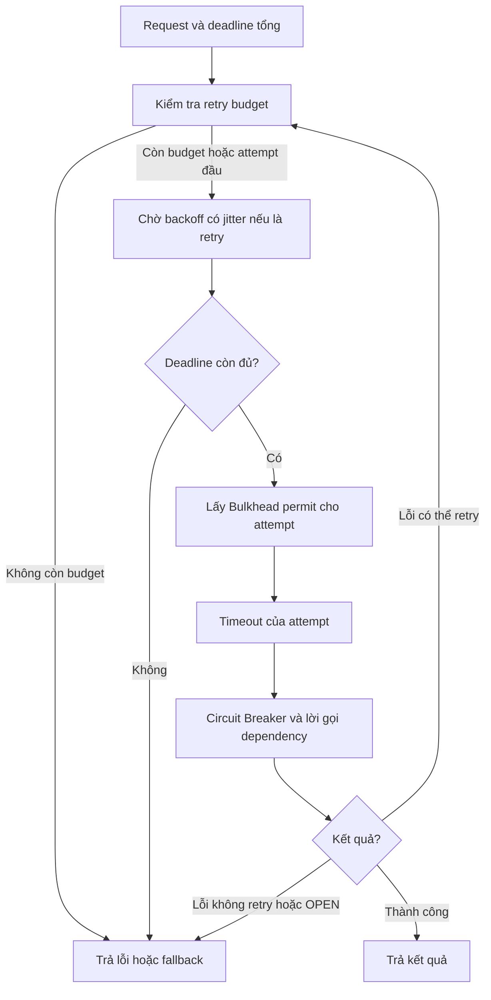

# Backoff, jitter và ngân sách số lần thử

## Mục tiêu

Retry giúp một lời gọi vượt qua lỗi tạm thời, nhưng thử lại quá nhanh hoặc quá nhiều có thể làm dịch vụ đang quá tải nhận thêm request và phục hồi chậm hơn. Khi phối hợp Retry với Circuit Breaker trong Spring Cloud, cần giới hạn số lần thử, giãn khoảng chờ bằng backoff, phân tán thời điểm thử lại bằng jitter và đặt ngân sách retry cho toàn bộ lưu lượng.

Sau bài học, bạn có thể:

- Phân biệt số lần thử tối đa với số lần retry bổ sung.
- Tính lịch exponential backoff và giải thích vai trò của jitter.
- Thiết lập retry budget, timeout mỗi lần thử và deadline toàn request.
- Chỉ retry các lỗi tạm thời và xử lý an toàn các thao tác có side effect.
- Chọn thứ tự phối hợp Retry, Circuit Breaker, Bulkhead và TimeLimiter để tránh khuếch đại tải.

## Vì sao cần backoff và jitter?

Giả sử một dịch vụ danh mục bắt đầu trả lỗi vì quá tải. Nếu hàng nghìn request đồng loạt thử lại sau đúng 100 mili giây, chúng có thể cùng quay lại ở một thời điểm, tạo thêm một đợt tải đột biến. Nếu tiếp tục thử theo chu kỳ cố định, các client có thể đồng bộ và duy trì hiện tượng dồn tải.

**Backoff** tăng khoảng chờ giữa các lần thử. **Jitter** thêm độ ngẫu nhiên vào khoảng chờ để các client không thử lại cùng lúc. Hai kỹ thuật bổ trợ nhau:

- Backoff giảm tần suất retry khi lỗi kéo dài.
- Jitter phân tán retry theo thời gian, giảm các đợt request đồng bộ.
- Retry budget giới hạn tổng lượng request bổ sung được tạo ra.

Retry chỉ có ích khi lỗi có khả năng tự hết trong thời gian chờ. Nó không sửa lỗi cấu hình, dữ liệu đầu vào sai hoặc một dịch vụ đã mất khả năng phục vụ lâu dài. Circuit Breaker bổ sung một cơ chế ngắt retry khi tín hiệu lỗi cho thấy dependency không khỏe.

## Số lần thử và exponential backoff

Trong chính sách retry, cần phân biệt:

- **Attempt:** một lần thực thi thao tác, bao gồm lần gọi đầu tiên.
- **Retry:** một lần gọi lại sau khi attempt trước thất bại.
- **Max attempts:** tổng số attempt tối đa, thường bao gồm attempt đầu tiên.
- **Max retries:** số lần gọi lại bổ sung, không bao gồm attempt đầu tiên.

Ví dụ `maxAttempts = 3` nghĩa là tối đa ba lần thực thi: một lần đầu và hai lần retry. Nếu dùng một API nhận `maxRetries = 3`, tổng số attempt có thể là bốn. Luôn kiểm tra ngữ nghĩa của thuộc tính trong thư viện đang sử dụng.

Với exponential backoff, khoảng chờ trước lần retry thứ `n` có thể được mô tả như sau:

\[
d_n = \min(d_{max}, d_0 \times m^{n-1})
\]

Trong đó:

- `d0` là khoảng chờ ban đầu.
- `m` là hệ số tăng, thường lớn hơn 1.
- `dmax` là giới hạn tối đa để thời gian chờ không tăng vô hạn.
- `n` bắt đầu từ 1 cho lần retry đầu tiên.

Ví dụ với `d0 = 100 ms`, `m = 2` và `dmax = 1.000 ms`:

| Lần retry | Khoảng chờ trước jitter |
|---:|---:|
| 1 | 100 ms |
| 2 | 200 ms |
| 3 | 400 ms |
| 4 | 800 ms |
| 5 | 1.000 ms (đã chạm giới hạn) |
| 6 | 1.000 ms |

Backoff có giới hạn giúp hệ thống giảm tốc độ retry khi sự cố kéo dài, đồng thời vẫn cho phép thử lại tương đối nhanh ở những lần đầu.

## Jitter phân tán thời điểm retry

Nếu mọi client dùng cùng một lịch backoff, chúng vẫn có thể đồng bộ. Jitter ngẫu nhiên hóa khoảng chờ của từng client.

Một số chiến lược phổ biến:

| Chiến lược | Cách chọn khoảng chờ | Đặc điểm |
|---|---|---|
| Full jitter | Chọn ngẫu nhiên từ 0 tới giới hạn backoff hiện tại. | Phân tán rộng, giảm đợt retry đồng thời. |
| Equal jitter | Giữ một phần cố định của backoff và ngẫu nhiên hóa phần còn lại. | Tránh khoảng chờ quá ngắn nhưng vẫn phân tán client. |
| Randomized multiplier | Nhân khoảng chờ cơ sở với một hệ số ngẫu nhiên trong phạm vi cấu hình. | Dễ cấu hình khi thư viện cung cấp hệ số ngẫu nhiên. |

Ví dụ full jitter với giới hạn backoff 400 ms có thể chọn bất kỳ thời lượng nào trong khoảng từ 0 đến 400 ms. Hai client cùng gặp lỗi sẽ có xác suất thấp hơn để thử lại đúng cùng thời điểm.

Jitter không thay thế giới hạn backoff hoặc retry budget. Một khoảng chờ ngẫu nhiên vẫn có thể quá ngắn nếu giới hạn cơ sở không hợp lý. Hãy chọn `d0`, multiplier và `dmax` theo latency, SLA và thời gian phục hồi thường thấy của dependency.

## Retry budget giới hạn lượng tải bổ sung

Giới hạn attempt trên từng request vẫn có thể tạo tải rất lớn khi có nhiều request đồng thời. Retry budget đặt một giới hạn tổng thể cho số lần gọi lại trong một khoảng thời gian hoặc theo tỷ lệ lưu lượng gốc.

Ví dụ, một dịch vụ đặt budget cho phép số retry không vượt quá 10% số request ban đầu trong cửa sổ một phút. Nếu trong phút đó có 1.000 request ban đầu, budget cho phép tối đa 100 retry bổ sung. Khi budget cạn, request mới chỉ thực hiện attempt ban đầu hoặc trả lỗi theo chính sách; không tiếp tục tạo retry.

Một cách triển khai đơn giản là token bucket:

1. Mỗi retry cần tiêu thụ một token.
2. Token được bổ sung theo tốc độ đã định, hoặc được tính lại từ số request gốc trong cửa sổ.
3. Nếu không còn token, bỏ retry và truyền lỗi hiện tại về caller.
4. Giới hạn dung lượng bucket để không tích lũy một lượng retry quá lớn sau thời gian ít lưu lượng.

Retry budget có thể được đặt theo dependency, theo instance ứng dụng hoặc theo nhóm request. Cần hiểu phạm vi của nó: nếu mỗi pod có budget riêng, tổng budget của cả cụm sẽ tăng theo số pod. Muốn giới hạn toàn cụm, cần cơ chế phối hợp hoặc phân bổ ngân sách cho từng instance; không nên mặc định một bộ đếm cục bộ đại diện cho toàn hệ thống.

Retry budget cũng cần phối hợp với giới hạn số attempt. Budget tổng kiểm soát lượng retry của toàn hệ thống, còn `maxAttempts` ngăn một request đơn lẻ chiếm quá nhiều ngân sách.

## Deadline và timeout cho toàn bộ chuỗi retry

Mỗi attempt cần timeout riêng, đồng thời toàn bộ request cần deadline cuối cùng. Nếu chỉ đặt timeout cho từng attempt mà không đặt deadline, tổng thời gian chờ có thể vượt thời gian caller còn sẵn sàng chờ.

Tổng thời gian dự kiến có thể ước lượng bằng:

\[
T_{total} = \sum_{i=1}^{A} T_i + \sum_{i=1}^{A-1} d_i + T_{overhead}
\]

Trong đó `A` là tổng số attempt, `Ti` là timeout tối đa của attempt thứ `i`, `di` là khoảng chờ giữa hai attempt và `Toverhead` là thời gian xử lý phụ.

Ví dụ, ba attempt, mỗi attempt tối đa 500 ms, với backoff 100 ms rồi 200 ms sẽ có thời gian tối đa xấp xỉ:

\[
3 \times 500 + 100 + 200 = 1.800\text{ ms}
\]

Nếu API có deadline 1.200 ms, không nên bắt đầu attempt mới khi thời gian còn lại không đủ cho timeout tối thiểu và xử lý kết quả. Deadline phải truyền qua các tầng nếu hệ thống hỗ trợ propagation; mỗi tầng chỉ sử dụng phần thời gian còn lại.

Timeout của attempt, TimeLimiter và HTTP client timeout có thể cùng tồn tại. Hãy quyết định tầng nào sở hữu deadline tổng và tầng nào giới hạn I/O thực tế. Hủy future hoặc subscription không bảo đảm mọi request đã gửi tới server từ xa dừng ngay lập tức.

## Chỉ retry lỗi tạm thời

Không retry mọi exception. Một chính sách tốt phân loại lỗi theo khả năng phục hồi và ngữ nghĩa thao tác:

| Loại lỗi | Chính sách gợi ý |
|---|---|
| Lỗi kết nối tạm thời, connection reset | Có thể retry với backoff và budget. |
| Timeout khi gọi dependency | Có thể retry nếu deadline còn đủ và thao tác an toàn. |
| HTTP 429 hoặc 503 | Có thể retry; tôn trọng `Retry-After` nếu server gửi. |
| Một số HTTP 5xx | Đánh giá theo hợp đồng dịch vụ; chỉ retry khi lỗi có khả năng tạm thời. |
| HTTP 400, 401, 403 hoặc dữ liệu không hợp lệ | Thường không retry vì request cần được sửa hoặc xác thực lại. |
| HTTP 404 | Thường là kết quả nghiệp vụ; không retry trừ khi hệ thống có ngữ nghĩa eventual consistency cụ thể. |
| Circuit Breaker từ chối vì `OPEN` | Thường không retry ngay; chờ cơ chế phục hồi của Circuit Breaker. |
| Bulkhead hết hạn mức | Không retry dồn dập; có thể trả lỗi quá tải hoặc xếp hàng theo chính sách riêng. |

Với HTTP 429 hoặc 503, header `Retry-After` có thể chứa thời điểm hoặc số giây cần chờ. Nếu hỗ trợ, client nên tôn trọng giá trị này, nhưng vẫn phải áp dụng deadline và retry budget. Không để một giá trị Retry-After vượt deadline khiến request giữ tài nguyên quá lâu.

## Tính idempotent trước khi retry

Retry có thể gửi lại thao tác đã được server thực hiện nhưng client không nhận được phản hồi. Ví dụ, client gửi yêu cầu thanh toán, server đã ghi nhận giao dịch, nhưng kết nối bị ngắt trước khi trả kết quả. Nếu client gửi lại mà không có cơ chế chống trùng, giao dịch có thể bị thực hiện hai lần.

Trước khi retry, hãy hỏi:

- Thao tác có idempotent theo hợp đồng API không?
- Nếu server đã thực hiện nhưng response bị mất, client có thể xác định kết quả bằng cách nào?
- Có thể dùng idempotency key ổn định cho tất cả attempt của cùng một thao tác không?
- Có endpoint truy vấn trạng thái để xác minh trước khi gửi lại không?

Với thao tác tạo giao dịch hoặc thanh toán, dùng idempotency key được server hỗ trợ và giữ nguyên key qua mọi attempt. Không tạo key mới cho mỗi lần retry vì server sẽ coi đó là các giao dịch khác nhau.

## Phối hợp Retry với Circuit Breaker

Thứ tự đặt hai chính sách ảnh hưởng trực tiếp đến số mẫu Circuit Breaker ghi nhận.

**Retry bên ngoài Circuit Breaker:** mỗi attempt đi qua Circuit Breaker:

```java
Supplier<Product> protectedAttempt = CircuitBreaker.decorateSupplier(
        circuitBreaker,
        () -> catalogClient.findById(id));

Supplier<Product> retryingCall = Retry.decorateSupplier(
        retry,
        protectedAttempt);
```

Trong cấu trúc này, mỗi attempt có thể tạo một mẫu riêng trong Circuit Breaker. Nếu lỗi tiếp tục xảy ra và mạch chuyển `OPEN`, attempt kế tiếp sẽ bị từ chối sớm thay vì gọi tiếp dependency. Đây thường là lựa chọn phù hợp khi muốn Circuit Breaker phản ánh từng lần thử thực tế.

**Retry bên trong Circuit Breaker:** Circuit Breaker bao toàn bộ chuỗi retry:

```java
Supplier<Product> retryingAttempt = Retry.decorateSupplier(
        retry,
        () -> catalogClient.findById(id));

Supplier<Product> protectedLogicalCall = CircuitBreaker.decorateSupplier(
        circuitBreaker,
        retryingAttempt);
```

Circuit Breaker thường quan sát kết quả cuối của chuỗi retry như một lần gọi logic. Dịch vụ phụ thuộc có thể nhận nhiều request trước khi Circuit Breaker ghi nhận lỗi cuối cùng và mở mạch. Cách này có thể hữu ích khi muốn retry xử lý lỗi ngắn hạn bên trong một thao tác, nhưng cần giới hạn số attempt và deadline chặt chẽ.

| Vị trí | Circuit Breaker ghi nhận | Hệ quả |
|---|---|---|
| Retry ngoài Circuit Breaker | Từng attempt được cho phép. | Mạch nhận tín hiệu lỗi sớm và có thể mở trước khi các retry còn lại chạy. |
| Retry trong Circuit Breaker | Kết quả cuối của chuỗi retry. | Một lần gọi logic có thể tạo nhiều request trước khi mạch ghi nhận thất bại. |

Khi dùng Spring Cloud CircuitBreaker factory, API `run` có fallback. Nếu fallback chuyển exception thành giá trị thành công, Retry bên ngoài sẽ không thấy lỗi để thử lại. Nếu cần retry, phải để lỗi phù hợp truyền ra khỏi lớp retry cần quan sát; chỉ dùng fallback sau khi chính sách retry đã kết thúc hoặc với lỗi không được retry.

## Cấu hình Retry bằng Resilience4j

Resilience4j Retry có thể được cấu hình riêng theo instance. Ví dụ YAML:

```yaml
resilience4j:
  retry:
    configs:
      remote-default:
        maxAttempts: 3
        waitDuration: 100ms
        retryExceptions:
          - java.io.IOException
          - java.net.SocketTimeoutException
        ignoreExceptions:
          - io.github.resilience4j.circuitbreaker.CallNotPermittedException
          - com.example.catalog.ProductNotFoundException
    instances:
      catalog:
        baseConfig: remote-default
```

`maxAttempts: 3` bao gồm attempt đầu tiên, tức tối đa hai retry. `waitDuration` là thời gian chờ cơ bản. `retryExceptions` liệt kê exception cần retry; `ignoreExceptions` loại các exception không nên retry. Ví dụ bỏ qua `CallNotPermittedException` để Retry không liên tục thử lại một lời gọi mà Circuit Breaker đã từ chối vì đang `OPEN`. Các thuộc tính cụ thể và cách kế thừa có thể thay đổi theo phiên bản Resilience4j; hãy đối chiếu dependency version của ứng dụng.

Nếu cần exponential backoff và jitter, có thể tạo `IntervalFunction` trong Java:

```java
import java.time.Duration;

import io.github.resilience4j.retry.Retry;
import io.github.resilience4j.retry.RetryConfig;
import io.github.resilience4j.core.IntervalFunction;

RetryConfig retryConfig = RetryConfig.custom()
        .maxAttempts(3)
        .intervalFunction(IntervalFunction.ofExponentialRandomBackoff(
                Duration.ofMillis(100).toMillis(),
                2.0,
                0.5))
        .retryOnException(error -> error instanceof java.io.IOException
                || error instanceof java.net.SocketTimeoutException)
        .ignoreExceptions(
                io.github.resilience4j.circuitbreaker.CallNotPermittedException.class,
                ProductNotFoundException.class)
        .build();

Retry catalogRetry = Retry.of("catalog", retryConfig);
```

`ofExponentialRandomBackoff` tạo khoảng chờ tăng theo cấp số nhân và thêm ngẫu nhiên theo hệ số cấu hình. Tên API hoặc overload có thể khác theo phiên bản thư viện; kiểm tra Javadoc của phiên bản được quản lý trong dự án trước khi sử dụng. Nếu cần full jitter hoặc tôn trọng `Retry-After`, có thể cung cấp interval function riêng để tính khoảng chờ theo attempt và thông tin lỗi.

Với Reactor, có thể dùng `Retry.backoff` và `jitter`:

```java
import java.time.Duration;

import reactor.util.retry.Retry;

Retry retrySpec = Retry.backoff(2, Duration.ofMillis(100))
        .maxBackoff(Duration.ofSeconds(1))
        .jitter(0.5)
        .filter(this::isTransientFailure);

Mono<Product> result = catalogGateway.findById(id)
        .retryWhen(retrySpec);
```

Trong Reactor, `Retry.backoff(2, ...)` nhận số retry bổ sung, không phải tổng số attempt. Ví dụ có thể thực hiện một attempt đầu và tối đa hai lần retry. Bộ lọc `isTransientFailure` cũng cần loại `CallNotPermittedException` để không retry một lời gọi đã bị Circuit Breaker từ chối. Nếu publisher đã được bọc Circuit Breaker, vị trí đặt `retryWhen` quyết định mỗi lần retry có đi qua Circuit Breaker hay không.

## Ví dụ phối hợp chính sách cho dependency catalog

Giả sử catalog có timeout mỗi attempt 400 ms, tối đa ba attempt, backoff 100 ms với multiplier 2, giới hạn backoff 500 ms và retry budget 10%. Mỗi request có deadline 1.500 ms.

Lịch cơ sở trước jitter:

| Giai đoạn | Thời lượng tối đa |
|---|---:|
| Attempt 1 | 400 ms |
| Chờ trước attempt 2 | 100 ms |
| Attempt 2 | 400 ms |
| Chờ trước attempt 3 | 200 ms |
| Attempt 3 | 400 ms |
| Tổng | 1.500 ms |

Đây là tổng đúng bằng deadline ví dụ và chưa tính overhead. Trong triển khai thật, cần để dư thời gian cho xử lý, truyền dữ liệu và trả response; nếu deadline còn lại không đủ thì bỏ attempt tiếp theo. Jitter có thể làm thời gian chờ thay đổi, vì vậy deadline phải kiểm tra trên thời gian thực tế còn lại chứ không chỉ dựa vào lịch cơ sở.

Một chính sách vận hành hợp lý có thể là:

1. Mỗi request chỉ được tối đa ba attempt.
2. Chỉ retry lỗi kết nối, timeout hoặc phản hồi 503 đã được phân loại tạm thời.
3. Mỗi retry tiêu thụ một token từ budget 10% của dependency catalog.
4. Mỗi attempt đi qua Circuit Breaker để lỗi được ghi nhận riêng; nếu mạch `OPEN`, không tiếp tục retry.
5. Mỗi attempt có timeout 400 ms và chỉ bắt đầu nếu deadline tổng còn đủ.
6. Bulkhead cấp phép trong thời gian thực hiện attempt; không giữ giấy phép trong lúc backoff.
7. Sau khi hết retry hoặc hết budget, trả lỗi hoặc fallback phù hợp với hợp đồng API.

## Sơ đồ phối hợp các giới hạn



Sơ đồ thể hiện một cách tổ chức thường dùng, không phải thứ tự bắt buộc của mọi thư viện. Điểm quan trọng là không giữ Bulkhead permit trong thời gian backoff và không bắt đầu retry khi Circuit Breaker đã mở hoặc deadline đã hết.

## Theo dõi hiệu quả Retry

Theo dõi Retry cùng Circuit Breaker để biết cơ chế có giúp phục hồi hay đang khuếch đại tải. Các số liệu hữu ích gồm:

- Số request logic từ caller.
- Tổng số attempt và số retry bổ sung.
- Tỷ lệ retry thành công ở attempt sau.
- Số retry bị từ chối vì hết budget.
- Số attempt bị Circuit Breaker từ chối.
- Thời gian chờ backoff, độ trễ mỗi attempt và thời gian toàn request.
- Số timeout, lỗi 429/503, lỗi kết nối và lỗi không retry.
- Tỷ lệ fallback và trạng thái Circuit Breaker theo dependency.

Resilience4j Retry và Circuit Breaker cung cấp metric/event qua Micrometer khi binder phù hợp được bật. Tên metric/tag phụ thuộc phiên bản và registry; kiểm tra dữ liệu thực tế trước khi viết dashboard. Tránh chỉ nhìn tỷ lệ thành công cuối cùng: request cuối cùng có thể thành công sau nhiều retry, trong khi dependency vẫn đang chịu tải gấp nhiều lần.

Một dấu hiệu xấu là retry tăng nhanh, tỷ lệ retry thành công thấp, độ trễ tổng tăng và Circuit Breaker thường xuyên `OPEN`. Khi đó, giảm retry budget, giảm max attempts, tăng backoff/jitter hoặc xử lý nguyên nhân gốc sẽ hiệu quả hơn việc tăng số lần thử.

## Thực hành kiểm chứng

Thực hiện trong môi trường thử nghiệm với dependency có thể trả lỗi theo kịch bản:

1. Cấu hình tối đa ba attempt, exponential backoff từ 100 ms, multiplier 2 và jitter.
2. Cho attempt đầu trả lỗi kết nối tạm thời và attempt sau thành công; ghi nhận số request, khoảng chờ và thời gian toàn request.
3. Cho mọi attempt thất bại; xác nhận tổng attempt không vượt ba và lỗi cuối được chuyển tới fallback hoặc caller.
4. Gửi nhiều request đồng thời để làm cạn retry budget; xác nhận các request sau không tiếp tục tạo retry khi budget hết.
5. Làm Circuit Breaker chuyển `OPEN`; xác nhận retry không tiếp tục gọi dependency sau khi lời gọi bị từ chối.
6. Giảm deadline để attempt tiếp theo không còn đủ thời gian; xác nhận hệ thống bỏ retry thay vì vượt deadline.
7. Thử một thao tác có side effect với idempotency key; xác nhận tất cả attempt dùng cùng key và server không tạo giao dịch trùng.
8. So sánh metric khi Retry nằm ngoài và bên trong Circuit Breaker để thấy sự khác biệt giữa số attempt, số request mạng và số mẫu Circuit Breaker.

## Lỗi thường gặp

- **Nhầm maxAttempts với maxRetries:** có thể vô tình tạo thêm một lần gọi ngoài dự kiến.
- **Retry ngay lập tức:** làm nhiều client đồng bộ và tạo đợt tải mới.
- **Chỉ dùng exponential backoff mà không có jitter:** client vẫn có thể retry cùng thời điểm.
- **Không giới hạn backoff:** request có thể chờ lâu hơn deadline hoặc SLA.
- **Không có retry budget:** tổng lượng request bổ sung tăng theo số request đồng thời.
- **Retry mọi exception:** lỗi nghiệp vụ và lỗi cấu hình không tự hết khi thử lại.
- **Retry thao tác không idempotent:** có thể tạo giao dịch hoặc side effect trùng lặp.
- **Giữ Bulkhead permit trong lúc chờ:** làm cạn tài nguyên dù không có attempt nào đang chạy.
- **Để fallback biến lỗi thành thành công trước Retry:** Retry phía ngoài không còn nhận được tín hiệu lỗi.
- **Retry khi Circuit Breaker `OPEN`:** tạo thêm attempt bị từ chối và làm tăng độ trễ không cần thiết.
- **Chỉ đo kết quả cuối:** bỏ qua số request phụ mà Retry đã tạo ra.

Backoff, jitter và retry budget biến Retry thành một chính sách có giới hạn. Khi kết hợp chúng với deadline, timeout mỗi attempt, Bulkhead và Circuit Breaker, hệ thống có thể xử lý lỗi tạm thời mà vẫn kiểm soát được lượng tải bổ sung và thời gian chờ của caller.
