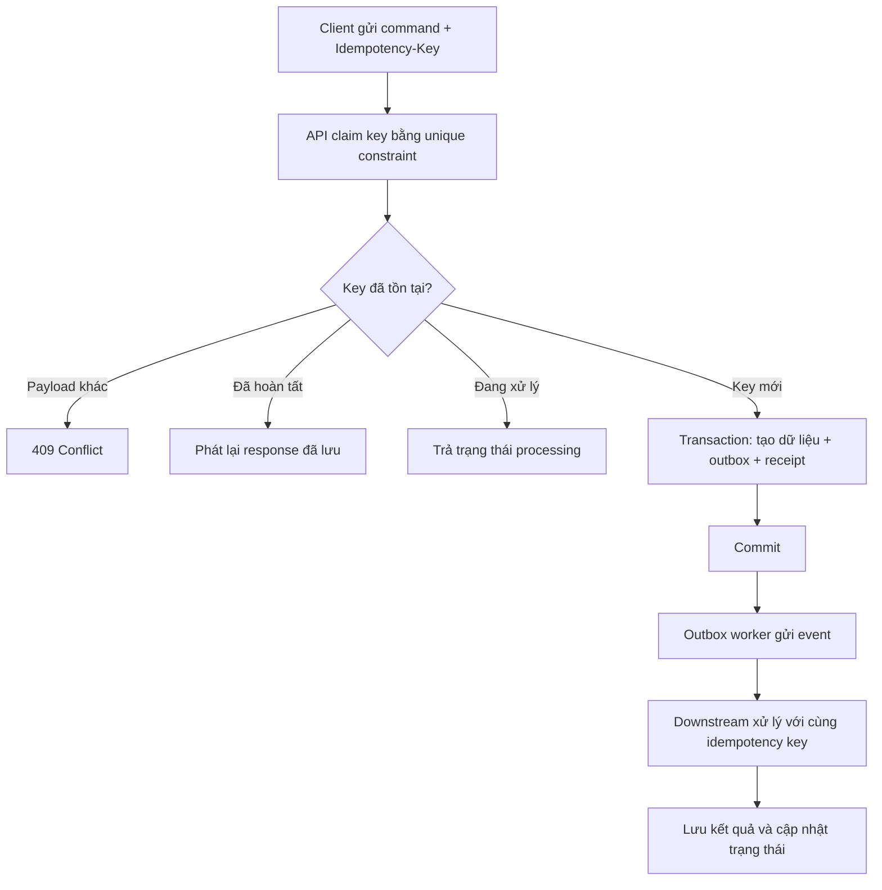

# Tính lũy đẳng khi thử lại yêu cầu có tác dụng phụ

Thử lại (retry) giúp ứng dụng vượt qua lỗi tạm thời như timeout, mất kết nối ngắn hoặc dịch vụ phụ thuộc vừa khởi động lại. Nhưng với yêu cầu có tác dụng phụ như tạo đơn hàng, trừ tiền, đặt chỗ hoặc gửi lệnh giao dịch, retry có thể khiến cùng một hành động được thực hiện nhiều lần.

Vấn đề khó nhất thường xuất hiện khi caller timeout mà không biết dịch vụ đã xử lý request hay chưa. Server có thể đã ghi nhận thanh toán nhưng response bị mất trên đường về. Nếu caller gửi lại yêu cầu như một thao tác mới, khách hàng có thể bị trừ tiền hai lần. **Idempotency** (tính lũy đẳng) giải quyết vấn đề này bằng cách nhận diện nhiều lần gửi lại của cùng một thao tác logic và đảm bảo chúng không tạo thêm tác dụng phụ.

Trong hệ thống Spring Cloud Circuit Breaker, retry, timeout, circuit breaker và fallback cần phối hợp với cơ chế idempotency ở tầng nghiệp vụ. Circuit breaker ngăn tiếp tục gọi dependency khi tỷ lệ lỗi cao; timeout giới hạn thời gian chờ; retry gửi lại khi phù hợp; idempotency bảo vệ tác dụng phụ khi một request được gửi nhiều lần.

## Idempotency nghĩa là gì

Một thao tác idempotent có thể được thực hiện nhiều lần với cùng một định danh mà kết quả nghiệp vụ cuối cùng tương đương với việc thực hiện một lần. Ví dụ, yêu cầu “đặt trạng thái đơn hàng thành CANCELLED” có thể lặp lại mà không tạo thêm đơn hàng hủy. Ngược lại, “tạo một đơn hàng mới” hoặc “cộng 100.000 đồng vào số dư” thường không idempotent nếu mỗi lần gọi đều tạo một thay đổi mới.

| Thao tác | Có thể lặp lại an toàn theo bản chất? | Lưu ý |
|---|---|---|
| Đọc thông tin sản phẩm | Có | Không tạo tác dụng phụ nghiệp vụ |
| Đặt trạng thái đơn hàng thành `CANCELLED` | Thường có | Cần xử lý chuyển trạng thái hợp lệ và side effect phụ như hoàn tiền |
| Tạo đơn hàng mới | Không | Mỗi lần gọi có thể tạo một đơn khác |
| Trừ 100.000 đồng khỏi tài khoản | Không | Mỗi lần gọi có thể trừ thêm tiền |
| Đặt chỗ cho một ghế | Không | Có thể tạo nhiều reservation nếu không có khóa chống trùng |

HTTP method `PUT` và `DELETE` được định nghĩa là idempotent theo ngữ nghĩa HTTP, trong khi `POST` thường không được bảo đảm như vậy. Tuy nhiên, tên method không tự bảo vệ dữ liệu. Một endpoint `PUT` vẫn có thể phát sinh email, thanh toán hoặc sự kiện trùng lặp nếu phần triển khai tạo side effect mỗi lần nhận request. Idempotency phải được bảo đảm ở tầng xử lý nghiệp vụ và lưu trữ.

## Idempotency key nhận diện một thao tác logic

Client tạo một khóa duy nhất cho một thao tác nghiệp vụ và gửi khóa đó trong mọi lần thử lại, thường qua header `Idempotency-Key`:

```http
POST /api/orders
Idempotency-Key: 8f3a0d9c-2b11-4f6a-a3c0-1a9f5b9b2e21
Content-Type: application/json

{
  "customerId": "c-102",
  "items": [
    { "productId": "p-10", "quantity": 2 }
  ]
}
```

Nếu response bị mất, client gửi lại cùng request với cùng key. Server tìm bản ghi idempotency tương ứng. Nếu thao tác đã hoàn tất, server trả lại kết quả đã lưu thay vì tạo đơn hàng lần nữa. Nếu request cùng key nhưng payload khác, server phải từ chối vì một key không được đại diện cho hai thao tác khác nhau.

Khóa cần được tạo một lần ở ranh giới của thao tác logic, sau đó giữ nguyên qua tất cả retry. Không sinh UUID mới trong mỗi lần gọi HTTP hoặc trong mỗi lần retry của service. Nếu tạo key mới, server không thể biết các request đó là cùng một ý định của người dùng.

Nên định phạm vi key theo tenant/khách hàng và loại thao tác, ví dụ `(tenant_id, operation, idempotency_key)`. Không dùng một key toàn cục mà thiếu phạm vi, vì hai khách hàng hoặc hai endpoint khác nhau có thể vô tình va chạm. Key nên là giá trị opaque, khó đoán và không chứa thông tin cá nhân.

## Lưu key và kết quả một cách bền vững

Không nên chỉ giữ key trong bộ nhớ của một instance ứng dụng. Khi ứng dụng khởi động lại hoặc request tiếp theo được chuyển tới replica khác, dữ liệu chống trùng sẽ mất. Với thao tác quan trọng, lưu key và trạng thái vào kho bền vững có unique constraint.

Ví dụ bảng PostgreSQL:

```sql
CREATE TABLE idempotency_record (
    tenant_id          VARCHAR(100) NOT NULL,
    operation          VARCHAR(100) NOT NULL,
    idempotency_key    VARCHAR(200) NOT NULL,
    request_hash       CHAR(64) NOT NULL,
    status             VARCHAR(20) NOT NULL,
    response_status    INTEGER,
    response_body      JSONB,
    resource_id        UUID,
    created_at         TIMESTAMPTZ NOT NULL DEFAULT now(),
    expires_at         TIMESTAMPTZ NOT NULL,
    PRIMARY KEY (tenant_id, operation, idempotency_key),
    CHECK (status IN ('IN_PROGRESS', 'COMPLETED', 'FAILED'))
);
```

`request_hash` là hash của payload đã chuẩn hóa theo ngữ nghĩa. Nó giúp phát hiện trường hợp cùng key nhưng nội dung khác. `response_status` và `response_body` cho phép phát lại response đã hoàn tất. `resource_id` có thể lưu ID đơn hàng hoặc giao dịch để caller truy vấn trạng thái. Dữ liệu thực tế có thể tách response lớn sang bảng riêng hoặc chỉ lưu thông tin đủ để dựng lại response.

Một ràng buộc unique ở database là điều kiện quan trọng để xử lý đồng thời. Hai request cùng key có thể tới hai thread hoặc hai replica gần như cùng lúc. Kiểm tra `if (!exists)` rồi mới insert mà không có unique constraint sẽ tạo race condition: cả hai thread đều có thể thấy chưa tồn tại và cùng thực hiện side effect.

Ví dụ thao tác giành quyền xử lý bằng PostgreSQL:

```sql
INSERT INTO idempotency_record (
    tenant_id, operation, idempotency_key,
    request_hash, status, expires_at
)
VALUES (
    :tenantId, :operation, :key,
    :requestHash, 'IN_PROGRESS', :expiresAt
)
ON CONFLICT (tenant_id, operation, idempotency_key) DO NOTHING;
```

Nếu insert tạo được một hàng, transaction hiện tại đã giành quyền xử lý key. Nếu không tạo hàng nào, đọc bản ghi hiện có, so sánh `request_hash` và xử lý theo trạng thái. Cách đọc và xử lý phải nằm trong giao thức transaction có kiểm soát; không thay thế unique constraint bằng một lần kiểm tra ở tầng Java.

## Xử lý request lặp lại

Một luồng xử lý phổ biến có ba trạng thái:

| Trạng thái | Ý nghĩa | Hành vi với request cùng key |
|---|---|---|
| `IN_PROGRESS` | Request đã được nhận và đang xử lý | Trả trạng thái đang xử lý hoặc hướng dẫn caller truy vấn lại; không chạy side effect lần nữa |
| `COMPLETED` | Tác vụ đã hoàn tất và response được lưu | Phát lại response đã lưu |
| `FAILED` | Tác vụ kết thúc thất bại | Áp dụng chính sách đã định nghĩa: phát lại lỗi cuối cùng hoặc cho phép retry có kiểm soát nếu chắc chắn chưa có side effect |

Nếu key đã tồn tại nhưng hash payload khác, trả lỗi xung đột (thường là `409 Conflict`) và không thực thi. Nếu key đã `COMPLETED`, phát lại status code, body và những header có ý nghĩa của response gốc. Nếu key `IN_PROGRESS`, có thể trả `202 Accepted` kèm URL truy vấn trạng thái, hoặc `409 Conflict`/`Retry-After` theo hợp đồng API. Điều quan trọng là không bắt đầu một thao tác thứ hai chỉ vì request đầu chưa có response.

Không phải mọi lỗi đều nên lưu `FAILED` vĩnh viễn. Ví dụ, validation thất bại trước khi có side effect có thể được trả lại ổn định; một timeout khi gọi nhà cung cấp thanh toán có thể có kết quả chưa xác định. Với kết quả chưa xác định, không đánh dấu thất bại rồi tạo một giao dịch mới. Hãy truy vấn nhà cung cấp bằng key hoặc gửi lại cùng key theo hợp đồng idempotency của nhà cung cấp.

## Gắn idempotency với transaction dữ liệu cục bộ

Nếu tác dụng phụ chỉ nằm trong cùng một database, có thể ghi bản ghi idempotency, thay đổi nghiệp vụ và response đã lưu trong cùng một transaction. Khi transaction commit, cả ba cùng thành công; nếu rollback, cả ba cùng bị hủy.

Ví dụ Java dưới đây mô tả giao thức ở tầng service. `tryClaim` phải được triển khai bằng insert có unique constraint như SQL ở trên; không được dùng cặp thao tác `exists` rồi `insert` không khóa.

```java
@Service
public class OrderService {

    private final IdempotencyRepository idempotencyRepository;
    private final OrderRepository orderRepository;
    private final ObjectMapper objectMapper;

    @Transactional
    public OrderResponse createOrder(
            String tenantId,
            String idempotencyKey,
            CreateOrderCommand command) {

        String requestHash = fingerprint(command);
        boolean claimed = idempotencyRepository.tryClaim(
                tenantId, "CREATE_ORDER", idempotencyKey,
                requestHash);

        if (!claimed) {
            IdempotencyRecord existing = idempotencyRepository
                    .findRequired(tenantId, "CREATE_ORDER", idempotencyKey);

            if (!existing.requestHash().equals(requestHash)) {
                throw new IdempotencyKeyConflictException();
            }

            if (existing.status() == IdempotencyStatus.COMPLETED) {
                return deserialize(existing.responseBody(), OrderResponse.class);
            }

            throw new RequestStillProcessingException();
        }

        Order order = orderRepository.save(Order.create(command));
        OrderResponse response = OrderResponse.from(order);

        idempotencyRepository.markCompleted(
                tenantId, "CREATE_ORDER", idempotencyKey,
                order.getId(), serialize(response));

        return response;
    }
}
```

Ví dụ này giả định thao tác tạo đơn và ghi idempotency dùng cùng database/transaction. Với transaction isolation thông thường như PostgreSQL `READ COMMITTED`, insert cạnh tranh trên unique key sẽ được database điều phối; request thua cuộc đọc bản ghi sau khi request thắng commit. Cần kiểm thử hành vi cụ thể theo database và isolation level của ứng dụng. Nếu request thắng rollback, request còn lại có thể giành quyền claim và thực hiện thao tác.

Không gọi một nhà cung cấp thanh toán, gửi email hoặc gọi HTTP tới hệ thống khác bên trong transaction database đang mở chỉ để đạt tính nguyên tử. Database không thể rollback side effect đã xảy ra ở hệ thống từ xa. Trường hợp đó cần một giao thức phân tán khác.

## Side effect ở hệ thống ngoài: Transactional Outbox

Với side effect liên quan tới dịch vụ khác, dùng Transactional Outbox để ghi ý định gửi sự kiện trong cùng transaction với dữ liệu nghiệp vụ và idempotency record:

1. Trong một transaction database, claim idempotency key, tạo đơn hàng và ghi một outbox event.
2. Commit transaction. Lúc này đơn hàng, idempotency record và ý định gửi sự kiện cùng tồn tại.
3. Worker đọc outbox và gửi lệnh tới dịch vụ thanh toán hoặc message broker.
4. Nếu worker không nhận được xác nhận, nó có thể gửi lại event. Consumer hoặc nhà cung cấp phải nhận diện cùng event/key và chống thực hiện side effect lần hai.
5. Lưu kết quả downstream và cập nhật trạng thái xử lý để caller có thể truy vấn.



Outbox thường bảo đảm event được gửi ít nhất một lần (at-least-once), vì worker có thể gửi lại sau khi mất xác nhận. Consumer nên có inbox/deduplication table với unique constraint trên `event_id`, và ghi inbox cùng side effect cục bộ trong một transaction. Nếu consumer gọi tiếp một hệ thống khác, cần truyền tiếp một key ổn định hoặc áp dụng outbox ở ranh giới đó.

Nếu nhà cung cấp thanh toán hỗ trợ idempotency key, gửi một key ổn định được tạo từ thao tác thanh toán của đơn hàng và dùng nguyên key đó cho mọi lần retry. Không dùng key của một request HTTP mới nếu nó biểu diễn cùng một khoản thanh toán. Hãy kiểm tra thời hạn lưu key và quy tắc replay của nhà cung cấp; không phải API bên ngoài nào cũng hỗ trợ cùng semantics.

## Timeout tạo ra kết quả chưa xác định

Timeout không chứng minh thao tác đã thất bại. Ví dụ:

1. API gửi lệnh thanh toán tới provider.
2. Provider ghi nhận thanh toán thành công.
3. Response bị mất hoặc đến sau deadline.
4. API nhận timeout và caller không biết giao dịch đã xảy ra hay chưa.

Đây là trạng thái **unknown outcome**. Hành động đúng là truy vấn trạng thái theo idempotency key hoặc gửi lại cùng key nếu provider cam kết chống trùng. Tạo key mới và gửi lệnh thanh toán mới sẽ biến một lần retry thành giao dịch thứ hai.

Fallback cũng phải phản ánh sự không chắc chắn này. Không trả “thanh toán thất bại” nếu chỉ biết caller timeout; không trả “thanh toán thành công” nếu chưa có xác nhận. Có thể trả `202 Accepted` cùng `operationId` và endpoint kiểm tra trạng thái, hoặc một lỗi có mã `OUTCOME_UNKNOWN` để caller truy vấn lại bằng cùng key.

## Phối hợp Retry, CircuitBreaker và Idempotency

Ba cơ chế có nhiệm vụ khác nhau:

| Cơ chế | Câu hỏi nó trả lời | Điều nó không bảo đảm |
|---|---|---|
| Retry | Có nên gửi lại sau lỗi tạm thời? | Không ngăn side effect bị lặp |
| CircuitBreaker | Có nên tạm ngừng gọi dependency đang lỗi? | Không xác định request trước đã được xử lý hay chưa |
| Idempotency | Request lặp lại có tạo thêm side effect không? | Không làm dependency khỏe hơn hoặc giảm latency |

Quy tắc vận hành:

- Chỉ retry lỗi có khả năng tạm thời, như timeout, lỗi kết nối hoặc một số mã `5xx` theo hợp đồng. Không retry validation, authorization, xung đột nghiệp vụ hoặc `409` do payload không khớp key.
- Dùng số lần retry hữu hạn, exponential backoff có jitter và deadline tổng thể. Retry quá nhiều có thể làm tăng tải đúng lúc dependency đang suy giảm.
- Giữ nguyên idempotency key và payload logic qua mọi attempt. Nếu caller khởi tạo một thao tác mới, tạo key mới.
- Không retry `CallNotPermittedException` khi circuit breaker đang `OPEN`; breaker đã quyết định từ chối request. Hãy chờ chu kỳ phục hồi hoặc trả trạng thái phù hợp.
- Đặt fallback sau khi đã áp dụng chính sách retry phù hợp. Fallback không được che giấu kết quả chưa xác định của side effect.

Thứ tự decorator ảnh hưởng cách breaker thống kê retry. Nếu `Retry(CircuitBreaker(call))`, mỗi attempt đi qua breaker và có thể được ghi nhận riêng. Nếu `CircuitBreaker(Retry(call))`, breaker nhìn thấy kết quả cuối cùng của cả chuỗi retry. Chọn theo mục tiêu quan sát: đo từng attempt hay đo một thao tác logic sau retry. Dù chọn cách nào, idempotency key vẫn phải giữ nguyên ở mọi lần gửi tới hệ thống thực hiện side effect.

## Chính sách lưu giữ và bảo vệ idempotency key

Idempotency record phải được giữ lâu hơn khoảng thời gian mà client, gateway, message broker hoặc worker có thể retry. Nếu xóa key quá sớm, một request cũ được gửi lại sau thời hạn sẽ bị coi như thao tác mới. Với thanh toán hoặc tạo đơn, thời gian lưu có thể cần dài theo yêu cầu đối soát và quy định nghiệp vụ.

Khi dọn record:

- Chỉ xóa bản ghi đã hoàn tất và đã qua thời gian lưu được phê duyệt.
- Không xóa `IN_PROGRESS` khi worker còn có thể hoàn tất; cần lease/heartbeat và quy trình phục hồi nếu worker chết.
- Cân nhắc lưu tombstone gồm key, fingerprint và resource ID sau khi response body hết hạn để tiếp tục ngăn side effect trùng.
- Không ghi payload nhạy cảm hoặc key đầy đủ vào log; dùng hash hoặc correlation ID khi cần truy vết.

Nếu xử lý bất đồng bộ, trạng thái `IN_PROGRESS` nên có chủ sở hữu/lease và thời điểm hết hạn. Khi lease hết hạn, worker phục hồi phải kiểm tra trạng thái downstream trước khi tiếp tục, vì worker cũ có thể đã gửi lệnh nhưng chết trước khi ghi nhận response. Lease chỉ điều phối quyền xử lý; nó không tự chứng minh side effect từ xa chưa xảy ra.

## Kiểm thử các tình huống retry và cạnh tranh

Một bộ kiểm thử idempotency cần mô phỏng cả việc response mất lẫn nhiều request đồng thời:

| Kịch bản | Kết quả cần xác nhận |
|---|---|
| Gửi lần đầu với key mới | Side effect được thực hiện một lần và response được lưu |
| Gửi lại cùng key, cùng payload sau khi hoàn tất | Phát lại response; không tạo thêm side effect |
| Cùng key nhưng payload khác | Trả conflict; không thực thi |
| Hai request cùng key đến đồng thời | Unique constraint chỉ cho một request claim; side effect chỉ xảy ra một lần |
| Timeout sau khi provider có thể đã xử lý | Tra cứu hoặc retry cùng key; không tạo giao dịch mới |
| Request lặp khi đang xử lý | Trả trạng thái processing hoặc kết quả đã lưu; không chạy song song lần hai |
| Worker outbox gửi event lặp | Consumer deduplicate event; side effect downstream không bị nhân đôi |
| Key hết hạn rồi request cũ được gửi lại | Hành vi phù hợp retention/tombstone đã công bố |

Ví dụ kiểm thử đơn giản cho service cục bộ:

```java
OrderResponse first = orderService.createOrder(
        "tenant-1", "order-key-123", command);

OrderResponse replay = orderService.createOrder(
        "tenant-1", "order-key-123", command);

assertEquals(first.orderId(), replay.orderId());
verify(orderRepository, times(1)).save(any(Order.class));
```

Ngoài test tuần tự, cần integration test chạy hai request đồng thời trên database thật hoặc Testcontainers để xác nhận unique constraint và transaction isolation. Mock repository không thể chứng minh giao thức chống race condition ở database hoạt động đúng.

## Checklist triển khai

1. Xác định ranh giới của một thao tác logic và yêu cầu nghiệp vụ về tác dụng phụ.
2. Yêu cầu client tạo một idempotency key và giữ nguyên key qua mọi retry.
3. Phạm vi hóa key theo tenant và operation; lưu fingerprint của payload đã chuẩn hóa.
4. Dùng unique constraint và transaction để chỉ một request được quyền tạo side effect cục bộ.
5. Lưu response hoặc resource ID để replay; xử lý rõ `IN_PROGRESS`, `COMPLETED` và kết quả chưa xác định.
6. Dùng Transactional Outbox và downstream idempotency cho side effect vượt qua ranh giới database.
7. Cấu hình retry hữu hạn, backoff, jitter và deadline; không retry lỗi nghiệp vụ hoặc request bị breaker từ chối.
8. Chọn retention đủ dài và có quy trình phục hồi record đang xử lý.
9. Theo dõi tỷ lệ replay, conflict do key/payload khác, request đang xử lý, timeout unknown outcome và lỗi outbox.
10. Kiểm thử request đồng thời, timeout mơ hồ, worker crash và duplicate delivery.

Không có một header hay thư viện nào tự biến mọi hệ thống phân tán thành exactly-once. Mục tiêu thực tế là cho phép truyền lại ít nhất một lần nhưng bảo đảm mỗi thao tác nghiệp vụ chỉ tạo hiệu ứng một lần trong phạm vi được kiểm soát, nhờ key bền vững, transaction, deduplication và hợp đồng rõ ràng giữa các dịch vụ.
