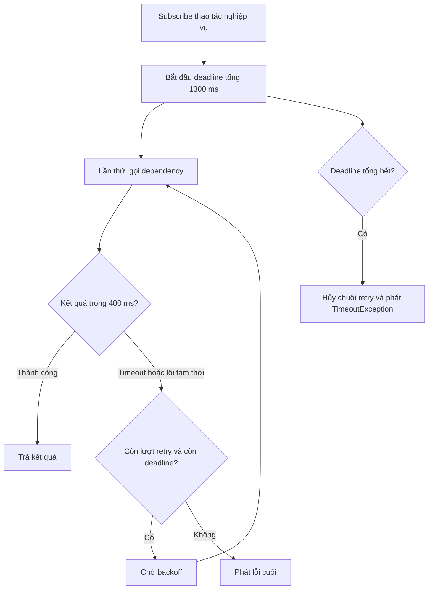

# Phối hợp Retry với timeout tổng thể và timeout từng lần thử

Khi gọi một dịch vụ phụ thuộc, một lần thử có thể thất bại vì kết nối chập chờn hoặc phản hồi quá chậm. Retry cho phép thử lại lỗi tạm thời; timeout từng lần thử giới hạn thời gian chờ của mỗi lần gọi; timeout tổng thể giới hạn toàn bộ chuỗi gồm các lần thử và thời gian backoff. Nếu chỉ đặt timeout cho từng lần thử, chuỗi retry có thể kéo dài lâu hơn thời gian mà API hoặc người dùng chấp nhận.

Trong Spring Cloud CircuitBreaker với backend Resilience4j, cần xác định rõ ranh giới của một thao tác nghiệp vụ, tổng số lần thử, timeout cho mỗi lần thử và deadline tổng. Với luồng reactive, Reactor cung cấp `timeout` và `retryWhen` để ghép các chính sách này. Vị trí của các toán tử quyết định timeout nào được retry, Circuit Breaker nhìn thấy một kết quả cuối hay từng lần thử, và fallback chạy khi nào.

## Phân biệt ba giới hạn thời gian

- **Timeout từng lần thử (per-attempt timeout):** thời gian tối đa cho một lần gọi dịch vụ phụ thuộc. Khi hết thời gian, lần thử phát lỗi timeout và có thể được retry nếu chính sách cho phép.
- **Backoff:** khoảng nghỉ giữa hai lần thử. Backoff giảm tải khi dependency đang gặp sự cố và tránh các request retry đồng loạt.
- **Timeout tổng thể (overall timeout/deadline):** thời gian tối đa cho toàn bộ thao tác, tính từ lần subscribe đầu tiên đến khi có kết quả cuối. Nó bao gồm thời gian của các lần thử, backoff và overhead trong chuỗi reactive.

Ví dụ, một request có tối đa ba lần thử, mỗi lần được chờ 400 ms, với backoff 100 ms rồi 200 ms. Ngân sách xấu nhất theo cấu hình là:

\[
T_{total} = 3 \times 400 + 100 + 200 = 1500\text{ ms}
\]

Con số này chưa tính thời gian tạo request, lập lịch, giải mã response và xử lý sau lời gọi. Nếu API có deadline 1.300 ms, không thể để chuỗi retry sử dụng trọn 1.500 ms. Timeout tổng phải cắt chuỗi khi deadline hết, kể cả khi lần thử cuối vẫn còn thời gian riêng.

| Thành phần | Ví dụ | Phạm vi áp dụng |
|---|---:|---|
| Timeout mỗi lần thử | 400 ms | Được bắt đầu lại ở mỗi lần subscribe vào nguồn |
| Backoff lần 1 | 100 ms | Giữa lần thử đầu và lần thứ hai |
| Backoff lần 2 | 200 ms | Giữa lần thử thứ hai và lần thứ ba |
| Timeout tổng | 1.300 ms | Một lần thực thi nghiệp vụ, gồm cả retry và backoff |

Timeout tổng thường nhỏ hơn hoặc bằng deadline còn lại do caller truyền xuống. Không tạo một deadline mới đầy đủ ở mỗi service hoặc mỗi lần retry, vì như vậy chuỗi gọi có thể vượt thời hạn của request ban đầu.

## Đặt timeout từng lần thử trước `retryWhen`

Trong Reactor, `timeout` đặt trước `retryWhen` áp dụng cho mỗi lần subscribe vào publisher nguồn. Khi timeout phát ra, `retryWhen` nhận lỗi đó và quyết định có thực hiện lần thử tiếp theo hay không.

```java
Mono<Product> request = Mono.defer(() -> catalogClient.find(sku))
    .timeout(Duration.ofMillis(400))
    .retryWhen(Retry.backoff(2, Duration.ofMillis(100))
        .maxBackoff(Duration.ofMillis(200))
        .jitter(0d)
        .filter(this::isRetryable)
        .onRetryExhaustedThrow((spec, signal) -> signal.failure()));
```

`Retry.backoff(2, ...)` cho phép tối đa hai lần retry sau lần gọi ban đầu, tức tối đa ba lần thử. `Mono.defer(...)` tạo lời gọi client mới ở mỗi subscription. Nếu bỏ `defer` trong khi publisher đã chứa side effect hoặc một đối tượng chỉ dùng được một lần, retry có thể không thực hiện lại lời gọi theo cách mong muốn.

Timeout ở vị trí này được làm mới cho mỗi lần thử. Nếu lần thử đầu mất 400 ms và timeout, lần thứ hai có thêm tối đa 400 ms sau khoảng backoff. Vì vậy, chỉ có per-attempt timeout thì tổng thời gian vẫn có thể gần bằng tổng thời gian các lần thử cộng backoff.

## Đặt timeout tổng thể sau `retryWhen`

Để giới hạn toàn bộ chuỗi, đặt một `timeout` khác sau `retryWhen`:

```java
Mono<Product> request = Mono.defer(() -> catalogClient.find(sku))
    .timeout(Duration.ofMillis(400))
    .retryWhen(Retry.backoff(2, Duration.ofMillis(100))
        .maxBackoff(Duration.ofMillis(200))
        .jitter(0d)
        .filter(this::isRetryable)
        .onRetryExhaustedThrow((spec, signal) -> signal.failure()))
    .timeout(Duration.ofMillis(1300));
```

Timeout thứ nhất được khởi động lại ở mỗi lần thử. Timeout cuối cùng bắt đầu một lần cho toàn chuỗi khi subscription được tạo; nó bao gồm thời gian gọi và backoff. Nếu tổng thời gian chạm 1.300 ms, publisher kết thúc bằng timeout và hủy subscription đang hoạt động theo cơ chế cancellation của Reactor.



Sơ đồ thể hiện hai giới hạn cùng tồn tại. Retry chỉ tiếp tục khi lỗi thuộc nhóm được phép và còn lượt thử; timeout tổng có thể kết thúc toàn bộ chuỗi bất kể số lượt retry còn lại.

## Chọn lỗi nào được retry

Không nên retry mọi exception. Retry hữu ích với lỗi có khả năng tạm thời, ví dụ lỗi kết nối ngắn hạn hoặc timeout của một dependency. Những lỗi đầu vào, lỗi xác thực, lỗi nghiệp vụ không tồn tại tài nguyên hoặc lỗi cấu hình thường không thể khắc phục bằng cách gọi lại ngay.

```java
private boolean isRetryable(Throwable error) {
    Throwable cause = Exceptions.unwrap(error);
    return cause instanceof IOException
        || cause instanceof TimeoutException;
}
```

Trong ứng dụng dùng Resilience4j, cần loại trừ `CallNotPermittedException`. Đây là tín hiệu Circuit Breaker đang từ chối lời gọi vì mạch `OPEN`; retry liên tục chỉ tạo thêm subscription bị từ chối. Cũng cần cân nhắc các lỗi do Bulkhead từ chối, vì thử lại ngay có thể làm tăng áp lực lên hàng đợi hoặc semaphore.

Khi dùng `Retry.backoff(...)`, Reactor áp dụng backoff tăng dần và có thể có jitter tùy cấu hình. Trong ví dụ tính toán, `maxBackoff(200 ms)` và `jitter(0)` giữ hai khoảng nghỉ lần lượt là 100 ms và 200 ms để phép tính dễ kiểm tra. Trong production, có thể bật jitter để nhiều client không retry đồng loạt; vẫn cần đặt `maxBackoff` và giới hạn tổng số lần thử để chuỗi không vượt deadline.

Khi hết retry, Reactor có thể phát `RetryExhaustedException` bọc lỗi cuối. Nếu phần phân loại exception hoặc fallback cần nhận đúng lỗi cuối, dùng `onRetryExhaustedThrow((spec, signal) -> signal.failure())` hoặc xử lý `cause` một cách có chủ đích. Không giả định mọi wrapper exception đều được Circuit Breaker phân loại giống lỗi gốc.

## Phối hợp Retry và Circuit Breaker

Vị trí của Circuit Breaker so với retry quyết định sliding window đếm kết quả của một thao tác nghiệp vụ hay từng lần thử.

### Circuit Breaker bao quanh toàn bộ chuỗi retry

```java
Mono<Product> attempts = Mono.defer(() -> catalogClient.find(sku))
    .timeout(perAttemptTimeout)
    .retryWhen(retryPolicy)
    .timeout(overallTimeout);

return reactiveCircuitBreakerFactory.create("catalog")
    .run(attempts, error -> fallbackProduct(sku, error));
```

Circuit Breaker nhận kết quả cuối cùng của chuỗi retry cho một subscription. Nếu hai lần thử thất bại nhưng lần thứ ba thành công, mạch ghi nhận một kết quả thành công. Nếu retry cạn lượt hoặc timeout tổng hết, mạch nhận lỗi cuối và ghi nhận theo chính sách `recordExceptions`/`ignoreExceptions`.

Cách này phù hợp khi muốn Circuit Breaker đánh giá kết quả của một thao tác nghiệp vụ sau khi đã áp dụng retry. Nó tránh việc một request duy nhất đóng góp nhiều mẫu lỗi chỉ vì có nhiều lần thử.

### Mỗi lần thử đi qua Circuit Breaker riêng

```java
Mono<Product> oneAttempt = Mono.defer(() ->
    reactiveCircuitBreakerFactory.create("catalog").run(
        Mono.defer(() -> catalogClient.find(sku))
            .timeout(perAttemptTimeout),
        error -> Mono.error(error)));

return oneAttempt
    .retryWhen(retryPolicy)
    .timeout(overallTimeout)
    .onErrorResume(error -> fallbackProduct(sku, error));
```

Ở đây, `retryWhen` subscribe lại publisher có Circuit Breaker. Mỗi lần thử có thể tạo một mẫu riêng trong sliding window. Điều này giúp mạch phản ứng nhanh hơn với lỗi của từng attempt, nhưng một request có thể đóng góp nhiều failure. Khi mạch mở sau một lần thử, lần retry kế tiếp có thể nhận `CallNotPermittedException` và cần bị loại khỏi retry predicate.

Timeout tổng trong ví dụ này nằm ngoài Circuit Breaker của từng attempt. Vì vậy, timeout tổng có thể kết thúc chuỗi sau khi hủy subscription nhưng không nhất thiết được ghi nhận như một lỗi của Circuit Breaker theo từng attempt. Nếu cần theo dõi cả sức khỏe từng attempt lẫn kết quả toàn thao tác, hãy cân nhắc hai ranh giới bảo vệ riêng biệt với mục đích và tên mạch rõ ràng; tránh dùng hai mạch lồng nhau chỉ để đếm cùng một lỗi hai lần.

| Cách đặt | Mẫu Circuit Breaker | Ưu điểm | Điều cần cân nhắc |
|---|---|---|---|
| Circuit Breaker ngoài retry | Một mẫu cho kết quả cuối của chuỗi | Đánh giá trải nghiệm cuối cùng của thao tác | Lỗi tạm thời được retry có thể không làm tăng failure count |
| Circuit Breaker trong retry | Một mẫu cho mỗi lần thử được bảo vệ | Phản ứng nhanh với lỗi từng attempt | Một request có thể tạo nhiều mẫu failure; timeout tổng nằm ngoài mạch |

## Ví dụ tích hợp hoàn chỉnh với Spring Cloud CircuitBreaker

Ví dụ dưới đây dùng Circuit Breaker bao quanh toàn bộ chuỗi retry. Mỗi lần gọi có timeout 400 ms, tối đa hai lần retry, backoff tăng dần 100 ms rồi 200 ms và deadline tổng 1.300 ms. Fallback chỉ chạy sau khi chuỗi được bảo vệ kết thúc bằng lỗi hoặc Circuit Breaker từ chối quyền gọi.

```java
import java.io.IOException;
import java.time.Duration;
import java.util.concurrent.TimeoutException;

import io.github.resilience4j.circuitbreaker.CallNotPermittedException;
import org.springframework.cloud.client.circuitbreaker.ReactiveCircuitBreaker;
import org.springframework.cloud.client.circuitbreaker.ReactiveCircuitBreakerFactory;
import org.springframework.stereotype.Service;
import reactor.core.Exceptions;
import reactor.core.publisher.Mono;
import reactor.util.retry.Retry;

@Service
class CatalogService {

    private final ReactiveCircuitBreakerFactory<?, ?> circuitBreakerFactory;
    private final CatalogClient catalogClient;
    private final ProductCache productCache;

    CatalogService(
            ReactiveCircuitBreakerFactory<?, ?> circuitBreakerFactory,
            CatalogClient catalogClient,
            ProductCache productCache) {
        this.circuitBreakerFactory = circuitBreakerFactory;
        this.catalogClient = catalogClient;
        this.productCache = productCache;
    }

    Mono<Product> find(String sku) {
        Duration perAttemptTimeout = Duration.ofMillis(400);
        Duration overallTimeout = Duration.ofMillis(1300);

        Retry retryPolicy = Retry.backoff(2, Duration.ofMillis(100))
            .maxBackoff(Duration.ofMillis(200))
            .jitter(0d)
            .filter(this::isRetryable)
            .onRetryExhaustedThrow((spec, signal) -> signal.failure());

        Mono<Product> attempts = Mono.defer(() -> catalogClient.find(sku))
            .timeout(perAttemptTimeout)
            .retryWhen(retryPolicy)
            .timeout(overallTimeout);

        ReactiveCircuitBreaker breaker = circuitBreakerFactory.create("catalog");
        return breaker.run(attempts, error -> fallback(sku, error));
    }

    private boolean isRetryable(Throwable error) {
        Throwable cause = Exceptions.unwrap(error);
        return !(cause instanceof CallNotPermittedException)
            && (cause instanceof IOException || cause instanceof TimeoutException);
    }

    private Mono<Product> fallback(String sku, Throwable error) {
        return productCache.find(sku)
            .switchIfEmpty(Mono.error(
                new CatalogUnavailableException(sku, error)));
    }
}
```

`Mono.defer(...)` tạo lại lời gọi client ở mỗi lần thử. Timeout 400 ms nằm trước `retryWhen`, nên timeout từng attempt có thể kích hoạt retry. Timeout 1.300 ms nằm sau retry, nên giới hạn tổng thời gian của toàn chuỗi. Vì Circuit Breaker bao quanh publisher `attempts`, nó nhìn thấy kết quả cuối cùng của chuỗi và có thể ghi nhận timeout tổng nếu timeout đó được phân loại là failure.

Fallback đọc cache và trả về `Mono`; nó không chặn thread reactive. Trong ứng dụng thực tế, hãy đặt timeout riêng cho cache nếu cache có thể chậm, đồng thời bảo đảm fallback không kéo dài quá deadline của request. Nếu fallback trả lỗi, caller sẽ nhận lỗi đó theo hợp đồng API.

## Cấu hình Resilience4j và ranh giới trách nhiệm

Có thể cấu hình chính sách Retry và TimeLimiter bằng properties cho các API sử dụng cấu hình tự động của Resilience4j:

```yaml
resilience4j:
  retry:
    instances:
      catalog:
        maxAttempts: 3
        waitDuration: 100ms
        enableExponentialBackoff: true
        exponentialBackoffMultiplier: 2
  timelimiter:
    instances:
      catalog:
        timeoutDuration: 1300ms
        cancelRunningFuture: true
  circuitbreaker:
    instances:
      catalog:
        slidingWindowType: COUNT_BASED
        slidingWindowSize: 20
        minimumNumberOfCalls: 10
        failureRateThreshold: 50
        waitDurationInOpenState: 5s
```

`maxAttempts: 3` gồm một lần gọi ban đầu và tối đa hai lần retry. `waitDuration` là khoảng nghỉ cơ sở; khi bật exponential backoff, khoảng nghỉ tăng theo multiplier. Đây là cấu hình Retry của Resilience4j, không tự động chứng minh rằng toàn bộ chuỗi có deadline động theo request. TimeLimiter ở trên đặt giới hạn cho thao tác theo instance; nếu request có ngân sách còn lại khác nhau, cần áp dụng timeout động trong publisher, chẳng hạn `Mono.timeout(remaining)`, và bảo đảm nó nằm trong ranh giới Circuit Breaker cần đo lường.

Trong ứng dụng reactive, `retryWhen` của Reactor và `Mono.timeout` là cách trực tiếp để điều khiển thứ tự retry và deadline cho publisher. Không nên đồng thời áp dụng nhiều lớp Retry hoặc TimeLimiter lên cùng publisher mà không xác định rõ lớp nào sở hữu số lần thử và deadline tổng; nếu không, số lần gọi thực tế và thời gian chờ sẽ khó dự đoán.

## Những lỗi thường gặp khi ghép Retry và timeout

- **Chỉ đặt timeout từng lần thử:** mỗi lần retry được cấp lại toàn bộ thời gian, khiến tổng thời gian vượt deadline của caller. Thêm timeout tổng sau `retryWhen`.
- **Đặt timeout tổng trước retry:** mỗi lần retry có thể khởi động lại timeout đó. Đặt timeout tổng sau `retryWhen` để nó bao trùm chuỗi.
- **Không dùng `defer` cho lời gọi có side effect:** retry có thể subscribe lại publisher không tạo request mới như mong muốn. Tạo lời gọi client bên trong `Mono.defer`.
- **Retry mọi exception:** lỗi nghiệp vụ, lỗi xác thực hoặc `CallNotPermittedException` bị thử lại vô ích. Dùng predicate giới hạn lỗi tạm thời.
- **Fallback trước Circuit Breaker:** lỗi được thay bằng dữ liệu trước khi mạch quan sát, khiến dependency lỗi có thể bị tính là success. Đặt fallback sau ranh giới đo lường nếu muốn Circuit Breaker ghi nhận lỗi nguồn.
- **Timeout tổng nằm ngoài mạch nhưng kỳ vọng mạch ghi nhận nó:** timeout downstream có thể chỉ hủy subscription. Đặt deadline trong publisher được bảo vệ nếu muốn Circuit Breaker quan sát timeout tổng.
- **Retry thao tác không idempotent:** request tạo đơn hàng hoặc trừ tồn kho có thể thực hiện side effect nhiều lần. Dùng idempotency key hoặc cơ chế chống thực thi trùng lặp.

## Cách kiểm thử

Kiểm thử nên xác nhận cả thời gian hoàn tất, số lần gọi dependency và metrics Circuit Breaker:

1. Cho lần thử đầu timeout nhưng lần thứ hai thành công. Xác nhận mỗi lần thử có timeout riêng và request trả kết quả trước deadline tổng.
2. Cho mọi lần thử timeout. Xác nhận retry dừng sau số lần tối đa hoặc khi timeout tổng hết, tùy điều kiện nào đến trước.
3. Cho lỗi không retry được, ví dụ lỗi validation. Xác nhận client chỉ được gọi một lần.
4. Cho Circuit Breaker ở `OPEN`. Xác nhận `CallNotPermittedException` không kích hoạt retry.
5. So sánh Circuit Breaker bao quanh retry với Circuit Breaker nằm trong retry. Xác nhận một thao tác tạo một mẫu cuối hoặc nhiều mẫu theo đúng thiết kế.
6. Cho fallback chậm. Xác nhận fallback có giới hạn riêng và không vượt deadline của request.
7. Với request có side effect, phát lại cùng idempotency key và xác nhận không tạo tác vụ trùng.

Với Reactor Test, dùng `StepVerifier.withVirtualTime(...)` để kiểm soát timeout và backoff mà không phải chờ thời gian thực. Dùng publisher giả lập đếm số subscription để xác nhận `retryWhen` thực hiện đúng số lần. Sau mỗi kịch bản, kiểm tra số lời gọi client, trạng thái Circuit Breaker, failure rate và lỗi cuối cùng caller nhận được.

Thiết kế tốt giữ ba chính sách độc lập nhưng phối hợp theo cùng một ngân sách: timeout từng lần thử ngăn một attempt chờ quá lâu, Retry chỉ thử lại lỗi có khả năng phục hồi, còn timeout tổng bảo đảm toàn bộ thao tác kết thúc đúng hạn. Circuit Breaker quan sát đúng ranh giới đã chọn để sliding window phản ánh nhất quán sức khỏe của dependency.
