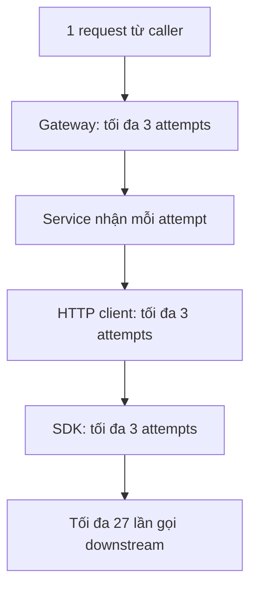
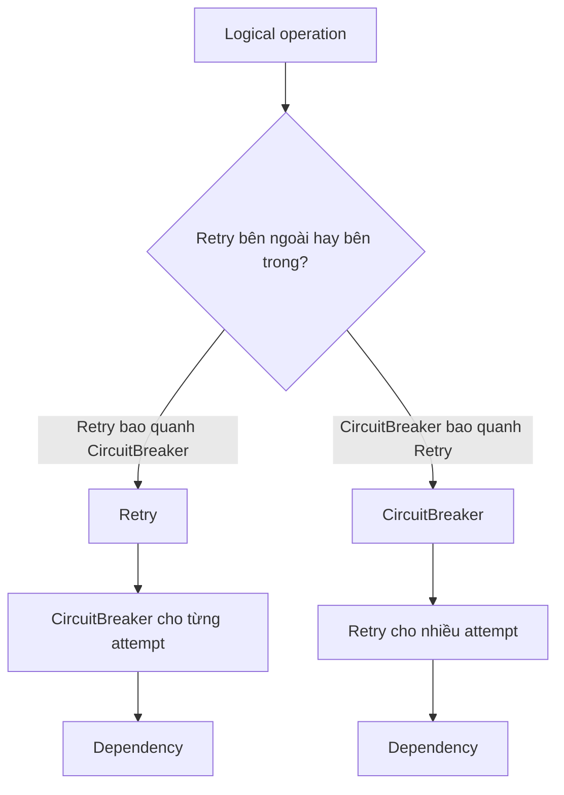

# Tránh nhiều lớp retry nhân số yêu cầu qua Gateway, client và SDK

Retry giúp vượt qua lỗi tạm thời, nhưng mỗi lần thử lại đều tạo thêm tải lên hệ thống. Trong kiến trúc microservices, một request có thể đi qua Spring Cloud Gateway, HTTP client của service và SDK của nhà cung cấp. Nếu cả ba lớp đều tự retry, số lần gọi đến dịch vụ đích có thể tăng theo cấp số nhân. Khi dịch vụ đang quá tải, retry chồng lớp dễ biến một sự cố nhỏ thành retry storm và kéo dài thời gian phục hồi.

Khi triển khai Spring Cloud CircuitBreaker, Resilience4j và các client trong cùng một request path, cần thiết kế retry như một chính sách thống nhất. Hãy xác định lớp nào chịu trách nhiệm retry cho từng loại lỗi, giới hạn tổng số lần thử bằng deadline và retry budget, đồng thời dùng circuit breaker để ngừng gửi request khi phụ thuộc đã có dấu hiệu không khỏe.

## 1. Vì sao nhiều lớp retry làm nhân số yêu cầu?

Giả sử một request đi qua ba lớp:

1. Spring Cloud Gateway nhận request từ người dùng.
2. Service nghiệp vụ gọi dịch vụ tồn kho bằng HTTP client.
3. HTTP client sử dụng SDK có cơ chế retry nội bộ.

Nếu mỗi lớp đều thực hiện tối đa 3 lần thử cho một lần gọi ở lớp của nó, một request đầu vào có thể tạo tối đa:

\[
3 \times 3 \times 3 = 27\text{ lần gọi đến dịch vụ đích}
\]

Số lần thử ở một lớp trở thành số lần gọi toàn bộ chuỗi ở lớp kế tiếp. Gateway thử lại request đến service; mỗi request mới lại kích hoạt client; mỗi lần client thử lại lại có thể khiến SDK tiếp tục thử.



Phép nhân trên là giới hạn xấu nhất khi mọi lần thử đều đi tiếp đến lớp bên dưới và đều thỏa điều kiện retry. Trong thực tế, số lần gọi có thể thấp hơn vì một lớp có thể thành công sớm, lỗi không thuộc điều kiện retry hoặc request bị từ chối bởi circuit breaker. Tuy vậy, thiết kế phải tính đến trường hợp xấu nhất, đặc biệt trong lúc phụ thuộc mất khả năng phục vụ.

## 2. Phân biệt số lần retry và tổng số attempt

Các thư viện không phải lúc nào cũng dùng cùng quy ước đặt tên. Có cấu hình biểu thị tổng số attempt bao gồm lần gọi đầu tiên; có cấu hình biểu thị số lần retry thêm sau lần đầu.

| Cách gọi cấu hình | Ý nghĩa | Tổng attempt |
|---|---|---:|
| `maxAttempts: 3` trong Resilience4j Retry | Gồm lần gọi đầu tiên và các lần thử tiếp theo | 3 |
| `retries: 2` trong Spring Cloud Gateway Retry filter | Hai lần retry sau request đầu tiên | 3 |
| SDK `maxRetries: 2` | Thường là hai lần thử thêm, nhưng phải xác minh tài liệu SDK | Thường là 3 |

Không nên cộng trực tiếp các giá trị cấu hình của các thư viện khác nhau. Hãy chuyển mỗi giá trị thành tổng attempt của lớp đó rồi mới tính tích.

Nếu lớp thứ (i) có (R_i) lần retry thêm, tổng số attempt tối đa của lớp đó là (A_i = R_i + 1). Khi các lớp lồng nhau đều retry cùng một thao tác, số lần gọi tối đa ở đích xấp xỉ:

\[
A_{total} = \prod_{i=1}^{n} A_i
\]

Ví dụ, Gateway có 2 retry thêm, client có 1 retry thêm và SDK có 2 retry thêm:

\[
(2+1) \times (1+1) \times (2+1) = 18\text{ attempts}
\]

Đây là cách ước lượng giới hạn cho một request path tuần tự. Nếu một request còn gọi nhiều dịch vụ song song hoặc fan-out đến nhiều partition, số lời gọi tổng có thể còn cao hơn. Cần tính riêng số nhánh và số lần thử của từng nhánh.

## 3. Chọn một lớp chịu trách nhiệm retry

Không nên để Gateway, service client và SDK cùng retry một loại lỗi mà không có phối hợp. Hãy xác định lớp chịu trách nhiệm cho từng phạm vi:

| Lớp | Vai trò có thể đảm nhận | Khi nào phù hợp |
|---|---|---|
| Gateway | Retry request HTTP an toàn theo method, status hoặc exception đã chọn. | Muốn xử lý lỗi tạm thời ở ranh giới ingress và caller có thể chờ trong deadline. |
| Service client | Retry lời gọi đến một phụ thuộc cụ thể với kiến thức về timeout, lỗi mạng và tính idempotent. | Muốn chính service kiểm soát retry theo hợp đồng của dependency. |
| SDK | Retry các lỗi giao thức hoặc kết nối mà SDK hiểu rõ. | SDK là lớp duy nhất retry hoặc chính sách của SDK được giới hạn và tính vào ngân sách chung. |

Một quy tắc thực tế là chỉ định **một lớp retry chính cho mỗi loại lỗi và mỗi thao tác**. Các lớp còn lại đặt số retry bằng 0 hoặc 1 attempt, trừ khi có lý do rõ ràng cho một loại lỗi khác. Ví dụ, SDK có thể retry lỗi thiết lập kết nối trước khi request được gửi, trong khi service client chịu trách nhiệm retry phản hồi 503. Cần xác nhận hai chính sách không chồng lặp cùng một tình huống.

Ví dụ phân vai:

- Gateway không retry request ghi đơn hàng; nó chuyển lỗi có kiểm soát về caller.
- Service client là chủ sở hữu retry cho lời gọi đọc tồn kho, với tối đa một lần thử lại.
- SDK bên dưới được cấu hình không retry cùng lỗi HTTP 5xx, hoặc chỉ retry một lỗi vận chuyển đặc thù đã được loại khỏi chính sách của client.

Một lớp retry duy nhất giúp dự đoán số lần gọi, độ trễ tối đa và tải phát sinh. Khi cần thay đổi chính sách, nhóm phát triển có thể sửa một nơi và đánh giá tác động rõ ràng.

## 4. Chỉ retry lỗi có khả năng phục hồi

Retry chỉ có ích khi lỗi có khả năng tạm thời và lần thử sau có cơ hội thành công. Không phải mọi lỗi đều nên thử lại.

| Nhóm lỗi | Hướng xử lý thường phù hợp |
|---|---|
| Lỗi kết nối tạm thời trước khi request được gửi | Có thể retry có giới hạn nếu thao tác an toàn. |
| Timeout khi chờ response | Cần xác định request đã được xử lý ở phía đích hay chưa; đặc biệt thận trọng với thao tác ghi. |
| HTTP 502, 503 hoặc 504 | Có thể retry theo chính sách và deadline; cân nhắc `Retry-After` nếu có. |
| HTTP 429 | Tôn trọng `Retry-After` hoặc giới hạn tốc độ được trả về; không retry dồn dập. |
| HTTP 400, 401, 403 hoặc lỗi validation | Thông thường không retry vì thử lại không sửa được request hoặc quyền truy cập. |
| Lỗi nghiệp vụ không thể phục hồi | Trả lỗi nghiệp vụ, không retry tự động. |
| `CallNotPermittedException` | Không retry ngay; circuit breaker đang chủ động từ chối lời gọi. |

Một timeout đọc response không chứng minh thao tác ghi chưa được thực hiện. Dịch vụ đích có thể đã xử lý giao dịch nhưng response bị mất trên đường về. Nếu client gửi lại lệnh tạo đơn hoặc thanh toán, hệ thống có thể tạo giao dịch trùng.

Với thao tác có side effect, cần có idempotency key hoặc cơ chế chống trùng ở phía server. Cùng một logical operation phải sử dụng cùng khóa idempotency qua mọi attempt. Không tạo khóa mới cho mỗi lần retry, vì khi đó server có thể xem từng lần là giao dịch khác nhau.

## 5. Đặt retry tại ranh giới hiểu rõ thao tác

Gateway biết method, path và status HTTP, nhưng thường không hiểu đầy đủ ý nghĩa nghiệp vụ của request. Service client biết rõ hơn một lời gọi cụ thể có idempotent hay không, timeout nào được xem là tạm thời và kết quả nào có thể thử lại.

Vì vậy, lựa chọn lớp retry cần dựa trên thông tin mà lớp đó có:

- Retry tại Gateway phù hợp với request đọc có tính idempotent và điều kiện HTTP rõ ràng.
- Retry tại service client phù hợp khi cần quyết định theo dependency, loại exception hoặc ngân sách của thao tác.
- Retry trong SDK chỉ nên được giữ khi nhóm phát triển hiểu được số attempt, loại lỗi và thời gian chờ mà SDK tự áp dụng.

Nếu Gateway retry toàn bộ request sau khi service đã thực hiện một phần công việc, service có thể nhận lại cùng request và chạy lại các thao tác trước đó. Đặc biệt với POST hoặc lệnh ghi, chỉ bật retry khi hợp đồng endpoint bảo đảm idempotency.

## 6. Ví dụ retry có giới hạn ở Spring Cloud Gateway

Spring Cloud Gateway Retry filter cho phép chọn số lần retry, HTTP method, status, exception và backoff. Ví dụ dưới đây chỉ retry request `GET` đến route tồn kho khi nhận một số lỗi gateway tạm thời:

```yaml
spring:
  cloud:
    gateway:
      routes:
        - id: inventory-read
          uri: http://inventory-service
          predicates:
            - Path=/inventory/**
          filters:
            - name: Retry
              args:
                retries: 2
                methods:
                  - GET
                statuses:
                  - BAD_GATEWAY
                  - SERVICE_UNAVAILABLE
                  - GATEWAY_TIMEOUT
                exceptions:
                  - java.io.IOException
                backoff:
                  firstBackoff: 50ms
                  maxBackoff: 200ms
                  factor: 2
                  basedOnPreviousValue: false
```

`retries: 2` là hai lần thử thêm sau request ban đầu, tức tối đa ba attempt ở Gateway. Cấu hình giới hạn method `GET` để tránh tự động gửi lại thao tác ghi. Danh sách status và exception cần khớp với lỗi mà Gateway thực sự quan sát được; nếu service trả một lỗi nghiệp vụ hoặc một status không nằm trong danh sách, filter không retry.

Backoff tăng thời gian chờ giữa các lần thử. Ví dụ này bắt đầu ở 50 ms, tăng theo hệ số 2 và không vượt 200 ms. Trong môi trường thật, cần tính thời gian backoff vào deadline của request và xem xét jitter nếu cơ chế hoặc lớp điều phối hỗ trợ.

## 7. Ví dụ retry ở service client bằng Resilience4j

Nếu service client là lớp duy nhất sở hữu retry cho dependency `inventory`, có thể cấu hình Resilience4j Retry:

```yaml
resilience4j:
  retry:
    instances:
      inventory:
        maxAttempts: 2
        waitDuration: 100ms
        enableExponentialBackoff: true
        exponentialBackoffMultiplier: 2
        retryExceptions:
          - java.io.IOException
          - java.net.SocketTimeoutException
        ignoreExceptions:
          - com.example.inventory.InvalidSkuException
```

Trong Resilience4j, `maxAttempts: 2` gồm lần gọi đầu tiên và một lần thử lại. Danh sách exception phải phù hợp với exception thực tế mà HTTP client phát ra; nếu client bọc timeout trong một exception khác, cần cấu hình loại exception hoặc predicate tương ứng. Lỗi validation được ignore để tránh thử lại một request không hợp lệ.

Ví dụ service dùng circuit breaker và retry:

```java
import org.springframework.cloud.client.circuitbreaker.CircuitBreakerFactory;
import org.springframework.stereotype.Service;
import io.github.resilience4j.retry.Retry;

@Service
public class InventoryService {
    private final Retry inventoryRetry;
    private final CircuitBreakerFactory<?, ?> circuitBreakerFactory;
    private final InventoryClient inventoryClient;

    public InventoryService(
            Retry inventoryRetry,
            CircuitBreakerFactory<?, ?> circuitBreakerFactory,
            InventoryClient inventoryClient) {
        this.inventoryRetry = inventoryRetry;
        this.circuitBreakerFactory = circuitBreakerFactory;
        this.inventoryClient = inventoryClient;
    }

    public Stock getStock(String sku) {
        var retryingCall = Retry.decorateSupplier(
            inventoryRetry,
            () -> inventoryClient.getStock(sku)
        );
        return circuitBreakerFactory.create("inventory").run(
            retryingCall,
            error -> Stock.unavailable(sku)
        );
    }
}
```

Đoạn Java trên minh họa việc đặt Resilience4j Retry bên trong supplier được bảo vệ bởi circuit breaker. Bean `Retry` có thể được lấy từ `RetryRegistry` theo tên instance `inventory` đã cấu hình. Không thêm Spring Retry hoặc retry nội bộ của SDK cho cùng lỗi nếu không có chủ đích và ngân sách attempt đã tính trước.

## 8. Thứ tự Retry và CircuitBreaker ảnh hưởng thống kê

Khi kết hợp Retry với CircuitBreaker, thứ tự bọc quyết định circuit breaker nhìn thấy từng attempt hay kết quả cuối cùng của cả chuỗi retry.



Hai cách tổ chức có ý nghĩa khác nhau:

| Thứ tự khái niệm | Circuit breaker quan sát | Tác động |
|---|---|---|
| `Retry(CircuitBreaker(call))` | Mỗi attempt đi qua circuit breaker. | Nhiều lỗi của cùng một logical operation có thể đóng góp nhiều kết quả vào sliding window. Khi mạch mở, các attempt sau có thể bị từ chối. |
| `CircuitBreaker(Retry(call))` | Kết quả cuối cùng sau chuỗi retry. | Một logical operation thường tạo một kết quả thành công hoặc thất bại cho circuit breaker. |

Không có thứ tự đúng cho mọi trường hợp. Nếu muốn circuit breaker phản ứng nhanh với từng lần dependency lỗi, có thể để nó quan sát từng attempt. Nếu muốn thống kê kết quả của một logical operation sau khi retry đã hoàn tất, đặt Retry bên trong circuit breaker. Dù chọn cách nào, vẫn phải giới hạn số attempt và thời gian tổng.

Không retry `CallNotPermittedException` vô hạn. Khi circuit breaker `OPEN`, nó đang từ chối lời gọi để giảm tải cho dependency. Retry bên ngoài có thể tiếp tục gọi circuit breaker và nhận rejection liên tiếp mà không tạo thêm cơ hội thành công.

## 9. Tính deadline tổng thay vì chỉ giới hạn từng attempt

Giới hạn timeout riêng của từng attempt chưa đủ để bảo đảm request kết thúc đúng hạn. Tổng thời gian có thể bao gồm:

- Thời gian thực thi từng attempt.
- Backoff giữa các attempt.
- Thời gian chờ permit của bulkhead.
- Thời gian xử lý tại Gateway và service.
- Thời gian thực thi fallback.

Ví dụ, client cho phép 3 attempt, mỗi attempt có response timeout 800 ms và có hai khoảng backoff 100 ms, 200 ms. Thời gian tối đa riêng cho client đã có thể xấp xỉ:

\[
3 \times 800\text{ ms} + 100\text{ ms} + 200\text{ ms} = 2.7\text{ s}
\]

Đây chưa bao gồm thời gian chờ tại Gateway, bulkhead, xử lý nội bộ và fallback. Nếu deadline của request đầu vào chỉ là 2 giây, cấu hình trên có thể khiến service tiếp tục làm việc sau khi caller đã timeout.

Hãy truyền deadline hoặc timeout budget từ ranh giới đầu vào xuống các lời gọi phụ thuộc nếu hệ thống hỗ trợ. Mỗi lớp chỉ sử dụng phần ngân sách còn lại; không bắt đầu một lần retry mới nếu thời gian còn lại không đủ cho một attempt có ý nghĩa.

## 10. Backoff, jitter và Retry-After

Retry liên tiếp không có khoảng chờ có thể khiến nhiều client đồng loạt gửi request lại đúng lúc dependency đang phục hồi. Backoff làm giãn các lần thử. Exponential backoff thường tăng thời gian chờ theo cấp số nhân:

\[
t_n = \min(t_{max}, t_{base} \times m^{n-1})
\]

Trong đó `t_base` là thời gian chờ ban đầu, `m` là hệ số tăng và `t_max` là giới hạn trên. Jitter thêm độ ngẫu nhiên để các client không đồng bộ retry cùng thời điểm.

Với HTTP 429 hoặc 503, nếu server trả `Retry-After`, client nên tôn trọng giá trị đó trong giới hạn deadline và chính sách vận hành. Không được bỏ qua hướng dẫn trì hoãn rồi retry dồn dập hơn.

Backoff không thay thế giới hạn số lần thử. Cần có cả số attempt tối đa, thời gian chờ tối đa và deadline tổng. Với request tương tác, retry nhiều lần có thể làm trải nghiệm tệ hơn việc trả lỗi tạm thời để caller quyết định thử lại sau.

## 11. Retry budget và bảo vệ khỏi retry storm

Retry budget giới hạn lượng traffic phát sinh từ retry trong một khoảng thời gian. Ví dụ, nhóm vận hành có thể đặt mục tiêu tổng retry không vượt quá một tỷ lệ nhất định so với request gốc trong cửa sổ quan sát. Khi budget cạn, request mới không được retry thêm dù lỗi có nằm trong danh sách retry.

Một chính sách retry an toàn thường gồm:

1. Số attempt tối đa nhỏ và rõ ràng.
2. Backoff có giới hạn, có jitter khi phù hợp.
3. Deadline tổng được truyền xuống các lớp.
4. Retry budget để giới hạn traffic bổ sung khi sự cố lan rộng.
5. Circuit breaker để ngừng lời gọi đến dependency đang không khỏe.
6. Bulkhead và rate limit để giới hạn concurrency và tốc độ request.

Retry, circuit breaker, bulkhead và rate limiter có mục đích khác nhau. Retry tăng cơ hội thành công cho lỗi tạm thời; circuit breaker ngăn gọi khi dependency có dấu hiệu hỏng; bulkhead giới hạn số lời gọi đồng thời; rate limiter giới hạn tốc độ. Không nên tăng retry để bù cho một dependency thiếu năng lực hoặc đang quá tải.

## 12. Idempotency khi Gateway hoặc client retry

Retry một request đọc thường an toàn hơn retry request ghi. Với thao tác ghi, cần xác định server có thể nhận cùng một logical operation nhiều lần hay không.

Ví dụ, khi tạo đơn hàng, client gửi `Idempotency-Key` ổn định cho logical operation. Nếu response timeout và client retry, request mới dùng lại cùng khóa. Server lưu kết quả gắn với khóa đó và trả lại kết quả đã xử lý thay vì tạo đơn hàng thứ hai.

Các nguyên tắc cần tuân thủ:

- Chỉ retry thao tác có tính idempotent hoặc đã có cơ chế chống trùng đáng tin cậy.
- Giữ nguyên idempotency key qua Gateway, service client và SDK.
- Không tạo giao dịch phụ mới mỗi khi bắt đầu một attempt.
- Có thời hạn lưu khóa và xử lý trường hợp cùng khóa nhưng payload khác nhau.
- Khi không biết request trước đã được xử lý hay chưa, tra cứu trạng thái trước khi phát lại thao tác ghi.

Circuit breaker không giải quyết vấn đề giao dịch trùng. Nó chỉ quyết định có cho phép lời gọi đi qua hay không; tính idempotent vẫn thuộc hợp đồng API và logic nghiệp vụ.

## 13. Ma trận chính sách retry cho một request path

Trước khi triển khai, lập bảng cho từng dependency để chỉ rõ ai retry và ai không retry:

| Tình huống | Gateway | Service client | SDK | Chủ sở hữu retry |
|---|---|---|---|---|
| GET tồn kho trả 503 tạm thời | Chuyển tiếp, không retry | Tối đa 1 retry thêm | Không retry 503 | Service client |
| Lỗi kết nối trước khi gửi request | Không retry | Không retry nếu SDK xử lý | Tối đa 1 retry có giới hạn | SDK |
| POST tạo đơn hàng timeout | Không retry tự động | Chỉ retry với idempotency key | Tắt retry mặc định | Service client nếu có idempotency |
| HTTP 400 validation | Không retry | Không retry | Không retry | Không có retry |
| `CallNotPermittedException` | Không lặp request ngay | Không retry | Không retry | Không có retry; chờ circuit breaker phục hồi |

Ma trận trên chỉ là ví dụ. Nhóm phát triển cần thay bằng loại lỗi, method, idempotency và timeout thật của hệ thống. Điều quan trọng là mọi lớp đều biết chính sách của lớp bên cạnh để không cùng retry một failure category.

## 14. Kiểm thử tổng số attempt xuyên suốt

Kiểm thử riêng từng RetryTemplate hoặc SDK không phát hiện được retry amplification trong toàn bộ request path. Nên có một kiểm thử tích hợp hoặc môi trường thử nghiệm có thể đếm số lần dịch vụ đích nhận request.

Kịch bản đề xuất:

1. Tạo một request đầu vào duy nhất qua Gateway.
2. Cấu hình dependency trả lỗi thuộc điều kiện retry trong một số lần liên tiếp.
3. Ghi nhận số request Gateway gửi đến service, số lần service gọi client và số request dịch vụ đích nhận được.
4. Xác minh tổng attempt không vượt giới hạn đã tính từ chính sách các lớp.
5. Thử lỗi không được retry như HTTP 400 và xác nhận chỉ có một attempt.
6. Thử `CallNotPermittedException` và xác nhận không có retry nóng.
7. Thử timeout của thao tác ghi và xác nhận idempotency key ngăn tạo giao dịch trùng.
8. Đo thời gian tổng, bao gồm backoff, để xác nhận request nằm trong deadline.

Nên kiểm thử cả trường hợp thành công ở attempt đầu tiên, thành công ở attempt sau và thất bại đến hết số lần thử. Số liệu cần phân biệt logical request với downstream attempt; nếu chỉ đếm request đầu vào, retry storm có thể bị che khuất.

## 15. Theo dõi retry trong production

Metrics và trace cần phân biệt số logical operation với số attempt thực tế. Các chỉ số hữu ích gồm:

- Tổng số request đầu vào và số logical operation.
- Tổng số attempt đến từng dependency.
- Số lần retry theo lớp và theo loại lỗi.
- Tỷ lệ thành công ở lần đầu so với thành công sau retry.
- Số request hết retry budget hoặc hết deadline.
- Số lần circuit breaker mở và số lần lời gọi bị từ chối.
- Độ trễ tổng của request và độ trễ từng attempt.

Không dùng request ID, user ID hoặc khóa idempotency làm metric tag có cardinality cao. Đưa các giá trị định danh vào trace hoặc log có kiểm soát. Khi thấy tỷ lệ retry tăng cùng độ trễ dependency tăng, cần xem xét giảm tải hoặc mở circuit breaker thay vì tăng số lần thử.

## 16. Nguyên tắc phối hợp

Để tránh nhiều lớp retry nhân số yêu cầu, hãy tính tổng attempt của Gateway, client và SDK trước khi phát hành. Chỉ định một lớp chịu trách nhiệm retry cho từng loại lỗi; các lớp khác không retry trùng lặp. Chọn lỗi có khả năng phục hồi, giới hạn số lần thử và backoff, truyền deadline tổng, dùng idempotency cho thao tác ghi và theo dõi retry budget.

Khi kết hợp Spring Cloud CircuitBreaker với Resilience4j Retry, quyết định rõ circuit breaker cần quan sát từng attempt hay kết quả cuối cùng của logical operation. Không retry nóng `CallNotPermittedException`, và không xem retry là cách khắc phục quá tải. Một chính sách được phối hợp xuyên suốt request path giúp bảo vệ dependency, giữ độ trễ trong giới hạn và tránh khuếch đại sự cố khi hệ thống đang suy giảm.
