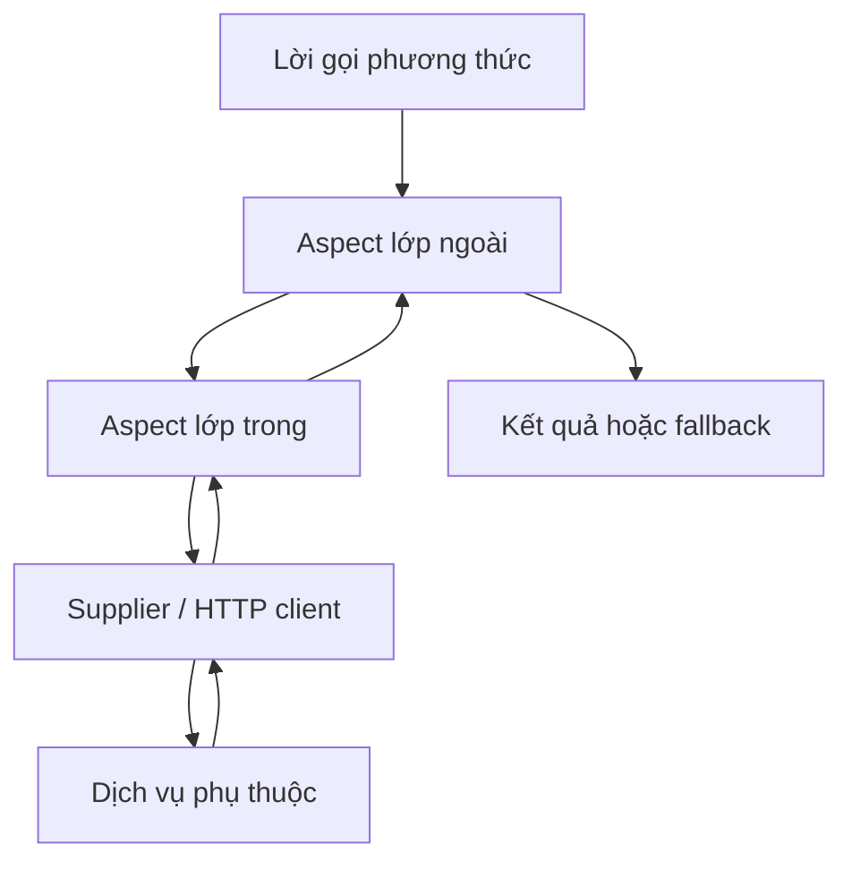

# Phụ thuộc và điều kiện để Spring AOP kích hoạt annotation

Các annotation như `@CircuitBreaker`, `@Retry`, `@Bulkhead`, `@RateLimiter` và `@TimeLimiter` giúp đặt chính sách phục hồi ngay tại phương thức gọi dịch vụ. Tuy nhiên, annotation chỉ là metadata. Để hành vi bảo vệ thực sự chạy, ứng dụng cần có đúng thư viện tích hợp Resilience4j, cơ chế Spring AOP, bean do Spring quản lý và một lời gọi đi qua proxy mà Spring tạo ra.

Đây là điểm quan trọng khi triển khai circuit breaker trong Spring Cloud: có dependency cho `CircuitBreakerFactory` không đồng nghĩa các annotation Resilience4j đã được kích hoạt. API Spring Cloud CircuitBreaker và annotation aspect của Resilience4j là hai cách tích hợp liên quan nhưng có hợp đồng và điều kiện khởi tạo riêng. Hiểu các điều kiện này giúp tránh tình trạng mã biên dịch thành công, ứng dụng vẫn khởi động nhưng phương thức có annotation lại chạy như một lời gọi Java bình thường.

## 1. Annotation cần aspect để thực thi

Spring AOP triển khai lời gọi được đánh chặn bằng proxy. Khi một bean được Spring tạo, container có thể bọc bean đó bằng proxy. Một lời gọi đi qua proxy sẽ được các aspect kiểm tra trước hoặc sau khi phương thức đích chạy. Resilience4j cung cấp các aspect nhận diện annotation và bao quanh phương thức bằng circuit breaker, retry, bulkhead, rate limiter hoặc time limiter.


Nếu không có proxy/aspect phù hợp, Java vẫn cho phép đặt annotation trên phương thức nhưng annotation không tự thay đổi cách gọi. Ví dụ, `@CircuitBreaker(name = "inventory")` không tự chặn request chỉ vì class có import đúng annotation. Aspect phải được nạp và phương thức phải được gọi qua proxy.

## 2. Phân biệt hai cách tích hợp Spring Cloud và Resilience4j

Trong hệ thống Spring Cloud có hai lớp API thường gặp:

| Cách tích hợp | Thành phần chính | Mục đích |
|---|---|---|
| Spring Cloud CircuitBreaker | `CircuitBreakerFactory`, `ReactiveCircuitBreakerFactory` | Lấy breaker bằng ID và bao quanh lời gọi qua API chung của Spring Cloud |
| Resilience4j Spring Boot annotations | `@CircuitBreaker`, `@Retry`, `@Bulkhead`, `@RateLimiter`, `@TimeLimiter` và các aspect | Đánh chặn phương thức Spring bean bằng AOP và áp dụng policy Resilience4j |

Starter `spring-cloud-starter-circuitbreaker-resilience4j` cung cấp implementation Resilience4j cho abstraction Spring Cloud CircuitBreaker. Nếu muốn dùng annotation aspect của Resilience4j, cần thêm module tích hợp Spring Boot tương ứng như `resilience4j-spring-boot3` hoặc `resilience4j-spring-boot2`, theo phiên bản Spring Boot của dự án.

Hai cách có thể cùng tồn tại trong một ứng dụng, nhưng không nên giả định starter Spring Cloud tự động bật tất cả annotation aspect của Resilience4j. Chọn đúng dependency theo API sẽ sử dụng. Nếu code gọi bằng `CircuitBreakerFactory`, cần starter Spring Cloud tương ứng. Nếu code dựa vào `@CircuitBreaker` và các annotation Resilience4j, cần tích hợp Spring Boot/AOP cung cấp các aspect đó.

Với ứng dụng reactive dùng API factory của Spring Cloud, cần starter reactive tương ứng, ví dụ `spring-cloud-starter-circuitbreaker-reactor-resilience4j`. Với annotation trên phương thức trả về kiểu reactive, cần kiểm tra hỗ trợ của aspect và phiên bản Resilience4j; trong nhiều trường hợp, API `ReactiveCircuitBreaker` hoặc operator Reactor tường minh dễ kiểm soát semantics hơn.

## 3. Các dependency cần có

### Spring Boot 3

Để sử dụng annotation aspect Resilience4j trên Spring Boot 3, dependency tích hợp thường dùng là `resilience4j-spring-boot3`. Ứng dụng cũng cần Spring AOP; khai báo `spring-boot-starter-aop` một cách tường minh giúp thể hiện rõ yêu cầu proxy-based AOP và tránh phụ thuộc vào việc một starter khác có kéo AOP transitively hay không.

Ví dụ Gradle:

```kotlin
dependencies {
    implementation("io.github.resilience4j:resilience4j-spring-boot3")
    implementation("org.springframework.boot:spring-boot-starter-aop")
    implementation("org.springframework.boot:spring-boot-starter-actuator")
}
```

### Spring Boot 2

Với Spring Boot 2, dùng module tích hợp tương ứng:

```kotlin
dependencies {
    implementation("io.github.resilience4j:resilience4j-spring-boot2")
    implementation("org.springframework.boot:spring-boot-starter-aop")
    implementation("org.springframework.boot:spring-boot-starter-actuator")
}
```

Không thêm cả `resilience4j-spring-boot2` và `resilience4j-spring-boot3` vào cùng một ứng dụng. Chọn module theo dòng Spring Boot, Java và Spring Framework đang dùng. Quản lý version bằng dependency management hoặc BOM tương thích của dự án; không sao chép một version tùy ý vào từng dependency.

### Khi dùng Spring Cloud CircuitBreaker factory

Nếu gateway sử dụng API `CircuitBreakerFactory`, thêm starter Spring Cloud Resilience4j:

```kotlin
dependencies {
    implementation("org.springframework.cloud:spring-cloud-starter-circuitbreaker-resilience4j")
}
```

Với API reactive của Spring Cloud, dùng starter reactive phù hợp:

```kotlin
dependencies {
    implementation("org.springframework.cloud:spring-cloud-starter-circuitbreaker-reactor-resilience4j")
}
```

Các artifact trên cần được quản lý theo Spring Cloud release train tương thích với Spring Boot của ứng dụng. Không trộn tùy ý các phiên bản Spring Cloud, Spring Boot và Resilience4j vì có thể dẫn đến lỗi class loading, thiếu method hoặc auto-configuration không hoạt động.

## 4. Vì sao cần spring-boot-starter-aop?

Resilience4j annotation được xử lý bởi aspect. `spring-boot-starter-aop` đưa Spring AOP và thư viện AspectJ cần thiết vào classpath, đồng thời hỗ trợ cơ chế auto-configuration AOP của Spring Boot. Trong ứng dụng Spring Boot thông thường, không cần tự viết một aspect cho từng annotation.

Một số dự án có thể đã nhận Spring AOP từ dependency khác. Dù vậy, nên kiểm tra dependency tree để xác nhận `spring-aop` và các thành phần cần thiết thực sự có mặt. Chỉ thêm `aspectjweaver` hoặc chỉ import annotation không thay thế module tích hợp Resilience4j cung cấp aspect.

Spring AOP của Spring Boot chủ yếu dùng proxy runtime. Nó không phải AspectJ compile-time weaving và không tự đánh chặn mọi lời gọi nội bộ trong bytecode. Vì vậy, điều kiện proxy ở cấp bean và cách gọi phương thức rất quan trọng.

## 5. Bean phải do Spring quản lý

Annotation aspect chỉ có cơ hội đánh chặn đối tượng được Spring tạo và bọc proxy. Bean có thể được đăng ký qua `@Service`, `@Component`, `@Repository`, `@Bean` hoặc cơ chế cấu hình Spring tương ứng.

Ví dụ một gateway được Spring quản lý:

```java
import org.springframework.stereotype.Service;
import io.github.resilience4j.circuitbreaker.annotation.CircuitBreaker;

@Service
public class InventoryGateway {

    private final InventoryClient inventoryClient;

    public InventoryGateway(InventoryClient inventoryClient) {
        this.inventoryClient = inventoryClient;
    }

    @CircuitBreaker(name = "inventory", fallbackMethod = "fallback")
    public InventoryView find(String sku) {
        return inventoryClient.find(sku);
    }

    private InventoryView fallback(String sku, Throwable error) {
        return InventoryView.unavailable(sku);
    }
}
```

Spring tạo `InventoryGateway` và có thể bọc nó bằng proxy. Khi một bean khác inject `InventoryGateway` và gọi `find`, lời gọi đi qua proxy để aspect xử lý annotation.

Không tự tạo đối tượng bằng `new InventoryGateway(...)` trong mã nghiệp vụ:

```java
// Không đi qua Spring proxy nên annotation AOP không được áp dụng.
InventoryGateway gateway = new InventoryGateway(inventoryClient);
```

Đối tượng tự tạo không được container quản lý, không có proxy do Spring tạo và không được inject các aspect như một bean bình thường. Hãy inject bean qua constructor hoặc lấy từ application context trong các tình huống framework đặc biệt.

## 6. Lời gọi phải đi qua proxy

Một bean được proxy chưa đủ; lời gọi cần đi qua proxy đó. Trường hợp thường gặp nhất làm annotation không chạy là **self-invocation**: một phương thức trong class gọi một phương thức khác của cùng instance bằng `this` hoặc gọi trực tiếp tên phương thức.

```java
@Service
public class OrderService {

    public OrderView place(String orderId) {
        // Gọi nội bộ trên this, bỏ qua proxy.
        return loadInventory(orderId);
    }

    @CircuitBreaker(name = "inventory")
    public OrderView loadInventory(String orderId) {
        // Gọi dịch vụ tồn kho.
        return ...;
    }
}
```

Khi `place` chạy trên proxy rồi gọi `loadInventory` nội bộ, lời gọi nội bộ không quay lại proxy. Aspect của `@CircuitBreaker` có thể bị bỏ qua. Cách sửa thường dùng là chuyển phương thức được bảo vệ sang một bean riêng:

```java
@Service
public class InventoryGateway {
    @CircuitBreaker(name = "inventory", fallbackMethod = "fallback")
    public InventoryView find(String sku) {
        return inventoryClient.find(sku);
    }

    private InventoryView fallback(String sku, Throwable error) {
        return InventoryView.unavailable(sku);
    }
}

@Service
public class OrderService {
    private final InventoryGateway inventoryGateway;

    public OrderService(InventoryGateway inventoryGateway) {
        this.inventoryGateway = inventoryGateway;
    }

    public OrderView place(String sku) {
        InventoryView inventory = inventoryGateway.find(sku);
        return OrderView.from(inventory);
    }
}
```

Ở đây, `OrderService` gọi bean `InventoryGateway` được inject. Lời gọi đi qua proxy của gateway và aspect có thể thực thi.

Một lựa chọn khác là thiết kế lại ranh giới bean để lời gọi từ bên ngoài luôn đi qua proxy. Việc inject chính bean vào chính nó hoặc lấy proxy từ application context có thể giải quyết một số trường hợp nhưng làm cấu trúc khó hiểu hơn; tách trách nhiệm thành bean riêng thường dễ kiểm thử và bảo trì hơn.

## 7. Kiểu proxy ảnh hưởng đến phương thức được đánh chặn

Spring AOP có thể sử dụng JDK dynamic proxy hoặc class-based proxy (CGLIB). Khả năng đánh chặn phụ thuộc vào kiểu proxy và đặc tính của phương thức.

| Đặc điểm | JDK dynamic proxy | Class-based proxy (CGLIB) |
|---|---|---|
| Cách tạo | Proxy dựa trên interface | Tạo lớp con của class bean |
| Phương thức có thể được gọi qua proxy | Phương thức khai báo trên interface proxy | Phương thức có thể override của class |
| Phương thức `final` | Có thể được đánh chặn nếu phương thức được expose qua interface proxy; proxy chặn ở interface boundary | Không thể override nên không thể đánh chặn bằng subclass proxy |
| Phương thức `private` | Không thuộc interface | Không thể override |
| Phương thức `static` | Không phải lời gọi instance qua proxy | Không thể override |
| Self-invocation | Bỏ qua proxy | Bỏ qua proxy |

Với JDK proxy, caller cần gọi phương thức thông qua interface mà proxy triển khai. Vì proxy là một đối tượng riêng triển khai interface, một phương thức `final` ở implementation vẫn có thể được aspect đánh chặn khi lời gọi đi qua interface proxy; giới hạn `final` chủ yếu ảnh hưởng class-based proxy. Nếu inject kiểu implementation cụ thể ở nơi chỉ có JDK proxy, có thể gặp lỗi không tương thích kiểu; hãy inject interface hoặc cấu hình proxy nhất quán.

Với CGLIB, class bean không được `final` và phương thức cần đánh chặn không được `final` hoặc `private`. Một phương thức `protected` hoặc package-private có thể được class proxy xử lý tùy phiên bản Spring và khả năng truy cập, nhưng phương thức `public` trên bean Spring vẫn là lựa chọn dễ dự đoán nhất cho annotation Resilience4j.

Spring Boot có thể chọn proxy dựa trên cấu hình AOP và classpath. Không nên dựa vào một kiểu proxy ngầm định khi thiết kế phương thức. Kiểm tra `spring.aop.proxy-target-class` và loại bean/proxy thực tế nếu cần chẩn đoán.

## 8. Annotation và ID phải khớp cấu hình instance

Thuộc tính `name` của annotation xác định instance Resilience4j cần sử dụng. Nó phải khớp với ID trong cấu hình:

```java
@CircuitBreaker(name = "inventory", fallbackMethod = "fallback")
public InventoryView find(String sku) {
    return inventoryClient.find(sku);
}
```

```yaml
resilience4j:
  circuitbreaker:
    instances:
      inventory:
        slidingWindowType: COUNT_BASED
        slidingWindowSize: 20
        minimumNumberOfCalls: 10
        failureRateThreshold: 50
        waitDurationInOpenState: 10s
```

Nếu annotation dùng `name = "inventory"` nhưng YAML chỉ khai báo `instances.stock`, cấu hình `stock` không tự áp dụng cho `inventory`. Tùy cấu hình mặc định và phiên bản, instance có thể được tạo bằng cấu hình mặc định hoặc báo lỗi cấu hình. Vì vậy, cần thống nhất tên trong annotation, cấu hình, log và metric.

Không nên tạo tên instance từ mã người dùng, mã đơn hàng hoặc giá trị thay đổi theo từng request. Mỗi ID có thể tạo một breaker riêng và metric tương ứng; số lượng ID không giới hạn làm tăng bộ nhớ và cardinality của metric.

## 9. Fallback method cũng phải đúng hợp đồng

Với annotation Resilience4j, `fallbackMethod` trỏ tới một phương thức fallback trong cùng class. Phương thức fallback cần nhận các tham số nghiệp vụ tương ứng với phương thức gốc, có thể thêm exception ở tham số cuối và trả về kiểu tương thích với phương thức gốc.

Ví dụ:

```java
@CircuitBreaker(name = "inventory", fallbackMethod = "fallback")
public InventoryView find(String sku) {
    return inventoryClient.find(sku);
}

private InventoryView fallback(String sku, CallNotPermittedException error) {
    return InventoryView.unavailable(sku);
}

private InventoryView fallback(String sku, Throwable error) {
    return InventoryView.unavailable(sku);
}
```

Resilience4j chọn fallback tương ứng với loại exception; overload tổng quát nhận `Throwable` có thể xử lý các lỗi còn lại. Cần tránh tạo nhiều fallback overload có cùng mức phù hợp khiến việc chọn phương thức trở nên khó hiểu. Hãy bảo đảm fallback không gọi lại chính phụ thuộc đang bị bảo vệ và không biến dữ liệu không xác định thành kết quả nghiệp vụ giả.

Nếu fallback không tồn tại, sai tên, sai tham số hoặc kiểu trả về không tương thích, ứng dụng có thể gặp lỗi khi aspect tìm và gọi fallback. Kiểm tra chữ ký fallback trong lúc phát triển và viết kiểm thử cho cả đường lỗi lẫn đường thành công.

## 10. Kiểu trả về cần phù hợp với annotation

Không phải annotation nào cũng áp dụng giống nhau cho mọi kiểu trả về. `@CircuitBreaker`, `@Retry`, `@Bulkhead` và `@RateLimiter` có thể bảo vệ lời gọi đồng bộ; các aspect cũng có hỗ trợ cho một số kiểu bất đồng bộ tùy module và phiên bản. `@TimeLimiter` thường được dùng với `Future`/`CompletionStage` và cần một tác vụ bất đồng bộ có thể áp dụng giới hạn thời gian.

Ví dụ một phương thức bất đồng bộ:

```java
import java.util.concurrent.CompletableFuture;

@TimeLimiter(name = "inventory", fallbackMethod = "fallback")
public CompletableFuture<InventoryView> findAsync(String sku) {
    return CompletableFuture.supplyAsync(() -> inventoryClient.find(sku));
}
```

`CompletableFuture.supplyAsync` không tự bảo đảm tác vụ chạy trên executor phù hợp hoặc dừng khi timeout. Trong ứng dụng thực tế, nên dùng executor được quản lý và hiểu hành vi hủy của tác vụ nền. `cancelRunningFuture` có thể yêu cầu hủy Future nhưng không bảo đảm mọi I/O hoặc thao tác server đã dừng.

Với WebFlux/Reactor, không mặc định rằng một annotation đồng bộ có thể bảo vệ publisher theo đúng semantics reactive. Nếu cần bảo vệ `Mono` hoặc `Flux`, dùng API reactive được tài liệu của phiên bản hỗ trợ, ví dụ `ReactiveCircuitBreakerFactory`, hoặc dùng operator Resilience4j Reactor phù hợp. Kiểm thử cancellation, timeout và fallback trên publisher thay vì suy ra từ test của `CompletableFuture`.

## 11. Nhiều annotation trên cùng phương thức và thứ tự aspect

Một phương thức có thể cần nhiều chính sách như retry, circuit breaker, rate limiter và bulkhead. Mỗi annotation tạo một aspect; khi nhiều aspect cùng áp dụng, thứ tự lồng nhau quyết định cơ chế nào chạy trước và cơ chế nào quan sát exception của cơ chế bên trong.

Ví dụ, nếu retry bao ngoài circuit breaker, mỗi lần retry có thể đi qua breaker và được breaker đánh giá riêng. Nếu circuit breaker bao ngoài retry, breaker có thể chỉ quan sát kết quả cuối cùng của toàn bộ chuỗi thử lại. Tương tự, nếu circuit breaker bao ngoài bulkhead, `BulkheadFullException` có thể được nhìn như exception của lời gọi được bảo vệ; nếu bulkhead bao ngoài breaker, từ chối ở bulkhead có thể không đi vào thống kê breaker.



Resilience4j cho phép cấu hình thứ tự aspect qua các thuộc tính order tương ứng của module. Tên thuộc tính và giá trị mặc định cần kiểm tra theo phiên bản đang dùng; không nên dựa vào thứ tự mặc định nếu chính sách nghiệp vụ yêu cầu thứ tự cụ thể. Khi cần semantics rõ ràng, có thể ghép các decorator bằng API programmatic thay vì đặt nhiều annotation trên cùng phương thức.

Không gắn nhiều annotation chỉ vì muốn “bật tất cả” mà không xác định thứ tự và ý nghĩa exception. Hãy quyết định rõ retry có được thực hiện khi breaker mở không, bulkhead rejection có được tính là failure không, và timeout có được ghi vào breaker hay chỉ giới hạn deadline bên ngoài.

## 12. Các nguyên nhân phổ biến khiến annotation không hoạt động

| Triệu chứng | Nguyên nhân thường gặp | Cách kiểm tra hoặc sửa |
|---|---|---|
| Annotation biên dịch nhưng lời gọi không được bảo vệ | Thiếu module Resilience4j Spring Boot/AOP | Kiểm tra dependency tree và auto-configuration |
| Bean không có proxy | Bean không do Spring quản lý hoặc AOP bị tắt | Đăng ký bean bằng Spring và kiểm tra cấu hình AOP |
| Gọi nội bộ không kích hoạt aspect | Self-invocation đi qua `this` | Tách phương thức sang bean khác và inject bean đó |
| Phương thức không bị đánh chặn | Phương thức `private`, `static`, hoặc `final` khi dùng class-based proxy; phương thức không được expose qua interface khi dùng JDK proxy | Dùng phương thức instance có thể proxy, ưu tiên public |
| JDK proxy không tương thích kiểu inject | Inject implementation trong khi proxy chỉ triển khai interface | Inject interface hoặc chọn proxy phù hợp |
| Cấu hình không áp dụng | `name` trong annotation khác ID trong YAML | Đồng bộ tên instance |
| Fallback không được gọi | Sai tên hoặc chữ ký fallback | Kiểm tra tham số, exception cuối và kiểu trả về |
| TimeLimiter không dừng tác vụ | Tác vụ không hỗ trợ cancellation hoặc chạy blocking | Kiểm tra Future/executor/client và khả năng hủy thực tế |
| Reactive annotation có hành vi bất ngờ | Aspect/API không hỗ trợ kiểu publisher hoặc timeout đặt sai tầng | Dùng API reactive đúng phiên bản và test tín hiệu |

Một số kiểm tra nhanh hữu ích:

- Kiểm tra bean được inject có phải proxy hay không, ví dụ qua `AopUtils.isAopProxy(bean)` trong một kiểm thử hoặc lúc debug.
- Bật log phù hợp cho Spring AOP/Resilience4j trong môi trường phát triển để xác nhận aspect và instance được khởi tạo.
- Kiểm tra endpoint Actuator/metrics nếu đã bật để xác nhận lời gọi có làm thay đổi metric của instance.
- Dùng test gọi phương thức từ một bean khác, không chỉ gọi trực tiếp đối tượng trong unit test.
- Tạo lỗi có kiểm soát ở dependency giả và xác nhận fallback hoặc trạng thái breaker thực sự thay đổi.

## 13. Kiểm thử điều kiện kích hoạt AOP

Một unit test khởi tạo class bằng `new` chỉ kiểm tra logic Java; nó không kiểm tra proxy và aspect. Muốn xác nhận annotation hoạt động, hãy dùng Spring test context để lấy bean từ container và gọi qua bean đó.

Các trường hợp nên có:

1. **Bean do Spring quản lý:** lấy gateway từ context, gọi phương thức và xác nhận aspect được thực thi.
2. **Lời gọi qua bean khác:** gọi gateway từ một service khác để xác nhận proxy được đi qua.
3. **Self-invocation:** tạo trường hợp gọi nội bộ và xác nhận annotation bên trong không được kích hoạt, sau đó kiểm thử cách tách bean.
4. **Cấu hình instance:** dùng đúng ID trong annotation và xác nhận breaker/metric tương ứng được tạo.
5. **Fallback:** mô phỏng lỗi phụ thuộc và xác nhận fallback đúng chữ ký được gọi.
6. **Proxy type:** kiểm tra interface proxy hoặc class proxy theo cấu hình ứng dụng; xác nhận phương thức được expose qua proxy.
7. **Aspect order:** nếu có nhiều annotation, kiểm thử trường hợp lỗi để xác nhận thứ tự và thống kê đúng yêu cầu.
8. **Reactive/async:** kiểm tra kiểu trả về, timeout, cancellation và fallback bằng công cụ test phù hợp với Reactor hoặc `CompletableFuture`.

Với Resilience4j, có thể kiểm tra trạng thái breaker và metric thông qua API hoặc Actuator trong test tích hợp. Không nên chỉ xác nhận rằng annotation có mặt bằng reflection rồi kết luận AOP đang hoạt động.

## 14. Khi nào nên dùng annotation và khi nào nên dùng API programmatic?

Annotation phù hợp khi một phương thức có chính sách tương đối ổn định, ID cấu hình rõ ràng và lời gọi luôn đi qua Spring proxy. Cách này giúp code ngắn và đặt chính sách gần nơi gọi phụ thuộc.

API programmatic như `CircuitBreakerFactory` hoặc decorator Resilience4j phù hợp khi cần điều khiển thứ tự chính xác, chọn policy theo dữ liệu runtime, phối hợp nhiều publisher hoặc xử lý cancellation/timeout phức tạp. Nó cũng hữu ích khi lời gọi không nằm trong một bean Spring có thể proxy hoặc khi cần tránh giới hạn self-invocation.

Không nên bọc cùng một lời gọi bằng cả annotation và một circuit breaker programmatic khác nếu chưa xác định rõ mục tiêu. Hai breaker có thể ghi nhận cùng lỗi, mở ở các thời điểm khác nhau hoặc tạo hai lớp fallback khó hiểu. Chọn một điểm chịu trách nhiệm chính cho mỗi policy và kiểm thử hành vi khi có nhiều cơ chế lồng nhau.

## 15. Quy trình xác nhận annotation đã được kích hoạt

Khi thêm annotation Resilience4j vào một gateway Spring Cloud, hãy kiểm tra theo thứ tự:

1. Chọn đúng cách tích hợp: Spring Cloud `CircuitBreakerFactory` hay Resilience4j Spring Boot annotations.
2. Thêm đúng starter theo phiên bản Spring Boot và Spring Cloud; quản lý version bằng BOM tương thích.
3. Xác nhận `spring-boot-starter-aop` và module cung cấp aspect Resilience4j có mặt.
4. Đăng ký class thành bean Spring và inject qua container; không tự tạo bằng `new`.
5. Đảm bảo lời gọi đến phương thức được thực hiện từ bên ngoài proxy, tránh self-invocation.
6. Dùng phương thức instance có thể proxy; kiểm tra interface/JDK proxy hoặc class/CGLIB proxy.
7. Đồng bộ `name` trong annotation với instance ID trong cấu hình.
8. Kiểm tra fallback và kiểu trả về phù hợp với loại tác vụ đồng bộ, bất đồng bộ hoặc reactive.
9. Xác định thứ tự khi nhiều aspect cùng áp dụng và kiểm thử exception phát sinh.
10. Dùng Spring integration test để chứng minh proxy và policy hoạt động khi dependency thành công, thất bại hoặc chậm.

Annotation chỉ là điểm khai báo chính sách. Spring AOP phải tạo proxy, Resilience4j phải cung cấp aspect phù hợp và lời gọi phải đi qua proxy thì circuit breaker hoặc các cơ chế phục hồi mới được áp dụng. Khi xác nhận đủ dependency, bean, proxy, ID cấu hình và kiểu trả về, ứng dụng Spring Cloud có thể dùng annotation một cách dự đoán được; với các luồng reactive hoặc thứ tự policy phức tạp, API programmatic vẫn là lựa chọn rõ ràng để kiểm soát hành vi.
