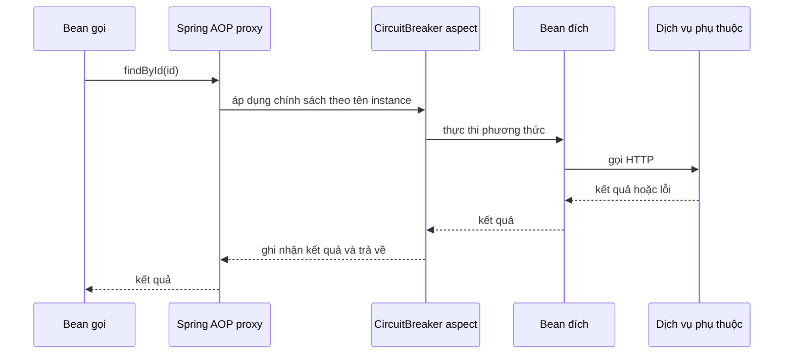

# Giới hạn self-invocation, proxy và phạm vi phương thức

## Mục tiêu

Resilience4j cho phép áp dụng Circuit Breaker bằng annotation `@CircuitBreaker` trên phương thức Spring bean. Annotation giúp mã nghiệp vụ gọn hơn, nhưng chỉ có tác dụng khi lời gọi đi qua Spring AOP proxy. Nếu một phương thức trong bean gọi trực tiếp phương thức khác của chính bean đó, lời gọi nội bộ thường bỏ qua proxy và không chạy advice Circuit Breaker. Hiểu ranh giới proxy và phạm vi phương thức giúp tránh tình trạng annotation có mặt trong mã nhưng request vẫn không được bảo vệ.

Sau bài học, bạn có thể:

- Giải thích Spring AOP proxy xử lý lời gọi có `@CircuitBreaker` như thế nào.
- Nhận diện trường hợp self-invocation khiến Circuit Breaker advice không được áp dụng.
- Chọn ranh giới phương thức và tên instance phù hợp với dependency cần bảo vệ.
- Khắc phục self-invocation bằng cách tách bean hoặc dùng API lập trình của Spring Cloud CircuitBreaker.
- Kiểm tra proxy, fallback và metric bằng một bài thử tích hợp.

## Annotation được áp dụng qua Spring AOP proxy

Khi dùng Resilience4j Spring Boot integration, `@CircuitBreaker` được xử lý bởi aspect của Resilience4j. Spring tạo proxy bao quanh bean được áp dụng advice. Khi một bean khác gọi phương thức trên proxy, lời gọi đi qua aspect trước khi vào phần thân phương thức.

Luồng khái quát:



Ví dụ một service gọi dịch vụ danh mục:

```java
import io.github.resilience4j.circuitbreaker.annotation.CircuitBreaker;
import org.springframework.stereotype.Service;

@Service
public class CatalogService {
    private final CatalogClient catalogClient;

    public CatalogService(CatalogClient catalogClient) {
        this.catalogClient = catalogClient;
    }

    @CircuitBreaker(name = "catalog-read", fallbackMethod = "findFallback")
    public Product findById(String id) {
        return catalogClient.findById(id);
    }

    public Product findFallback(String id, Throwable error) {
        return Product.unavailable(id);
    }
}
```

Khi controller hoặc một bean khác inject `CatalogService` rồi gọi `findById`, Spring có thể đưa lời gọi qua proxy để aspect áp dụng Circuit Breaker instance `catalog-read`. Nếu mạch đang `OPEN`, lời gọi tới `catalogClient` bị ngăn và fallback có thể được thực thi. `Product`, `CatalogClient` và `Product.unavailable` là các kiểu dữ liệu của ứng dụng.

Annotation không tự biến mọi lời gọi trong lớp thành lời gọi được bảo vệ. Điều kiện cốt lõi là lời gọi phải đi qua proxy mà Spring đã tạo cho bean.

## Self-invocation bỏ qua proxy

Self-invocation xảy ra khi một phương thức trong bean gọi phương thức khác trên chính đối tượng đó bằng `this` hoặc lời gọi không ghi `this`:

```java
@Service
public class CatalogService {
    private final CatalogClient catalogClient;

    public CatalogService(CatalogClient catalogClient) {
        this.catalogClient = catalogClient;
    }

    public Product loadPageProduct(String id) {
        // Lời gọi trực tiếp trên target object, không quay lại Spring proxy.
        return findById(id);
    }

    @CircuitBreaker(name = "catalog-read", fallbackMethod = "findFallback")
    public Product findById(String id) {
        return catalogClient.findById(id);
    }

    public Product findFallback(String id, Throwable error) {
        return Product.unavailable(id);
    }
}
```

Nếu caller bên ngoài gọi `loadPageProduct` qua proxy, proxy chỉ nhìn thấy lời gọi `loadPageProduct`. Khi phần thân phương thức chạy, `findById` được gọi trực tiếp trên target object. Lời gọi nội bộ không đi qua proxy lần thứ hai, vì vậy aspect của `@CircuitBreaker` trên `findById` không được kích hoạt. Kết quả là:

- Supplier/lời gọi tới `CatalogClient` vẫn chạy ngay cả khi instance Circuit Breaker dự kiến đang `OPEN`.
- Circuit Breaker `catalog-read` không ghi nhận kết quả của lời gọi nội bộ này.
- Fallback `findFallback` không được gọi bởi annotation trên `findById`.

Đây là lỗi khó nhận ra vì code có annotation, ứng dụng vẫn khởi động và phương thức vẫn trả kết quả. Cần kiểm tra đường đi thực tế của lời gọi thay vì chỉ tìm annotation trong source.

## Proxy interface và proxy dựa trên lớp

Spring AOP thường dùng một trong hai kiểu proxy:

| Kiểu proxy | Cách hoạt động | Điểm cần lưu ý |
|---|---|---|
| JDK dynamic proxy | Tạo proxy thực thi interface của bean. | Caller cần gọi qua interface mà proxy cung cấp; phương thức không thuộc interface không nằm trong bề mặt proxy đó. |
| Class-based proxy (CGLIB) | Tạo lớp con để ghi đè phương thức có thể advice. | Không thể advice phương thức `final`, `private` hoặc phương thức không thể override; lớp `final` cũng không thể được mở rộng. |

Kiểu proxy thực tế phụ thuộc cấu hình Spring và cấu trúc bean. Với JDK proxy, nên inject và gọi bean qua interface. Với CGLIB, phương thức cần được override và gọi qua proxy. Trong cả hai trường hợp, self-invocation vẫn bỏ qua proxy vì lời gọi nội bộ sử dụng đối tượng đích.

Để tránh phụ thuộc vào chi tiết proxy, hãy đặt phương thức có annotation trên một Spring bean được gọi từ bean khác, dùng phương thức có thể được proxy và inject bean qua abstraction phù hợp. Với ngôn ngữ hoặc cấu hình làm lớp/phương thức mặc định là `final`, cần bảo đảm cơ chế mở lớp tương thích với loại proxy đã chọn.

## Chọn phạm vi phương thức cần bảo vệ

Đặt `@CircuitBreaker` ở phương thức đại diện cho một ranh giới gọi dependency. Phương thức đó nên có trách nhiệm rõ ràng: gọi một dịch vụ từ xa hoặc một thao tác có đặc tính lỗi cần được theo dõi riêng.

Ví dụ:

```java
@Service
public class ProductGateway {
    private final CatalogClient catalogClient;
    private final InventoryClient inventoryClient;

    public ProductGateway(
            CatalogClient catalogClient,
            InventoryClient inventoryClient) {
        this.catalogClient = catalogClient;
        this.inventoryClient = inventoryClient;
    }

    @CircuitBreaker(name = "catalog-read", fallbackMethod = "catalogFallback")
    public Product readCatalog(String id) {
        return catalogClient.findById(id);
    }

    @CircuitBreaker(name = "inventory-read", fallbackMethod = "inventoryFallback")
    public Stock readInventory(String id) {
        return inventoryClient.findStock(id);
    }

    private Product catalogFallback(String id, Throwable error) {
        return Product.unavailable(id);
    }

    private Stock inventoryFallback(String id, Throwable error) {
        return Stock.unknown(id);
    }
}
```

Trong thực tế, hai phương thức này cần được gọi qua proxy từ một bean khác. Ví dụ minh họa phạm vi: lỗi catalog và inventory có thể được thống kê bằng hai Circuit Breaker instance riêng. Nếu cả hai phương thức dùng cùng một tên instance, chúng có thể chia sẻ cùng cấu hình và trạng thái Circuit Breaker; hãy chỉ làm vậy khi hai thao tác thực sự thuộc cùng một ranh giới lỗi.

Không nên đặt annotation quá rộng lên một phương thức orchestration thực hiện nhiều việc không liên quan, như kiểm tra dữ liệu đầu vào, tính toán nội bộ, gọi catalog và cập nhật cache. Nếu toàn bộ phương thức bị xem là một lời gọi dependency, lỗi validation hoặc lỗi cục bộ cũng có thể bị tính vào Circuit Breaker. Tách phần gọi dependency ra gateway có ranh giới rõ ràng giúp phân loại lỗi và metric chính xác hơn.

## Fallback phải khớp chữ ký phương thức

Với annotation Resilience4j, fallback thường là một phương thức trong cùng bean. Phương thức fallback cần:

- Có kiểu trả về tương thích với phương thức được bảo vệ.
- Nhận các tham số nghiệp vụ của phương thức gốc theo cùng thứ tự.
- Có thêm tham số exception ở cuối để nhận nguyên nhân lỗi.
- Có thể dùng `Throwable` để xử lý chung hoặc một kiểu exception cụ thể để xử lý một nhóm lỗi.

Ví dụ:

```java
@CircuitBreaker(name = "catalog-read", fallbackMethod = "findFallback")
public Product findById(String id, String locale) {
    return catalogClient.findById(id, locale);
}

public Product findFallback(String id, String locale, CallNotPermittedException error) {
    return cache.findProduct(id, locale)
            .orElse(Product.unavailable(id));
}
```

Fallback trên xử lý trường hợp Circuit Breaker từ chối lời gọi. Nếu phương thức có thể thất bại bằng nhiều loại exception, có thể tạo overload fallback cho từng loại hoặc dùng `Throwable` để phân loại bên trong. Cần bảo đảm overload không mơ hồ và chữ ký phù hợp với phiên bản Resilience4j đang dùng.

Fallback cũng chịu ảnh hưởng của self-invocation. Nếu lời gọi không đi qua proxy, fallback của annotation không được kích hoạt. Ngoài ra, fallback không nên gọi lại chính dependency đang lỗi qua một đường không được bảo vệ; hãy dùng cache, dữ liệu suy giảm có ý nghĩa hoặc truyền lỗi phù hợp về caller.

## Khắc phục self-invocation bằng cách tách bean

Giải pháp dễ bảo trì nhất thường là chuyển thao tác gọi dependency sang một bean riêng. Bean orchestration gọi bean gateway qua Spring container, do đó lời gọi đi qua proxy.

```java
@Service
public class CatalogGateway {
    private final CatalogClient catalogClient;

    public CatalogGateway(CatalogClient catalogClient) {
        this.catalogClient = catalogClient;
    }

    @CircuitBreaker(name = "catalog-read", fallbackMethod = "findFallback")
    public Product findById(String id) {
        return catalogClient.findById(id);
    }

    public Product findFallback(String id, Throwable error) {
        return Product.unavailable(id);
    }
}

@Service
public class ProductFacade {
    private final CatalogGateway catalogGateway;

    public ProductFacade(CatalogGateway catalogGateway) {
        this.catalogGateway = catalogGateway;
    }

    public Product loadPageProduct(String id) {
        // Lời gọi giữa hai bean đi qua proxy của CatalogGateway.
        return catalogGateway.findById(id);
    }
}
```

`ProductFacade` chịu trách nhiệm điều phối luồng ứng dụng; `CatalogGateway` chịu trách nhiệm giao tiếp với dependency và áp dụng Circuit Breaker. Cách chia này làm rõ ranh giới lỗi, giúp dễ kiểm thử riêng và tránh gọi nội bộ trên cùng target object.

## Các cách gọi qua proxy khác

Trong một số tình huống không thể tách bean, có thể cân nhắc các cách sau:

**Inject tham chiếu self qua Spring:** có thể inject proxy của chính bean, thường dùng `@Lazy` để tránh vòng phụ thuộc khi khởi tạo. Sau đó gọi phương thức qua tham chiếu proxy thay vì `this`. Cách này cần thiết kế cẩn thận để không tạo vòng lặp gọi hoặc làm dependency graph khó hiểu.

**Dùng `AopContext.currentProxy()`:** Spring có thể cho phép lấy proxy hiện tại nếu cấu hình `exposeProxy` được bật. Cách này gắn mã nghiệp vụ với Spring AOP và làm việc kiểm thử khó hơn; chỉ dùng khi có lý do rõ ràng.

**Dùng API lập trình:** nếu cần kiểm soát ranh giới lời gọi ngay trong mã, có thể dùng `CircuitBreakerFactory` hoặc `ReactiveCircuitBreakerFactory` của Spring Cloud CircuitBreaker để bọc supplier/publisher. Cách này không phụ thuộc annotation trên lời gọi nội bộ, nhưng vẫn phải đặt lời gọi thật bên trong supplier hoặc publisher được bảo vệ.

Ví dụ với factory đồng bộ:

```java
@Service
public class CatalogGateway {
    private final CatalogClient catalogClient;
    private final CircuitBreaker circuitBreaker;

    public CatalogGateway(
            CatalogClient catalogClient,
            CircuitBreakerFactory<?, ?> factory) {
        this.catalogClient = catalogClient;
        this.circuitBreaker = factory.create("catalog-read");
    }

    public Product findById(String id) {
        return circuitBreaker.run(
                () -> catalogClient.findById(id),
                error -> Product.unavailable(id));
    }
}
```

Ở đây Circuit Breaker được gọi trực tiếp trong thân phương thức. Dù `findById` được gọi từ một phương thức khác cùng bean, supplier vẫn được đưa qua Circuit Breaker vì mã đã chủ động gọi `run`. Không cần dựa vào aspect để bắt lời gọi nội bộ.

## Cấu hình instance theo tên annotation

Tên trong `@CircuitBreaker(name = "catalog-read")` cần khớp với instance được cấu hình trong Resilience4j:

```yaml
resilience4j:
  circuitbreaker:
    instances:
      catalog-read:
        slidingWindowType: COUNT_BASED
        slidingWindowSize: 20
        minimumNumberOfCalls: 10
        failureRateThreshold: 50
        waitDurationInOpenState: 8s
        permittedNumberOfCallsInHalfOpenState: 3
      inventory-read:
        slidingWindowType: COUNT_BASED
        slidingWindowSize: 30
        minimumNumberOfCalls: 15
        failureRateThreshold: 40
        waitDurationInOpenState: 10s
        permittedNumberOfCallsInHalfOpenState: 2
```

Mỗi tên instance có cấu hình và trạng thái runtime riêng. Nhiều phương thức dùng chung một tên sẽ cùng sử dụng cùng Circuit Breaker instance theo cách integration quản lý. Tên khác nhau tạo ranh giới thống kê khác nhau. Đặt tên theo dependency hoặc thao tác có cùng đặc tính lỗi; không thêm ID request vào tên.

Nếu dùng `@CircuitBreaker` với `fallbackMethod`, fallback phải tồn tại và tương thích chữ ký. Nếu cấu hình instance sai tên, ứng dụng có thể rơi vào cấu hình mặc định hoặc không có cấu hình mong muốn tùy integration và phiên bản. Kiểm tra log khởi động và metric theo tag instance để xác nhận tên được bind đúng.

## Thứ tự aspect khi kết hợp nhiều annotation

Một phương thức có thể dùng nhiều annotation như `@Retry`, `@RateLimiter`, `@Bulkhead` và `@CircuitBreaker`. Khi nhiều aspect cùng intercept một lời gọi, thứ tự thực thi ảnh hưởng tới:

- Circuit Breaker ghi nhận từng attempt hay kết quả cuối của chuỗi retry.
- Timeout được áp dụng cho từng lần thử hay toàn bộ thao tác.
- Bulkhead permit có bị giữ trong thời gian backoff hay không.
- Exception nào tới fallback và metric của từng aspect.

Không nên dựa vào thứ tự ngầm định nếu ứng dụng cần một hành vi cụ thể. Resilience4j có cấu hình aspect order cho các annotation trong các phiên bản tương ứng; hãy kiểm tra tài liệu của phiên bản đang dùng và đặt thứ tự rõ ràng nếu cần. Sau khi thay đổi order, kiểm thử số request thực tế, số attempt, thời gian tổng và số mẫu Circuit Breaker.

Trong nhiều trường hợp, dùng một lớp orchestration lập trình rõ thứ tự sẽ dễ đọc hơn việc xếp nhiều annotation trên cùng một phương thức. Dù chọn cách nào, hãy bảo đảm retry không lặp lại lỗi `CallNotPermittedException` khi Circuit Breaker đã `OPEN`.

## Kiểm chứng proxy và phạm vi phương thức

Một bài kiểm tra tích hợp nên xác nhận hành vi qua bean mà ứng dụng thực sự inject, không gọi trực tiếp target object đã được unwrap.

Ví dụ kiểm tra bean có proxy:

```java
import static org.assertj.core.api.Assertions.assertThat;

import org.junit.jupiter.api.Test;
import org.springframework.aop.support.AopUtils;
import org.springframework.beans.factory.annotation.Autowired;
import org.springframework.boot.test.context.SpringBootTest;

@SpringBootTest
class CatalogGatewayProxyTest {
    @Autowired
    private CatalogGateway catalogGateway;

    @Test
    void gatewayIsManagedThroughSpringProxy() {
        assertThat(AopUtils.isAopProxy(catalogGateway)).isTrue();
    }
}
```

Kiểm tra proxy chỉ xác nhận bean được bọc; nó chưa chứng minh annotation đang bảo vệ đúng lời gọi. Hãy bổ sung kiểm thử hành vi:

1. Mock `CatalogClient` để lần gọi đầu ném lỗi tạm thời.
2. Gọi phương thức có annotation qua bean được inject từ Spring context.
3. Xác nhận fallback được gọi và Circuit Breaker ghi nhận lỗi theo cấu hình.
4. Làm đủ số lỗi để mạch chuyển `OPEN`; xác nhận lời gọi tiếp theo không gọi mock client.
5. Gọi một phương thức orchestration có self-invocation; so sánh với lời gọi qua gateway bean đã tách để phát hiện đường đi bỏ qua proxy.
6. Quan sát metric theo tên instance để xác nhận chỉ những lời gọi qua proxy được ghi nhận.

Trong kiểm thử, tránh phụ thuộc thời gian chờ dài. Có thể cấu hình cửa sổ nhỏ, số mẫu tối thiểu thấp và thời gian `OPEN` ngắn cho profile test. Không mang cấu hình kiểm thử này sang production.

## Lỗi thường gặp

- **Thấy annotation nên cho rằng mọi lời gọi đều được bảo vệ:** aspect chỉ chạy khi lời gọi đi qua proxy.
- **Gọi `this.method()` trong cùng bean:** self-invocation bỏ qua proxy và không kích hoạt Circuit Breaker annotation ở phương thức đích.
- **Đặt annotation trên phương thức không thể proxy:** private/final hoặc phương thức không thuộc interface của JDK proxy có thể không được advice như mong đợi.
- **Inject target thay vì Spring bean proxy:** có thể làm mất advice của AOP.
- **Dùng cùng tên instance cho các dependency độc lập:** trạng thái và thống kê bị chia sẻ ngoài ý muốn.
- **Đặt annotation quá rộng:** lỗi validation hoặc xử lý cục bộ có thể bị tính là lỗi dependency.
- **Fallback sai chữ ký:** Resilience4j không tìm được fallback phù hợp hoặc lỗi gốc bị che bởi lỗi gọi fallback.
- **Fallback gọi lại dependency đang lỗi:** tạo thêm tải và có thể lặp vòng lỗi.
- **Chỉ kiểm tra AopUtils:** bean có proxy chưa đủ chứng minh lời gọi cụ thể đi qua advice.
- **Không xét thứ tự aspect:** Retry, TimeLimiter, Bulkhead và Circuit Breaker có thể ghi nhận số lần gọi khác dự kiến.

Hãy xem proxy là ranh giới thực thi của annotation. Đặt Circuit Breaker trên phương thức đại diện cho dependency, gọi phương thức đó qua Spring bean proxy và kiểm thử cả fallback lẫn trạng thái. Nếu luồng nội bộ cần gọi lại phương thức được bảo vệ, ưu tiên tách gateway thành bean riêng hoặc bọc lời gọi bằng API lập trình của Spring Cloud CircuitBreaker.
