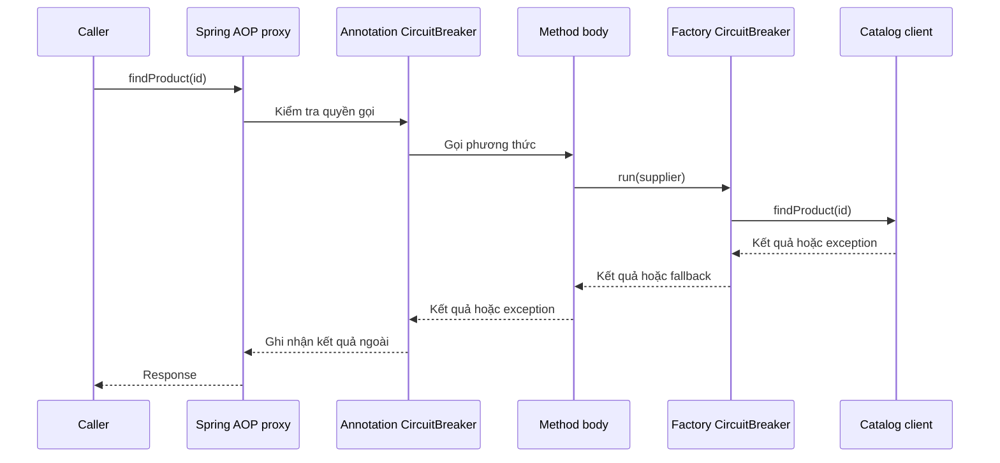

# Tránh bao cùng thao tác hai lần qua factory và annotation

Spring Cloud Circuit Breaker cung cấp API lập trình qua `CircuitBreakerFactory` hoặc `ReactiveCircuitBreakerFactory`. Resilience4j đồng thời cung cấp annotation như `@CircuitBreaker` để AOP tự bọc lời gọi phương thức. Cả hai cách đều có thể bảo vệ một lời gọi tới dịch vụ phụ thuộc, nhưng nếu dùng đồng thời trên cùng một đường thực thi, thao tác có thể bị bao bởi hai lớp circuit breaker.

Hai lớp bảo vệ cho cùng một request thường làm hành vi khó dự đoán: một lỗi có thể được ghi nhận nhiều lần, fallback có thể chạy ở lớp trong trước khi lớp ngoài nhìn thấy lỗi, và các trạng thái breaker có thể không phản ánh đúng một lần gọi nghiệp vụ. Vì vậy, mỗi thao tác phụ thuộc nên có một nơi chịu trách nhiệm áp dụng CircuitBreaker. Chọn annotation hoặc factory cho đường thực thi đó và tránh lồng cả hai nếu không có chủ đích rõ ràng.

## Hai cách áp dụng CircuitBreaker

`CircuitBreakerFactory` là API của Spring Cloud Circuit Breaker. Ứng dụng tạo instance theo ID và gọi `run` để bọc supplier:

```java
@Service
public class CatalogService {

    private final CircuitBreakerFactory<?, ?> circuitBreakerFactory;
    private final CatalogClient catalogClient;

    public CatalogService(
            CircuitBreakerFactory<?, ?> circuitBreakerFactory,
            CatalogClient catalogClient) {
        this.circuitBreakerFactory = circuitBreakerFactory;
        this.catalogClient = catalogClient;
    }

    public Product findProduct(String productId) {
        CircuitBreaker breaker = circuitBreakerFactory.create("catalog");

        return breaker.run(
                () -> catalogClient.findProduct(productId),
                error -> Product.unavailable(productId)
        );
    }
}
```

Ở cách này, vị trí bọc được thể hiện trực tiếp trong code. Người đọc có thể thấy chính xác supplier nào nằm trong circuit breaker và fallback nào xử lý exception.

Resilience4j có thể áp dụng circuit breaker bằng annotation:

```java
@Service
public class CatalogService {

    private final CatalogClient catalogClient;

    public CatalogService(CatalogClient catalogClient) {
        this.catalogClient = catalogClient;
    }

    @CircuitBreaker(name = "catalog", fallbackMethod = "findProductFallback")
    public Product findProduct(String productId) {
        return catalogClient.findProduct(productId);
    }

    private Product findProductFallback(String productId, Throwable cause) {
        return Product.unavailable(productId);
    }
}
```

Annotation được xử lý qua Spring AOP. Khi một bean khác gọi phương thức qua Spring proxy, aspect của Resilience4j có thể bọc lời gọi, quản lý quyền thực thi và chuyển exception sang fallback. Phương thức fallback cần tương thích với kiểu trả về và các tham số của phương thức gốc; có thể nhận thêm exception ở cuối chữ ký.

Hai ví dụ trên là hai lựa chọn độc lập. API factory thuộc abstraction của Spring Cloud Circuit Breaker; `@CircuitBreaker` là annotation của Resilience4j. Không nên giả định annotation này là một phần của API chung Spring Cloud hoặc có mặt chỉ vì đã thêm bất kỳ starter circuit breaker nào. Muốn dùng annotation, ứng dụng cần dependency AOP và integration Resilience4j Spring tương thích với phiên bản Spring Boot đang chạy, đồng thời cấu hình đúng component scanning và auto-configuration.

## Tình huống bao cùng thao tác hai lần

Một lỗi thường gặp là giữ annotation trên phương thức nhưng sau đó thêm `factory.create(...).run(...)` quanh lời gọi trong chính phương thức đó:

```java
@Service
public class CatalogService {

    private final CircuitBreakerFactory<?, ?> factory;
    private final CatalogClient catalogClient;

    public CatalogService(
            CircuitBreakerFactory<?, ?> factory,
            CatalogClient catalogClient) {
        this.factory = factory;
        this.catalogClient = catalogClient;
    }

    @CircuitBreaker(name = "catalog", fallbackMethod = "fallback")
    public Product findProduct(String productId) {
        CircuitBreaker inner = factory.create("catalog");
        return inner.run(() -> catalogClient.findProduct(productId));
    }

    private Product fallback(String productId, Throwable error) {
        return Product.unavailable(productId);
    }
}
```

Khi phương thức được gọi qua proxy, annotation có thể tạo lớp bảo vệ bên ngoài. Phần thân phương thức lại gọi `run` để tạo lớp bảo vệ bên trong. Đường thực thi lúc này có dạng:



Tùy backend, phiên bản và cách đăng ký registry, hai lớp có thể tham chiếu cùng một instance Resilience4j hoặc hai instance riêng. Không nên dựa vào việc hai nơi cùng dùng tên `catalog` để cho rằng hệ thống sẽ tự gộp chúng thành một lần bảo vệ. Dù dùng chung instance hay tách instance, hai wrapper vẫn tạo thêm một tầng điều phối và làm thay đổi số lần kiểm tra quyền, ghi nhận kết quả và xử lý lỗi.

## Hệ quả của double wrapping

| Hệ quả | Điều có thể xảy ra |
|---|---|
| Ghi nhận kết quả nhiều lần | Cùng một request đi qua hai wrapper và có thể tạo nhiều lần ghi nhận/event hoặc tác động tới quota probe nhiều hơn dự kiến |
| Hai state machine | Nếu hai wrapper dùng instance khác nhau, mỗi breaker có sliding window, threshold và trạng thái riêng |
| Fallback lồng nhau | Fallback bên trong có thể trả giá trị dự phòng; breaker bên ngoài nhìn thấy một kết quả thành công và không biết dependency gốc đã lỗi |
| Exception bị xử lý hai lần | Nếu lớp trong truyền exception ra ngoài, lớp ngoài có thể kích hoạt fallback lần nữa hoặc ghi nhận thêm một lỗi |
| Khó giải thích metric | Số lời gọi, số lỗi và số fallback của các instance không còn tương ứng trực tiếp với số thao tác nghiệp vụ |
| HALF_OPEN bất thường | Hai lần xin quyền cho cùng một thao tác có thể tiêu thụ nhiều hơn một permit thử nghiệm hoặc khiến lần gọi bị từ chối khi quota nhỏ |

Ví dụ, lớp trong gọi catalog và gặp timeout, sau đó fallback trả `Product.unavailable`. Lớp ngoài chỉ thấy phương thức hoàn tất bình thường và có thể ghi nhận thành công. Dashboard của breaker ngoài vì vậy có thể không phản ánh lỗi dependency, trong khi breaker trong lại ghi nhận lỗi. Nếu cả hai dùng cùng registry instance, một request vẫn có thể đi qua logic bảo vệ nhiều lần và làm số liệu/quota khó diễn giải.

## Chọn một nơi sở hữu chính sách

Hãy chọn cách bọc dựa trên mục tiêu tổ chức code:

| Tiêu chí | Dùng annotation | Dùng factory |
|---|---|---|
| Code cần ngắn, chính sách gắn với method | Phù hợp | Có thể dài hơn |
| Cần chọn breaker động theo dữ liệu runtime | Khó hơn vì annotation thường khai báo ID cố định | Phù hợp vì có thể chọn ID khi gọi `create` |
| Cần kiểm soát rõ vị trí và phạm vi supplier | Ít tường minh hơn do AOP | Tường minh trong code |
| Muốn dùng API chung của Spring Cloud Circuit Breaker | Annotation Resilience4j không phải API chung | Phù hợp |
| Cần fallback riêng theo method | Dùng `fallbackMethod` | Truyền hàm fallback vào `run` |

Ví dụ chính sách annotation-only: phương thức service gọi trực tiếp client và chỉ annotation chịu trách nhiệm bảo vệ.

```java
@CircuitBreaker(name = "catalog", fallbackMethod = "fallback")
public Product findProduct(String productId) {
    return catalogClient.findProduct(productId);
}
```

Ví dụ chính sách factory-only: bỏ annotation và chỉ bọc supplier trong code.

```java
public Product findProduct(String productId) {
    CircuitBreaker breaker = circuitBreakerFactory.create("catalog");
    return breaker.run(
            () -> catalogClient.findProduct(productId),
            error -> Product.unavailable(productId)
    );
}
```

Với reactive, nguyên tắc tương tự: chọn `ReactiveCircuitBreakerFactory` hoặc cơ chế annotation reactive được Resilience4j hỗ trợ trong phiên bản đang dùng. Tránh bọc publisher bằng reactive factory rồi lại đặt một annotation circuit breaker trên cùng phương thức nếu mục tiêu chỉ là một state machine cho một thao tác.

## Hiểu đúng phạm vi AOP proxy

Annotation AOP chỉ hoạt động khi lời gọi đi qua proxy Spring. Một số trường hợp dễ làm người phát triển tưởng rằng annotation đã áp dụng trong khi aspect không được gọi:

- **Self-invocation:** một phương thức trong cùng object gọi `this.otherMethod()`. Lời gọi nội bộ không đi qua Spring proxy nên advice của `otherMethod` thường bị bỏ qua.
- **Gọi object bằng `new`:** instance tự tạo không do Spring quản lý nên không có proxy AOP của Spring.
- **Visibility và proxy type:** proxy JDK hoạt động qua interface; proxy dựa trên subclass có giới hạn với method/class `final` và method `private`. Nên đặt ranh giới bảo vệ ở method public của Spring bean được quản lý.
- **Thiếu AOP integration:** annotation có trên code nhưng dependency aspect hoặc cấu hình auto-configuration không được nạp, nên không có advice thực thi.

Nếu muốn hai phương thức đều có annotation và cần gọi từ phương thức này sang phương thức kia, có thể tách phương thức được bảo vệ sang một bean khác và inject bean đó. Lời gọi qua bean proxy sẽ đi qua AOP boundary. Trước khi thêm một lớp bảo vệ mới, xác định rõ method nào đại diện cho một thao tác dependency và chỉ để một cơ chế sở hữu circuit breaker ở ranh giới đó.

## Cấu hình và tên instance

Annotation Resilience4j thường tham chiếu instance qua `name`, còn factory của Spring Cloud Circuit Breaker nhận ID qua `create(id)`. Hai nơi có cùng chuỗi tên không tự chứng minh rằng chúng dùng chung một wrapper, một registry hoặc một chính sách. Hãy kiểm tra cách backend tạo registry và cách version Spring Cloud/Resilience4j đang sử dụng đăng ký bean.

Ví dụ cấu hình instance cho annotation hoặc registry Resilience4j:

```yaml
resilience4j:
  circuitbreaker:
    instances:
      catalog:
        slidingWindowType: COUNT_BASED
        slidingWindowSize: 20
        minimumNumberOfCalls: 10
        failureRateThreshold: 50
        waitDurationInOpenState: 10s
```

ID `catalog` cần nhất quán với tên được chọn ở cơ chế bảo vệ đang dùng. Không nhân đôi cùng cấu hình ở nhiều nơi bằng những giá trị threshold khác nhau. Nếu có cấu hình Java `Customizer`, properties và annotation, hãy xác định thứ tự/nguồn cấu hình có hiệu lực theo phiên bản cụ thể và ghi nhận nó trong thiết kế ứng dụng.

## Kết hợp với Retry, TimeLimiter và Bulkhead

Một phương thức có thể cần nhiều chính sách bảo vệ, nhưng mỗi chính sách nên có vai trò rõ ràng và chỉ được áp dụng một lần theo thứ tự đã chủ đích:

- `CircuitBreaker` quyết định có cho phép gọi dependency dựa trên trạng thái và thống kê lỗi.
- `Retry` quyết định có thử lại lỗi tạm thời hay không.
- `TimeLimiter` giới hạn thời gian chờ tác vụ bất đồng bộ.
- `Bulkhead` giới hạn số lời gọi đồng thời.

Không đặt hai `@CircuitBreaker` hoặc kết hợp annotation với factory cho cùng một request chỉ để “tăng bảo vệ”. Nếu cần retry cùng circuit breaker, quyết định rõ breaker đo từng attempt hay kết quả cuối cùng của chuỗi retry. Nếu cần fallback, chỉ chọn một tầng chịu trách nhiệm chuyển lỗi thành kết quả nghiệp vụ; fallback lồng nhau cần được thiết kế rõ để tránh lớp ngoài coi lỗi gốc là thành công.

Resilience4j có thể áp dụng nhiều annotation qua AOP. Thứ tự aspect giữa các chính sách có thể ảnh hưởng đến số lần thử, thời gian được đo, cách ghi nhận exception và lúc fallback chạy. Hãy kiểm tra cấu hình aspect order của phiên bản đang dùng và viết integration test cho thứ tự mong muốn; đừng suy ra thứ tự chỉ từ thứ tự các annotation trên source code.

## Kiểm thử để phát hiện bảo vệ hai lần

Một test tốt cần chứng minh mỗi request nghiệp vụ chỉ đi qua đúng một ranh giới CircuitBreaker và fallback được kích hoạt đúng một lần.

Các tình huống cần kiểm tra:

1. **Thành công:** dependency được gọi một lần, caller nhận kết quả trực tiếp và chỉ một breaker ghi nhận kết quả dự kiến.
2. **Dependency ném exception:** fallback đã chọn được gọi đúng một lần; không có fallback ở lớp khác che hoặc thay đổi kết quả ngoài ý muốn.
3. **Breaker OPEN:** supplier không được gọi; caller nhận fallback hoặc lỗi từ chối theo hợp đồng.
4. **HALF_OPEN:** một probe chỉ tiêu thụ số permit dự kiến; request không bị từ chối do cùng thao tác xin quyền hai lần.
5. **Metric và event:** số lần ghi nhận lỗi/thành công tương ứng với một attempt theo thiết kế, không bị nhân đôi ngoài ý muốn.
6. **AOP proxy:** gọi service qua bean Spring để xác nhận annotation thực sự được áp dụng; thêm test riêng cho self-invocation nếu code có đường gọi nội bộ.
7. **Factory path:** xác nhận ID và cấu hình instance đúng, và supplier được bọc một lần.

Ví dụ kiểm thử annotation-only có thể xác nhận fallback và client được gọi đúng số lần:

```java
@SpringBootTest
class CatalogServiceTest {

    @Autowired
    private CatalogService catalogService;

    @MockBean
    private CatalogClient catalogClient;

    @Test
    void usesFallbackWhenCatalogFails() {
        when(catalogClient.findProduct("p-1"))
                .thenThrow(new RuntimeException("catalog unavailable"));

        Product result = catalogService.findProduct("p-1");

        assertEquals("p-1", result.id());
        assertFalse(result.isAvailable());
        verify(catalogClient, times(1)).findProduct("p-1");
    }
}
```

Test phải lấy `CatalogService` từ Spring context để lời gọi đi qua proxy; tự khởi tạo bằng `new CatalogService(...)` sẽ không kiểm tra được annotation AOP. Cấu hình circuit breaker trong test cần đủ để lỗi được ghi nhận và fallback được gọi theo hành vi backend đã chọn.

## Checklist rà soát một đường gọi

1. Xác định phương thức nào thực sự gọi dịch vụ phụ thuộc.
2. Kiểm tra phương thức có `@CircuitBreaker` hoặc annotation tương đương không.
3. Kiểm tra bên trong phương thức có `factory.create(...).run(...)` hoặc decorator CircuitBreaker khác không.
4. Chọn một cơ chế làm chủ ranh giới bảo vệ và loại bỏ wrapper trùng nếu không có yêu cầu riêng.
5. Xác định fallback chạy ở đâu và kiểu kết quả có giữ đúng hợp đồng không.
6. Xác nhận AOP proxy hoạt động nếu dùng annotation; kiểm tra self-invocation và bean lifecycle.
7. Kiểm thử thành công, lỗi, OPEN, HALF_OPEN, fallback và metric để bảo đảm một thao tác không bị ghi nhận ngoài ý muốn nhiều lần.

Thiết kế tốt giúp người đọc xác định ngay nơi nào chịu trách nhiệm cho circuit breaker của một dependency. Dùng annotation khi muốn chính sách khai báo trên method và AOP phù hợp; dùng factory khi cần API chung, chọn ID động hoặc kiểm soát tường minh supplier. Chỉ kết hợp hai cách khi thực sự cần hai lớp độc lập, có chủ đích về quota, state, fallback và metric, và đã có kiểm thử chứng minh hành vi.
