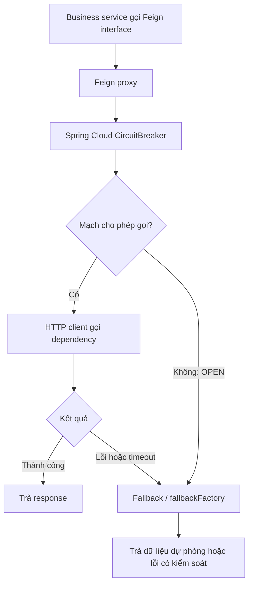

# Kích hoạt Spring Cloud CircuitBreaker cho Feign client

Spring Cloud OpenFeign có thể bọc từng lời gọi Feign client bằng Spring Cloud CircuitBreaker. Khi bật tích hợp này, lời gọi đến dịch vụ phụ thuộc được thực thi qua Circuit Breaker thay vì luôn gọi thẳng qua proxy Feign. Nếu tỷ lệ lỗi hoặc lời gọi chậm vượt ngưỡng, mạch có thể chuyển sang `OPEN` và từ chối lời gọi tiếp theo trong thời gian chờ. Ứng dụng có thể khai báo `fallback` hoặc `fallbackFactory` để trả kết quả dự phòng khi lời gọi thất bại hoặc mạch không cấp quyền gọi.

Trong module Spring Cloud Circuit Breaker, OpenFeign là một điểm tích hợp thường gặp vì nhiều ứng dụng Spring Cloud dùng Feign để gọi service khác. Việc bật Circuit Breaker cho Feign giúp bảo vệ các lời gọi HTTP khai báo bằng interface, đồng thời giữ phần lớn mã nghiệp vụ độc lập với cách Resilience4j ghi nhận trạng thái và thống kê.

## Cách tích hợp hoạt động

Khi bật `spring.cloud.openfeign.circuitbreaker.enabled`, Spring Cloud OpenFeign tạo proxy Feign có tích hợp Circuit Breaker. Mỗi phương thức được gọi trên interface Feign được thực thi qua một Circuit Breaker tương ứng. Khi dependency phản hồi bình thường, kết quả được trả về cho caller. Khi lỗi được phát ra, Circuit Breaker ghi nhận theo chính sách cấu hình; fallback được gọi nếu client đã khai báo.



Circuit Breaker bảo vệ lời gọi của từng phương thức Feign theo định danh mà factory tạo ra. Nó không tự bảo vệ toàn bộ quy trình nghiệp vụ gồm nhiều bước hoặc nhiều Feign client. Nếu một use case gọi `inventoryClient`, `pricingClient` và `shippingClient`, mỗi lời gọi có thể có Circuit Breaker riêng; logic tổng hợp kết quả vẫn thuộc service nghiệp vụ.

## Thêm dependency cần thiết

Ứng dụng cần Spring Cloud OpenFeign và backend Circuit Breaker mà ứng dụng muốn dùng. Với Resilience4j, các dependency Maven thường gồm:

```xml
<dependencies>
    <dependency>
        <groupId>org.springframework.cloud</groupId>
        <artifactId>spring-cloud-starter-openfeign</artifactId>
    </dependency>
    <dependency>
        <groupId>org.springframework.cloud</groupId>
        <artifactId>spring-cloud-starter-circuitbreaker-resilience4j</artifactId>
    </dependency>
</dependencies>
```

Quản lý phiên bản Spring Cloud bằng BOM tương thích với phiên bản Spring Boot của dự án. Không nên tự ghép các phiên bản Spring Cloud, OpenFeign và Resilience4j không tương thích với nhau. Nếu ứng dụng đã có starter Circuit Breaker qua dependency khác, kiểm tra dependency tree để tránh khai báo backend trùng hoặc kéo vào phiên bản không mong muốn.

## Bật OpenFeign Circuit Breaker

Khai báo `@EnableFeignClients` ở cấu hình ứng dụng và bật thuộc tính Circuit Breaker trong `application.yml`:

```java
import org.springframework.boot.SpringApplication;
import org.springframework.boot.autoconfigure.SpringBootApplication;
import org.springframework.cloud.openfeign.EnableFeignClients;

@SpringBootApplication
@EnableFeignClients
public class OrderApplication {

    public static void main(String[] args) {
        SpringApplication.run(OrderApplication.class, args);
    }
}
```

```yaml
spring:
  cloud:
    openfeign:
      circuitbreaker:
        enabled: true
```

Thuộc tính `spring.cloud.openfeign.circuitbreaker.enabled` là công tắc tích hợp. Nếu chưa bật, khai báo `fallback` trên Feign client không tự làm cho lời gọi được bảo vệ bởi Circuit Breaker. Sau khi bật, kiểm tra log khởi tạo và thử nghiệm một lời gọi lỗi để xác nhận fallback được gọi qua đường tích hợp mong đợi.

## Khai báo Feign client và fallback

Ví dụ một service gọi API tồn kho. `name` định danh dịch vụ đích; `contextId` định danh cấu hình client trong Spring context. `fallback` trỏ tới một bean triển khai cùng interface:

```java
import org.springframework.cloud.openfeign.FeignClient;
import org.springframework.web.bind.annotation.GetMapping;
import org.springframework.web.bind.annotation.PathVariable;

@FeignClient(
    name = "inventory",
    contextId = "inventoryClient",
    fallback = InventoryFallback.class)
public interface InventoryClient {

    @GetMapping("/inventory/{sku}")
    InventoryResponse find(@PathVariable("sku") String sku);
}
```

Lớp fallback phải là bean Spring và triển khai đầy đủ interface Feign:

```java
import org.springframework.stereotype.Component;

@Component
class InventoryFallback implements InventoryClient {

    @Override
    public InventoryResponse find(String sku) {
        return InventoryResponse.unavailable(sku);
    }
}
```

`InventoryResponse.unavailable(...)` là factory method minh họa của DTO ứng dụng. Hãy biểu diễn trạng thái không khả dụng một cách rõ ràng trong hợp đồng response. Không nên trả `availableQuantity = 0` như thể đã đọc được số lượng tồn kho thật nếu dữ liệu thực tế không truy cập được; caller có thể hiểu nhầm hệ thống đã xác nhận hết hàng.

Fallback cố định phù hợp khi mọi lỗi đều có cùng cách xử lý. Nó không nhận trực tiếp nguyên nhân lỗi của lời gọi. Nếu cần phân biệt timeout, lỗi kết nối, lỗi xác thực hoặc Circuit Breaker đang `OPEN`, dùng `fallbackFactory`.

## Dùng `fallbackFactory` để biết nguyên nhân

`FallbackFactory` nhận `Throwable` đã khiến lời gọi đi vào fallback và tạo một implementation cho interface Feign. Nhờ đó, ứng dụng có thể log nguyên nhân, chọn dữ liệu cache hoặc trả lỗi miền nghiệp vụ phù hợp:

```java
import org.slf4j.Logger;
import org.slf4j.LoggerFactory;
import org.springframework.cloud.openfeign.FallbackFactory;
import org.springframework.stereotype.Component;

@Component
class InventoryFallbackFactory implements FallbackFactory<InventoryClient> {

    private static final Logger log =
        LoggerFactory.getLogger(InventoryFallbackFactory.class);

    private final InventoryCache inventoryCache;

    InventoryFallbackFactory(InventoryCache inventoryCache) {
        this.inventoryCache = inventoryCache;
    }

    @Override
    public InventoryClient create(Throwable cause) {
        return sku -> {
            log.warn("Không gọi được inventory cho SKU {}: {}",
                sku, cause.toString());

            return inventoryCache.find(sku)
                .orElseGet(() -> InventoryResponse.unavailable(sku));
        };
    }
}
```

Khai báo factory trong `@FeignClient`:

```java
@FeignClient(
    name = "inventory",
    contextId = "inventoryClient",
    fallbackFactory = InventoryFallbackFactory.class)
public interface InventoryClient {

    @GetMapping("/inventory/{sku}")
    InventoryResponse find(@PathVariable("sku") String sku);
}
```

Chọn `fallback` hoặc `fallbackFactory` cho một Feign client theo nhu cầu; không cần khai báo cả hai. Không để fallback gọi lại chính Feign client đang được bảo vệ, vì có thể tạo vòng lặp gọi hoặc tiếp tục đi vào cùng Circuit Breaker. Nếu fallback dùng cache hay service khác, các dependency đó cũng cần timeout và chính sách bảo vệ phù hợp.

## Định danh Circuit Breaker theo Feign method

Resilience4j cần tên instance để tìm cấu hình cho Circuit Breaker. Tên được Spring Cloud OpenFeign tạo ra phụ thuộc vào resolver và phiên bản Spring Cloud. Vì vậy, khi khai báo cấu hình theo từng Feign method, cần xác định chính xác tên thực tế đang được sử dụng.

Có thể cung cấp `CircuitBreakerNameResolver` để đặt quy tắc tên ổn định. Ví dụ sau dùng tên client và tên phương thức:

```java
import org.springframework.cloud.openfeign.CircuitBreakerNameResolver;
import org.springframework.context.annotation.Bean;
import org.springframework.context.annotation.Configuration;

@Configuration
class FeignCircuitBreakerNamingConfiguration {

    @Bean
    CircuitBreakerNameResolver circuitBreakerNameResolver() {
        return (feignClientName, target, method) ->
            feignClientName + "_" + method.getName();
    }
}
```

Với client `inventory` và phương thức `find`, resolver trên tạo tên `inventory_find`. Cấu hình Resilience4j có thể dùng chính tên đó:

```yaml
resilience4j:
  circuitbreaker:
    instances:
      inventory_find:
        slidingWindowType: COUNT_BASED
        slidingWindowSize: 20
        minimumNumberOfCalls: 10
        failureRateThreshold: 50
        slowCallDurationThreshold: 800ms
        slowCallRateThreshold: 50
        waitDurationInOpenState: 5s
        permittedNumberOfCallsInHalfOpenState: 3
```

Resolver là cấu hình dùng chung trong application context, nên cần bảo đảm tên trả về không trùng giữa các client hoặc method cần chính sách riêng. Nếu nhiều method dùng chung một tên, chúng sẽ chia sẻ cùng instance Circuit Breaker và cùng sliding window. Nếu muốn cấu hình riêng, đưa method vào tên như ví dụ. Khi thay đổi resolver, hãy cập nhật đồng bộ các key trong `resilience4j.circuitbreaker.instances` và kiểm tra tên thực tế qua log hoặc metrics.

## Kết hợp timeout của Feign với Circuit Breaker

Circuit Breaker không thay thế timeout của HTTP client. Nếu Feign client không có connect/read timeout phù hợp, một request có thể chờ quá lâu trước khi trả về lỗi để Circuit Breaker ghi nhận. Có thể cấu hình timeout theo client trong `application.yml`:

```yaml
spring:
  cloud:
    openfeign:
      circuitbreaker:
        enabled: true
      client:
        config:
          inventory:
            connectTimeout: 500
            readTimeout: 1000
```

Các giá trị `connectTimeout` và `readTimeout` ở ví dụ được tính bằng mili giây. Connect timeout giới hạn thời gian thiết lập kết nối; read timeout giới hạn thời gian chờ đọc dữ liệu theo HTTP client đang sử dụng. Timeout thực tế còn phụ thuộc client implementation và các giai đoạn khác như chờ connection pool. Hãy chọn timeout nhỏ hơn ngân sách end-to-end của request và dành thời gian cho xử lý fallback, serialize response và trả về caller.

Resilience4j có thể cấu hình failure rate và slow call rate riêng. Ví dụ, Circuit Breaker mở khi ít nhất 50% mẫu là lỗi hoặc ít nhất 50% lời gọi vượt ngưỡng chậm 800 ms, sau khi đã có tối thiểu 10 mẫu trong cửa sổ 20 lời gọi. Một lỗi timeout do Feign phát ra thường được ghi nhận theo chính sách exception của Circuit Breaker; cần xác nhận loại exception thực tế trước khi tùy chỉnh `recordExceptions` hoặc `ignoreExceptions`.

## Phân biệt Circuit Breaker với Retry của Feign

Circuit Breaker và Retry giải quyết hai vấn đề khác nhau. Circuit Breaker ngừng gọi dependency khi kết quả gần đây cho thấy dịch vụ không khỏe. Retry thử lại một lỗi được xem là tạm thời. Không nên retry vô hạn hoặc retry các lỗi do Circuit Breaker từ chối, vì việc đó có thể tạo thêm tải trong lúc dependency đang phục hồi.

Spring Cloud OpenFeign mặc định cung cấp `Retryer.NEVER_RETRY`, nên không nên giả định mọi lỗi I/O sẽ tự động được thử lại. Nếu ứng dụng chủ động thêm Retryer hoặc dùng Resilience4j Retry, cần xác định rõ số lần thử và timeout tổng. `CallNotPermittedException` và các lỗi không retry được phải bị loại khỏi retry predicate. Với thao tác có side effect, chỉ retry khi API hỗ trợ idempotency hoặc có khóa chống xử lý trùng.

## Những điều cần lưu ý khi dùng fallback

- **Không che giấu trạng thái dependency:** fallback có thể trả dữ liệu cache hoặc trạng thái không khả dụng, nhưng cần phân biệt rõ dữ liệu dự phòng với dữ liệu mới lấy từ service.
- **Không tạo thành công giả:** tránh trả giá trị mặc định có ý nghĩa nghiệp vụ như tồn kho bằng 0, giá bằng 0 hoặc đơn hàng đã được tạo khi thực tế chưa xác nhận.
- **Giữ fallback ngắn và có giới hạn:** cache hoặc service dự phòng cũng có thể chậm. Fallback không nên gọi lại dependency đang lỗi.
- **Giữ nguyên nguyên nhân để quan sát:** dùng `fallbackFactory` khi cần ghi nhận loại lỗi; không log toàn bộ payload, token hoặc dữ liệu nhạy cảm.
- **Kiểm soát bean fallback:** fallback phải là bean Spring nằm trong phạm vi component scan của ứng dụng. Nếu có class `@Configuration` riêng cho một Feign client, tránh để cấu hình đó bị component scan vào context cha, vì nó có thể vô tình áp dụng cho các client khác.
- **Không giả định mọi exception đều mở mạch:** lỗi nghiệp vụ như tài nguyên không tồn tại có thể không phản ánh sức khỏe dependency. Cấu hình phân loại exception theo ngữ nghĩa lỗi.

## Kiểm tra tích hợp

Sau khi bật Circuit Breaker, nên kiểm tra cả trường hợp thành công, lỗi và mạch mở:

1. Gọi Feign client khi dependency hoạt động. Xác nhận response bình thường được trả về và Circuit Breaker ghi nhận success.
2. Cho dependency trả lỗi kết nối hoặc phản hồi quá thời gian. Xác nhận lỗi được ghi nhận theo cấu hình và fallback được gọi.
3. Tạo đủ mẫu lỗi để vượt `failureRateThreshold`. Xác nhận Circuit Breaker chuyển `OPEN` và lời gọi tiếp theo bị từ chối nhanh mà không gửi HTTP request mới.
4. Xác nhận `fallbackFactory` nhận nguyên nhân phù hợp, đặc biệt phân biệt lỗi client với `CallNotPermittedException`.
5. Sau `waitDurationInOpenState`, xác nhận mạch chuyển sang `HALF_OPEN` theo cấu hình và chỉ cho phép số lời gọi thử đã định.
6. Cho dependency phục hồi và xác nhận mạch trở lại `CLOSED` sau các probe thành công.
7. Kiểm tra log và metrics để xác nhận tên Circuit Breaker khớp key cấu hình `resilience4j.circuitbreaker.instances`.

Có thể dùng WireMock hoặc HTTP server giả lập để điều khiển status code, độ trễ và lỗi kết nối. Khi kiểm tra mạch `OPEN`, đếm số request thực sự đến server giả lập: số lần gọi không nên tăng khi Circuit Breaker từ chối request. Đồng thời xác nhận fallback không làm caller hiểu nhầm rằng dependency đã trả dữ liệu thành công.

## Tóm tắt luồng cấu hình

Để kích hoạt Spring Cloud CircuitBreaker cho Feign client, thêm starter OpenFeign và backend Circuit Breaker tương thích, bật `spring.cloud.openfeign.circuitbreaker.enabled`, khai báo Feign interface cùng fallback hoặc fallback factory, sau đó cấu hình Resilience4j theo tên Circuit Breaker thực tế. Timeout của Feign giới hạn thời gian chờ HTTP; Circuit Breaker theo dõi lỗi và lời gọi chậm; fallback cung cấp cách phản hồi có kiểm soát khi dependency không thể phục vụ. Khi các phần này được cấu hình đồng bộ, các lời gọi Feign có thể thất bại nhanh hơn, giảm lỗi dây chuyền và vẫn giữ hợp đồng phản hồi rõ ràng cho service gọi.
