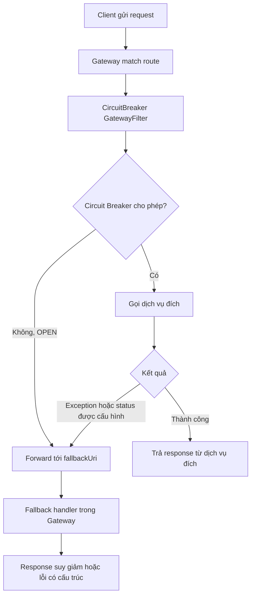

# `fallbackUri` với `forward:` và xử lý phản hồi dự phòng

## Mục tiêu

Spring Cloud Gateway có thể bảo vệ một route bằng `CircuitBreaker` GatewayFilter. Khi lời gọi tới dịch vụ đích thất bại hoặc Circuit Breaker từ chối request, filter có thể chuyển request nội bộ tới một fallback handler thông qua `fallbackUri`. Với scheme `forward:`, Gateway chuyển tiếp `ServerWebExchange` tới một handler trong chính ứng dụng Gateway, nơi có thể trả dữ liệu suy giảm, dữ liệu cache hoặc phản hồi dịch vụ tạm thời không khả dụng.

Sau bài học, bạn có thể:

- Cấu hình `fallbackUri: forward:/...` cho một route Gateway.
- Phân biệt lỗi kết nối/timeout với HTTP status cần khai báo trong `statusCodes`.
- Viết fallback handler reactive và chọn HTTP status, response body phù hợp.
- Đọc nguyên nhân lỗi từ exchange attribute mà không làm lộ chi tiết nội bộ.
- Tránh fallback loop, retry không kiểm soát và việc gọi lại dependency đang lỗi.

## `fallbackUri` hoạt động như thế nào?

`fallbackUri` là đích xử lý dự phòng được CircuitBreaker GatewayFilter sử dụng khi request được bảo vệ không thể hoàn tất bình thường. Với scheme `forward:`, Gateway dispatch request tới một đường dẫn nội bộ trong cùng ứng dụng. Đường dẫn này thường được xử lý bởi một controller WebFlux.

Luồng cơ bản:



`forward:` là một internal dispatch. Nó không tạo một HTTP request mới tới một host từ xa. Vì vậy, fallback handler cần được triển khai trong ứng dụng Gateway và có mapping tương ứng. Với CircuitBreaker GatewayFilter của Spring Cloud Gateway, `fallbackUri` sử dụng scheme `forward:`; không đặt URL tùy ý của một máy chủ khác vào thuộc tính này.

## Cấu hình route với fallbackUri

Ví dụ route `/catalog/**` chuyển request tới dịch vụ danh mục. Nếu Circuit Breaker mở, lời gọi timeout hoặc gặp lỗi được tính là thất bại, Gateway forward tới `/fallback/catalog`:

```yaml
spring:
  cloud:
    gateway:
      routes:
        - id: catalog-route
          uri: lb://CATALOG-SERVICE
          predicates:
            - Path=/catalog/**
          filters:
            - name: CircuitBreaker
              args:
                name: catalog
                fallbackUri: forward:/fallback/catalog
                statusCodes:
                  - '500'
                  - '503'
```

Các thành phần chính:

- `name: catalog` là ID Circuit Breaker được dùng để lấy cấu hình Resilience4j.
- `fallbackUri: forward:/fallback/catalog` là đường dẫn nội bộ mà Gateway gọi khi cần xử lý dự phòng.
- `statusCodes` khai báo HTTP status từ dịch vụ đích được xem là lỗi của Circuit Breaker. Ví dụ này đưa 500 và 503 vào nhóm thất bại.
- `lb://CATALOG-SERVICE` yêu cầu load-balancer integration tìm instance của dịch vụ danh mục. Có thể thay bằng URI đích phù hợp với cách triển khai.

Các lỗi như không kết nối được tới upstream hoặc timeout thường xuất hiện dưới dạng exception và đi vào fallback. Một HTTP response 500 hoặc 503 không nhất thiết tự động trở thành exception ở Gateway. Nếu muốn các status đó được tính vào Circuit Breaker, hãy khai báo chúng trong `statusCodes`. Không nên đưa mọi mã 4xx vào danh sách: 400, 401, 403 hoặc 404 thường phản ánh request hay kết quả nghiệp vụ, không phải tình trạng sức khỏe của dịch vụ.

## Cấu hình Circuit Breaker instance

Tên `catalog` trong Gateway filter cần khớp với instance được cấu hình:

```yaml
resilience4j:
  circuitbreaker:
    instances:
      catalog:
        slidingWindowType: COUNT_BASED
        slidingWindowSize: 20
        minimumNumberOfCalls: 10
        failureRateThreshold: 50
        slowCallRateThreshold: 60
        slowCallDurationThreshold: 1s
        waitDurationInOpenState: 8s
        permittedNumberOfCallsInHalfOpenState: 3
```

Ví dụ này dùng 20 kết quả gần nhất để tính tỷ lệ trong `CLOSED`, chỉ đánh giá sau ít nhất 10 lời gọi và mở mạch khi tỷ lệ lỗi đạt 50% hoặc tỷ lệ lời gọi chậm đạt 60%. Sau tám giây ở `OPEN`, Circuit Breaker có thể cho tối đa ba probe đi qua trong `HALF_OPEN`.

Gateway chạy theo mô hình reactive, vì vậy cần dependency Spring Cloud CircuitBreaker reactive Resilience4j phù hợp với release train của Spring Cloud đang sử dụng. Dùng BOM của dự án để quản lý phiên bản thay vì ghép các phiên bản Spring Cloud, Gateway và Resilience4j tùy ý.

## Viết fallback handler reactive

Controller fallback cần có mapping khớp với đường dẫn sau `forward:`. Có thể dùng `@RequestMapping` để handler nhận nhiều HTTP method nếu route ban đầu hỗ trợ cả GET, POST hoặc các method khác.

```java
import java.util.Map;

import org.slf4j.Logger;
import org.slf4j.LoggerFactory;
import org.springframework.cloud.gateway.support.ServerWebExchangeUtils;
import org.springframework.http.HttpStatus;
import org.springframework.http.MediaType;
import org.springframework.http.ResponseEntity;
import org.springframework.web.bind.annotation.RequestMapping;
import org.springframework.web.bind.annotation.RestController;
import org.springframework.web.server.ServerWebExchange;

import reactor.core.publisher.Mono;

@RestController
public class GatewayFallbackController {
    private static final Logger log = LoggerFactory.getLogger(GatewayFallbackController.class);

    @RequestMapping(path = "/fallback/catalog", produces = MediaType.APPLICATION_JSON_VALUE)
    public Mono<ResponseEntity<Map<String, Object>>> catalogFallback(
            ServerWebExchange exchange) {
        Throwable cause = exchange.getAttribute(
                ServerWebExchangeUtils.CIRCUITBREAKER_EXECUTION_EXCEPTION_ATTR);

        String causeType = cause == null
                ? "unknown"
                : cause.getClass().getSimpleName();
        log.warn("Catalog route is using fallback; causeType={}", causeType);

        Map<String, Object> body = Map.of(
                "code", "CATALOG_UNAVAILABLE",
                "message", "Dịch vụ danh mục tạm thời không khả dụng",
                "degraded", true);

        return Mono.just(ResponseEntity
                .status(HttpStatus.SERVICE_UNAVAILABLE)
                .body(body));
    }
}
```

Gateway đặt nguyên nhân thực thi Circuit Breaker trong exchange attribute `CIRCUITBREAKER_EXECUTION_EXCEPTION_ATTR` khi có exception tương ứng. Fallback handler có thể đọc attribute để ghi log hoặc chọn phản hồi. Attribute có thể không có trong một số đường xử lý, vì vậy ví dụ kiểm tra `null`. Chỉ ghi loại lỗi hoặc mã nội bộ cần thiết; không trả stack trace, host nội bộ, thông tin xác thực hay message exception thô cho client.

Response ở ví dụ dùng HTTP 503 vì dịch vụ danh mục hiện không thể phục vụ request. Response body có mã lỗi ổn định để client xử lý và cờ `degraded` để thể hiện kết quả không phải phản hồi bình thường từ upstream. Nội dung message có thể được bản địa hóa theo hợp đồng API của ứng dụng.

## Trả dữ liệu cache khi có thể

Fallback không bắt buộc phải luôn trả 503. Nếu sản phẩm cho phép dùng dữ liệu cache cũ, fallback handler có thể thử đọc cache trước. Khi tìm được dữ liệu, trả 200 cùng metadata cho biết response là dữ liệu suy giảm; nếu không có dữ liệu, trả 503.

Ví dụ minh họa với một cache reactive:

```java
import org.springframework.web.bind.annotation.PathVariable;

public record CatalogFallbackBody(
        String code,
        ProductView data,
        boolean degraded) {}

// Ví dụ method trong GatewayFallbackController.
@RequestMapping(path = "/fallback/catalog/{id}", produces = MediaType.APPLICATION_JSON_VALUE)
public Mono<ResponseEntity<CatalogFallbackBody>> catalogFallback(
        @PathVariable String id) {
    return catalogCache.findById(id)
            .map(product -> ResponseEntity.ok(
                    new CatalogFallbackBody("CACHED_CATALOG", product, true)))
            .defaultIfEmpty(ResponseEntity
                    .status(HttpStatus.SERVICE_UNAVAILABLE)
                    .body(new CatalogFallbackBody("CATALOG_UNAVAILABLE", null, true)));
}
```

Để dùng mapping này, route cần khai báo một URI template variable có tên `id`, chẳng hạn predicate `Path=/catalog/{id}`, rồi forward tới `forward:/fallback/catalog/{id}`. Spring Cloud Gateway mở rộng biến URI từ request đã match route trong `fallbackUri`. Nếu route chỉ dùng wildcard như `Path=/catalog/**`, không có biến `id` được đặt tên; khi đó hãy dùng fallback path cố định hoặc khai báo lại predicate với biến phù hợp.

Dữ liệu cache cần có quy tắc về độ cũ. Nếu response chứa giá hoặc tồn kho, hãy cân nhắc trả `cachedAt`, `stale` hoặc tuổi dữ liệu để caller không nhầm dữ liệu cũ với dữ liệu trực tiếp. Không trả dữ liệu cache nếu nó có thể gây quyết định nghiệp vụ nguy hiểm hoặc vi phạm yêu cầu nhất quán.

## Phân biệt lỗi upstream và lỗi nghiệp vụ

Circuit Breaker nên phản ánh tình trạng dependency. Việc phân loại HTTP status vì vậy cần dựa trên hợp đồng API:

| Kết quả upstream | Có nên kích hoạt Circuit Breaker? | Xử lý thường gặp |
|---|---|---|
| Không kết nối được, connection reset | Có, nếu là lỗi dependency. | Chuyển tới fallback. |
| Timeout | Có. | Chuyển tới fallback; kiểm tra timeout ở Gateway/client. |
| HTTP 500 hoặc 503 | Có nếu đã khai báo trong `statusCodes`. | Chuyển tới fallback. |
| HTTP 429 | Tùy hợp đồng và chính sách quá tải. | Có thể giới hạn riêng hoặc đưa vào danh sách status được xem là lỗi. |
| HTTP 400, 401, 403 | Thường không. | Trả lỗi request/xác thực theo hợp đồng. |
| HTTP 404 | Thường không. | Giữ ý nghĩa không tìm thấy tài nguyên. |

Nếu đưa 404 vào `statusCodes`, một lượng lớn ID không tồn tại có thể làm mạch mở dù dịch vụ vẫn khỏe. Ngược lại, nếu upstream trả 503 nhưng không khai báo status đó là lỗi, Gateway có thể chuyển response 503 về client mà không làm Circuit Breaker tích lũy failure như mong muốn.

## Fallback không được tạo vòng lặp

Fallback phải kết thúc bằng một response hoặc một lỗi có chủ đích. Tránh các cấu trúc sau:

- Forward fallback quay lại chính route đang được bảo vệ.
- Fallback gọi lại cùng upstream qua một route khác nhưng vẫn phụ thuộc vào dịch vụ đang lỗi.
- Fallback có retry không giới hạn hoặc thời gian chờ dài hơn request ban đầu.
- Nhiều route fallback gọi lẫn nhau khiến request không có điểm kết thúc.

Đặt fallback handler trên một path nội bộ riêng, chẳng hạn `/fallback/catalog`, và bảo đảm path này không match lại route `/catalog/**` đang được bảo vệ. Nếu fallback cần gọi một dịch vụ khác, đó phải là dependency độc lập có timeout và chính sách bảo vệ riêng; không dùng chính dependency đã gây lỗi để tạo vòng gọi lại.

Fallback cũng nên nhanh và có tài nguyên giới hạn. Nếu fallback đọc cache hoặc cơ sở dữ liệu dự phòng, hãy giới hạn concurrency và timeout của nguồn đó. Nếu nguồn dự phòng cũng không khả dụng, trả lỗi 503 có cấu trúc thay vì tiếp tục gọi qua nhiều tầng.

## Lưu ý với request body và HTTP method

`forward:` chuyển tiếp exchange nội bộ tới handler. Với GET, fallback thường chỉ cần path/query/header. Với POST hoặc PUT, không nên giả định body có thể được đọc lại tùy ý sau khi request đã đi qua các filter và được chuyển tới upstream. Body của reactive request là luồng có thể chỉ tiêu thụ một lần; việc replay cần được thiết kế rõ và có giới hạn bộ nhớ.

Nếu fallback cho thao tác ghi cần dữ liệu từ body, hãy xác định trước nơi cache body, giới hạn kích thước, cách bảo vệ dữ liệu nhạy cảm và hành vi khi client ngắt kết nối. Với thao tác thanh toán hoặc tạo đơn, không tự động trả thành công giả khi upstream timeout: server có thể đã xử lý request trước khi mất response. Dùng idempotency key và endpoint tra cứu trạng thái để xác định kết quả trước khi cho phép gửi lại.

## Theo dõi fallback trong vận hành

Nên ghi nhận riêng các chỉ số:

- Số request đi vào fallback theo route và Circuit Breaker ID.
- Nguyên nhân fallback: Circuit Breaker `OPEN`, timeout, lỗi kết nối hoặc status upstream được cấu hình.
- Tỷ lệ fallback trả cache và tỷ lệ fallback trả 503.
- Độ trễ xử lý fallback và lỗi của nguồn cache/dự phòng.
- Số lần Circuit Breaker chuyển `CLOSED`, `OPEN`, `HALF_OPEN`.
- Số request bị từ chối và số probe trong `HALF_OPEN`.

Không chỉ đếm số response 503, vì fallback cache có thể trả 200 trong khi upstream vẫn đang lỗi. Một metric riêng cho fallback giúp dashboard thể hiện chế độ suy giảm ngay cả khi response thành công về mặt HTTP.

Đặt cảnh báo khi tỷ lệ fallback tăng đột ngột, fallback cache trở nên quá cũ hoặc fallback handler tự phát sinh lỗi. Log nên chứa route ID, Circuit Breaker name, cause type và correlation ID; tránh log toàn bộ request body hoặc exception message nhạy cảm.

## Thực hành kiểm chứng

Thực hiện trong môi trường thử nghiệm với dịch vụ danh mục có thể chủ động trả lỗi:

1. Khởi động Gateway, Circuit Breaker reactive Resilience4j và dịch vụ danh mục. Gửi request thành công tới `/catalog/**` để xác nhận route bình thường.
2. Cho upstream trả HTTP 500. Xác nhận `statusCodes` làm Circuit Breaker ghi nhận lỗi và Gateway forward tới `/fallback/catalog`.
3. Cho upstream trả HTTP 404. Xác nhận status không nằm trong danh sách lỗi nên vẫn giữ ý nghĩa không tìm thấy, không kích hoạt fallback chỉ vì 404.
4. Ngắt kết nối hoặc làm upstream timeout. Xác nhận exception đi vào fallback handler.
5. Tạo đủ lỗi để Circuit Breaker chuyển `OPEN`. Gửi thêm request và xác nhận Gateway không gọi upstream mà chuyển thẳng tới fallback.
6. Khôi phục upstream và quan sát các probe `HALF_OPEN`; xác nhận mạch đóng lại khi probe đạt yêu cầu.
7. Tắt cache dự phòng hoặc làm cache lỗi. Xác nhận fallback trả 503 có cấu trúc và không gọi lại route ban đầu.
8. Kiểm tra log/metric để phân biệt response upstream, response cache và response 503 từ fallback.

## Lỗi thường gặp

- **Dùng URL từ xa trong `fallbackUri`:** CircuitBreaker GatewayFilter sử dụng `forward:` để dispatch tới handler nội bộ.
- **Quên tạo controller cho đường dẫn forward:** Gateway không có handler phù hợp và fallback có thể thất bại.
- **Không cấu hình `statusCodes`:** HTTP 5xx có thể được chuyển tiếp như response bình thường thay vì được tính là lỗi Circuit Breaker.
- **Đưa mọi 4xx vào statusCodes:** lỗi nghiệp vụ hoặc request sai có thể làm mạch mở không cần thiết.
- **Dùng fallback path trùng route ban đầu:** tạo vòng lặp hoặc tiếp tục gọi dependency đang lỗi.
- **Trả HTTP 200 cho mọi fallback:** caller và monitoring có thể hiểu nhầm dependency đang khỏe.
- **Luôn trả 503 dù có cache hợp lệ:** làm mất khả năng phục vụ suy giảm mà sản phẩm cho phép.
- **Lộ exception message:** có thể tiết lộ host, topology hoặc thông tin nội bộ.
- **Đọc lại request body không kiểm soát:** body reactive có thể đã bị tiêu thụ và việc cache có thể tiêu tốn nhiều bộ nhớ.
- **Trả thành công giả cho thao tác ghi:** timeout không chứng minh server chưa thực hiện side effect.

`fallbackUri: forward:` tạo một đường xử lý dự phòng ngay trong Gateway. Hãy kết hợp route CircuitBreaker, danh sách `statusCodes` phù hợp và một fallback handler nhanh, có response contract rõ ràng. Khi fallback dùng cache, biểu diễn rõ dữ liệu suy giảm; khi không thể phục vụ, trả lỗi tạm thời có cấu trúc để client có thể xử lý an toàn.
