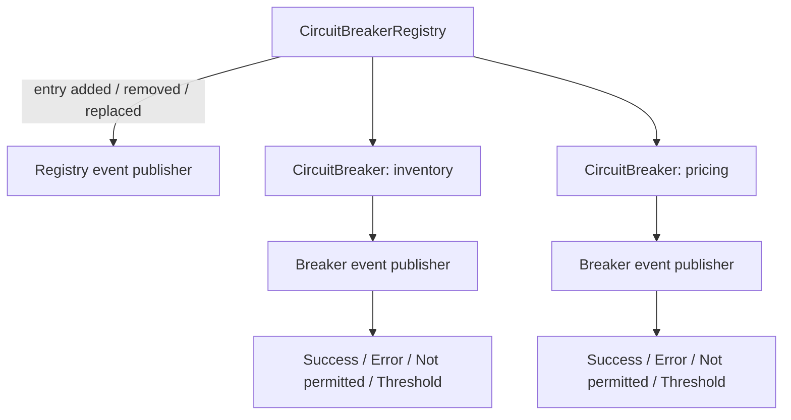

# Sự kiện thành công, lỗi, lời gọi chậm và bị từ chối

Circuit breaker không chỉ chuyển giữa `CLOSED`, `OPEN` và `HALF_OPEN`; nó còn phát ra các sự kiện mô tả điều gì vừa xảy ra với lời gọi được bảo vệ. Resilience4j cung cấp event publisher để ứng dụng lắng nghe kết quả thành công, lỗi, lỗi bị bỏ qua, lời gọi bị từ chối, ngưỡng lỗi hoặc ngưỡng lời gọi chậm bị vượt qua và thay đổi trạng thái.

Các sự kiện giúp giải thích vì sao breaker mở, đo tác động của phụ thuộc chậm và phân biệt lỗi từ dịch vụ đích với lời gọi bị chặn ngay tại ứng dụng. Chúng bổ sung cho metric và log: event mô tả một thay đổi hoặc kết quả cụ thể, metric tổng hợp xu hướng theo thời gian, còn log giữ ngữ cảnh phục vụ điều tra. Listener nên xử lý nhanh để không làm chậm đường gọi đang được bảo vệ.

## 1. Registry và event publisher có hai phạm vi

Resilience4j quản lý các circuit breaker thông qua `CircuitBreakerRegistry`. Registry tạo và tra cứu breaker theo tên. Bản thân registry cũng phát sự kiện khi một entry được thêm, xóa hoặc thay thế. Sau khi lấy được một breaker, ứng dụng có thể đăng ký listener trên event publisher của chính breaker đó để nhận các sự kiện vận hành.



Hai phạm vi không nên bị nhầm lẫn:

| Publisher | Sự kiện | Mục đích |
|---|---|---|
| `CircuitBreakerRegistry.getEventPublisher()` | Entry được thêm, xóa hoặc thay thế | Theo dõi vòng đời các breaker trong registry |
| `CircuitBreaker.getEventPublisher()` | Thành công, lỗi, lỗi bỏ qua, bị từ chối, vượt ngưỡng, chuyển trạng thái và reset | Theo dõi hoạt động của một breaker cụ thể |

Ví dụ, `inventory` và `pricing` có thể cùng nằm trong một registry nhưng có event publisher và thống kê riêng. Listener của breaker `inventory` chỉ nhận sự kiện phát ra từ breaker đó; listener đăng ký trên registry nhận sự kiện quản lý entry.

## 2. Lấy breaker từ registry

Ứng dụng có thể tạo registry và lấy breaker theo ID:

```java
import io.github.resilience4j.circuitbreaker.CircuitBreaker;
import io.github.resilience4j.circuitbreaker.CircuitBreakerRegistry;

public class InventoryProtection {
    private final CircuitBreakerRegistry registry =
            CircuitBreakerRegistry.ofDefaults();

    public CircuitBreaker inventoryBreaker() {
        return registry.circuitBreaker("inventory");
    }
}
```

`circuitBreaker("inventory")` trả về breaker có tên `inventory` trong registry. Nếu entry chưa tồn tại, registry tạo entry mới theo cấu hình mặc định hoặc cấu hình được cung cấp cho registry. Khi dùng Spring Boot với Resilience4j auto-configuration, registry thường được Spring quản lý và cấu hình từ `application.yml`; ứng dụng nên inject registry đó thay vì tự tạo một registry mới ở mỗi request.

Ví dụ inject registry trong một bean Spring:

```java
@Component
public class InventoryEventConfiguration {
    private final CircuitBreakerRegistry registry;

    public InventoryEventConfiguration(CircuitBreakerRegistry registry) {
        this.registry = registry;
    }
}
```

Registry native là API của Resilience4j. Nếu gateway chỉ dùng abstraction `CircuitBreakerFactory` của Spring Cloud, việc truy cập registry và event publisher native sẽ gắn mã quan sát với Resilience4j. Đây là lựa chọn hợp lý khi ứng dụng đã chọn Resilience4j làm implementation và cần event chi tiết, nhưng cần nhận biết phần mã này không còn độc lập với implementation.

## 3. Sự kiện thành công

Khi supplier hoàn tất bình thường và breaker ghi nhận một kết quả thành công, Resilience4j phát `CircuitBreakerOnSuccessEvent`. Event chứa tên breaker và thời gian thực thi đã đo được. Thời gian này hữu ích để phân tích độ trễ của lời gọi dù nó không thất bại.

```java
CircuitBreaker breaker = registry.circuitBreaker("inventory");

breaker.getEventPublisher()
        .onSuccess(event -> log.info(
                "Circuit breaker {} succeeded in {}",
                event.getCircuitBreakerName(),
                event.getElapsedDuration()));
```

Không nên chỉ đếm thành công. Khi latency tăng dần, tỷ lệ thành công vẫn có thể cao trong khi phụ thuộc đang giữ thread hoặc connection lâu hơn bình thường. Kết hợp số lần thành công với thời gian thực thi giúp phát hiện tình trạng suy giảm trước khi nó chuyển thành lỗi hàng loạt.

Nếu một lời gọi thành công nhưng vượt `slowCallDurationThreshold`, kết quả vẫn có thể là thành công về mặt nghiệp vụ và được tính vào slow call statistics. Sự kiện thành công cùng elapsed duration giúp ứng dụng nhận biết độ trễ của lần gọi đó.

## 4. Sự kiện lỗi

Khi supplier ném exception và breaker phân loại kết quả là lỗi, Resilience4j phát `CircuitBreakerOnErrorEvent`. Event chứa exception và thời gian thực thi. Đây là tín hiệu cho biết một lời gọi đã được thử nhưng không hoàn tất bình thường.

```java
breaker.getEventPublisher()
        .onError(event -> log.warn(
                "Circuit breaker {} failed after {}: {}",
                event.getCircuitBreakerName(),
                event.getElapsedDuration(),
                event.getThrowable().toString()));
```

Lỗi có thể đến từ timeout, connection refused, DNS, HTTP 5xx hoặc lỗi lập trình trong supplier. Event không tự xác định nguyên nhân nghiệp vụ; ứng dụng cần phân loại exception và cause chain phù hợp. Tránh ghi toàn bộ request/response hoặc thông tin xác thực vào log khi xử lý event.

Resilience4j cũng có sự kiện `CircuitBreakerOnIgnoredErrorEvent` cho exception được cấu hình bỏ qua. Exception bị ignore không được tính như success hay failure trong sliding window. Listener riêng giúp phân biệt lỗi nghiệp vụ được chủ động bỏ qua với lỗi đang góp vào failure rate.

```java
breaker.getEventPublisher()
        .onIgnoredError(event -> log.debug(
                "Circuit breaker {} ignored error: {}",
                event.getCircuitBreakerName(),
                event.getThrowable().toString()));
```

Không nên cộng `onIgnoredError` vào số lỗi dùng để tính failure rate. Có thể theo dõi riêng để biết ứng dụng thường xuyên gặp những loại exception nào đã được phân loại là không ảnh hưởng đến sức khỏe phụ thuộc.

## 5. Sự kiện lời gọi bị từ chối

Khi circuit breaker không cấp permission để thực thi supplier, Resilience4j phát `CircuitBreakerOnCallNotPermittedEvent`. Trường hợp thường gặp là breaker đang `OPEN`; trong `HALF_OPEN`, các permission thăm dò đã được cấp hết cũng có thể khiến lời gọi mới bị từ chối.

```java
breaker.getEventPublisher()
        .onCallNotPermitted(event -> log.warn(
                "Circuit breaker {} rejected a call",
                event.getCircuitBreakerName()));
```

Lời gọi bị từ chối khác với một lần supplier thất bại. Khi breaker chặn lời gọi, mã gọi dịch vụ đích không được chạy; request không nhất thiết đã được gửi qua mạng. Vì vậy, không nên ghi `CallNotPermittedException` như thể backend vừa trả HTTP 500 hoặc timeout.

Sự kiện từ chối hữu ích để đo mức độ ảnh hưởng của breaker tới traffic. Nếu số lần từ chối tăng, cần đối chiếu trạng thái breaker, thời điểm chuyển sang `OPEN`, fallback và lỗi trước đó. Sự kiện này cũng giúp phân biệt breaker đang bảo vệ backend với backend tiếp tục nhận request và tự trả lỗi.

## 6. Sự kiện liên quan lời gọi chậm

Resilience4j phân biệt thời gian thực thi của từng lời gọi với tỷ lệ lời gọi chậm trong sliding window. Một lời gọi được xem là chậm khi thời gian thực thi vượt `slowCallDurationThreshold`. Khi tỷ lệ slow call đạt hoặc vượt `slowCallRateThreshold` sau khi có đủ mẫu, breaker có thể mở ngay cả khi nhiều lời gọi vẫn thành công.

Hai loại sự kiện cần phân biệt:

- `CircuitBreakerOnSuccessEvent` hoặc `CircuitBreakerOnErrorEvent` ghi nhận kết quả từng lời gọi cùng elapsed duration. Ứng dụng có thể dùng duration để quan sát các lời gọi chậm riêng lẻ.
- `CircuitBreakerOnSlowCallRateExceededEvent` báo rằng tỷ lệ lời gọi chậm đã vượt ngưỡng cấu hình. Đây là sự kiện về ngưỡng thống kê, không phải một event riêng cho mọi lời gọi chậm.

Đăng ký listener khi ngưỡng slow call bị vượt:

```java
breaker.getEventPublisher()
        .onSlowCallRateExceeded(event -> log.warn(
                "Circuit breaker {} exceeded the slow-call rate threshold: {}",
                event.getCircuitBreakerName(),
                event));
```

Để hiểu latency từng lần gọi, cần quan sát elapsed duration trong event thành công/lỗi hoặc dùng metric/trace của HTTP client. Không nên chỉ dựa vào `onSlowCallRateExceeded`, vì nó chỉ báo tình trạng tỷ lệ vượt ngưỡng và không thay thế histogram latency.

Ví dụ cấu hình:

```yaml
resilience4j:
  circuitbreaker:
    instances:
      inventory:
        slidingWindowType: COUNT_BASED
        slidingWindowSize: 20
        minimumNumberOfCalls: 10
        failureRateThreshold: 50
        slowCallDurationThreshold: 800ms
        slowCallRateThreshold: 60
        waitDurationInOpenState: 10s
        permittedNumberOfCallsInHalfOpenState: 3
```

Với cấu hình trên, lời gọi lâu hơn 800 ms được tính là slow call. Khi đủ tối thiểu 10 mẫu và tỷ lệ slow call trong cửa sổ đạt ngưỡng 60%, breaker có thể chuyển sang `OPEN`. Các giá trị chỉ mang tính minh họa; cần chọn theo latency mục tiêu và khả năng của dịch vụ phụ thuộc.

## 7. Sự kiện khi failure rate vượt ngưỡng

Khi failure rate vượt `failureRateThreshold`, Resilience4j phát `CircuitBreakerOnFailureRateExceededEvent`. Event này giải thích một lần chuyển từ thống kê lỗi sang quyết định bảo vệ. Nó khác với `CircuitBreakerOnErrorEvent`: event lỗi mô tả một lần gọi thất bại, còn event vượt ngưỡng mô tả việc tỷ lệ lỗi trong cửa sổ đã đạt điều kiện.

```java
breaker.getEventPublisher()
        .onFailureRateExceeded(event -> log.error(
                "Circuit breaker {} exceeded the failure-rate threshold: {}",
                event.getCircuitBreakerName(),
                event));
```

Không phải mọi lỗi đều lập tức tạo sự kiện vượt ngưỡng. Breaker cần có đủ `minimumNumberOfCalls` và tỷ lệ lỗi đạt ngưỡng. Ví dụ, với tối thiểu 10 mẫu và ngưỡng 50%, 2 lỗi trong 4 lời gọi chưa đủ điều kiện để đánh giá; khi đã có 10 mẫu, tỷ lệ lỗi được tính trên cửa sổ theo cấu hình.

## 8. Sự kiện chuyển trạng thái và reset

`CircuitBreakerOnStateTransitionEvent` được phát khi breaker chuyển trạng thái, ví dụ `CLOSED` sang `OPEN`, `OPEN` sang `HALF_OPEN` hoặc `HALF_OPEN` về `CLOSED`. Sự kiện này thường hữu ích nhất khi điều tra thời điểm hệ thống bắt đầu chặn lời gọi và thời điểm phụ thuộc được cho phép thăm dò lại.

```java
breaker.getEventPublisher()
        .onStateTransition(event -> log.info(
                "Circuit breaker {} changed state: {}",
                event.getCircuitBreakerName(),
                event.getStateTransition()));
```

Resilience4j cũng phát sự kiện reset khi breaker được reset. Reset xóa thống kê và đưa breaker về trạng thái ban đầu theo API của implementation. Reset không chứng minh dịch vụ đích đã phục hồi; nó chỉ thay đổi state machine và thống kê cục bộ. Không nên reset tự động chỉ để làm dashboard hết báo đỏ.

## 9. Đăng ký nhiều listener cho một breaker

Ứng dụng có thể đăng ký nhiều loại event trên cùng publisher. Ví dụ sau kết hợp thành công, lỗi, lời gọi bị từ chối, ngưỡng chậm và chuyển trạng thái:

```java
import io.github.resilience4j.circuitbreaker.CircuitBreaker;
import io.github.resilience4j.circuitbreaker.CircuitBreakerRegistry;
import org.springframework.stereotype.Component;

@Component
public class InventoryCircuitBreakerEvents {

    public InventoryCircuitBreakerEvents(CircuitBreakerRegistry registry) {
        CircuitBreaker breaker = registry.circuitBreaker("inventory");

        breaker.getEventPublisher()
                .onSuccess(event -> log.info(
                        "inventory success in {}", event.getElapsedDuration()))
                .onError(event -> log.warn(
                        "inventory error after {}: {}",
                        event.getElapsedDuration(), event.getThrowable()))
                .onIgnoredError(event -> log.debug(
                        "inventory ignored error: {}", event.getThrowable()))
                .onCallNotPermitted(event -> log.warn(
                        "inventory call not permitted"))
                .onSlowCallRateExceeded(event -> log.warn(
                        "inventory slow-call rate exceeded: {}", event))
                .onFailureRateExceeded(event -> log.error(
                        "inventory failure rate exceeded: {}", event))
                .onStateTransition(event -> log.info(
                        "inventory state transition: {}", event.getStateTransition()));
    }
}
```

Đoạn mã minh họa cách đăng ký listener trên breaker đã lấy từ registry. Trong ứng dụng thực tế, `log` cần được khai báo bằng logger phù hợp, ví dụ SLF4J. Cần đăng ký listener một lần trong vòng đời bean, không đăng ký lại mỗi lần xử lý request; nếu đăng ký lặp, cùng một event có thể được xử lý nhiều lần và làm tăng log/metric ngoài ý muốn.

Nếu registry tạo breaker trước khi listener được đăng ký, lấy breaker hiện có bằng `registry.circuitBreaker("inventory")` vẫn cho phép đăng ký listener cho các event tiếp theo. Listener không nhận lại các event đã phát trước thời điểm đăng ký.

## 10. Theo dõi entry được thêm vào hoặc xóa khỏi Registry

Event publisher của registry hữu ích khi số breaker được tạo theo cấu hình hoặc theo nhu cầu ứng dụng. Listener có thể ghi nhận vòng đời entry:

```java
registry.getEventPublisher()
        .onEntryAdded(event -> log.info(
                "Circuit breaker registered: {}",
                event.getAddedEntry().getName()))
        .onEntryRemoved(event -> log.info(
                "Circuit breaker removed: {}",
                event.getRemovedEntry().getName()))
        .onEntryReplaced(event -> log.info(
                "Circuit breaker replaced: {}",
                event.getNewEntry().getName()));
```

Tên accessor của event registry có thể khác theo loại event và phiên bản Resilience4j; hãy dùng API được cung cấp bởi phiên bản dependency đang quản lý. Điểm quan trọng là event registry nói về vòng đời đối tượng breaker, còn event publisher trên breaker nói về kết quả gọi và state machine.

Khi registry quản lý nhiều instance, sự kiện entry giúp phát hiện instance mới xuất hiện ngoài dự kiến. Nếu ID breaker được tạo từ dữ liệu động của request, số entry có thể tăng liên tục. Đây là dấu hiệu cần xem lại quy tắc đặt tên và phạm vi registry.

## 11. Cấu hình và giới hạn event consumer

Resilience4j cho phép cấu hình kích thước bộ đệm event consumer cho circuit breaker bằng thuộc tính `eventConsumerBufferSize` trong cấu hình instance hoặc mặc định, tùy cách cấu hình đang dùng.

```yaml
resilience4j:
  circuitbreaker:
    configs:
      default:
        eventConsumerBufferSize: 20
        slidingWindowSize: 100
        minimumNumberOfCalls: 20
    instances:
      inventory:
        baseConfig: default
```

Event buffer hữu ích cho các consumer dạng ring buffer và endpoint quan sát event gần đây. Nó không phải kho lưu trữ bền vững và không đảm bảo giữ toàn bộ lịch sử sự kiện. Khi buffer đầy, event cũ có thể bị thay thế theo chính sách của buffer. Nếu cần lưu lịch sử kiểm toán hoặc phân tích dài hạn, hãy xuất sự kiện sang hệ thống logging/monitoring phù hợp.

Không nên dùng event buffer để thay thế metric. Event có thể nhiều và chi tiết; metric tổng hợp phù hợp hơn cho dashboard, alert và phân tích xu hướng. Chỉ lưu các trường cần thiết, tránh ghi payload hoặc dữ liệu nhạy cảm.

## 12. Listener phải nhẹ và không chặn đường gọi

Event được phát trong quá trình xử lý lời gọi hoặc chuyển trạng thái. Listener đồng bộ và nặng có thể làm tăng latency của request, giữ thread lâu hơn và thậm chí góp phần gây quá tải. Vì vậy, listener nên:

- Thực hiện thao tác ngắn như tăng counter, ghi log có cấu trúc hoặc đưa một thông điệp nhỏ vào hàng đợi.
- Tránh gọi HTTP, database hoặc một dịch vụ khác ngay trong callback event.
- Không ném exception ngược ra luồng xử lý của breaker; xử lý lỗi nội bộ của listener một cách an toàn.
- Không đăng ký listener lặp lại trên mỗi request.
- Tránh log stack trace đầy đủ cho mọi lỗi lặp lại; dùng sampling hoặc mức log phù hợp.
- Không đưa user ID, request ID hoặc payload vào metric label vì cardinality và rủi ro lộ dữ liệu.

Nếu cần xử lý sự kiện bất đồng bộ, callback có thể đẩy dữ liệu tối thiểu vào queue có giới hạn và worker riêng xử lý sau. Queue cần có chính sách khi đầy: bỏ sự kiện telemetry, gộp sự kiện hoặc tăng counter báo mất event. Không nên tạo một queue không giới hạn vì chính luồng quan sát có thể trở thành nguồn cạn bộ nhớ.

## 13. Event, metric và log phục vụ các mục tiêu khác nhau

| Cơ chế | Câu hỏi trả lời | Ví dụ |
|---|---|---|
| Event | Điều gì vừa xảy ra? | Một lời gọi lỗi, breaker từ chối, trạng thái chuyển sang `OPEN` |
| Metric | Xu hướng và tỷ lệ đang như thế nào? | Failure rate, slow call rate, số lời gọi bị từ chối, latency histogram |
| Log | Có ngữ cảnh gì để điều tra? | Breaker ID, dependency, exception class, trace ID và thời điểm |
| Trace | Request đã đi qua các bước nào và mất thời gian ở đâu? | Span HTTP tới inventory-service và thời gian chờ response |

Resilience4j tích hợp Micrometer để xuất các metric của breaker khi có dependency và cấu hình phù hợp. Event listener có thể bổ sung counter riêng, nhưng tránh tạo metric trùng lặp với metric đã được exporter cung cấp. Trước khi thêm metric tùy chỉnh, hãy xác định dashboard cần dữ liệu nào và kiểm tra endpoint metrics đang có.

Ví dụ, khi `onCallNotPermitted` tăng, metric từ chối cũng tăng và state transition cho thấy breaker vừa chuyển `CLOSED` sang `OPEN`, hệ thống có bằng chứng rằng traffic đang bị chặn bởi breaker. Nếu chỉ thấy `onError` tăng mà breaker chưa mở, hãy kiểm tra `minimumNumberOfCalls`, failure threshold và phân loại exception.

## 14. Kiểm thử event listener

Nên kiểm thử cả việc listener nhận event đúng loại lẫn việc listener không làm thay đổi hành vi bảo vệ. Các tình huống có thể dùng breaker cấu hình nhỏ trong test:

1. Supplier trả kết quả bình thường; xác nhận listener success được gọi và elapsed duration có giá trị.
2. Supplier ném exception được ghi nhận; xác nhận listener error nhận đúng nguyên nhân.
3. Supplier ném exception được ignore; xác nhận listener ignored error được gọi và lỗi không góp vào failure rate.
4. Đưa breaker sang `OPEN`; gọi thêm lần nữa và xác nhận listener call-not-permitted được gọi mà supplier không chạy.
5. Tạo đủ mẫu chậm để vượt `slowCallRateThreshold`; xác nhận event vượt ngưỡng slow call được phát.
6. Tạo đủ mẫu lỗi để vượt `failureRateThreshold`; xác nhận event vượt ngưỡng failure được phát.
7. Kiểm tra `onStateTransition` khi breaker đổi trạng thái.
8. Tạo hoặc xóa breaker trong registry; xác nhận listener vòng đời entry nhận đúng event.
9. Đăng ký listener một lần và xác nhận một event không bị xử lý lặp ngoài ý muốn.

Trong test, có thể dùng `CountDownLatch`, mock consumer hoặc bộ đếm thread-safe để chờ event. Tránh giả định event được phát trên một thread riêng; thiết kế listener và test theo semantics của publisher trong phiên bản đang dùng. Nếu cần kiểm tra thứ tự event, hãy kiểm soát rõ lần gọi và chuyển trạng thái để tránh phụ thuộc vào timing ngẫu nhiên.

## 15. Quy trình triển khai quan sát sự kiện

Khi thêm event listener cho một circuit breaker trong Spring Cloud, có thể thực hiện theo trình tự sau:

1. Lấy `CircuitBreakerRegistry` do Resilience4j/Spring quản lý và xác định ID breaker cần theo dõi.
2. Đăng ký listener trên `CircuitBreaker.getEventPublisher()` một lần trong vòng đời bean.
3. Theo dõi success, error, ignored error và call-not-permitted để phân biệt kết quả supplier với từ chối tại breaker.
4. Theo dõi elapsed duration và `onSlowCallRateExceeded` để phát hiện lời gọi chậm cùng lúc tỷ lệ chậm vượt ngưỡng.
5. Theo dõi `onFailureRateExceeded` và `onStateTransition` để giải thích thời điểm breaker mở và phục hồi.
6. Dùng registry event publisher nếu cần quan sát breaker được thêm, xóa hoặc thay thế.
7. Giữ callback nhẹ; xuất log/metric hoặc đẩy event vào queue có giới hạn.
8. Kết hợp event với Micrometer, log và trace; không coi event buffer là kho lưu trữ bền vững.
9. Viết kiểm thử cho từng loại event và kiểm tra listener không làm chậm lời gọi.

Sự kiện thành công, lỗi, lời gọi chậm và bị từ chối cho thấy breaker đang quan sát điều gì ở từng thời điểm. `onSuccess` và `onError` mô tả kết quả lời gọi; event slow-call và failure-rate báo ngưỡng thống kê bị vượt; `onCallNotPermitted` cho biết breaker đã chặn lời gọi; `onStateTransition` giải thích thay đổi state machine. Kết hợp đúng phạm vi registry, listener nhẹ và metric/trace giúp ứng dụng Spring Cloud vận hành circuit breaker minh bạch mà không làm chính cơ chế quan sát trở thành điểm nghẽn mới.
