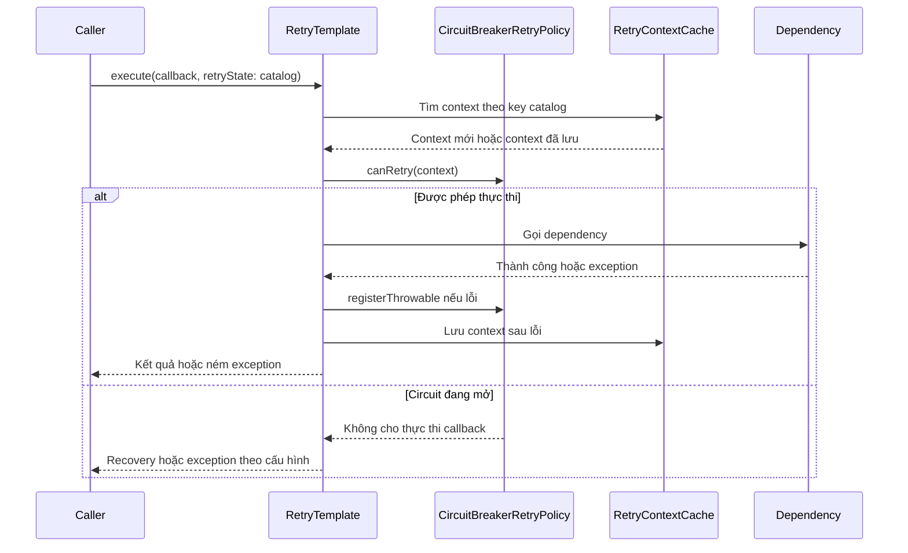
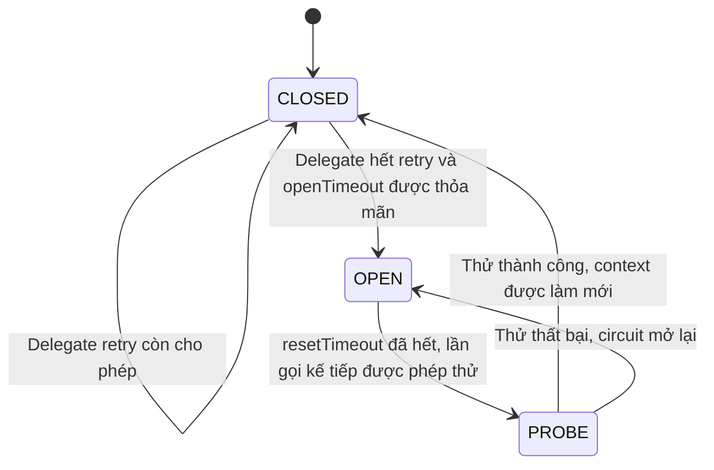

# CircuitBreakerRetryPolicy, DefaultRetryState và stateful retry

Spring Cloud Circuit Breaker có backend dựa trên Spring Retry. Backend này kết hợp `CircuitBreakerRetryPolicy` với stateful retry và `DefaultRetryState` để giữ ngữ cảnh lỗi giữa các lần gọi. `CircuitBreakerRetryPolicy` quyết định khi nào một lần gọi được phép tiếp tục theo retry policy và thời gian mở/reset; `DefaultRetryState` cung cấp khóa để Spring Retry nhận diện ngữ cảnh của cùng một breaker qua các lần thực thi.

Ba thành phần này có nhiệm vụ khác nhau:

| Thành phần | Vai trò |
|---|---|
| `RetryPolicy` delegate | Quyết định exception nào có thể retry và giới hạn số lần hoặc thời gian thử lại |
| `CircuitBreakerRetryPolicy` | Bọc retry policy, theo dõi trạng thái circuit trong retry context, từ chối lời gọi khi circuit đang mở và điều khiển thời điểm mở/reset |
| `DefaultRetryState` | Mang một key ổn định để `RetryTemplate` tìm lại retry context đã lưu giữa các lần gọi |

Spring Cloud Circuit Breaker tạo `CircuitBreakerRetryPolicy` và `DefaultRetryState` cho các breaker dùng backend Spring Retry. Ứng dụng thường cấu hình retry policy qua `SpringRetryConfigBuilder`; không cần tự tạo hai đối tượng này trong mỗi request. Hiểu các lớp nền tảng giúp giải thích vì sao trạng thái breaker tồn tại qua nhiều lần gọi và cách chọn key đúng.

## Retry không trạng thái và stateful retry

Với stateless retry, `RetryTemplate` thực hiện các attempt trong cùng một lần gọi `execute`. Retry context thường nằm trong luồng thực thi hiện tại. Nếu mọi attempt thất bại, exception cuối cùng hoặc recovery callback được trả về caller.

Với stateful retry, một lần thực thi thất bại có thể kết thúc bằng cách ném exception ra ngoài. Retry context được lưu vào `RetryContextCache` theo key của `RetryState`. Khi cùng một công việc được gửi lại với cùng key, `RetryTemplate` lấy lại context trước đó và tiếp tục từ trạng thái đã lưu. Cơ chế này hữu ích khi transaction hiện tại phải rollback sau lỗi và công việc được gọi lại trong transaction mới; nó cũng là nền tảng để Spring Retry duy trì trạng thái circuit breaker giữa các lần gọi.

| Đặc điểm | Stateless retry | Stateful retry |
|---|---|---|
| Ngữ cảnh retry | Gắn với một lần thực thi | Có thể được lưu và tìm lại qua nhiều lần thực thi |
| Sau khi một attempt thất bại | `RetryTemplate` có thể thử tiếp trong cùng lần gọi | Exception có thể được ném ra để caller/transaction kết thúc; lần gọi sau tiếp tục theo key |
| Nhận diện công việc | Không cần key bên ngoài | Cần key ổn định qua các lần thử lại |
| Trường hợp thường gặp | Retry một lời gọi mạng ngắn trong cùng request | Retry item trong batch hoặc công việc cần rollback transaction giữa các lần thử |

Stateful retry không có nghĩa là một request HTTP được giữ mở trong lúc chờ. Mỗi lần gọi có thể kết thúc; retry context được dùng lại khi cùng công việc được gửi lại. Trong circuit breaker của Spring Cloud, key thường gắn với ID breaker, ví dụ `catalog`, để các lần gọi thuộc cùng failure domain chia sẻ ngữ cảnh.

## CircuitBreakerRetryPolicy phối hợp với delegate policy

`CircuitBreakerRetryPolicy` triển khai interface `RetryPolicy` và có thể bọc một retry policy khác:

```java
RetryPolicy delegate = new SimpleRetryPolicy(3);
CircuitBreakerRetryPolicy circuitPolicy =
        new CircuitBreakerRetryPolicy(delegate);

circuitPolicy.setOpenTimeout(5_000L);
circuitPolicy.setResetTimeout(20_000L);
```

Trong ví dụ, `SimpleRetryPolicy(3)` cho phép tối đa ba attempt tổng cộng trong một lần thực thi retry, tính cả lần đầu. Delegate quyết định giới hạn và phân loại lỗi; `CircuitBreakerRetryPolicy` bổ sung hành vi circuit breaker quanh quyết định đó.

Hai timeout của policy có ý nghĩa riêng:

- `openTimeout` là khoảng thời gian dùng để xác định circuit có cần mở hay không. Khi delegate không còn cho retry và thời gian từ lúc context bắt đầu vẫn nằm trong cửa sổ này, circuit được đánh dấu mở.
- `resetTimeout` là thời gian chờ sau khi circuit mở trước khi context được reset. Khi thời gian này đã trôi qua, lần gọi tiếp theo có thể được phép thử lại dependency và bắt đầu một context mới.

Các setter trên `CircuitBreakerRetryPolicy` nhận giá trị theo mili giây. Ví dụ `5_000L` tương đương năm giây và `20_000L` tương đương hai mươi giây. Đây không phải hai ngưỡng tỷ lệ phần trăm hoặc kích thước sliding window.

`openTimeout` cũng không có nghĩa là “cứ lỗi trong năm giây thì mở” độc lập với delegate. Điều kiện mở phụ thuộc việc delegate đã hết quyền retry và thời gian context đã trôi qua. Nếu cần chính sách dựa trên tỷ lệ lỗi hoặc lời gọi chậm trong cửa sổ thống kê, hãy chọn backend hỗ trợ mô hình đó như Resilience4j.

## DefaultRetryState và khóa của retry context

`DefaultRetryState` triển khai `RetryState`. Đối tượng này mang key để `RetryTemplate` tra cứu context đã lưu giữa các lần thực thi. Một số constructor thường dùng:

```java
RetryState state = new DefaultRetryState("catalog");
```

Hoặc cấu hình thêm việc làm mới context và phân loại rollback:

```java
RetryState state = new DefaultRetryState(
        "catalog",
        false,
        throwable -> true
);
```

Các tham số có ý nghĩa:

- `key`: định danh công việc hoặc breaker cần nhận diện giữa các lần gọi. Với circuit breaker, dùng key ổn định theo dependency, chẳng hạn `catalog`.
- `forceRefresh`: cho biết có thể bỏ qua bước tra cứu context cũ vì chắc chắn đây là trạng thái mới hay không. Giá trị mặc định là `false`.
- `rollbackClassifier`: phân loại exception có yêu cầu rollback hay không. Nếu không cung cấp classifier, mặc định bảo thủ là xem exception cần rollback.

Không dùng `requestId`, timestamp hoặc UUID mới cho mỗi request khi muốn các request cùng dependency chia sẻ circuit state. Nếu key thay đổi mỗi lần, retry context bị chia nhỏ và breaker không nhận diện được lịch sử chung. Ngược lại, nếu dùng chung key cho hai công việc nghiệp vụ độc lập trong một stateful retry thông thường, trạng thái của chúng có thể bị trộn lẫn.

Với Spring Cloud Circuit Breaker, factory tự tạo `DefaultRetryState` cho breaker. Khi dùng `RetryTemplate` trực tiếp, lập trình viên chịu trách nhiệm cung cấp key đúng và gọi overload `execute` có nhận `RetryState`.

## RetryContextCache lưu trạng thái ở đâu

`DefaultRetryState` không tự lưu dữ liệu. Nó chỉ cung cấp key và các thông tin điều khiển cho `RetryTemplate`. `RetryTemplate` dùng `RetryContextCache` để lưu context theo key, rồi tìm lại context đó khi có lần thực thi tiếp theo.



Cache mặc định của Spring Retry là cache trong bộ nhớ của tiến trình. Vì vậy, stateful retry theo cách này không tự đồng bộ giữa các replica và không bảo đảm giữ trạng thái sau khi JVM khởi động lại. Nếu có nhiều pod, mỗi pod có thể giữ context riêng; cùng một ID breaker không tự tạo thành circuit breaker phân tán. Cần đưa đặc điểm này vào thiết kế và quan sát vận hành.

## Cấu hình backend Spring Retry qua Spring Cloud Circuit Breaker

Để dùng backend Spring Retry, thêm starter tương ứng và quản lý version qua Spring Cloud BOM:

```xml
<dependency>
    <groupId>org.springframework.cloud</groupId>
    <artifactId>spring-cloud-starter-circuitbreaker-spring-retry</artifactId>
</dependency>
```

Spring Cloud Circuit Breaker dùng `SpringRetryCircuitBreakerFactory`. Có thể cấu hình retry policy mặc định cho mọi ID:

```java
import org.springframework.cloud.client.circuitbreaker.Customizer;
import org.springframework.cloud.circuitbreaker.springretry.SpringRetryCircuitBreakerFactory;
import org.springframework.cloud.circuitbreaker.springretry.SpringRetryConfigBuilder;
import org.springframework.context.annotation.Bean;
import org.springframework.context.annotation.Configuration;
import org.springframework.retry.policy.SimpleRetryPolicy;

@Configuration
public class SpringRetryCircuitBreakerConfiguration {

    @Bean
    public Customizer<SpringRetryCircuitBreakerFactory> defaultRetryConfiguration() {
        return factory -> factory.configureDefault(id ->
                new SpringRetryConfigBuilder(id)
                        .retryPolicy(new SimpleRetryPolicy(3))
                        .build()
        );
    }
}
```

Trong ví dụ, mỗi breaker dùng retry policy cho tối đa ba attempt. Spring Cloud tạo phần `CircuitBreakerRetryPolicy` và `DefaultRetryState` trong backend. Nếu chỉ một dependency cần chính sách khác, cấu hình theo ID:

```java
@Bean
public Customizer<SpringRetryCircuitBreakerFactory> catalogRetryConfiguration() {
    return factory -> factory.configure(
            builder -> builder
                    .retryPolicy(new SimpleRetryPolicy(2))
                    .build(),
            "catalog"
    );
}
```

Không cấu hình cùng ID ở nhiều nơi với các retry policy mâu thuẫn. Cần kiểm tra version Spring Cloud Circuit Breaker và Spring Retry trong BOM đang dùng trước khi dựa vào API builder cụ thể. Các ví dụ chính thức của Spring Cloud dùng `SpringRetryConfigBuilder.retryPolicy(...)` để cung cấp delegate policy.

## Gọi dependency qua factory và fallback

Service tạo breaker theo ID và bọc lời gọi trong `run`:

```java
@Service
public class CatalogService {

    private final CircuitBreakerFactory<?, ?> circuitBreakerFactory;
    private final CatalogClient catalogClient;

    public CatalogService(
            CircuitBreakerFactory<?, ?> circuitBreakerFactory,
            CatalogClient catalogClient) {
        this.circuitBreakerFactory = circuitBreakerFactory;
        this.catalogClient = catalogClient;
    }

    public Product findProduct(String productId) {
        CircuitBreaker breaker = circuitBreakerFactory.create("catalog");

        return breaker.run(
                () -> catalogClient.findProduct(productId),
                error -> Product.unavailable(productId)
        );
    }
}
```

ID `catalog` là định danh ổn định cho breaker. Các request dùng cùng ID đi qua cùng cấu hình và ngữ cảnh do backend quản lý. Khi policy cho phép thực thi, supplier gọi client và Spring Retry áp dụng retry policy. Khi circuit đang mở hoặc lần thực thi đã hết retry, fallback có thể tạo kết quả thay thế cho caller.

Fallback không làm cho lần gọi gốc trở thành thành công trong retry context. Nó chỉ quyết định kết quả mà caller nhận được. Nếu dependency đã lỗi, hãy giữ metric/log và thông tin nguyên nhân để không che giấu tình trạng dịch vụ phụ thuộc.

## Tùy biến RetryTemplate và lắng nghe sự kiện

Spring Cloud Circuit Breaker cho phép tùy biến `RetryTemplate` trước khi factory trả breaker cho caller bằng `addRetryTemplateCustomizers`. Cách này phù hợp để đăng ký `RetryListener` hoặc điều chỉnh hành vi quan sát của template:

```java
@Bean
public Customizer<SpringRetryCircuitBreakerFactory> retryListenerConfiguration() {
    return factory -> factory.addRetryTemplateCustomizers(retryTemplate ->
            retryTemplate.registerListener(new RetryListener() {
                @Override
                public <T, E extends Throwable> boolean open(
                        RetryContext context,
                        RetryCallback<T, E> callback) {
                    return false;
                }

                @Override
                public <T, E extends Throwable> void close(
                        RetryContext context,
                        RetryCallback<T, E> callback,
                        Throwable throwable) {
                    // Ghi nhận kết quả cuối của block retry.
                }

                @Override
                public <T, E extends Throwable> void onError(
                        RetryContext context,
                        RetryCallback<T, E> callback,
                        Throwable throwable) {
                    // Ghi nhận từng attempt lỗi.
                }
            })
    );
}
```

`onError` được gọi khi một attempt gặp lỗi; `close` chạy khi block retry đóng. Callback nên nhẹ, tránh gọi dịch vụ khác hoặc ghi log đồng bộ chậm trong luồng request. Nếu cần phát metric, dùng nhãn có cardinality thấp như breaker ID và loại kết quả, không dùng user ID hoặc request ID làm nhãn.

## Dùng RetryTemplate trực tiếp khi cần stateful retry

Trong trường hợp không dùng factory Spring Cloud và muốn hiểu cách các primitive phối hợp, có thể cấu hình `RetryTemplate` trực tiếp:

```java
RetryTemplate retryTemplate = new RetryTemplate();

CircuitBreakerRetryPolicy circuitPolicy =
        new CircuitBreakerRetryPolicy(new SimpleRetryPolicy(3));
circuitPolicy.setOpenTimeout(5_000L);
circuitPolicy.setResetTimeout(20_000L);

retryTemplate.setRetryPolicy(circuitPolicy);

Product product = retryTemplate.execute(
        context -> catalogClient.findProduct(productId),
        context -> Product.unavailable(productId),
        new DefaultRetryState("catalog")
);
```

Ví dụ này minh họa API Spring Retry ở mức thấp: `CircuitBreakerRetryPolicy` bọc delegate, còn `DefaultRetryState("catalog")` cung cấp key để lưu/tìm context. Không đồng thời bọc cùng supplier bằng một `SpringRetryCircuitBreakerFactory` khác; hãy chọn một ranh giới thực thi cho thao tác đó.

Trong code ứng dụng thực tế, cần đưa `RetryTemplate` vào bean dùng chung thay vì tạo mới cho từng request. Nếu template hoặc cache bị tạo lại liên tục, context sẽ không còn được chia sẻ giữa các lần gọi. Đồng thời, key phải ổn định theo circuit cần bảo vệ.

## Diễn giải vòng đời circuit

Với delegate policy và stateful context, có thể mô tả luồng tổng quát như sau:

1. **Circuit cho phép gọi:** callback được thực thi theo retry policy. Delegate quyết định số attempt và exception nào được thử lại.
2. **Delegate hết quyền retry:** nếu điều kiện `openTimeout` được thỏa mãn, `CircuitBreakerRetryPolicy` đánh dấu circuit mở trong retry context.
3. **Circuit đang mở:** những lần gọi tiếp theo dùng cùng key bị chặn khỏi callback và đi tới recovery/fallback theo cách tích hợp.
4. **Hết `resetTimeout`:** lần gọi tiếp theo có thể khởi tạo lại context để thử dependency. Nếu thành công, trạng thái lỗi cũ được xóa; nếu thất bại, policy có thể mở circuit lại.



`PROBE` trong sơ đồ là cách mô tả lần gọi kiểm tra sau thời gian reset; không nên giả định backend Spring Retry cung cấp đầy đủ cùng API trạng thái, metric và event như Resilience4j. Đặc biệt, mô hình này không sử dụng sliding window tính tỷ lệ lỗi/lời gọi chậm như Resilience4j.

## Những điểm cần lưu ý khi triển khai

- **Chọn delegate policy đúng:** chỉ retry exception có khả năng tạm thời. Không retry lỗi validation, authorization hoặc lỗi nghiệp vụ không thể khắc phục bằng thử lại.
- **Hiểu tổng số attempt:** `SimpleRetryPolicy(3)` giới hạn ba attempt tổng cộng, không phải ba lần retry cộng thêm lần đầu.
- **Giữ key ổn định:** với breaker, key theo dependency/ID breaker; với stateful batch retry, key theo item nghiệp vụ. Không thay key ở mỗi attempt.
- **Phân biệt hai timeout:** `openTimeout` tham gia quyết định mở circuit khi delegate hết retry; `resetTimeout` quyết định khi nào context có thể được reset để thử lại.
- **Không xem cache mặc định là phân tán:** context trong bộ nhớ không đồng bộ giữa các JVM và có thể mất khi restart.
- **Tránh lồng retry không kiểm soát:** retry ở client, service và gateway có thể nhân số attempt. Tính tổng thời gian, số lần gọi và tải phát sinh.
- **Không thay thế timeout mạng:** retry policy không tự đặt connect/read timeout cho HTTP client. Cấu hình timeout ở client để một attempt không treo vô hạn.
- **Chọn backend phù hợp:** Spring Retry dùng `RetryTemplate` đồng bộ. Với `Mono`/`Flux`, dùng reactive integration như Resilience4j thay vì chặn luồng reactive bằng `.block()`.

## Kiểm thử stateful retry và circuit breaker

Nên kiểm tra cả retry trong một lần gọi và trạng thái được giữ qua nhiều lần gọi:

| Kịch bản | Điều cần xác nhận |
|---|---|
| Dependency thành công ngay | Callback chạy một lần và context kết thúc thành công |
| Một vài lỗi tạm thời rồi thành công | Delegate thực hiện đúng số attempt cho phép |
| Delegate hết retry trong `openTimeout` | Circuit chuyển sang trạng thái mở theo policy |
| Gọi lại cùng ID khi circuit mở | Callback không gọi dependency; recovery/fallback được áp dụng |
| Gọi lại với key khác | Không dùng nhầm context của breaker khác |
| Gọi lại cùng key sau `resetTimeout` | Lần gọi có thể thử dependency và context được làm mới theo kết quả |
| Hai replica nhận request | Xác nhận trạng thái local của từng replica; không giả định có shared state |
| Restart ứng dụng | Xác nhận context in-memory được tạo lại và hành vi phục hồi được chấp nhận |

Với stateful retry tự triển khai, thêm test cho `RetryContextCache` và transaction rollback. Một mock unit test chỉ xác nhận code gọi `execute` không chứng minh được cache key, concurrency và transaction isolation hoạt động đúng; cần integration test cho các đường quan trọng.

## Khi nào nên chọn backend này

Spring Retry phù hợp khi ứng dụng đã dùng hệ sinh thái Spring Retry, cần tích hợp `RetryTemplate`/`RetryPolicy` và muốn kết hợp retry với cơ chế circuit breaker stateful. Nếu cần sliding window theo số lượng hoặc thời gian, tỷ lệ failure/slow call, bulkhead, time limiter hoặc hỗ trợ reactive toàn diện, Resilience4j thường cung cấp bộ tính năng phong phú hơn. Hãy chọn backend dựa trên semantics cần có, không chỉ dựa trên việc cả hai đều có tên “circuit breaker”.

## Tài liệu tham khảo

- [Spring Cloud Circuit Breaker — Configuring Spring Retry Circuit Breakers](https://docs.spring.io/spring-cloud-circuitbreaker/reference/spring-cloud-circuitbreaker-spring-retry.html)
- [Spring Retry — CircuitBreakerRetryPolicy API](https://docs.spring.io/spring-retry/docs/current/apidocs/spring.retry/org/springframework/retry/policy/CircuitBreakerRetryPolicy.html)
- [Spring Retry — DefaultRetryState API](https://docs.spring.io/spring-retry/docs/api/current/org/springframework/retry/support/DefaultRetryState.html)
- [Spring Retry — RetryTemplate API](https://docs.spring.io/spring-retry/docs/api/current/org/springframework/retry/support/RetryTemplate.html)
- [Spring Retry — Stateful Retry overview](https://docs.spring.io/spring-batch/trunk_bkp/reference/html/retry.html)
