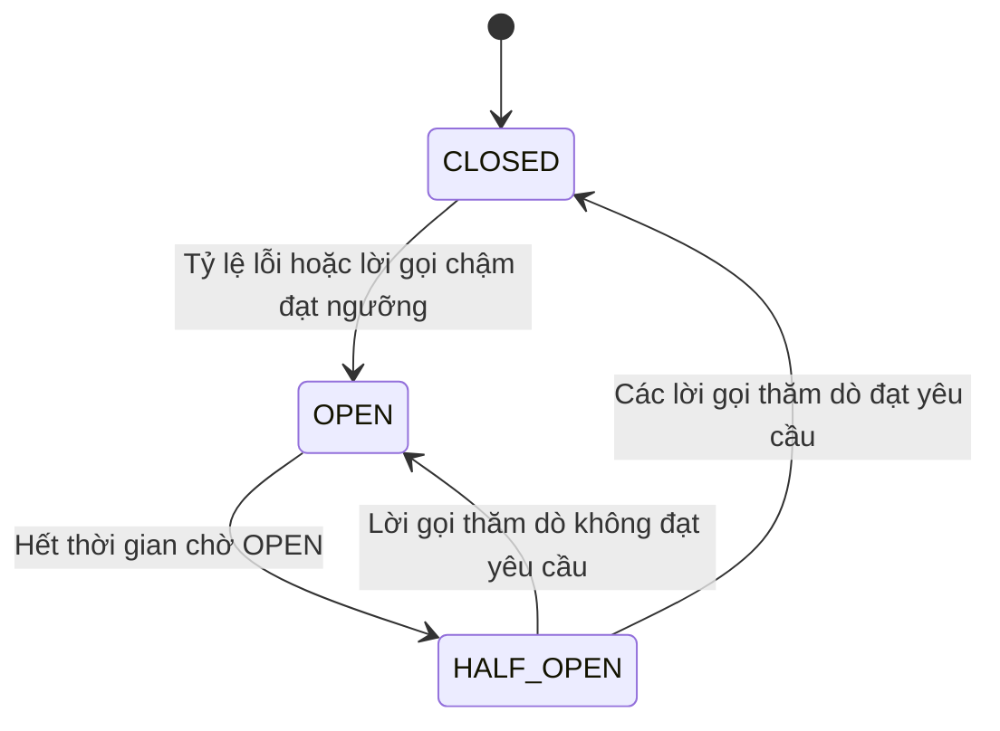

# HALF_OPEN: cho phép một số lời gọi thăm dò phục hồi

## Mục tiêu

Khi một dịch vụ phụ thuộc gặp sự cố, Circuit Breaker chuyển từ `CLOSED` sang `OPEN` để ngăn các yêu cầu tiếp tục dồn vào dịch vụ đang lỗi. Tuy nhiên, nếu giữ `OPEN` mãi thì hệ thống không có cơ hội nhận ra dịch vụ đã phục hồi. Trạng thái `HALF_OPEN` giải quyết khoảng trống đó: sau một khoảng chờ, bộ ngắt mạch chỉ cho phép một số ít lời gọi thăm dò đi qua, quan sát kết quả rồi quyết định đóng mạch hay mở lại.

Sau bài học, bạn có thể:

- Mô tả điều kiện chuyển `OPEN` sang `HALF_OPEN` và các kết quả có thể xảy ra sau lượt thăm dò.
- Phân biệt số lời gọi thăm dò trong `HALF_OPEN` với sliding window dùng để đánh giá lỗi trong `CLOSED`.
- Cấu hình `permittedNumberOfCallsInHalfOpenState`, thời gian chờ và ngưỡng lỗi bằng Resilience4j trong ứng dụng Spring Cloud.
- Kết hợp Circuit Breaker với fallback, timeout, bulkhead và lời gọi reactive; đọc các chỉ số để đánh giá khả năng bảo vệ dịch vụ.

## Vai trò của HALF_OPEN trong máy trạng thái

Circuit Breaker có ba trạng thái vận hành chính:

| Trạng thái | Hành vi | Mục đích |
|---|---|---|
| `CLOSED` | Cho phép lời gọi đi tới dịch vụ phụ thuộc và ghi nhận kết quả. | Hoạt động bình thường, đồng thời thu thập dữ liệu lỗi và độ trễ. |
| `OPEN` | Từ chối lời gọi ngay, thường bằng `CallNotPermittedException`; phần xử lý phía ứng dụng có thể chuyển sang fallback. | Cắt dòng yêu cầu tới dịch vụ đang không khỏe, tránh làm sự cố lan rộng. |
| `HALF_OPEN` | Chỉ cho phép số lời gọi thăm dò đã cấu hình; các lời gọi vượt hạn mức tiếp tục bị từ chối. | Kiểm tra dịch vụ đã phục hồi hay chưa với tải nhỏ và có kiểm soát. |

Luồng chuyển trạng thái cơ bản:



Trong `CLOSED`, Circuit Breaker ghi nhận kết quả các lời gọi trong sliding window. Khi đã có đủ số mẫu tối thiểu, nếu tỷ lệ lỗi hoặc tỷ lệ lời gọi chậm đạt ngưỡng cấu hình, mạch chuyển sang `OPEN`. Ví dụ, với `failureRateThreshold: 50`, tỷ lệ lỗi bằng hoặc lớn hơn 50% có thể kích hoạt `OPEN` khi số mẫu đã đạt `minimumNumberOfCalls`.

Trong `OPEN`, lời gọi mới không được chuyển tiếp xuống dịch vụ phụ thuộc. Bộ ngắt mạch giữ trạng thái này trong `waitDurationInOpenState`. Khi hết thời gian chờ, nó có thể chuyển sang `HALF_OPEN` để thử phục hồi. Nếu `automaticTransitionFromOpenToHalfOpenEnabled` là `false`, mặc định, lần gọi tiếp theo sau thời gian chờ sẽ kích hoạt chuyển trạng thái. Nếu bật thuộc tính này, một tác vụ nền sẽ tự chuyển trạng thái khi hết thời gian chờ, kể cả khi chưa có yêu cầu mới.

Trong `HALF_OPEN`, Resilience4j cho phép tối đa `permittedNumberOfCallsInHalfOpenState` lời gọi thăm dò. Các lời gọi còn lại bị từ chối cho tới khi bộ ngắt mạch có đủ kết quả để đưa ra quyết định. Khi các lời gọi được cấp phép đã hoàn tất:

- Nếu tỷ lệ lỗi và tỷ lệ lời gọi chậm nằm dưới các ngưỡng tương ứng, Circuit Breaker chuyển về `CLOSED` và tiếp tục nhận lưu lượng bình thường.
- Nếu một trong các tỷ lệ đạt hoặc vượt ngưỡng, Circuit Breaker quay lại `OPEN` và bắt đầu một chu kỳ chờ mới.

`maxWaitDurationInHalfOpenState` đặt giới hạn thời gian tối đa ở `HALF_OPEN`. Giá trị `0` có nghĩa là không đặt giới hạn; bộ ngắt mạch chờ các lời gọi thăm dò được cấp phép hoàn tất. Nếu đặt một thời lượng dương, khi hết thời lượng đó mà trạng thái thăm dò chưa thể kết thúc, Circuit Breaker chuyển lại `OPEN`. Cấu hình này hữu ích khi lời gọi có thể treo lâu hoặc không trả kết quả.

## Số lời gọi thăm dò và sliding window là hai khái niệm khác nhau

Hai cấu hình thường bị nhầm lẫn:

| Cấu hình | Được dùng khi nào? | Ý nghĩa |
|---|---|---|
| `slidingWindowSize` | Chủ yếu khi đánh giá kết quả ở `CLOSED`. | Kích thước cửa sổ dùng để tính tỷ lệ lỗi và tỷ lệ lời gọi chậm. |
| `minimumNumberOfCalls` | Khi đánh giá ngưỡng trong `CLOSED`. | Số mẫu tối thiểu cần có trước khi tỷ lệ được dùng để quyết định mở mạch. |
| `permittedNumberOfCallsInHalfOpenState` | Khi đang ở `HALF_OPEN`. | Số lời gọi thăm dò tối đa được phép đi qua trong một lượt kiểm tra phục hồi. |

Resilience4j hỗ trợ hai loại sliding window:

- `COUNT_BASED`: cửa sổ chứa kết quả của một số lời gọi gần nhất. Với `slidingWindowSize: 20`, bộ ngắt mạch đánh giá tối đa 20 kết quả gần nhất.
- `TIME_BASED`: cửa sổ chia theo các khoảng thời gian và đánh giá kết quả trong số giây được cấu hình. Với `slidingWindowSize: 10`, cửa sổ bao phủ 10 giây gần nhất.

Ví dụ, một dịch vụ danh mục có cửa sổ 20 lời gọi và `minimumNumberOfCalls: 10`. Trong `CLOSED`, Circuit Breaker chưa dùng tỷ lệ lỗi để mở mạch cho tới khi có ít nhất 10 mẫu. Sau khi mở mạch và hết thời gian chờ, nó chuyển sang `HALF_OPEN` và chỉ cấp ba lời gọi thăm dò nếu `permittedNumberOfCallsInHalfOpenState: 3`. Ba lời gọi này là mẫu kiểm tra phục hồi riêng; chúng không có nghĩa là phải đợi thêm 20 lời gọi mới quyết định trạng thái.

Giả sử ngưỡng lỗi là 50% và lượt thăm dò có ba lời gọi:

- Không có lời gọi nào thất bại: tỷ lệ lỗi 0%, dịch vụ có thể được xem là đã phục hồi và mạch đóng lại nếu tỷ lệ lời gọi chậm cũng đạt yêu cầu.
- Một lời gọi thất bại: tỷ lệ lỗi khoảng 33%, thấp hơn ngưỡng 50%; mạch có thể đóng lại nếu không có ngưỡng khác bị vi phạm.
- Hai lời gọi thất bại: tỷ lệ lỗi khoảng 67%, vượt ngưỡng; mạch quay lại `OPEN`.

Đây là ví dụ với ba mẫu hoàn tất và chỉ xét ngưỡng lỗi. Nếu có cấu hình `slowCallRateThreshold`, các lời gọi quá thời lượng `slowCallDurationThreshold` cũng có thể khiến mạch mở lại dù chúng không ném ngoại lệ.

## Cấu hình Resilience4j trong Spring Cloud

Ví dụ dưới đây cấu hình một Circuit Breaker tên `catalog`. Các giá trị là điểm bắt đầu để thực hành; khi vận hành cần điều chỉnh theo độ trễ bình thường, lưu lượng và khả năng chịu tải của dịch vụ phụ thuộc.

```yaml
resilience4j:
  circuitbreaker:
    instances:
      catalog:
        registerHealthIndicator: true
        slidingWindowType: COUNT_BASED
        slidingWindowSize: 20
        minimumNumberOfCalls: 10
        failureRateThreshold: 50
        slowCallRateThreshold: 60
        slowCallDurationThreshold: 800ms
        waitDurationInOpenState: 8s
        permittedNumberOfCallsInHalfOpenState: 3
        maxWaitDurationInHalfOpenState: 5s
        automaticTransitionFromOpenToHalfOpenEnabled: false
        ignoreExceptions:
          - com.example.catalog.InvalidProductIdException
          - io.github.resilience4j.bulkhead.BulkheadFullException
  timelimiter:
    instances:
      catalog:
        timeoutDuration: 2s
        cancelRunningFuture: true
  bulkhead:
    instances:
      catalog:
        maxConcurrentCalls: 20
        maxWaitDuration: 0
```

Ý nghĩa các giá trị liên quan trực tiếp đến máy trạng thái:

- `waitDurationInOpenState: 8s`: sau khi vào `OPEN`, bộ ngắt mạch chờ tám giây trước khi cho phép bắt đầu kiểm tra phục hồi.
- `permittedNumberOfCallsInHalfOpenState: 3`: mỗi lượt `HALF_OPEN` chỉ cho ba lời gọi thăm dò đi qua.
- `maxWaitDurationInHalfOpenState: 5s`: không để một lượt thăm dò bị giữ ở `HALF_OPEN` vô thời hạn.
- `automaticTransitionFromOpenToHalfOpenEnabled: false`: trạng thái chỉ chuyển khi có lời gọi đến sau thời gian chờ; bật thuộc tính nếu cần chuyển tự động ngay cả khi hệ thống đang ít lưu lượng.
- `ignoreExceptions`: các lỗi nghiệp vụ được liệt kê không làm tăng tỷ lệ lỗi của Circuit Breaker. Chỉ bỏ qua ngoại lệ khi chúng thực sự không phản ánh tình trạng sức khỏe của dịch vụ phụ thuộc.

Tên instance phải nhất quán giữa cấu hình và nơi tạo Circuit Breaker. Với Spring Cloud CircuitBreaker dùng implementation Resilience4j, có thể gọi qua `ReactiveCircuitBreakerFactory` trong luồng reactive hoặc `CircuitBreakerFactory` trong luồng đồng bộ. Ví dụ reactive:

```java
import org.springframework.cloud.client.circuitbreaker.ReactiveCircuitBreaker;
import org.springframework.cloud.client.circuitbreaker.ReactiveCircuitBreakerFactory;
import org.springframework.stereotype.Service;
import org.springframework.web.reactive.function.client.WebClient;
import reactor.core.publisher.Mono;

@Service
public class CatalogGateway {
    private final WebClient webClient;
    private final ReactiveCircuitBreakerFactory<?, ?> circuitBreakerFactory;

    public CatalogGateway(
            WebClient webClient,
            ReactiveCircuitBreakerFactory<?, ?> circuitBreakerFactory) {
        this.webClient = webClient;
        this.circuitBreakerFactory = circuitBreakerFactory;
    }

    public Mono<Product> findById(String id) {
        ReactiveCircuitBreaker breaker = circuitBreakerFactory.create("catalog");

        Mono<Product> request = webClient.get()
                .uri("/products/{id}", id)
                .retrieve()
                .bodyToMono(Product.class);

        return breaker.run(request, error -> {
            // Có thể đọc dữ liệu cache hoặc trả kết quả suy giảm phù hợp.
            return Mono.just(Product.unavailable(id));
        });
    }
}
```

`Product` và `Product.unavailable` trong ví dụ là kiểu dữ liệu của ứng dụng, cần được định nghĩa theo mô hình thực tế. `ReactiveCircuitBreaker` áp dụng chính sách của instance `catalog` cho publisher. Khi mạch `OPEN` hoặc lời gọi gặp lỗi được tính là lỗi, hàm fallback có thể trả dữ liệu cache, trạng thái không khả dụng hoặc một kết quả suy giảm mà API đã quy định. Fallback nên nhanh, không gọi lại chính dịch vụ đang lỗi và không che giấu lỗi nghiệp vụ bằng dữ liệu giả gây hiểu nhầm.

Nếu dùng trực tiếp annotation của Resilience4j thay vì Spring Cloud CircuitBreaker factory, có thể gắn `@CircuitBreaker(name = "catalog", fallbackMethod = "findFallback")` lên phương thức. Phương thức fallback cần có cùng các tham số nghiệp vụ và thêm tham số ngoại lệ ở cuối; kiểu trả về phải tương thích với phương thức gốc. Chọn một cách tích hợp nhất quán để tránh vô tình bọc cùng một lời gọi qua nhiều Circuit Breaker.

## Kết hợp timeout và bulkhead

Circuit Breaker quyết định có cho lời gọi đi tiếp hay không dựa trên trạng thái và kết quả đã ghi nhận. Nó không tự đặt thời hạn cho mọi lời gọi và cũng không tự giới hạn số tác vụ đồng thời. Hai cơ chế bổ sung giải quyết hai vấn đề khác nhau:

- **Timeout / TimeLimiter** giới hạn thời gian chờ. Nếu dịch vụ phụ thuộc phản hồi quá chậm, lời gọi kết thúc bằng lỗi timeout; lỗi này có thể được Circuit Breaker ghi nhận và làm tăng tỷ lệ lỗi hoặc tỷ lệ lời gọi chậm.
- **Bulkhead** giới hạn số lời gọi đồng thời hoặc cô lập chúng trong một nhóm tài nguyên riêng. Khi hết hạn mức, yêu cầu mới bị từ chối hoặc phải chờ theo cấu hình, nhờ đó một dịch vụ chậm không chiếm hết tài nguyên dành cho các dịch vụ khác.

Trong cấu hình mẫu, `timeoutDuration: 2s` đặt thời hạn cho TimeLimiter được tích hợp. `maxConcurrentCalls: 20` và `maxWaitDuration: 0` cấu hình Bulkhead kiểu semaphore: tối đa 20 lời gọi đồng thời và không chờ để lấy thêm giấy phép khi đã đầy. Nếu cần cô lập bằng pool luồng, Resilience4j có `thread-pool-bulkhead` với các thuộc tính như `coreThreadPoolSize`, `maxThreadPoolSize` và `queueCapacity`; chọn kiểu phù hợp với mô hình đồng bộ hay reactive của ứng dụng.

Với Reactor khi tự ghép operator, có thể đặt timeout trực tiếp trên `Mono` hoặc `Flux`:

```java
Mono<Product> request = webClient.get()
        .uri("/products/{id}", id)
        .retrieve()
        .bodyToMono(Product.class)
        .timeout(Duration.ofSeconds(2));
```

Khi dùng `ReactiveCircuitBreakerFactory`, cấu hình TimeLimiter của instance có thể cung cấp thời hạn cho implementation Resilience4j. Nếu tự dùng `Mono.timeout`, hãy tránh đặt hai thời hạn mâu thuẫn cho cùng một lời gọi. Với Bulkhead reactive, có thể dùng `BulkheadOperator` của Resilience4j Reactor để giới hạn subscription; cần quyết định rõ lỗi từ chối do hết Bulkhead có được tính là lỗi của dịch vụ phụ thuộc hay không. Ví dụ cấu hình trên bỏ qua `BulkheadFullException` để tình trạng quá tải tại cổng vào không làm sai tỷ lệ lỗi sức khỏe của dịch vụ danh mục.

Thứ tự các lớp bảo vệ ảnh hưởng tới loại lỗi mà Circuit Breaker quan sát. Timeout phản ánh lời gọi phụ thuộc quá chậm; Bulkhead rejection phản ánh ứng dụng đã hết hạn mức xử lý. Phân loại đúng hai loại lỗi giúp quyết định `OPEN` dựa trên sức khỏe dịch vụ phụ thuộc thay vì nhầm lẫn với giới hạn tài nguyên cục bộ.

## Theo dõi trạng thái và kết quả thăm dò

Khi bật `registerHealthIndicator: true` và tích hợp Spring Boot Actuator, trạng thái Circuit Breaker có thể xuất hiện trong health endpoint. Micrometer cũng cung cấp các metric Resilience4j, thường gồm:

- `resilience4j.circuitbreaker.state`: trạng thái hiện tại của instance.
- `resilience4j.circuitbreaker.calls`: số lời gọi theo kết quả và loại lời gọi.
- `resilience4j.circuitbreaker.not.permitted.calls`: số lời gọi bị từ chối do trạng thái không cho phép.
- `resilience4j.circuitbreaker.failure.rate` và `resilience4j.circuitbreaker.slow.call.rate`: các tỷ lệ dùng để đánh giá ngưỡng.
- `resilience4j.circuitbreaker.buffered.calls`: số kết quả đang được ghi nhận trong cửa sổ.

Có thể truy vấn metric qua Actuator, ví dụ `/actuator/metrics/resilience4j.circuitbreaker.state`, rồi lọc theo tag `name` tương ứng với instance. Tên metric và tag khả dụng phụ thuộc phiên bản, registry và cấu hình Micrometer của ứng dụng. Trong môi trường thật, chỉ mở các endpoint cần thiết và bảo vệ quyền truy cập.

Khi điều tra một lần chuyển `OPEN` sang `HALF_OPEN`, hãy đối chiếu thời điểm chuyển trạng thái, số lời gọi được cấp phép, kết quả thành công/thất bại, độ trễ và số lời gọi bị từ chối. Nếu mạch liên tục quay lại `OPEN`, hãy xem dịch vụ đã thực sự phục hồi chưa, timeout có quá ngắn không, số probe có đủ đại diện không và fallback có đang che mất tín hiệu lỗi không. Trạng thái Circuit Breaker của một dịch vụ phụ thuộc cũng không nên tự động được dùng làm liveness probe khiến toàn bộ ứng dụng bị khởi động lại khi dịch vụ đó gặp sự cố.

## Thực hành quan sát một chu kỳ phục hồi

Thực hiện trong môi trường thử nghiệm với một dịch vụ danh mục có thể chủ động làm chậm hoặc trả lỗi:

1. Khởi động cả hai dịch vụ và gửi đủ yêu cầu thành công để xác nhận instance `catalog` ở `CLOSED`.
2. Làm dịch vụ danh mục trả lỗi hoặc phản hồi chậm. Gửi đủ số lời gọi để vượt `minimumNumberOfCalls` và đạt một trong các ngưỡng đã cấu hình.
3. Quan sát Circuit Breaker chuyển sang `OPEN`. Gửi thêm yêu cầu và xác nhận chúng bị từ chối nhanh; kiểm tra fallback trả kết quả suy giảm theo hợp đồng API.
4. Khôi phục dịch vụ danh mục và chờ hết `waitDurationInOpenState`. Gửi yêu cầu để kích hoạt `HALF_OPEN` nếu không bật chuyển trạng thái tự động.
5. Quan sát tối đa ba lời gọi thăm dò được phép đi qua. Các yêu cầu vượt hạn mức phải tiếp tục bị từ chối trong khi chờ kết quả probe.
6. Khi cả ba lời gọi hoàn tất, xác nhận mạch về `CLOSED` nếu tỷ lệ lỗi và lời gọi chậm dưới ngưỡng. Lặp lại thử nghiệm với ít nhất hai probe thất bại để quan sát mạch quay về `OPEN`.

Trong lúc thử nghiệm, ghi lại thời điểm, trạng thái, số probe, tỷ lệ lỗi, độ trễ và số lần fallback. Không tạo tải thử nghiệm lớn hơn khả năng của môi trường; mục tiêu là quan sát quy tắc chuyển trạng thái với số lượng yêu cầu có kiểm soát.

## Những lỗi cấu hình thường gặp

- **Đặt quá nhiều probe:** `permittedNumberOfCallsInHalfOpenState` quá lớn có thể tạo một đợt tải đáng kể lên dịch vụ vừa phục hồi. Bắt đầu với số nhỏ và tăng dựa trên dữ liệu vận hành.
- **Đặt quá ít probe:** một hoặc hai mẫu có thể không đại diện cho tình trạng dịch vụ. Cân nhắc lưu lượng thực tế và thời gian phục hồi khi chọn số lượng.
- **Nhầm sliding window với probe count:** `slidingWindowSize` không quyết định số lời gọi được phép trong `HALF_OPEN`; thuộc tính đó là `permittedNumberOfCallsInHalfOpenState`.
- **Để lời gọi thăm dò treo:** nếu thời hạn lời gọi không rõ ràng, `HALF_OPEN` có thể kéo dài. Cấu hình timeout và cân nhắc `maxWaitDurationInHalfOpenState`.
- **Fallback gọi lại cùng dịch vụ:** fallback như vậy có thể tạo thêm tải đúng lúc dịch vụ đang phục hồi. Dùng cache, dữ liệu mặc định có ý nghĩa hoặc thông báo không khả dụng.
- **Đếm lỗi nghiệp vụ thành lỗi hạ tầng:** xác định ngoại lệ nào cần ghi nhận và ngoại lệ nào cần bỏ qua; nếu không, dữ liệu đầu vào sai có thể làm Circuit Breaker mở mạch.
- **Retry khuếch đại lưu lượng:** retry nhiều lần bên trong mỗi probe có thể biến một số ít probe thành nhiều yêu cầu tới dịch vụ phụ thuộc. Giới hạn số lần retry và phối hợp backoff với timeout, Circuit Breaker.

`HALF_OPEN` là giai đoạn kiểm tra có giới hạn, không phải trạng thái phục hồi được đảm bảo. Circuit Breaker chỉ đóng lại khi các lời gọi thăm dò cung cấp đủ bằng chứng rằng dịch vụ phụ thuộc đáp ứng các ngưỡng đã đặt; nếu chưa đạt, nó quay về `OPEN` để tiếp tục bảo vệ phần còn lại của hệ thống.
