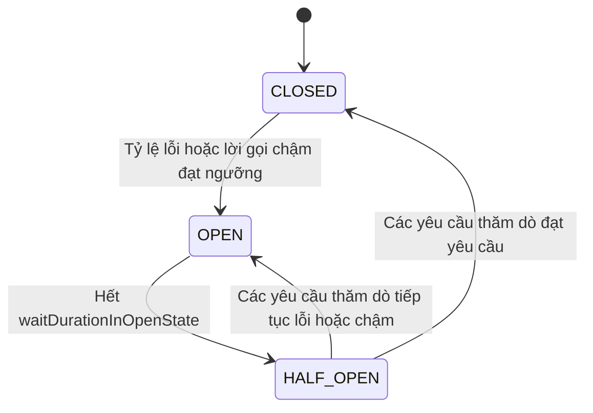

# Thời gian chờ trước khi thử phục hồi

Trong Circuit Breaker, khi tỷ lệ lỗi hoặc tỷ lệ lời gọi chậm vượt ngưỡng, bộ ngắt chuyển từ `CLOSED` sang `OPEN` để ngừng gửi thêm yêu cầu tới dịch vụ đang gặp sự cố. Sau khi mở mạch, hệ thống cần một khoảng nghỉ trước khi kiểm tra xem dịch vụ phụ thuộc đã phục hồi hay chưa. Resilience4j cấu hình khoảng nghỉ này bằng `waitDurationInOpenState`.

Khoảng chờ giúp dịch vụ phụ thuộc có thời gian ổn định lại và tránh bị dồn thêm lưu lượng ngay sau một đợt lỗi. Hết thời gian chờ chỉ cho phép chuyển sang giai đoạn thử nghiệm `HALF_OPEN`; nó không chứng minh dịch vụ đã khỏe và cũng không tự gửi một yêu cầu kiểm tra sức khỏe.

## 1. Vị trí của thời gian chờ trong máy trạng thái

- `CLOSED`: yêu cầu được chuyển tới dịch vụ phụ thuộc. Circuit Breaker ghi nhận kết quả vào sliding window. Khi đủ số mẫu tối thiểu và tỷ lệ lỗi hoặc lời gọi chậm đạt ngưỡng, bộ ngắt chuyển sang `OPEN`.
- `OPEN`: yêu cầu mới bị từ chối nhanh. Ứng dụng có thể trả dữ liệu dự phòng hoặc thông báo dịch vụ tạm thời không khả dụng. Đồng hồ `waitDurationInOpenState` bắt đầu khi bộ ngắt đi vào trạng thái này.
- `HALF_OPEN`: sau khoảng chờ, bộ ngắt chỉ cấp quyền cho một số lượng yêu cầu thăm dò giới hạn. Kết quả của các yêu cầu này quyết định mạch sẽ đóng lại hay mở lại.



Ví dụ, dịch vụ tồn kho liên tục trả lỗi và Circuit Breaker chuyển sang `OPEN` lúc 10:00:00. Nếu `waitDurationInOpenState` là 20 giây, bộ ngắt chỉ bắt đầu cho phép thử phục hồi từ khoảng 10:00:20. Nếu các yêu cầu thăm dò thành công theo ngưỡng đã cấu hình, mạch trở lại `CLOSED`. Nếu chúng tiếp tục thất bại, mạch quay về `OPEN` và bắt đầu một khoảng chờ mới.

Thời gian chờ này bắt đầu sau khi Circuit Breaker đã quyết định mở mạch. Nó không thay thế `slidingWindowSize`, `minimumNumberOfCalls` hay `failureRateThreshold`: các cấu hình đó quyết định khi nào mạch mở; `waitDurationInOpenState` quyết định phải giữ mạch mở bao lâu trước khi thử lại.

## 2. Cấu hình trong Spring Cloud CircuitBreaker với Resilience4j

Với ứng dụng Spring Boot dùng starter không reactive `org.springframework.cloud:spring-cloud-starter-circuitbreaker-resilience4j`, có thể cấu hình từng bộ ngắt trong `application.yml`. Tên `inventory` phải trùng với ID truyền vào `circuitBreakerFactory.create("inventory")`.

```yaml
resilience4j:
  circuitbreaker:
    instances:
      inventory:
        slidingWindowType: COUNT_BASED
        slidingWindowSize: 20
        minimumNumberOfCalls: 10
        failureRateThreshold: 50
        waitDurationInOpenState: 20s
        automaticTransitionFromOpenToHalfOpenEnabled: false
        permittedNumberOfCallsInHalfOpenState: 3
        maxWaitDurationInHalfOpenState: 5s
```

Ý nghĩa các thuộc tính liên quan:

| Thuộc tính | Ý nghĩa |
| --- | --- |
| `waitDurationInOpenState` | Khoảng thời gian tối thiểu bộ ngắt ở `OPEN` trước khi có thể sang `HALF_OPEN`. Resilience4j mặc định là 60 giây nếu không cấu hình giá trị khác. |
| `automaticTransitionFromOpenToHalfOpenEnabled` | Khi `true`, bộ ngắt tự chuyển sang `HALF_OPEN` khi hết giờ, kể cả khi chưa có yêu cầu mới. Mặc định là `false`. |
| `permittedNumberOfCallsInHalfOpenState` | Số yêu cầu tối đa được cấp quyền thăm dò trong `HALF_OPEN`. |
| `maxWaitDurationInHalfOpenState` | Giới hạn thời gian ở `HALF_OPEN` để chờ các yêu cầu thăm dò hoàn tất. Giá trị `0` mặc định nghĩa là không đặt giới hạn thời gian này. |

Với cấu hình trên, cửa sổ lưu 20 kết quả gần nhất và chỉ bắt đầu đánh giá tỷ lệ lỗi sau ít nhất 10 lời gọi. Nếu tỷ lệ lỗi đạt từ 50% trở lên, mạch mở và giữ trạng thái đó ít nhất 20 giây. Sau đó, tối đa ba lời gọi được dùng để đánh giá khả năng phục hồi. Giá trị 20 giây và ba lời gọi chỉ là ví dụ; cần điều chỉnh theo đặc tính của dịch vụ thực tế.

Spring Cloud CircuitBreaker cũng hỗ trợ cấu hình mặc định, cấu hình theo nhóm và cấu hình theo ID. Khi cấu hình bằng properties, cấu hình properties có độ ưu tiên cao hơn cấu hình Java `Customizer`. Vì vậy, nếu thời gian chờ trong ứng dụng không như mong đợi, hãy kiểm tra đúng ID bộ ngắt và các cấu hình properties đang áp dụng.

## 3. Hai cách chuyển từ OPEN sang HALF_OPEN

Khi `automaticTransitionFromOpenToHalfOpenEnabled` là `false` (mặc định), Resilience4j không cần tạo một tác vụ nền chỉ để đổi trạng thái. Sau khi thời gian chờ đã hết, bộ ngắt vẫn có thể hiển thị `OPEN` cho đến khi có lời gọi tiếp theo. Lời gọi đến sau thời hạn sẽ kích hoạt chuyển trạng thái và được xét như một lời gọi thăm dò nếu được cấp quyền.

Khi thuộc tính này là `true`, bộ ngắt tự chuyển sang `HALF_OPEN` ngay khi hết thời gian chờ, kể cả lúc hệ thống không có lưu lượng. Việc chuyển trạng thái tự động không đồng nghĩa Resilience4j tự gọi endpoint của dịch vụ phụ thuộc. Các yêu cầu thăm dò thực tế vẫn đến từ lưu lượng ứng dụng sau đó.

Chọn `false` khi muốn giữ cơ chế đơn giản và chỉ đánh giá lại khi có lưu lượng. Chọn `true` khi cần trạng thái chuyển đúng hạn ngay cả trong thời gian ít hoặc không có yêu cầu, đồng thời đã tính đến tài nguyên lập lịch và cách quan sát trạng thái.

## 4. Gắn bộ ngắt với lời gọi dịch vụ và fallback

Ví dụ dưới đây dùng Spring Cloud CircuitBreaker để bảo vệ lời gọi đồng bộ tới dịch vụ tồn kho:

```java
@Service
public class InventoryGateway {
    private final CircuitBreakerFactory<?, ?> circuitBreakerFactory;
    private final InventoryClient inventoryClient;

    public InventoryGateway(
            CircuitBreakerFactory<?, ?> circuitBreakerFactory,
            InventoryClient inventoryClient) {
        this.circuitBreakerFactory = circuitBreakerFactory;
        this.inventoryClient = inventoryClient;
    }

    public Stock getStock(String sku) {
        return circuitBreakerFactory.create("inventory").run(
            () -> inventoryClient.getStock(sku),
            error -> Stock.unavailable(sku)
        );
    }
}
```

`Stock.unavailable(sku)` đại diện cho cách ứng dụng tạo kết quả dự phòng theo mô hình dữ liệu của mình. Khi mạch đang `OPEN`, lời gọi bị từ chối nhanh và hàm fallback có thể trả kết quả dự phòng. Khi mạch ở `HALF_OPEN`, chỉ những lời gọi được cấp quyền mới đi tới dịch vụ tồn kho; kết quả của chúng được dùng để quyết định trạng thái tiếp theo. Fallback nên nhanh, không gọi vòng lại chính dịch vụ đang được bảo vệ và cần thể hiện rõ dữ liệu dự phòng hoặc trạng thái chưa xác định.

Đối với ứng dụng reactive, dùng starter `org.springframework.cloud:spring-cloud-starter-circuitbreaker-reactor-resilience4j` và `ReactiveCircuitBreakerFactory`. Cách bao lời gọi có cùng ý nghĩa về trạng thái:

```java
public Mono<Stock> getStock(String sku) {
    return reactiveCircuitBreakerFactory.create("inventory").run(
        webClient.get()
            .uri("/stock/{sku}", sku)
            .retrieve()
            .bodyToMono(Stock.class),
        error -> Mono.just(Stock.unavailable(sku))
    );
}
```

Trong cả hai kiểu gọi, thời gian chờ là thuộc tính của bộ ngắt theo ID `inventory`. Nó không phải thời gian chờ của một HTTP request riêng lẻ. Nếu một lời gọi thăm dò có thể bị treo lâu, hãy cấu hình timeout phù hợp cho kiểu lời gọi đang dùng; timeout giới hạn thời gian hoàn thành một lời gọi, còn `waitDurationInOpenState` quyết định khi nào bắt đầu thử phục hồi.

## 5. Chọn khoảng chờ phù hợp

Không có một giá trị tối ưu cho mọi dịch vụ. Hãy chọn khoảng chờ dựa trên thời gian dịch vụ phụ thuộc thường cần để khởi động lại, khôi phục kết nối, giải phóng tài nguyên hoặc ổn định sau sự cố. Có thể bắt đầu bằng một giá trị bảo thủ, sau đó điều chỉnh bằng dữ liệu vận hành.

- Nếu khoảng chờ quá ngắn, bộ ngắt liên tục đưa lưu lượng thăm dò tới một dịch vụ chưa phục hồi. Mạch có thể dao động giữa `OPEN` và `HALF_OPEN`, làm sự cố kéo dài.
- Nếu khoảng chờ quá dài, hệ thống tiếp tục trả fallback dù dịch vụ phụ thuộc có thể đã hoạt động trở lại. Người dùng phải chờ lâu hơn để nhận dữ liệu thật.
- Nếu các dịch vụ có thời gian phục hồi khác nhau, cấu hình bộ ngắt riêng theo ID thay vì áp dụng một thời gian chờ cho tất cả.
- Nếu cần tăng dần khoảng chờ sau nhiều lần thử thất bại, xem xét interval function hoặc chính sách backoff mà phiên bản Resilience4j đang dùng hỗ trợ. Kiểm tra giới hạn tối đa để thời gian mở mạch không tăng ngoài dự kiến.

Cần phân biệt các cơ chế thường được cấu hình cùng nhau:

| Cơ chế | Câu hỏi nó trả lời |
| --- | --- |
| `waitDurationInOpenState` | Sau khi mở mạch, bao lâu thì được thử phục hồi? |
| `TimeLimiter` | Một lời gọi riêng lẻ được phép chạy tối đa bao lâu? |
| Retry | Khi một lời gọi thất bại, có thử lại lời gọi đó hay không và chờ bao lâu giữa các lần thử? |
| Bulkhead | Có bao nhiêu lời gọi đồng thời được phép sử dụng tài nguyên của dịch vụ phụ thuộc? |

`permittedNumberOfCallsInHalfOpenState` chỉ giới hạn số lời gọi thăm dò trong `HALF_OPEN`; nó không thay thế giới hạn đồng thời của Bulkhead. Khi kết hợp Retry, TimeLimiter và Circuit Breaker, cần kiểm tra thứ tự áp dụng và tổng số lời gọi có thể phát sinh để các lần thử không làm tăng tải lên dịch vụ đang hồi phục.

## 6. Theo dõi và kiểm chứng

Để biết khoảng chờ có phù hợp hay không, theo dõi thời điểm chuyển trạng thái, thời lượng ở `OPEN`, số lời gọi bị từ chối, số lần fallback, kết quả các lời gọi thăm dò, tỷ lệ lỗi và độ trễ của dịch vụ phụ thuộc. Có thể bật `registerHealthIndicator: true` nếu ứng dụng sử dụng health endpoint. Spring Cloud CircuitBreaker có thể xuất metrics Resilience4j khi ứng dụng có Spring Boot Actuator và `resilience4j-micrometer` trên classpath.

Một kịch bản kiểm chứng nên bao gồm cả đường phục hồi thành công và thất bại:

1. Dùng stub hoặc môi trường kiểm thử để làm dịch vụ phụ thuộc trả lỗi. Gửi đủ số lời gọi tối thiểu để tỷ lệ lỗi vượt ngưỡng và xác nhận bộ ngắt chuyển sang `OPEN`.
2. Gửi thêm yêu cầu trong khoảng chờ. Xác nhận chúng bị từ chối nhanh, fallback được gọi và số yêu cầu tới dịch vụ phụ thuộc không tăng do các lời gọi này.
3. Sau khi hết thời gian chờ, tạo lưu lượng để kích hoạt các lời gọi thăm dò. Xác nhận số lời gọi được cấp quyền không vượt `permittedNumberOfCallsInHalfOpenState`.
4. Cho các lời gọi thăm dò thành công và xác nhận bộ ngắt trở lại `CLOSED`. Lặp lại với các lời gọi thất bại hoặc chậm để xác nhận bộ ngắt quay về `OPEN` và bắt đầu khoảng chờ mới.
5. Kiểm tra riêng hành vi khi `automaticTransitionFromOpenToHalfOpenEnabled` là `false` và `true`, đặc biệt trong trường hợp không có lưu lượng ngay sau khi thời gian chờ kết thúc.

Không nên chỉ kiểm tra giá trị trạng thái cuối cùng. Hãy kiểm tra cả số lần gọi tới dịch vụ phụ thuộc, số fallback và thời điểm chuyển trạng thái để phát hiện trường hợp cấu hình đúng nhưng thứ tự áp dụng Retry, timeout hoặc fallback làm tăng tải ngoài dự kiến.

## 7. Những nhầm lẫn cần tránh

- Hết `waitDurationInOpenState` không tự động đóng mạch. Bộ ngắt phải đi qua `HALF_OPEN` và đánh giá kết quả các lời gọi thăm dò.
- `automaticTransitionFromOpenToHalfOpenEnabled` chỉ tự động chuyển trạng thái. Nó không chạy health check và không gửi request thăm dò tới dịch vụ.
- `waitDurationInOpenState` không phải `timeoutDuration` và cũng không phải khoảng nghỉ giữa các lần Retry.
- Kết quả fallback thành công không có nghĩa lời gọi tới dịch vụ phụ thuộc đã thành công. Cần theo dõi riêng lỗi gốc và kết quả dự phòng.
- Không nên đặt số lời gọi thăm dò quá lớn. Mục tiêu là lấy đủ tín hiệu về khả năng phục hồi mà không tạo một đợt tải mới lên dịch vụ.

## Tài liệu tham khảo

- [Resilience4j – CircuitBreaker](https://resilience4j.readme.io/docs/circuitbreaker): trạng thái, sliding window, thời gian chờ ở `OPEN` và các lời gọi được phép trong `HALF_OPEN`.
- [Spring Cloud CircuitBreaker – Configuring Resilience4J Circuit Breakers](https://docs.spring.io/spring-cloud-circuitbreaker/docs/current/reference/html/spring-cloud-circuitbreaker-resilience4j.html): starter reactive/non-reactive, cấu hình theo instance, TimeLimiter, Bulkhead và metrics.
