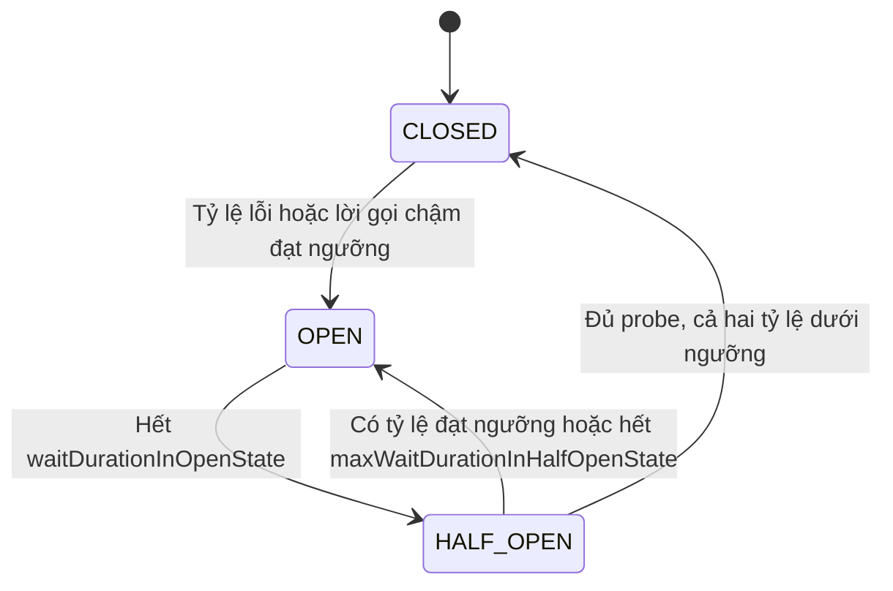

# Giới hạn lời gọi và điều kiện kết thúc HALF_OPEN

Trong Spring Cloud Circuit Breaker với Resilience4j, trạng thái `HALF_OPEN` là giai đoạn kiểm tra xem dịch vụ phụ thuộc đã phục hồi sau thời gian bị bảo vệ ở `OPEN` hay chưa. Circuit breaker cho phép một số lượng lời gọi thử nghiệm đi tới dịch vụ. Kết quả của các lời gọi này quyết định breaker chuyển về `CLOSED` hay quay lại `OPEN`.

Giới hạn số lời gọi thử nghiệm rất quan trọng: nếu cho quá nhiều lời gọi đi qua cùng lúc, một dịch vụ vừa phục hồi có thể lại bị quá tải; nếu cho quá ít lời gọi, kết luận về sức khỏe dịch vụ dễ bị ảnh hưởng bởi một kết quả bất thường. Resilience4j cung cấp cấu hình để kiểm soát cả số lời gọi được phép và thời gian tối đa ở `HALF_OPEN`.

## Hai giới hạn cần phân biệt

| Cấu hình | Ý nghĩa | Tác động |
|---|---|---|
| `permittedNumberOfCallsInHalfOpenState` | Số lời gọi tối đa được cấp quyền trong một lần thử ở `HALF_OPEN` | Giới hạn lượng tải thăm dò gửi tới dịch vụ phụ thuộc |
| `maxWaitDurationInHalfOpenState` | Thời gian tối đa breaker được ở `HALF_OPEN` | Ngăn breaker mắc kẹt quá lâu khi không đủ lời gọi thử nghiệm hoàn tất |

`permittedNumberOfCallsInHalfOpenState` là quota của instance circuit breaker. Các luồng gọi đồng thời dùng chung instance sẽ cùng tiêu thụ quota đó. Khi quota đã được cấp hết, những lời gọi tiếp theo bị từ chối bằng `CallNotPermittedException` trong lúc breaker chờ các lời gọi thử nghiệm có kết quả. Breaker không xếp hàng những lời gọi bị từ chối để chạy sau.

`maxWaitDurationInHalfOpenState` giới hạn thời gian của trạng thái, không phải thời gian chờ phản hồi HTTP cho từng request. Nếu giá trị là `0`, breaker có thể ở `HALF_OPEN` cho tới khi các lời gọi thử nghiệm cần thiết hoàn tất. Khi đặt một thời lượng lớn hơn `0`, breaker chuyển về `OPEN` nếu thời hạn đó kết thúc trước khi quá trình kiểm tra hoàn tất.

## Điều kiện chuyển trạng thái

Trình tự thông thường là:

1. Breaker chuyển sang `OPEN` khi tỷ lệ lỗi hoặc tỷ lệ lời gọi chậm đạt ngưỡng đã cấu hình.
2. Sau `waitDurationInOpenState`, breaker có thể chuyển sang `HALF_OPEN`. Nếu bật `automaticTransitionFromOpenToHalfOpenEnabled`, Resilience4j tự chuyển trạng thái khi hết thời gian chờ. Nếu tắt, lần gọi tiếp theo sau thời gian chờ sẽ kích hoạt việc chuyển sang `HALF_OPEN`.
3. Breaker cấp tối đa `permittedNumberOfCallsInHalfOpenState` quyền gọi thử nghiệm.
4. Khi đủ số lời gọi thử nghiệm được cấp quyền đã hoàn tất, breaker tổng hợp kết quả và đánh giá các ngưỡng.
5. Nếu tỷ lệ lỗi **hoặc** tỷ lệ lời gọi chậm đạt hay vượt ngưỡng tương ứng, breaker chuyển lại `OPEN`. Nếu cả hai tỷ lệ đều thấp hơn ngưỡng, breaker chuyển sang `CLOSED`.



Trong `CLOSED`, `slidingWindowSize` và `minimumNumberOfCalls` điều khiển cửa sổ thống kê dùng để đánh giá các lời gọi thông thường. Trong `HALF_OPEN`, số lời gọi thử nghiệm được kiểm soát riêng bằng `permittedNumberOfCallsInHalfOpenState`. Vì vậy, không nên tăng `slidingWindowSize` với mục đích tăng số probe ở `HALF_OPEN`.

Breaker đánh giá cả hai loại kết quả:

- **Lỗi:** lời gọi kết thúc bằng exception được cấu hình để ghi nhận là lỗi. Những exception được cấu hình bỏ qua không được tính như lỗi thông thường.
- **Lời gọi chậm:** thời lượng thực thi vượt `slowCallDurationThreshold`. Một lời gọi có thể trả về thành công nhưng vẫn bị tính là chậm.

Ví dụ với ba probe, `failureRateThreshold: 50` và `slowCallRateThreshold: 50`:

| Kết quả ba probe | Tỷ lệ lỗi | Tỷ lệ chậm | Quyết định |
|---|---:|---:|---|
| 3 thành công nhanh | 0% | 0% | `CLOSED` |
| 2 lỗi, 1 thành công nhanh | 66,7% | 0% | `OPEN` |
| 1 lỗi, 2 thành công nhanh | 33,3% | 0% | `CLOSED` |
| 3 thành công nhưng 2 lời gọi chậm | 0% | 66,7% | `OPEN` |

Đây là ví dụ độc lập cho từng trường hợp; quyết định thực tế xét đồng thời cả tỷ lệ lỗi và tỷ lệ lời gọi chậm theo cấu hình của instance. Ngưỡng là điều kiện mở lại breaker, nên tỷ lệ bằng ngưỡng cũng được xem là đã chạm ngưỡng.

## Cấu hình Resilience4j trong Spring

Ví dụ sau cho instance bảo vệ lời gọi tới dịch vụ danh mục. Ba lời gọi được phép thăm dò sau khi breaker hết thời gian `OPEN`; breaker chỉ ở `HALF_OPEN` tối đa mười giây.

```yaml
resilience4j:
  circuitbreaker:
    instances:
      catalogService:
        registerHealthIndicator: true
        slidingWindowType: COUNT_BASED
        slidingWindowSize: 20
        minimumNumberOfCalls: 10
        failureRateThreshold: 50
        slowCallRateThreshold: 50
        slowCallDurationThreshold: 2s
        waitDurationInOpenState: 20s
        permittedNumberOfCallsInHalfOpenState: 3
        maxWaitDurationInHalfOpenState: 10s
        automaticTransitionFromOpenToHalfOpenEnabled: true
```

Hai cấu hình thời gian có mục đích khác nhau:

- `waitDurationInOpenState` quy định breaker phải ở `OPEN` bao lâu trước khi được thử phục hồi.
- `maxWaitDurationInHalfOpenState` quy định breaker được phép ở giai đoạn thử phục hồi tối đa bao lâu.

Nếu dịch vụ phụ thuộc không nhận được request nào sau khi chuyển sang `HALF_OPEN`, hoặc chỉ nhận được một phần số probe cần thiết, breaker có thể chưa có đủ dữ liệu để đưa ra quyết định. Một giá trị `maxWaitDurationInHalfOpenState` hữu hạn giúp kết thúc tình trạng này bằng cách đưa breaker trở lại `OPEN`; hệ thống có thể thử lại sau một chu kỳ `waitDurationInOpenState` mới.

## Tích hợp với lời gọi và fallback

Với Resilience4j Spring Boot, một phương thức có thể được bảo vệ bằng annotation như sau:

```java
@Service
public class CatalogClient {

    @CircuitBreaker(name = "catalogService", fallbackMethod = "catalogFallback")
    public Product findProduct(String productId) {
        return callCatalogService(productId);
    }

    private Product catalogFallback(String productId, Throwable cause) {
        return Product.unavailable(productId);
    }
}
```

Phương thức fallback cần giữ các tham số nghiệp vụ của phương thức gốc và có thể nhận thêm exception ở cuối chữ ký. Khi breaker đang `OPEN`, hoặc đã dùng hết quota probe trong `HALF_OPEN`, lời gọi có thể đi vào fallback với `CallNotPermittedException`. Fallback cung cấp kết quả thay thế cho caller; bản thân việc fallback chạy thành công không biến một probe thất bại thành thành công và không làm breaker chuyển sang `CLOSED`.

`maxWaitDurationInHalfOpenState` cũng không thay thế timeout của HTTP client hay `TimeLimiter`. Một probe bị treo vẫn có thể chiếm tài nguyên của ứng dụng và dịch vụ phụ thuộc. Hãy đặt connect/read timeout hoặc `TimeLimiter` phù hợp để mỗi lời gọi có thể kết thúc trong thời gian dự kiến. `Bulkhead` giải quyết một giới hạn khác: nó hạn chế số lời gọi đồng thời chiếm tài nguyên của ứng dụng. Quota probe của circuit breaker, timeout của request và giới hạn đồng thời của bulkhead nên được cấu hình phối hợp.

## Chọn quota và thời gian thử nghiệm

Chọn `permittedNumberOfCallsInHalfOpenState` theo tải mà dịch vụ có thể chịu khi vừa phục hồi. Giá trị nhỏ giảm áp lực và giúp breaker quyết định nhanh, nhưng một hoặc hai kết quả có thể chưa đại diện cho tình trạng thực tế. Giá trị lớn cung cấp nhiều dữ liệu hơn, đồng thời tạo thêm tải và có thể kéo dài thời gian đánh giá khi các request hoàn tất chậm.

Chọn `maxWaitDurationInHalfOpenState` dựa trên timeout tối đa của lời gọi phụ thuộc và khoảng thời gian chấp nhận được cho một lần thử phục hồi. Thời lượng này cần đủ để các probe bình thường hoàn tất, nhưng không nên dài tới mức breaker giữ trạng thái thử nghiệm quá lâu khi dịch vụ vẫn treo. Nếu timeout của request dài hơn thời hạn `HALF_OPEN`, cần xem lại hai cấu hình để tránh probe thường xuyên bị ngắt khỏi chu kỳ đánh giá.

Khi kiểm tra cấu hình, nên xác minh ít nhất các tình huống sau:

1. Tất cả probe thành công nhanh: breaker trở về `CLOSED`.
2. Tỷ lệ lỗi của probe đạt ngưỡng: breaker trở về `OPEN`.
3. Tỷ lệ lời gọi chậm đạt ngưỡng dù các lời gọi vẫn thành công: breaker trở về `OPEN`.
4. Không đủ probe hoàn tất trước `maxWaitDurationInHalfOpenState`: breaker trở về `OPEN`.
5. Quota probe đã hết nhưng vẫn có lời gọi mới: lời gọi mới bị từ chối và có thể được xử lý bằng fallback.

Theo dõi sự kiện chuyển trạng thái và metric của Resilience4j, đặc biệt số lời gọi thành công, thất bại, chậm và bị từ chối. Có thể kiểm tra trạng thái hiện tại qua `CircuitBreaker.getState()` khi dùng API Java, hoặc quan sát các endpoint Actuator/metric đã được bật trong ứng dụng. Những dữ liệu này giúp phân biệt dịch vụ thực sự phục hồi với trường hợp breaker chỉ chuyển trạng thái do hết thời gian chờ.
