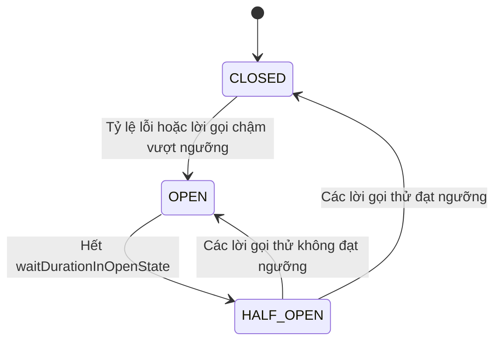
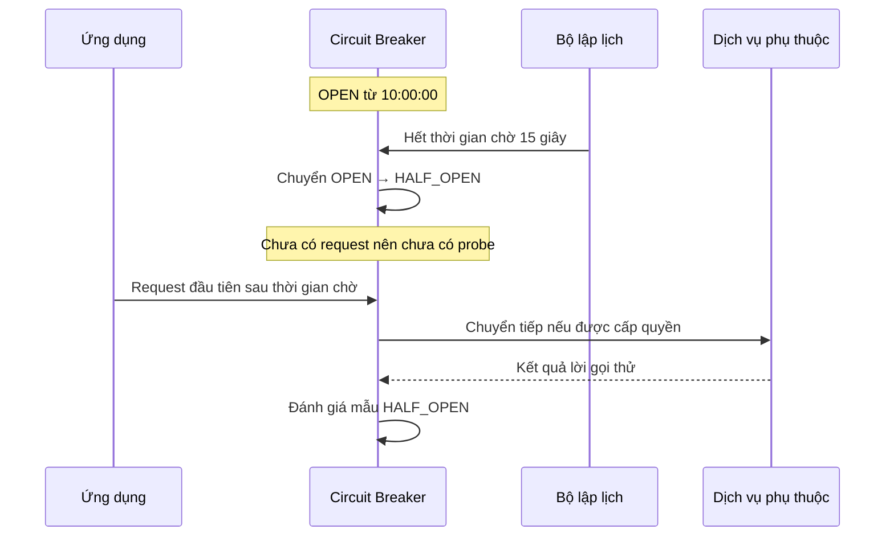
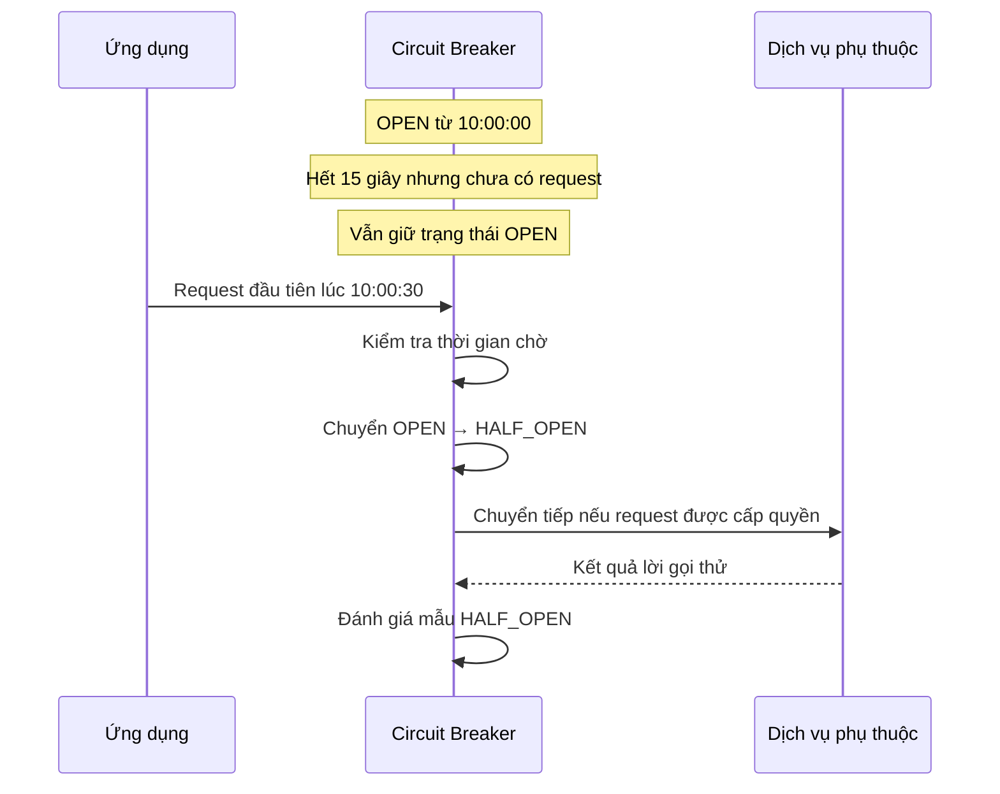

# Chuyển trạng thái tự động so với chuyển khi có lời gọi mới

Trong Resilience4j, khi Circuit Breaker chuyển từ `CLOSED` sang `OPEN`, nó ngừng chuyển tiếp lời gọi đến dịch vụ phụ thuộc trong một khoảng thời gian. Sau khoảng chờ đó, mạch cần chuyển sang `HALF_OPEN` để cho phép một số lời gọi thử nghiệm đi qua. Resilience4j cung cấp hai cách thực hiện bước `OPEN` → `HALF_OPEN`: chuyển trạng thái bằng bộ lập lịch nền hoặc chuyển lười khi có lời gọi tiếp theo.

Hai cách đều tuân theo cùng một nguyên tắc bảo vệ: chỉ một số lượng lời gọi giới hạn được phép thử dịch vụ sau thời gian chờ. Điểm khác biệt nằm ở thời điểm trạng thái nội bộ đổi sang `HALF_OPEN`, đặc biệt khi hệ thống không có lưu lượng.

## Vòng đời trạng thái liên quan

Circuit Breaker thường bắt đầu ở `CLOSED`. Các kết quả lời gọi được ghi vào sliding window. Khi đủ số mẫu tối thiểu và tỷ lệ lỗi hoặc tỷ lệ lời gọi chậm vượt ngưỡng cấu hình, nó chuyển sang `OPEN`. Những lời gọi đến trong thời gian mạch đang `OPEN` bị từ chối nhanh, thường phát sinh `CallNotPermittedException`, để ứng dụng có thể chạy fallback.

Sau `waitDurationInOpenState`, mạch có thể chuyển sang `HALF_OPEN`. Ở trạng thái này, Circuit Breaker chỉ cấp quyền cho tối đa `permittedNumberOfCallsInHalfOpenState` lời gọi thử. Khi có đủ kết quả để đánh giá, nó chuyển về `CLOSED` nếu dịch vụ có vẻ đã phục hồi; nếu kết quả vẫn vượt ngưỡng lỗi hoặc lời gọi chậm, nó quay lại `OPEN` và bắt đầu một chu kỳ chờ mới.



Sơ đồ trên thể hiện các trạng thái nghiệp vụ. Cấu hình tự động hay lười chỉ quyết định cách kích hoạt cạnh `OPEN` → `HALF_OPEN`; nó không thay đổi điều kiện đánh giá kết quả ở `CLOSED` hoặc `HALF_OPEN`.

## Chuyển tự động bằng bộ lập lịch

Khi bật `automaticTransitionFromOpenToHalfOpenEnabled`, Resilience4j lên lịch chuyển Circuit Breaker từ `OPEN` sang `HALF_OPEN` sau khi `waitDurationInOpenState` kết thúc. Việc chuyển trạng thái diễn ra ngay cả khi không có request mới đến ứng dụng.

Ví dụ, mạch vào `OPEN` lúc 10:00:00 và có thời gian chờ 15 giây. Khoảng 10:00:15, bộ lập lịch chuyển mạch sang `HALF_OPEN`. Nếu dịch vụ phụ thuộc vẫn chưa nhận request nào, mạch vẫn ở `HALF_OPEN`, nhưng chưa có lời gọi thử nào được gửi đi. Khi request xuất hiện, Circuit Breaker mới cấp quyền cho số lời gọi thử đã cấu hình.



Ưu điểm của cách này là trạng thái phản ánh thời gian chờ đã hết mà không cần đợi request. Điều đó hữu ích khi dashboard, health indicator hoặc quy trình vận hành cần quan sát thời điểm mạch sẵn sàng nhận lời gọi thử. Đổi lại, hệ thống cần cơ chế lập lịch nền để thực hiện chuyển trạng thái; hãy tính đến tài nguyên và vòng đời của scheduler trong môi trường chạy.

## Chuyển lười khi có lời gọi mới

Khi `automaticTransitionFromOpenToHalfOpenEnabled` là `false`, Resilience4j không chủ động đổi trạng thái chỉ vì thời gian chờ đã hết. Mạch tiếp tục được xem là `OPEN` cho đến khi có một lời gọi mới kiểm tra quyền truy cập. Nếu thời gian chờ đã kết thúc, chính lời gọi đó kích hoạt chuyển sang `HALF_OPEN` và được xét như một lời gọi thử theo giới hạn đã cấu hình.

Ví dụ, mạch vào `OPEN` lúc 10:00:00 với thời gian chờ 15 giây. Không có request nào đến trong 30 giây tiếp theo. Trạng thái vẫn có thể được quan sát là `OPEN` cho đến request đầu tiên lúc 10:00:30. Khi request này đến, Circuit Breaker nhận thấy thời gian chờ đã qua, chuyển sang `HALF_OPEN` rồi quyết định có cấp quyền cho request thử hay không. Request đó không phải một lời gọi bình thường được chuyển tiếp bất kể điều kiện; nó chịu giới hạn probe của `HALF_OPEN`.



Cách này tránh phải thực hiện chuyển trạng thái nền khi không có lưu lượng. Nó phù hợp với dịch vụ ít request hoặc khi trạng thái chỉ cần được cập nhật tại thời điểm ứng dụng thực sự có nhu cầu gọi dịch vụ phụ thuộc. Hệ quả cần hiểu rõ là dashboard có thể vẫn hiển thị `OPEN` sau khi thời gian chờ đã trôi qua, cho đến khi một lời gọi mới kích hoạt việc kiểm tra.

## Cấu hình trong Spring Cloud CircuitBreaker với Resilience4j

Với backend Resilience4j, có thể cấu hình theo từng instance trong `application.yml`. Ví dụ dưới đây đặt cửa sổ đếm 10 lời gọi, yêu cầu tối thiểu 5 mẫu, ngưỡng lỗi 50%, thời gian chờ 15 giây và cho phép tối đa 3 lời gọi thử trong `HALF_OPEN`.

```yaml
resilience4j:
  circuitbreaker:
    instances:
      catalog:
        slidingWindowType: COUNT_BASED
        slidingWindowSize: 10
        minimumNumberOfCalls: 5
        failureRateThreshold: 50
        waitDurationInOpenState: 15s
        permittedNumberOfCallsInHalfOpenState: 3
        automaticTransitionFromOpenToHalfOpenEnabled: false
```

Với cấu hình trên, mạch `catalog` dùng chuyển lười. Để chuyển tự động theo bộ lập lịch, giữ các thuộc tính còn lại và đặt thuộc tính này trong cùng instance `catalog`:

```yaml
resilience4j:
  circuitbreaker:
    instances:
      catalog:
        automaticTransitionFromOpenToHalfOpenEnabled: true
```

Nếu cấu hình bằng Java trực tiếp với Resilience4j, thuộc tính tương ứng là `automaticTransitionFromOpenToHalfOpenEnabled` trên `CircuitBreakerConfig.Builder`:

```java
CircuitBreakerConfig config = CircuitBreakerConfig.custom()
    .slidingWindowSize(10)
    .minimumNumberOfCalls(5)
    .failureRateThreshold(50)
    .waitDurationInOpenState(Duration.ofSeconds(15))
    .permittedNumberOfCallsInHalfOpenState(3)
    .automaticTransitionFromOpenToHalfOpenEnabled(true)
    .build();
```

Trong ứng dụng Spring Cloud CircuitBreaker, hãy bảo đảm instance và backend đang được sử dụng khớp với cấu hình này. Cấu hình mặc định, cấu hình theo group hoặc cấu hình theo instance có thể ảnh hưởng giá trị hiệu lực; khi điều tra hành vi thực tế, cần kiểm tra cấu hình đã được nạp cho đúng tên Circuit Breaker.

## So sánh và cách chọn

| Tiêu chí | Chuyển tự động (`true`) | Chuyển khi có lời gọi mới (`false`) |
|---|---|---|
| Thời điểm đổi `OPEN` → `HALF_OPEN` | Bộ lập lịch đổi sau thời gian chờ | Lời gọi mới kiểm tra và kích hoạt sau khi thời gian chờ đã hết |
| Khi không có request | Vẫn chuyển sang `HALF_OPEN` | Tiếp tục ở `OPEN` cho đến request kế tiếp |
| Quan sát trạng thái | Thể hiện thời điểm hết chờ dù chưa có traffic | Trạng thái chỉ đổi khi có traffic kích hoạt |
| Công việc nền | Cần cơ chế lập lịch | Không cần lịch chuyển trạng thái nền cho bước này |
| Hành vi probe | Chỉ request đến sau khi chuyển trạng thái mới được xét cấp quyền | Request kích hoạt chuyển trạng thái được xét như probe đầu tiên |

Chọn chuyển tự động khi đội vận hành cần trạng thái `HALF_OPEN` xuất hiện đúng sau thời gian chờ, kể cả lúc lưu lượng bằng không, chẳng hạn để theo dõi trạng thái trên dashboard hoặc phối hợp với quy trình giám sát. Chọn chuyển lười khi muốn giảm công việc nền và chỉ cần mở lại cơ hội thử vào thời điểm có request thực tế.

Không nên xem chuyển tự động là một health check chủ động. Bộ lập lịch chỉ thay đổi trạng thái của Circuit Breaker; nó không tự gửi request kiểm tra dịch vụ phụ thuộc. Cả hai chế độ đều cần lưu lượng thật để tạo probe. Nếu không có request, `HALF_OPEN` có thể tồn tại mà chưa có kết quả mới để kết luận dịch vụ đã phục hồi.

## Các điểm cần kiểm tra khi vận hành

- **Phân biệt thời gian chờ và thời gian phục hồi:** `waitDurationInOpenState` là khoảng nghỉ trước khi cho phép thử lại. Hết thời gian này không chứng minh dịch vụ phụ thuộc đã khỏe.
- **Giới hạn số lời gọi thử:** `permittedNumberOfCallsInHalfOpenState` giới hạn số request được cấp quyền trong giai đoạn thử. Với lưu lượng đồng thời, các request vượt giới hạn vẫn bị từ chối và có thể đi theo nhánh fallback.
- **Theo dõi kết quả chuyển trạng thái:** ghi nhận các sự kiện chuyển `CLOSED`, `OPEN`, `HALF_OPEN`, số lời gọi bị từ chối, tỷ lệ lỗi và tỷ lệ lời gọi chậm. Các dữ liệu này giúp phân biệt mạch đang chờ, đang thử hay đã đóng lại.
- **Thiết kế fallback cho cả hai thời điểm:** request bị từ chối khi mạch `OPEN` và request không được cấp quyền khi `HALF_OPEN` đều cần được xử lý phù hợp. Fallback nên trả dữ liệu dự phòng hoặc thông báo có kiểm soát, tránh che giấu lỗi bằng một giá trị thành công giả.
- **Kiểm thử khi không có traffic:** sau khi đưa mạch vào `OPEN`, cho thời gian chờ trôi qua mà không gửi request. Với chế độ tự động, xác minh trạng thái chuyển sang `HALF_OPEN`; với chế độ lười, xác minh trạng thái chỉ chuyển khi request tiếp theo đến. Sau đó kiểm tra số probe được cấp và kết quả quay về `CLOSED` hoặc `OPEN`.

Khi điều tra một mạch dường như ở `OPEN` quá lâu, trước tiên hãy kiểm tra `automaticTransitionFromOpenToHalfOpenEnabled` và lưu lượng thực tế. Nếu đang dùng chuyển lười, trạng thái `OPEN` sau thời gian chờ có thể là hành vi dự kiến: chưa có request nào kích hoạt bước chuyển. Nếu đang dùng chuyển tự động, hãy kiểm tra cấu hình hiệu lực, sự kiện chuyển trạng thái và hoạt động của scheduler. Trong cả hai trường hợp, cần đánh giá kết quả probe trước khi kết luận dịch vụ phụ thuộc đã phục hồi.
