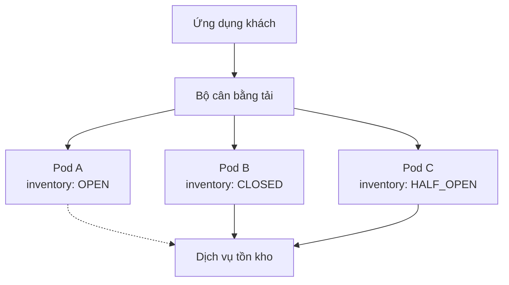
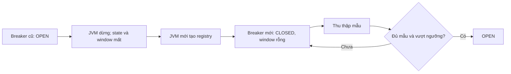

# Trạng thái cục bộ trong từng tiến trình và ảnh hưởng khi khởi động lại

Trong một ứng dụng Spring Cloud triển khai nhiều bản sao, mỗi tiến trình thường có circuit breaker riêng cho từng dịch vụ phụ thuộc. Các breaker có thể cùng tên, dùng cùng một file cấu hình và cùng gọi đến một dịch vụ đích, nhưng trạng thái `CLOSED`, `OPEN` hoặc `HALF_OPEN` của chúng được theo dõi độc lập trong bộ nhớ của tiến trình. Vì vậy, circuit breaker của Resilience4j mặc định là cơ chế bảo vệ cục bộ; nó không tự đồng bộ trạng thái giữa các máy chủ hoặc pod.

Đặc điểm này giúp quyết định mở mạch diễn ra nhanh ngay trong ứng dụng gọi. Đồng thời, nó tạo ra một số hệ quả khi hệ thống mở rộng số replica, triển khai phiên bản mới hoặc khởi động lại sau sự cố. Muốn vận hành đúng, cần hiểu rõ phạm vi của một breaker, dữ liệu mà nó giữ, cách trạng thái được tạo lại và ảnh hưởng của nhiều breaker độc lập lên cùng một phụ thuộc.

## 1. Trạng thái circuit breaker nằm ở đâu?

Khi ứng dụng tạo một circuit breaker Resilience4j, đối tượng breaker được quản lý bởi `CircuitBreakerRegistry` trong tiến trình ứng dụng. Registry quản lý các breaker theo tên trong phạm vi registry đó. Những thành phần cùng sử dụng một instance breaker có thể quan sát cùng trạng thái và cùng thống kê; một registry khác trong một tiến trình khác sẽ quản lý các đối tượng riêng.

Breaker lưu trạng thái vận hành và thống kê cần thiết để ra quyết định. Các dữ liệu quan trọng gồm:

- Trạng thái hiện tại: `CLOSED`, `OPEN`, `HALF_OPEN` hoặc các trạng thái đặc biệt như `DISABLED`, `FORCED_OPEN`.
- Kết quả các lời gọi trong sliding window: số lần thành công, thất bại, lời gọi chậm và tổng số mẫu đã ghi nhận.
- Thông tin thời gian phục vụ chuyển trạng thái, chẳng hạn thời điểm mở mạch và thời gian chờ trước khi cho phép thăm dò.
- Số lượt gọi thăm dò còn được phép khi breaker ở `HALF_OPEN`.

Với cấu hình thông thường, trạng thái và cửa sổ thống kê được giữ trong bộ nhớ của tiến trình. Resilience4j không mặc định ghi trạng thái circuit breaker vào Redis, cơ sở dữ liệu hay một kho dùng chung. Việc xuất metric qua Spring Boot Actuator hoặc Micrometer chỉ giúp hệ thống giám sát đọc và lưu số liệu quan sát; thao tác đó không tự biến metric thành dữ liệu khôi phục trạng thái breaker.

Ví dụ, một ứng dụng có thể tạo breaker cho dịch vụ tồn kho thông qua registry:

```java
import io.github.resilience4j.circuitbreaker.CircuitBreaker;
import io.github.resilience4j.circuitbreaker.CircuitBreakerRegistry;

public class InventoryProtection {
    private final CircuitBreakerRegistry registry =
            CircuitBreakerRegistry.ofDefaults();

    public CircuitBreaker inventoryCircuitBreaker() {
        return registry.circuitBreaker("inventory");
    }

    public void printState() {
        CircuitBreaker breaker = inventoryCircuitBreaker();
        System.out.println("State: " + breaker.getState());
        System.out.println("Buffered calls: "
                + breaker.getMetrics().getNumberOfBufferedCalls());
    }
}
```

Đây là ví dụ minh họa việc tạo và đọc breaker trong một tiến trình. Trong ứng dụng Spring Boot thực tế, registry thường được cấu hình và quản lý bởi tích hợp Resilience4j; không cần tạo một registry mới mỗi lần xử lý yêu cầu. Nếu cùng một registry trả về breaker `inventory` đã được đăng ký, các thành phần sử dụng breaker đó sẽ cùng nhìn thấy trạng thái và thống kê của nó.

Tên `inventory` chỉ định danh breaker trong registry cục bộ. Hai tiến trình cùng tạo breaker tên `inventory` không có nghĩa chúng đang tham chiếu đến một đối tượng dùng chung. Mỗi tiến trình có heap, registry, cửa sổ thống kê và trạng thái riêng.

## 2. Mỗi replica có một state machine độc lập

Giả sử dịch vụ đặt hàng được triển khai thành ba pod. Mỗi pod gọi cùng một dịch vụ tồn kho và đều cấu hình circuit breaker tên `inventory`:



Pod A có thể đã ghi nhận đủ lỗi để mở mạch. Pod B mới nhận lưu lượng hoặc có kết quả tốt nên vẫn ở `CLOSED`. Pod C đã hết thời gian chờ và đang thực hiện một số lời gọi thăm dò. Đây là tình huống hợp lệ: các pod cùng chạy một phiên bản ứng dụng nhưng có lịch sử lời gọi khác nhau.

| Phạm vi | Trạng thái và thống kê |
|---|---|
| Một breaker trong một registry | Được các thành phần dùng chung breaker đó quan sát |
| Hai breaker khác tên trong cùng registry | Có state machine và sliding window riêng |
| Hai tiến trình JVM riêng biệt | Có registry, trạng thái và thống kê riêng, dù breaker cùng tên |
| Nhiều pod của cùng một service | Mỗi pod thường có breaker riêng cho từng phụ thuộc |
| Nhiều service gọi cùng một backend | Mỗi service và mỗi tiến trình tự đánh giá phụ thuộc theo cấu hình của mình |

Do đó, một pod ở `OPEN` không tự làm breaker của pod khác chuyển sang `OPEN`. Pod đang mở mạch sẽ từ chối nhanh các lời gọi theo chính sách của nó; bộ cân bằng tải vẫn có thể chuyển yêu cầu sang pod khác đang `CLOSED` hoặc `HALF_OPEN`. Nếu dịch vụ đích vẫn lỗi, pod còn nhận lưu lượng có thể tiếp tục ghi nhận lỗi và tự mở mạch sau khi đủ mẫu.

Sự độc lập này có lợi khi chỉ một tiến trình bị ảnh hưởng, ví dụ pod đó có kết nối mạng lỗi hoặc gặp tải bất thường. Các pod khỏe mạnh vẫn có thể tiếp tục phục vụ. Tuy nhiên, nó cũng có nghĩa là breaker không tạo ra một quyết định toàn cụm. Khi một phụ thuộc gặp sự cố trên diện rộng, từng replica cần thời gian và mẫu riêng để nhận biết.

## 3. Sliding window và ngưỡng được tính theo từng tiến trình

Các tham số như `slidingWindowSize`, `minimumNumberOfCalls`, `failureRateThreshold` và `slowCallRateThreshold` được áp dụng cho từng breaker instance. Nếu mỗi pod có breaker riêng, mỗi pod xây dựng sliding window từ các lời gọi mà chính nó quan sát được.

Ví dụ, một dịch vụ có 4 replica và mỗi breaker dùng cửa sổ `COUNT_BASED` gồm 20 lời gọi, với `minimumNumberOfCalls: 10`. Điều kiện đủ mẫu được xét riêng trên từng pod. Một pod có thể đã nhận 12 lời gọi và đủ điều kiện đánh giá, trong khi pod khác mới nhận 4 lời gọi và chưa thể kết luận. Không có một cửa sổ 20 lời gọi chung được tự động ghép từ cả 4 pod.

Điều này ảnh hưởng đến thời gian phát hiện lỗi khi scale out. Nếu lưu lượng tổng được chia cho nhiều replica hơn, mỗi pod có thể nhận ít lời gọi hơn. Một cửa sổ theo số lượng vì vậy có thể mất nhiều thời gian hơn để đủ mẫu ở từng pod. Với `TIME_BASED`, mỗi pod cũng tổng hợp mẫu trong khoảng thời gian của riêng nó; cửa sổ thời gian không trở thành thống kê toàn cụm.

Việc chọn kiểu cửa sổ cần dựa trên lưu lượng dự kiến của từng replica, không chỉ dựa trên tổng thông lượng của cả service. Khi số replica thay đổi thường xuyên, hãy đánh giá lại thời gian để mỗi breaker thu thập đủ mẫu và nguy cơ một pod ít lưu lượng không mở mạch dù phụ thuộc đang có vấn đề.

## 4. Điều gì xảy ra khi tiến trình khởi động lại?

Khi JVM dừng, các đối tượng circuit breaker và dữ liệu sliding window nằm trong heap của tiến trình đó cũng kết thúc vòng đời. Khi ứng dụng khởi động lại và tạo registry cùng breaker mới, breaker mới bắt đầu với trạng thái ban đầu của cấu hình. Với cấu hình Resilience4j thông thường, trạng thái ban đầu là `CLOSED` và cửa sổ thống kê chưa có mẫu.

Điều này có nghĩa là một breaker từng ở `OPEN` không mặc định khôi phục lại trạng thái `OPEN` sau khi tiến trình khởi động lại. Thời gian chờ còn lại trong trạng thái mở, số mẫu lỗi trước đó và kết quả thăm dò của tiến trình cũ cũng không được tự động mang sang tiến trình mới.

Ví dụ, pod A đã mở mạch dịch vụ tồn kho sau khi ghi nhận tỷ lệ lỗi cao. Pod A được thay thế trong một lần triển khai. Pod mới tạo breaker `inventory` ở trạng thái ban đầu `CLOSED`. Nếu dịch vụ tồn kho vẫn chưa phục hồi, các yêu cầu đầu tiên đến pod mới sẽ được gửi đi và có thể thất bại. Sau khi có đủ mẫu và vượt ngưỡng, breaker mới mới chuyển sang `OPEN`.



Sơ đồ nhấn mạnh rằng việc khởi động lại tạo một vòng đời breaker mới. Đây không phải là chuyển trạng thái phục hồi từ `OPEN` sang `HALF_OPEN`; tiến trình mới bắt đầu thu thập thống kê lại từ đầu.

Nếu chỉ một replica khởi động lại, các replica còn lại vẫn giữ nguyên trạng thái và sliding window của chúng. Nếu toàn bộ service được khởi động lại, tất cả breaker cục bộ được tạo mới. Vì thế, một đợt restart diện rộng có thể làm mất đồng thời lịch sử bảo vệ mà các tiến trình đã tích lũy.

## 5. Tác động lên lưu lượng khi restart hoặc scale out

Việc reset về `CLOSED` có thể tạo ra một đợt lời gọi mới đến phụ thuộc đang suy giảm. Trong thời gian breaker mới chưa có đủ mẫu, nó chưa có cơ sở thống kê để mở mạch theo ngưỡng đã cấu hình. Nếu nhiều pod mới cùng khởi động, tổng số lời gọi được gửi đến backend có thể tăng mạnh.

Một số tình huống thường gặp:

- **Rolling restart:** pod mới bắt đầu ở `CLOSED` trong khi pod cũ vẫn đang `OPEN`. Bộ cân bằng tải có thể gửi lưu lượng đến pod mới và các lời gọi lại chạm vào backend đang lỗi.
- **Restart toàn bộ replica:** nhiều breaker cùng mất sliding window và bắt đầu thu thập mẫu từ đầu. Backend có thể nhận một đợt lưu lượng kiểm tra lớn khi service trở lại.
- **Scale out:** replica mới chưa có lịch sử lỗi của các replica cũ. Chúng bắt đầu ở trạng thái ban đầu và cần tự đánh giá backend.
- **Crash loop:** mỗi lần tiến trình khởi động, breaker mới lại mất lịch sử trước đó. Nếu tiến trình liên tục bị thay thế, breaker có thể không tồn tại đủ lâu để tích lũy mẫu hữu ích.

`HALF_OPEN` cũng có phạm vi cục bộ. `permittedNumberOfCallsInHalfOpenState` giới hạn số lời gọi thăm dò cho từng breaker, không phải giới hạn chung của toàn bộ service. Nếu có N replica cùng chuyển sang `HALF_OPEN` và mỗi replica cho phép k lời gọi thăm dò, tổng số lời gọi thăm dò có thể lên đến N × k trong trường hợp tất cả đều được kích hoạt và có đủ lưu lượng. Ví dụ, 8 pod với giới hạn 3 lời gọi mỗi pod có thể tạo tối đa 24 lời gọi thăm dò cùng lúc.

Vì vậy, tăng `permittedNumberOfCallsInHalfOpenState` trên mỗi pod cần được cân nhắc cùng số replica tối đa. Nếu backend chỉ chịu được một lượng nhỏ request kiểm tra, hãy giới hạn lưu lượng bằng bulkhead hoặc rate limiter bổ sung, hoặc thiết kế cơ chế điều phối thăm dò tập trung nếu nghiệp vụ thực sự cần một hạn mức toàn cụm.

## 6. Ví dụ về trạng thái khác nhau trong một lần triển khai

Giả sử dịch vụ tồn kho gặp sự cố trong 30 giây. Service đặt hàng có ba pod:

1. Pod A nhận nhiều yêu cầu trong thời điểm sự cố, đạt ngưỡng lỗi và chuyển sang `OPEN`.
2. Pod B nhận ít yêu cầu hơn nên chưa đạt `minimumNumberOfCalls`; breaker vẫn ở `CLOSED`.
3. Pod C đã mở mạch trước đó, hết `waitDurationInOpenState` và đang ở `HALF_OPEN` với hai lời gọi thăm dò được cho phép.

Trong lúc này, đội vận hành triển khai bản sửa và thay thế Pod A. Pod A mới bắt đầu với breaker `CLOSED`, trong khi Pod B và C giữ trạng thái cũ. Khi bộ cân bằng tải gửi yêu cầu đến A, pod mới tiếp tục gọi dịch vụ tồn kho. Nếu backend vẫn chưa ổn định, các lỗi mới sẽ được ghi vào sliding window của A và có thể khiến breaker mở lại.

Một bảng trạng thái minh họa trước và sau khi thay Pod A:

| Replica | Trước restart | Sau khi thay Pod A |
|---|---|---|
| Pod A | `OPEN`, đã có lịch sử lỗi | `CLOSED`, cửa sổ mới chưa có mẫu |
| Pod B | `CLOSED`, chưa đủ mẫu | `CLOSED`, tiếp tục giữ lịch sử cũ |
| Pod C | `HALF_OPEN`, đang thăm dò | `HALF_OPEN`, tiếp tục giữ lịch sử cũ |

Nếu backend vẫn lỗi, Pod A có thể tạm thời tạo thêm tải. Nếu backend đã phục hồi, các lời gọi đầu tiên của A có thể thành công và breaker sẽ tích lũy bằng chứng mới. Không thể suy ra trạng thái của Pod A từ trạng thái Pod B hoặc C; cần quan sát từng replica.

## 7. Cách giảm rủi ro trong quá trình khởi động và triển khai

Vì breaker mới không tự kế thừa lịch sử của tiến trình cũ, việc bảo vệ backend trong lúc khởi động cần kết hợp thêm các cơ chế khác:

- **Giới hạn timeout:** đặt timeout kết nối và phản hồi phù hợp để mỗi lời gọi không giữ tài nguyên quá lâu trong lúc breaker thu thập mẫu.
- **Giới hạn đồng thời:** dùng bulkhead để hạn chế số lời gọi đang chạy đến một phụ thuộc trên mỗi tiến trình. Nếu cần giới hạn toàn cụm, phải tính đến tổng giới hạn của tất cả replica.
- **Giới hạn tốc độ:** dùng rate limiter hoặc cơ chế điều tiết ở gateway khi backend cần một hạn mức lưu lượng chung.
- **Triển khai có kiểm soát:** giới hạn số pod khởi động cùng lúc, điều chỉnh tốc độ rollout và tránh đưa toàn bộ replica mới vào nhận tải đồng thời.
- **Retry có ngân sách:** giới hạn số lần thử, dùng backoff và jitter; tránh để client và nhiều tầng dịch vụ retry đồng thời làm nhân tải.
- **Xử lý thao tác có tác động phụ:** dùng idempotency key hoặc cơ chế chống xử lý lặp vì timeout và restart không chứng minh rằng backend chưa thực hiện thao tác.

Readiness và liveness probe của Kubernetes cũng cần được thiết kế theo mục đích. Liveness nên phản ánh tiến trình có cần được khởi động lại hay không; không nên khiến một phụ thuộc bên ngoài lỗi làm mọi pod liên tục restart. Readiness quyết định pod có nhận lưu lượng mới hay không và cần được đánh giá cùng chiến lược phục hồi. Nếu dùng trạng thái circuit breaker trực tiếp trong health check, phải hiểu rõ cách trạng thái `OPEN` ảnh hưởng đến endpoint health và cơ chế đưa pod trở lại nhận traffic; cấu hình thiếu cẩn trọng có thể tạo vòng lặp loại pod rồi khởi động lại.

Không nên dùng restart như một cách đóng circuit breaker. Restart xóa lịch sử cục bộ và đưa breaker mới về trạng thái ban đầu, nhưng không làm dịch vụ đích phục hồi. Nếu nguyên nhân quá tải vẫn còn, việc restart liên tục có thể khiến backend phải nhận thêm các lời gọi mới và làm sự cố kéo dài hơn.

## 8. Khi nào cần trạng thái dùng chung?

Với phần lớn lời gọi dịch vụ, circuit breaker cục bộ là lựa chọn phù hợp: quyết định nhanh, không cần thêm một phụ thuộc mạng và mỗi tiến trình tự phản ứng với chất lượng kết nối mà nó quan sát. Việc các replica có trạng thái khác nhau không nhất thiết là lỗi; nó phản ánh khác biệt về lịch sử và điều kiện thực tế của từng tiến trình.

Chỉ nên cân nhắc điều phối trạng thái ở phạm vi rộng hơn khi có yêu cầu rõ ràng, ví dụ backend chỉ cho phép một số lượng rất nhỏ lời gọi thăm dò trên toàn cụm. Resilience4j không tự cung cấp cơ chế đồng bộ state machine giữa các registry ở các JVM khác nhau. Muốn chia sẻ trạng thái, hệ thống cần một giải pháp riêng như dịch vụ điều phối, kho trạng thái dùng chung hoặc một lớp gateway có khả năng quản lý chính sách tập trung.

Thiết kế trạng thái dùng chung cũng có chi phí. Mỗi quyết định có thể phụ thuộc vào mạng và kho lưu trữ; kho đó trở thành một thành phần cần bảo vệ. Cần xử lý độ trễ, lỗi truy cập, tranh chấp cập nhật, thời hạn dữ liệu và trường hợp hai replica cùng thử chuyển trạng thái. Một cơ chế dùng chung không được thiết kế cẩn thận có thể tạo thêm điểm lỗi và làm chậm đường gọi vốn cần được bảo vệ nhanh.

Gateway hoặc service mesh có thể cung cấp các chính sách phát hiện endpoint lỗi và điều tiết lưu lượng ở tầng proxy. Tuy nhiên, cần kiểm tra phạm vi thực tế của chính sách: nhiều proxy sidecar cũng có thể theo dõi endpoint độc lập. Có một mặt phẳng điều khiển cấu hình tập trung không đồng nghĩa mọi bộ đếm lỗi và trạng thái runtime đã được chia sẻ toàn cụm.

## 9. Quan sát trạng thái theo từng replica

Vì breaker là cục bộ, dashboard tổng hợp toàn service có thể che khuất khác biệt giữa các pod. Ví dụ, nếu hai pod đang `OPEN` và hai pod đang `CLOSED`, một biểu đồ tổng hợp có thể không cho thấy pod nào đang tiếp tục gửi lỗi đến backend. Nên theo dõi trạng thái và metric theo tên breaker cùng định danh replica.

Các tín hiệu hữu ích gồm:

- Trạng thái breaker của từng pod và số lần chuyển `CLOSED`, `OPEN`, `HALF_OPEN`.
- Số lời gọi thành công, thất bại, chậm và bị từ chối theo từng replica.
- Số mẫu hiện có trong sliding window và thời gian từ lúc tiến trình khởi động.
- Số lần fallback, timeout, bulkhead rejection và retry.
- Tần suất restart, số pod mới nhận traffic và tỷ lệ lỗi backend trong cùng khoảng thời gian.

Khi phân tích sự cố, hãy đối chiếu trạng thái breaker với lịch sử triển khai và thời điểm pod khởi động. Nếu các pod mới liên tục có tỷ lệ lỗi cao trong khi pod cũ vẫn `OPEN`, có thể backend chưa phục hồi và breaker mới đang trong giai đoạn thu thập mẫu. Nếu chỉ một pod mở mạch còn các pod khác thành công, hãy kiểm tra kết nối mạng, node, cấu hình hoặc đường đi riêng của pod đó trước khi kết luận backend gặp sự cố toàn cục.

Nhãn metric theo pod cần được kiểm soát để tránh tạo quá nhiều chuỗi thời gian khi môi trường có số lượng instance lớn và thay đổi liên tục. Có thể dùng dashboard chi tiết cho các replica đang hoạt động và giữ số liệu tổng hợp cho xu hướng toàn service. Log sự kiện chuyển trạng thái và trace của lời gọi từ xa sẽ giúp giải thích vì sao các pod có quyết định khác nhau.

## 10. Nguyên tắc vận hành cần ghi nhớ

Trạng thái circuit breaker trong Resilience4j gắn với instance breaker và registry đang sống trong tiến trình. Cùng tên breaker giữa các pod không tạo ra state machine dùng chung. Sliding window, số mẫu tối thiểu và số lời gọi thăm dò đều được tính ở phạm vi cục bộ. Khi tiến trình kết thúc và registry được tạo lại, breaker thông thường khởi động ở `CLOSED` với cửa sổ thống kê mới.

Do đó, khi triển khai hoặc mở rộng service, cần tính đến việc replica mới chưa có lịch sử lỗi, nhiều breaker có thể cùng gửi lời gọi thăm dò và một đợt restart có thể làm tăng tải lên backend. Hãy kết hợp circuit breaker với timeout, bulkhead, rate limiting, rollout có kiểm soát và quan sát theo từng pod. Nếu cần một quyết định bảo vệ chung cho toàn cụm, hãy thiết kế rõ cơ chế điều phối và các điểm lỗi mới mà nó tạo ra thay vì giả định Resilience4j tự đồng bộ trạng thái giữa các tiến trình.
