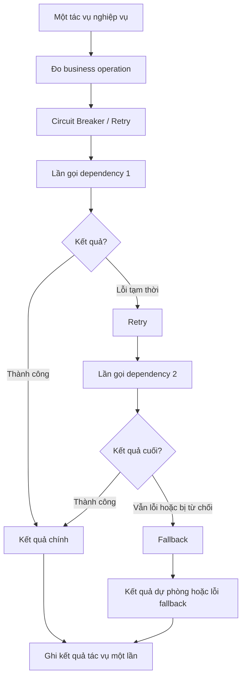

# Phân biệt số liệu tác vụ gốc với số liệu fallback và retry

Một request nghiệp vụ có thể gọi dịch vụ phụ thuộc nhiều lần do retry, được Circuit Breaker từ chối trước khi gửi request, hoặc nhận dữ liệu dự phòng từ fallback. Nếu gộp tất cả các sự kiện này vào một bộ đếm “thành công/thất bại”, dashboard sẽ dễ đưa ra kết luận sai: một thao tác có thể trả response cho caller nhưng dependency vẫn đang lỗi; một request cũng có thể tạo nhiều lần thử HTTP.

Khi quan sát Spring Cloud CircuitBreaker và Resilience4j, hãy tách ít nhất ba lớp số liệu: **tác vụ nghiệp vụ**, **lần gọi dependency**, và **hành vi của cơ chế bảo vệ**. Ghi nhận fallback và retry như các chiều riêng. Cách này cho biết người dùng nhận được kết quả gì, dependency thực sự hoạt động ra sao và chính sách bảo vệ đã can thiệp như thế nào.

## Ba lớp số liệu có ý nghĩa khác nhau

| Lớp | Đơn vị đo | Câu hỏi vận hành | Ví dụ metric |
|---|---|---|---|
| Tác vụ gốc (business operation) | Một lần xử lý nghiệp vụ từ đầu đến cuối | Caller có nhận được kết quả đúng hợp đồng không? | `catalog.operation.completed`, `catalog.operation.duration` |
| Lần thử dependency (dependency attempt) | Một request thực tế tới dịch vụ phụ thuộc | Dependency trả lời thành công, lỗi hay quá chậm? | `catalog.attempts`, `catalog.attempt.duration` |
| Chính sách bảo vệ (resilience policy) | Một lần retry, một lần bị Circuit Breaker từ chối, một lần fallback | Cơ chế bảo vệ can thiệp bao nhiêu lần và vì sao? | Retry metrics, Circuit Breaker metrics, `catalog.fallbacks` |

Ví dụ: một request tra cứu sản phẩm gọi catalog lần đầu bị timeout, retry lần hai thành công. Tác vụ nghiệp vụ là một; số lần gọi dependency là hai; số retry đã thực hiện là một; fallback bằng không. Nếu cả hai lần thử đều lỗi nhưng cache fallback trả dữ liệu, tác vụ nghiệp vụ có thể hoàn tất với dữ liệu dự phòng, trong khi dependency có hai lần thử thất bại và fallback đã chạy một lần.



Số liệu ở các lớp không nhất thiết bằng nhau. Đó là điều bình thường vì mỗi lớp đo một đơn vị khác nhau.

## Định nghĩa rõ “tác vụ gốc”

Tác vụ gốc là một lần xử lý nghiệp vụ được khởi tạo bởi một request hoặc một lệnh ở ranh giới service. Tác vụ này có thể bao gồm nhiều lời gọi dependency, retry và fallback, nhưng chỉ được tính một lần ở metric cấp nghiệp vụ.

Nên xác định trước các kết quả có ý nghĩa với caller, ví dụ:

- `primary`: lấy được dữ liệu từ dependency chính.
- `fallback`: hoàn tất bằng dữ liệu cache hoặc nguồn dự phòng.
- `error`: không lấy được kết quả hợp lệ, kể cả khi fallback cũng thất bại.
- `cancelled`: caller hủy request hoặc subscription trước khi hoàn tất.

Không nên gộp `fallback` vào `primary` chỉ vì HTTP endpoint cuối cùng trả status 200. Nếu caller nhận dữ liệu cũ từ cache, đó là một kết quả được phục vụ thành công ở góc độ availability, nhưng vẫn là một lần degraded service ở góc độ dependency. Có thể theo dõi đồng thời hai chiều: `operation outcome` và `delivery source`.

Ví dụ, dashboard có thể cho thấy 99,9% tác vụ trả được response, nhưng 8% trong số đó dùng fallback. Nếu chỉ nhìn tỷ lệ response thành công, đội vận hành sẽ bỏ lỡ việc dependency chính đang suy giảm.

## Đo từng lần gọi dependency và retry

Một attempt là một lần thực sự subscribe/gọi client tới dependency. Với Reactor, đặt instrumentation bên trong `Mono.defer(...)` trước `retryWhen(...)` để timer và counter được tạo cho từng lần thử:

```java
Mono<Product> oneAttempt(String sku) {
    return Mono.defer(() -> {
        Timer.Sample sample = Timer.start(meterRegistry);

        return catalogClient.find(sku)
            .doOnSuccess(product -> meterRegistry.counter(
                "catalog.attempts",
                "outcome", "success").increment())
            .doOnError(error -> meterRegistry.counter(
                "catalog.attempts",
                "outcome", classifyAttemptError(error)).increment())
            .doFinally(signal -> sample.stop(Timer.builder(
                    "catalog.attempt.duration")
                .tag("dependency", "catalog")
                .register(meterRegistry)));
    });
}
```

Sau đó ghép retry:

```java
Mono<Product> attempts = oneAttempt(sku)
    .retryWhen(Retry.backoff(2, Duration.ofMillis(100))
        .filter(this::isRetryable)
        .doBeforeRetry(retrySignal -> meterRegistry.counter(
            "catalog.retry.scheduled",
            "dependency", "catalog").increment()));
```

Với cấu hình trên, `Retry.backoff(2, ...)` cho phép tối đa hai lần retry sau lần gọi ban đầu. Nếu lần đầu timeout và lần thứ hai thành công, `catalog.attempts{outcome="timeout"}` tăng một, `catalog.attempts{outcome="success"}` tăng một, và `catalog.retry.scheduled` tăng một. Không tính số lần retry như số tác vụ nghiệp vụ mới.

`doBeforeRetry` đo số lần retry được lên lịch. Nếu cần biết retry thực sự bắt đầu và kết thúc, hãy bổ sung instrumentation cho từng attempt hoặc dùng metrics của Resilience4j Retry. Retry có thể bị hủy bởi deadline tổng trước khi attempt tiếp theo bắt đầu; vì vậy “retry scheduled” và “attempt started” là hai sự kiện khác nhau.

## Đo tác vụ nghiệp vụ đúng một lần

Instrumentation cấp tác vụ nên bao quanh toàn bộ chuỗi Circuit Breaker, retry và fallback. Với reactive publisher, đặt nó trong `Mono.defer(...)` để mỗi subscription tương ứng một lần thực thi nghiệp vụ:

```java
record Delivery<T>(T value, String source) {}

Mono<Delivery<Product>> findProduct(String sku) {
    Mono<Product> attempts = oneAttempt(sku)
        .retryWhen(retryPolicy);

    Mono<Delivery<Product>> primary = attempts
        .map(product -> new Delivery<>(product, "primary"));

    return Mono.defer(() -> {
        Timer.Sample sample = Timer.start(meterRegistry);

        return reactiveCircuitBreakerFactory.create("catalog")
            .run(primary, error -> productCache.find(sku)
                .switchIfEmpty(Mono.error(
                    new CatalogUnavailableException(sku, error)))
                .map(product -> new Delivery<>(product, "fallback")))
            .doOnNext(delivery -> meterRegistry.counter(
                "catalog.operation.completed",
                "source", delivery.source()).increment())
            .doOnError(error -> meterRegistry.counter(
                "catalog.operation.failed",
                "reason", classifyOperationError(error)).increment())
            .doFinally(signal -> sample.stop(Timer.builder(
                    "catalog.operation.duration")
                .tag("terminal", signal.name().toLowerCase())
                .register(meterRegistry)));
    });
}
```

Đây là ví dụ minh họa cấu trúc; `meterRegistry`, `retryPolicy`, `productCache`, client và các hàm phân loại là dependency của service. `Delivery` giữ lại nguồn dữ liệu để metric cấp tác vụ phân biệt kết quả chính và fallback. Timer bên ngoài chỉ dừng một lần khi subscription kết thúc, trong khi timer attempt nằm bên trong `oneAttempt` sẽ chạy lại theo từng lần gọi.

Nếu fallback cũng lỗi, `doOnError` tăng metric tác vụ thất bại. Nếu fallback trả dữ liệu, `catalog.operation.completed{source="fallback"}` tăng, nhưng metric attempt vẫn giữ các lỗi của dependency chính. Nhờ vậy, response dự phòng không xóa dấu vết lỗi gốc.

Với API đồng bộ, áp dụng cùng nguyên tắc: bắt đầu timer ở đầu phương thức nghiệp vụ, đo từng lần gọi client ở lớp adapter, ghi fallback ở nhánh fallback, rồi kết thúc timer nghiệp vụ một lần trong `finally` hoặc qua observation phù hợp.

## Phân biệt lỗi gốc, lỗi retry và lỗi fallback

Một request có thể tạo ra nhiều exception khác nhau. Hãy lưu nguyên nhân theo từng giai đoạn:

| Giai đoạn | Ví dụ nguyên nhân | Nên ghi nhận ở đâu? |
|---|---|---|
| Attempt gốc | `ConnectException`, HTTP 503, `TimeoutException` | Attempt counter/timer và trace span của dependency |
| Retry | Một attempt sau đó được lên lịch vì lỗi tạm thời | Retry counter và event của Retry |
| Circuit Breaker từ chối | `CallNotPermittedException` | Circuit Breaker not-permitted metric; không coi là HTTP attempt tới dependency |
| Fallback bắt đầu | Dùng cache vì dependency lỗi hoặc mạch đang `OPEN` | Fallback invocation counter, gắn reason category |
| Fallback hoàn tất | Cache trả dữ liệu dự phòng | Fallback success counter và delivery source của operation |
| Fallback thất bại | Cache timeout hoặc cache không có dữ liệu | Fallback failure counter và operation failure |

Không thay thế exception gốc bằng exception fallback trong log rồi bỏ mất liên kết giữa chúng. Có thể ghi `fallback.reason=dependency_timeout` và `fallback.outcome=success`, đồng thời giữ exception của attempt trong trace hoặc log có correlation ID. Nếu fallback lỗi, ghi riêng `fallback.error=cache_timeout`; điều đó giúp phân biệt dependency chính hỏng với nguồn dự phòng cũng hỏng.

## Hiểu metrics do Resilience4j cung cấp

Resilience4j Micrometer integration cung cấp metrics riêng cho từng thành phần. Tên metric và tag có thể thay đổi theo phiên bản, nhưng các nhóm ý nghĩa phổ biến gồm:

| Nhóm | Thông tin quan sát | Cách diễn giải |
|---|---|---|
| Circuit Breaker calls | Thành công, thất bại, ignored, not permitted | Kết quả mà Circuit Breaker nhìn thấy tại ranh giới decorator của nó |
| Circuit Breaker state | Gauge trạng thái `CLOSED`, `OPEN`, `HALF_OPEN` và trạng thái đặc biệt | Trạng thái hiện tại của instance |
| Circuit Breaker rates | Failure rate, slow call rate, buffered calls | Dữ liệu sliding window dùng cho quyết định mở mạch |
| Retry calls | Thành công không cần retry, thành công sau retry, thất bại trước/sau retry | Kết quả của chuỗi Retry theo decorator được cấu hình |
| Retry attempts | Số lần retry được thực hiện hoặc lên lịch | Mức độ phải thử lại để hoàn tất một thao tác |
| TimeLimiter | Thành công, timeout và thời lượng thao tác bất đồng bộ | Số thao tác hết thời gian chờ ở ranh giới TimeLimiter |
| Bulkhead | Số lời gọi được cấp quyền, bị từ chối và số lời gọi đang hoạt động | Áp lực concurrency lên dependency |

Với Resilience4j Retry, các outcome thường được phân biệt thành `successful_without_retry`, `successful_with_retry`, `failed_without_retry` và `failed_with_retry`. Đây là phân loại kết quả của chuỗi Retry, không phải số request nghiệp vụ tổng thể. Hãy kiểm tra metric thực tế qua `/actuator/metrics` hoặc endpoint Prometheus của phiên bản đang chạy trước khi viết dashboard hoặc alert.

### Vị trí decorator ảnh hưởng số liệu Circuit Breaker

Nếu Circuit Breaker bao quanh toàn bộ retry, nó thường nhìn thấy kết quả cuối cùng của chuỗi thử lại. Ví dụ, hai attempt đầu thất bại và attempt thứ ba thành công thì Circuit Breaker có thể ghi nhận một success cho subscription đó. Nếu retry nằm ngoài Circuit Breaker, mỗi subscription có thể đi qua Circuit Breaker riêng, vì vậy sliding window có thể nhận nhiều failure trước khi có một success.

Vì thế, không so sánh trực tiếp số `resilience4j.circuitbreaker.calls` với số `catalog.attempts` nếu chưa xác định thứ tự decorator. Số attempt thường lớn hơn số operation; số mẫu Circuit Breaker phụ thuộc ranh giới mà decorator đang bảo vệ. Ghi rõ thứ tự `Retry` và `CircuitBreaker` trong tài liệu vận hành để dashboard được diễn giải đúng.

## Thiết kế tên metric và tag có cardinality thấp

Metric cần đủ chi tiết để phân tích nhưng không được tạo một chuỗi time series mới cho mỗi request. Các tag phù hợp thường là:

- `dependency`: tên dependency ổn định, ví dụ `catalog` hoặc `inventory`.
- `operation`: tên thao tác có tập giá trị nhỏ, ví dụ `find_product`.
- `outcome`: `success`, `error`, `fallback`, `timeout`, `rejected`.
- `reason`: nhóm lỗi đã chuẩn hóa như `connect`, `read_timeout`, `http_5xx`, `circuit_open`, `bulkhead_full`.
- `source`: `primary` hoặc `fallback`.

Không dùng `requestId`, `traceId`, SKU, URL đầy đủ, thông điệp exception hoặc user ID làm tag metric. Các giá trị này có cardinality rất cao; hãy giữ chúng trong trace hoặc log có kiểm soát. Không đưa stack trace hoặc exception message vào nhãn `reason`; chuyển exception thành một tập phân loại nhỏ, ổn định.

## Kết hợp metrics, trace và log

Metrics cho biết xu hướng tổng hợp, trace giúp theo dõi một request cụ thể, còn log cung cấp chi tiết sự kiện. Ba nguồn này nên dùng chung trace ID hoặc correlation ID để liên kết nhưng mỗi nguồn có vai trò riêng.

Một trace có thể có cấu trúc:

```text
HTTP GET /products/{sku}                 [business operation]
  └─ catalog.lookup                     [protected operation]
      ├─ catalog HTTP attempt #1         [timeout]
      ├─ retry backoff                   [100 ms]
      ├─ catalog HTTP attempt #2         [HTTP 503]
      └─ product cache fallback          [success]
```

Span attempt nên có thời lượng, peer/dependency, status và loại lỗi. Span fallback nên được đánh dấu là nhánh dự phòng. Span tác vụ gốc có thể kết thúc thành công theo hợp đồng caller nhưng vẫn mang thuộc tính `delivery.source=fallback` hoặc trạng thái degraded. Không đánh dấu span dependency là thành công chỉ vì span cha trả dữ liệu từ cache.

Khi sampling trace, vẫn cần metric không lấy mẫu để thống kê chính xác tỷ lệ retry và fallback trên toàn hệ thống. Không dựa vào số trace được lưu để tính tỷ lệ lỗi nếu sampling rate thay đổi.

## Ví dụ đọc dashboard

Giả sử trong một phút có 1.000 tác vụ tra cứu sản phẩm và dashboard hiển thị:

| Chỉ số | Giá trị | Ý nghĩa |
|---|---:|---|
| Business operations | 1.000 | Số lần caller yêu cầu tra cứu |
| Primary delivery | 900 | 900 tác vụ lấy được dữ liệu từ catalog |
| Fallback delivery | 80 | 80 tác vụ được phục vụ từ cache |
| Operation failed | 20 | 20 tác vụ không có kết quả hợp lệ |
| Dependency attempts | 1.180 | Tổng số lần gọi catalog thực tế |
| Retry attempts | 180 | Số lần gọi lại sau attempt ban đầu |
| Fallback invocations | 100 | Số lần fallback được gọi, gồm 80 thành công và 20 thất bại |

Từ số liệu này có thể rút ra:

- Caller gửi 1.000 tác vụ, không phải 1.180 tác vụ. 1.180 là số attempt tới dependency.
- 80 tác vụ được phục vụ bằng fallback; tỷ lệ fallback trên tổng operation là 8%.
- 20 tác vụ thất bại cuối cùng; tỷ lệ lỗi nghiệp vụ là 2%.
- 100 fallback invocation cao hơn 80 fallback delivery vì có 20 lần fallback không lấy được dữ liệu.
- 180 retry attempt cho thấy dependency có vấn đề ở một số lần gọi; không nên xem chúng là 180 operation mới.

Nếu chỉ nhìn business operation thành công 98%, hệ thống có vẻ đáp ứng tốt. Nhưng tỷ lệ fallback 8% và retry 180 lần cho thấy dependency chính đang suy giảm. Đây là lý do cần giữ các lớp số liệu riêng.

## Alert nên dựa trên chỉ số nào?

Không nên tạo một cảnh báo duy nhất dựa trên số lượng fallback hoặc retry tuyệt đối. Hãy kết hợp tỷ lệ, thời lượng và trạng thái:

- Cảnh báo dependency khi attempt failure rate hoặc p95/p99 latency vượt ngưỡng trong một khoảng thời gian đủ dài.
- Cảnh báo degraded service khi tỷ lệ operation dùng fallback tăng, kể cả khi tỷ lệ operation trả response vẫn cao.
- Cảnh báo người dùng bị ảnh hưởng khi operation failure rate hoặc operation latency vượt SLO.
- Cảnh báo cấu hình retry bất thường khi số retry trên mỗi operation tăng cao hoặc retry budget bị tiêu thụ nhanh.
- Cảnh báo Circuit Breaker khi mạch ở `OPEN` kéo dài hoặc liên tục dao động giữa `CLOSED` và `OPEN`.
- Cảnh báo nguồn dự phòng khi fallback failure rate tăng hoặc fallback latency chiếm phần lớn deadline.

Đặt cửa sổ đánh giá và ngưỡng theo lưu lượng thực tế. Với dependency ít traffic, dùng số mẫu tối thiểu hoặc cửa sổ dài hơn để tránh cảnh báo từ một vài request. Với endpoint quan trọng, kết hợp error budget và SLO để cảnh báo dựa trên tác động đến caller.

## Quy trình kiểm tra số liệu khi có sự cố

Khi dashboard cho thấy operation thành công nhưng người dùng phản ánh dữ liệu cũ hoặc thiếu:

1. Kiểm tra `delivery.source` để biết kết quả đến từ dependency chính hay fallback.
2. So sánh số business operation với số dependency attempt để xác định retry có đang làm tăng lưu lượng không.
3. Kiểm tra retry outcome và nguyên nhân từng attempt để tìm lỗi kết nối, timeout hoặc HTTP 5xx.
4. Kiểm tra Circuit Breaker state, failure rate, slow call rate và not-permitted count để biết mạch có đang chặn request không.
5. Kiểm tra fallback invocation, fallback success/failure và latency để xác định nguồn dự phòng có đáp ứng được không.
6. Dùng trace ID để nối operation, các attempt và fallback trong cùng một request; đối chiếu với log sự kiện mà không đưa ID đó vào metric tag.

Khi các con số được tách theo đúng đơn vị, đội vận hành có thể nhận ra sự khác nhau giữa “người dùng đã được phục vụ”, “dependency đã trả lời tốt” và “hệ thống phải dùng cơ chế bảo vệ”. Đây là nền tảng để đánh giá hiệu quả Circuit Breaker, Retry và fallback mà không che khuất tình trạng thật của dịch vụ phụ thuộc.
