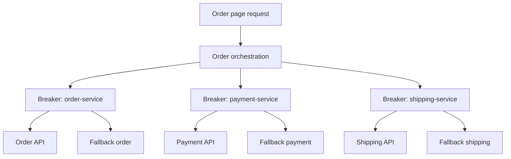

# Chọn một bộ ngắt mạch theo phụ thuộc hay theo thao tác

Khi dùng Spring Cloud Circuit Breaker, mỗi lời gọi được bảo vệ cần một định danh (ID) để factory lấy đúng instance circuit breaker. Câu hỏi thiết kế quan trọng là nên đặt ID theo **dịch vụ phụ thuộc** hay theo **thao tác nghiệp vụ**. Quyết định này xác định những lời gọi nào chia sẻ sliding window, tỷ lệ lỗi, trạng thái `CLOSED`/`OPEN`/`HALF_OPEN` và quota probe.

Không có một quy tắc duy nhất phù hợp cho mọi hệ thống. Hãy chọn phạm vi theo failure domain: những lời gọi nào có chung nguyên nhân lỗi và cần được ngắt cùng nhau? Nếu nhiều thao tác thực sự phụ thuộc vào cùng một năng lực từ xa, dùng chung breaker có thể ngăn lỗi dây chuyền hiệu quả. Nếu các thao tác có đường xử lý, SLA hoặc đặc tính lỗi độc lập, tách breaker giúp một thao tác không làm gián đoạn thao tác khác.

## Circuit breaker bảo vệ một failure domain

Circuit breaker thu thập kết quả của các lần gọi đi qua cùng một instance. Khi tỷ lệ lỗi hoặc tỷ lệ lời gọi chậm đạt ngưỡng, instance chuyển sang `OPEN` và từ chối các lời gọi tiếp theo. Khi hết thời gian chờ, breaker chuyển sang `HALF_OPEN` để kiểm tra khả năng phục hồi bằng số probe được cấp.

Vì vậy, phạm vi breaker chính là phạm vi chia sẻ quyết định bảo vệ:

- Các phương thức dùng cùng ID trong cùng một registry/factory instance chia sẻ trạng thái và thống kê.
- Các ID khác nhau có state machine và sliding window độc lập, ngay cả khi chúng gọi cùng một máy chủ từ xa.
- Một ID ổn định nên đại diện cho một failure domain có ý nghĩa vận hành, không phải một request hoặc một người dùng.

Ví dụ, ứng dụng gọi dịch vụ catalog qua ba thao tác: đọc sản phẩm, tìm kiếm và cập nhật tồn kho. Nếu cả ba dùng cùng một cụm catalog, cùng connection pool và cùng năng lực backend, lỗi hạ tầng catalog có thể ảnh hưởng đồng thời cả ba. Dùng một breaker `catalog` giúp lỗi từ một thao tác đóng đường gọi tới các thao tác còn lại trong cùng failure domain.

Ngược lại, nếu tìm kiếm chạy trên search cluster riêng còn cập nhật tồn kho đi tới inventory service, chúng không nên chia sẻ một breaker chỉ vì cùng xuất hiện trong nghiệp vụ “catalog”. Chúng có endpoint, năng lực và nguyên nhân lỗi khác nhau; cần breaker riêng theo dependency thực tế.

## So sánh phạm vi theo dependency và theo operation

| Tiêu chí | Một breaker theo dependency | Breaker riêng theo operation |
|---|---|---|
| Phạm vi thống kê | Nhiều thao tác gọi cùng dependency chia sẻ mẫu | Mỗi thao tác có sliding window riêng |
| Khi một thao tác lỗi | Có thể làm mở breaker cho các thao tác dùng chung ID | Chỉ thao tác đó bị ngắt |
| Khi dependency lỗi toàn bộ | Nhiều thao tác cùng ngừng gọi sớm | Mỗi breaker cần tích lũy đủ mẫu trước khi mở |
| Lỗi cục bộ ở một endpoint | Có thể làm ảnh hưởng endpoint khỏe khác | Cô lập endpoint khỏe khỏi endpoint lỗi |
| Độ phức tạp vận hành | Ít instance và metric hơn | Nhiều cấu hình, trạng thái và metric hơn |
| Dữ liệu thống kê | Tập mẫu lớn hơn, nhưng có thể trộn đặc tính khác nhau | Mẫu nhỏ hơn, phản ánh đúng từng thao tác hơn |

Chọn theo dependency khi các thao tác cùng phụ thuộc vào một failure domain và cần được bảo vệ như một nhóm. Chọn theo operation khi các thao tác có SLA, timeout, tải hoặc khả năng lỗi khác nhau đủ lớn để cần chính sách riêng.

## Khi nào nên dùng chung một breaker

Dùng chung ID thường phù hợp khi:

- Các lời gọi đi tới cùng một dịch vụ hoặc cụm backend và dùng chung năng lực xử lý.
- Sự cố ở một endpoint thường báo hiệu dependency đang suy giảm đối với các endpoint còn lại.
- Các thao tác có timeout, ngưỡng slow-call và yêu cầu phục hồi tương tự.
- Muốn một thao tác có đủ lưu lượng để breaker phát hiện sự cố nhanh, thay vì chia nhỏ mẫu thành nhiều cửa sổ quá ít request.

Ví dụ, hai phương thức `getProduct` và `getCategory` cùng gọi một catalog API có chung connection pool. Nếu catalog API ngừng phản hồi, giữ hai breaker riêng có thể khiến mỗi breaker phải chờ đủ `minimumNumberOfCalls` của chính nó. Dùng chung `catalog-read` gom các kết quả vào một cửa sổ và có thể mở sớm hơn.

```java
@Service
public class CatalogReadService {

    private final CircuitBreakerFactory<?, ?> factory;
    private final CatalogClient client;

    public CatalogReadService(
            CircuitBreakerFactory<?, ?> factory,
            CatalogClient client) {
        this.factory = factory;
        this.client = client;
    }

    public Product getProduct(String id) {
        return factory.create("catalog-read").run(
                () -> client.getProduct(id),
                error -> Product.unavailable(id)
        );
    }

    public Category getCategory(String id) {
        return factory.create("catalog-read").run(
                () -> client.getCategory(id),
                error -> Category.unavailable(id)
        );
    }
}
```

Cả hai phương thức dùng cùng ID `catalog-read`, do đó dùng cùng instance trong backend của factory. Nếu một trong hai gặp lỗi, kết quả đó tham gia vào thống kê chung. Khi breaker mở, cả hai phương thức đều không gọi catalog API và chạy fallback tương ứng.

Fallback vẫn cần phù hợp với từng thao tác. Dùng chung breaker không có nghĩa là phải dùng chung một fallback hoặc trả cùng một kiểu dữ liệu. `getProduct` có thể trả sản phẩm không khả dụng, còn `getCategory` có thể trả danh mục cache nếu nghiệp vụ cho phép.

## Khi nào nên tách breaker theo operation

Tách ID khi có khác biệt đáng kể về:

- **SLA và timeout:** thao tác tìm kiếm có thể chấp nhận 800 ms, trong khi đọc thông tin cơ bản cần hoàn tất trong 150 ms.
- **Đặc tính tải:** một endpoint có burst traffic lớn hoặc thời gian xử lý dài, endpoint khác có lưu lượng thấp và ổn định.
- **Mức độ quan trọng:** thao tác xác thực thanh toán cần chính sách bảo vệ riêng so với thao tác lấy gợi ý sản phẩm.
- **Failure domain:** endpoint dùng backend hoặc connection pool riêng, nên lỗi ở endpoint này không chứng minh endpoint kia không khả dụng.
- **Fallback:** mỗi thao tác có khả năng suy giảm và quy tắc nghiệp vụ khác nhau, cần quan sát riêng.

Ví dụ, `catalog-search` chạy trên search cluster có độ trễ cao, còn `catalog-detail` đọc từ API chi tiết. Nếu search cluster quá tải, không nên tự động chặn việc đọc chi tiết sản phẩm khi hai hệ thống thực sự độc lập.

```java
public SearchResult search(String query) {
    return factory.create("catalog-search").run(
            () -> searchClient.search(query),
            error -> SearchResult.temporarilyUnavailable()
    );
}

public Product getDetail(String productId) {
    return factory.create("catalog-detail").run(
            () -> detailClient.getProduct(productId),
            error -> detailCache.find(productId)
                    .orElseGet(() -> Product.unavailable(productId))
    );
}
```

Hai breaker có thể được cấu hình với `slowCallDurationThreshold`, `failureRateThreshold` và `minimumNumberOfCalls` khác nhau. Cần bảo đảm các ID trong code khớp tên instance trong cấu hình Resilience4j nếu backend đang dùng properties theo instance.

## Cấu hình nhiều instance theo ranh giới đã chọn

Ví dụ dưới đây cấu hình một breaker dùng chung cho nhóm đọc catalog và hai breaker độc lập cho tìm kiếm và đọc chi tiết:

```yaml
resilience4j:
  circuitbreaker:
    instances:
      catalog-read:
        slidingWindowType: COUNT_BASED
        slidingWindowSize: 30
        minimumNumberOfCalls: 15
        failureRateThreshold: 50
        slowCallRateThreshold: 50
        slowCallDurationThreshold: 500ms
        waitDurationInOpenState: 10s
        permittedNumberOfCallsInHalfOpenState: 3
      catalog-search:
        slidingWindowType: COUNT_BASED
        slidingWindowSize: 20
        minimumNumberOfCalls: 10
        failureRateThreshold: 40
        slowCallRateThreshold: 50
        slowCallDurationThreshold: 1500ms
        waitDurationInOpenState: 20s
        permittedNumberOfCallsInHalfOpenState: 2
      catalog-detail:
        slidingWindowType: TIME_BASED
        slidingWindowSize: 30
        minimumNumberOfCalls: 10
        failureRateThreshold: 50
        slowCallRateThreshold: 40
        slowCallDurationThreshold: 300ms
        waitDurationInOpenState: 10s
        permittedNumberOfCallsInHalfOpenState: 3
```

Đây là ví dụ cho backend Resilience4j. Với backend khác của Spring Cloud Circuit Breaker, cách cấu hình có thể khác. `catalog-read` có cửa sổ lớn hơn vì gom lưu lượng đọc; `catalog-search` dùng ngưỡng thời gian chậm dài hơn; `catalog-detail` dùng cửa sổ theo thời gian. Các con số chỉ minh họa cách thể hiện chính sách, cần hiệu chỉnh theo latency thực tế và ngân sách thời gian của caller.

Không nên tạo một cấu hình riêng cho từng URL nếu chúng không có failure domain độc lập. Mỗi instance mới cần đủ lưu lượng để thỏa `minimumNumberOfCalls`; nếu chia nhỏ quá mức, breaker có thể ít khi đánh giá được tỷ lệ lỗi và phản ứng chậm với sự cố.

## Thiết kế cho thao tác gọi nhiều dependency

Một thao tác nghiệp vụ có thể gọi nhiều dịch vụ phụ thuộc. Ví dụ trang chi tiết đơn hàng cần order service, payment service và shipping service. Không nên tạo một circuit breaker duy nhất tên `order-page` để bao toàn bộ quy trình nếu mục tiêu là bảo vệ từng dependency.

Thay vào đó, đặt breaker tại từng ranh giới gọi ra ngoài:



Mỗi breaker theo dõi đúng dependency mà nó bảo vệ. Nếu payment API lỗi, breaker payment mở nhưng order và shipping vẫn có thể được gọi nếu độc lập. Orchestrator quyết định response tổng hợp như thế nào khi một phần dữ liệu không có. Điều này giữ rõ nguyên nhân suy giảm và tránh một lỗi ở một dependency làm vô hiệu hóa mọi phần còn lại.

Nếu nhiều dependency cùng đi qua một gateway hoặc connection pool chung, cần xem xét thêm failure domain ở tầng hạ tầng. Một gateway lỗi có thể ảnh hưởng nhiều API; khi đó có thể cần breaker bổ sung ở ranh giới gateway, nhưng không thay thế các breaker theo dependency nếu mỗi dịch vụ vẫn có đặc tính lỗi riêng.

## Đừng nhầm circuit breaker với bulkhead

Hai cơ chế có thể dùng chung ranh giới dependency nhưng bảo vệ theo cách khác nhau:

| Cơ chế | Mục đích | Phạm vi cần cân nhắc |
|---|---|---|
| Circuit breaker | Ngừng gọi khi kết quả cho thấy dependency đang lỗi hoặc chậm | Failure domain và chính sách thống kê |
| Bulkhead | Giới hạn số lời gọi đồng thời chiếm tài nguyên | Tài nguyên cần cô lập như thread pool, semaphore hoặc connection pool |

Có thể dùng chung một breaker cho nhiều thao tác gọi catalog nhưng vẫn cần Bulkhead riêng cho nhóm tìm kiếm nếu search request tiêu thụ nhiều tài nguyên hơn. Ngược lại, hai breaker riêng không tự tạo ra hai pool tài nguyên độc lập. Nếu muốn cô lập concurrency, cần cấu hình Bulkhead hoặc connection pool tương ứng.

## Những sai lầm khi chọn phạm vi

| Sai lầm | Hậu quả | Điều chỉnh |
|---|---|---|
| Một breaker toàn ứng dụng | Lỗi của một dependency có thể chặn các dependency khỏe | Tách theo failure domain |
| Một breaker cho mỗi request hoặc user | Quá nhiều instance, mỗi instance thiếu dữ liệu thống kê | Dùng ID ổn định, cardinality thấp |
| Một breaker cho từng URL dù cùng backend | Chia nhỏ lưu lượng và phản ứng chậm khi backend lỗi chung | Gộp các endpoint có chung failure domain |
| Gộp các dependency độc lập vào một breaker | Một dịch vụ lỗi làm chặn dịch vụ khác | Tách instance theo dependency thực tế |
| Tách mọi operation nhưng giữ cùng timeout/threshold máy móc | Tăng vận hành nhưng không tạo lợi ích cô lập rõ ràng | Chỉ tách khi có khác biệt về SLA, tải hoặc failure domain |
| Cho rằng ID giống nhau giữa các pod là state chung | Mỗi JVM vẫn có sliding window và trạng thái riêng | Quan sát từng replica; không xem registry cục bộ là phân tán |

## Đánh giá tác động của minimumNumberOfCalls

Khi tách một breaker theo từng operation, mỗi instance có ít request hơn. Resilience4j chỉ tính failure rate sau khi cửa sổ có ít nhất `minimumNumberOfCalls` kết quả được ghi nhận. Nếu một endpoint chỉ nhận hai request mỗi phút nhưng `minimumNumberOfCalls` là 20, breaker có thể mất nhiều phút mới đủ mẫu.

Khi dùng chung breaker theo dependency, các operation đóng góp vào cùng cửa sổ và có thể giúp phát hiện lỗi nhanh hơn. Nhưng cần bảo đảm kết quả giữa các operation có thể so sánh được. Nếu operation A vốn chậm hơn nhiều so với operation B, gộp chúng có thể làm slow-call rate bị chi phối bởi A. Khi đó, tách breaker hoặc dùng ngưỡng/cấu hình khác nhau có thể phù hợp hơn.

Đừng điều chỉnh `minimumNumberOfCalls` chỉ để breaker mở nhanh. Hãy đánh giá tốc độ request, kích thước sliding window, tỷ lệ lỗi, phân vị latency và ảnh hưởng của một operation có lưu lượng lớn lên các operation khác.

## Tên instance, metric và phạm vi tiến trình

Đặt tên ngắn, ổn định và mô tả failure domain, chẳng hạn `catalog-read`, `catalog-search`, `payment-authorize`. Không đưa `userId`, `tenantId`, request ID hoặc tham số truy vấn vào tên instance. Những tên có cardinality cao làm tăng số state machine, bộ nhớ và chuỗi metric.

Trong một JVM, các lời gọi dùng cùng instance ID của cùng factory/backend sẽ chia sẻ trạng thái. Mỗi replica ứng dụng lại có registry và trạng thái local riêng. Nếu chạy sáu pod, sáu breaker tên `catalog-read` không tự đồng bộ sliding window hoặc state transition. Một pod có thể `OPEN` trong khi pod khác vẫn `CLOSED`.

Theo dõi metric và event theo tên breaker, đồng thời gắn thêm thông tin replica ở tầng telemetry nếu cần chẩn đoán. Không tổng hợp các trạng thái local thành một trạng thái cluster giả định. Nếu yêu cầu cần một quyết định ngắt toàn cụm, đó là một thiết kế điều phối khác ngoài registry local thông thường.

## Quy trình ra quyết định

Trước khi tạo ID mới, hãy trả lời lần lượt:

1. Các thao tác này có gọi cùng dependency và cùng failure domain không?
2. Khi một thao tác lỗi, các thao tác còn lại có cần bị ngắt để tránh tiếp tục gây tải lên cùng backend không?
3. Các thao tác có cùng timeout, slow-call threshold, tải và SLA không?
4. Nếu dùng chung, liệu một endpoint có thể làm nhiễu thống kê của endpoint khác không?
5. Nếu tách riêng, mỗi breaker có đủ lưu lượng để đạt `minimumNumberOfCalls` trong thời gian chấp nhận được không?
6. Fallback có thể khác nhau theo operation dù breaker dùng chung không?
7. Có cần Bulkhead riêng để cô lập tài nguyên dù dùng chung breaker không?

Nếu các thao tác có chung failure domain và chính sách gần giống nhau, dùng một breaker theo dependency. Nếu chúng có failure domain hoặc yêu cầu bảo vệ khác nhau, tách breaker theo operation/dependency cụ thể. Với quy trình nhiều dịch vụ, đặt breaker ở từng lời gọi ra ngoài và để orchestration quyết định cách tổng hợp kết quả.

## Kiểm thử ranh giới breaker

Kiểm thử nên chứng minh đúng những thao tác nào chia sẻ state và thao tác nào độc lập:

| Kịch bản | Điều cần xác nhận |
|---|---|
| Hai operation dùng chung ID | Cùng một instance và cùng sliding window |
| Hai operation dùng ID riêng | Lỗi của operation A không làm mở breaker B |
| Một endpoint lỗi trong nhóm dùng chung | Breaker chung ghi nhận lỗi theo chính sách đã chọn |
| Một endpoint có latency cao hơn nhiều | Xác nhận có làm slow-call rate của nhóm bị nhiễu không |
| Breaker chung chuyển `OPEN` | Tất cả lời gọi dùng ID đó bị từ chối và fallback riêng vẫn đúng hợp đồng |
| Breaker riêng chuyển `OPEN` | Các dependency/operation độc lập vẫn tiếp tục hoạt động |
| Chia lưu lượng thành nhiều breaker | Mỗi instance có đủ mẫu để đánh giá theo `minimumNumberOfCalls` |
| Nhiều replica | Xác nhận state là local và quan sát được theo từng pod |

Trong integration test, dùng một factory/backend thật của Spring context và gọi các service qua đúng bean. Có thể cấu hình cửa sổ nhỏ để tạo chuyển trạng thái xác định, sau đó kiểm tra `getState()` hoặc event của instance Resilience4j. Tránh chỉ mock `CircuitBreakerFactory`, vì mock không chứng minh các lời gọi cùng ID thực sự chia sẻ state trong backend.

## Nguyên tắc thiết kế

Circuit breaker nên đại diện cho failure domain cần được bảo vệ. Dùng chung theo dependency khi nhiều thao tác chia sẻ nguyên nhân lỗi, SLA và chính sách; tách theo operation khi cần cô lập đặc tính tải, latency hoặc khả năng lỗi. Giữ tên instance ổn định và có cardinality thấp, đặt breaker tại từng ranh giới gọi dependency, và đánh giá tác động của `minimumNumberOfCalls` trước khi chia nhỏ lưu lượng. Quyết định này giúp breaker ngắt đúng phần đang lỗi mà vẫn duy trì khả năng phục vụ những thao tác độc lập.
