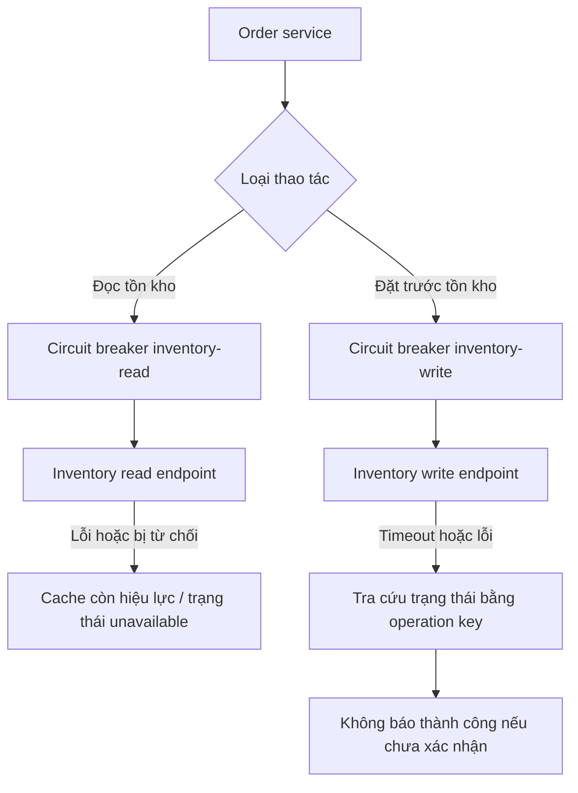

# Cân nhắc tách thao tác đọc, ghi và nhóm độ trễ khác nhau

Một dịch vụ có thể cung cấp nhiều loại thao tác với đặc tính rất khác nhau. Đọc tồn kho thường cần phản hồi nhanh và có thể chấp nhận dữ liệu cache còn đủ mới; đặt trước tồn kho là thao tác ghi có side effect, cần xác định rõ kết quả giao dịch; tạo báo cáo có thể mất vài giây hoặc lâu hơn. Nếu tất cả thao tác dùng chung một circuit breaker, lỗi hoặc độ trễ của một nhóm có thể làm các nhóm còn lại bị ngắt theo.

Trong Spring Cloud CircuitBreaker với Resilience4j, định danh truyền vào `CircuitBreakerFactory.create(...)` xác định circuit breaker được sử dụng cho lời gọi. Việc chọn định danh vì vậy là một quyết định thiết kế ranh giới: những thao tác nào nên chia sẻ cửa sổ thống kê và trạng thái, thao tác nào cần chính sách riêng? Bài học này trình bày cách cân nhắc tách đọc/ghi và nhóm độ trễ sao cho circuit breaker phản ánh đúng failure domain, ngân sách thời gian và ngữ nghĩa nghiệp vụ.

## 1. Chọn ranh giới theo đặc tính của thao tác

Không nên mặc định mỗi method có một circuit breaker riêng, cũng không nên gom mọi lời gọi đến cùng host vào một breaker duy nhất. Một breaker nên đại diện cho nhóm thao tác có các đặc tính tương đồng:

- Cùng phụ thuộc hoặc cùng failure domain: các lời gọi có khả năng cùng suy giảm vì một nguyên nhân.
- Cùng ngân sách độ trễ: thời gian phản hồi được xem là bình thường hoặc chậm tương tự nhau.
- Cùng ngữ nghĩa kết quả: cách phân loại lỗi và cách ứng dụng phục hồi tương tự nhau.
- Cùng chính sách retry và idempotency: các thao tác có thể được thử lại theo cách tương tự.
- Đủ lưu lượng để tạo mẫu thống kê có ý nghĩa trong cửa sổ đã chọn.

Nếu hai thao tác có độ trễ và cách phục hồi khác nhau, dùng chung breaker có thể khiến một thao tác ảnh hưởng không phù hợp đến thao tác kia. Nếu tách quá nhỏ, mỗi breaker lại thiếu dữ liệu để đánh giá và làm tăng số cấu hình, metrics cùng trạng thái cần vận hành.

| Tiêu chí | Nên cân nhắc dùng chung breaker khi | Nên cân nhắc tách breaker khi |
|---|---|---|
| Failure domain | Cùng phụ thuộc, cùng nguyên nhân suy giảm và cùng cách phục hồi. | Một thao tác gọi dịch vụ hoặc tài nguyên khác có thể hỏng độc lập. |
| Ngân sách độ trễ | Cùng mục tiêu phản hồi và cùng ngưỡng lời gọi chậm. | Một nhóm cần phản hồi nhanh, nhóm kia vốn có thời gian xử lý dài hơn. |
| Ngữ nghĩa nghiệp vụ | Cùng cách xử lý lỗi, fallback và retry. | Đọc có thể dùng cache nhưng ghi phải báo trạng thái giao dịch rõ ràng. |
| Lưu lượng | Tổng lưu lượng đủ đại diện cho nhóm có cùng hành vi. | Gộp hai nhóm làm thống kê che lấp sự cố riêng của một nhóm. |
| Tài nguyên | Cùng pool và không cần cách ly tải riêng. | Cần giới hạn concurrency hoặc pool riêng để một nhóm không chiếm tài nguyên của nhóm kia. |

## 2. Vì sao thường cần tách thao tác đọc và ghi?

Thao tác đọc và ghi thường có hợp đồng nghiệp vụ khác nhau, ngay cả khi cùng gọi một dịch vụ.

**Đọc dữ liệu** thường có thể dùng cache hoặc dữ liệu stale trong giới hạn cho phép khi phụ thuộc tạm thời không sẵn sàng. Mục tiêu chính là giữ trải nghiệm phản hồi và thông báo rõ độ mới của dữ liệu. Đọc thường idempotent, nên có thể có chính sách retry hạn chế nếu lỗi có khả năng phục hồi.

**Ghi dữ liệu** có thể tạo side effect như trừ tồn kho, tạo đơn hàng hoặc thu tiền. Khi request timeout, không thể mặc định giao dịch chưa được thực hiện: dịch vụ đích có thể đã commit nhưng response bị mất. Fallback không được trả thành công giả. Nếu cần retry, thao tác phải có idempotency key hoặc cơ chế chống thực hiện trùng.

Do khác biệt đó, một breaker đọc và một breaker ghi có thể dùng ngưỡng lỗi, thời gian mở mạch và fallback khác nhau. Ví dụ, breaker đọc có thể cho phép dùng cache; breaker ghi có thể từ chối nhanh và chuyển caller sang quy trình tra cứu trạng thái giao dịch.



Tách breaker không có nghĩa là hai thao tác đã được cách ly hoàn toàn. Nếu read và write cùng dùng một connection pool, thread pool hoặc cơ sở dữ liệu, tải của nhóm ghi vẫn có thể chiếm tài nguyên khiến nhóm đọc chậm theo. Circuit breaker chỉ tách thống kê và quyết định mở mạch; muốn cách ly tài nguyên cần thêm Bulkhead, pool riêng hoặc giới hạn tải phù hợp.

## 3. Dùng định danh riêng cho read và write

Ví dụ dưới đây dùng hai ID ổn định cho cùng dịch vụ tồn kho:

```java
import org.springframework.cloud.client.circuitbreaker.CircuitBreakerFactory;
import org.springframework.stereotype.Service;

@Service
public class InventoryFacade {
    private final CircuitBreakerFactory<?, ?> circuitBreakerFactory;
    private final InventoryClient inventoryClient;
    private final InventoryCache inventoryCache;

    public InventoryFacade(
            CircuitBreakerFactory<?, ?> circuitBreakerFactory,
            InventoryClient inventoryClient,
            InventoryCache inventoryCache) {
        this.circuitBreakerFactory = circuitBreakerFactory;
        this.inventoryClient = inventoryClient;
        this.inventoryCache = inventoryCache;
    }

    public Stock getStock(String sku) {
        return circuitBreakerFactory.create("inventory-read").run(
            () -> inventoryClient.getStock(sku),
            error -> inventoryCache.getFreshStock(sku)
                .orElseGet(() -> Stock.unavailable(sku))
        );
    }

    public ReservationResult reserveStock(String sku, int quantity, String idempotencyKey) {
        return circuitBreakerFactory.create("inventory-write").run(
            () -> inventoryClient.reserveStock(sku, quantity, idempotencyKey),
            error -> {
                throw new InventoryWriteUnavailableException(
                    "Không thể xác nhận thao tác đặt trước tồn kho",
                    error
                );
            }
        );
    }
}
```

Ví dụ giả định `getFreshStock` chỉ trả dữ liệu cache còn trong thời hạn nghiệp vụ chấp nhận được. Kết quả `Stock.unavailable` cần được phân biệt với tồn kho bằng không. Với thao tác ghi, fallback ném exception có nguyên nhân gốc thay vì trả một `ReservationResult` giả định đã thành công. Caller có thể dùng idempotency key để tra cứu trạng thái trước khi quyết định gửi lại lệnh.

ID `inventory-read` và `inventory-write` cần được dùng nhất quán trong cấu hình Resilience4j, metrics và dashboard. Tránh tạo ID từ SKU, user ID hoặc request ID; những ID động làm số instance và cardinality tăng không kiểm soát.

## 4. Cấu hình riêng cho đọc và ghi

Các nhóm đọc/ghi có thể cần ngưỡng và thời gian khác nhau. Ví dụ:

```yaml
resilience4j:
  circuitbreaker:
    instances:
      inventory-read:
        slidingWindowType: COUNT_BASED
        slidingWindowSize: 50
        minimumNumberOfCalls: 20
        failureRateThreshold: 50
        slowCallDurationThreshold: 300ms
        slowCallRateThreshold: 60
        waitDurationInOpenState: 5s
        permittedNumberOfCallsInHalfOpenState: 5
      inventory-write:
        slidingWindowType: COUNT_BASED
        slidingWindowSize: 30
        minimumNumberOfCalls: 10
        failureRateThreshold: 40
        slowCallDurationThreshold: 1s
        slowCallRateThreshold: 50
        waitDurationInOpenState: 15s
        permittedNumberOfCallsInHalfOpenState: 2
```

Các con số chỉ minh họa cách tách chính sách, không phải giá trị mặc định phù hợp cho mọi hệ thống. Đọc tồn kho có ngân sách phản hồi 300 ms nên có thể dùng ngưỡng lời gọi chậm ngắn hơn. Ghi đặt trước có thể mất nhiều thời gian hơn nhưng cần thận trọng với lỗi và thời gian phục hồi. Cần lấy số liệu p95/p99, SLO và năng lực dịch vụ đích để hiệu chỉnh.

`minimumNumberOfCalls` cần được xem xét riêng cho mỗi breaker. Nếu lưu lượng ghi thấp, ngưỡng 10 mẫu có thể mất nhiều thời gian mới đạt được; breaker có thể chưa đánh giá tỷ lệ trong lúc dependency đang suy giảm. Có thể dùng cửa sổ thời gian hoặc điều chỉnh số mẫu, nhưng không nên gộp read và write chỉ để tăng số mẫu nếu hai nhóm có ngữ nghĩa lỗi khác nhau.

## 5. Tách nhóm theo ngân sách độ trễ

Ngoài đọc/ghi, cùng một dịch vụ có thể có thao tác với ngân sách độ trễ khác nhau. Ví dụ:

- `catalog-fast-read`: tra cứu một sản phẩm để hiển thị trang.
- `catalog-search`: tìm kiếm có nhiều điều kiện và xử lý chỉ mục.
- `reporting-batch`: tạo báo cáo hoặc tổng hợp dữ liệu với thời gian chạy dài hơn.

Nếu gom các thao tác này vào một breaker, ngưỡng `slowCallDurationThreshold` phù hợp với báo cáo có thể quá rộng đối với API hiển thị sản phẩm. Ngược lại, ngưỡng ngắn của API tương tác có thể khiến báo cáo bình thường bị phân loại là chậm và mở mạch cho cả tra cứu nhanh.

| Nhóm thao tác | Ngân sách minh họa | Điều cần ưu tiên |
|---|---:|---|
| Tra cứu nhanh cho giao diện | 200–300 ms | Phát hiện độ trễ sớm, fallback cache nếu dữ liệu còn hợp lệ. |
| Tìm kiếm phức tạp | 800 ms–1,5 s | Cân bằng độ trễ và chất lượng kết quả; có thể giảm chức năng khi quá tải. |
| Báo cáo/batch | Vài giây đến hàng chục giây | Timeout riêng, concurrency giới hạn và tiến trình bất đồng bộ khi phù hợp. |

Các khoảng thời gian trên chỉ là ví dụ để minh họa nhóm độ trễ. Ngân sách thực tế phải được xác định từ hợp đồng API, thời gian xử lý nội bộ và deadline của caller. Không dùng ngưỡng chậm dài cho mọi thao tác chỉ vì một số endpoint vốn chạy lâu.

## 6. Chỉ nhóm các thao tác có cùng failure domain

Hai thao tác có cùng ngân sách độ trễ vẫn chưa chắc nên dùng chung breaker nếu chúng gọi các phụ thuộc khác nhau. Ví dụ tra cứu giá và tra cứu tồn kho có thể đều cần dưới 300 ms, nhưng nếu chúng được phục vụ bởi hai dịch vụ độc lập thì sự cố ở dịch vụ giá không nên tự động mở breaker của tồn kho.

Ngược lại, nhiều phương thức của cùng một client có thể dùng chung breaker nếu chúng cùng phụ thuộc vào một dịch vụ, cùng connection pool và cùng cách phục hồi. Việc dùng chung giúp tích lũy đủ mẫu, nhưng có thể làm một phương thức lỗi kéo các phương thức còn lại vào trạng thái `OPEN`.

Hãy xem xét cả failure domain logic lẫn hạ tầng:

- Cùng host nhưng hai endpoint dùng hai cluster hoặc pool khác nhau có thể là hai failure domain.
- Hai endpoint khác nhau nhưng cùng database và connection pool có thể suy giảm cùng lúc.
- Một endpoint đọc cache và một endpoint ghi database có thể có đường phụ thuộc khác nhau dù cùng thuộc một service.
- Một thao tác batch có thể tiêu thụ nhiều tài nguyên hơn thao tác đọc đơn lẻ và cần Bulkhead riêng.

Breaker nên đặt ở ranh giới của lời gọi phụ thuộc có thể thất bại độc lập. Nếu các thao tác chia sẻ một tài nguyên chung, cần cân nhắc liệu chúng có nên chia sẻ thống kê lỗi hay cần thêm Bulkhead để tách tải.

## 7. Tránh tách quá nhỏ và thiếu mẫu thống kê

Tạo một breaker cho từng method có thể khiến mỗi cửa sổ chỉ nhận rất ít lời gọi. Khi `minimumNumberOfCalls` chưa đạt, circuit breaker chưa thể đánh giá failure rate hoặc slow call rate theo cấu hình. Một endpoint ít được gọi có thể tiếp tục gửi request lỗi trong thời gian dài vì không tích lũy đủ mẫu.

Ngược lại, gom quá nhiều method không cùng failure domain vào một breaker khiến một lỗi cục bộ ảnh hưởng toàn bộ nhóm. Cần cân bằng giữa tính cô lập và chất lượng mẫu.

| Cách chia | Rủi ro |
|---|---|
| Một breaker cho mọi dependency và mọi thao tác | Một phụ thuộc lỗi có thể mở mạch cho các phụ thuộc khỏe mạnh. |
| Một breaker cho từng method hoặc từng request | Thiếu mẫu, nhiều instance, khó quản lý metrics và cấu hình. |
| Một breaker cho nhóm thao tác cùng dependency, latency và semantics | Thường cân bằng hơn, nhưng vẫn cần theo dõi tác động chéo giữa các phương thức trong nhóm. |

Nếu một nhóm có lưu lượng thấp, có thể nhóm các thao tác tương đồng hơn hoặc chọn time-based window phù hợp. Không nên đưa một thao tác ghi nhạy cảm vào breaker đọc chỉ để tăng số mẫu. Tính đúng đắn nghiệp vụ quan trọng hơn việc có một failure rate trông ổn định.

## 8. Định danh breaker phải ổn định và có ý nghĩa

Nên đặt ID mô tả phụ thuộc cùng nhóm thao tác, ví dụ:

```text
inventory-read
inventory-write
catalog-fast-read
catalog-search
reporting-batch
payment-authorize
payment-status-read
```

ID ổn định giúp ánh xạ chính xác giữa mã Java, cấu hình YAML, event, metrics và dashboard. Tránh dùng tên method tự sinh nếu quy tắc đặt tên có thể thay đổi khi refactor; tránh ghép ID với dữ liệu đầu vào như SKU hoặc tenant nếu không có yêu cầu cách ly thực sự.

Nếu cần tách theo tenant, hãy đánh giá quy mô số tenant, vòng đời instance, cardinality metrics và cơ chế thu hồi. Không tạo một circuit breaker vô hạn cho từng tenant mà không có giới hạn. Với đa số hệ thống, breaker theo dependency và nhóm thao tác là đủ; giới hạn tải theo tenant có thể được xử lý bằng rate limiter hoặc quota riêng.

## 9. Tách breaker không thay thế Bulkhead và RateLimiter

Hai breaker độc lập có thể có trạng thái và sliding window riêng, nhưng vẫn chạy trong cùng process và có thể dùng chung thread pool, connection pool hoặc tài nguyên hệ điều hành. Khi nhóm batch giữ toàn bộ kết nối, breaker của nhóm đọc nhanh vẫn có thể timeout dù breaker đó đang `CLOSED`.

Hãy phối hợp các cơ chế:

- **CircuitBreaker:** ngăn lời gọi đến dependency khi tỷ lệ lỗi hoặc lời gọi chậm vượt ngưỡng.
- **Bulkhead:** giới hạn concurrency để một nhóm thao tác không chiếm hết tài nguyên của nhóm khác.
- **RateLimiter:** giới hạn tốc độ request đến dependency hoặc nhóm thao tác.
- **Timeout:** giới hạn thời gian chờ ở HTTP client và tác vụ bất đồng bộ.
- **Retry:** chỉ thử lại lỗi có khả năng phục hồi, có giới hạn và phù hợp với idempotency.

Ví dụ, có thể dùng bulkhead riêng cho `reporting-batch` với số lời gọi đồng thời thấp, trong khi `catalog-fast-read` có giới hạn concurrency phù hợp với tải giao diện. Nếu cần tách connection pool, cấu hình HTTP client cũng phải phản ánh ranh giới đó; chỉ đặt hai circuit breaker ID không tự tạo hai pool.

## 10. Phối hợp fallback theo read/write semantics

Fallback nên phản ánh hợp đồng của nhóm thao tác:

| Nhóm | Fallback có thể chấp nhận | Điều cần tránh |
|---|---|---|
| Đọc danh mục | Cache còn trong freshness limit, dữ liệu rút gọn hoặc trạng thái unavailable. | Trả dữ liệu cũ không giới hạn mà không đánh dấu. |
| Đọc tồn kho | Cache có timestamp hoặc kết quả tạm thời không khả dụng. | Trả số lượng 0 khi chưa biết số lượng thật. |
| Ghi đặt trước | Trả trạng thái chưa xác nhận, mã tra cứu hoặc lỗi có kiểm soát. | Báo đã đặt trước thành công khi chưa có xác nhận. |
| Thanh toán | Tra cứu trạng thái giao dịch bằng idempotency key. | Gửi lại lệnh thu tiền với khóa mới hoặc tạo thành công giả. |
| Báo cáo dài hạn | Trả job ID, trạng thái đang xử lý hoặc dữ liệu báo cáo gần nhất nếu nghiệp vụ cho phép. | Giữ request đồng bộ vô hạn hoặc trả báo cáo chưa hoàn tất như dữ liệu mới. |

Nếu fallback của thao tác đọc dùng cache, nên có metadata về thời điểm cập nhật và giới hạn stale. Với thao tác ghi, timeout có thể tạo kết quả không xác định; cần idempotency key, trạng thái giao dịch và quy trình đối soát.

## 11. Kiểm thử ranh giới breaker

Kiểm thử cần chứng minh các nhóm thực sự độc lập theo thiết kế:

1. Làm `inventory-read` vượt ngưỡng lỗi và xác nhận nó chuyển `OPEN`.
2. Gọi `inventory-write` trong khi breaker đọc đang `OPEN`; xác nhận breaker ghi vẫn có trạng thái và quyết định riêng.
3. Làm thao tác `reporting-batch` chậm nhưng giữ `catalog-fast-read` trong ngưỡng độ trễ bình thường; xác nhận breaker nhanh không mở chỉ vì báo cáo chậm nếu chúng được tách theo thiết kế.
4. Kiểm tra số mẫu của từng breaker và thời điểm bắt đầu đánh giá tỷ lệ.
5. Xác minh fallback đọc không trả dữ liệu hết hạn và fallback ghi không báo thành công giả.
6. Xác minh timeout của thao tác ghi không gây tạo giao dịch trùng khi tra cứu hoặc retry bằng idempotency key.
7. Tạo tải đồng thời để kiểm tra Bulkhead và connection pool có thực sự cách ly các nhóm cần thiết.

Nên dùng client giả hoặc server mô phỏng để điều khiển lỗi và độ trễ. Kiểm tra cả trạng thái breaker lẫn số request thực tế đến dependency; chỉ kiểm tra giá trị fallback trả về chưa đủ chứng minh supplier bị ngắt hoặc nhóm khác được cách ly.

## 12. Theo dõi sau khi triển khai

Metrics nên gắn với breaker ID ổn định để dashboard so sánh được từng nhóm:

- Trạng thái hiện tại và số lần chuyển trạng thái.
- Số lời gọi thành công, thất bại và bị từ chối.
- Failure rate, slow call rate và số mẫu trong cửa sổ.
- Độ trễ p50/p95/p99 của từng nhóm thao tác.
- Số lần fallback, tỷ lệ fallback thành công và số lần trả dữ liệu stale.
- Số lần Bulkhead đầy, thời gian chờ permit và concurrency đang sử dụng.

Tránh dùng SKU, user ID hoặc request ID làm tag metrics vì cardinality có thể tăng nhanh. Những dữ liệu định danh từng request nên nằm trong log hoặc trace có kiểm soát. Khi thấy breaker ghi mở thường xuyên, hãy xác định đó là lỗi dependency, ngưỡng latency không phù hợp hay một nhóm thao tác khác đang dùng chung breaker.

## 13. Quy trình quyết định ranh giới

Trước khi tạo breaker ID mới hoặc gộp hai ID hiện có, hãy thực hiện lần lượt:

1. Xác định dependency và failure domain thực tế của thao tác.
2. Phân biệt đọc, ghi, batch và các side effect nghiệp vụ.
3. Xác định ngân sách độ trễ và ngưỡng lời gọi chậm cho từng nhóm.
4. Xác định fallback, retry, idempotency và cách xử lý timeout.
5. Ước lượng lưu lượng trên từng instance để chọn sliding window và `minimumNumberOfCalls`.
6. Kiểm tra nhu cầu Bulkhead, RateLimiter và connection pool riêng.
7. Đặt ID ổn định, cấu hình theo ID và thêm metrics tương ứng.
8. Kiểm thử tác động chéo: mở một breaker không được vô tình ngắt nhóm độc lập.

Tách thao tác đọc, ghi và nhóm độ trễ khi chúng có ngữ nghĩa phục hồi, ngân sách thời gian hoặc failure domain khác nhau. Dùng chung breaker khi các thao tác thực sự có cùng đặc tính và cần chia sẻ thống kê. Giữ số lượng ID ở mức có thể vận hành, bảo đảm mỗi cửa sổ có đủ mẫu và nhớ rằng breaker chỉ tách quyết định thống kê; Bulkhead cùng cấu hình client mới giúp cách ly tài nguyên. Thiết kế ranh giới theo các tiêu chí này giúp Spring Cloud CircuitBreaker bảo vệ đúng nhóm thao tác mà không tạo ra trạng thái mở mạch ngoài ý muốn.
