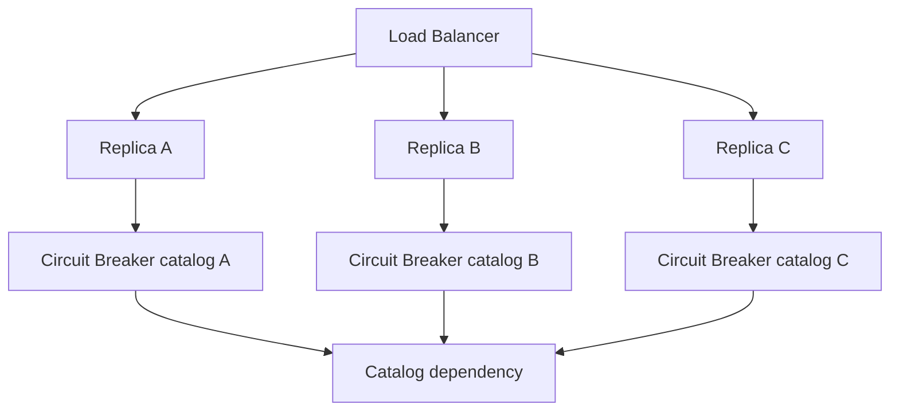
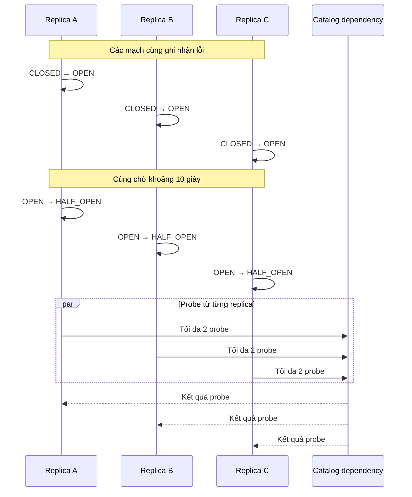

# Trạng thái riêng mỗi replica và hiệu ứng thăm dò đồng loạt

Trong ứng dụng Spring Cloud chạy nhiều replica, mỗi tiến trình thường có một instance Circuit Breaker Resilience4j riêng cho từng tên mạch. Trạng thái `CLOSED`, `OPEN`, `HALF_OPEN`, sliding window và bộ đếm lời gọi được lưu trong bộ nhớ của tiến trình đó. Các replica không tự chia sẻ trạng thái hoặc thống kê với nhau.

Thiết kế này giúp mỗi replica quyết định nhanh mà không cần gọi một dịch vụ điều phối trung tâm. Tuy nhiên, nó tạo ra một hệ quả khi hệ thống có nhiều replica: nếu tất cả cùng phát hiện dependency lỗi gần một thời điểm và dùng cùng `waitDurationInOpenState`, chúng có thể chuyển sang `HALF_OPEN` gần như đồng loạt. Mỗi replica lại được phép gửi một số lời gọi thử riêng, khiến dependency vừa phục hồi phải nhận một đợt probe lớn cùng lúc.

## Phạm vi của trạng thái Circuit Breaker

Một Circuit Breaker Resilience4j là một đối tượng runtime trong tiến trình sở hữu nó. Trong cùng một tiến trình, các thành phần dùng chung đúng instance Circuit Breaker sẽ chia sẻ state và sliding window của instance đó. Khi triển khai service thành nhiều pod hoặc VM, mỗi tiến trình có bộ nhớ riêng, nên các instance cùng tên vẫn là những mạch độc lập.



Tên `catalog` có thể giống nhau trong cấu hình của cả ba replica, nhưng mỗi tiến trình có state machine và cửa sổ thống kê riêng. Khi replica A chuyển sang `OPEN`, replica B vẫn có thể ở `CLOSED` và tiếp tục gọi dependency. Một replica mới khởi động cũng thường tạo Circuit Breaker mới ở trạng thái ban đầu theo cấu hình; state của replica cũ không tự động được khôi phục từ registry của tiến trình khác.

| Phạm vi | Được chia sẻ? | Hệ quả |
|---|---|---|
| Nhiều lời gọi dùng cùng một Circuit Breaker object trong một tiến trình | Có | Cùng state, sliding window và event publisher |
| Hai Circuit Breaker có tên khác nhau trong cùng tiến trình | Không | Mỗi mạch có chính sách và thống kê riêng |
| Cùng tên Circuit Breaker ở hai replica khác nhau | Không mặc định | Mỗi replica có state và sliding window riêng |
| Metrics được thu thập từ nhiều replica | Có thể tổng hợp ở hệ thống quan sát | Tổng hợp metrics không đồng nghĩa state runtime được đồng bộ |

Vì vậy, một dashboard tổng hợp toàn cụm có thể hiển thị nhiều trạng thái khác nhau cho cùng dependency. Đó không nhất thiết là lỗi cấu hình; có thể là phản ánh chính xác rằng mỗi replica đã quan sát một tập kết quả và lưu lượng khác nhau.

## Vì sao xuất hiện đợt probe đồng loạt?

Giả sử 20 replica cùng gọi `catalog` trong lúc dependency ngừng phản hồi. Do cùng nhận lỗi trong một khoảng ngắn, phần lớn Circuit Breaker có thể chuyển `CLOSED` → `OPEN` gần nhau. Nếu tất cả dùng `waitDurationInOpenState: 10s`, chúng cũng có thể kết thúc thời gian chờ gần như cùng lúc.

Khi từng mạch chuyển sang `HALF_OPEN`, `permittedNumberOfCallsInHalfOpenState` được áp dụng riêng cho từng instance. Nếu mỗi replica cho phép 2 lời gọi thử, toàn cụm có thể phát sinh tối đa khoảng 40 probe trong một chu kỳ chuyển trạng thái khi cả 20 replica đều nhận đủ traffic để sử dụng quyền thử. Đây là ngân sách probe theo từng replica, không phải giới hạn toàn cụm.



Đợt traffic này có thể làm dependency vừa phục hồi lại quá tải, khiến các probe thất bại và từng mạch quay về `OPEN`. Nếu tất cả lại chờ cùng một khoảng cố định, hiện tượng có thể lặp lại theo nhịp, tạo ra các đợt tải tăng đột ngột thay vì phục hồi ổn định.

## Giới hạn probe là giới hạn cục bộ

`permittedNumberOfCallsInHalfOpenState` quy định số lời gọi được cấp quyền thử trong trạng thái `HALF_OPEN` của một Circuit Breaker instance. Nó không giới hạn tổng số probe của toàn bộ deployment và cũng không phải giới hạn concurrency chung khi mạch ở `CLOSED`.

Ví dụ với 20 replica:

| Replica | Probe tối đa mỗi mạch | Tổng probe tiềm năng |
|---:|---:|---:|
| 5 | 2 | 10 |
| 10 | 2 | 20 |
| 20 | 2 | 40 |
| 40 | 2 | 80 |

Có thể ước lượng ngân sách tối đa theo công thức:

\[
P_{fleet} \approx N_{replicas} \times P_{half-open-per-replica}
\]

Đây là ước lượng cho một tên Circuit Breaker và một đợt chuyển trạng thái; số probe thực tế phụ thuộc traffic đến từng replica, số mạch, cách định tuyến và thời điểm các mạch chuyển trạng thái. Nếu một pod có nhiều breaker name cùng gọi một dependency, cần tính ngân sách riêng cho từng mạch rồi đánh giá tổng tải lên dependency.

Đừng tăng số probe trên mỗi replica chỉ để “kiểm tra chắc chắn hơn” khi số replica có thể scale lớn. Với 50 replica và 5 probe mỗi mạch, hệ thống có thể tạo ra khoảng 250 lời gọi thử trong cùng một chu kỳ. Hãy chọn số probe dựa trên khả năng chịu tải của dependency và quy mô deployment.

## Phân tán thời điểm chuyển sang HALF_OPEN

Một cách giảm đợt probe đồng loạt là làm lệch thời gian chờ giữa các replica. Nếu mọi replica dùng một giá trị cố định, chúng có xu hướng chuyển trạng thái cùng nhịp sau một sự cố đồng thời. Có thể dùng thời gian chờ ngẫu nhiên hoặc jitter trong cấu hình Java của Resilience4j để mỗi chu kỳ `OPEN` có khoảng chờ khác nhau.

Ví dụ cấu hình một Circuit Breaker với `IntervalFunction` ngẫu nhiên:

```java
import io.github.resilience4j.circuitbreaker.CircuitBreakerConfig;
import io.github.resilience4j.core.IntervalFunction;

CircuitBreakerConfig catalogConfig = CircuitBreakerConfig.custom()
    .slidingWindowSize(20)
    .minimumNumberOfCalls(10)
    .failureRateThreshold(50)
    .waitIntervalFunctionInOpenState(
        IntervalFunction.ofRandomized(10_000, 0.5))
    .permittedNumberOfCallsInHalfOpenState(2)
    .build();
```

`IntervalFunction.ofRandomized(...)` tạo độ ngẫu nhiên cho khoảng chờ theo API Resilience4j. Hãy xác nhận chữ ký API và hành vi khoảng giá trị với phiên bản Resilience4j mà dự án đang dùng. Cấu hình `waitDurationInOpenState` trong YAML là một thời lượng cố định; nếu cần jitter theo từng lần mở mạch, dùng cơ chế lập lịch thời gian chờ được hỗ trợ ở phiên bản thư viện hoặc một chiến lược cấu hình tương đương.

Khi áp dụng cấu hình này qua Spring Cloud CircuitBreaker, đặt `CircuitBreakerConfig` vào customizer của đúng factory và đúng id:

```java
import org.springframework.cloud.client.circuitbreaker.Customizer;
import org.springframework.cloud.circuitbreaker.resilience4j.Resilience4JCircuitBreakerFactory;
import org.springframework.context.annotation.Bean;

@Bean
Customizer<Resilience4JCircuitBreakerFactory> catalogCircuitBreakerPolicy() {
    return factory -> factory.configure(
        builder -> builder.circuitBreakerConfig(catalogConfig),
        "catalog");
}
```

Trong ví dụ, `catalogConfig` là cấu hình đã xây dựng ở phần trên. Nếu properties cũng khai báo instance `catalog`, cần kiểm tra thứ tự ưu tiên cấu hình của phiên bản Spring Cloud CircuitBreaker đang dùng; property-based configuration có thể được ưu tiên hơn Java customizer. Tránh cấu hình một giá trị trong YAML rồi giả định customizer đã thay thế nó.

Trong mã ứng dụng hoàn chỉnh, đặt `catalogConfig` thành bean hoặc field được inject vào class cấu hình chứa customizer; hai đoạn code trên được tách riêng để làm rõ phần tạo cấu hình và phần gắn cấu hình vào factory.

Jitter làm phân tán thời điểm probe, nhưng không tạo ra giới hạn toàn cụm tuyệt đối. Nếu dependency chỉ chịu được tối đa 5 probe mỗi giây, vẫn cần một cơ chế điều tiết có phạm vi toàn cụm hoặc ở phía dependency.

## Giữ số probe nhỏ và có chủ đích

Chỉ cần một số ít lời gọi thử để biết dependency có khả năng phục hồi hay chưa. Trong `HALF_OPEN`, hãy chọn `permittedNumberOfCallsInHalfOpenState` nhỏ, sau đó quan sát kết quả và mở lại lưu lượng theo cách có kiểm soát.

Một số nguyên tắc:

- Chọn số probe trên mỗi replica dựa trên tổng số replica tối đa có thể scale, không chỉ số replica hiện tại.
- Nếu dependency phục hồi chậm hoặc có giới hạn quota thấp, bắt đầu với một probe cho mỗi mạch rồi tăng dần khi có bằng chứng an toàn.
- Tránh retry nhiều lần bên trong một probe `HALF_OPEN`; một probe có thể tạo thêm nhiều request thực tế nếu Retry được lồng bên trong.
- Không retry `CallNotPermittedException`. Đây là tín hiệu mạch đang từ chối quyền gọi, không phải lỗi tạm thời của dependency.
- Ưu tiên probe là request thực tế, an toàn và idempotent. Không dùng thao tác tạo đơn hàng, thanh toán hoặc thay đổi dữ liệu làm probe nếu không có cơ chế chống lặp.
- Không tạo một vòng health-check chủ động từ mỗi replica chỉ để ép Circuit Breaker sang `HALF_OPEN`; điều đó có thể tạo thêm tải ngoài traffic nghiệp vụ.

Nếu retry nằm bên trong Circuit Breaker, một chuỗi nhiều attempt có thể chỉ tạo một kết quả cuối cùng cho mạch nhưng vẫn gửi nhiều request đến dependency. Vì thế, số mẫu Circuit Breaker không phản ánh đầy đủ số request thực tế mà dependency nhận trong giai đoạn probe. Hãy đo riêng số attempt và số retry.

## Phân biệt Circuit Breaker cục bộ với giới hạn toàn cụm

Circuit Breaker thường nên giữ state cục bộ trong tiến trình: thao tác đọc state nhanh, không phụ thuộc mạng và mỗi replica tự bảo vệ khi dependency lỗi. Nếu cần giới hạn tổng lượng traffic hoặc probe trên toàn deployment, dùng cơ chế có phạm vi phù hợp với yêu cầu đó.

| Nhu cầu | Cơ chế phù hợp | Phạm vi |
|---|---|---|
| Ngăn một replica tiếp tục gọi dependency đang lỗi | Circuit Breaker Resilience4j | Một instance Circuit Breaker trong một tiến trình |
| Giới hạn số lời gọi đồng thời trong một replica | Semaphore hoặc ThreadPool Bulkhead | Một tiến trình/instance Bulkhead |
| Giới hạn tốc độ gọi toàn cụm | Distributed RateLimiter, gateway hoặc quota ở dependency | Toàn deployment hoặc phía nhận |
| Giới hạn tổng probe mà dependency chấp nhận | Admission control, quota hoặc hàng đợi tại gateway/dependency | Phạm vi chia sẻ được thiết kế rõ |
| Điều phối rollout và tăng traffic sau phục hồi | Progressive rollout, traffic shifting hoặc cơ chế điều phối | Toàn deployment |

Bulkhead cục bộ cũng nhân theo số replica. Nếu mỗi pod cho phép 10 lời gọi đồng thời và có 30 pod, tổng số lời gọi đang hoạt động có thể lên tới khoảng 300. Vì vậy, không xem Bulkhead cục bộ là quota toàn cụm.

Có thể xây dựng Circuit Breaker phân tán dùng state store chung, nhưng điều đó đưa thêm độ trễ mạng, phụ thuộc vào kho trạng thái, xử lý đồng thời và vấn đề nhất quán. Khi kho trạng thái gặp sự cố, chính cơ chế bảo vệ cũng có thể trở thành điểm lỗi. Chỉ chọn thiết kế này khi yêu cầu thực sự cần một quyết định mở mạch chung cho toàn cụm và đã xác định rõ hành vi khi không truy cập được state store. Trong nhiều hệ thống, Circuit Breaker cục bộ kết hợp với rate limit hoặc admission control ở một lớp dùng chung sẽ đơn giản và dễ vận hành hơn.

## Tác động của traffic phân phối không đều

Mỗi replica chỉ ghi nhận những lời gọi đi qua nó. Nếu load balancer phân phối traffic không đều, một số replica có thể nhận đủ `minimumNumberOfCalls` để đánh giá failure rate và chuyển `OPEN`, trong khi replica ít traffic chưa có đủ mẫu và vẫn `CLOSED`.

Ví dụ, cấu hình `minimumNumberOfCalls: 10` áp dụng cho từng Circuit Breaker instance. Với 10 replica, không có nghĩa toàn cụm chỉ cần 10 mẫu. Mỗi instance cần đủ mẫu trong cửa sổ của riêng nó trước khi tính tỷ lệ theo điều kiện cấu hình. Một replica nóng có thể mở mạch sớm hơn; một replica lạnh có thể tiếp tục gọi dependency vì chưa đủ mẫu.

Khi điều tra sự khác biệt này, hãy kiểm tra:

- Số request và số attempt theo từng replica.
- Failure rate, slow call rate và buffered calls của từng instance.
- Tên Circuit Breaker có nhất quán giữa các replica không.
- Có replica mới khởi động hoặc vừa được scale up không.
- Load balancer có sticky session hoặc phân phối lệch không.

Đừng cộng gộp tất cả mẫu thành một tỷ lệ rồi kỳ vọng mỗi Circuit Breaker cục bộ có cùng state. Metrics tổng hợp mô tả toàn cụm; state machine ra quyết định dựa trên dữ liệu cục bộ.

## Replica mới khởi động và trạng thái ban đầu

Khi một replica mới được tạo, Circuit Breaker trong tiến trình mới thường bắt đầu từ trạng thái ban đầu `CLOSED` với sliding window rỗng. Nếu deployment scale out đúng lúc dependency đang phục hồi, nhiều replica mới có thể cùng bắt đầu gọi dependency trước khi thu thập đủ mẫu để mở mạch.

Để giảm tải khởi động:

- Dùng startup ramp-up hoặc giới hạn traffic ban đầu nếu service có thể nhận lượng request lớn ngay khi vừa ready.
- Đặt timeout, Bulkhead và rate limit phù hợp để bảo vệ dependency trong giai đoạn sliding window chưa có đủ mẫu.
- Tránh đưa trạng thái Circuit Breaker `OPEN` thành liveness failure khiến Kubernetes liên tục restart pod; restart có thể xóa state cục bộ và tạo thêm các replica mới ở `CLOSED`.
- Thiết kế readiness theo khả năng phục vụ của chính ứng dụng, không mặc định rằng một dependency đang `OPEN` đồng nghĩa toàn bộ pod không thể phục vụ request khác.
- Theo dõi số replica mới và số attempt tăng đột biến trong cùng thời điểm scale.

Nếu cần trạng thái được chia sẻ qua restart, đó là một yêu cầu kiến trúc riêng. Không nên giả định Resilience4j tự persist state hoặc đồng bộ sliding window giữa các tiến trình.

## Quan sát state theo replica

Dashboard cần cho thấy cả tổng thể và sự khác biệt giữa các replica. Các thông tin hữu ích gồm:

- State hiện tại của Circuit Breaker theo dependency và replica.
- Số lần chuyển `CLOSED` → `OPEN`, `OPEN` → `HALF_OPEN` và `HALF_OPEN` → `CLOSED`.
- Số probe được cấp quyền và số probe thất bại trong mỗi chu kỳ.
- Số lời gọi bị từ chối do `OPEN` hoặc hết quyền trong `HALF_OPEN`.
- Attempt rate, retry rate, failure rate và latency của dependency.
- Số replica đang hoạt động, vừa khởi động hoặc đang scale.

Có thể dùng tag `service`, `dependency`, `region` và trạng thái; thông tin pod/replica nên được thêm qua resource attribute của nền tảng quan sát nếu hệ thống hỗ trợ. Tránh đưa request ID, SKU hoặc exception message vào metric label. Với log và trace, có thể gắn pod identity và trace ID để lần theo một chu kỳ probe cụ thể.

Khi dashboard tổng hợp báo 30% replica ở `OPEN`, điều đó khác với việc một Circuit Breaker duy nhất có failure rate 30%. Hãy thể hiện tỷ lệ replica theo state và số request bị chặn để đánh giá ảnh hưởng thực tế đến traffic.

## Kiểm thử hiệu ứng thăm dò đồng loạt

Một bài kiểm thử đa replica giúp xác nhận cấu hình không tạo burst quá lớn:

1. Chạy nhiều instance của service, mỗi instance dùng cùng cấu hình Circuit Breaker cho dependency giả lập.
2. Làm dependency trả lỗi đủ lâu để các mạch cục bộ chuyển sang `OPEN`.
3. Dùng cùng một `waitDurationInOpenState` cố định và ghi lại thời điểm mỗi replica chuyển sang `HALF_OPEN`.
4. Cho dependency phục hồi ngay trước thời điểm hết chờ; đếm số request thử đến trong một khoảng ngắn.
5. Đặt `permittedNumberOfCallsInHalfOpenState` nhỏ, sau đó thêm jitter và lặp lại thử nghiệm.
6. So sánh số probe tối đa theo replica, số probe thực tế và latency của dependency sau phục hồi.
7. Thử scale thêm replica trong lúc dependency đang phục hồi để kiểm tra các instance mới bắt đầu ở `CLOSED` có làm tăng traffic đột ngột không.
8. Thêm Bulkhead hoặc rate limit ở phạm vi phù hợp và xác nhận tổng traffic không vượt khả năng tiếp nhận đã định.

Trong môi trường kiểm thử, có thể giảm thời gian chờ xuống vài giây để quan sát nhanh, nhưng giữ nguyên tỷ lệ giữa thời gian mở mạch, số probe và năng lực dependency như kịch bản production. Dùng clock hoặc scheduler có thể điều khiển nếu phiên bản và cách tích hợp hỗ trợ, để tránh test phụ thuộc vào thời gian thực.

## Checklist khi thiết kế cho nhiều replica

| Câu hỏi | Quyết định cần có |
|---|---|
| State Circuit Breaker nằm ở đâu? | Xác định rõ mỗi instance trong mỗi tiến trình, không mặc định là state toàn cụm |
| Một dependency có bao nhiêu breaker name? | Tính số mạch trên mỗi replica và tổng số mạch trong deployment |
| Bao nhiêu probe được cấp ở HALF_OPEN? | Tính `replica tối đa × probe mỗi replica` cho từng mạch |
| Các replica có cùng thời gian chờ không? | Cân nhắc jitter hoặc khoảng chờ được phân tán |
| Retry có nằm trong probe không? | Giới hạn attempt và loại trừ `CallNotPermittedException` |
| Cần quota toàn cụm không? | Dùng gateway, distributed rate limit hoặc admission control tại dependency |
| Replica mới khởi động sẽ làm gì? | Kiểm soát ramp-up, timeout và tải trước khi có đủ mẫu cục bộ |
| Dashboard có phân biệt state từng replica không? | Theo dõi state, probe, attempt và latency theo phạm vi phù hợp |

Thiết kế Circuit Breaker nhiều replica cần xem mỗi mạch là một bộ điều khiển cục bộ. Khi nhiều bộ điều khiển cùng phản ứng với một sự cố, thời gian chờ và số probe của chúng có thể cộng dồn thành một đợt tải lớn. Phân tán thời điểm `HALF_OPEN`, giữ probe nhỏ, giới hạn traffic ở phạm vi toàn cụm khi cần và quan sát state theo từng replica giúp dependency phục hồi dần thay vì bị dồn tải ngay khi vừa hoạt động trở lại.
