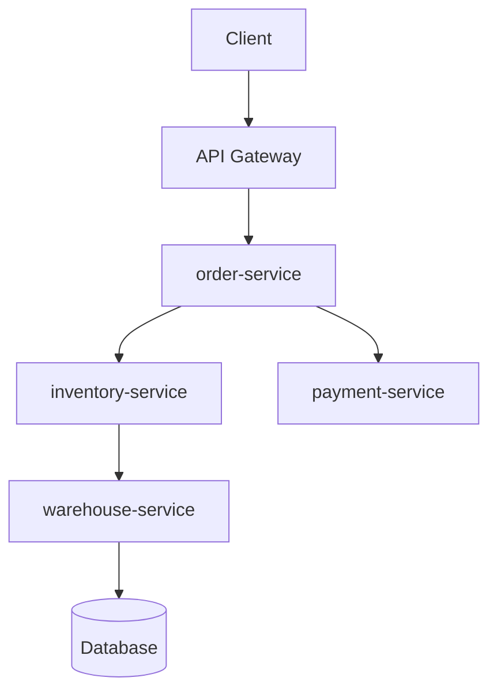
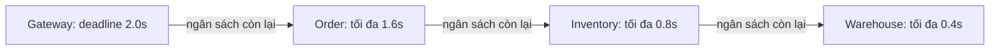

# Hệ thống nhiều tầng gọi và chiến lược tránh lỗi lan truyền

## Mục tiêu

Trong hệ thống microservice, một request thường đi qua nhiều tầng: API Gateway gọi order-service, order-service gọi inventory-service và inventory-service truy vấn một dịch vụ kho hoặc cơ sở dữ liệu. Khi một dependency chậm hoặc mất khả năng phục vụ, các tầng phía trên có thể giữ thread, connection, bộ nhớ và hàng đợi để chờ kết quả. Nếu tải tiếp tục tăng, những dịch vụ vốn khỏe cũng cạn tài nguyên và sự cố lan ra toàn hệ thống.

Circuit Breaker là một phần của chiến lược chống lỗi lan truyền. Để bảo vệ cả chuỗi, cần đặt nó tại đúng ranh giới gọi, phối hợp với timeout/deadline, Bulkhead, giới hạn concurrency, retry có ngân sách và fallback có kiểm soát.

Sau bài học, bạn có thể:

- Đọc dependency graph và xác định các cạnh có thể truyền sự cố.
- Đặt Circuit Breaker riêng cho từng dependency outbound cần cô lập.
- Phối hợp timeout và deadline xuyên nhiều tầng để request kết thúc trong ngân sách.
- Dùng Bulkhead và giới hạn concurrency để ngăn một dependency chiếm hết tài nguyên.
- Tránh retry amplification và fallback chain khi nhiều tầng cùng gặp lỗi.
- Thiết kế response suy giảm và kiểm thử khả năng ngăn lỗi lan truyền.

## Lỗi lan truyền hình thành như thế nào?

Xét luồng xử lý đơn hàng:



Một request tới order-service có thể cần gọi inventory và payment. Inventory lại gọi warehouse, sau đó warehouse truy vấn database. Nếu database chậm, warehouse giữ connection và request đang chạy. Inventory phải chờ warehouse; order-service phải chờ inventory; Gateway tiếp tục giữ request của client. Khi số request tăng, các tầng phía trên có thể cạn thread, connection pool hoặc giới hạn concurrency.

Một số cơ chế làm sự cố khuếch đại:

- **Thời gian chờ tích lũy:** mỗi tầng đặt timeout độc lập mà không xét thời gian còn lại của request. Tổng thời gian chờ có thể vượt xa deadline mà client chấp nhận.
- **Hàng đợi tăng:** request chậm chiếm worker, connection và slot đồng thời; request mới phải chờ lâu hơn, khiến latency tăng tiếp.
- **Fan-out:** một request gọi nhiều dependency song song hoặc tuần tự. Chỉ một nhánh chậm cũng có thể giữ request tổng thể; nhiều nhánh cùng lỗi làm số tác vụ đang chạy tăng nhanh.
- **Retry lồng nhau:** mỗi tầng tự retry, khiến một request logic tạo nhiều request vật lý tới dependency sâu nhất.
- **Fallback gọi tiếp dependency:** đường dự phòng vẫn phụ thuộc vào dịch vụ đang lỗi hoặc gọi qua một tầng đang quá tải, làm phát sinh thêm công việc.

Lỗi lan truyền thường bắt đầu từ một dependency chậm, sau đó biểu hiện thành quá tải tài nguyên ở các caller. Chỉ nhìn tỷ lệ HTTP 5xx ở tầng cuối có thể bỏ qua nguyên nhân ban đầu là latency, pool exhaustion hoặc hàng đợi bị lấp đầy.

## Bảo vệ từng cạnh trong dependency graph

Circuit Breaker nên được đặt ở phía caller, quanh lời gọi outbound tới một dependency có ranh giới lỗi rõ ràng. Ví dụ:

| Caller | Dependency được bảo vệ | Circuit Breaker đặt ở đâu? | Phạm vi cần quan sát |
|---|---|---|---|
| Gateway | order-service | Route filter hoặc gateway client gọi order-service. | Lỗi/độ trễ mà Gateway quan sát từ order-service. |
| order-service | inventory-service | Gateway/client outbound của order-service. | Lỗi/độ trễ của inventory đối với order-service. |
| order-service | payment-service | Gateway/client outbound riêng cho payment. | Lỗi/độ trễ của payment đối với order-service. |
| inventory-service | warehouse-service | Client outbound của inventory. | Lỗi/độ trễ của warehouse đối với inventory. |
| warehouse-service | database | Circuit Breaker nếu thư viện và kiểu dependency phù hợp; đồng thời dùng pool, timeout và giới hạn truy vấn. | Khả năng phục vụ của database đối với warehouse. |

Mỗi Circuit Breaker ghi nhận góc nhìn của caller. Circuit Breaker `inventory` trong order-service không phải bộ ngắt mạch toàn cụm và không tự thay đổi trạng thái Circuit Breaker ở Gateway. Các instance ứng dụng cũng thường có trạng thái Circuit Breaker cục bộ riêng; nhiều pod có thể chuyển `OPEN` ở những thời điểm khác nhau.

Không nên dùng một Circuit Breaker duy nhất cho mọi dependency outbound. Nếu payment gặp sự cố, Circuit Breaker dùng chung với inventory có thể mở và chặn cả chức năng tồn kho dù inventory vẫn khỏe. Hãy dùng ID riêng cho dependency hoặc nhóm thao tác có cùng đặc tính lỗi. Có thể chia sẻ profile cấu hình, nhưng giữ trạng thái runtime riêng khi các dependency độc lập.

Circuit Breaker bảo vệ caller khỏi tiếp tục khởi tạo lời gọi khi tín hiệu lỗi vượt ngưỡng. Nó không tự hủy mọi request đang chạy, không giải phóng ngay các connection đã bị giữ và không ngăn một background job đã được gửi tới dependency. Vì vậy, phải kết hợp với timeout và kiểm soát concurrency.

## Mỗi tầng cần timeout phù hợp với deadline tổng

Đặt timeout độc lập ở mỗi tầng mà không có deadline chung có thể làm thời gian chờ cộng dồn. Ví dụ, Gateway chờ order-service tối đa 3 giây; order-service lại chờ inventory 3 giây; inventory chờ warehouse 3 giây. Một request có thể tiêu tốn gần 9 giây ở các tầng, dù client chỉ chờ 3 giây trước khi đóng kết nối.

Thay vào đó, xác định deadline tổng và phân bổ ngân sách thời gian theo đường đi:



Các con số trên chỉ là ví dụ. Mỗi tầng phải chừa thời gian cho xử lý nội bộ, serialize response và truyền dữ liệu về caller. Một quy tắc hữu ích là deadline của lời gọi outbound phải ngắn hơn deadline còn lại của request hiện tại. Không đặt timeout của tầng dưới bằng hoặc dài hơn thời gian mà tầng trên còn có thể chờ.

Nếu hệ thống hỗ trợ deadline propagation, truyền thời điểm hết hạn hoặc thời gian còn lại qua các service boundary. Tầng nhận request tính lại ngân sách còn lại theo đồng hồ đơn điệu cục bộ và không bắt đầu công việc mới nếu deadline đã hết. Nếu dùng header riêng, phải thống nhất định dạng, đơn vị, quy tắc giới hạn và xử lý header không hợp lệ; không tin giá trị do client tùy ý gửi mà không kiểm tra.

Timeout có thể được đặt ở nhiều lớp với vai trò khác nhau:

- **HTTP client connect timeout:** giới hạn thời gian thiết lập kết nối.
- **Response/read timeout:** giới hạn thời gian chờ phản hồi hoặc dữ liệu.
- **TimeLimiter:** giới hạn thời gian chờ của thao tác theo khả năng của integration.
- **Request deadline:** giới hạn thời gian tổng từ lúc nhận request đến khi hoàn tất.

Hủy future hoặc reactive subscription không bảo đảm server từ xa dừng xử lý ngay. Cần kiểm tra khả năng cancel của HTTP client và vẫn giữ timeout ở tầng I/O để connection, socket và worker được giải phóng.

## Bulkhead và giới hạn concurrency ở từng dependency

Timeout giới hạn thời gian một lời gọi có thể chờ; Bulkhead giới hạn số lời gọi có thể chiếm tài nguyên cùng lúc. Nếu một dependency chậm, Bulkhead giúp cô lập nó để các dependency khác vẫn có capacity.

Ví dụ order-service gọi hai dependency:

| Dependency | Giới hạn đồng thời minh họa | Lý do |
|---|---:|---|
| inventory-service | 30 | Đọc tồn kho có tải cao và có thể suy giảm bằng dữ liệu cache. |
| payment-service | 10 | Giao dịch cần kiểm soát chặt số request đồng thời. |

Không dùng chung một pool hoặc semaphore không giới hạn cho mọi outbound call. Khi payment bị treo, nó không nên chiếm hết worker hoặc connection dành cho inventory. Cấu hình giới hạn phải dựa trên capacity của caller và dependency, không chỉ dựa trên số request dự kiến.

Với Resilience4j, có thể dùng semaphore Bulkhead cho giới hạn số lời gọi đồng thời hoặc ThreadPoolBulkhead cho cách ly bằng pool luồng. Trong ứng dụng reactive, ưu tiên client non-blocking và cơ chế giới hạn concurrency phù hợp; không chuyển lời gọi blocking lên event-loop. Hàng đợi Bulkhead nên có giới hạn nhỏ hoặc không chờ nếu request có deadline ngắn. Hàng đợi vô hạn chỉ chuyển quá tải thành latency và bộ nhớ tăng.

Khi Bulkhead hết slot, request mới cần bị từ chối nhanh hoặc chờ trong giới hạn đã định. Phân loại lỗi từ chối này riêng với lỗi sức khỏe của dependency. Ví dụ, `BulkheadFullException` phản ánh caller đã hết capacity cục bộ; nó không nhất thiết chứng minh upstream đang lỗi. Có thể loại ngoại lệ này khỏi failure rate của Circuit Breaker nếu mục tiêu đo là sức khỏe upstream.

## Retry lồng nhau có thể nhân số request

Giả sử chuỗi có ba tầng gọi nhau: Gateway gọi order, order gọi inventory, inventory gọi warehouse. Nếu mỗi tầng cho phép tối đa ba attempt cho mỗi request, một request logic ở Gateway có thể tạo tới:

\[
3 \times 3 \times 3 = 27
\]

request tới warehouse trong trường hợp tất cả các tầng đều retry đủ số lần. Nếu mỗi tầng còn retry các lỗi đã được tầng dưới thử lại, lượng tải có thể tăng mạnh ngay trong thời điểm hệ thống đang suy yếu.

Để tránh retry amplification:

- Chọn một tầng sở hữu retry cho một loại lỗi, thường là tầng hiểu rõ tính idempotent và deadline của thao tác.
- Giới hạn tổng số attempt và retry budget theo dependency, không chỉ giới hạn từng request riêng lẻ.
- Dùng exponential backoff và jitter để phân tán thời điểm thử lại.
- Không retry lỗi nghiệp vụ, lỗi validation hoặc `CallNotPermittedException` khi Circuit Breaker đang `OPEN`.
- Không giữ Bulkhead permit trong lúc chờ backoff.
- Không bắt đầu attempt mới nếu deadline còn lại không đủ.

Nếu cần retry tại nhiều tầng vì các thao tác có ngữ nghĩa độc lập, hãy tính tổng số request tối đa và ngân sách thời gian toàn chuỗi. Đừng giả định `maxAttempts: 3` ở ba tầng chỉ tạo ba lần gọi tổng cộng.

## Đặt Circuit Breaker quanh đúng thao tác

Ví dụ order-service gọi inventory bằng reactive Circuit Breaker factory:

```java
import org.springframework.cloud.client.circuitbreaker.ReactiveCircuitBreaker;
import org.springframework.cloud.client.circuitbreaker.ReactiveCircuitBreakerFactory;
import org.springframework.stereotype.Service;
import org.springframework.web.reactive.function.client.WebClient;
import reactor.core.publisher.Mono;

@Service
public class InventoryGateway {
    private final WebClient webClient;
    private final ReactiveCircuitBreaker inventoryBreaker;

    public InventoryGateway(
            WebClient webClient,
            ReactiveCircuitBreakerFactory<?, ?> factory) {
        this.webClient = webClient;
        this.inventoryBreaker = factory.create("inventory-from-order");
    }

    public Mono<StockView> getStock(String sku) {
        Mono<StockView> request = webClient.get()
                .uri("/stock/{sku}", sku)
                .retrieve()
                .bodyToMono(StockView.class);

        return Mono.from(inventoryBreaker.run(
                request,
                error -> Mono.error(new InventoryUnavailableException(sku, error))));
    }
}
```

Các kiểu `StockView` và `InventoryUnavailableException` là kiểu dữ liệu của ứng dụng. Ví dụ truyền lỗi về tầng order để tầng đó quyết định có thể dùng cache, trả kết quả một phần hay báo không khả dụng. Nếu muốn fallback trả giá trị cache ngay tại gateway, thay `Mono.error(...)` bằng publisher đọc cache và đánh dấu kết quả là dữ liệu suy giảm.

Điểm quan trọng là toàn bộ lời gọi outbound nằm trong publisher được bảo vệ. Với nguồn reactive cold như `WebClient`, request chỉ chạy khi có subscription. Không tự subscribe trong gateway rồi trả publisher cho caller, vì có thể tạo request trùng và ghi nhận nhiều mẫu ngoài dự kiến.

Với ứng dụng đồng bộ, dùng `CircuitBreakerFactory` để bao supplier của HTTP client. Dù dùng API đồng bộ hay reactive, tên instance nên đại diện cho dependency từ góc nhìn caller, chẳng hạn `inventory-from-order`; không dùng một ID duy nhất cho tất cả downstream.

## Cấu hình mỗi dependency độc lập

Ví dụ order-service dùng các Circuit Breaker riêng cho inventory và payment:

```yaml
resilience4j:
  circuitbreaker:
    instances:
      inventory-from-order:
        slidingWindowType: COUNT_BASED
        slidingWindowSize: 20
        minimumNumberOfCalls: 10
        failureRateThreshold: 50
        slowCallRateThreshold: 60
        slowCallDurationThreshold: 500ms
        waitDurationInOpenState: 8s
        permittedNumberOfCallsInHalfOpenState: 3
      payment-from-order:
        slidingWindowType: COUNT_BASED
        slidingWindowSize: 10
        minimumNumberOfCalls: 5
        failureRateThreshold: 40
        slowCallRateThreshold: 50
        slowCallDurationThreshold: 300ms
        waitDurationInOpenState: 12s
        permittedNumberOfCallsInHalfOpenState: 2
  timelimiter:
    instances:
      inventory-from-order:
        timeoutDuration: 700ms
      payment-from-order:
        timeoutDuration: 500ms
  bulkhead:
    instances:
      inventory-from-order:
        maxConcurrentCalls: 30
        maxWaitDuration: 0
      payment-from-order:
        maxConcurrentCalls: 10
        maxWaitDuration: 0
```

Đây là các giá trị minh họa, không phải cấu hình production mặc định. `slidingWindowSize` và `minimumNumberOfCalls` quyết định cách đánh giá lỗi trong `CLOSED`; `waitDurationInOpenState` và `permittedNumberOfCallsInHalfOpenState` điều khiển quá trình phục hồi. TimeLimiter giới hạn thời gian chờ theo integration, còn HTTP client vẫn cần connect/response timeout. Bulkhead giới hạn concurrency riêng cho mỗi dependency.

Khi tích hợp qua Spring Cloud CircuitBreaker, xác nhận đúng starter và cách cấu hình instance của release train đang dùng. Nếu kết hợp nhiều decorator như Circuit Breaker, TimeLimiter và Bulkhead, hãy xác định thứ tự thực thi và kiểm thử số request, thời gian giữ permit và exception được ghi nhận. Cùng một timeout hoặc Bulkhead rejection không nên bị đếm nhầm thành lỗi upstream nếu mục tiêu thống kê là đo sức khỏe dependency.

## Fallback tại đúng ranh giới

Fallback cần trả lời câu hỏi: tầng hiện tại có thể tiếp tục phục vụ một phần request mà không gọi lại dependency đang lỗi hay không?

Ví dụ:

- **Catalog:** có thể trả dữ liệu cache nếu độ cũ được chấp nhận và response ghi rõ `stale` hoặc `cachedAt`.
- **Inventory:** nếu không biết tồn kho hiện tại, trả trạng thái `UNKNOWN` hoặc không khả dụng. Không tự coi số lượng tồn kho bằng 0 hay vô hạn nếu điều đó làm thay đổi quyết định bán hàng.
- **Payment:** không trả thành công giả khi timeout. Giao dịch có thể đã được xử lý ở upstream; cần idempotency key và endpoint truy vấn trạng thái.
- **Search/recommendation:** có thể bỏ một nhánh tùy chọn hoặc trả kết quả một phần nếu hợp đồng API cho phép.

Fallback nên kết thúc tại tầng có đủ thông tin nghiệp vụ để chọn response. Tránh tạo chuỗi fallback như order gọi fallback inventory, fallback inventory lại gọi warehouse, rồi fallback warehouse lại gọi database đang lỗi. Nếu fallback cần dependency dự phòng, dependency đó phải có timeout, Bulkhead và giới hạn tài nguyên riêng.

Không phải fallback nào cũng nên trả HTTP 200. Dữ liệu cache có thể trả 200 kèm metadata suy giảm nếu hợp đồng cho phép. Khi không thể đưa ra kết quả đáng tin cậy, trả lỗi tạm thời có cấu trúc như 503. Điều quan trọng là caller nhận biết được dữ liệu đầy đủ, dữ liệu suy giảm hay trạng thái chưa xác định.

## Fan-out và xử lý một phần

Một tầng có thể gọi nhiều dependency song song. Ví dụ trang chi tiết đơn hàng gọi inventory, payment status và recommendation. Nếu một nhánh tùy chọn chậm, không nhất thiết phải giữ toàn bộ response chờ nhánh đó.

Chiến lược fan-out an toàn:

- Đặt deadline riêng cho từng nhánh dựa trên deadline tổng.
- Giới hạn số nhánh chạy đồng thời và số request mỗi dependency.
- Bảo vệ từng nhánh bằng Circuit Breaker riêng.
- Xác định nhánh bắt buộc và nhánh tùy chọn trước khi triển khai fallback.
- Trả response một phần khi hợp đồng API cho phép; đánh dấu trường bị thiếu hoặc suy giảm.
- Hủy nhánh không còn cần thiết khi caller đã có đủ dữ liệu hoặc deadline hết, đồng thời kiểm tra khả năng hủy I/O thực tế.

Không để một nhánh chậm giữ toàn bộ tài nguyên của request nếu sản phẩm cho phép trả một phần. Ngược lại, không bỏ qua lỗi của nhánh bắt buộc chỉ để giữ HTTP 200; response phải thể hiện đúng mức độ hoàn chỉnh của dữ liệu.

## Load shedding và giới hạn hàng đợi

Khi hệ thống gần quá tải, từ chối một phần request sớm có thể giữ cho các request còn lại hoàn tất. Các điểm có thể áp dụng:

- Giới hạn concurrency ở ingress/Gateway và mỗi outbound dependency.
- Giới hạn queue length và thời gian chờ lấy slot.
- Áp dụng rate limit hoặc quota theo caller/tenant nếu cần.
- Ưu tiên request quan trọng và loại bỏ công việc nền không cấp thiết khi capacity cạn.
- Dùng Circuit Breaker để fail fast với dependency có tỷ lệ lỗi hoặc độ trễ vượt ngưỡng.

Circuit Breaker và load shedding khác nhau. Circuit Breaker phản ứng với kết quả gọi một dependency; load shedding phản ứng với capacity của chính hệ thống nhận request. Một service có thể cần load shedding dù mọi dependency đều khỏe, chẳng hạn khi CPU hoặc worker pool đã gần giới hạn.

## Theo dõi lỗi theo tầng và theo cạnh

Để xác định nơi bắt đầu sự cố, dashboard cần phân biệt latency và lỗi ở từng cạnh caller → dependency. Các chỉ số nên có:

- Request rate, success/error rate và latency p50/p95/p99 theo route hoặc dependency.
- Số request đang chạy, queue depth, pool usage và số lần từ chối Bulkhead.
- Trạng thái Circuit Breaker, failure rate, slow-call rate, buffered calls và not-permitted calls.
- Số timeout theo từng tầng và deadline còn lại khi bắt đầu outbound call.
- Số attempt/retry, retry budget đã dùng và tỷ lệ retry thành công.
- Số fallback, tỷ lệ dữ liệu cache, tuổi dữ liệu và tỷ lệ response một phần.
- Trace liên kết các span xuyên Gateway và service, có route/dependency name nhất quán.

Nếu Gateway thấy order-service chậm nhưng order-service ghi nhận inventory chậm và inventory ghi nhận warehouse timeout, trace có thể chỉ ra điểm nghẽn đầu tiên. Nếu chỉ có metric tổng hợp toàn ứng dụng, rất khó phân biệt lỗi upstream với caller đã cạn tài nguyên.

Metric Circuit Breaker của Resilience4j có thể được xuất qua Micrometer khi binder phù hợp được bật. Tên metric và tag phụ thuộc phiên bản và registry. Tránh đưa user ID, order ID hoặc giá trị request động vào tên Circuit Breaker hay metric tag có cardinality cao.

## Thực hành kiểm chứng lỗi lan truyền

Thực hiện trong môi trường thử nghiệm với các service có thể điều khiển latency và lỗi:

1. Khởi động Gateway, order-service, inventory-service, payment-service và warehouse-service. Gửi request bình thường, ghi nhận latency từng cạnh.
2. Làm warehouse-service chậm hơn timeout. Xác nhận inventory có timeout và Circuit Breaker riêng cho warehouse ghi nhận lỗi; quan sát ảnh hưởng tới lời gọi inventory từ order.
3. Tạo đủ lỗi để Circuit Breaker của inventory trong order chuyển `OPEN`. Xác nhận order fail fast hoặc trả fallback theo hợp đồng mà không tiếp tục tạo request tới inventory.
4. Giữ payment khỏe và xác nhận Circuit Breaker payment vẫn `CLOSED`, request thanh toán không bị chặn bởi lỗi inventory.
5. Tăng concurrency để chạm Bulkhead của inventory. Xác nhận các lời gọi payment vẫn có capacity riêng và request vượt hạn mức bị từ chối trong thời gian ngắn.
6. Bật retry ở từng tầng trong môi trường thử nghiệm và đếm request tới warehouse. So sánh số request khi chỉ một tầng retry với trường hợp ba tầng cùng cho ba attempt.
7. Đặt deadline ngắn hơn tổng timeout cộng backoff. Xác nhận tầng dưới không bắt đầu attempt mới khi deadline đã hết.
8. Khôi phục warehouse và quan sát `HALF_OPEN` probe. Xác nhận Circuit Breaker chỉ đóng lại khi kết quả thăm dò đạt ngưỡng.
9. Kiểm tra trace, metric, queue, pool usage và fallback để xác nhận sự cố được giới hạn ở dependency có lỗi.

Ghi lại số request logic, số request vật lý tới từng dependency, trạng thái Circuit Breaker, số lần từ chối Bulkhead và thời gian hoàn tất. Không tạo tải thử nghiệm vượt khả năng môi trường.

## Lỗi thường gặp

- **Chỉ đặt Circuit Breaker ở Gateway:** service bên trong vẫn có thể tiếp tục gọi dependency chậm và tự cạn tài nguyên.
- **Dùng một Circuit Breaker cho mọi downstream:** lỗi của một dependency có thể chặn các dependency khỏe.
- **Cho rằng Circuit Breaker là bộ ngắt mạch toàn cụm:** trạng thái thường cục bộ theo instance caller; không tự đồng bộ giữa các pod.
- **Không đặt timeout ở tầng I/O:** request đang chạy vẫn có thể giữ connection sau khi caller đã timeout.
- **Đặt timeout độc lập không có deadline:** thời gian chờ cộng dồn qua các tầng và vượt SLA của client.
- **Retry ở mọi tầng:** số request vật lý có thể tăng theo tích số attempt của từng tầng.
- **Giữ Bulkhead permit khi backoff:** slot bị chiếm dù không có request đang chạy.
- **Dùng hàng đợi không giới hạn:** quá tải biến thành latency và memory pressure.
- **Fallback gọi lại dependency đang lỗi:** tạo fallback loop và thêm tải vào hệ thống đã suy yếu.
- **Trả thành công giả:** che giấu trạng thái chưa xác định, đặc biệt nguy hiểm với payment và inventory.
- **Không phân biệt lỗi Bulkhead với lỗi upstream:** làm sai failure rate và quyết định mở mạch.
- **Chỉ theo dõi 5xx:** bỏ qua latency, pool exhaustion, queue depth và số request bị từ chối.

Một hệ thống nhiều tầng chống lỗi lan truyền tốt khi mỗi caller kiểm soát lời gọi outbound của chính nó, toàn bộ chuỗi chia sẻ một deadline hữu hạn, tài nguyên được cô lập theo dependency và retry/fallback không tạo thêm tải vô hạn. Circuit Breaker giúp từng tầng ngừng gọi dependency đang suy yếu; timeout, Bulkhead, load shedding và quan sát xuyên tầng giúp phần còn lại của hệ thống tiếp tục phục vụ trong giới hạn có thể dự đoán.
