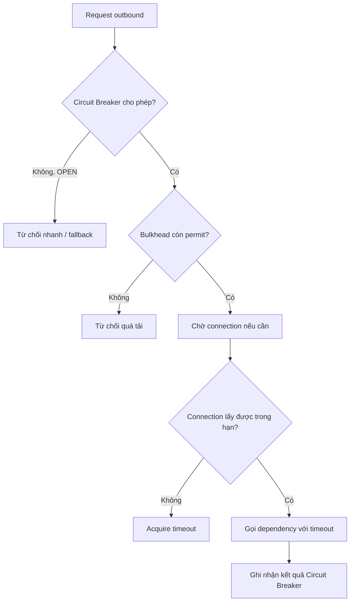

# Thread pool, hàng đợi và connection pool khi phụ thuộc chậm

## Mục tiêu

Khi một dịch vụ phụ thuộc phản hồi chậm, request của caller phải chờ lâu hơn và giữ tài nguyên trong suốt thời gian chờ. Ở ứng dụng đồng bộ, thread có thể bị giữ; ở ứng dụng reactive, connection và các tác vụ đang chờ vẫn chiếm tài nguyên dù event loop không bị chặn. Nếu thread pool, hàng đợi hoặc connection pool không có giới hạn phù hợp, độ trễ của một dependency có thể làm toàn bộ ứng dụng suy giảm.

Trong hệ thống Spring Cloud Circuit Breaker, Circuit Breaker giúp ngừng gửi lời gọi mới khi dependency có dấu hiệu lỗi. Để bảo vệ hiệu năng, cần hiểu rõ thread pool, queue và connection pool, đặt giới hạn concurrency, timeout và chính sách từ chối phù hợp.

Sau bài học, bạn có thể:

- Phân biệt thread pool, queue và connection pool ở phía caller.
- Ước lượng concurrency và nhu cầu tài nguyên bằng Little's Law.
- Chọn queue có giới hạn, timeout chờ slot và hành vi từ chối khi quá tải.
- Cấu hình Bulkhead đồng bộ hoặc ThreadPoolBulkhead cho tác vụ phù hợp.
- Cấu hình connection pool cho WebClient/Reactor Netty và nhận biết pool JDBC là tài nguyên khác.
- Phối hợp Circuit Breaker, TimeLimiter, Bulkhead và connection pool mà không che giấu điểm nghẽn.
- Theo dõi saturation, queue wait, connection acquire và số request bị từ chối.

## Ba loại tài nguyên khác nhau

Thread pool, queue và connection pool thường xuất hiện cùng nhau nhưng quản lý những thứ khác nhau:

| Tài nguyên | Quản lý | Bị chiếm trong tình huống nào? | Dấu hiệu quá tải |
|---|---|---|---|
| Thread pool | Số tác vụ có thể chạy đồng thời trên các worker thread. | Khi một tác vụ đồng bộ đang thực thi hoặc chờ I/O theo kiểu blocking. | Active threads chạm giới hạn, queue tăng, task bị từ chối. |
| Queue | Các tác vụ đã được nhận nhưng chưa có worker hoặc slot để chạy. | Khi tốc độ đến cao hơn tốc độ xử lý trong một khoảng thời gian. | Queue depth và queue wait tăng, deadline hết trước khi task bắt đầu. |
| Connection pool | Các kết nối mạng hoặc database có thể được mượn đồng thời. | Khi request đang sử dụng một kết nối để gửi/nhận dữ liệu. | Active/leased connections chạm giới hạn, pending acquire tăng, acquire timeout. |

Một request đồng bộ có thể giữ một thread trong khi chờ một HTTP connection và chờ response. Một request reactive thường không giữ một thread riêng trong suốt thời gian chờ mạng, nhưng vẫn có thể giữ một connection, một slot concurrency và bộ nhớ cho publisher đang hoạt động. Reactive không có nghĩa là tài nguyên chờ đợi miễn phí.

Connection pool cũng có nhiều loại. Pool của HTTP client dùng để tái sử dụng kết nối tới dịch vụ từ xa; pool JDBC như HikariCP quản lý kết nối tới database. Không nên cộng hoặc điều chỉnh hai pool này như thể chúng là cùng một tài nguyên.

## Cách dependency chậm làm cạn tài nguyên

Giả sử order-service nhận 100 request mỗi giây. Mỗi request gọi inventory-service và inventory mất trung bình hai giây để phản hồi. Số lời gọi inventory đang chờ trung bình có thể xấp xỉ 200.

Little's Law mô tả quan hệ giữa lưu lượng, thời gian và số công việc đang tồn tại:

\[
L = \lambda \times W
\]

Trong đó:

- `L` là số request/tác vụ trung bình đang ở trong hệ thống.
- `lambda` là tốc độ đến trung bình, tính bằng request mỗi giây.
- `W` là thời gian trung bình một request ở trong hệ thống, tính bằng giây.

Với ví dụ trên:

\[
L = 100\;requests/s \times 2\;s = 200\;requests
\]

Nếu HTTP connection pool chỉ có 40 kết nối, tối đa khoảng 40 request có thể sử dụng connection cùng lúc; phần còn lại phải chờ lấy connection hoặc bị từ chối. Nếu ứng dụng đồng bộ có 50 worker thread nhưng tất cả đều chờ inventory, các request gọi payment hoặc xử lý nội bộ cũng có thể không còn thread để chạy.

Little's Law mô tả trạng thái trung bình khi hệ thống ổn định; nó không tự đưa ra kích thước pool production. Khi dependency bắt đầu chậm hơn, `W` tăng và số request đang tồn tại tăng theo. Nếu arrival rate vẫn cao hơn throughput, hệ thống không còn trạng thái ổn định: queue tiếp tục tăng cho tới khi timeout, giới hạn bộ nhớ hoặc cơ chế từ chối can thiệp.

## Thread pool và queue phải có giới hạn

Thread pool giới hạn số tác vụ blocking hoặc tác vụ được offload có thể chạy đồng thời. Queue giữ các tác vụ chờ worker. Tăng số thread hoặc tăng queue không tự làm dependency xử lý nhanh hơn.

Một queue lớn có thể khiến hệ thống trông như vẫn nhận request, nhưng request nằm chờ lâu đến mức deadline đã hết. Khi worker cuối cùng xử lý task, caller có thể đã ngắt kết nối hoặc không còn cần kết quả. Công việc vẫn tiêu tốn CPU, connection và bộ nhớ dù không còn giá trị với người dùng.

Ví dụ cấu hình server Tomcat:

```yaml
server:
  tomcat:
    threads:
      max: 160
      min-spare: 10
    accept-count: 80
    max-connections: 4000
```

Các thuộc tính này điều chỉnh khả năng tiếp nhận request inbound của Tomcat: số worker thread, số kết nối và hàng đợi kết nối chờ được chấp nhận. Chúng không cấu hình HTTP connection pool outbound tới inventory-service. Cần phân biệt giới hạn server inbound với giới hạn ở HTTP client.

Khi queue đầy, hệ thống nên từ chối nhanh hoặc áp dụng chính sách load shedding đã định nghĩa. Tránh queue vô hạn. Với event loop reactive, không dùng chính sách kiểu `CallerRuns` để chạy tác vụ blocking ngay trên thread gửi request; điều đó có thể chặn event loop và ảnh hưởng nhiều request không liên quan.

## Ước lượng concurrency và kích thước pool

Có thể dùng Little's Law để ước lượng số tác vụ đồng thời cần thiết ở một mức tải và latency mục tiêu:

\[
Concurrency_{avg} \approx ArrivalRate \times ServiceTime
\]

Ví dụ, dependency xử lý 60 request mỗi giây với thời gian trung bình 250 ms:

\[
60 \times 0.25 = 15\;concurrent\ calls
\]

Con số 15 là concurrency trung bình theo giả định ổn định. Khi sizing cần xem thêm peak traffic, p95/p99 latency, burst, thời gian kết nối, giới hạn của dependency và headroom. Nếu chọn pool đúng bằng giá trị trung bình, các đợt tải tăng hoặc latency biến động sẽ nhanh chóng làm pool bão hòa.

Một quy trình sizing thực tế:

1. Đo arrival rate theo dependency, không chỉ tổng request inbound.
2. Đo latency trung bình và phân vị p95/p99 khi dependency khỏe và khi tải tăng.
3. Ước lượng concurrency trung bình, sau đó thử tải ở mức peak dự kiến.
4. Chọn giới hạn Bulkhead và connection pool sao cho caller không vượt capacity mà dependency đã thỏa thuận.
5. Đặt queue nhỏ có chủ đích và giới hạn thời gian chờ queue/acquire.
6. Kiểm tra CPU, memory, số thread, file descriptor, connection và throughput trong bài thử.
7. Điều chỉnh theo số instance/pod; tổng pool của toàn cụm có thể lớn hơn nhiều so với pool của một pod.

Ví dụ, 10 pod mỗi pod có 50 HTTP connection cho cùng một dependency có thể tạo tối đa 500 kết nối từ cụm. Nếu dependency chỉ chịu được 120 kết nối, cấu hình từng pod riêng lẻ có thể làm upstream quá tải dù mỗi pod không vượt giới hạn cục bộ. Hãy chia sẻ ngân sách capacity theo số replica và có headroom cho các client khác.

## Bulkhead giới hạn số tác vụ đang chạy

Resilience4j cung cấp hai kiểu Bulkhead phổ biến:

- **Semaphore Bulkhead:** giới hạn số lời gọi đồng thời bằng permit. Không tạo thread pool riêng; lời gọi chạy trên thread của caller.
- **ThreadPoolBulkhead:** dùng thread pool và queue riêng để cách ly tác vụ. Phù hợp với một số tác vụ blocking hoặc cần executor riêng; lời gọi được thực thi qua cơ chế bất đồng bộ của bulkhead.

Ví dụ Semaphore Bulkhead:

```yaml
resilience4j:
  bulkhead:
    instances:
      inventory:
        maxConcurrentCalls: 24
        maxWaitDuration: 0
```

Tối đa 24 lời gọi có thể giữ permit cùng lúc. `maxWaitDuration: 0` yêu cầu không chờ khi hết permit; lời gọi mới bị từ chối nhanh. Đây là giới hạn concurrency, không phải số worker thread.

Ví dụ ThreadPoolBulkhead:

```yaml
resilience4j:
  thread-pool-bulkhead:
    instances:
      legacy-catalog:
        coreThreadPoolSize: 4
        maxThreadPoolSize: 8
        queueCapacity: 16
        keepAliveDuration: 20ms
```

ThreadPoolBulkhead có tối đa tám worker thread và queue tối đa 16 task theo cấu hình minh họa. Khi pool và queue đều đầy, task mới bị từ chối. Không tăng `queueCapacity` để che giấu một dependency xử lý chậm; queue cần đủ nhỏ để task không đợi lâu hơn deadline của request.

Chọn một mô hình phù hợp với loại công việc. Semaphore Bulkhead thường phù hợp với lời gọi không blocking hoặc khi muốn giới hạn concurrency ngay trên caller thread. ThreadPoolBulkhead có thể cách ly một thư viện blocking, nhưng cần tính chi phí context switching, queue, thread stack và cách truyền context. Trong reactive pipeline, tránh chuyển tác vụ blocking sang event loop; dùng executor chuyên dụng hoặc cơ chế scheduler phù hợp.

## Thứ tự Bulkhead, Circuit Breaker và queue

Mục tiêu là từ chối sớm khi dependency đang `OPEN` hoặc khi capacity đã cạn, tránh đưa thêm công việc vào queue không cần thiết.

Một request outbound có thể trải qua các bước:



Đây là thứ tự logic để suy nghĩ về giới hạn, không phải bảo đảm thứ tự decorator mặc định của mọi integration. Với Spring Cloud CircuitBreaker và Resilience4j, thứ tự thực thi giữa Circuit Breaker, TimeLimiter và Bulkhead phụ thuộc cách factory/customizer và decorator được cấu hình. Cần kiểm tra cấu hình thực tế và thử nghiệm khi phối hợp nhiều decorator.

Một số nguyên tắc:

- Kiểm tra Circuit Breaker trước khi đưa task vào một queue dài, nếu integration cho phép kiểm soát thứ tự.
- Lấy Bulkhead permit trong khoảng thời gian task thực sự được thực thi; không giữ permit trong lúc backoff giữa các retry.
- Giới hạn thời gian chờ lấy connection bằng pending-acquire timeout hoặc connection-request timeout.
- Đặt response timeout và deadline tổng để lời gọi đang chạy không giữ connection vô hạn.
- Phân biệt Bulkhead rejection và connection-pool exhaustion với lỗi sức khỏe của upstream. Nếu mục tiêu Circuit Breaker là đo upstream, không tự động tính mọi lỗi capacity cục bộ là lỗi upstream.

Circuit Breaker không giải phóng connection đang bị một request treo giữ. TimeLimiter có thể kết thúc việc chờ ở caller, nhưng hủy future không nhất thiết dừng I/O. HTTP client cần timeout và khả năng cancel phù hợp để connection cuối cùng được trả về pool.

## HTTP connection pool với WebClient và Reactor Netty

`WebClient` thường dùng Reactor Netty trong ứng dụng WebFlux. `ConnectionProvider` quản lý pool kết nối, số kết nối tối đa và số request đang chờ lấy connection.

Ví dụ tạo pool có giới hạn:

```java
import java.time.Duration;

import reactor.netty.http.client.HttpClient;
import reactor.netty.resources.ConnectionProvider;
import org.springframework.context.annotation.Bean;
import org.springframework.context.annotation.Configuration;
import org.springframework.http.client.reactive.ReactorClientHttpConnector;
import org.springframework.web.reactive.function.client.WebClient;

@Configuration
public class CatalogWebClientConfiguration {
    @Bean
    WebClient catalogWebClient() {
        ConnectionProvider provider = ConnectionProvider.builder("catalog-pool")
                .maxConnections(40)
                .pendingAcquireMaxCount(80)
                .pendingAcquireTimeout(Duration.ofMillis(200))
                .maxIdleTime(Duration.ofSeconds(20))
                .maxLifeTime(Duration.ofMinutes(5))
                .evictInBackground(Duration.ofSeconds(30))
                .build();

        HttpClient httpClient = HttpClient.create(provider)
                .responseTimeout(Duration.ofMillis(700));

        return WebClient.builder()
                .baseUrl("http://catalog-service")
                .clientConnector(new ReactorClientHttpConnector(httpClient))
                .build();
    }
}
```

Ý nghĩa các giới hạn:

- `maxConnections(40)`: tối đa 40 connection trong pool theo cấu hình provider.
- `pendingAcquireMaxCount(80)`: giới hạn số yêu cầu đang chờ mượn connection.
- `pendingAcquireTimeout(200 ms)`: giới hạn thời gian chờ connection được cấp.
- `maxIdleTime` và `maxLifeTime`: loại bỏ connection nhàn rỗi quá lâu hoặc vượt tuổi thọ.
- `responseTimeout(700 ms)`: giới hạn thời gian chờ response ở HTTP client theo semantics Reactor Netty.

Các giá trị chỉ là ví dụ. Nếu `pendingAcquireMaxCount` quá lớn, queue chờ connection có thể giữ nhiều request đã hết deadline. Nếu quá nhỏ, burst ngắn có thể bị từ chối sớm. Chọn cả `maxConnections` và pending queue theo capacity của upstream, số pod và deadline của caller.

Connection pool là tài nguyên dùng chung của client. Nếu một request giữ connection lâu vì upstream chậm, số connection khả dụng giảm. Khi pool đầy, request mới chờ acquire; khi pending queue đầy hoặc hết acquire timeout, client phát lỗi. Circuit Breaker cần được cấu hình để nhận biết timeout/lỗi phù hợp, nhưng không nên tính nhầm mọi lỗi cấu hình hoặc lỗi cục bộ là lỗi upstream.

Trong thực tế, nên tạo và tái sử dụng `WebClient`/`ConnectionProvider` dưới dạng bean theo dependency hoặc nhóm dependency có cùng đặc tính. Không tạo pool mới cho mỗi request, vì điều đó làm mất hiệu quả pooling và tăng số socket.

## Connection pool JDBC là một giới hạn khác

Nếu warehouse-service truy vấn database, pool JDBC như HikariCP quản lý số connection database. Một truy vấn chậm có thể giữ connection lâu và làm các request khác chờ lấy connection.

Ví dụ cấu hình:

```yaml
spring:
  datasource:
    hikari:
      maximum-pool-size: 20
      minimum-idle: 5
      connection-timeout: 1000
      validation-timeout: 500
      max-lifetime: 1800000
```

`maximum-pool-size` giới hạn tổng số connection của pool; `connection-timeout` giới hạn thời gian chờ lấy connection từ pool, tính bằng mili giây. Nó không phải query timeout. Cần cấu hình statement/query timeout ở tầng JDBC hoặc ORM theo deadline ứng dụng. Cũng cần kiểm tra tổng số connection từ tất cả pod không vượt giới hạn database.

Không tăng `maximum-pool-size` chỉ vì thấy request chờ connection. Nếu database đã bão hòa CPU, I/O hoặc lock, tăng pool có thể làm nhiều query chạy đồng thời hơn và khiến database chậm thêm. Đo query latency, active connection, pending thread và database capacity trước khi thay đổi.

## Blocking và reactive cần cách quản lý khác nhau

Trong ứng dụng servlet với `RestTemplate` hoặc một HTTP client blocking, mỗi lời gọi đang chờ response thường giữ một worker thread. Nếu thread pool có 100 worker và 100 lời gọi cùng chờ một dependency, request mới có thể không còn worker.

Trong ứng dụng WebFlux với `WebClient`, I/O không blocking và event loop có thể phục vụ nhiều connection mà không cần một thread riêng cho mỗi request đang chờ. Tuy vậy:

- Connection pool vẫn hữu hạn.
- Pending acquire queue vẫn có thể tăng.
- Publisher, buffer và context vẫn chiếm bộ nhớ.
- CPU-bound hoặc blocking code trên event loop có thể chặn nhiều request cùng lúc.
- Giới hạn concurrency vẫn cần thiết để tránh gửi quá nhiều request tới dependency.

Không gọi `block()`, `Thread.sleep()` hoặc JDBC blocking trực tiếp trên event loop. Nếu phải gọi thư viện blocking, chuyển nó sang scheduler/executor chuyên dụng có giới hạn, đặt timeout và kiểm soát queue. Không dùng `boundedElastic` như một queue vô hạn để đẩy mọi vấn đề ra khỏi event loop; vẫn cần giới hạn số tác vụ và theo dõi saturation.

## Phối hợp với Retry và deadline

Retry tạo thêm attempt và có thể giữ request trong hệ thống lâu hơn. Khi dependency chậm, retry không có backoff và deadline có thể làm queue, thread và connection pool nhanh chóng bão hòa.

Ví dụ, nếu mỗi attempt có timeout 700 ms, có ba attempt và backoff 100 ms rồi 200 ms, tổng thời gian có thể gần:

\[
3 \times 700 + 100 + 200 = 2.400\;ms
\]

Con số chưa bao gồm thời gian chờ queue và lấy connection. Nếu request chỉ còn 900 ms deadline, không nên bắt đầu chuỗi ba attempt này. Cần tính thời gian chờ queue, acquire, thực thi và backoff vào deadline tổng.

Các nguyên tắc phối hợp:

- Chỉ retry lỗi tạm thời và thao tác có thể thực hiện lại an toàn.
- Dùng exponential backoff và jitter; không giữ Bulkhead permit trong lúc chờ.
- Giới hạn số attempt và retry budget theo dependency.
- Không retry `CallNotPermittedException` khi Circuit Breaker `OPEN`.
- Không retry liên tục khi lỗi thực chất là Bulkhead full hoặc connection pool exhausted; đó thường là dấu hiệu caller đã hết capacity.
- Bỏ attempt mới nếu thời gian còn lại không đủ cho queue/acquire và xử lý response.

Khi Circuit Breaker chuyển `OPEN`, lời gọi mới nên bị từ chối trước khi vào queue hoặc lấy connection nếu thứ tự tích hợp cho phép. Khi `HALF_OPEN`, số probe được cấp phép cũng cần phù hợp với connection pool và năng lực phục hồi của upstream; không để nhiều pod đồng loạt tạo một đợt probe lớn hơn capacity thực tế.

## Quan sát pool và hàng đợi

Không thể điều chỉnh pool hiệu quả nếu chỉ nhìn CPU hoặc HTTP 5xx. Hãy theo dõi cả lượng công việc đang chạy và thời gian chờ:

| Nhóm | Chỉ số nên theo dõi | Dấu hiệu cần điều tra |
|---|---|---|
| Thread pool | Active threads, pool size, completed tasks, rejected tasks. | Active chạm max lâu, task completion giảm, rejection tăng. |
| Queue | Queue depth, queue capacity, queue wait time, oldest task age. | Queue tăng liên tục hoặc task bắt đầu sau deadline. |
| HTTP connection pool | Active/idle connections, pending acquire, acquire latency, acquire timeout. | Active chạm max, pending tăng, acquire timeout xuất hiện. |
| JDBC pool | Active/idle/pending connections, connection usage time, acquisition timeout. | Pool cạn hoặc query giữ connection lâu. |
| Circuit Breaker | State, failure rate, slow-call rate, not-permitted calls. | `OPEN` liên tục hoặc nhiều request bị từ chối. |
| Bulkhead | Available permits, concurrent calls, rejected calls. | Permit luôn cạn hoặc rejection tăng. |

Micrometer có thể xuất metric từ Resilience4j và các pool/client có binder tương ứng. Tên metric và tag phụ thuộc phiên bản, thư viện và cấu hình. Hãy kiểm tra metric thực tế của ứng dụng trước khi viết dashboard. Với Reactor Netty, bật quan sát pool phù hợp và giữ tên pool ổn định để có thể lọc theo dependency.

Log/trace nên phân biệt:

- Thời gian chờ queue hoặc lấy connection.
- Thời gian kết nối và thời gian response từ upstream.
- Thời gian thực thi thực tế.
- Lỗi do Circuit Breaker, Bulkhead, acquire timeout hay upstream.
- Deadline còn lại khi request bắt đầu outbound call.

Nếu response timeout tăng nhưng connection acquire vẫn thấp, vấn đề có thể nằm ở upstream. Nếu pending acquire tăng trước khi response timeout, pool có thể là điểm nghẽn ở caller. Nếu active thread tăng nhưng connection pool chưa đầy, kiểm tra blocking code hoặc lock ở tầng ứng dụng.

## Quy trình điều tra dependency chậm

Khi một dependency bắt đầu phản hồi chậm, thực hiện theo thứ tự:

1. Xác nhận latency p95/p99 và tỷ lệ lỗi của dependency, so sánh với thời điểm bình thường.
2. Kiểm tra Circuit Breaker state và số lời gọi đang được phép; xác định request mới có còn được gửi tới upstream không.
3. Kiểm tra Bulkhead permit, active task và rejected task để biết caller có đang cạn concurrency.
4. Kiểm tra HTTP connection pool hoặc JDBC pool: active, idle, pending acquire và acquire timeout.
5. Kiểm tra thread pool và queue: active thread, queue depth, thời gian chờ và task quá hạn.
6. Đối chiếu số pod và tổng connection/concurrency với capacity upstream.
7. Kiểm tra timeout/deadline, retry và backoff để phát hiện công việc tiếp tục chạy sau khi caller đã bỏ request.
8. Giảm tải hoặc từ chối sớm nếu queue tiếp tục tăng; không tăng pool hàng loạt khi chưa biết bottleneck.
9. Khôi phục dependency và quan sát `HALF_OPEN` probe, connection acquire và tốc độ queue giảm về bình thường.

## Thực hành kiểm chứng

Thực hiện trong môi trường thử nghiệm với một endpoint catalog có thể tạo độ trễ:

1. Cấu hình HTTP connection pool tối đa 20 connection, pending acquire tối đa 10 và acquire timeout 200 ms.
2. Đặt Bulkhead tối đa 16 lời gọi đồng thời, không chờ khi hết permit.
3. Gửi tải bình thường và ghi nhận active/idle connection, pending acquire, active calls và latency.
4. Làm catalog chậm hơn một giây trong khi caller gửi nhiều request. Quan sát connection pool và Bulkhead đạt giới hạn như thế nào.
5. Xác nhận request vượt concurrency bị từ chối hoặc acquire timeout theo đúng giới hạn; queue không tăng vô hạn.
6. Làm đủ lỗi để Circuit Breaker chuyển `OPEN`. Gửi thêm request và xác nhận lời gọi bị từ chối trước khi tạo thêm tải lên upstream.
7. So sánh một cấu hình queue nhỏ với queue lớn. Ghi nhận queue wait, tỷ lệ request hết deadline và số request hoàn tất hữu ích.
8. Khôi phục dependency, quan sát `HALF_OPEN` và xác nhận số probe không vượt capacity đã định.
9. Nếu ứng dụng dùng cả JDBC pool, làm query thử nghiệm chậm và quan sát pool database riêng; không nhầm metric JDBC với HTTP connection pool.

Ghi lại throughput, p95/p99 latency, số request đang chạy, queue depth, connection acquire timeout, Bulkhead rejection và Circuit Breaker state. Không tạo tải vượt khả năng môi trường.

## Lỗi thường gặp

- **Tăng thread pool khi dependency chậm:** nhiều thread hơn có thể chỉ tạo thêm request đang chờ và tăng context switching.
- **Dùng queue vô hạn:** giữ request quá hạn, tăng memory và kéo dài thời gian phục hồi.
- **Nhầm server thread pool với outbound connection pool:** một cái phục vụ request inbound, cái kia quản lý kết nối tới dependency.
- **Nhầm HTTP pool với JDBC pool:** hai loại kết nối có capacity và metric riêng.
- **Tạo WebClient hoặc ConnectionProvider mỗi request:** làm mất pooling, tăng socket và khó quản lý lifecycle.
- **Chỉ đặt TimeLimiter:** caller có thể ngừng chờ nhưng I/O bên dưới vẫn chạy và giữ connection.
- **Bulkhead lớn hơn capacity upstream:** caller có thể gửi nhiều request hơn dịch vụ đích chịu được.
- **Pending acquire queue quá lớn:** request chờ connection có thể hết deadline trước khi bắt đầu.
- **Retry khi pool đã cạn:** tạo thêm attempt và làm tình trạng quá tải nặng hơn.
- **Chạy blocking trên event loop:** một tác vụ có thể làm chậm nhiều request reactive không liên quan.
- **Tính capacity theo từng pod mà quên toàn cụm:** tổng connection từ nhiều replica có thể vượt giới hạn dependency.
- **Chỉ nhìn CPU:** pool hoặc queue có thể bão hòa trong khi CPU vẫn thấp vì nhiều tác vụ đang chờ I/O.

Thread pool giới hạn số tác vụ chạy, queue giữ các tác vụ chờ và connection pool giới hạn số kết nối đang được sử dụng. Khi dependency chậm, hãy đo cả ba loại tài nguyên, đặt giới hạn có chủ đích và từ chối request sớm khi capacity cạn. Circuit Breaker ngăn lời gọi mới tới dependency không khỏe; Bulkhead, timeout, queue hữu hạn và connection pool được sizing phù hợp giúp các phần còn lại của ứng dụng tiếp tục hoạt động.
