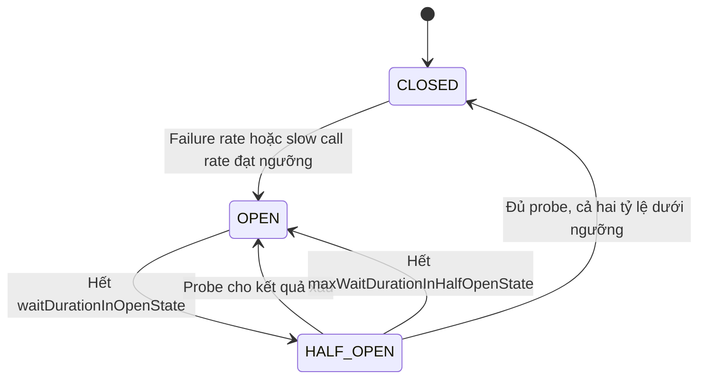

# HALF_OPEN giữ quá lâu vì lời gọi chưa hoàn tất

Trong Spring Cloud Circuit Breaker dùng Resilience4j, trạng thái `HALF_OPEN` là giai đoạn thử xem dependency đã phục hồi hay chưa. Circuit breaker cấp quyền cho một số lời gọi thăm dò (probe) đi tới dependency. Khi đủ kết quả, breaker đánh giá failure rate và slow call rate để chuyển về `CLOSED` hoặc quay lại `OPEN`.

Một sự cố thường gặp là breaker vào `HALF_OPEN` nhưng ở trạng thái này lâu hơn dự kiến. Nguyên nhân có thể là probe bị treo, client không đặt timeout, publisher reactive không phát tín hiệu kết thúc, hoặc không có đủ request để hoàn thành số probe cần thiết. Nếu không xử lý, ứng dụng có thể tiếp tục từ chối request hoặc giữ tài nguyên của các lời gọi đang chạy.

Điểm cần phân biệt là `maxWaitDurationInHalfOpenState` giới hạn thời gian breaker được ở `HALF_OPEN`; nó không phải timeout của từng HTTP request và không tự bảo đảm hủy lời gọi đang chạy. Muốn probe kết thúc, cần cấu hình timeout ở đúng tầng thực thi.

## Cơ chế hoàn tất HALF_OPEN

Khi hết `waitDurationInOpenState`, breaker có thể chuyển từ `OPEN` sang `HALF_OPEN`. Nếu bật `automaticTransitionFromOpenToHalfOpenEnabled`, Resilience4j tự chuyển trạng thái khi hết thời gian chờ. Nếu không bật, lần gọi tiếp theo sau thời gian chờ sẽ kích hoạt chuyển trạng thái.

Trong `HALF_OPEN`, `permittedNumberOfCallsInHalfOpenState` quy định số lời gọi được phép thăm dò. Các lời gọi được cấp quyền phải có kết quả để breaker tổng hợp và quyết định:

- Nếu failure rate **và** slow call rate đều dưới ngưỡng, breaker chuyển về `CLOSED`.
- Nếu failure rate **hoặc** slow call rate đạt ngưỡng, breaker chuyển lại `OPEN`.
- Nếu probe chưa hoàn tất hoặc chưa có đủ số kết quả cần thiết, breaker chưa thể đưa ra quyết định dựa trên mẫu thử.

`maxWaitDurationInHalfOpenState` kiểm soát trường hợp cuối. Giá trị mặc định `0` có nghĩa là breaker chờ vô hạn cho tới khi các lời gọi được cấp quyền hoàn tất. Nếu đặt một thời lượng lớn hơn `0`, breaker chuyển về `OPEN` khi thời hạn HALF_OPEN kết thúc mà quá trình thử nghiệm vẫn chưa hoàn tất.



Ví dụ, `permittedNumberOfCallsInHalfOpenState=3` nghĩa là breaker cho phép tối đa ba probe. Nếu hai probe đã hoàn tất nhưng probe thứ ba bị treo, breaker có thể chưa có đủ mẫu để đánh giá. Nếu `maxWaitDurationInHalfOpenState=0`, trạng thái có thể chờ vô hạn. Đặt giới hạn hữu hạn giúp breaker quay lại `OPEN` sau thời gian quy định, nhưng probe bị treo có thể vẫn chiếm thread, connection hoặc tài nguyên khác nếu tầng gọi không có timeout và cancellation phù hợp.

## Phân biệt các khoảng thời gian

Một số cấu hình có tên gần nhau nhưng giải quyết các vấn đề khác nhau:

| Cấu hình | Giới hạn điều gì | Khi hết thời gian |
|---|---|---|
| `waitDurationInOpenState` | Thời gian breaker ở `OPEN` trước khi cho phép thử phục hồi | Breaker có thể chuyển sang `HALF_OPEN` |
| `maxWaitDurationInHalfOpenState` | Thời gian tối đa breaker ở `HALF_OPEN` để chờ probe hoàn tất | Breaker chuyển lại `OPEN` nếu thử nghiệm chưa hoàn tất |
| HTTP connect timeout | Thời gian thiết lập kết nối tới dependency | Client kết thúc lần kết nối thất bại |
| HTTP response/read timeout | Thời gian chờ response hoặc dữ liệu từ dependency | Client kết thúc lời gọi bằng timeout exception |
| Reactor `timeout(Duration)` | Thời gian chờ tín hiệu của publisher reactive | Publisher phát `TimeoutException` và hủy subscription nguồn |
| Resilience4j `TimeLimiter` | Thời gian chờ tác vụ bất đồng bộ mà integration hỗ trợ | Future/CompletionStage bị timeout; việc hủy phụ thuộc cấu hình và khả năng của tác vụ |

Không tăng `maxWaitDurationInHalfOpenState` chỉ để cho một HTTP request thêm thời gian chạy. Nếu probe mất 30 giây nhưng caller chỉ có ngân sách 3 giây, hãy sửa timeout của request. Ngược lại, nếu từng request hoàn tất trong 1 giây nhưng breaker vẫn chờ vì cần ba probe và traffic không đủ, hãy xem lại số probe, lưu lượng và thời hạn HALF_OPEN.

## Chẩn đoán theo triệu chứng

Khi thấy breaker ở `HALF_OPEN` lâu, kiểm tra lần lượt:

| Triệu chứng | Nguyên nhân có thể | Cách xác minh |
|---|---|---|
| Có probe bắt đầu nhưng không có kết quả thành công hoặc lỗi | HTTP call bị treo, socket không có read timeout hoặc tác vụ Future không hoàn tất | Kiểm tra log client, connection pool, thread dump và thời lượng request đang chạy |
| Một vài probe hoàn tất, còn một probe không kết thúc | Một endpoint hoặc một request cụ thể bị treo | Gắn correlation ID cho từng probe; xem latency và trace theo endpoint |
| Không thấy probe nào sau khi vào `HALF_OPEN` | Lưu lượng thấp, chưa có caller subscribe hoặc traffic chưa tới instance đó | Kiểm tra request rate, routing, subscription và `automaticTransitionFromOpenToHalfOpenEnabled` |
| Reactive publisher không phát `onComplete` hoặc `onError` | Nguồn là publisher không kết thúc, upstream bị kẹt hoặc timeout chưa được đặt đúng chỗ | Dùng log signal, `doFinally`, trace và test bằng `StepVerifier` |
| Breaker quay lại `OPEN` đúng sau một khoảng cố định nhưng request vẫn chạy | `maxWaitDurationInHalfOpenState` đã hết, nhưng timeout tầng client chưa dừng lời gọi | Kiểm tra thời gian của state transition và các request còn in-flight sau transition |
| Probe bị từ chối ngay khi có traffic | Quota HALF_OPEN đã được cấp hết hoặc nhiều đường gọi cùng dùng một breaker | Kiểm tra `permittedNumberOfCallsInHalfOpenState` và số lời gọi đang chờ kết quả |

Đọc trạng thái cùng metric và event thay vì chỉ xem một giá trị `state`. Cần biết thời điểm vào `HALF_OPEN`, số probe đã bắt đầu, số probe đã kết thúc, số lời gọi đang chạy, số lần bị từ chối và thời điểm chuyển trạng thái tiếp theo. Nếu chỉ nhìn `HALF_OPEN`, không thể phân biệt breaker đang chờ một request bị treo với trường hợp chưa có đủ traffic để thực hiện probe.

## Kiểm tra timeout ở HTTP client

Với lời gọi blocking, đặt timeout ở HTTP client để mỗi probe có thể kết thúc trong khoảng thời gian xác định. Ít nhất cần xem xét:

- Connect timeout: tránh chờ quá lâu khi không thể thiết lập kết nối.
- Response/read timeout: tránh giữ thread và connection vô hạn khi dependency không trả dữ liệu.
- Connection pool acquisition timeout: tránh chờ vô hạn để lấy một connection từ pool đã cạn.

Ví dụ với Reactor Netty và `WebClient`, có thể giới hạn thời gian kết nối và thời gian chờ response:

```java
HttpClient httpClient = HttpClient.create()
        .option(ChannelOption.CONNECT_TIMEOUT_MILLIS, 1_000)
        .responseTimeout(Duration.ofSeconds(4));

WebClient webClient = WebClient.builder()
        .clientConnector(new ReactorClientHttpConnector(httpClient))
        .build();
```

`CONNECT_TIMEOUT_MILLIS` giới hạn thời gian thiết lập kết nối; `responseTimeout` giới hạn thời gian chờ response theo cơ chế Reactor Netty. Hãy kiểm tra thêm timeout đọc dữ liệu, timeout của proxy/gateway và deadline tổng thể của request trong stack đang dùng. Timeout ở một tầng không tự thay thế mọi timeout ở tầng khác.

Nếu dùng `RestClient`, `RestTemplate` hoặc một HTTP client khác, cấu hình timeout trên request factory/client tương ứng. Không dựa vào `maxWaitDurationInHalfOpenState` để kết thúc socket hoặc ngắt một thread đang bị block.

## Đặt timeout trong publisher reactive

Với `Mono` hoặc `Flux`, đặt timeout trong publisher mà circuit breaker bảo vệ để lỗi timeout được chuyển qua breaker. Ví dụ:

```java
public Mono<Product> findProduct(String productId) {
    ReactiveCircuitBreaker breaker =
            reactiveCircuitBreakerFactory.create("catalog");

    Mono<Product> request = Mono.defer(() ->
            webClient.get()
                    .uri("/products/{id}", productId)
                    .retrieve()
                    .bodyToMono(Product.class)
    ).timeout(Duration.ofSeconds(4));

    return breaker.run(
            request,
            error -> Mono.just(Product.unavailable(productId))
    );
}
```

Trong ví dụ, timeout nằm bên trong publisher được truyền vào `breaker.run`. Khi nguồn không phát tín hiệu trong bốn giây, publisher phát `TimeoutException`; circuit breaker có thể ghi nhận kết quả đó theo cấu hình exception và fallback trả publisher thay thế cho caller.

Nếu đặt timeout bên ngoài publisher đã được bảo vệ, timeout có thể xảy ra sau lớp circuit breaker. Khi đó breaker có thể chỉ quan sát cancellation thay vì timeout exception, tùy cách tích hợp và operator. Hãy đặt timeout ở ranh giới muốn circuit breaker thống kê và xác minh bằng test trên phiên bản Reactor/Spring Cloud đang dùng.

Không gọi `.block()` trong WebFlux để chờ probe. Việc block event-loop có thể làm nhiều request cùng bị kẹt, khiến các probe khác không có cơ hội hoàn tất. Trả `Mono`/`Flux` cho WebFlux và để framework quản lý subscription.

## Cấu hình HALF_OPEN có thời hạn

Ví dụ dưới đây cho phép ba probe. Mỗi lời gọi reactive có timeout bốn giây; breaker chờ tối đa tám giây ở `HALF_OPEN` trước khi quay lại `OPEN` nếu chưa đủ kết quả:

```yaml
resilience4j:
  circuitbreaker:
    instances:
      catalog:
        waitDurationInOpenState: 20s
        permittedNumberOfCallsInHalfOpenState: 3
        maxWaitDurationInHalfOpenState: 8s
        failureRateThreshold: 50
        slowCallRateThreshold: 50
        slowCallDurationThreshold: 2s
  timelimiter:
    instances:
      catalog:
        timeoutDuration: 4s
        cancelRunningFuture: true
```

Trong ví dụ, `maxWaitDurationInHalfOpenState` dài hơn timeout một lời gọi để cho phép probe hoàn tất trong điều kiện bình thường. Với ba probe được chạy song song, chúng thường có thể kết thúc trong khoảng timeout của từng request. Nếu probe được xếp hàng hoặc bắt đầu trễ, cần cộng thêm thời gian lập lịch và thời gian chờ tài nguyên.

`TimeLimiter` chỉ áp dụng theo kiểu tác vụ và integration được backend hỗ trợ. Đặc biệt, không giả định nó có thể dừng tùy ý một lời gọi blocking `Supplier<T>` hoặc hủy chắc chắn request ở hệ thống từ xa. Với HTTP client, vẫn cần timeout kết nối/response ở client. Với Reactor, dùng timeout của publisher và xác nhận cancellation truyền tới nguồn.

Giá trị `maxWaitDurationInHalfOpenState` là giới hạn của state machine, không phải deadline tổng thể của request. Nếu nó hết trước timeout từng probe, breaker có thể quay lại `OPEN` trong khi probe vẫn còn chạy. Hãy chọn các thời hạn theo cùng một ngân sách và kiểm tra request còn in-flight sau khi state transition xảy ra.

## Điều chỉnh số probe và traffic

`permittedNumberOfCallsInHalfOpenState` cần phù hợp với năng lực dependency vừa phục hồi. Nếu đặt quá lớn, nhiều probe có thể cùng tạo tải; nếu đặt quá nhỏ, một kết quả bất thường có thể quyết định trạng thái. Tuy nhiên, số probe lớn cũng đòi hỏi có đủ traffic để các quyền gọi được sử dụng và có đủ kết quả để breaker đánh giá.

Nếu instance nhận rất ít request, ví dụ chỉ một request mỗi phút, đặt mười probe có thể khiến breaker chờ lâu hoặc hết `maxWaitDurationInHalfOpenState` trước khi có đủ mẫu. Hãy cân nhắc:

- Giảm số probe ở HALF_OPEN theo lưu lượng thực tế.
- Dùng health check hoặc một luồng kiểm tra chủ động có kiểm soát nếu kiến trúc cho phép và probe đó phản ánh đúng dependency.
- Giữ `maxWaitDurationInHalfOpenState` hữu hạn để tránh chờ vô hạn.
- Không gửi probe giả lập liên tục chỉ để ép breaker đóng; probe phải kiểm tra đúng năng lực mà request thật sử dụng.

`automaticTransitionFromOpenToHalfOpenEnabled=true` giúp breaker chuyển sang HALF_OPEN khi hết `waitDurationInOpenState`, ngay cả khi chưa có request mới. Nó không tự tạo probe. Nếu không có traffic, breaker có thể ở HALF_OPEN mà không có lời gọi để hoàn tất. Nếu tắt thuộc tính này, request đầu tiên sau thời gian OPEN kích hoạt chuyển trạng thái và có thể là probe đầu tiên.

## Quan sát trạng thái và các lời gọi đang chạy

Khi điều tra, thu thập các dữ liệu cùng một khoảng thời gian:

1. Event chuyển trạng thái `OPEN` sang `HALF_OPEN` và thời điểm chính xác.
2. `permittedNumberOfCallsInHalfOpenState` cùng số lời gọi đã được cấp quyền.
3. Số lời gọi hoàn tất thành công, thất bại hoặc bị phân loại là chậm.
4. Số lời gọi đang in-flight, thời lượng của từng lời gọi và endpoint được gọi.
5. Số lần `CallNotPermittedException` và số lần fallback chạy.
6. Event chuyển về `CLOSED` hoặc `OPEN`, cùng lý do và thời gian đã trôi qua.

Resilience4j cung cấp event publisher cho từng instance. Có thể đăng ký listener một lần khi khởi tạo bean:

```java
CircuitBreaker catalog = registry.circuitBreaker("catalog");

catalog.getEventPublisher()
        .onStateTransition(event -> log.info(
                "Circuit {} transitioned: {}",
                event.getCircuitBreakerName(),
                event.getStateTransition()))
        .onCallNotPermitted(event -> log.warn(
                "Circuit {} rejected a call",
                event.getCircuitBreakerName()));
```

Listener state transition cho biết thời điểm breaker đổi trạng thái; nó không tự cung cấp toàn bộ stack trace của probe đang treo. Kết hợp event với HTTP client metrics, thread dump, distributed tracing và log có correlation ID để tìm request chưa hoàn tất. Không đăng ký listener trong mỗi request và không dùng request ID làm metric label có cardinality cao.

## Quy trình khắc phục theo thứ tự

Khi `HALF_OPEN` bị giữ lâu, xử lý theo các bước sau:

1. **Xác nhận đúng instance:** kiểm tra tên breaker, replica và thời điểm chuyển vào `HALF_OPEN`. Mỗi JVM có state machine riêng nếu không có cơ chế phân tán bổ sung.
2. **Đếm probe:** xác định bao nhiêu lời gọi được cấp quyền, bao nhiêu đã bắt đầu và bao nhiêu đã kết thúc. Phân biệt thiếu traffic với request bị treo.
3. **Tìm request in-flight:** dùng trace, log client, connection pool metrics hoặc thread dump để tìm endpoint và tầng đang chờ.
4. **Thêm hoặc sửa timeout:** cấu hình connect, response/read, pool-acquisition timeout hoặc Reactor `timeout` sao cho mỗi probe có thể kết thúc trong ngân sách.
5. **Chọn maxWait hữu hạn:** đặt `maxWaitDurationInHalfOpenState` lớn hơn thời gian hoàn tất probe bình thường, có thêm biên cho scheduling; tránh giá trị `0` nếu không chấp nhận chờ vô hạn.
6. **Điều chỉnh số probe:** bảo đảm dependency có thể nhận tải thăm dò và traffic có thể hoàn thành đủ số mẫu trong thời hạn.
7. **Kiểm tra cancellation:** xác nhận timeout/hủy subscription giải phóng connection, thread và permit Bulkhead; đừng giả định đổi state sẽ dừng request cũ.
8. **Kiểm thử sự phục hồi:** tạo tình huống dependency phản hồi nhanh, phản hồi chậm, treo và phục hồi; xác nhận breaker về `CLOSED` hoặc `OPEN` đúng theo kết quả.

Không reset breaker thủ công như cách xử lý đầu tiên. Reset có thể cho phép request mới đi tới dependency trong khi các probe cũ vẫn chạy hoặc nguyên nhân timeout chưa được sửa. Nếu cần thao tác vận hành khẩn cấp, phải xác nhận dependency đã khỏe và hiểu tác động của reset tới các request đang in-flight.

## Kiểm thử tình huống HALF_OPEN bị treo

Nên có kiểm thử cho cả probe hoàn tất, probe lỗi và probe không bao giờ kết thúc. Ví dụ reactive với `Mono.never()` mô phỏng nguồn không phát tín hiệu:

```java
StepVerifier.withVirtualTime(() ->
        Mono.<Product>never().timeout(Duration.ofSeconds(2))
)
        .expectSubscription()
        .thenAwait(Duration.ofSeconds(2))
        .expectError(TimeoutException.class)
        .verify();
```

Test này xác minh timeout của Reactor kết thúc publisher không phát tín hiệu. Nó chưa tự xác minh timer nội bộ của Resilience4j, vì virtual time của Reactor không tự điều khiển mọi clock/scheduler của thư viện khác.

Với circuit breaker thật, tạo một instance test có `permittedNumberOfCallsInHalfOpenState` nhỏ và `maxWaitDurationInHalfOpenState` hữu hạn. Điều khiển probe bằng publisher hoặc client giả lập:

| Kịch bản | Điều cần xác nhận |
|---|---|
| Tất cả probe thành công nhanh | Breaker chuyển về `CLOSED` |
| Probe lỗi đủ ngưỡng | Breaker quay lại `OPEN` |
| Một probe không kết thúc, timeout của client có hiệu lực | Timeout trở thành kết quả probe; breaker đánh giá đủ mẫu |
| Probe không kết thúc và maxWait hết | Breaker chuyển về `OPEN` theo giới hạn HALF_OPEN |
| Không có traffic trong HALF_OPEN | Hành vi với `maxWaitDurationInHalfOpenState=0` và giá trị hữu hạn được xác nhận |
| Breaker quay lại OPEN nhưng request cũ vẫn chạy | Xác nhận timeout/cancellation ở client, không chỉ state transition |
| Request bị hủy trong reactive flow | Xác nhận cancellation truyền tới publisher nguồn và tài nguyên được giải phóng |

Không dùng `Thread.sleep` dài để kiểm tra thời gian nếu có thể điều khiển clock hoặc scheduler test của phiên bản Resilience4j. Với Reactor pipeline, dùng `StepVerifier`; với state machine, dùng cấu hình test ngắn, clock được hỗ trợ hoặc kiểm thử tích hợp có giới hạn thời gian rõ ràng.

## Các sai lầm thường gặp

- **Chỉ tăng `maxWaitDurationInHalfOpenState`:** breaker chờ lâu hơn nhưng request vẫn có thể treo và chiếm tài nguyên. Hãy đặt timeout ở client hoặc publisher.
- **Đặt `maxWaitDurationInHalfOpenState=0` trong production mà không chủ đích:** một probe không kết thúc có thể giữ HALF_OPEN vô hạn.
- **Đặt maxWait ngắn hơn timeout từng probe:** breaker có thể quay lại OPEN trước khi request kết thúc; request cũ vẫn có thể chạy.
- **Đặt quá nhiều probe cho dependency ít traffic:** không đủ lời gọi để hoàn thành mẫu trong thời hạn.
- **Cho rằng `TimeLimiter` hủy mọi thao tác:** khả năng hủy phụ thuộc Future, executor, client và integration; request từ xa có thể vẫn chạy.
- **Dùng `.block()` trong WebFlux:** có thể chặn event-loop và làm chính probe bị chậm.
- **Chỉ nhìn state mà không kiểm tra in-flight calls:** bỏ sót nguyên nhân là request treo hoặc pool cạn.
- **Reset breaker trước khi xử lý timeout:** cho phép tải mới vào dependency trong khi các request cũ vẫn giữ tài nguyên.

## Nguyên tắc vận hành

Một lần thử phục hồi chỉ có ý nghĩa khi probe có thể kết thúc trong một khoảng thời gian xác định. `permittedNumberOfCallsInHalfOpenState` kiểm soát số probe, `maxWaitDurationInHalfOpenState` giới hạn thời gian state machine chờ kết quả, còn timeout của HTTP client, Reactor hoặc tác vụ bất đồng bộ kết thúc từng lời gọi. Chọn các giá trị theo cùng ngân sách thời gian, xác minh cancellation và theo dõi số probe đang chạy. Khi `HALF_OPEN` giữ quá lâu, hãy tìm lời gọi chưa hoàn tất hoặc thiếu traffic trước khi thay đổi threshold; đây thường là vấn đề vòng đời request và timeout, không phải lý do để tăng ngẫu nhiên các ngưỡng lỗi.
