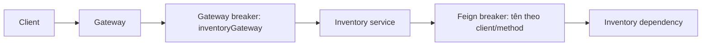

# Feign hoặc Gateway sinh tên khác khóa cấu hình mong đợi

Khi Spring Cloud CircuitBreaker được dùng cùng OpenFeign hoặc Spring Cloud Gateway, tên circuit breaker có thể được tạo ở một tầng khác với nơi khai báo cấu hình Resilience4j. Nếu tên runtime không trùng khóa trong `resilience4j.circuitbreaker.instances`, breaker có thể nhận cấu hình mặc định thay vì ngưỡng, timeout hoặc chính sách mà đội phát triển dự định áp dụng. Triệu chứng thường gặp là sửa YAML nhưng hành vi không đổi, metric xuất hiện dưới một tên lạ, hoặc một route/Feign method không dùng đúng policy.

Để chẩn đoán, cần tách biệt **định danh route**, **định danh Feign client** và **breaker ID**. Gateway có một route ID, filter CircuitBreaker có thuộc tính `name`; OpenFeign có `name` và `contextId`, còn breaker ID có thể được tạo từ client interface, method và chữ ký method. Các giá trị này không tự động giống nhau. Cấu hình Resilience4j phải khớp chính xác breaker ID mà integration thực sự yêu cầu.

## 1. Nhận diện ba lớp định danh

Một ứng dụng có thể đồng thời có nhiều tên liên quan đến cùng một dependency:

| Lớp | Ví dụ | Vai trò |
|---|---|---|
| Gateway route ID | `inventory-route` | Định danh route trong cấu hình Gateway, dùng cho quản lý route và quan sát route |
| Gateway CircuitBreaker filter name | `inventoryGateway` | Tên breaker được filter sử dụng khi gọi Spring Cloud CircuitBreaker factory |
| Feign client name | `inventory-service` | Tên dịch vụ/đích mà Feign gọi, thường gắn với service discovery/load balancing |
| Feign `contextId` | `inventoryReadClient` | Định danh context cấu hình của một Feign client trong Spring |
| Feign breaker ID | Ví dụ `InventoryClientfindBySkuString` | ID do OpenFeign integration/resolver tạo cho method được bảo vệ |
| Resilience4j instance key | `instances.inventoryGateway` | Khóa cấu hình phải khớp ID mà breaker factory nhận |

Không nên lấy `route id` hoặc `@FeignClient(name = ...)` rồi mặc định dùng nó làm khóa cấu hình. Với Gateway, tên breaker thường được khai báo tường minh ở `args.name`. Với OpenFeign, tên có thể được tạo tự động từ method và target, sau đó được chuẩn hóa theo cấu hình phiên bản.

## 2. Gateway route ID khác với CircuitBreaker filter name

Trong Spring Cloud Gateway, mỗi route có `id` để định danh route. Filter `CircuitBreaker` nhận một tham số `name`; chính tham số này là tên breaker mà filter yêu cầu. Hai giá trị có thể giống nhau nếu đội phát triển chủ động chọn như vậy, nhưng không có yêu cầu chúng phải giống nhau.

Ví dụ:

```yaml
spring:
  cloud:
    gateway:
      routes:
        - id: inventory-route
          uri: lb://inventory-service
          predicates:
            - Path=/api/inventory/**
          filters:
            - name: CircuitBreaker
              args:
                name: inventoryGateway
                fallbackUri: forward:/fallback/inventory
```

Trong ví dụ này:

- `inventory-route` là route ID.
- `inventory-service` là service URI mà Gateway định tuyến tới.
- `inventoryGateway` là tên breaker được CircuitBreaker filter sử dụng.
- `/fallback/inventory` là đường dẫn nội bộ để Gateway chuyển tiếp khi fallback được kích hoạt theo cấu hình filter.

Do đó, khóa cấu hình Resilience4j cần dùng tên `inventoryGateway`:

```yaml
resilience4j:
  circuitbreaker:
    instances:
      inventoryGateway:
        slidingWindowType: COUNT_BASED
        slidingWindowSize: 20
        minimumNumberOfCalls: 10
        failureRateThreshold: 50
        slowCallDurationThreshold: 800ms
        slowCallRateThreshold: 60
        waitDurationInOpenState: 10s
        permittedNumberOfCallsInHalfOpenState: 3
```

Nếu thay `instances.inventoryGateway` bằng `instances.inventory-route`, cấu hình đó không tự động áp dụng chỉ vì route ID có tên tương tự. Gateway filter đang yêu cầu breaker có tên `inventoryGateway`; cấu hình cần theo đúng tên này.

## 3. Feign client name và contextId không nhất thiết là breaker ID

Một Feign client có thể được khai báo như sau:

```java
@FeignClient(
        name = "inventory-service",
        contextId = "inventoryReadClient")
public interface InventoryClient {

    @GetMapping("/inventory/{sku}")
    InventoryView findBySku(@PathVariable("sku") String sku);

    @GetMapping("/inventory/{sku}/availability")
    AvailabilityView checkAvailability(@PathVariable("sku") String sku);
}
```

`name` xác định dịch vụ đích. `contextId` phân biệt context cấu hình Feign, đặc biệt khi nhiều client cùng gọi một service nhưng cần cấu hình khác nhau. Khi bật circuit breaker cho OpenFeign, integration có thể tạo breaker ID theo target interface và method. Vì thế, khóa `resilience4j.circuitbreaker.instances.inventory-service` hoặc `instances.inventoryReadClient` có thể không phải tên được dùng cho từng method.

Bật tích hợp circuit breaker cho OpenFeign bằng thuộc tính phù hợp với phiên bản Spring Cloud đang dùng:

```yaml
spring:
  cloud:
    openfeign:
      circuitbreaker:
        enabled: true
```

Sau khi bật, cần xác định tên thực tế do resolver tạo ra. Không suy đoán ID chỉ từ annotation `@FeignClient`.

## 4. Tên mặc định của Feign có thể phụ thuộc phiên bản

Spring Cloud OpenFeign có cơ chế tạo tên breaker cho từng method. Định dạng mặc định đã thay đổi giữa các thế hệ Spring Cloud và có thể chịu ảnh hưởng của cấu hình alphanumeric ID. Vì vậy, không nên copy một tên được thấy trong tài liệu của release train khác rồi giả định nó là tên runtime của ứng dụng hiện tại.

Các yếu tố có thể ảnh hưởng đến ID gồm:

- Tên client mà OpenFeign truyền cho resolver.
- Target interface thực tế.
- Tên method Java.
- Kiểu tham số trong method signature, đặc biệt với các overload.
- `CircuitBreakerNameResolver` mặc định hoặc custom bean.
- Tùy chọn chuẩn hóa tên thành alphanumeric ID của phiên bản OpenFeign đang dùng.

Ví dụ cùng một interface có hai method overload:

```java
public interface InventoryClient {
    InventoryView find(String sku);
    InventoryView find(Long inventoryId);
}
```

Nếu resolver chỉ dùng `method.getName()`, hai method có thể tạo cùng ID `find` dù tham số khác nhau. Resolver mặc định có thể đưa chữ ký method vào tên; resolver tùy chỉnh cũng nên cân nhắc kiểu tham số để tránh va chạm.

## 5. Kiểm tra hoặc tùy chỉnh tên bằng CircuitBreakerNameResolver

Spring Cloud OpenFeign cung cấp `CircuitBreakerNameResolver` để ứng dụng định nghĩa quy tắc đặt tên. Ví dụ dưới đây tạo ID từ tên client, target interface, method và kiểu tham số:

```java
import java.lang.reflect.Method;
import java.util.Arrays;
import java.util.stream.Collectors;

import feign.Target;
import org.springframework.cloud.openfeign.CircuitBreakerNameResolver;
import org.springframework.context.annotation.Bean;
import org.springframework.context.annotation.Configuration;

@Configuration
public class FeignBreakerNamingConfiguration {

    @Bean
    CircuitBreakerNameResolver circuitBreakerNameResolver() {
        return (clientName, target, method) -> {
            String parameters = Arrays.stream(method.getParameterTypes())
                    .map(Class::getSimpleName)
                    .collect(Collectors.joining(""));

            String raw = clientName
                    + target.type().getSimpleName()
                    + method.getName()
                    + parameters;

            return raw.replaceAll("[^A-Za-z0-9]", "");
        };
    }
}
```

Với client `inventory-service`, target `InventoryClient` và method `findBySku(String)`, tên sau chuẩn hóa có dạng `inventoryserviceInventoryClientfindBySkuString`. Cấu hình Resilience4j phải dùng đúng khóa đó nếu resolver này là resolver đang hoạt động.

Ví dụ cấu hình:

```yaml
resilience4j:
  circuitbreaker:
    instances:
      inventoryserviceInventoryClientfindBySkuString:
        slidingWindowSize: 20
        minimumNumberOfCalls: 10
        failureRateThreshold: 50
        waitDurationInOpenState: 10s
```

Đây là quy tắc minh họa; tên cuối cùng phụ thuộc đúng các đối số resolver nhận được và việc chuẩn hóa trong phiên bản đang chạy. `Class.getSimpleName()` có thể va chạm nếu hai kiểu tham số ở package khác nhau có cùng tên. Với hệ thống lớn, có thể dùng `Class.getName()` rồi chuẩn hóa hoặc mapping tường minh.

## 6. Alphanumeric IDs có thể làm tên khác với khóa đã viết

Một số phiên bản Spring Cloud OpenFeign hỗ trợ chuẩn hóa breaker ID thành chuỗi chỉ gồm chữ và số. Thuộc tính thường gặp trong các phiên bản hỗ trợ là:

```yaml
spring:
  cloud:
    openfeign:
      circuitbreaker:
        enabled: true
        alphanumeric-ids:
          enabled: true
```

Khi bật chuẩn hóa, dấu chấm, dấu gạch ngang, dấu gạch dưới, dấu ngoặc và ký tự phân tách trong tên gốc có thể bị loại bỏ. Ví dụ, một tên như `InventoryClient#find(String)` có thể được chuyển thành một chuỗi alphanumeric. Nếu YAML vẫn khai báo khóa có dấu phân cách, binder có thể không liên kết cấu hình đó với ID đã chuẩn hóa.

Không nên giả định giá trị mặc định của thuộc tính này giống nhau ở mọi release train. Hãy kiểm tra tài liệu của đúng Spring Cloud OpenFeign version, cấu hình hiệu lực và ID thực tế được sử dụng. Nếu có custom `CircuitBreakerNameResolver`, cần xác định rõ resolver trả tên đã chuẩn hóa hay còn để integration xử lý tiếp.

## 7. Một dependency có thể có hai ID khác nhau ở Gateway và Feign

Trong kiến trúc phổ biến, Gateway gọi một route có CircuitBreaker filter, sau đó service phía sau lại gọi một dependency khác bằng Feign. Mỗi tầng có breaker riêng:



Breaker ở Gateway bảo vệ lời gọi từ Gateway tới route đích. Breaker ở service bảo vệ lời gọi Feign từ service tới dependency. Dù cả hai cùng liên quan tới inventory, chúng không nhất thiết dùng cùng ID, registry, sliding window hoặc trạng thái. Cấu hình `instances.inventoryGateway` không tự cấu hình breaker do Feign tạo ra trong service phía sau.

Khi điều tra một request lỗi, cần xác định breaker nào đã từ chối hoặc ghi nhận lỗi. Nếu Gateway breaker mở, request có thể không đến service phía sau. Nếu Gateway cho qua nhưng Feign breaker trong service mở, service có thể trả fallback hoặc lỗi trước khi gọi dependency. Dashboard nên gắn ID theo từng tầng để tránh nhầm nguyên nhân.

## 8. Cách xác minh ID runtime

Khi tên cấu hình không khớp, bước đầu tiên là tìm tên breaker thực sự được tạo. Với Resilience4j native registry, có thể liệt kê tên instance đang tồn tại:

```java
import io.github.resilience4j.circuitbreaker.CircuitBreakerRegistry;
import org.springframework.boot.ApplicationRunner;
import org.springframework.context.annotation.Bean;
import org.springframework.context.annotation.Configuration;

@Configuration
public class CircuitBreakerInventoryDiagnostic {

    @Bean
    ApplicationRunner logCircuitBreakerNames(CircuitBreakerRegistry registry) {
        return args -> registry.getAllCircuitBreakers().forEach(breaker ->
                System.out.println("Circuit breaker ID: " + breaker.getName()));
    }
}
```

Đoạn mã chỉ hữu ích nếu registry được inject chính là registry mà Spring Cloud CircuitBreaker/Feign integration đang sử dụng. Nếu ứng dụng có nhiều registry hoặc factory tùy chỉnh, liệt kê một registry khác có thể không phản ánh các breaker đang bảo vệ traffic. Trong production, dùng logger thay `System.out` và tránh log lặp lại ở mỗi request.

Có thể kết hợp các cách sau:

1. Bật log chẩn đoán có chọn lọc cho OpenFeign/CircuitBreaker trong môi trường phát triển.
2. Quan sát metric Resilience4j theo tag tên breaker.
3. Liệt kê tên instance từ đúng registry.
4. Đặt breakpoint tại `CircuitBreakerNameResolver` để xem các đối số và giá trị trả về.
5. Kiểm tra tên `args.name` trong Gateway route đang được nạp.
6. Đối chiếu ID runtime với khóa trong `resilience4j.circuitbreaker.instances`.

Không nên dựa vào tên file YAML, tên route hoặc tên class một cách độc lập. Giá trị cần khớp là ID mà factory nhận khi tạo breaker.

## 9. Kiểm tra cấu hình hiệu lực của Resilience4j

Khi đã biết ID runtime, kiểm tra khóa cấu hình chính xác. Ví dụ, nếu Gateway filter sử dụng `inventoryGateway`, cấu hình phải nằm dưới:

```yaml
resilience4j:
  circuitbreaker:
    instances:
      inventoryGateway:
        slidingWindowSize: 30
        minimumNumberOfCalls: 12
        failureRateThreshold: 40
```

Nếu ID runtime là `inventoryserviceInventoryClientfindBySkuString`, cấu hình phải dùng khóa đó thay vì `inventory-service`, `inventoryReadClient` hoặc `inventory-route`.

Ngoài tên instance, cần kiểm tra các nguồn cấu hình Spring Boot có thể ghi đè YAML: profile đang hoạt động, biến môi trường, tham số dòng lệnh và config server. Nếu tên đã đúng nhưng ngưỡng vẫn không đúng, vấn đề có thể nằm ở property source ưu tiên cao hơn hoặc Java Customizer. Trong Spring Cloud CircuitBreaker với Resilience4j, thuộc tính cấu hình có độ ưu tiên cao hơn Java Customizer khi cùng cấu hình một instance.

Actuator có thể giúp khám phá metric đang được xuất. Ví dụ, endpoint metrics cho meter calls có thể cung cấp các tag `name` và `kind` để nhận diện ID. Tên meter/tag và cách xuất Prometheus phụ thuộc phiên bản; hãy kiểm tra `availableTags` hoặc endpoint `/actuator/prometheus` thực tế trước khi viết dashboard.

## 10. Các triệu chứng thường gặp và nguyên nhân

| Triệu chứng | Nguyên nhân có thể | Hướng kiểm tra |
|---|---|---|
| Sửa `instances.inventory-service` nhưng Feign không đổi hành vi | Feign tạo ID theo target/method hoặc resolver | Xem `CircuitBreakerNameResolver` và ID runtime |
| Gateway route có ID `inventory-route` nhưng cấu hình không áp dụng | Filter dùng `args.name` khác route ID | Đọc cấu hình filter và dùng đúng `name` |
| Hai method trong một Feign client dùng chung policy ngoài ý muốn | Resolver chỉ dùng client name hoặc method name không đủ phân biệt | Kiểm tra chữ ký method và thêm mapping riêng |
| YAML có dấu `-`, `_`, `#`, `()` nhưng metric chỉ hiện chữ/số | Alphanumeric normalization | Kiểm tra `alphanumeric-ids.enabled` và tên sau chuẩn hóa |
| Một service có hai breaker inventory cùng hoạt động | Gateway và Feign có breaker ở hai tầng | Xác định request bị chặn ở tầng nào |
| Cấu hình đúng tên nhưng ngưỡng vẫn khác | Profile, environment variable hoặc Java Customizer ghi đè | Kiểm tra Spring Environment và thứ tự ưu tiên |
| Metric không xuất hiện dưới tên dự kiến | ID runtime khác, meter chưa được tạo hoặc registry khác | Liệt kê breaker từ đúng registry và kiểm tra metric tags |
| Sau nâng cấp Spring Cloud, breaker dùng cấu hình mặc định | Quy tắc tên mặc định hoặc chuẩn hóa đã thay đổi | So sánh resolver/ID trước và sau nâng cấp |

## 11. Quy trình chẩn đoán theo từng tầng

Khi Feign hoặc Gateway không dùng đúng khóa cấu hình, thực hiện theo thứ tự sau:

1. Xác định request đi qua Gateway, Feign hay cả hai; ghi lại tầng nghi ngờ có breaker không hoạt động đúng.
2. Với Gateway, đọc route ID và `filters[].args.name`; dùng giá trị `name` làm breaker ID cần đối chiếu.
3. Với Feign, xác nhận `spring.cloud.openfeign.circuitbreaker.enabled` đã bật và xác định client interface cùng method được gọi.
4. Kiểm tra `CircuitBreakerNameResolver`, method signature và tùy chọn alphanumeric IDs của đúng phiên bản.
5. Lấy ID runtime từ resolver, registry hoặc metric tag; không đoán từ `@FeignClient(name)`.
6. Tìm khóa `resilience4j.circuitbreaker.instances.<runtime-id>` và xác nhận chính tả/chuẩn hóa khớp hoàn toàn.
7. Kiểm tra profile, environment variable, config server và Java Customizer nếu giá trị hiệu lực vẫn khác.
8. Xác nhận đúng registry/factory đang được integration sử dụng, nhất là khi có nhiều context hoặc custom configuration.
9. Gửi một request thử và đối chiếu state, calls, fallback, HTTP client metrics ở đúng tầng.
10. Sau khi sửa tên, cập nhật đồng bộ cấu hình, dashboard, alert và test để tránh quay lại lỗi khi refactor hoặc nâng phiên bản.

## 12. Kiểm thử để khóa quy tắc đặt tên

Tên breaker là một phần hợp đồng giữa code và cấu hình. Nên có kiểm thử xác nhận ID thay vì chỉ kiểm tra YAML có chứa một chuỗi dự kiến.

Với Gateway, kiểm tra route filter sử dụng đúng `args.name` và breaker instance tương ứng được tạo. Với Feign, kiểm thử resolver bằng các trường hợp:

- Hai method khác tên tạo ID khác nhau khi cần policy riêng.
- Hai method overload cùng tên nhưng khác tham số không va chạm ngoài ý muốn.
- Hai client cùng gọi một service nhưng có `contextId`/target khác nhau được phân biệt theo chính sách.
- Tên trả về tuân thủ quy tắc alphanumeric nếu tính năng chuẩn hóa được bật.
- Khóa YAML trùng ID runtime và metric xuất hiện dưới cùng tên.
- Sau khi đổi resolver hoặc nâng Spring Cloud, các ID quan trọng vẫn ổn định hoặc cấu hình đã được cập nhật có chủ đích.

Một test resolver đơn giản có thể gọi trực tiếp hàm tạo tên với `Method` lấy từ interface test và xác nhận kết quả. Một integration test nên lấy breaker từ đúng registry hoặc quan sát metric sau khi gọi Feign/Gateway. Reflection xác nhận annotation tồn tại không đủ để chứng minh CircuitBreaker integration đang dùng ID đó.

## 13. Nguyên tắc đặt tên ổn định

Để tránh lỗi lệch tên về sau:

- Gateway: đặt tên breaker trong `args.name` có chủ đích; không dựa vào route ID trừ khi chủ động gán hai giá trị giống nhau.
- Feign: xác định quy tắc mặc định của release train hoặc định nghĩa `CircuitBreakerNameResolver` rõ ràng.
- Phân biệt `name`, `contextId`, route ID và breaker ID trong tài liệu cấu hình.
- Nếu cần tách policy theo method, đưa method signature vào resolver; nếu nhiều method cùng failure domain, mapping chúng về một ID ổn định.
- Không đưa SKU, user ID, order ID hoặc dữ liệu runtime vào breaker ID vì sẽ tạo quá nhiều instance và metric cardinality.
- Giữ tên trong code, YAML, dashboard và alert đồng bộ.
- Khi nâng Spring Cloud hoặc thay đổi resolver/alphanumeric setting, kiểm tra lại tên runtime trước khi triển khai.

## 14. Kết luận vận hành

Feign và Gateway có thể tạo hoặc chọn breaker ID theo những quy tắc khác nhau. Với Gateway, `route id` chỉ định tuyến; `CircuitBreaker` filter dùng `args.name` để chọn breaker. Với Feign, `name` và `contextId` định danh client/context, còn breaker ID có thể được tạo từ target interface, method signature và resolver. Resilience4j chỉ áp dụng khóa instance khớp với ID mà integration thực sự sử dụng.

Khi cấu hình không có tác dụng, hãy tìm ID runtime trước, sau đó mới sửa khóa `resilience4j.circuitbreaker.instances`. Phân biệt đúng từng tầng, kiểm tra chuẩn hóa tên và xác minh registry/factory đang hoạt động sẽ giúp tránh tình trạng breaker chạy bằng cấu hình mặc định, metric bị phân mảnh hoặc một policy vô tình áp dụng cho sai thao tác.
