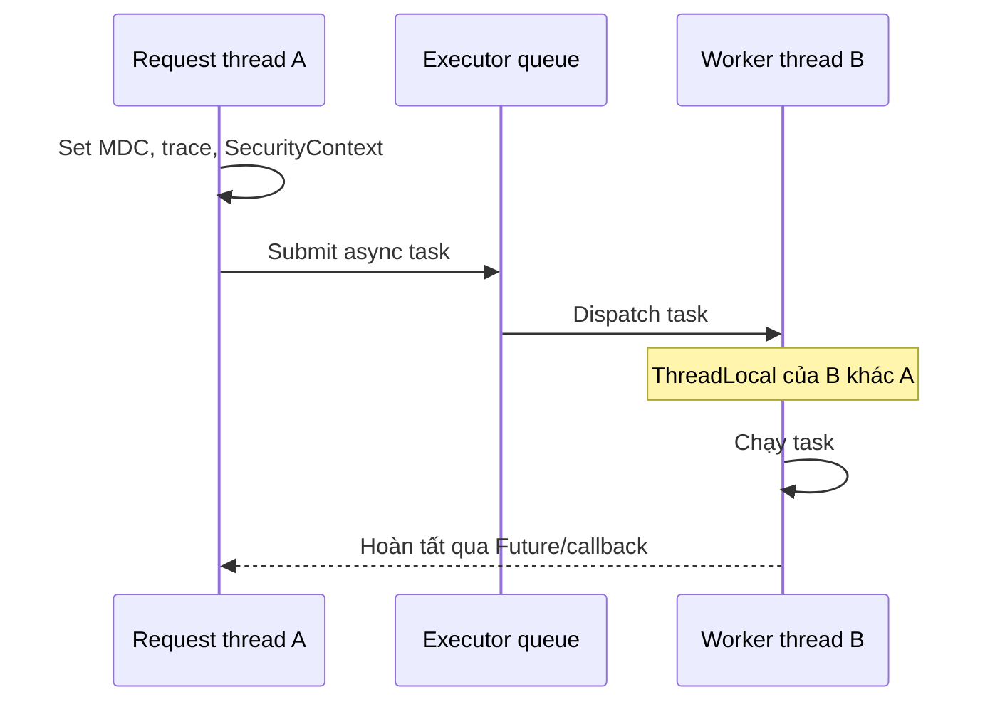

# Mất ngữ cảnh log, tracing hoặc thông tin xác thực khi chuyển thread

Một lời gọi được bảo vệ bởi circuit breaker có thể bắt đầu trên thread xử lý request rồi tiếp tục ở một thread khác. Điều này thường xảy ra khi dùng `CompletableFuture`, `@Async`, `ThreadPoolBulkhead` hoặc executor riêng cho tác vụ blocking. Nếu ngữ cảnh được lưu trong `ThreadLocal`, thread mới không tự nhận được các giá trị từ thread ban đầu. Log có thể mất correlation ID, trace có thể bị đứt thành một trace mới, và mã kiểm tra quyền có thể không còn thấy `SecurityContext`.

Trong module **SPRING_CLOUD_CIRCUIT_BREAKER**, cần hiểu ranh giới chuyển thread để bảo vệ lời gọi mà vẫn giữ được khả năng quan sát và danh tính thực thi. MDC, tracing context, security context và Reactor Context là các loại ngữ cảnh khác nhau; không nên xử lý chúng như một bản đồ `ThreadLocal` duy nhất. Bài này trình bày cách nhận diện lỗi, truyền đúng loại context và dọn dẹp sau khi tác vụ hoàn tất.

## 1. Vì sao context biến mất khi đổi thread?

Nhiều thư viện lưu dữ liệu gắn với thread hiện tại:

- SLF4J MDC thường lưu các trường log như `traceId`, `spanId`, `correlationId` trong `ThreadLocal`.
- Spring Security ở ứng dụng Servlet thường lưu `SecurityContext` qua `SecurityContextHolder`, mặc định dùng chiến lược `ThreadLocal`.
- OpenTelemetry giữ context hiện hành qua cơ chế context storage gắn với execution scope; nhiều instrumentation tự truyền context qua các API được hỗ trợ.
- Một số thư viện nội bộ cũng lưu tenant, locale hoặc thông tin request trong `ThreadLocal`.

Khi thread A submit một task vào executor, thread B lấy task từ queue và thực thi. Thread B có `ThreadLocal` riêng; việc submit task không tự sao chép giá trị từ A sang B. Thread B có thể không có context hoặc còn giữ context của task trước nếu thư viện không dọn dẹp đúng cách.



Kết quả thường thấy là log ở controller có `traceId` nhưng log trong bulkhead worker không có; trace chỉ có span phía caller mà thiếu span downstream; hoặc service gọi một bean yêu cầu người dùng hiện tại nhưng nhận `null`/anonymous authentication.

## 2. Phân biệt các loại context

Không có một cơ chế propagation duy nhất phù hợp cho mọi loại context.

| Context | Mục đích | Cơ chế thường gặp | Điều cần lưu ý |
|---|---|---|---|
| MDC | Gắn trường vào log | SLF4J MDC, thường dựa trên `ThreadLocal` | Cần capture và restore trên worker thread. |
| Trace/span context | Nối các span trong distributed trace | OpenTelemetry Context hoặc Micrometer Tracing/Observation | Ưu tiên instrumentation và context propagation chính thức của stack đang dùng. |
| Security context | Danh tính, authentication và quyền | Spring Security `SecurityContextHolder` ở Servlet; Reactor Context ở WebFlux | Dùng wrapper của Spring Security; không truyền token qua log hoặc context toàn cục. |
| Reactor Context | Truyền metadata theo subscription | `Context`/`ContextView` của Reactor | Theo subscriber, không phụ thuộc thread cố định. |
| Tenant/locale/request metadata | Ngữ cảnh nghiệp vụ | API context rõ ràng hoặc accessor riêng | Chỉ truyền các giá trị cần thiết và giới hạn vòng đời. |

Mất MDC không nhất thiết có nghĩa trace đã mất: tracing instrumentation có thể vẫn giữ span context và khôi phục MDC khi log. Ngược lại, thấy `traceId` trong log cũng chưa chứng minh span parent-child được nối đúng. Cần kiểm tra cả log và trace backend.

Tương tự, `SecurityContext` không phải là trace context. Không nên dùng trace ID để quyết định quyền truy cập, và không nên đưa bearer token hoặc toàn bộ authentication object vào MDC.

## 3. Xác định ranh giới nào thực sự chuyển thread

Không phải mọi cơ chế resilience đều tự tạo thread mới:

| Thành phần | Có tự chuyển sang thread khác không? | Nơi cần kiểm tra propagation |
|---|---|---|
| CircuitBreaker đồng bộ | Thông thường không; supplier chạy trên thread gọi. | Các executor hoặc async API nằm bên trong supplier. |
| SemaphoreBulkhead | Giới hạn permit, không tự chuyển thread. | Không có thread hop chỉ vì semaphore; vẫn có thể có hop từ client hoặc callback. |
| ThreadPoolBulkhead | Có; supplier được chạy trong thread pool riêng. | Context propagator của Resilience4j hoặc wrapper executor phù hợp. |
| `CompletableFuture.*Async` | Có thể dùng ForkJoinPool chung hoặc executor được chỉ định. | Executor và context capture tại thời điểm submit. |
| Spring `@Async` | Chạy qua `TaskExecutor`/executor được cấu hình. | `TaskDecorator` và wrapper Spring Security. |
| Reactor `publishOn`/`subscribeOn` | Có thể chuyển tín hiệu hoặc subscription qua scheduler khác. | Reactor Context và context propagation integration. |
| HTTP client async | Phụ thuộc client và instrumentation. | Client instrumentation, callback executor và outbound header propagation. |

Khi điều tra, hãy ghi lại tên thread ở đầu request, trước khi gọi breaker, bên trong supplier và trong callback. Nếu thread thay đổi tại `ThreadPoolBulkhead` hoặc `thenApplyAsync`, đó là ranh giới cần xác minh.

## 4. Triệu chứng và nguyên nhân thường gặp

| Triệu chứng | Nguyên nhân có thể | Cách xác minh |
|---|---|---|
| Log downstream thiếu `traceId` hoặc `correlationId` | MDC không được capture sang worker thread. | So sánh MDC trước submit và bên trong task. |
| Trace hiển thị hai trace riêng | Trace context không được truyền hoặc instrumentation không hỗ trợ executor đang dùng. | Kiểm tra parent span ID và context tại điểm submit. |
| Log mang ID của request trước | Worker thread tái sử dụng nhưng context không được clear/restore. | Chạy hai task liên tiếp trên cùng worker và so sánh MDC. |
| `SecurityContextHolder.getContext()` không có authentication | SecurityContext không được truyền sang thread mới. | Kiểm tra wrapper executor và authentication trong worker. |
| Request async bị 401/403 dù request đầu vào đã xác thực | Outbound call hoặc tác vụ nền không có danh tính/credential cần thiết. | Phân biệt security context nội bộ với token gửi đến service đích. |
| Tenant/locale sai giữa các request | ThreadLocal cũ bị giữ hoặc context mới không được capture. | Kiểm tra cả capture và cleanup trong `finally`. |
| Reactive log mất metadata sau scheduler hop | Metadata đặt trong ThreadLocal thay vì Reactor Context, hoặc propagation integration chưa bật. | Đọc `ContextView` ở subscriber và kiểm tra cấu hình instrumentation. |

## 5. Truyền MDC qua Spring TaskExecutor bằng TaskDecorator

Với `ThreadPoolTaskExecutor` của Spring, `TaskDecorator` có thể capture MDC lúc task được submit và đặt lại MDC trong worker. Cần khôi phục trạng thái trước đó trong `finally`, vì worker thread được tái sử dụng cho nhiều task.

```java
import java.util.Map;

import org.slf4j.MDC;
import org.springframework.core.task.TaskDecorator;

public class MdcTaskDecorator implements TaskDecorator {

    @Override
    public Runnable decorate(Runnable task) {
        Map<String, String> captured = MDC.getCopyOfContextMap();

        return () -> {
            Map<String, String> previous = MDC.getCopyOfContextMap();
            try {
                if (captured == null) {
                    MDC.clear();
                } else {
                    MDC.setContextMap(captured);
                }
                task.run();
            } finally {
                if (previous == null) {
                    MDC.clear();
                } else {
                    MDC.setContextMap(previous);
                }
            }
        };
    }
}
```

Gắn decorator vào executor:

```java
import org.springframework.context.annotation.Bean;
import org.springframework.context.annotation.Configuration;
import org.springframework.scheduling.concurrent.ThreadPoolTaskExecutor;

import java.util.concurrent.Executor;

@Configuration(proxyBeanMethods = false)
public class AsyncExecutorConfiguration {

    @Bean("applicationTaskExecutor")
    public Executor applicationTaskExecutor() {
        ThreadPoolTaskExecutor executor = new ThreadPoolTaskExecutor();
        executor.setCorePoolSize(8);
        executor.setMaxPoolSize(16);
        executor.setQueueCapacity(100);
        executor.setThreadNamePrefix("application-async-");
        executor.setTaskDecorator(new MdcTaskDecorator());
        executor.initialize();
        return executor;
    }
}
```

`MdcTaskDecorator` chỉ xử lý MDC. Nó không tự truyền OpenTelemetry context, `SecurityContext` hoặc Reactor Context. Nếu ứng dụng cần các loại context đó, hãy bổ sung cơ chế chuyên dụng thay vì sao chép một cách tùy tiện toàn bộ `ThreadLocal`.

## 6. Truyền SecurityContext cho tác vụ imperative

Trong ứng dụng Servlet, Spring Security cung cấp executor wrapper để truyền `SecurityContext` khi submit task. Có thể bọc một `AsyncTaskExecutor` bằng `DelegatingSecurityContextAsyncTaskExecutor`:

```java
import org.springframework.core.task.AsyncTaskExecutor;
import org.springframework.scheduling.concurrent.ThreadPoolTaskExecutor;
import org.springframework.security.task.DelegatingSecurityContextAsyncTaskExecutor;
import org.springframework.context.annotation.Bean;
import org.springframework.context.annotation.Configuration;

@Configuration(proxyBeanMethods = false)
public class SecurityAsyncConfiguration {

    @Bean
    AsyncTaskExecutor securedTaskExecutor() {
        ThreadPoolTaskExecutor delegate = new ThreadPoolTaskExecutor();
        delegate.setCorePoolSize(8);
        delegate.setMaxPoolSize(16);
        delegate.setQueueCapacity(100);
        delegate.setThreadNamePrefix("secured-async-");
        delegate.initialize();

        return new DelegatingSecurityContextAsyncTaskExecutor(delegate);
    }
}
```

Wrapper capture context theo cơ chế Spring Security và thiết lập context trong lúc task chạy, sau đó dọn dẹp để tránh rò danh tính giữa các task trên cùng worker. Dùng executor này cho tác vụ cần thực thi dưới danh tính người dùng hiện tại.

Không phải mọi tác vụ nền đều nên chạy dưới quyền của người dùng đã gửi request. Với công việc được lên lịch hoặc xử lý sau khi request kết thúc, hãy quyết định rõ nên dùng service account, danh tính hệ thống hay lưu actor ID để audit. Không giữ `SecurityContext` của request trong một job chạy lâu nếu quyền có thể bị thu hồi hoặc session hết hạn.

Nếu cần cả MDC và SecurityContext, hãy kết hợp decorator/wrapper một cách có chủ đích. Kiểm tra thứ tự wrapper và bảo đảm mỗi cơ chế khôi phục trạng thái trong `finally`. Tránh tự viết một wrapper tổng quát sao chép mọi `ThreadLocal` đang tồn tại trong thread.

## 7. Truyền trace context qua executor

Nếu dùng OpenTelemetry API trực tiếp, có thể capture context hiện tại trước khi submit task và bọc `Runnable` bằng context đó:

```java
import io.opentelemetry.context.Context;

Context parentContext = Context.current();
executor.execute(parentContext.wrap(() -> {
    inventoryClient.refreshCache();
}));
```

`Context.current()` được lấy ở thread đang submit. `wrap(...)` thiết lập context trong lúc task chạy và khôi phục context trước đó sau khi task kết thúc. Cách này hữu ích khi executor không được instrumentation tự động hỗ trợ.

Trong ứng dụng dùng Micrometer Tracing/Spring Boot Observability, ưu tiên cơ chế context propagation mà stack đã cung cấp, chẳng hạn `ContextPropagatingTaskDecorator` ở các phiên bản Spring Framework hỗ trợ. Thành phần này dựa trên Micrometer Context Propagation và các accessor đã đăng ký. Hãy xác nhận phiên bản Spring Framework/Micrometer và accessor của tracer đang dùng; không giả định mọi thư viện tracing tự động được truyền chỉ vì đã thêm decorator.

Nếu dùng Java agent hoặc instrumentation của OpenTelemetry, executor/client phổ biến có thể đã được instrument tự động. Tránh bọc context hai lần mà không hiểu tác động. Kiểm tra trace thực tế xem span con có parent đúng, trace ID có giữ nguyên và scope có được đóng sau task hay không.

## 8. Context propagation với Resilience4j ThreadPoolBulkhead

`ThreadPoolBulkhead` chạy supplier trong executor riêng của Resilience4j. `TaskDecorator` gắn vào một `ThreadPoolTaskExecutor` của ứng dụng không tự động áp dụng cho executor nội bộ của ThreadPoolBulkhead.

Resilience4j có cơ chế `ContextPropagator` cho ThreadPoolBulkhead ở các phiên bản hỗ trợ. Cơ chế này cho phép:

1. Lấy context từ thread submit trước khi task được đưa vào pool.
2. Thiết lập context tương ứng trên worker trước khi supplier chạy.
3. Xóa hoặc khôi phục context sau khi task hoàn tất.

API và cấu hình cụ thể phụ thuộc phiên bản Resilience4j được BOM kéo vào. Hãy kiểm tra `ThreadPoolBulkheadConfig` và `ContextPropagator` của đúng artifact trước khi triển khai; không giả định `TaskDecorator` của Spring sẽ bao phủ executor riêng của Resilience4j.

Khi dùng `ThreadPoolBulkhead`, kiểm tra các context cần truyền riêng: MDC, tracing và security không nhất thiết được một propagator duy nhất hỗ trợ. Nếu một propagator chỉ xử lý MDC, trace có thể vẫn được instrumentation tự động truyền nhưng security context có thể không có. Viết adapter cho đúng accessor cần thiết và bảo đảm hàm `clear` được gọi ngay cả khi supplier ném exception.

`SemaphoreBulkhead` không tạo worker thread riêng. Nếu context mất khi dùng semaphore, hãy tìm một ranh giới chuyển thread khác bên trong supplier, HTTP client hoặc callback thay vì quy lỗi cho semaphore.

## 9. Reactor Context trong ứng dụng WebFlux

Reactor Context gắn với subscription và được truyền qua các operator Reactor, kể cả khi tín hiệu chuyển qua scheduler. Đây là nơi phù hợp để giữ metadata reactive như correlation ID hoặc dữ liệu phục vụ security reactive; không nên dựa vào ThreadLocal như nguồn sự thật trong chuỗi WebFlux.

Ví dụ ghi và đọc correlation ID:

```java
import reactor.core.publisher.Mono;
import reactor.util.context.ContextView;

Mono<String> operation = Mono.deferContextual((ContextView context) -> {
    String correlationId = context.getOrDefault("correlationId", "unknown");
    return inventoryClient.refresh(correlationId);
}).contextWrite(context -> context.put("correlationId", "req-123"));
```

`deferContextual` đọc context khi có subscription. `contextWrite` thêm giá trị vào context của subscriber cho các operator upstream. Không đọc Reactor Context ngay lúc xây dựng chuỗi vì lúc đó subscription chưa diễn ra.

Spring Security reactive sử dụng Reactor Context để giữ `SecurityContext`. Hãy dùng API reactive của Spring Security như `ReactiveSecurityContextHolder` và giữ lời gọi trong chuỗi reactive. Không lấy `SecurityContextHolder` kiểu Servlet rồi giả định nó có mặt trên mọi scheduler của WebFlux.

## 10. Cầu nối giữa Reactor Context và ThreadLocal

Một số thư viện cũ chỉ đọc MDC hoặc ThreadLocal. Trong khi đó, ứng dụng WebFlux giữ context theo subscription. Khi cần tương thích, dùng Micrometer Context Propagation hoặc tích hợp Reactor được hỗ trợ bởi phiên bản Spring Boot/Reactor đang dùng để capture và khôi phục các accessor đã đăng ký.

Không tự bật một global hook hoặc sao chép toàn bộ Reactor Context vào ThreadLocal mà không hiểu phạm vi ảnh hưởng. Global hook có thể tác động đến toàn bộ publisher trong process và làm thay đổi hiệu năng. Trước khi bật automatic context propagation, hãy xác nhận phiên bản Reactor hỗ trợ, accessor nào được đăng ký và các thư viện nào cần context.

Nếu một tác vụ reactive gọi sang API imperative blocking, hãy chuyển phần blocking sang scheduler phù hợp và truyền context qua cơ chế đã chọn. Không gọi `block()` trên event loop chỉ để lấy `SecurityContext`, trace hoặc MDC.

## 11. Thông tin xác thực không đồng nghĩa với việc sao chép bearer token

Khi một tác vụ chuyển thread rồi gọi dịch vụ khác, cần xác định dịch vụ đích xác thực request theo cách nào:

- Nếu dùng OAuth2 token relay, cần lấy hoặc chuyển tiếp token theo cơ chế OAuth2/Spring Security hỗ trợ và theo đúng thời hạn hiệu lực.
- Nếu dùng service-to-service authentication, tác vụ nền có thể cần service account hoặc client credentials thay vì token người dùng.
- Nếu chỉ cần audit, lưu actor ID hoặc principal identifier theo chính sách dữ liệu; không cần giữ toàn bộ credentials.
- Nếu job chạy sau khi request kết thúc, không mặc định token ban đầu vẫn hợp lệ hoặc được phép sử dụng.

Không ghi access token, refresh token, cookie hoặc toàn bộ header `Authorization` vào MDC, log, trace attribute hay exception message. Không lưu token trong static `ThreadLocal` hoặc biến dùng chung giữa worker. Nếu phải truyền credential, dùng cơ chế bảo mật có vòng đời rõ ràng và bảo đảm không tái sử dụng credential của request trước.

## 12. Những lỗi thường gặp khi tự triển khai propagation

| Lỗi | Hậu quả | Cách tránh |
|---|---|---|
| Chỉ copy MDC nhưng nghĩ đã truyền toàn bộ context | Log có ID nhưng security hoặc trace vẫn thiếu. | Kiểm tra riêng từng loại context. |
| Không clear MDC trong `finally` | Worker thread có thể mang ID của request trước. | Restore context cũ hoặc clear khi không có context. |
| Chỉ dùng `TaskDecorator` cho Spring executor nhưng task chạy trong ThreadPoolBulkhead | Decorator không bao phủ executor nội bộ. | Dùng ContextPropagator phù hợp cho Resilience4j. |
| Sao chép SecurityContext thủ công và không restore | Có nguy cơ rò danh tính giữa các task. | Dùng wrapper Spring Security hoặc adapter có cleanup. |
| Dùng `ThreadLocal` làm nguồn dữ liệu trong WebFlux | Giá trị mất khi scheduler đổi thread. | Dùng Reactor Context và reactive security APIs. |
| Gắn trace ID thủ công nhưng không truyền span context | Log có cùng ID nhưng trace không có quan hệ parent-child. | Truyền tracing Context qua instrumentation/API chính thức. |
| Truyền token người dùng vào job chạy lâu | Token hết hạn hoặc quyền đã bị thu hồi. | Chọn service identity hoặc xác thực lại theo thời điểm thực thi. |
| Không khôi phục context trước đó | Context task mới có thể ghi đè context của worker/caller. | Capture previous state và restore trong `finally`. |

## 13. Quy trình chẩn đoán khi context bị mất

Khi log, trace hoặc authentication biến mất sau một lời gọi bất đồng bộ, kiểm tra theo thứ tự:

1. **Xác định điểm đổi thread:** ghi tên thread trước supplier, trong supplier và trong callback.
2. **Xác định cơ chế tạo thread:** `ThreadPoolBulkhead`, `@Async`, `CompletableFuture`, Reactor scheduler hay HTTP client callback.
3. **Phân loại context bị mất:** MDC, trace/span, SecurityContext, Reactor Context hay metadata riêng.
4. **Kiểm tra cơ chế propagation đúng executor:** Spring `TaskDecorator`, Spring Security wrapper, OpenTelemetry/Micrometer context propagation hoặc Resilience4j `ContextPropagator`.
5. **Kiểm tra cleanup:** chạy hai request khác nhau tuần tự trên cùng worker để phát hiện context cũ còn sót.
6. **Kiểm tra outbound authentication:** xác định token relay, service account hoặc client credentials có phù hợp với thời điểm task chạy không.
7. **Kiểm tra trace backend:** xác nhận span con có đúng parent, không chỉ nhìn vào chuỗi trace ID trong log.

Không thay đổi đồng thời mọi cơ chế propagation. Hãy tạo một test có kiểm soát, thêm một context marker giả, chạy task qua đúng executor và xác minh marker xuất hiện trong worker rồi biến mất sau khi task hoàn tất.

## 14. Kiểm thử không rò context giữa các worker task

Một test hữu ích cần kiểm tra cả việc truyền context và cleanup. Với MDC, có thể dùng một executor một thread để buộc hai task chạy tuần tự trên cùng worker:

```java
import static org.junit.jupiter.api.Assertions.assertEquals;
import static org.junit.jupiter.api.Assertions.assertNull;

import java.util.concurrent.ExecutorService;
import java.util.concurrent.Executors;
import java.util.concurrent.Future;
import java.util.concurrent.atomic.AtomicReference;

import org.junit.jupiter.api.AfterEach;
import org.junit.jupiter.api.Test;
import org.slf4j.MDC;
import org.springframework.core.task.TaskDecorator;

class MdcPropagationTest {
    private final ExecutorService delegate = Executors.newSingleThreadExecutor();

    @AfterEach
    void tearDown() {
        delegate.shutdownNow();
        MDC.clear();
    }

    @Test
    void propagatesAndThenClearsRequestContext() throws Exception {
        TaskDecorator decorator = new MdcTaskDecorator();
        AtomicReference<String> observed = new AtomicReference<>();

        MDC.put("correlationId", "request-A");
        Runnable decorated = decorator.decorate(
            () -> observed.set(MDC.get("correlationId"))
        );
        MDC.clear();

        Future<?> first = delegate.submit(decorated);
        first.get();
        assertEquals("request-A", observed.get());

        Future<String> second = delegate.submit(() -> MDC.get("correlationId"));
        assertNull(second.get());
    }
}
```

Trong ví dụ, decorator được áp dụng trên thread test khi MDC đang chứa `request-A`; sau đó MDC ở thread submit được xóa trước khi task chạy. Task đầu tiên vẫn nhìn thấy giá trị đã capture. Task thứ hai chạy trên cùng worker nhưng không thấy `correlationId`, chứng minh decorator đã khôi phục trạng thái trước đó thay vì để context của request đầu tiên rò sang task tiếp theo.

Với tracing và security, bổ sung kiểm thử riêng:

- Trace span trong worker có cùng trace ID và parent span đúng với span submit.
- Security wrapper truyền đúng principal được mong đợi.
- Sau task, worker không còn `SecurityContext` của request vừa hoàn tất.
- Khi supplier ném exception hoặc bị cancel, cleanup vẫn chạy.
- Hai request với hai principal/correlation ID khác nhau không nhìn thấy context của nhau.

## 15. Checklist vận hành

- [ ] Xác định được thread hop cụ thể và executor tạo ra nó.
- [ ] MDC được capture tại thời điểm submit, thiết lập trên worker và restore/clear sau task.
- [ ] Trace context được truyền bằng OpenTelemetry/Micrometer hoặc instrumentation tương ứng.
- [ ] SecurityContext imperative dùng wrapper Spring Security phù hợp nếu task cần danh tính người dùng.
- [ ] WebFlux dùng Reactor Context và reactive security APIs, không dựa vào Servlet ThreadLocal.
- [ ] ThreadPoolBulkhead có ContextPropagator riêng nếu cần truyền context vào executor của Resilience4j.
- [ ] Không giả định SemaphoreBulkhead tự tạo thread mới.
- [ ] Không ghi credentials vào log, MDC hoặc trace attributes.
- [ ] Có kiểm thử hai task liên tiếp trên cùng worker để phát hiện context leakage.
- [ ] Cleanup được thực hiện khi success, exception, timeout và cancellation.

Khi context biến mất sau khi chuyển thread, hãy xác định đúng executor và loại context trước khi sửa. MDC cần capture/restore riêng; tracing cần truyền span context; Spring Security cần wrapper hoặc cơ chế reactive phù hợp; Reactor Context đi theo subscription chứ không theo thread. Đặc biệt, `ThreadPoolBulkhead` có executor riêng nên decorator của Spring không tự động bao phủ nó. Truyền đúng context và dọn dẹp sau mỗi task giúp log, tracing và xác thực giữ được tính liên tục mà không làm rò dữ liệu giữa các request.
