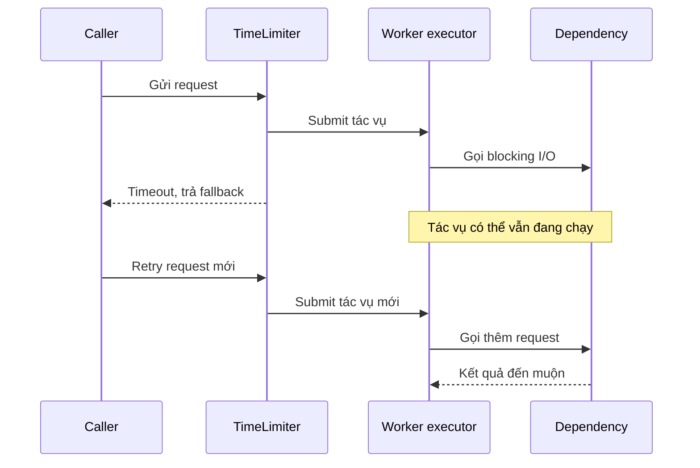

# Retry nhiều lớp, rò rỉ tác vụ và fallback gây quá tải thứ cấp

Retry giúp một lời gọi vượt qua lỗi tạm thời, nhưng nhiều lớp retry lồng nhau có thể nhân số request gửi tới dependency. Khi timeout chỉ kết thúc việc chờ của caller mà tác vụ blocking vẫn chạy, hệ thống tiếp tục giữ thread, connection và queue cho những request đã hết hạn. Nếu fallback lại gọi dịch vụ khác, retry tiếp hoặc tranh chấp cùng tài nguyên, đường dự phòng có thể tạo ra một đợt quá tải thứ cấp.

Với Spring Cloud Circuit Breaker, cần chẩn đoán cả đường gọi chính và đường phục hồi: retry, Circuit Breaker, TimeLimiter, Bulkhead, client timeout, fallback và cơ chế redelivery ở tầng message. Mục tiêu là giữ tổng công việc trong deadline và capacity của hệ thống, đồng thời bảo đảm một lỗi tạm thời không khuếch đại thành lỗi dây chuyền.

## 1. Nhận diện ba dạng khuếch đại

### Retry nhiều lớp

Một request nghiệp vụ có thể đi qua gateway, service, HTTP client, SDK và broker. Nếu mỗi lớp tự retry mà không biết chính sách của lớp khác, một request logic có thể tạo ra nhiều lần thực thi ở dependency cuối.

Nếu mỗi lớp cho phép `A` lần thử (đã bao gồm lần đầu), số lần gọi tối đa có thể tiến gần tích của số lần thử ở các lớp:

\[
N_{backend} = \prod_{i=1}^{n} A_i
\]

Ví dụ gateway cho 3 lần thử, service cho 3 lần và HTTP client cho 2 lần, một request logic có thể tạo tối đa `3 × 3 × 2 = 18` request tới backend. Nếu cấu hình ghi `maxAttempts: 3`, giá trị này thường bao gồm lần gọi đầu tiên, tức tối đa hai lần retry; cần kiểm tra semantics của thư viện đang dùng.

### Tác vụ còn chạy sau timeout

TimeLimiter có thể hoàn tất timeout ở phía caller và yêu cầu hủy Future. Việc đó không bảo đảm tác vụ blocking hoặc I/O ở phía dưới đã dừng. Caller đã trả fallback nhưng worker vẫn chạy, giữ connection hoặc tiếp tục ghi dữ liệu. Nếu request được retry, một tác vụ mới có thể bắt đầu trong khi tác vụ cũ chưa kết thúc.

### Fallback tạo tải thứ cấp

Fallback có thể gọi cache từ xa, database, dịch vụ dự phòng hoặc một endpoint khác. Nếu nhiều request cùng fallback, nguồn dự phòng có thể nhận một đợt traffic đột biến. Retry trong fallback, cache miss đồng loạt hoặc queue không giới hạn càng làm tình trạng nặng hơn.

## 2. Triệu chứng và bằng chứng cần thu thập

| Triệu chứng | Dấu hiệu có thể quan sát | Nguyên nhân cần kiểm tra |
| --- | --- | --- |
| Backend nhận nhiều request hơn gateway | Tỷ lệ backend calls trên logical requests tăng mạnh | Retry ở gateway, service, client hoặc SDK bị lồng nhau |
| Latency tăng theo cấp số nhân | p95/p99 cao, request chờ qua nhiều khoảng backoff | Nhiều lần retry, deadline không được truyền giữa các lớp |
| Timeout tăng nhưng thread vẫn bận | Caller đã trả timeout nhưng active worker/connection không giảm | Future cancellation không dừng tác vụ blocking; client timeout dài hơn TimeLimiter |
| Queue và thread pool tăng liên tục | Queue depth, active threads, rejected tasks hoặc connection pending tăng | Tác vụ cũ tồn đọng, queue quá lớn, dependency chậm |
| Fallback tăng đồng thời với lỗi cache/database | Fallback dependency latency và connection pool tăng | Fallback phụ thuộc cùng failure domain hoặc bị gọi đồng loạt |
| CPU/network tăng dù traffic người dùng ổn định | Backend attempts, retry attempts hoặc broker redelivery tăng | Một request logic sinh nhiều lần thực thi |
| Mạch liên tục `OPEN`/`HALF_OPEN` | Failure rate và not-permitted calls dao động | Retry làm tăng mẫu lỗi, probe cạnh tranh với traffic retry |

Thu thập bằng chứng từ nhiều lớp:

- Gateway: request ID, logical request count, upstream attempts, deadline và response status.
- Service: retry attempt, exception được retry, thời gian backoff, breaker ID và fallback reason.
- HTTP client/SDK: request count, connect/read timeout, connection pool và cancellation.
- Executor/Bulkhead: active workers, queue depth, queue wait, task completion, rejection và task còn chạy sau timeout.
- Fallback: số lần gọi, latency, cache hit/miss, tuổi dữ liệu, lỗi và dependency mà fallback sử dụng.
- Broker: delivery count, redelivery, visibility timeout, dead-letter queue và idempotency key.

Đối chiếu trace theo một correlation ID. Một logical request nên có span riêng cho từng attempt, fallback và dependency; không chỉ nhìn tổng số request ở backend.

## 3. Tính ngân sách retry và deadline tổng

Retry phải nằm trong deadline của request từ đầu tới cuối. Tổng thời gian không chỉ gồm thời gian chạy các attempt mà còn gồm backoff, queue wait, connection acquisition và thời gian fallback.

\[
T_{total} = \sum_{i=1}^{A} T_i + \sum_{i=1}^{A-1} B_i + T_{queue} + T_{fallback}
\]

Trong đó `A` là tổng số attempt, `T_i` là thời gian của từng attempt và `B_i` là khoảng backoff giữa các attempt. Nếu deadline của API là 2 giây, không thể đặt ba attempt mỗi attempt 1 giây rồi cộng thêm backoff 500 ms mà vẫn kỳ vọng phản hồi đúng hạn.

Ví dụ ngân sách:

| Thành phần | Ngân sách minh họa |
| --- | ---: |
| Attempt 1 | tối đa 400 ms |
| Backoff 1 | khoảng 80 ms |
| Attempt 2 | tối đa 400 ms |
| Backoff 2 | khoảng 160 ms |
| Attempt 3 | tối đa 400 ms |
| Fallback và serialization | tối đa 200 ms |
| Tổng | khoảng 1.640 ms, chưa tính queue/connect overhead |

Phần còn lại tới deadline 2 giây là dự phòng cho queue, connection và sai số. Nếu các tầng khác cũng retry, phải tính cả số attempt ở những tầng đó hoặc tắt retry trùng lặp.

Truyền deadline hoặc thời gian còn lại xuống các service thay vì để mỗi tầng tự đặt timeout độc lập. Trước khi bắt đầu attempt mới, kiểm tra ngân sách còn đủ cho một lần thử có ý nghĩa hay không. Nếu deadline đã hết, dừng retry và chuyển sang fallback hoặc trả timeout.

## 4. Chọn một tầng sở hữu chính sách retry

Thiết kế rõ tầng nào chịu trách nhiệm retry cho từng dependency. Có thể dùng retry ở service vì nơi đó hiểu nghiệp vụ, hoặc ở HTTP client nếu cần xử lý lỗi mạng chung. Gateway có thể retry một số lỗi phục vụ tạm thời, nhưng phải tính đến việc service phía sau đã retry hay chưa.

| Tầng | Khi phù hợp | Điều cần tránh |
| --- | --- | --- |
| Gateway/API client | Retry lỗi upstream tạm thời theo deadline của caller | Retry toàn bộ request POST không có idempotency |
| Service nghiệp vụ | Có ngữ cảnh để biết lỗi nào có thể thử lại và kết quả nào an toàn | Retry lần nữa một HTTP client đã có retry policy lớn |
| HTTP client/SDK | Xử lý lỗi kết nối hoặc retry-after theo giao thức | Retry status/lỗi không phù hợp và không báo số attempt lên tầng trên |
| Message broker | Redelivery khi consumer lỗi hoặc chưa ack | Redelivery vô hạn không có DLQ, idempotency hoặc backoff |

Đặt `maxAttempts` thấp và có giới hạn tổng thời gian. Nếu nhiều tầng bắt buộc phải retry, mỗi tầng phải có ngân sách con rõ ràng và telemetry để tính tổng attempts.

## 5. Chỉ retry lỗi tạm thời và thao tác an toàn

Retry phù hợp với lỗi có khả năng tự hết trong thời gian ngắn, chẳng hạn connection reset, lỗi mạng tạm thời, HTTP 502/503/504 hoặc 429 theo chính sách `Retry-After`. Cần phân loại theo hợp đồng của dependency.

- Không retry lỗi đầu vào hoặc lỗi nghiệp vụ không thể tự sửa như 400, 401, 403 hay SKU không tồn tại 404, trừ khi hợp đồng cụ thể quy định khác.
- Không retry mọi `Exception` hoặc `Throwable`; lỗi lập trình, lỗi mapping dữ liệu và vi phạm invariant thường không thể phục hồi bằng cách gọi lại.
- Với 429, tôn trọng `Retry-After` nếu client và policy hỗ trợ; vẫn phải giới hạn theo deadline.
- Với thao tác ghi, chỉ retry khi có idempotency key, deduplication hoặc cơ chế đảm bảo thao tác lặp không tạo tác động kép.
- Với thanh toán hoặc tạo đơn hàng, timeout không cho biết server chưa thực hiện thao tác. Tra cứu trạng thái bằng idempotency key trước khi gửi lại.

Retry policy nên có `retryExceptions` và `ignoreExceptions` cụ thể. Nếu dùng Circuit Breaker cùng Retry, không retry `CallNotPermittedException`: đó là tín hiệu breaker đã từ chối request, không phải lỗi transient của dependency.

## 6. Backoff, jitter và retry budget

Không retry ngay lập tức theo nhịp cố định khi nhiều instance cùng gặp sự cố. Chúng có thể đồng loạt gửi lại request tại cùng thời điểm, tạo thundering herd. Exponential backoff tăng dần khoảng chờ; jitter thêm độ ngẫu nhiên để phân tán lần retry.

Ví dụ thời gian chờ tăng theo cấp số nhân:

\[
B_k = \min(B_{max}, B_0 \times 2^{k-1})
\]

Với `B_0 = 100 ms`, các khoảng chờ trước jitter có thể là 100 ms, 200 ms, 400 ms. Jitter và giới hạn tối đa cần được cấu hình theo thư viện, không tự cộng thêm một vòng retry khác.

Ví dụ Resilience4j:

```yaml
resilience4j:
  retry:
    instances:
      inventory:
        maxAttempts: 3
        waitDuration: 100ms
        enableExponentialBackoff: true
        exponentialBackoffMultiplier: 2
        enableRandomizedWait: true
        randomizedWaitFactor: 0.5
        retryExceptions:
          - java.io.IOException
        ignoreExceptions:
          - com.example.inventory.InvalidSkuException
          - io.github.resilience4j.circuitbreaker.CallNotPermittedException
```

Đây là ví dụ minh họa cho một policy; kiểm tra property được hỗ trợ trong phiên bản Resilience4j đang dùng và thay exception bằng loại thực tế của client. Không để exception bị retry ở một tầng rồi tiếp tục bị retry lần nữa ở tầng trên mà không tính vào ngân sách.

Retry budget giới hạn tỷ lệ request được phép retry so với request gốc trong một cửa sổ. Khi budget cạn, hệ thống trả lỗi hoặc fallback thay vì tiếp tục tăng tải. Có thể dùng token bucket hoặc cơ chế quota ở tầng gọi; metric retry attempts phải được so sánh với logical requests để thấy mức khuếch đại.

## 7. Chọn thứ tự Retry và Circuit Breaker có chủ đích

Vị trí của Circuit Breaker so với Retry thay đổi ý nghĩa thống kê:

- **Circuit Breaker ngoài Retry:** breaker quan sát một logical operation sau khi Retry đã hoàn tất. Nếu một attempt thất bại nhưng attempt sau thành công, breaker có thể ghi nhận logical operation là thành công.
- **Retry ngoài Circuit Breaker:** mỗi attempt đi qua breaker và có thể được ghi nhận riêng. Breaker có thể mở ngay giữa chuỗi retry; khi đó Retry phải bỏ qua `CallNotPermittedException`.

Ví dụ dùng API Resilience4j tường minh, với Circuit Breaker ngoài Retry để breaker đánh giá kết quả cuối của logical operation:

```java
Supplier<Inventory> remoteCall = () -> inventoryClient.getStock(sku);

Supplier<Inventory> retriedCall =
        Retry.decorateSupplier(retry, remoteCall);

Supplier<Inventory> protectedCall =
        CircuitBreaker.decorateSupplier(circuitBreaker, retriedCall);

try {
    return protectedCall.get();
} catch (CallNotPermittedException ex) {
    return fallbackForOpenCircuit(sku, ex);
} catch (Exception ex) {
    return fallbackForDependencyFailure(sku, ex);
}
```

Trong ví dụ, một lần gọi `protectedCall.get()` là một logical operation; Retry chạy các attempt bên trong, còn Circuit Breaker quan sát kết quả cuối. Đây là một lựa chọn thiết kế, không phải thứ tự bắt buộc cho mọi ứng dụng. Nếu cần breaker đếm từng attempt, đảo thứ tự decorator và kiểm tra kỹ việc bỏ qua `CallNotPermittedException`.

Với Spring AOP annotations, thứ tự aspect cũng ảnh hưởng đến việc exception được ghi nhận và fallback chạy ở lớp nào. Đừng dựa vào thứ tự annotation nhìn thấy trong source; kiểm tra cấu hình aspect order của phiên bản đang dùng hoặc dùng functional composition khi cần kiểm soát rõ ràng.

## 8. Timeout kết thúc caller nhưng không kết thúc tác vụ

Đây là một nguyên nhân phổ biến gây rò rỉ tác vụ. Một request có thể trải qua chuỗi:



`Future.cancel(true)` yêu cầu interrupt worker, nhưng không cưỡng bức dừng code. Một thư viện HTTP, JDBC driver hoặc vòng lặp bỏ qua interrupt có thể tiếp tục chạy. Trong CompletionStage, hoàn tất stage bằng timeout cũng không tự hủy tác vụ nguồn nếu API không có cơ chế cancellation tương ứng.

Các dấu hiệu của orphaned task:

- Số request đã timeout tăng nhưng active worker không giảm.
- Thread dump có nhiều thread chờ cùng một host/socket hoặc cùng một connection pool.
- Queue chứa tác vụ từ request đã hết deadline.
- Backend vẫn nhận request sau khi caller đã trả timeout.
- Connection pool pending tăng, pool không giải phóng dù request phía trên đã kết thúc.

Cần timeout ở chính HTTP client/driver, giới hạn thời gian chờ connection acquisition, và cancellation được hỗ trợ bởi client. Nếu client hỗ trợ hủy request, nối cancellation của Future/CompletionStage với API đó. Với tác vụ CPU, kiểm tra interrupt hoặc cancellation token định kỳ.

Không tạo một executor mới cho mỗi request. Dùng executor có lifecycle do Spring quản lý, giới hạn worker và queue; khi shutdown cần dừng nhận tác vụ mới, chờ trong thời hạn có kiểm soát rồi hủy tác vụ còn lại theo chính sách ứng dụng.

## 9. Tránh queue và thread pool che giấu rò rỉ

Thread pool không giới hạn hoặc queue quá lớn có thể biến lỗi nhanh thành độ trễ kéo dài và giữ nhiều request hết hạn. Theo dõi:

| Chỉ số | Dấu hiệu nguy hiểm |
| --- | --- |
| Active worker threads | Gần bằng max trong thời gian dài |
| Queue depth | Tăng liên tục, không giảm sau khi traffic giảm |
| Queue wait time | Chiếm phần lớn deadline trước khi tác vụ bắt đầu |
| Rejected tasks | Tăng đột biến, cho thấy capacity đã cạn |
| Task duration | p95/p99 tăng hoặc có task chạy lâu hơn deadline |
| Connection pool pending | Request chờ connection dù caller đã timeout |

Bulkhead nên có giới hạn concurrency và queue phù hợp với năng lực dependency. Khi hết capacity, từ chối sớm và dùng fallback an toàn hoặc trả lỗi quá tải. Không chuyển tác vụ từ queue đầy sang một queue khác không giới hạn.

Với WebFlux, không chạy blocking I/O trên event-loop. Nếu buộc phải gọi thư viện blocking, chuyển nó sang scheduler/executor dành cho blocking và giới hạn concurrency. Hủy subscription của Reactor có thể truyền cancellation ngược dòng, nhưng việc dừng I/O vẫn phụ thuộc publisher/client nguồn.

## 10. Fallback gây quá tải thứ cấp

Fallback thường được xem là đường cứu hộ, nhưng nó cũng sử dụng tài nguyên và có thể có dependency riêng. Một fallback không được giới hạn có thể tạo một failure domain thứ hai.

### Các kiểu fallback nguy hiểm

- Fallback gọi một backup service dùng chung database, network hoặc connection pool với dependency chính.
- Fallback retry nhiều lần khi backup service cũng đang lỗi.
- Cache miss trên diện rộng khiến mọi request đồng loạt truy vấn database hoặc cache origin.
- Fallback đồng bộ chờ I/O từ xa, giữ request thread trong khi dependency chính đã timeout.
- Fallback tạo queue hoặc task async không giới hạn để xử lý phần việc còn lại.
- Fallback phát lại cùng exception qua một Circuit Breaker khác rồi quay lại chính service ban đầu.

### Nguyên tắc thiết kế

- Ưu tiên dữ liệu cache/snapshot cục bộ đã được kiểm tra freshness và tính đúng nghiệp vụ.
- Fallback phải nhanh, có timeout, giới hạn concurrency và queue riêng nếu có I/O.
- Không retry fallback mặc định; nếu cần, chỉ cho phép một lần thử có deadline và retry budget riêng.
- Không gọi lại dependency chính từ fallback của chính dependency đó.
- Phân biệt `unavailable`, `unknown`, `stale` và dữ liệu thật; không trả giá trị giả có vẻ hợp lệ.
- Dùng single-flight/request coalescing hoặc cache stampede protection để hợp nhất các lần tải cùng một key khi phù hợp.
- Khi không có nguồn dự phòng đáng tin cậy, từ chối sớm bằng lỗi phù hợp thay vì tạo tải thứ cấp.

Ví dụ fallback chỉ đọc cache cục bộ:

```java
private Inventory fallbackForDependencyFailure(String sku, Throwable cause) {
    return localInventoryCache.getIfPresent(sku)
            .filter(snapshot -> snapshot.isFreshAt(Instant.now()))
            .map(snapshot -> Inventory.stale(snapshot.value(), snapshot.updatedAt()))
            .orElseThrow(() -> new InventoryUnavailableException(
                    "Inventory is temporarily unavailable", cause));
}
```

Đoạn mã minh họa cần mô hình cache và freshness phù hợp với ứng dụng. Nếu cache nằm trên mạng, nó cũng là dependency: đặt timeout, Bulkhead và quan sát riêng. Không giả định fallback từ cache luôn rẻ hoặc luôn sẵn sàng.

## 11. Tách telemetry của logical request, attempt và fallback

Nếu chỉ đếm HTTP request tổng, khó biết traffic tăng do người dùng hay do retry. Nên phân biệt:

- `logical_requests`: số request nghiệp vụ ban đầu.
- `retry_attempts`: tổng số lần thử lại, không tính lần đầu.
- `downstream_attempts`: số lần thực sự gửi request tới dependency.
- `timed_out_tasks`: số caller hết deadline.
- `tasks_running_after_timeout`: số tác vụ vẫn chạy sau timeout nếu ứng dụng có thể đo.
- `fallback_calls`: số lần fallback, gắn reason hữu hạn như `timeout`, `circuit_open`, `dependency_error`, `bulkhead_full`.
- `fallback_failures`: số lần fallback cũng thất bại.

Ví dụ Counter với tag có tập giá trị hữu hạn:

```java
@Component
public class ResilienceOperationMetrics {
    private final MeterRegistry registry;

    public ResilienceOperationMetrics(MeterRegistry registry) {
        this.registry = registry;
    }

    public void recordRetry(String dependency, String layer) {
        registry.counter("app.retry.attempts",
                "dependency", dependency, "layer", layer).increment();
    }

    public void recordLogicalRequest(String dependency) {
        registry.counter("app.logical.requests",
                "dependency", dependency).increment();
    }

    public void recordDownstreamAttempt(String dependency) {
        registry.counter("app.downstream.attempts",
                "dependency", dependency).increment();
    }

    public void recordFallback(String dependency, String reason) {
        registry.counter("app.fallback.calls",
                "dependency", dependency, "reason", reason).increment();
    }
}
```

Không đưa request ID, user ID, SKU, exception message hoặc URL chứa ID vào metric tag vì cardinality sẽ tăng theo từng request. Dùng log/trace để nối một logical request với từng attempt. Log nên có `attempt`, `maxAttempts`, `remainingDeadline`, `backoff`, `breakerId` và `fallbackReason`.

## 12. Dashboard và truy vấn chẩn đoán

Dashboard cần đặt các chỉ số sau cạnh nhau:

1. Logical request rate và downstream attempt rate.
2. Tỷ lệ `downstream_attempts / logical_requests` theo dependency.
3. Retry attempts theo layer và exception class đã chuẩn hóa.
4. Timeout count cùng active worker, queue depth và connection pool pending.
5. Fallback calls/failures cùng cache hit, cache age và backup dependency latency.
6. Circuit Breaker state, failure rate, slow-call rate và not-permitted calls.
7. p95/p99 ở caller, từng attempt và dependency cuối.

Ví dụ PromQL nếu ứng dụng xuất các custom counter tương ứng:

```promql
sum by (dependency) (rate(app_downstream_attempts_total[5m]))
/
clamp_min(sum by (dependency) (rate(app_logical_requests_total[5m])), 0.001)
```

Đây là query minh họa; tên meter sau khi chuẩn hóa có thể khác. Xác nhận scrape output và quy ước đặt tên của registry trước khi dùng. Nếu tỷ lệ attempts/request tăng trong khi logical request rate ổn định, kiểm tra retry lồng nhau.

Để phát hiện tác vụ chạy sau timeout, cần custom instrumentation tại executor/client vì không phải mọi thư viện đều xuất metric này. Có thể ghi timestamp lúc timeout và lúc tác vụ thực sự kết thúc, rồi đo số tác vụ quá deadline còn hoạt động.

## 13. Quy trình xử lý khi retry và fallback khuếch đại tải

### Bước 1 — Giới hạn tác động

- Dừng hoặc giảm traffic không thiết yếu tới dependency đang quá tải theo runbook đã phê duyệt.
- Tắt retry ở một tầng đã xác định là trùng lặp nếu có cơ chế cấu hình an toàn và người có thẩm quyền phê duyệt.
- Không retry `CallNotPermittedException`; không tăng số probe `HALF_OPEN` trong lúc dependency chưa ổn định.
- Giới hạn concurrency và queue; từ chối sớm khi capacity cạn.

### Bước 2 — Xác định số lần thực thi thực tế

- Lấy một correlation ID và đếm số span/attempt ở gateway, service, client và broker.
- Tính tích `maxAttempts` ở các tầng, đồng thời kiểm tra liệu từng tầng có bao gồm lần gọi đầu tiên hay không.
- Xác định retry nào phát sinh trước/sau Circuit Breaker và exception nào đang bị retry.
- Kiểm tra retry-after, backoff và jitter; xác định có nhiều instance retry đồng thời hay không.

### Bước 3 — Tìm tác vụ còn sống sau timeout

- So sánh timeout count với active worker và queue.
- Chụp thread dump khi được phép; tìm thread chờ socket, connection pool hoặc lock.
- Kiểm tra HTTP client/driver timeout và khả năng hủy request.
- Xác nhận task có kết thúc sau caller timeout hay không; tìm executor queue chứa công việc đã hết deadline.

### Bước 4 — Kiểm tra đường fallback

- Đếm fallback theo reason và dependency đích.
- Kiểm tra fallback có gọi remote service, retry hoặc dùng chung connection pool không.
- Kiểm tra cache miss/stampede, dữ liệu stale và số fallback thất bại.
- Nếu fallback không an toàn, chuyển sang phản hồi `unavailable` hoặc shed load theo hợp đồng API.

### Bước 5 — Khôi phục theo từng lớp

- Giữ một tầng retry có chủ sở hữu, giảm `maxAttempts` và đặt deadline phù hợp.
- Đặt client timeout để giải phóng socket/connection; kiểm tra cancellation.
- Điều chỉnh Bulkhead/queue theo capacity thực tế, không chỉ tăng kích thước.
- Đưa fallback về nguồn cục bộ hoặc phản hồi tối giản đã được kiểm chứng.
- Tăng traffic từ từ và xác nhận tỷ lệ attempts/request, queue, timeout và fallback trở về baseline.

## 14. Kịch bản kiểm thử tái hiện

Dùng mock server hoặc dependency giả lập để tạo lỗi có kiểm soát:

1. Cấu hình gateway, service và HTTP client đều có retry. Gửi một logical request, đếm số request tại mock server và so sánh với tích `maxAttempts`.
2. Tắt retry ở các tầng không sở hữu policy; chạy lại và xác nhận downstream attempts không vượt ngân sách đã định.
3. Cho dependency chậm hơn TimeLimiter nhưng client không hỗ trợ cancellation. Xác nhận caller timeout trong khi task vẫn chạy; quan sát worker và connection pool.
4. Bật client timeout/cancellation được hỗ trợ; xác nhận task kết thúc và tài nguyên được giải phóng trong thời gian dự kiến.
5. Làm fallback gọi backup service chậm; tạo nhiều request đồng thời và quan sát fallback concurrency, queue, retry và backup latency.
6. Thêm cache hit hoặc request coalescing; xác nhận số truy vấn backup giảm khi nhiều request cùng một key.
7. Làm Circuit Breaker `OPEN`; xác nhận `CallNotPermittedException` không bị Retry gọi lại và fallback không gửi request tới dependency chính.
8. Kiểm tra idempotency khi retry thao tác ghi; xác nhận request lặp không tạo đơn hàng hoặc giao dịch trùng.
9. Kiểm tra deadline tổng; xác nhận không bắt đầu attempt mới hoặc fallback remote khi thời gian còn lại không đủ.

## 15. Điều kiện xác nhận đã khắc phục

Không đóng incident chỉ vì tỷ lệ lỗi tức thời giảm. Cần quan sát một cửa sổ đủ dài và xác nhận:

- Tỷ lệ downstream attempts trên logical requests trở về giới hạn thiết kế.
- Retry attempts tập trung ở lỗi transient đã cho phép; không còn retry lỗi nghiệp vụ hoặc `CallNotPermittedException`.
- Caller timeout và client timeout phù hợp; không còn tác vụ quá deadline tồn đọng.
- Active worker, queue depth, queue wait và connection pool pending trở lại baseline an toàn.
- Fallback rate và fallback failure giảm; backup dependency không còn nhận traffic đột biến.
- Cache freshness nằm trong giới hạn nghiệp vụ; không có dữ liệu giả được trả như dữ liệu đã xác nhận.
- Circuit Breaker ổn định, probe `HALF_OPEN` thành công và không liên tục mở lại.
- API SLI/SLO, p95/p99 và error budget trở lại mục tiêu.
- Các retry policy, timeout và fallback mới có owner, tài liệu và kế hoạch rollback.

## 16. Lỗi thường gặp

- Cấu hình retry ở gateway, service và client mà không tính số attempt tổng.
- Nhầm `maxAttempts` là số retry bổ sung trong khi cấu hình đã bao gồm lần gọi đầu.
- Retry mọi exception, bao gồm lỗi nghiệp vụ, lỗi lập trình hoặc `CallNotPermittedException`.
- Dùng backoff cố định không jitter khiến nhiều instance retry cùng lúc.
- Đặt tổng retry time dài hơn deadline của caller.
- Cho rằng `Future.cancel(true)` hoặc timeout stage chắc chắn dừng I/O.
- Dùng executor hoặc queue không giới hạn để xử lý tác vụ blocking.
- Fallback gọi remote dependency khác nhưng không có timeout, Bulkhead hoặc retry budget.
- Cache miss đồng loạt tạo stampede vào database hoặc backup service.
- Chỉ theo dõi HTTP status mà không đếm logical request, downstream attempt, task tồn đọng và fallback reason.

## Tài liệu tham khảo

- [Resilience4j – Retry](https://resilience4j.readme.io/docs/retry): `maxAttempts`, wait duration, exponential backoff, jitter, exception predicates và metrics.
- [Resilience4j – CircuitBreaker](https://resilience4j.readme.io/docs/circuitbreaker): trạng thái, sliding window, lời gọi bị từ chối và phối hợp với decorator.
- [Resilience4j – TimeLimiter](https://resilience4j.readme.io/docs/timeout): timeout, Future cancellation và CompletionStage.
- [Resilience4j – Bulkhead](https://resilience4j.readme.io/docs/bulkhead): giới hạn concurrency, semaphore và thread-pool bulkhead.
- [Spring Cloud CircuitBreaker – Resilience4J](https://docs.spring.io/spring-cloud-circuitbreaker/reference/spring-cloud-circuitbreaker-resilience4j.html): cấu hình Retry/TimeLimiter/Bulkhead qua integration và factory.
- [Spring Framework – WebClient](https://docs.spring.io/spring-framework/reference/web/webflux-webclient.html): client HTTP reactive và xử lý non-blocking.
