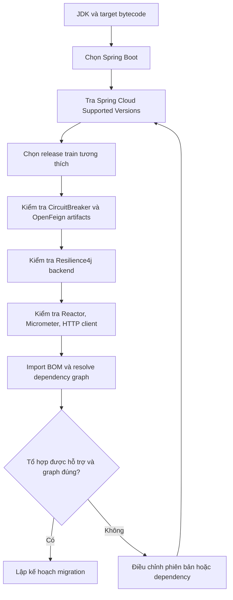
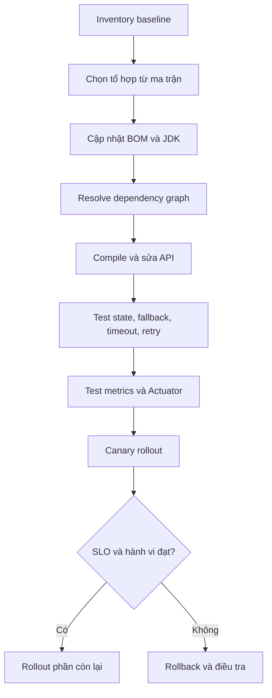

# Đọc ma trận tương thích trước khi nâng cấp Spring Cloud hoặc Resilience4j

Nâng cấp Spring Boot, Spring Cloud hoặc Resilience4j cùng lúc có thể làm thay đổi nhiều lớp của ứng dụng: auto-configuration, API của Spring Cloud CircuitBreaker, HTTP client, Reactor, metrics và cách các dependency được quản lý phiên bản. Một dự án có thể biên dịch thành công nhưng vẫn dùng một tổ hợp phiên bản không còn được hỗ trợ, hoặc chạy được nhưng thay đổi hành vi fallback, timeout và Circuit Breaker khi khởi động.

Trước khi sửa dependency, hãy đọc ma trận tương thích chính thức để chọn một tổ hợp Spring Boot, Spring Cloud release train, JDK và backend Resilience4j đã được hỗ trợ. Sau đó đối chiếu với dependency graph thực tế của ứng dụng. Ma trận cho biết những tổ hợp nào được hỗ trợ; dependency graph cho biết Maven hoặc Gradle thực sự phân giải những artifact và phiên bản nào.

## Những thành phần cần đối chiếu

Trong một ứng dụng dùng Spring Cloud CircuitBreaker với Resilience4j, không chỉ có một cặp phiên bản cần kiểm tra. Hãy lập danh sách ít nhất các thành phần sau:

| Thành phần | Cần xác minh | Vì sao quan trọng |
|---|---|---|
| JDK | Phiên bản Java tối thiểu và target bytecode | Thư viện mới có thể yêu cầu JDK cao hơn; môi trường build và runtime phải thống nhất |
| Spring Boot | Phiên bản Boot và Spring Framework được quản lý | Quyết định nền tảng auto-configuration, dependency management và Jakarta baseline |
| Spring Cloud release train | Train nào hỗ trợ phiên bản Spring Boot đang dùng | Các module Spring Cloud phải thuộc train tương thích với Boot |
| Spring Cloud CircuitBreaker | Artifact và phiên bản nằm trong release train | Cung cấp factory abstraction và adapter cho backend Resilience4j |
| Resilience4j | Phiên bản backend và các module liên quan | API cấu hình, event, metrics và yêu cầu Java có thể thay đổi theo major/minor |
| Reactor | Phiên bản Reactor Core và tích hợp reactive | Ảnh hưởng đến `Mono`, `Flux`, retry, timeout và cancellation |
| OpenFeign hoặc HTTP client | Phiên bản và cơ chế tích hợp Circuit Breaker | Ảnh hưởng proxy, fallback, timeout và cách lỗi được bọc |
| Micrometer/Actuator | Phiên bản và tên metric thực tế | Dashboard và alert có thể phụ thuộc tên metric, tag và health indicator |

Một tổ hợp hợp lệ cần thỏa cả quan hệ giữa các thành phần. Ví dụ, Spring Cloud release train phải hỗ trợ Spring Boot đang chọn; starter Spring Cloud CircuitBreaker phải thuộc train đó; backend Resilience4j phải nằm trong phiên bản mà starter và JDK hiện tại hỗ trợ.

## Đọc ma trận theo thứ tự

Không nên bắt đầu bằng cách chọn phiên bản Resilience4j mới nhất rồi cố ghép các thư viện Spring xung quanh nó. Hãy đi từ nền tảng ứng dụng:

1. Xác định JDK đang dùng ở môi trường build và production.
2. Chọn phiên bản Spring Boot nằm trong phạm vi hỗ trợ của dự án.
3. Mở bảng Spring Cloud Supported Versions và tìm release train tương thích với phiên bản Boot đó.
4. Chọn bản GA của Spring Cloud release train được hỗ trợ; kiểm tra thời gian hỗ trợ và ghi chú phát hành.
5. Xác định phiên bản Spring Cloud CircuitBreaker và OpenFeign được train quản lý.
6. Kiểm tra Resilience4j mà starter backend đưa vào, yêu cầu Java và các module tương ứng.
7. Kiểm tra Reactor, Micrometer và các thư viện tích hợp khác được phân giải cùng tổ hợp.
8. Đối chiếu dependency graph sau khi import BOM để xác nhận dự án thực sự dùng đúng phiên bản đã chọn.



Ma trận thường thể hiện các release train, phạm vi Spring Boot được hỗ trợ và trạng thái hỗ trợ. Đọc cả chú thích và ghi chú phát hành, không chỉ nhìn thấy hai số phiên bản có vẻ gần nhau. Một bản snapshot, milestone hoặc release candidate có thể xuất hiện trong tài liệu phát triển nhưng không phải lựa chọn production tương đương bản GA.

## Nguồn tương thích nên dùng

Ưu tiên tài liệu chính thức và tài liệu đúng phiên bản:

- [Spring Cloud – Supported Versions](https://spring.io/projects/spring-cloud#overview): đối chiếu Spring Cloud release train với Spring Boot và trạng thái hỗ trợ.
- [Spring Cloud Release Notes](https://github.com/spring-cloud/spring-cloud-release/releases): xem thay đổi của release train, dependency được nâng và các lưu ý tương thích.
- [Spring Cloud CircuitBreaker Reference](https://docs.spring.io/spring-cloud-circuitbreaker/reference/): kiểm tra API factory, backend Resilience4j, cấu hình và tích hợp reactive theo phiên bản tài liệu.
- [Resilience4j Documentation](https://resilience4j.readme.io/): kiểm tra yêu cầu Java, API cấu hình, module và thay đổi giữa các phiên bản.
- [Spring Boot Documentation](https://docs.spring.io/spring-boot/): kiểm tra yêu cầu Java, dependency management, Actuator và thay đổi auto-configuration.

Khi dự án đang dùng một release train cũ, mở tài liệu của chính train đó nếu có. Không mặc định tài liệu `current` mô tả đúng API của phiên bản ứng dụng đang chạy. Với mỗi lựa chọn, lưu lại URL hoặc số phiên bản tài liệu đã đối chiếu trong change record để reviewer có thể kiểm tra lại.

## Ma trận hỗ trợ khác với dependency graph

Ma trận trả lời câu hỏi “tổ hợp này có được nhà cung cấp hỗ trợ không?”. Dependency graph trả lời “dự án hiện phân giải những artifact nào?”. Hai việc này bổ sung cho nhau.

Một dependency graph có thể cho thấy ứng dụng đang dùng:

- Spring Boot từ parent hoặc BOM.
- Spring Cloud CircuitBreaker từ Spring Cloud BOM.
- Resilience4j được kéo vào gián tiếp qua starter backend.
- Một phiên bản Reactor hoặc Micrometer được chọn bởi dependency management.
- Một thư viện khác override phiên bản transitive bằng dependency declaration riêng.

Nếu chỉ nhìn `pom.xml` hoặc `build.gradle`, có thể bỏ sót phiên bản được chọn sau khi Maven/Gradle giải quyết xung đột. Ngược lại, nếu chỉ nhìn dependency tree, có thể thấy tất cả artifact resolve được nhưng không biết tổ hợp đó còn nằm trong phạm vi hỗ trợ chính thức hay không.

Các lệnh sau là công cụ kiểm tra trong quá trình migration; chỉ chạy trong môi trường build của dự án sau khi đã xác định được thay đổi cần kiểm tra:

```bash
# Maven: xem dependency tree của các nhóm thư viện liên quan
mvn dependency:tree -Dincludes=org.springframework.boot,org.springframework.cloud,io.github.resilience4j,io.projectreactor,micrometer

# Maven: xem POM hiệu lực sau khi áp dụng parent và BOM
mvn help:effective-pom

# Gradle: xem các dependency được resolve cho runtime classpath
./gradlew dependencies --configuration runtimeClasspath

# Gradle: tìm lý do một phiên bản cụ thể được chọn
./gradlew dependencyInsight --dependency resilience4j-circuitbreaker --configuration runtimeClasspath
```

Đọc kết quả để tìm phiên bản bị override, nhiều phiên bản cùng tồn tại, dependency bị exclude hoặc module không cùng một release line. Một tổ hợp có thể compile nhờ binary compatibility nhưng vẫn không phải tổ hợp được kiểm thử hoặc hỗ trợ.

## Quản lý phiên bản bằng BOM

Trong Maven, Spring Boot parent thường quản lý dependency nền tảng của Boot. Import Spring Cloud BOM để quản lý đồng bộ các module Spring Cloud. Hãy lấy giá trị `spring-cloud.version` từ release train đã chọn trong ma trận; không tự gán một số phiên bản bất kỳ.

```xml
<properties>
    <!-- Chọn release train GA tương thích với Spring Boot từ ma trận chính thức. -->
    <spring-cloud.version>SPRING_CLOUD_TRAIN_VERSION_FROM_MATRIX</spring-cloud.version>
</properties>

<dependencyManagement>
    <dependencies>
        <dependency>
            <groupId>org.springframework.cloud</groupId>
            <artifactId>spring-cloud-dependencies</artifactId>
            <version>${spring-cloud.version}</version>
            <type>pom</type>
            <scope>import</scope>
        </dependency>
    </dependencies>
</dependencyManagement>

<dependencies>
    <dependency>
        <groupId>org.springframework.cloud</groupId>
        <artifactId>spring-cloud-starter-circuitbreaker-resilience4j</artifactId>
    </dependency>
</dependencies>
```

`SPRING_CLOUD_TRAIN_VERSION_FROM_MATRIX` là placeholder cần thay bằng phiên bản GA đã xác minh; đây không phải giá trị hợp lệ để giữ nguyên trong POM. Nếu dùng WebFlux và cần backend reactive, kiểm tra starter reactive phù hợp với phiên bản Spring Cloud CircuitBreaker đang dùng, ví dụ `spring-cloud-starter-circuitbreaker-reactor-resilience4j`.

Trong Gradle, dùng platform/BOM thay vì gán phiên bản riêng cho từng module Spring Cloud:

```kotlin
dependencies {
    implementation(platform("org.springframework.cloud:spring-cloud-dependencies:$springCloudVersion"))
    implementation("org.springframework.cloud:spring-cloud-starter-circuitbreaker-resilience4j")
}
```

Nếu ứng dụng khai báo trực tiếp các module `io.github.resilience4j`, trước tiên kiểm tra phiên bản mà Spring Cloud CircuitBreaker starter đã chọn. Chỉ import Resilience4j BOM hoặc override phiên bản khi có lý do rõ ràng và xác nhận tổ hợp mới tương thích. Hai BOM cùng quản lý một nhóm dependency có thể tạo xung đột do thứ tự import hoặc dependency management của parent; luôn kiểm tra effective POM và dependency insight sau thay đổi.

Không dùng phiên bản mới nhất của từng artifact một cách độc lập. BOM giúp giữ các module trong cùng một release line, nhưng BOM không thể làm cho một release train không được hỗ trợ trở thành tương thích với Spring Boot khác train.

## Kiểm tra yêu cầu JDK và thay đổi nền tảng

Phiên bản Java là một phần của ma trận. Kiểm tra cả JDK dùng để compile, toolchain, target bytecode, container image và JRE/JDK ở production. Nếu thư viện mới nâng baseline Java, build có thể thành công trên máy phát triển nhưng container production vẫn chạy JDK cũ và không khởi động được.

Khi nâng từ thế hệ Spring Boot dùng `javax.*` sang thế hệ dùng Jakarta EE, kiểm tra các API servlet, validation, persistence và thư viện tích hợp. Các import `javax.*` liên quan đến Jakarta có thể cần chuyển sang `jakarta.*`; không áp dụng thay thế hàng loạt cho mọi package bắt đầu bằng `javax`, vì một số package Java SE vẫn hợp lệ. Kiểm tra các starter và thư viện bên thứ ba có hỗ trợ Jakarta baseline tương ứng.

Với Resilience4j, kiểm tra yêu cầu Java và thay đổi API của đúng major version. Ví dụ, dòng Resilience4j 2.x yêu cầu Java 17 trở lên; khi chuyển từ dòng cũ hơn, hãy xác nhận toolchain và runtime đã đáp ứng. Đừng chỉ thay số phiên bản trong BOM rồi giả định mọi API cấu hình, event và metrics vẫn giữ nguyên.

## Kiểm tra các artifact Spring Cloud CircuitBreaker

Sau khi chọn release train, kiểm tra artifact cụ thể mà ứng dụng sử dụng:

| Nhu cầu | Artifact cần kiểm tra |
|---|---|
| API Circuit Breaker chung và backend Resilience4j đồng bộ | `spring-cloud-starter-circuitbreaker-resilience4j` |
| Backend Resilience4j cho luồng reactive | `spring-cloud-starter-circuitbreaker-reactor-resilience4j` |
| Feign client | `spring-cloud-starter-openfeign` và tích hợp Circuit Breaker của phiên bản tương ứng |
| Metrics/health | Spring Boot Actuator, Micrometer và registry phù hợp |

Không thêm cả starter đồng bộ và reactive chỉ vì muốn có đủ class trên classpath. Chọn theo mô hình thực thi thực tế và xem dependency tree để tránh kéo thêm module không cần thiết. Nếu dùng Feign, kiểm tra property bật Circuit Breaker, cách tạo tên mạch, fallback/fallbackFactory và hành vi timeout theo phiên bản Spring Cloud OpenFeign.

## Đối chiếu thay đổi API và cấu hình trước khi nâng cấp

Ma trận chỉ xác nhận tương thích phiên bản ở cấp nền tảng. Migration vẫn cần đọc release notes và so sánh các điểm mà ứng dụng đang sử dụng:

| Khu vực | Nội dung cần kiểm tra |
|---|---|
| Factory abstraction | Constructor, generic type, `create(...)`, `run(...)` và customizer |
| Resilience4j config | Tên property, kiểu dữ liệu, default và độ ưu tiên giữa properties với Java customizer |
| Circuit Breaker name | Resolver, tên instance và key trong `resilience4j.circuitbreaker.instances` |
| Exception classification | `recordExceptions`, `ignoreExceptions`, predicate và exception wrapper của client |
| Fallback | Chữ ký fallback, fallback factory và thứ tự với retry/error recovery |
| TimeLimiter | Timeout, cancellation và khác biệt giữa `Future`, `CompletionStage`, `Mono`/`Flux` |
| Bulkhead | Semaphore/thread-pool behavior, giới hạn concurrency và queue |
| Reactive | Subscription, retry, timeout, cancellation và không block event loop |
| Metrics/Actuator | Tên metric, tag, health indicator và endpoint exposure |
| OpenFeign | Circuit Breaker enablement, fallback bean scope và resolver tên mạch |

Một thay đổi nhỏ ở thứ tự decorator có thể làm sliding window ghi nhận một kết quả cuối cùng thay vì từng attempt. Một thay đổi tên instance có thể khiến cấu hình cũ không còn được áp dụng, dẫn đến mạch chạy bằng default config. Vì vậy, hãy xác nhận cả tên Circuit Breaker thực tế lẫn cấu hình hiệu lực sau nâng cấp.

## Quy trình migration theo từng giai đoạn

### 1. Ghi nhận baseline hiện tại

Trước khi thay đổi, lưu lại phiên bản JDK, Spring Boot, Spring Cloud release train, Spring Cloud CircuitBreaker, Resilience4j, Reactor, OpenFeign và Micrometer đang được resolve. Ghi nhận dependency tree, effective POM hoặc dependency lockfile. Đồng thời ghi lại hành vi hiện tại: tên Circuit Breaker, sliding window, threshold, timeout, retry, fallback và các metrics quan trọng.

### 2. Chọn một tổ hợp đích được hỗ trợ

Tra ma trận chính thức để chọn Spring Boot và Spring Cloud release train tương thích. Kiểm tra trạng thái hỗ trợ, yêu cầu JDK và release notes. Xác nhận Spring Cloud CircuitBreaker backend Resilience4j có trong train đó và phiên bản Resilience4j đáp ứng baseline Java của dự án.

### 3. Nâng dependency management trước

Thay đổi Boot parent/BOM và Spring Cloud BOM theo tổ hợp đã chọn. Loại bỏ các pin phiên bản riêng không còn cần thiết. Không override Resilience4j transitive trước khi biết starter đang quản lý phiên bản nào. Sau đó xem effective POM hoặc dependency insight để xác nhận dependency graph.

### 4. Xử lý compile và API migration

Sửa import, API hoặc cấu hình đã thay đổi theo release notes. Kiểm tra Jakarta migration nếu có, cập nhật JDK/toolchain và các plugin build. Không thay đổi chính sách Circuit Breaker cùng lúc nếu chưa cần; giữ nguyên threshold và timeout trước để dễ xác định nguồn phát sinh khác biệt.

### 5. Kiểm thử hành vi bảo vệ

Kiểm thử success, exception, ignored exception, timeout, slow call, retry, fallback, `CLOSED` → `OPEN` → `HALF_OPEN` và lời gọi bị từ chối. Kiểm tra cả đồng bộ lẫn reactive nếu ứng dụng dùng hai mô hình. Với Feign, xác nhận fallback/fallbackFactory và tên mạch vẫn khớp cấu hình.

### 6. Kiểm thử vận hành và quan sát

So sánh metric name/tag, health indicator, log event và trace trước/sau migration. Kiểm tra dashboard, alert và runbook không bị hỏng do đổi tên metric hoặc tag. Xác nhận endpoint Actuator vẫn được expose và bảo vệ đúng.

### 7. Triển khai canary và có đường rollback

Triển khai trên một nhóm instance nhỏ, theo dõi error rate, latency, retry, fallback, Circuit Breaker state và resource usage. Chỉ mở rộng rollout khi số liệu nằm trong ngưỡng. Giữ artifact version và cấu hình trước migration để rollback có thể thực hiện nhanh, đồng thời kiểm tra tương thích dữ liệu/cấu hình nếu rollback sau khi đã phát sinh thay đổi runtime.



## Kiểm tra cấu hình Resilience4j sau migration

Đừng chỉ xác nhận ứng dụng khởi động. Hãy kiểm tra một số cấu hình đại diện và instance được tạo đúng tên:

```yaml
resilience4j:
  circuitbreaker:
    instances:
      catalog:
        slidingWindowType: COUNT_BASED
        slidingWindowSize: 20
        minimumNumberOfCalls: 10
        failureRateThreshold: 50
        slowCallDurationThreshold: 800ms
        slowCallRateThreshold: 50
        waitDurationInOpenState: 5s
        permittedNumberOfCallsInHalfOpenState: 3
  timelimiter:
    instances:
      catalog:
        timeoutDuration: 1500ms
```

Ví dụ trên là cấu hình minh họa, không phải bộ giá trị phù hợp cho mọi dependency. Sau migration, xác nhận instance `catalog` thực sự sử dụng những giá trị dự kiến; nếu có properties và Java customizer cùng cấu hình, kiểm tra quy tắc ưu tiên của phiên bản đang chạy. Với timeout động theo request, xác nhận publisher hoặc client áp dụng deadline thực tế thay vì chỉ dựa vào một timeout cố định theo instance.

Kiểm tra thêm:

- `CircuitBreakerFactory` hoặc `ReactiveCircuitBreakerFactory` được inject đúng backend.
- Tên Circuit Breaker sinh ra khớp với key cấu hình và metrics.
- Các exception kỹ thuật được ghi nhận; exception nghiệp vụ được ignore hoặc phân loại như thiết kế.
- Retry không lặp lại `CallNotPermittedException`.
- Fallback chỉ chạy ở đúng ranh giới và không che lỗi dependency khỏi metrics cần thiết.
- `HALF_OPEN` chỉ cấp số probe đã định; replica mới không tạo đợt traffic bất thường.
- Actuator/Micrometer vẫn xuất metric cần thiết sau nâng cấp.

## Những dấu hiệu cho thấy tổ hợp phiên bản chưa đúng

- Maven/Gradle báo không tìm thấy method hoặc class sau khi dependency đã resolve: có thể API không tương thích hoặc module cần thiết không có trên classpath.
- Ứng dụng khởi động thất bại ở auto-configuration: kiểm tra Spring Boot và Spring Cloud train, điều kiện classpath và các dependency bị override.
- Lỗi `NoSuchMethodError` hoặc `ClassNotFoundException`: thường chỉ ra runtime classpath có các module không cùng phiên bản tương thích.
- Spring Cloud starter kéo một phiên bản Resilience4j khác dự kiến: xem dependency tree, BOM và dependency được khai báo trực tiếp.
- Circuit Breaker chạy bằng default config: kiểm tra tên instance, resolver và key properties.
- Metrics biến mất hoặc đổi tên: đối chiếu phiên bản Micrometer/Resilience4j và release notes trước khi sửa dashboard.
- Reactive request bị block hoặc cancellation thay đổi: kiểm tra Reactor version, operator order và tích hợp TimeLimiter.
- Fallback không còn được gọi: kiểm tra bean wiring, fallback signature, proxy và exception được phát ra.

Không xử lý các lỗi này bằng cách thêm nhiều version override ngẫu nhiên. Hãy tìm dependency nào đưa phiên bản không tương thích vào graph, sau đó sửa ở BOM hoặc dependency declaration có thẩm quyền.

## Bảng ghi nhận quyết định migration

Trước khi merge thay đổi, lưu một bảng tương tự trong change request hoặc tài liệu migration của dự án:

| Hạng mục | Trước nâng cấp | Sau nâng cấp | Bằng chứng |
|---|---|---|---|
| JDK | Phiên bản hiện tại | Phiên bản đích | Toolchain và runtime image |
| Spring Boot | Phiên bản hiện tại | Phiên bản được chọn | Ma trận hỗ trợ và release notes |
| Spring Cloud train | Release train hiện tại | Train tương thích | Spring Cloud Supported Versions |
| CircuitBreaker starter | Artifact/version hiện tại | Artifact/version đích | BOM và dependency tree |
| Resilience4j | Version hiện tại | Version được resolve | Dependency insight và release notes |
| Circuit Breaker behavior | Threshold, window, state | Hành vi sau migration | Unit/integration test |
| Fallback/Retry/TimeLimiter | Hành vi hiện tại | Hành vi đích | Test và trace |
| Metrics/Actuator | Metric và tag hiện tại | Metric và tag đích | Endpoint metrics/Prometheus |
| Rollback | Artifact/config trước | Cách phục hồi | Runbook và canary result |

Không điền phiên bản đích chỉ từ một bài blog hoặc ví dụ cấu hình không rõ ngày. Hãy ghi nguồn chính thức, ngày kiểm tra và người review để lần nâng cấp tiếp theo có thể tái sử dụng quyết định.

## Checklist trước khi merge

| Câu hỏi | Điều kiện đạt |
|---|---|
| Spring Boot và Spring Cloud có nằm trong tổ hợp hỗ trợ? | Đã đối chiếu ma trận chính thức và trạng thái hỗ trợ |
| JDK build/runtime có đáp ứng baseline? | Toolchain, CI và container cùng tương thích |
| BOM có quản lý các module Spring Cloud? | Không pin phiên bản lẻ nếu không có lý do được ghi nhận |
| Resilience4j có phiên bản phù hợp? | Đã xem phiên bản thực tế trong dependency graph và release notes |
| Dependency graph có xung đột? | Không có override ngoài dự kiến hoặc module lệch release line |
| API và properties có thay đổi? | Đã kiểm tra factory, customizer, resolver và exception classification |
| Hành vi bảo vệ có giữ đúng? | Test state, sliding window, timeout, retry và fallback đạt |
| Reactive/Feign có được xác minh? | Test theo đúng loại client và mô hình thực thi đang dùng |
| Metrics và Actuator có hoạt động? | Dashboard, alert, endpoint và security đã được xác nhận |
| Có rollback? | Artifact/config trước và quy trình canary được lưu lại |

Đọc ma trận tương thích trước khi nâng cấp giúp chọn đúng nền tảng, tránh ghép các module Spring Cloud và Resilience4j theo cảm tính. Kết hợp ma trận với dependency graph, release notes và kiểm thử hành vi thực tế sẽ giúp migration giữ được các cam kết quan trọng của Circuit Breaker: mở mạch đúng ngưỡng, giới hạn thời gian chờ, thực thi fallback đúng lúc và cung cấp số liệu đáng tin cậy cho vận hành.
