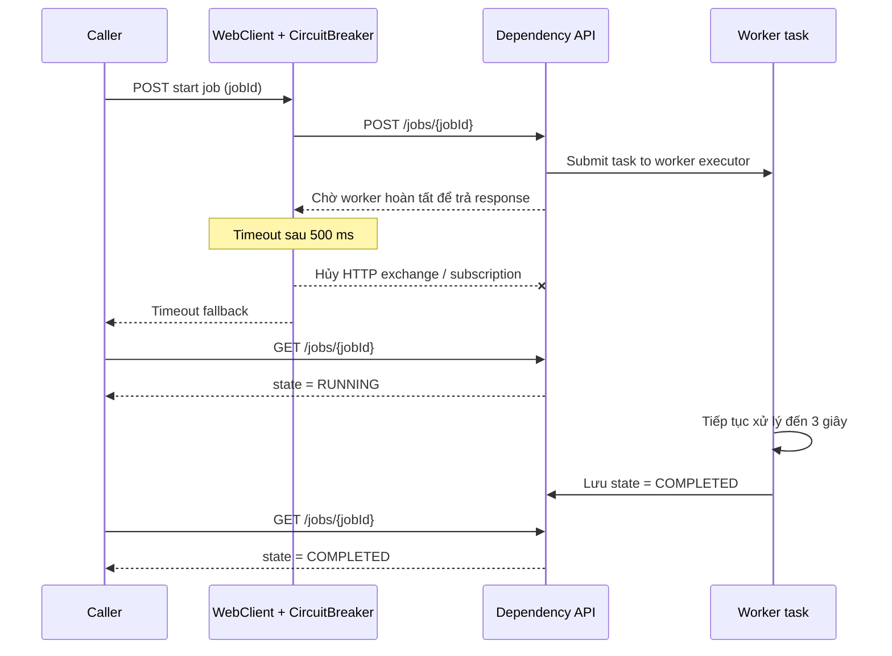

# Gây timeout rồi chứng minh trạng thái tác vụ thực tế phía phụ thuộc

Một request bị timeout ở phía gọi không chứng minh công việc phía dịch vụ phụ thuộc đã dừng. Timeout có thể chỉ kết thúc thời gian chờ của caller và hủy HTTP exchange ở phía client. Server có thể đã nhận request, tạo tác vụ nền hoặc gửi tiếp công việc đến database, queue hay một dịch vụ khác. Nếu các tầng không truyền tín hiệu hủy đến tác vụ thực tế, công việc vẫn tiếp tục sau khi caller đã trả fallback.

Bài thực hành này dựng hai ứng dụng nhỏ: một **caller** dùng Spring WebFlux, WebClient và Spring Cloud CircuitBreaker/Resilience4j; một **dependency** nhận yêu cầu, khởi chạy công việc trên worker executor riêng và lưu trạng thái theo `jobId`. Caller đặt timeout 500 ms trong khi dependency xử lý trong 3 giây. Sau timeout, ta gọi API trạng thái của dependency để chứng minh job vẫn `RUNNING`, rồi kiểm tra nó chuyển thành `COMPLETED`. Cuối cùng, ta gửi lệnh hủy tường minh để thấy việc dừng tác vụ cần được nối với worker thực tế.

## 1. Mục tiêu và kết quả cần chứng minh

Sau bài lab, bạn có thể:

- Phân biệt timeout ở caller với timeout hoặc cancellation ở dependency.
- Đặt Reactor `timeout` bên trong publisher được CircuitBreaker bảo vệ để breaker ghi nhận lỗi timeout.
- Tạo một tác vụ nền độc lập với vòng đời HTTP response.
- Dùng `jobId` để truy vấn trạng thái công việc sau khi caller đã timeout.
- Chứng minh bằng dữ liệu backend rằng công việc vẫn chạy và có thể hoàn tất sau khi caller ngừng chờ.
- Phân biệt cancellation của HTTP response với cancellation thực tế của worker task.
- Thiết kế endpoint hủy tường minh và xử lý trạng thái chưa xác định cho các thao tác có tác động phụ.

Kết quả quan trọng của lab không phải chỉ là thấy `TimeoutException`. Cần thu thập được bằng chứng độc lập ở dependency: cùng `jobId` đã được ghi nhận, có `startedAt`, trạng thái vẫn `RUNNING` sau thời điểm caller timeout, rồi có `finishedAt` và trạng thái `COMPLETED`.

## 2. Sơ đồ luồng thử nghiệm



Trong thiết kế của bài lab, dependency tách `responseFuture` khỏi `workerTask`. HTTP response có thể bị hủy khi caller timeout, nhưng việc hủy response future không tự gọi `workerTask.cancel(true)`. Vì vậy, worker tiếp tục chạy. Đây là hành vi được chủ động thiết kế để minh họa ranh giới giữa việc ngừng chờ response và việc dừng công việc.

Trong hệ thống thực tế, kết quả còn phụ thuộc HTTP protocol, server runtime, framework và cách tác vụ được thực thi. HTTP/2 có thể reset một stream; HTTP/1.1 có thể đóng hoặc bỏ kết nối. Server có thể nhận biết client disconnect, nhưng việc nhận biết đó không tự dừng mọi tác vụ con. Cần kiểm tra từng tầng bằng trạng thái hoặc trace.

## 3. Chuẩn bị hai ứng dụng

Tạo hai ứng dụng Spring Boot trong môi trường lab:

| Ứng dụng | Port | Vai trò |
|---|---:|---|
| `dependency-service` | `8091` | Nhận job, chạy worker trong executor riêng, cung cấp API status và cancel |
| `caller-service` | `8080` | Gọi dependency bằng WebClient, timeout sau 500 ms và dùng CircuitBreaker |

Dependency dùng Spring WebFlux để trả response từ `Mono.fromFuture`. Worker task chạy trên `ThreadPoolTaskExecutor` riêng, không chạy trên event-loop. Caller cần các dependency tương thích với Spring Boot/Spring Cloud release train của dự án, gồm WebFlux và Spring Cloud CircuitBreaker Reactor Resilience4j.

Ví dụ dependency cần có trong caller:

```kotlin
dependencies {
    implementation("org.springframework.boot:spring-boot-starter-webflux")
    implementation("org.springframework.cloud:spring-cloud-starter-circuitbreaker-reactor-resilience4j")
}
```

Dependency service chỉ cần WebFlux để cung cấp API reactive và một executor do Spring quản lý cho worker. Quản lý version qua Spring Boot/Cloud BOM tương thích; không trộn release train hoặc version Resilience4j tùy ý.

## 4. Xây dựng mô hình trạng thái job ở dependency

Mỗi tác vụ có một `jobId` duy nhất. Dependency lưu trạng thái để caller có thể truy vấn sau khi request khởi chạy đã kết thúc.

```java
import java.time.Instant;

public record WorkSnapshot(
        String jobId,
        String state,
        Instant startedAt,
        Instant finishedAt) {
}
```

Các trạng thái trong lab:

| Trạng thái | Ý nghĩa |
|---|---|
| `QUEUED` | Job đã được nhận nhưng worker chưa bắt đầu |
| `RUNNING` | Worker đã bắt đầu xử lý |
| `COMPLETED` | Công việc hoàn tất |
| `CANCELLED` | Worker nhận tín hiệu interrupt/cancel và dừng hợp tác |
| `FAILED` | Công việc kết thúc do lỗi |
| `REJECTED` | Executor không nhận thêm công việc vì đã đạt giới hạn |

Trạng thái phải được lưu ở dependency. Không lấy trạng thái từ kết quả fallback ở caller để suy ra backend đã hoàn tất hay đã hủy.

## 5. Cấu hình worker executor có giới hạn

Không chạy công việc dài trên event-loop của WebFlux. Tạo một executor riêng có giới hạn thread và queue:

```java
import org.springframework.context.annotation.Bean;
import org.springframework.context.annotation.Configuration;
import org.springframework.scheduling.concurrent.ThreadPoolTaskExecutor;

@Configuration
public class WorkerConfiguration {

    @Bean
    ThreadPoolTaskExecutor dependencyWorkExecutor() {
        ThreadPoolTaskExecutor executor = new ThreadPoolTaskExecutor();
        executor.setCorePoolSize(2);
        executor.setMaxPoolSize(4);
        executor.setQueueCapacity(20);
        executor.setThreadNamePrefix("dependency-work-");
        executor.setWaitForTasksToCompleteOnShutdown(true);
        executor.setAwaitTerminationSeconds(5);
        executor.initialize();
        return executor;
    }
}
```

Pool và queue nhỏ giúp bài lab dễ quan sát. Trong production, cần chọn giới hạn theo thời gian xử lý, CPU, connection pool và năng lực backend. Queue không giới hạn có thể biến timeout thành việc tích tụ các tác vụ không còn caller chờ kết quả.

## 6. Tạo service chạy worker độc lập với HTTP response

Điểm mấu chốt là giữ hai handle riêng:

- `responseFuture`: kết quả mà HTTP controller chờ để trả về caller.
- `workerTask`: công việc thực tế đang chạy trong executor.

Hủy `responseFuture` không tự hủy `workerTask`. Chỉ endpoint cancel tường minh mới gọi `workerTask.cancel(true)`.

```java
import java.time.Instant;
import java.util.concurrent.CompletableFuture;
import java.util.concurrent.ConcurrentHashMap;
import java.util.concurrent.Future;
import java.util.concurrent.FutureTask;
import java.util.concurrent.RejectedExecutionException;
import java.util.concurrent.ThreadPoolExecutor;

import org.springframework.scheduling.concurrent.ThreadPoolTaskExecutor;
import org.springframework.stereotype.Service;

@Service
public class DependencyWorkService {
    private final ThreadPoolTaskExecutor executor;
    private final ConcurrentHashMap<String, JobRecord> jobs =
            new ConcurrentHashMap<>();

    public DependencyWorkService(ThreadPoolTaskExecutor dependencyWorkExecutor) {
        this.executor = dependencyWorkExecutor;
    }

    public CompletableFuture<WorkSnapshot> start(String jobId, long durationMs) {
        if (durationMs < 1 || durationMs > 30_000) {
            throw new IllegalArgumentException("durationMs must be between 1 and 30000");
        }

        JobRecord record = new JobRecord(jobId);
        if (jobs.putIfAbsent(jobId, record) != null) {
            throw new IllegalArgumentException("jobId already exists: " + jobId);
        }

        CompletableFuture<WorkSnapshot> responseFuture = new CompletableFuture<>();
        record.responseFuture = responseFuture;

        FutureTask<Void> workerTask = new FutureTask<>(() -> {
            record.state = "RUNNING";
            record.startedAt = Instant.now();
            try {
                // Chỉ mô phỏng một công việc dài trong lab.
                Thread.sleep(durationMs);
                record.state = "COMPLETED";
                record.finishedAt = Instant.now();
                responseFuture.complete(record.snapshot());
            } catch (InterruptedException error) {
                record.state = "CANCELLED";
                record.finishedAt = Instant.now();
                responseFuture.completeExceptionally(error);
                Thread.currentThread().interrupt();
            } catch (RuntimeException error) {
                record.state = "FAILED";
                record.finishedAt = Instant.now();
                responseFuture.completeExceptionally(error);
                throw error;
            }
            return null;
        });

        record.workerTask = workerTask;
        try {
            executor.execute(workerTask);
        } catch (RejectedExecutionException error) {
            record.state = "REJECTED";
            record.finishedAt = Instant.now();
            responseFuture.completeExceptionally(error);
        }
        return responseFuture;
    }

    public WorkSnapshot status(String jobId) {
        JobRecord record = jobs.get(jobId);
        if (record == null) {
            throw new JobNotFoundException(jobId);
        }
        return record.snapshot();
    }

    public boolean cancel(String jobId) {
        JobRecord record = jobs.get(jobId);
        if (record == null || record.workerTask == null) {
            return false;
        }
        return record.workerTask.cancel(true);
    }

    private static final class JobRecord {
        private final String jobId;
        private volatile String state = "QUEUED";
        private volatile Instant startedAt;
        private volatile Instant finishedAt;
        private volatile Future<?> workerTask;
        private volatile CompletableFuture<WorkSnapshot> responseFuture;

        private JobRecord(String jobId) {
            this.jobId = jobId;
        }

        private WorkSnapshot snapshot() {
            return new WorkSnapshot(jobId, state, startedAt, finishedAt);
        }
    }
}
```

`JobNotFoundException` là exception ứng dụng trả khi không tìm thấy job. Trong code minh họa, có thể định nghĩa exception này và ánh xạ thành HTTP 404 bằng `@RestControllerAdvice`.

Ở đây, `FutureTask` được lưu riêng trong `record.workerTask`; `CompletableFuture` được trả cho controller chỉ đại diện cho response. Nếu Reactor hủy subscription và hủy `responseFuture`, worker task vẫn chạy vì không có callback nối việc hủy hai handle. Khi worker hoàn tất, `responseFuture.complete(...)` có thể trả về `false` vì future đã bị hủy; trạng thái job vẫn được cập nhật thành `COMPLETED`.

`Thread.sleep` chỉ dùng để tạo độ trễ có thể lặp lại trong bài lab. Không dùng nó để mô phỏng xử lý nghiệp vụ production. Công việc thật nên gọi API I/O phù hợp và hỗ trợ cancellation theo hợp đồng của thư viện.

## 7. Cung cấp API start, status và cancel

Controller dependency trả `Mono` từ response future, đồng thời cung cấp endpoint status độc lập:

```java
import org.springframework.http.ResponseEntity;
import org.springframework.web.bind.annotation.DeleteMapping;
import org.springframework.web.bind.annotation.GetMapping;
import org.springframework.web.bind.annotation.PathVariable;
import org.springframework.web.bind.annotation.PostMapping;
import org.springframework.web.bind.annotation.RequestMapping;
import org.springframework.web.bind.annotation.RequestParam;
import org.springframework.web.bind.annotation.RestController;

import reactor.core.publisher.Mono;

@RestController
@RequestMapping("/jobs")
public class DependencyWorkController {
    private final DependencyWorkService service;

    public DependencyWorkController(DependencyWorkService service) {
        this.service = service;
    }

    @PostMapping("/{jobId}")
    public Mono<WorkSnapshot> start(
            @PathVariable String jobId,
            @RequestParam(defaultValue = "3000") long durationMs) {
        return Mono.fromFuture(service.start(jobId, durationMs));
    }

    @GetMapping("/{jobId}")
    public WorkSnapshot status(@PathVariable String jobId) {
        return service.status(jobId);
    }

    @DeleteMapping("/{jobId}")
    public ResponseEntity<Void> cancel(@PathVariable String jobId) {
        return service.cancel(jobId)
                ? ResponseEntity.accepted().build()
                : ResponseEntity.noContent().build();
    }
}
```

Khi HTTP subscription bị hủy, Reactor có thể hủy `responseFuture` được bọc bởi `Mono.fromFuture`. Worker task vẫn độc lập. Endpoint `GET /jobs/{jobId}` đọc trạng thái từ registry trong bộ nhớ; nó không phụ thuộc vào response ban đầu. Endpoint `DELETE` mới gửi yêu cầu cancel đến `workerTask`.

Trong production, cần xử lý trường hợp process restart, job tồn tại lâu hoặc cần status xuyên nhiều replica bằng một kho trạng thái bền vững hay job service chuyên dụng. Map trong bộ nhớ chỉ phù hợp cho lab một instance.

## 8. Cấu hình CircuitBreaker ở caller

Caller dùng WebClient để gửi request khởi chạy job. Timeout 500 ms được đặt bên trong publisher trước khi truyền vào `ReactiveCircuitBreaker.run`. Như vậy, timeout trở thành lỗi của publisher được breaker bảo vệ và có thể được ghi nhận vào failure rate.

```yaml
resilience4j:
  circuitbreaker:
    instances:
      dependencyWork:
        slidingWindowType: COUNT_BASED
        slidingWindowSize: 10
        minimumNumberOfCalls: 1
        failureRateThreshold: 100
        waitDurationInOpenState: 15s
        permittedNumberOfCallsInHalfOpenState: 1
```

Trong lab, `minimumNumberOfCalls: 1` và `failureRateThreshold: 100` khiến một timeout được ghi nhận là failure có thể mở breaker. Điều này giúp quan sát nhanh `OPEN`; production thường cần số mẫu lớn hơn và threshold được hiệu chỉnh theo traffic.

## 9. Gọi dependency với timeout bên trong breaker

Caller tạo một `WebClient` tới dependency và dùng breaker `dependencyWork`:

```java
import java.time.Duration;
import java.util.concurrent.TimeoutException;

import org.springframework.cloud.client.circuitbreaker.ReactiveCircuitBreaker;
import org.springframework.cloud.client.circuitbreaker.ReactiveCircuitBreakerFactory;
import org.springframework.stereotype.Service;
import org.springframework.web.reactive.function.client.WebClient;

import reactor.core.publisher.Mono;

@Service
public class DependencyGateway {
    private final WebClient dependencyClient;
    private final ReactiveCircuitBreakerFactory<?, ?> breakerFactory;

    public DependencyGateway(
            WebClient.Builder builder,
            ReactiveCircuitBreakerFactory<?, ?> breakerFactory) {
        this.dependencyClient = builder
                .baseUrl("http://localhost:8091")
                .build();
        this.breakerFactory = breakerFactory;
    }

    public Mono<WorkSnapshot> start(String jobId) {
        Mono<WorkSnapshot> request = dependencyClient.post()
                .uri("/jobs/{jobId}?durationMs=3000", jobId)
                .retrieve()
                .bodyToMono(WorkSnapshot.class)
                .timeout(Duration.ofMillis(500));

        ReactiveCircuitBreaker breaker = breakerFactory.create("dependencyWork");
        return breaker.run(request, error -> {
            if (hasCause(error, TimeoutException.class)) {
                return Mono.just(new WorkSnapshot(
                        jobId, "CLIENT_TIMEOUT", null, null));
            }
            return Mono.error(error);
        });
    }

    public Mono<WorkSnapshot> status(String jobId) {
        // Status query đi trực tiếp để vẫn điều tra được khi start breaker đang OPEN.
        return dependencyClient.get()
                .uri("/jobs/{jobId}", jobId)
                .retrieve()
                .bodyToMono(WorkSnapshot.class);
    }

    public Mono<Void> cancel(String jobId) {
        return dependencyClient.delete()
                .uri("/jobs/{jobId}", jobId)
                .retrieve()
                .bodyToMono(Void.class);
    }

    private boolean hasCause(Throwable error, Class<? extends Throwable> type) {
        for (Throwable current = error; current != null; current = current.getCause()) {
            if (type.isInstance(current)) {
                return true;
            }
        }
        return false;
    }
}
```

`CLIENT_TIMEOUT` là trạng thái mà caller quan sát được, không phải trạng thái job ở dependency. Fallback chỉ nói caller đã hết thời gian chờ. Trạng thái thực tế phải được lấy từ `status(jobId)`.

Trong code này, status và cancel được gọi trực tiếp để vẫn có thể điều tra hoặc gửi lệnh hủy khi breaker `dependencyWork` đã `OPEN`. Trong production, status/cancel cũng cần bảo vệ bằng timeout và giới hạn tải; có thể dùng breaker riêng nếu phù hợp, nhưng không nên để cùng breaker đang mở chặn luôn kênh cần thiết để xác minh trạng thái job.

## 10. Expose endpoint ở caller

```java
import org.springframework.web.bind.annotation.GetMapping;
import org.springframework.web.bind.annotation.PathVariable;
import org.springframework.web.bind.annotation.PostMapping;
import org.springframework.web.bind.annotation.DeleteMapping;
import org.springframework.web.bind.annotation.RequestMapping;
import org.springframework.web.bind.annotation.RestController;

import reactor.core.publisher.Mono;

@RestController
@RequestMapping("/caller/jobs")
public class CallerController {
    private final DependencyGateway gateway;

    public CallerController(DependencyGateway gateway) {
        this.gateway = gateway;
    }

    @PostMapping("/{jobId}")
    public Mono<WorkSnapshot> start(@PathVariable String jobId) {
        return gateway.start(jobId);
    }

    @GetMapping("/{jobId}/dependency-status")
    public Mono<WorkSnapshot> status(@PathVariable String jobId) {
        return gateway.status(jobId);
    }

    @DeleteMapping("/{jobId}/dependency")
    public Mono<Void> cancel(@PathVariable String jobId) {
        return gateway.cancel(jobId);
    }
}
```

## 11. Chạy thử: timeout ở caller nhưng job vẫn chạy

Khởi động dependency trên port 8091 và caller trên port 8080. Chọn một `jobId` duy nhất cho mỗi lần thử, ví dụ `lab-timeout-001`.

Gửi yêu cầu khởi chạy:

```bash
curl -i -X POST http://localhost:8080/caller/jobs/lab-timeout-001
```

Caller chờ tối đa 500 ms. Dependency được yêu cầu chạy trong 3.000 ms, vì vậy caller dự kiến nhận snapshot fallback có `state=CLIENT_TIMEOUT` sau khoảng nửa giây.

Ngay sau đó, truy vấn trạng thái trực tiếp từ dependency thông qua caller:

```bash
curl -i http://localhost:8080/caller/jobs/lab-timeout-001/dependency-status
```

Kết quả dự kiến sau khoảng 600–900 ms kể từ lúc bắt đầu:

```json
{
  "jobId": "lab-timeout-001",
  "state": "RUNNING",
  "startedAt": "2026-11-24T10:00:00Z",
  "finishedAt": null
}
```

Đợi đến khi tổng thời gian vượt 3 giây rồi truy vấn lại:

```bash
curl -i http://localhost:8080/caller/jobs/lab-timeout-001/dependency-status
```

Kết quả dự kiến:

```json
{
  "jobId": "lab-timeout-001",
  "state": "COMPLETED",
  "startedAt": "2026-11-24T10:00:00Z",
  "finishedAt": "2026-11-24T10:00:03Z"
}
```

Thời điểm cụ thể sẽ khác khi chạy. Bằng chứng cần có là cùng `jobId`, `startedAt` có giá trị, state là `RUNNING` sau timeout của caller, rồi state chuyển `COMPLETED` và có `finishedAt`. Điều này chứng minh caller timeout không dừng worker task trong thiết kế này.

## 12. Quan sát CircuitBreaker sau timeout

Vì timeout được đặt bên trong publisher truyền vào breaker, `TimeoutException` có thể được breaker ghi nhận là lỗi. Với cấu hình lab có `minimumNumberOfCalls: 1` và failure threshold 100%, sau lần timeout đầu tiên breaker có thể chuyển `CLOSED` sang `OPEN`.

Có thể quan sát bằng Actuator/Micrometer nếu ứng dụng đã bật registry và endpoint metrics phù hợp. Cần xem:

- Breaker ID `dependencyWork`.
- State hiện tại (`CLOSED` hoặc `OPEN`).
- Số lần failed và thời điểm timeout.
- Số lần bị từ chối (`not_permitted`) nếu tiếp tục gọi start khi breaker đang `OPEN`.
- Metric của HTTP client và trạng thái job ở dependency.

Khi breaker `OPEN`, lần gọi `POST` tiếp theo có thể bị từ chối trước khi gửi request mới. Khi đó, dependency không tạo job mới. Tuy nhiên, job cũ vẫn có thể đang chạy và status endpoint vẫn trả trạng thái của job đó. Đây là lý do phải tách quan sát job status khỏi đường gọi start được bảo vệ bởi breaker.

Không dùng metric `not_permitted` để kết luận backend đã tiếp tục xử lý request. `not_permitted` có nghĩa breaker từ chối supplier; supplier không chạy trong lần gọi bị chặn.

## 13. Thử hủy tường minh và xác nhận trạng thái CANCELLED

Tạo một job thứ hai, ví dụ `lab-cancel-002`:

```bash
curl -i -X POST http://localhost:8080/caller/jobs/lab-cancel-002
```

Sau khi caller timeout, gửi lệnh cancel đến dependency:

```bash
curl -i -X DELETE http://localhost:8080/caller/jobs/lab-cancel-002/dependency
```

Endpoint cancel gọi `FutureTask.cancel(true)`, yêu cầu interrupt worker. Trong ví dụ, worker đang `Thread.sleep`, nên nó nhận `InterruptedException`, cập nhật state thành `CANCELLED` và ghi `finishedAt`.

Truy vấn lại:

```bash
curl -i http://localhost:8080/caller/jobs/lab-cancel-002/dependency-status
```

Kết quả mong đợi là `state=CANCELLED`. Có thể có một khoảng ngắn giữa lúc API DELETE trả về và lúc worker cập nhật trạng thái; hãy poll status đến khi thấy trạng thái cuối.

Điểm khác biệt:

| Hành động | Response future | Worker task | Trạng thái backend |
|---|---|---|---|
| Caller timeout | Ngừng chờ; response có thể bị cancel | Không tự bị cancel | Tiếp tục `RUNNING`, rồi `COMPLETED` |
| Explicit cancel endpoint | Có thể đã timeout trước đó | Gọi `cancel(true)` lên Future riêng | `CANCELLED` nếu worker hợp tác với interrupt |

`Future.cancel(true)` chỉ gửi yêu cầu interrupt. Nó không bảo đảm một thư viện I/O, câu lệnh database hoặc request đã gửi tới hệ thống khác sẽ dừng. Với công việc không hỗ trợ interrupt, cần API hủy riêng hoặc cơ chế cancellation token được tác vụ chủ động kiểm tra.

## 14. Bằng chứng nào đủ để kết luận công việc đã dừng?

Không nên kết luận job đã dừng chỉ vì caller nhận timeout hoặc vì HTTP connection đã đóng. Cần lấy bằng chứng ở nơi thực thi công việc:

- Job registry hoặc database trạng thái ghi `RUNNING`, `COMPLETED`, `CANCELLED` hoặc `FAILED`.
- `startedAt` và `finishedAt` cho biết khoảng thời gian xử lý.
- Worker log có cùng `jobId` và chuyển trạng thái tương ứng.
- Nếu công việc gửi tiếp đến queue hoặc service khác, cần đối chiếu trạng thái của tác vụ downstream đó.
- Nếu công việc thực hiện ghi dữ liệu, kiểm tra trạng thái giao dịch/record thực tế; HTTP timeout không chứng minh thao tác chưa commit.

Một log `client disconnected` chỉ chứng minh server phát hiện kết nối bị ngắt. Một log `cancel requested` chỉ chứng minh đã gửi yêu cầu hủy. Để chứng minh công việc dừng, cần thấy worker xác nhận cancellation và trạng thái cuối không còn `RUNNING`; với thao tác bên ngoài, cần trạng thái từ hệ thống thực hiện thao tác đó.

## 15. Các giới hạn của cancellation qua HTTP

Cancellation là tín hiệu hợp tác qua nhiều tầng:

1. Reactor timeout hủy subscription phía caller.
2. WebClient/HTTP client hủy exchange hoặc stream ở phía client.
3. Server có thể phát hiện client disconnect hoặc stream reset.
4. Framework server có thể truyền tín hiệu hủy tới publisher/handler.
5. Ứng dụng cần nối tín hiệu đó với worker task hoặc tác vụ con.
6. Tác vụ con cần hỗ trợ cancellation và xác nhận đã dừng.

Chuỗi có thể dừng ở bất kỳ tầng nào. Client không thể tự hủy một transaction đã commit ở database chỉ bằng cách đóng socket. Một server có thể đã gửi message vào queue; consumer có thể tiếp tục xử lý dù HTTP request ban đầu đã bị hủy.

Với một tác vụ blocking:

- `Thread.interrupt()` có thể dừng các thao tác chờ có hỗ trợ interrupt như `Thread.sleep`.
- JDBC driver có thể hỗ trợ `Statement.cancel()`, nhưng cần kiểm tra driver và database thực tế.
- Một socket hoặc thư viện native có thể không phản ứng với interrupt theo cách mong đợi.
- `CompletableFuture.cancel(true)` không phải cam kết phổ quát rằng công việc đang chạy đã dừng.
- Nếu tác vụ đã gửi request đến service khác, phải dùng API/hợp đồng của service đó để hủy hoặc truy vấn trạng thái.

## 16. Thiết kế an toàn cho thao tác có tác động phụ

Giả sử dependency xử lý thanh toán. Caller timeout sau 500 ms nhưng payment service đã gửi giao dịch tới ngân hàng và đang chờ kết quả. Nếu caller tự động retry như thể lần đầu chưa xảy ra, người dùng có thể bị tính tiền hai lần.

Với thao tác có tác động phụ:

- Dùng idempotency key ổn định cho một thao tác nghiệp vụ.
- Lưu trạng thái `PENDING`, `COMPLETED`, `FAILED` hoặc `UNKNOWN` tại nơi có thẩm quyền.
- Cung cấp API truy vấn trạng thái bằng operation ID/job ID.
- Chỉ gửi lệnh hủy nếu nghiệp vụ và hệ thống đích hỗ trợ hủy.
- Nếu không thể xác định kết quả, trả trạng thái chưa xác định và thực hiện đối soát thay vì retry mù.
- Dùng transactional outbox, deduplication hoặc compensation khi kiến trúc yêu cầu xử lý nhất quán qua nhiều hệ thống.

Circuit breaker giúp ngăn các lời gọi mới tiếp tục đổ vào dependency đang lỗi. Nó không rollback công việc đã bắt đầu và không bảo đảm hủy tác vụ phía server. Retry cũng cần tính đến idempotency và deadline tổng.

## 17. Những lỗi thường gặp trong bài lab

| Hiện tượng | Nguyên nhân có thể | Cách kiểm tra |
|---|---|---|
| Caller timeout nhưng không tìm thấy job | Request chưa tới dependency, job ID sai hoặc task bị reject | Kiểm tra log nhận request và trạng thái `QUEUED/REJECTED` |
| Status trả `RUNNING` lâu hơn dự kiến | Worker bị kẹt hoặc duration thực tế dài | Kiểm tra worker thread, queue và log theo job ID |
| Status chuyển `COMPLETED` sau caller timeout | Worker tách biệt với response lifecycle | Đây là kết quả dự kiến của lab |
| Status không chuyển `CANCELLED` sau DELETE | Worker không hỗ trợ interrupt hoặc cancel endpoint không trỏ đúng task | Kiểm tra `FutureTask.cancel`, thread và cancellation handling |
| Breaker mở nhưng status vẫn truy vấn được | Status endpoint dùng đường gọi riêng | Đây là chủ đích để giữ khả năng điều tra |
| Breaker không ghi nhận timeout | Timeout đặt ngoài breaker hoặc exception bị ignore | Kiểm tra vị trí Reactor `timeout` và record/ignore policy |
| Backend vẫn nhận nhiều job sau timeout | Caller retry hoặc nhiều request mới vẫn được gửi | Kiểm tra retry, breaker state và bulkhead |
| Hai job có cùng ID bị ghi đè | Thiếu kiểm soát trùng lặp | Dùng ID duy nhất và xử lý idempotency |

## 18. Bài tập mở rộng

1. Đổi worker duration từ 3.000 ms thành 5.000 ms, giữ caller timeout 500 ms. Ghi lại thời gian caller trả fallback và thời gian backend chuyển `COMPLETED`.
2. Đổi caller timeout thành 2.000 ms trong khi worker chạy 3.000 ms. Xác nhận caller vẫn timeout trước khi job hoàn tất.
3. Thử `durationMs=300` với timeout 500 ms. Xác nhận caller nhận response thành công và status đã `COMPLETED`.
4. Gửi hai job đồng thời với hai ID khác nhau. Xác nhận trạng thái của từng job độc lập.
5. Gửi lại cùng `jobId`. Xác nhận dependency từ chối ID trùng thay vì tạo tác vụ thứ hai.
6. Gọi DELETE khi job đang `RUNNING`. Xác nhận worker nhận interrupt và status chuyển `CANCELLED`.
7. Thay `Thread.sleep` bằng một thao tác blocking giả lập không phản ứng với interrupt. Quan sát vì sao `cancel(true)` không đủ để chứng minh công việc đã dừng; sau đó bổ sung cancellation token được kiểm tra định kỳ.
8. Đặt breaker ở `OPEN` sau timeout đầu tiên. Gửi request start thứ hai và xác nhận dependency không nhận job mới, trong khi status của job đầu tiên vẫn truy vấn được.
9. Thử đặt timeout ở ngoài `breaker.run(...)`, so sánh exception/cancellation mà breaker quan sát với trường hợp timeout nằm bên trong publisher được bảo vệ.

Khi ghi kết quả, lưu `jobId`, thời điểm request bắt đầu, thời điểm caller timeout, trạng thái dependency sau timeout, thời điểm task hoàn tất hoặc bị hủy và state của breaker. Không chỉ ghi “request timeout” vì thông tin đó chưa nói lên trạng thái công việc thực tế.

## 19. Checklist kết thúc lab

- Caller có timeout 500 ms trong khi worker được cấu hình chạy 3 giây.
- Timeout nằm trong publisher được đưa vào ReactiveCircuitBreaker.
- Breaker ghi nhận timeout theo cấu hình test.
- Dependency lưu job theo ID và có endpoint status độc lập.
- Sau caller timeout, status của dependency vẫn là `RUNNING`.
- Sau khi đủ thời gian, status chuyển `COMPLETED` và có `finishedAt`.
- Lệnh cancel tường minh tác động tới `workerTask` riêng, không chỉ response future.
- Đã phân biệt `CLIENT_TIMEOUT` với trạng thái job ở backend.
- Đã xác định giới hạn của interrupt/cancellation đối với I/O, database và tác vụ downstream.
- Thao tác có tác động phụ có idempotency key và cơ chế truy vấn/đối soát trạng thái.

Timeout chỉ cho biết caller đã hết thời gian chờ. Muốn biết công việc phía phụ thuộc có dừng hay không, phải quan sát trạng thái tại nơi công việc thực sự chạy và kiểm tra tín hiệu hủy có được truyền tới worker hay hệ thống downstream không. Bằng cách tách response future khỏi worker task, theo dõi `jobId` và thử hủy tường minh, bài lab chứng minh được vì sao một request đã timeout vẫn có thể hoàn tất ở backend, đồng thời cho thấy circuit breaker bảo vệ các lời gọi mới nhưng không tự dừng hoặc rollback tác vụ đã bắt đầu.
