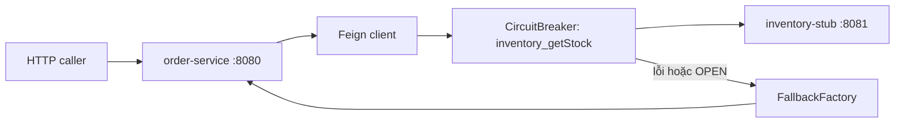

# Tích hợp Feign hoặc Gateway và xác minh cấu hình theo tên

Trong bài thực hành này, bạn sẽ bảo vệ một lời gọi đến dịch vụ tồn kho bằng Spring Cloud CircuitBreaker và Resilience4j, sau đó xác minh circuit breaker đã nhận đúng cấu hình theo tên. Phần chính sử dụng Spring Cloud OpenFeign vì mỗi client có thể khai báo fallback riêng và có thể kiểm tra tên breaker được tạo từ client cùng method. Cuối bài có nhánh thay thế ngắn cho Spring Cloud Gateway.

Mục tiêu là quan sát được toàn bộ vòng đời: lời gọi thành công, lỗi từ dịch vụ phụ thuộc, fallback, trạng thái `OPEN`, lời gọi bị từ chối, giai đoạn `HALF_OPEN` và phục hồi về `CLOSED`. Bài thuộc module **SPRING_CLOUD_CIRCUIT_BREAKER**, tập trung vào cách tích hợp và xác minh cấu hình runtime thay vì chỉ thêm dependency rồi giả định circuit breaker đã hoạt động.

## 1. Kết quả cần đạt

Sau khi hoàn thành, bạn có thể:

- Thêm đúng starter Spring Cloud OpenFeign và provider Resilience4j theo BOM của dự án.
- Bật CircuitBreaker integration cho Feign.
- Đặt tên breaker ổn định bằng `CircuitBreakerNameResolver`.
- Cấu hình `slidingWindowSize`, `minimumNumberOfCalls`, failure threshold và thời gian mở mạch theo đúng ID.
- Dùng `FallbackFactory` để phân biệt lỗi thực thi với lời gọi bị từ chối.
- Tạo lỗi có kiểm soát để làm breaker mở, rồi xác minh `HALF_OPEN` và phục hồi.
- Đọc actuator endpoint hoặc metrics để xác nhận ID runtime và cấu hình đang áp dụng.

## 2. Kiến trúc bài thực hành

Ta dùng hai ứng dụng nhỏ:

| Ứng dụng | Cổng | Vai trò |
|---|---:|---|
| `inventory-stub` | 8081 | Dịch vụ giả lập trả kết quả thành công, lỗi 503 hoặc phản hồi chậm. |
| `order-service` | 8080 | Gọi inventory bằng Feign được bảo vệ bởi Resilience4j. |

Lời gọi đi theo đường:



Để dễ kiểm soát kết quả, `inventory-stub` nhận query parameter `mode`:

- `mode=ok`: trả dữ liệu tồn kho bình thường.
- `mode=error`: trả HTTP 503 để Feign phát sinh exception.
- `mode=slow`: chờ lâu hơn ngưỡng lời gọi chậm rồi mới trả dữ liệu.

Trong thực tế, hai ứng dụng có thể được tách thành hai repository hoặc hai module Maven. Phần cấu hình dependency dưới đây chỉ nêu các artifact cần có; hãy để Spring Cloud BOM tương thích quản lý version thay vì tự gán version riêng cho từng starter.

## 3. Chuẩn bị dependency cho order-service

Trong `pom.xml` của `order-service`, dùng Spring Boot parent và Spring Cloud release train phù hợp với phiên bản Java/Spring Boot của dự án. Khai báo Spring Cloud BOM trong `dependencyManagement`, sau đó thêm các dependency cần thiết:

```xml
<dependencyManagement>
    <dependencies>
        <dependency>
            <groupId>org.springframework.cloud</groupId>
            <artifactId>spring-cloud-dependencies</artifactId>
            <version>${spring-cloud.version}</version>
            <type>pom</type>
            <scope>import</scope>
        </dependency>
    </dependencies>
</dependencyManagement>

<dependencies>
    <dependency>
        <groupId>org.springframework.cloud</groupId>
        <artifactId>spring-cloud-starter-openfeign</artifactId>
    </dependency>
    <dependency>
        <groupId>org.springframework.cloud</groupId>
        <artifactId>spring-cloud-starter-circuitbreaker-resilience4j</artifactId>
    </dependency>
    <dependency>
        <groupId>org.springframework.boot</groupId>
        <artifactId>spring-boot-starter-actuator</artifactId>
    </dependency>
</dependencies>
```

Nếu dùng Micrometer Prometheus registry, thêm `micrometer-registry-prometheus` theo dependency management của Spring Boot. Không thêm đồng thời một provider circuit breaker khác nếu chưa có chủ đích rõ ràng; nhiều provider cùng classpath có thể khiến việc xác định factory được inject trở nên khó hiểu.

`inventory-stub` chỉ cần `spring-boot-starter-web`. Không cần đưa Resilience4j vào ứng dụng giả lập vì breaker nằm ở phía caller, nơi thực hiện lời gọi Feign.

## 4. Tạo dịch vụ inventory giả lập

Trong `inventory-stub`, tạo DTO:

```java
public record StockResponse(
    String sku,
    int available,
    boolean fallback,
    String source
) {}
```

Tạo controller trả về ba kiểu kết quả:

```java
import org.springframework.http.HttpStatus;
import org.springframework.web.bind.annotation.GetMapping;
import org.springframework.web.bind.annotation.PathVariable;
import org.springframework.web.bind.annotation.RequestParam;
import org.springframework.web.bind.annotation.RestController;
import org.springframework.web.server.ResponseStatusException;

@RestController
public class InventoryStubController {

    @GetMapping("/inventory/{sku}")
    public StockResponse getStock(
            @PathVariable String sku,
            @RequestParam(defaultValue = "ok") String mode) {

        if ("error".equalsIgnoreCase(mode)) {
            throw new ResponseStatusException(
                HttpStatus.SERVICE_UNAVAILABLE,
                "Inventory is temporarily unavailable"
            );
        }

        if ("slow".equalsIgnoreCase(mode)) {
            try {
                Thread.sleep(1500);
            } catch (InterruptedException error) {
                Thread.currentThread().interrupt();
                throw new ResponseStatusException(
                    HttpStatus.SERVICE_UNAVAILABLE,
                    "Inventory request was interrupted",
                    error
                );
            }
        }

        return new StockResponse(sku, 25, false, "inventory-service");
    }
}
```

Ứng dụng giả lập này giúp tạo kết quả lặp lại được. `mode=error` trả 503; Feign mặc định chuyển response lỗi thành exception thông qua error decoder. `mode=slow` giữ request 1,5 giây để kiểm tra `slowCallDurationThreshold`.

## 5. Khai báo Feign client với fallback factory

Trong `order-service`, tạo interface client. Đặt `name` và `contextId` giống nhau để ví dụ có một định danh rõ ràng:

```java
import org.springframework.cloud.openfeign.FeignClient;
import org.springframework.web.bind.annotation.GetMapping;
import org.springframework.web.bind.annotation.PathVariable;
import org.springframework.web.bind.annotation.RequestParam;

@FeignClient(
    name = "inventory",
    contextId = "inventory",
    url = "${inventory.base-url}",
    fallbackFactory = InventoryFallbackFactory.class
)
public interface InventoryClient {

    @GetMapping("/inventory/{sku}")
    StockResponse getStock(
        @PathVariable("sku") String sku,
        @RequestParam(name = "mode", defaultValue = "ok") String mode
    );
}
```

Tạo fallback factory:

Hãy dùng `FallbackFactory` của Spring Cloud OpenFeign:

```java
import org.slf4j.Logger;
import org.slf4j.LoggerFactory;
import org.springframework.cloud.openfeign.FallbackFactory;
import org.springframework.stereotype.Component;

@Component
public class InventoryFallbackFactory
        implements FallbackFactory<InventoryClient> {

    private static final Logger log =
        LoggerFactory.getLogger(InventoryFallbackFactory.class);

    @Override
    public InventoryClient create(Throwable cause) {
        log.warn("Inventory client fallback được kích hoạt", cause);

        return (sku, mode) -> new StockResponse(
            sku,
            0,
            true,
            "temporarily-unavailable"
        );
    }
}
```

Fallback trả `fallback=true` để caller và bài kiểm thử phân biệt dữ liệu dự phòng với dữ liệu thật. Trong ứng dụng thực tế, không nên trả `available=0` như thể đã xác nhận tồn kho bằng không; trường `fallback` hoặc trạng thái riêng phải giúp tầng nghiệp vụ hiểu dữ liệu hiện không sẵn có. Log giữ nguyên `cause` để phân biệt HTTP 503, timeout và `CallNotPermittedException`.

Lưu ý: chỉ import `org.springframework.cloud.openfeign.FallbackFactory`; không dùng `feign.hystrix.FallbackFactory` của tích hợp Hystrix cũ.

## 6. Bật Feign CircuitBreaker và đặt tên ổn định

Trong ứng dụng chính, bật OpenFeign CircuitBreaker integration:

```java
import org.springframework.boot.SpringApplication;
import org.springframework.boot.autoconfigure.SpringBootApplication;
import org.springframework.cloud.openfeign.EnableFeignClients;

@SpringBootApplication
@EnableFeignClients
public class OrderServiceApplication {
    public static void main(String[] args) {
        SpringApplication.run(OrderServiceApplication.class, args);
    }
}
```

Định nghĩa resolver để tên breaker có quy tắc dễ dự đoán:

```java
import feign.Target;
import java.lang.reflect.Method;
import org.springframework.cloud.openfeign.CircuitBreakerNameResolver;
import org.springframework.context.annotation.Bean;
import org.springframework.context.annotation.Configuration;

@Configuration(proxyBeanMethods = false)
public class FeignCircuitBreakerNamingConfiguration {

    @Bean
    CircuitBreakerNameResolver circuitBreakerNameResolver() {
        return (feignClientName, target, method) ->
            feignClientName + "_" + method.getName();
    }
}
```

Với client `name="inventory"` và method `getStock`, resolver tạo tên `inventory_getStock`. Vì vậy, cấu hình Resilience4j ở phần tiếp theo phải dùng đúng ID `inventory_getStock`. Nếu dự án có method overload cùng tên, cần mở rộng quy tắc resolver để tránh trùng ID, ví dụ đưa thêm kiểu tham số vào tên.

Nếu không khai báo resolver tùy chỉnh, tên mặc định có thể phụ thuộc phiên bản Spring Cloud OpenFeign và tùy chọn alphanumeric ID. Trong trường hợp đó, không đoán tên từ `name` hoặc `contextId`; hãy đọc tên thực tế qua event hoặc metrics rồi cấu hình theo tên đó.

## 7. Cấu hình theo đúng tên breaker

Tạo `application.yml` cho `order-service`:

```yaml
server:
  port: 8080

inventory:
  base-url: http://localhost:8081

spring:
  cloud:
    openfeign:
      circuitbreaker:
        enabled: true
      client:
        config:
          inventory:
            connectTimeout: 300
            readTimeout: 2500
            loggerLevel: basic

resilience4j:
  circuitbreaker:
    instances:
      inventory_getStock:
        slidingWindowType: COUNT_BASED
        slidingWindowSize: 8
        minimumNumberOfCalls: 4
        failureRateThreshold: 50
        slowCallDurationThreshold: 800ms
        slowCallRateThreshold: 50
        waitDurationInOpenState: 10s
        permittedNumberOfCallsInHalfOpenState: 2
        registerHealthIndicator: true

management:
  endpoints:
    web:
      exposure:
        include: health,info,metrics,circuitbreakers,circuitbreakerevents
  endpoint:
    health:
      show-details: when_authorized
```

Giải thích các giá trị:

| Thuộc tính | Giá trị | Mục đích |
|---|---:|---|
| `slidingWindowSize` | 8 | Giữ tối đa 8 kết quả gần nhất trong cửa sổ count-based. |
| `minimumNumberOfCalls` | 4 | Chỉ đánh giá tỷ lệ khi có ít nhất 4 kết quả. |
| `failureRateThreshold` | 50 | Mở mạch khi tỷ lệ lỗi đạt 50% trở lên sau khi đủ mẫu. |
| `slowCallDurationThreshold` | 800 ms | Phân loại lời gọi từ 800 ms trở lên là chậm. |
| `slowCallRateThreshold` | 50 | Mở mạch nếu tỷ lệ lời gọi chậm đạt 50% trở lên sau khi đủ mẫu. |
| `waitDurationInOpenState` | 10 giây | Chờ trước khi cho phép thăm dò ở `HALF_OPEN`. |
| `permittedNumberOfCallsInHalfOpenState` | 2 | Cho phép hai lời gọi thăm dò. |

Tên `inventory_getStock` phải trùng chính xác kết quả của `CircuitBreakerNameResolver`. Nếu cấu hình đặt dưới `inventory` trong khi resolver tạo `inventory_getStock`, instance sẽ không dùng các ngưỡng vừa khai báo và có thể rơi về cấu hình mặc định.

`readTimeout` của Feign và `slowCallDurationThreshold` có mục đích khác nhau. `readTimeout` giới hạn thời gian chờ phản hồi của client; `slowCallDurationThreshold` chỉ phân loại kết quả đã hoàn tất là chậm để tính thống kê. Timeout mạng không được thay thế bằng ngưỡng slow call.

## 8. Expose endpoint kiểm tra từ order-service

Tạo controller gọi Feign client:

```java
import org.springframework.web.bind.annotation.GetMapping;
import org.springframework.web.bind.annotation.PathVariable;
import org.springframework.web.bind.annotation.RequestParam;
import org.springframework.web.bind.annotation.RestController;

@RestController
public class OrderAvailabilityController {
    private final InventoryClient inventoryClient;

    public OrderAvailabilityController(InventoryClient inventoryClient) {
        this.inventoryClient = inventoryClient;
    }

    @GetMapping("/orders/{sku}/availability")
    public StockResponse availability(
            @PathVariable String sku,
            @RequestParam(defaultValue = "ok") String mode) {
        return inventoryClient.getStock(sku, mode);
    }
}
```

Giờ đây mọi request đến endpoint `/orders/{sku}/availability` đều đi qua Feign và breaker `inventory_getStock`.

## 9. Chạy hai ứng dụng

Khởi động `inventory-stub` trên cổng 8081, sau đó khởi động `order-service` trên cổng 8080. Xác nhận cả hai ứng dụng đã sẵn sàng trước khi thử lỗi.

Thử lời gọi thành công:

```bash
curl "http://localhost:8080/orders/SKU-1/availability?mode=ok"
```

Kết quả dự kiến có dạng:

```json
{
  "sku": "SKU-1",
  "available": 25,
  "fallback": false,
  "source": "inventory-service"
}
```

Trường `fallback=false` xác nhận response đến từ dịch vụ inventory giả lập.

## 10. Làm circuit breaker chuyển sang OPEN

Gửi bốn request lỗi liên tiếp:

```bash
curl "http://localhost:8080/orders/SKU-1/availability?mode=error"
curl "http://localhost:8080/orders/SKU-2/availability?mode=error"
curl "http://localhost:8080/orders/SKU-3/availability?mode=error"
curl "http://localhost:8080/orders/SKU-4/availability?mode=error"
```

Vì `minimumNumberOfCalls` bằng 4 và cả bốn kết quả là lỗi được ghi nhận, failure rate đạt 100%, vượt ngưỡng 50%. Circuit breaker sẽ chuyển sang `OPEN` sau khi đánh giá cửa sổ.

Fallback trả response có `fallback=true`. Gửi thêm một request với `mode=ok` ngay sau đó:

```bash
curl "http://localhost:8080/orders/SKU-5/availability?mode=ok"
```

Kết quả vẫn có thể là fallback dù inventory đang khỏe. Khi breaker `OPEN`, supplier bị từ chối trước khi gọi dịch vụ đích. Kiểm tra log của `inventory-stub`: request mới không nên xuất hiện trong thời gian mạch mở. Đây là cách phân biệt lời gọi bị chặn với một request thực sự đến dependency rồi thất bại.

## 11. Xác minh trạng thái và tên instance

Kiểm tra health:

```bash
curl "http://localhost:8080/actuator/health"
```

Nếu endpoint circuit breakers được provider expose, kiểm tra danh sách instance:

```bash
curl "http://localhost:8080/actuator/circuitbreakers"
```

Kiểm tra event của breaker:

```bash
curl "http://localhost:8080/actuator/circuitbreakerevents/inventory_getStock"
```

Kiểm tra meter lời gọi:

```bash
curl "http://localhost:8080/actuator/metrics/resilience4j.circuitbreaker.calls?tag=name:inventory_getStock"
```

Tên endpoint và tag có thể thay đổi theo phiên bản Actuator, Resilience4j và Micrometer. Nếu endpoint không xuất hiện, xác minh dependency Actuator, provider Resilience4j, cấu hình expose endpoint và meter thực tế thay vì kết luận breaker không được tạo.

Các dấu hiệu cần tìm:

- Tên breaker runtime là `inventory_getStock`.
- Có event lỗi tương ứng với các request `mode=error`.
- Có event chuyển trạng thái sang `OPEN`.
- Có sự kiện hoặc metric `not permitted` khi gửi request tiếp theo trong lúc `OPEN`.
- Số lời gọi thực tế đến inventory không tăng trong các lần bị từ chối.

Nếu thấy ID khác, kiểm tra `CircuitBreakerNameResolver`, `name`, `contextId` và method Feign. Sau đó sửa khóa instance YAML để khớp ID runtime; không tạo thêm nhiều khóa gần giống nhau để thử may rủi.

## 12. Chờ HALF_OPEN và xác minh phục hồi

Sau `waitDurationInOpenState: 10s`, breaker có thể chuyển sang `HALF_OPEN` khi có lời gọi tiếp theo. Gửi hai request thành công:

```bash
curl "http://localhost:8080/orders/SKU-6/availability?mode=ok"
curl "http://localhost:8080/orders/SKU-7/availability?mode=ok"
```

Hai request được cấp quyền thăm dò. Nếu cả hai thành công, breaker có thể trở về `CLOSED`. Xác minh event chuyển trạng thái và gửi thêm request để chắc chắn supplier lại được gọi bình thường.

Nếu một request thăm dò thất bại, breaker có thể quay lại `OPEN` theo tỷ lệ lỗi và số quyền thăm dò. Khi kiểm thử, cần chờ đúng thời gian và quan sát event thay vì gửi một loạt request không kiểm soát.

## 13. Kiểm tra slow-call threshold

Để kiểm tra `slowCallDurationThreshold`, gửi các request `mode=slow`:

```bash
curl "http://localhost:8080/orders/SKU-8/availability?mode=slow"
curl "http://localhost:8080/orders/SKU-9/availability?mode=slow"
curl "http://localhost:8080/orders/SKU-10/availability?mode=slow"
curl "http://localhost:8080/orders/SKU-11/availability?mode=slow"
```

Stub chờ 1,5 giây, lớn hơn ngưỡng 800 ms. Sau khi đủ bốn mẫu, slow-call rate có thể đạt 100% và breaker mở theo `slowCallRateThreshold: 50`, dù các response đều thành công về HTTP.

Nếu request bị Feign read timeout trước khi hoàn tất, kết quả sẽ được ghi nhận như lỗi thay vì một slow call hoàn tất. Vì vậy, `readTimeout` phải lớn hơn thời gian phản hồi giả lập nếu mục tiêu là kiểm tra slow-call classification. Trong cấu hình bài này, read timeout là 2,5 giây, còn stub chờ 1,5 giây.

## 14. Nhánh thay thế: dùng Spring Cloud Gateway

Nếu bài toán cần bảo vệ route ở ingress thay vì một lời gọi Feign, có thể dùng CircuitBreaker Gateway filter. Với Gateway reactive, dùng provider Resilience4j reactive tương thích và cấu hình route:

```yaml
spring:
  cloud:
    gateway:
      routes:
        - id: inventory-route
          uri: http://localhost:8081
          predicates:
            - Path=/inventory/**
          filters:
            - name: CircuitBreaker
              args:
                name: inventoryGateway
                fallbackUri: forward:/fallback/inventory

resilience4j:
  circuitbreaker:
    instances:
      inventoryGateway:
        slidingWindowType: COUNT_BASED
        slidingWindowSize: 10
        minimumNumberOfCalls: 5
        failureRateThreshold: 50
        waitDurationInOpenState: 10s
```

Ở nhánh Gateway, giá trị `name: inventoryGateway` là tên circuit breaker được filter sử dụng; cấu hình Resilience4j phải đặt dưới `instances.inventoryGateway`. Tạo endpoint fallback nội bộ tương ứng với `forward:/fallback/inventory` và bảo đảm endpoint đó không chuyển tiếp ngược lại cùng route gây vòng lặp.

Không dùng cấu hình Feign `CircuitBreakerNameResolver` cho Gateway filter. Hai integration có cách xác định ID riêng: Feign thường tạo tên từ client/method; Gateway dùng tên được khai báo trong filter args. Nếu cần xác minh, đọc event và metrics theo đúng tên `inventoryGateway`.

## 15. Các lỗi thường gặp

| Hiện tượng | Nguyên nhân có thể | Cách xử lý |
|---|---|---|
| Feign vẫn gọi downstream khi đã khai báo fallback | Chưa bật `spring.cloud.openfeign.circuitbreaker.enabled` hoặc thiếu provider. | Kiểm tra property, dependency và factory bean. |
| Circuit breaker dùng cấu hình mặc định | Khóa YAML không khớp ID runtime. | Đọc ID từ event/metrics và sửa tên instance. |
| Không thấy event `OPEN` sau bốn lỗi | Chưa đủ mẫu, exception không được ghi nhận hoặc request đi qua breaker khác. | Kiểm tra `minimumNumberOfCalls`, error decoder và ID. |
| HTTP 503 bị tính là success | Client/custom decoder trả response bình thường thay vì ném exception. | Kiểm tra ErrorDecoder và exception mapping. |
| Fallback được gọi nhưng breaker không mở | Fallback xử lý lỗi trước khi breaker quan sát hoặc breaker khác đang được sử dụng. | Kiểm tra vị trí wrapper và tên instance. |
| `mode=slow` tạo lỗi timeout thay vì slow call | Feign read timeout ngắn hơn thời gian stub phản hồi. | Tăng read timeout trong test hoặc giảm delay. |
| Breaker không phục hồi | Chưa hết `waitDurationInOpenState`, probe thất bại hoặc đang xem sai instance. | Đọc state transition và gửi số probe đúng giới hạn. |
| Gateway không dùng cấu hình `inventoryGateway` | Tên trong filter args khác khóa instance. | Đồng bộ `name` và instance ID. |

## 16. Bài tập mở rộng

Sau khi hoàn thành luồng chính, hãy thử các thay đổi sau và ghi lại kết quả:

1. Đổi `minimumNumberOfCalls` từ 4 thành 6. Gửi năm lỗi và xác nhận breaker chưa đánh giá; gửi lỗi thứ sáu rồi quan sát trạng thái.
2. Đổi `failureRateThreshold` từ 50 xuống 25. Tạo một cửa sổ có một lỗi và ba thành công; xác định thời điểm breaker mở.
3. Tạo một Feign method thứ hai cho thao tác ghi, đặt tên breaker riêng và cấu hình threshold khác. Xác nhận breaker đọc mở không làm breaker ghi tự động mở.
4. Thêm `FallbackFactory` ghi lại loại cause, phân biệt exception từ Feign với `CallNotPermittedException`.
5. Thay đổi `CircuitBreakerNameResolver` rồi xác minh ID mới xuất hiện trong event/metrics và YAML có khóa tương ứng.
6. Tắt CircuitBreaker integration, chạy lại request lỗi và quan sát sự khác biệt; sau đó bật lại để xác nhận fallback và state transition.

## 17. Checklist hoàn thành

- [ ] Hai ứng dụng khởi động và giao tiếp được qua HTTP.
- [ ] Feign client được đăng ký bằng `@EnableFeignClients`.
- [ ] `spring.cloud.openfeign.circuitbreaker.enabled` được bật.
- [ ] `FallbackFactory` trả kết quả có dấu hiệu fallback rõ ràng.
- [ ] `CircuitBreakerNameResolver` tạo ID ổn định `inventory_getStock`.
- [ ] YAML dùng đúng khóa `resilience4j.circuitbreaker.instances.inventory_getStock`.
- [ ] Bốn lỗi liên tiếp làm breaker đạt điều kiện mở theo cấu hình mẫu.
- [ ] Request tiếp theo bị từ chối và không gọi inventory-stub.
- [ ] Event/metrics cho thấy đúng breaker ID và trạng thái `OPEN`.
- [ ] Sau thời gian chờ, hai probe thành công đưa breaker về `CLOSED`.
- [ ] Slow-call test phân biệt được phản hồi chậm với timeout.
- [ ] Nếu thử Gateway, filter name và instance ID khớp nhau.

Khi tích hợp Feign hoặc Gateway, điều quan trọng là xác định chính xác tên circuit breaker mà integration tạo ra rồi đặt cấu hình Resilience4j dưới đúng ID đó. Trong bài Feign, resolver tạo `inventory_getStock`; trong nhánh Gateway, filter khai báo `inventoryGateway`. Hãy xác minh bằng event, actuator và metrics, đồng thời quan sát request thực tế đến dependency để chứng minh `OPEN` đã chặn lời gọi và `HALF_OPEN` chỉ cho phép số probe đã cấu hình. Đây là cách kiểm tra end-to-end rằng Spring Cloud CircuitBreaker thực sự bảo vệ đúng ranh giới ứng dụng.
