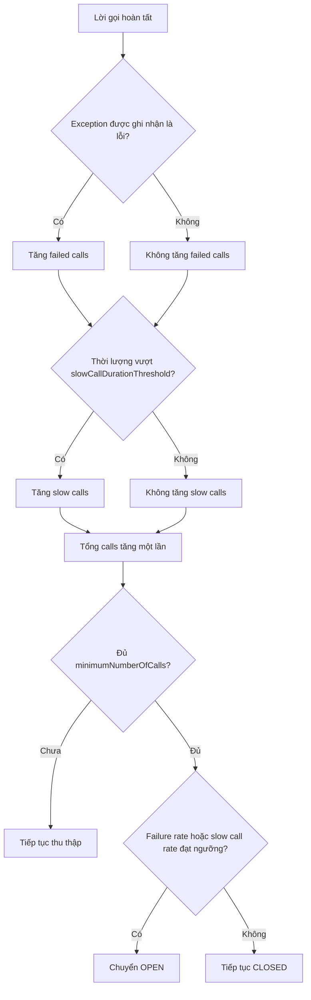

# Lời gọi vừa chậm vừa lỗi được ghi nhận như thế nào

Trong Spring Cloud Circuit Breaker sử dụng Resilience4j, mỗi lời gọi được đánh giá theo hai khía cạnh độc lập: kết quả có phải là lỗi hay không và thời gian thực thi có vượt ngưỡng lời gọi chậm hay không. Vì vậy, một lời gọi kết thúc bằng lỗi sau khi chạy quá lâu có thể đồng thời được tính là **một lời gọi lỗi** và **một lời gọi chậm**.

Hai nhãn này phục vụ hai tỷ lệ khác nhau trong circuit breaker. Chúng không biến một request thành hai request trong cửa sổ thống kê: tổng số lời gọi vẫn chỉ tăng một. Hiểu đúng cách ghi nhận này giúp đọc metric, chọn ngưỡng và giải thích vì sao breaker chuyển sang `OPEN`.

## Kết quả và thời lượng là hai phép đánh giá riêng

Khi lời gọi được bảo vệ hoàn tất, circuit breaker nhận thời lượng thực thi cùng kết quả của lời gọi. Resilience4j đánh giá:

- **Kết quả lỗi:** exception có được cấu hình hoặc predicate ghi nhận là lỗi hay không.
- **Kết quả chậm:** thời lượng thực thi có vượt `slowCallDurationThreshold` hay không.

Hai điều kiện không loại trừ nhau. Một lời gọi có thể thành công nhanh, thành công chậm, thất bại nhanh hoặc thất bại chậm.

| Tình huống | Tăng tổng số lời gọi | Tăng số lời gọi lỗi | Tăng số lời gọi chậm |
|---|---:|---:|---:|
| Thành công và nhanh | 1 | 0 | 0 |
| Thành công nhưng chậm | 1 | 0 | 1 |
| Lỗi nhưng nhanh | 1 | 1 | 0 |
| Lỗi và chậm | 1 | 1 | 1 |

Ví dụ: dịch vụ thanh toán mất 1,8 giây rồi ném `TimeoutException`. Nếu `slowCallDurationThreshold` là 1 giây và exception đó được ghi nhận là lỗi, lời gọi này đóng góp một đơn vị vào tổng số lời gọi, một đơn vị vào số lời gọi lỗi và một đơn vị vào số lời gọi chậm. Nó không được tính thành hai lời gọi trong mẫu số.

## Cách sliding window tổng hợp kết quả

Resilience4j hỗ trợ hai kiểu cửa sổ thống kê:

- `COUNT_BASED`: cửa sổ chứa kết quả của tối đa N lời gọi gần nhất. Khi có lời gọi mới và cửa sổ đã đầy, kết quả cũ nhất bị loại khỏi phép tổng hợp.
- `TIME_BASED`: cửa sổ chia thành các bucket thời gian; mỗi bucket lưu số liệu tổng hợp của các lời gọi trong khoảng thời gian tương ứng. Khi cửa sổ trượt, bucket cũ hết hạn được loại khỏi số liệu hiện tại.

Mỗi lời gọi được ghi nhận đóng góp vào tổng số lời gọi đúng một lần. Nếu kết quả được phân loại là lỗi, bộ đếm lỗi tăng một. Nếu thời lượng vượt ngưỡng chậm, bộ đếm lời gọi chậm cũng tăng một. Một kết quả vừa lỗi vừa chậm sẽ tăng cả hai bộ đếm chuyên biệt trong cùng một lần cập nhật cửa sổ.

Các tỷ lệ được tính riêng:

\[
\text{Failure rate} = \frac{\text{Số lời gọi lỗi}}{\text{Tổng số lời gọi được ghi nhận}} \times 100\%
\]

\[
\text{Slow call rate} = \frac{\text{Số lời gọi chậm}}{\text{Tổng số lời gọi được ghi nhận}} \times 100\%
\]

Do một lời gọi có thể thuộc cả hai nhóm, không cộng failure rate và slow call rate để suy ra một tỷ lệ lỗi tổng hợp. Hai tỷ lệ có cùng mẫu số nhưng có thể có phần tử giao nhau.

### Ví dụ về phần giao nhau

Giả sử cửa sổ hiện tại có 10 lời gọi được ghi nhận. Trong đó có 3 lời gọi lỗi, 4 lời gọi chậm và 1 lời gọi nằm trong cả hai nhóm.

| Nhóm | Số lời gọi | Tỷ lệ |
|---|---:|---:|
| Tổng số lời gọi | 10 | 100% |
| Lời gọi lỗi | 3 | 30% |
| Lời gọi chậm | 4 | 40% |
| Vừa lỗi vừa chậm | 1 | 10% |

Lời gọi vừa lỗi vừa chậm đã được tính trong cả nhóm lỗi và nhóm chậm. Số lời gọi thuộc ít nhất một trong hai nhóm là 3 + 4 - 1 = 6, không phải 7. Tuy nhiên, circuit breaker không cần tính một tỷ lệ hợp nhất từ con số 6: nó so sánh failure rate 30% với `failureRateThreshold` và slow call rate 40% với `slowCallRateThreshold` riêng rẽ.

## Điều kiện để circuit breaker chuyển sang OPEN

Resilience4j chỉ đánh giá các tỷ lệ sau khi có đủ số lời gọi tối thiểu theo `minimumNumberOfCalls`. Khi đã đủ mẫu, breaker chuyển sang `OPEN` nếu **failure rate đạt ngưỡng hoặc slow call rate đạt ngưỡng**. Chỉ cần một trong hai điều kiện đúng là đủ.

Ví dụ với `failureRateThreshold: 50` và `slowCallRateThreshold: 40`, cửa sổ ở ví dụ trên có failure rate 30% và slow call rate 40%. Breaker mở vì slow call rate đã chạm ngưỡng, dù failure rate vẫn thấp hơn ngưỡng. Việc lời gọi chậm có thành công hay thất bại không thay đổi cách so sánh hai tỷ lệ này.



Sơ đồ mô tả một lời gọi thông thường được ghi nhận trong cửa sổ. Với lời gọi vừa lỗi vừa chậm, cả nhánh tăng `failed calls` và nhánh tăng `slow calls` đều được thực hiện, trong khi `total calls` chỉ tăng một lần.

## Cấu hình minh họa trong Spring Boot

Đoạn cấu hình sau tạo cửa sổ theo số lượng gồm 10 lời gọi gần nhất. Breaker cần ít nhất 5 lời gọi được ghi nhận trước khi đánh giá tỷ lệ; lời gọi chạy lâu hơn một giây được đánh dấu là chậm.

```yaml
resilience4j:
  circuitbreaker:
    instances:
      paymentGateway:
        slidingWindowType: COUNT_BASED
        slidingWindowSize: 10
        minimumNumberOfCalls: 5
        failureRateThreshold: 50
        slowCallRateThreshold: 40
        slowCallDurationThreshold: 1s
        waitDurationInOpenState: 10s
        recordExceptions:
          - java.io.IOException
          - java.util.concurrent.TimeoutException
        ignoreExceptions:
          - com.example.payment.InvalidPaymentRequestException
```

Trong ví dụ, một `TimeoutException` kéo dài hơn một giây được ghi nhận ở cả hai nhóm: lỗi và chậm. `InvalidPaymentRequestException` được cấu hình bỏ qua nên không được ghi nhận như một kết quả lỗi hay thành công trong cửa sổ. Khi dùng `recordExceptions`, hãy bảo đảm các exception cần được xem là lỗi có mặt trong danh sách hoặc được xử lý bởi `recordExceptionPredicate` tương ứng. Các exception bị bỏ qua bởi `ignoreExceptions` không tham gia phép tổng hợp.

Tên exception trong cấu hình là ví dụ minh họa; thay bằng kiểu exception thực tế mà client của dịch vụ phụ thuộc phát ra. Đặc biệt, timeout chỉ làm tăng bộ đếm lỗi khi được circuit breaker phân loại là lỗi. Nó chỉ làm tăng bộ đếm lời gọi chậm khi thời lượng mà breaker đo được vượt `slowCallDurationThreshold`.

## Đọc metric và xử lý tình huống thực tế

Khi quan sát circuit breaker, hãy xem riêng tổng số lời gọi, số lời gọi lỗi, số lời gọi chậm, failure rate và slow call rate. Không suy luận rằng mọi lời gọi lỗi đều chậm hoặc mọi lời gọi chậm đều thất bại. Ví dụ, phản hồi HTTP 200 sau 2,5 giây có thể chỉ thuộc nhóm chậm; một lỗi kết nối xảy ra sau 50 mili giây có thể chỉ thuộc nhóm lỗi.

Nếu breaker mở do slow call rate, cần kiểm tra độ trễ của dịch vụ phụ thuộc, thời gian chờ ở client, tải và giới hạn tài nguyên. Nếu breaker mở do failure rate, hãy kiểm tra loại exception, lỗi mạng, lỗi ứng dụng và chính sách retry. Với lời gọi vừa lỗi vừa chậm, cần xem cả hai khía cạnh: dịch vụ vừa không cung cấp kết quả thành công vừa chiếm thời gian chờ đáng kể của caller.

Một số điểm cần kiểm tra khi thử nghiệm:

1. Gọi một request thành công nhanh và xác nhận chỉ tổng số lời gọi tăng.
2. Gọi một request thành công nhưng vượt ngưỡng thời gian và xác nhận số lời gọi chậm tăng.
3. Gọi một request thất bại nhanh và xác nhận số lời gọi lỗi tăng.
4. Gọi một request thất bại sau khi vượt ngưỡng thời gian và xác nhận cả hai bộ đếm lỗi và chậm tăng, còn tổng số lời gọi chỉ tăng một.
5. Kiểm tra một exception bị bỏ qua và xác nhận nó không làm tăng tỷ lệ lỗi hoặc tỷ lệ chậm trong cửa sổ.
6. Tạo đủ số mẫu theo `minimumNumberOfCalls`, sau đó kiểm tra breaker mở khi một trong hai tỷ lệ chạm ngưỡng.

Trong ứng dụng thực tế, hãy kết hợp metric với sự kiện chuyển trạng thái của Resilience4j để biết breaker mở do tỷ lệ lỗi hay tỷ lệ lời gọi chậm. Điều này giúp chọn đúng biện pháp: xử lý lỗi phụ thuộc, tối ưu độ trễ, điều chỉnh timeout hoặc điều chỉnh ngưỡng dựa trên đặc tính tải thực tế.
