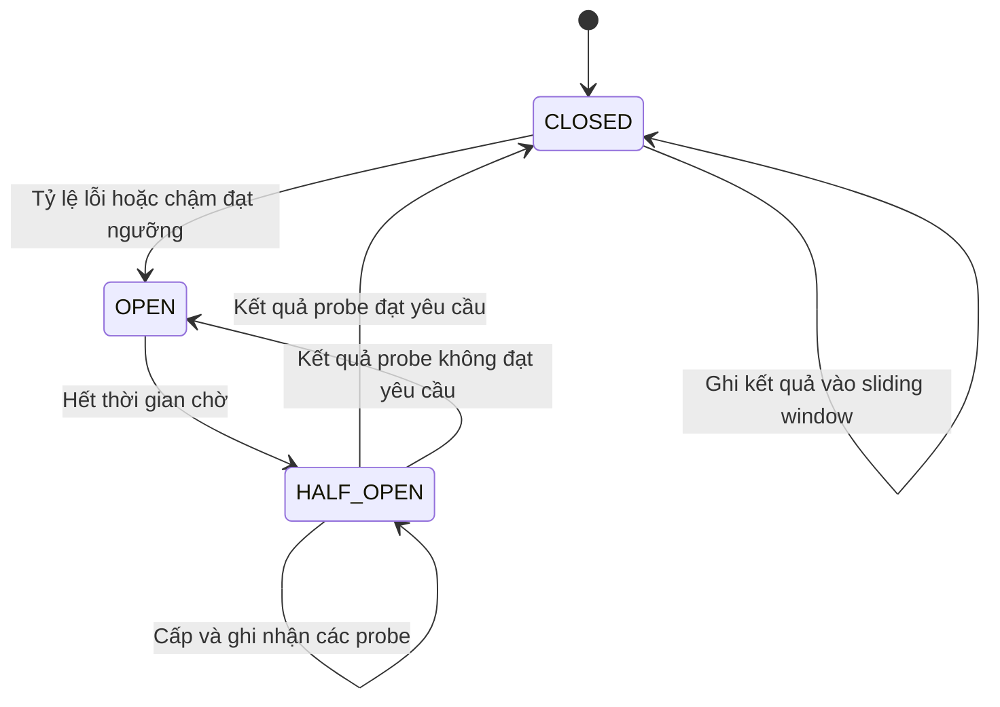

# Mẫu thống kê trong HALF_OPEN khác cửa sổ ở CLOSED

## Mục tiêu

Circuit Breaker dùng kết quả lời gọi để quyết định khi nào cần ngắt kết nối tới một dịch vụ phụ thuộc và khi nào có thể cho phép lưu lượng quay lại. Tuy nhiên, cách thu thập mẫu ở `CLOSED` và `HALF_OPEN` phục vụ hai quyết định khác nhau. `CLOSED` theo dõi lưu lượng bình thường bằng sliding window; `HALF_OPEN` giới hạn một nhóm lời gọi thăm dò để kiểm tra khả năng phục hồi.

Sau bài học, bạn có thể:

- Giải thích sliding window ghi nhận kết quả lời gọi trong `CLOSED`.
- Phân biệt `slidingWindowSize`, `minimumNumberOfCalls` và `permittedNumberOfCallsInHalfOpenState`.
- Tính tỷ lệ lỗi và tỷ lệ lời gọi chậm trong một cửa sổ hoặc một lượt thăm dò.
- Chọn số mẫu phù hợp, đọc metric và thiết kế thử nghiệm để quan sát chuyển trạng thái.

## Hai cơ chế thu thập mẫu, hai mục đích

Ở `CLOSED`, dịch vụ đang nhận lưu lượng bình thường. Circuit Breaker liên tục ghi nhận kết quả lời gọi vào một sliding window để đánh giá sức khỏe của dịch vụ theo một tập mẫu gần đây. Cửa sổ trượt giúp quyết định phản ánh tình hình hiện tại thay vì bị chi phối mãi bởi các lỗi đã xảy ra từ lâu.

Ở `HALF_OPEN`, Circuit Breaker vừa hết thời gian chờ trong `OPEN` và muốn kiểm tra xem dịch vụ đã phục hồi hay chưa. Nó chỉ cấp một số lượng lời gọi thăm dò có giới hạn. Các kết quả của lượt thăm dò được dùng để quyết định đóng mạch hay quay lại `OPEN`. Đây là một đợt kiểm tra có giới hạn, không phải một cửa sổ liên tục trượt theo lưu lượng bình thường.

| Khía cạnh | `CLOSED` | `HALF_OPEN` |
|---|---|---|
| Mục đích | Theo dõi sức khỏe trong quá trình phục vụ bình thường. | Kiểm tra dịch vụ sau khi đã bị ngắt. |
| Mẫu được ghi nhận | Các lời gọi được Circuit Breaker xử lý trong cửa sổ gần nhất. | Các lời gọi thăm dò được cấp phép trong lượt kiểm tra phục hồi. |
| Cách giới hạn mẫu | Sliding window theo số lời gọi hoặc theo thời gian. | Số lời gọi tối đa được cấu hình cho một lượt thăm dò. |
| Cấu hình chính | `slidingWindowType`, `slidingWindowSize`, `minimumNumberOfCalls`. | `permittedNumberOfCallsInHalfOpenState`, `maxWaitDurationInHalfOpenState`. |
| Quyết định | Đạt ngưỡng lỗi hoặc lời gọi chậm thì chuyển sang `OPEN`. | Kết quả thăm dò đạt ngưỡng thì quay lại `OPEN`; nếu đạt yêu cầu thì chuyển về `CLOSED`. |

Luồng tổng quát:



Điểm cần nhớ: `slidingWindowSize` không quyết định có bao nhiêu probe trong `HALF_OPEN`, còn `permittedNumberOfCallsInHalfOpenState` không quyết định kích thước cửa sổ ở `CLOSED`.

## Sliding window trong CLOSED

Resilience4j hỗ trợ hai kiểu cửa sổ:

- `COUNT_BASED`: cửa sổ giữ kết quả của tối đa N lời gọi gần nhất. Ví dụ `slidingWindowSize: 20` nghĩa là đánh giá trên tối đa 20 kết quả gần nhất.
- `TIME_BASED`: cửa sổ bao phủ N giây gần nhất. Ví dụ `slidingWindowSize: 10` nghĩa là đánh giá trên khoảng thời gian 10 giây gần nhất; các kết quả được tổng hợp theo từng khoảng thời gian trong cửa sổ.

`minimumNumberOfCalls` quy định số mẫu tối thiểu phải được ghi nhận trước khi Circuit Breaker tính tỷ lệ để so sánh với ngưỡng. Thuộc tính này tránh đưa ra quyết định chỉ từ một vài lời gọi đầu tiên. Nó đặc biệt quan trọng với dịch vụ có lưu lượng thấp.

Hai tỷ lệ thường dùng là:

\[
\text{Failure rate} = \frac{\text{số lời gọi thất bại}}{\text{số lời gọi được ghi nhận}} \times 100\%
\]

\[
\text{Slow call rate} = \frac{\text{số lời gọi chậm}}{\text{số lời gọi được ghi nhận}} \times 100\%
\]

Một lời gọi được xem là chậm khi thời lượng của nó bằng hoặc vượt `slowCallDurationThreshold`. Circuit Breaker có thể chuyển sang `OPEN` khi tỷ lệ lỗi đạt `failureRateThreshold` hoặc tỷ lệ lời gọi chậm đạt `slowCallRateThreshold`, sau khi đã có đủ số mẫu tối thiểu. Các ngoại lệ được cấu hình bỏ qua không được xem như lỗi thông thường để tính ngưỡng.

Ví dụ cấu hình cửa sổ theo số lời gọi:

```yaml
resilience4j:
  circuitbreaker:
    instances:
      inventory:
        slidingWindowType: COUNT_BASED
        slidingWindowSize: 20
        minimumNumberOfCalls: 10
        failureRateThreshold: 50
        slowCallRateThreshold: 60
        slowCallDurationThreshold: 1s
        waitDurationInOpenState: 10s
```

Trong ví dụ này, cửa sổ có thể giữ tối đa 20 kết quả gần nhất, nhưng Circuit Breaker bắt đầu đánh giá tỷ lệ sau khi có ít nhất 10 lời gọi được ghi nhận. Nếu 10 lời gọi đầu tiên có 5 lời gọi thất bại, tỷ lệ lỗi là 50% và đạt ngưỡng đã cấu hình; mạch có thể chuyển sang `OPEN` ngay ở thời điểm đó. Không cần chờ đủ 20 lời gọi mới được đánh giá.

Khi có thêm lời gọi, cửa sổ `COUNT_BASED` tiếp tục giữ các kết quả gần nhất và loại dần kết quả cũ ra khỏi cửa sổ. Với `TIME_BASED`, kết quả cũ rời khỏi phạm vi khi khoảng thời gian tương ứng trượt ra ngoài cửa sổ. Vì vậy, một đợt lỗi cũ có thể dần không còn ảnh hưởng khi dịch vụ hoạt động ổn định trở lại.

## Mẫu thăm dò trong HALF_OPEN

Khi `OPEN` hết thời gian chờ, Circuit Breaker chuyển sang `HALF_OPEN` theo cấu hình tự động hoặc khi có lời gọi tiếp theo. Resilience4j dùng `permittedNumberOfCallsInHalfOpenState` để giới hạn số lời gọi được phép đi qua trong lượt thăm dò.

Ví dụ:

```yaml
resilience4j:
  circuitbreaker:
    instances:
      inventory:
        waitDurationInOpenState: 10s
        permittedNumberOfCallsInHalfOpenState: 4
        maxWaitDurationInHalfOpenState: 6s
        failureRateThreshold: 50
        slowCallRateThreshold: 50
        slowCallDurationThreshold: 1s
```

Ở đây, tối đa bốn lời gọi được cấp phép trong một lượt `HALF_OPEN`. Các yêu cầu đến thêm trong khi các probe đang được xử lý sẽ bị từ chối vì không còn giấy phép. Sau khi có đủ kết quả để đánh giá, Circuit Breaker so sánh tỷ lệ lỗi và tỷ lệ lời gọi chậm với các ngưỡng đã cấu hình:

- Nếu các tỷ lệ nằm dưới ngưỡng, mạch chuyển về `CLOSED` và lưu lượng bình thường được tiếp nhận.
- Nếu tỷ lệ lỗi hoặc tỷ lệ lời gọi chậm đạt hay vượt ngưỡng, mạch quay lại `OPEN` và bắt đầu thời gian chờ mới.

`maxWaitDurationInHalfOpenState` giới hạn thời gian Circuit Breaker ở `HALF_OPEN`. Giá trị `0` có nghĩa là không đặt giới hạn thời gian. Khi đặt một thời lượng dương, cấu hình này giúp tránh giữ trạng thái thăm dò quá lâu nếu các lời gọi không hoàn tất. Cần phối hợp thời lượng này với timeout của lời gọi để probe có cơ hội trả kết quả trước hạn.

Số probe là hạn mức của một lượt kiểm tra phục hồi. Nó không phải số mẫu cần tích lũy qua nhiều phút hoặc nhiều yêu cầu bình thường. Khi một lượt thăm dò kết thúc và mạch trở về `OPEN` hoặc `CLOSED`, quyết định tiếp theo sẽ thuộc một giai đoạn trạng thái mới.

## Ví dụ tính tỷ lệ ở hai trạng thái

Giả sử cấu hình có `failureRateThreshold: 50` và `slowCallRateThreshold: 50`.

Trong `CLOSED`, cấu hình `slidingWindowSize: 20` và `minimumNumberOfCalls: 10`. Khi cửa sổ đang có 10 mẫu được ghi nhận:

| Kết quả trong 10 lời gọi | Tỷ lệ lỗi | Kết quả đánh giá |
|---|---:|---|
| 2 lỗi, 1 lời gọi chậm | 20% lỗi, 10% chậm | Chưa đạt ngưỡng. |
| 5 lỗi, 0 lời gọi chậm | 50% lỗi, 0% chậm | Đạt ngưỡng lỗi, chuyển `OPEN`. |
| 1 lỗi, 6 lời gọi chậm | 10% lỗi, 60% chậm | Đạt ngưỡng lời gọi chậm, chuyển `OPEN`. |

Sau thời gian chờ, giả sử mạch chuyển sang `HALF_OPEN` với `permittedNumberOfCallsInHalfOpenState: 4`. Bốn probe tạo thành mẫu cho lượt kiểm tra này:

| Kết quả của 4 probe | Tỷ lệ lỗi | Tỷ lệ chậm | Kết quả đánh giá |
|---|---:|---:|---|
| 0 lỗi, 0 chậm | 0% | 0% | Đạt yêu cầu, có thể về `CLOSED`. |
| 1 lỗi, 1 chậm | 25% | 25% | Cả hai tỷ lệ dưới ngưỡng, có thể về `CLOSED`. |
| 2 lỗi, 0 chậm | 50% | 0% | Đạt ngưỡng lỗi, quay lại `OPEN`. |
| 0 lỗi, 2 chậm | 0% | 50% | Đạt ngưỡng lời gọi chậm, quay lại `OPEN`. |

Ví dụ này cho thấy `minimumNumberOfCalls: 10` không buộc `HALF_OPEN` phải chờ 10 probe. Số probe được quyết định bởi `permittedNumberOfCallsInHalfOpenState: 4`. Tương tự, `slidingWindowSize: 20` không có nghĩa là Circuit Breaker phải gửi 20 lời gọi thăm dò.

Các phép tính trên giả định tất cả mẫu được tính vào tỷ lệ tương ứng. Trong ứng dụng thật, hãy tính theo các kết quả Circuit Breaker thực sự ghi nhận; ngoại lệ bị bỏ qua và lời gọi bị từ chối do không được cấp phép có cách xử lý riêng, không nên tự cộng chúng vào mẫu thất bại.

## Chọn kích thước cửa sổ và số probe

Không có một giá trị đúng cho mọi dịch vụ. Hãy chọn theo lưu lượng, mức độ biến động và tải mà dịch vụ phụ thuộc có thể chịu được.

**Với sliding window ở CLOSED:**

- Dùng `COUNT_BASED` khi muốn quyết định dựa trên số lượng lời gọi gần nhất, đặc biệt khi lưu lượng tương đối đều.
- Dùng `TIME_BASED` khi muốn cửa sổ đại diện cho một khoảng thời gian thực, nhất là khi lưu lượng thay đổi mạnh theo giờ hoặc theo đợt.
- Chọn `minimumNumberOfCalls` đủ lớn để tránh phản ứng quá mức với vài mẫu ngẫu nhiên, nhưng đủ nhỏ để Circuit Breaker nhận ra sự cố trong thời gian phù hợp.
- Đảm bảo cửa sổ có thể chứa đủ số mẫu để đạt `minimumNumberOfCalls`; đồng thời cân nhắc tốc độ lỗi cần phát hiện và độ trễ chấp nhận được.

**Với probe ở HALF_OPEN:**

- Chọn số probe nhỏ để giảm tải lên dịch vụ vừa phục hồi.
- Chọn đủ mẫu để một kết quả đơn lẻ không chi phối quyết định quá mạnh.
- Đặt timeout hợp lý để probe không chiếm giấy phép vô thời hạn.
- Kiểm tra khả năng chịu tải của dịch vụ phụ thuộc khi nhiều instance ứng dụng cùng chuyển sang `HALF_OPEN`. Mỗi instance có Circuit Breaker riêng có thể tạo ra tổng số probe lớn hơn dự kiến nếu tất cả cùng thăm dò một lúc.

Ví dụ, nếu có 8 instance ứng dụng và mỗi instance cho phép 4 probe, tổng cộng có thể có tới 32 probe đồng thời tới dịch vụ phụ thuộc khi các bộ ngắt mạch cùng chuyển sang `HALF_OPEN`. Vì vậy, số probe trên một instance cần được xem cùng số instance triển khai, cơ chế cân bằng tải và khả năng phục hồi của dịch vụ đích.

## Những yếu tố làm thay đổi ý nghĩa của mẫu

**Retry:** vị trí của Retry so với Circuit Breaker quyết định một probe đại diện cho một lần thử hay cho cả chuỗi thử lại. Nếu mỗi lần thử lại đi qua Circuit Breaker, nó có thể tiêu thụ thêm giấy phép và được ghi nhận như một lời gọi riêng. Cần giới hạn retry và phối hợp backoff với timeout để không khuếch đại tải trong lúc phục hồi.

**Timeout:** một lời gọi vượt thời hạn có thể được ghi nhận là thất bại hoặc lời gọi chậm tùy cách tích hợp và cấu hình. Đặt timeout dài hơn thời gian mà hệ thống có thể chờ sẽ làm probe giữ tài nguyên lâu; đặt quá ngắn có thể khiến dịch vụ khỏe nhưng phản hồi chậm nhất thời bị đánh giá không đạt.

**Fallback:** fallback được chạy sau khi Circuit Breaker xử lý kết quả lỗi. Một fallback trả về dữ liệu hợp lệ cho người gọi không biến lời gọi tới dịch vụ phụ thuộc thành thành công trong mẫu của Circuit Breaker. Khi phân tích metric, hãy phân biệt kết quả fallback với kết quả gốc của lời gọi phụ thuộc.

**Bulkhead:** lời gọi bị từ chối vì hết giấy phép Bulkhead phản ánh giới hạn tài nguyên tại ứng dụng. Hãy quyết định rõ ngoại lệ này có nên ảnh hưởng tới tỷ lệ lỗi sức khỏe dịch vụ phụ thuộc hay không; có thể cấu hình ngoại lệ bị bỏ qua nếu nó không phản ánh lỗi của dịch vụ đích.

## Theo dõi và kiểm chứng

Với Spring Boot Actuator và Micrometer được tích hợp, có thể quan sát các metric Resilience4j như:

- `resilience4j.circuitbreaker.state`: trạng thái hiện tại của instance.
- `resilience4j.circuitbreaker.calls`: số lời gọi theo kết quả và loại lời gọi.
- `resilience4j.circuitbreaker.failure.rate`: tỷ lệ lỗi được tính.
- `resilience4j.circuitbreaker.slow.call.rate`: tỷ lệ lời gọi chậm.
- `resilience4j.circuitbreaker.buffered.calls`: số kết quả được lưu trong cửa sổ.
- `resilience4j.circuitbreaker.not.permitted.calls`: số lời gọi bị từ chối do Circuit Breaker không cấp phép.

Tên metric và tag có thể thay đổi theo phiên bản thư viện, registry và cấu hình. Hãy xem các metric thực tế được xuất ra từ ứng dụng trước khi viết truy vấn dashboard hoặc cảnh báo. Khi ở `HALF_OPEN`, kết hợp trạng thái với số lời gọi được phép, số lời gọi bị từ chối và kết quả probe để hiểu vì sao mạch đóng lại hay mở lại.

Một bài kiểm tra có kiểm soát có thể thực hiện như sau:

1. Khởi động dịch vụ phụ thuộc ở trạng thái khỏe và gửi đủ yêu cầu để tạo mẫu trong `CLOSED`.
2. Làm dịch vụ trả lỗi hoặc chậm có chủ đích; xác nhận tỷ lệ trong sliding window đạt ngưỡng và Circuit Breaker chuyển sang `OPEN`.
3. Gửi thêm yêu cầu khi mạch `OPEN`; xác nhận chúng bị từ chối nhanh và không tiếp tục gọi dịch vụ phụ thuộc.
4. Khôi phục dịch vụ, chờ hết `waitDurationInOpenState` rồi kích hoạt `HALF_OPEN`.
5. Gửi nhiều yêu cầu gần đồng thời; xác nhận chỉ số lời gọi được cấp phép không vượt `permittedNumberOfCallsInHalfOpenState` và các yêu cầu vượt hạn mức bị từ chối.
6. Cho probe thành công rồi lặp lại với lỗi hoặc độ trễ có chủ đích; quan sát mạch lần lượt về `CLOSED` hoặc `OPEN` theo các ngưỡng.

Ghi lại số lời gọi, kết quả, độ trễ và trạng thái ở mỗi bước. Dùng cùng một kịch bản tải khi thay đổi `slidingWindowSize`, `minimumNumberOfCalls` hoặc số probe để so sánh khả năng phát hiện sự cố và tải tạo ra trong lúc phục hồi.

## Lỗi thường gặp

- **Dùng `slidingWindowSize` để điều chỉnh số probe:** hãy dùng `permittedNumberOfCallsInHalfOpenState` cho lượt thăm dò.
- **Cho rằng `minimumNumberOfCalls` áp dụng cho HALF_OPEN:** thuộc tính này đặt số mẫu tối thiểu để đánh giá sliding window trong `CLOSED`; số probe có cấu hình riêng.
- **Chọn cửa sổ quá nhỏ:** một vài lỗi ngẫu nhiên có thể làm tỷ lệ tăng đột ngột và mở mạch.
- **Chọn cửa sổ quá lớn:** sự cố có thể cần nhiều thời gian hoặc nhiều lời gọi mới đạt ngưỡng, khiến bảo vệ phản ứng chậm.
- **Cho phép quá nhiều probe:** dịch vụ vừa phục hồi có thể nhận một đợt tải lớn ngay lập tức, đặc biệt khi có nhiều instance ứng dụng.
- **Cho phép quá ít probe:** mẫu quá nhỏ có thể không đại diện cho chất lượng dịch vụ; một kết quả đơn lẻ dễ chi phối tỷ lệ.
- **Bỏ qua timeout và retry:** probe có thể giữ giấy phép lâu hoặc tạo nhiều yêu cầu hơn dự kiến.
- **Đọc fallback như thành công của dịch vụ đích:** fallback cải thiện phản hồi cho người gọi nhưng không xóa kết quả lỗi gốc mà Circuit Breaker đã ghi nhận.

Sliding window ở `CLOSED` trả lời câu hỏi “dịch vụ đang hoạt động bình thường có khỏe trong các mẫu gần đây không?”. Các probe ở `HALF_OPEN` trả lời câu hỏi “dịch vụ vừa được ngắt đã đủ khỏe để nhận lại lưu lượng chưa?”. Khi cấu hình đúng hai cơ chế theo mục đích riêng, Circuit Breaker vừa phát hiện sự cố trong quá trình vận hành vừa kiểm tra phục hồi với tải được kiểm soát.
