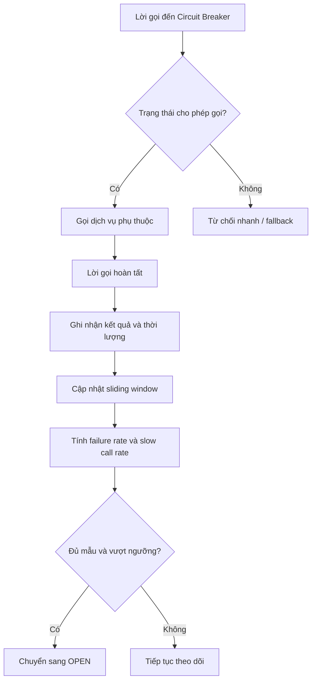

# Cửa sổ thống kê không phải giới hạn số lời gọi đồng thời

Trong Spring Cloud CircuitBreaker với backend Resilience4j, `slidingWindowSize` xác định phạm vi các kết quả lời gọi được dùng để tính tỷ lệ lỗi và tỷ lệ lời gọi chậm. Tham số này điều khiển cách Circuit Breaker quan sát sức khỏe của dịch vụ phụ thuộc. Nó không giới hạn số request được chạy cùng lúc, không giới hạn số thread và cũng không tự xếp hàng các lời gọi.

Sự khác biệt này rất quan trọng khi dịch vụ phụ thuộc phản hồi chậm. Một cửa sổ thống kê có kích thước 20 không có nghĩa là chỉ 20 lời gọi được phép chạy đồng thời. Nếu cần giới hạn số lời gọi đang hoạt động, hãy dùng Bulkhead. Circuit Breaker và Bulkhead giải quyết hai vấn đề khác nhau và có thể được kết hợp.

## Cửa sổ trượt dùng để làm gì?

Circuit Breaker ghi nhận kết quả của các lời gọi đã hoàn tất, sau đó dùng các mẫu trong cửa sổ trượt để tính:

- **Failure rate:** tỷ lệ lời gọi được phân loại là thất bại theo chính sách ghi nhận lỗi của Circuit Breaker.
- **Slow call rate:** tỷ lệ lời gọi có thời gian thực thi lớn hơn hoặc bằng `slowCallDurationThreshold`.

Khi số mẫu tối thiểu đã đạt và một trong các tỷ lệ vượt ngưỡng tương ứng, Circuit Breaker có thể chuyển từ `CLOSED` sang `OPEN`. Trong `OPEN`, lời gọi mới bị từ chối nhanh. Sau khoảng chờ, mạch chuyển sang `HALF_OPEN` để đánh giá một số lời gọi thử.

Một lời gọi đang chạy chưa có kết quả cuối cùng nên chưa đóng góp một mẫu hoàn chỉnh vào cửa sổ. Khi lời gọi kết thúc, Resilience4j mới ghi nhận thời lượng và kết quả của nó. Cửa sổ thống kê vì thế mô tả các kết quả quan sát được trong một phạm vi, chứ không phải số lượng request hiện đang nằm trong hệ thống.

## Hai loại sliding window

Resilience4j hỗ trợ hai kiểu cửa sổ:

| Kiểu | Ý nghĩa của `slidingWindowSize` | Cách cửa sổ dịch chuyển | Phù hợp khi |
|---|---|---|---|
| `COUNT_BASED` | Số lời gọi đã ghi nhận gần nhất | Mỗi kết quả mới được thêm vào; khi vượt kích thước, mẫu cũ nhất bị loại | Muốn đánh giá dựa trên một số lượng lời gọi gần nhất |
| `TIME_BASED` | Số giây gần nhất | Cửa sổ giữ các thống kê theo từng khoảng thời gian trong phạm vi số giây cấu hình | Muốn đánh giá theo một khoảng thời gian tương đối ổn định dù lưu lượng thay đổi |

Ví dụ với `COUNT_BASED` và `slidingWindowSize: 20`, cửa sổ thống kê tối đa 20 kết quả gần nhất. Nếu có 100 lời gọi hoàn tất, 20 kết quả mới nhất sẽ đại diện cho cửa sổ tại thời điểm đó. Kích thước 20 không giới hạn 20 lời gọi đồng thời; 100 lời gọi vẫn có thể đã chạy chồng lấp trước khi các kết quả được ghi nhận.

Với `TIME_BASED` và `slidingWindowSize: 10`, cửa sổ đại diện cho 10 giây gần nhất. Nếu dịch vụ nhận nhiều request trong 10 giây, cửa sổ có thể tổng hợp kết quả của rất nhiều lời gọi. Nếu lưu lượng thấp, cửa sổ có thể chỉ có một vài mẫu. Con số 10 ở đây là số giây, không phải số lời gọi.



Sơ đồ cho thấy cửa sổ được cập nhật từ kết quả lời gọi. Nhánh kiểm soát số lời gọi đang hoạt động là một cơ chế riêng, được trình bày ở phần Bulkhead.

## `minimumNumberOfCalls` là ngưỡng mẫu, không phải giới hạn đồng thời

`minimumNumberOfCalls` quy định số lượng mẫu tối thiểu cần có trong cửa sổ trước khi Circuit Breaker tính tỷ lệ lỗi và tỷ lệ lời gọi chậm để quyết định mở mạch. Khi chưa đủ mẫu, mạch chưa có đủ dữ liệu theo cấu hình để áp dụng các ngưỡng tỷ lệ.

Giả sử cấu hình `COUNT_BASED` có `slidingWindowSize: 20` và `minimumNumberOfCalls: 10`. Sau 4 lời gọi hoàn tất, Circuit Breaker chưa tính tỷ lệ để quyết định mở mạch. Khi đã có ít nhất 10 mẫu trong cửa sổ, nó có thể tính tỷ lệ và so sánh với ngưỡng. Điều này không có nghĩa phải đợi cho đến khi có 10 lời gọi đồng thời, cũng không có nghĩa chỉ 10 lời gọi được chạy.

Trong thực tế, hãy chọn `minimumNumberOfCalls` sao cho có thể đạt được trong cửa sổ và phù hợp với lưu lượng của dịch vụ. Giá trị quá cao có thể khiến mạch phản ứng chậm ở dịch vụ ít request; giá trị quá thấp khiến một số ít kết quả có ảnh hưởng lớn đến tỷ lệ. Với cửa sổ đếm, không đặt số mẫu tối thiểu lớn hơn số mẫu tối đa mà cửa sổ có thể giữ.

## Ví dụ cấu hình Circuit Breaker

Đoạn YAML dưới đây cấu hình một Circuit Breaker tên `catalog`. Cửa sổ đếm theo 20 lời gọi gần nhất; cần ít nhất 10 mẫu trước khi tính tỷ lệ. Mạch mở nếu tỷ lệ lỗi đạt 50% hoặc tỷ lệ lời gọi chậm đạt 50% theo các ngưỡng đã đặt.

```yaml
resilience4j:
  circuitbreaker:
    instances:
      catalog:
        slidingWindowType: COUNT_BASED
        slidingWindowSize: 20
        minimumNumberOfCalls: 10
        failureRateThreshold: 50
        slowCallDurationThreshold: 2s
        slowCallRateThreshold: 50
        waitDurationInOpenState: 10s
        permittedNumberOfCallsInHalfOpenState: 3
```

Nếu muốn đánh giá theo 10 giây gần nhất, thay kiểu cửa sổ và giữ kích thước mang ý nghĩa thời gian:

```yaml
resilience4j:
  circuitbreaker:
    instances:
      catalog:
        slidingWindowType: TIME_BASED
        slidingWindowSize: 10
        minimumNumberOfCalls: 10
        failureRateThreshold: 50
        slowCallDurationThreshold: 2s
        slowCallRateThreshold: 50
```

Ở ví dụ thứ hai, `slidingWindowSize: 10` là 10 giây. `minimumNumberOfCalls: 10` vẫn là số mẫu lời gọi tối thiểu cần quan sát trong cửa sổ đó. Hai tham số có đơn vị và vai trò khác nhau.

Trong Spring Cloud CircuitBreaker, các thuộc tính trên được cấu hình cho backend Resilience4j theo tên instance. Hãy bảo đảm tên mà ứng dụng dùng để tạo Circuit Breaker khớp với `catalog`, đồng thời kiểm tra cấu hình instance và group thực tế khi có nhiều cấp cấu hình. Nếu sử dụng `CircuitBreakerFactory` hoặc API reactive của Spring Cloud CircuitBreaker, cửa sổ vẫn là cấu hình thống kê của Circuit Breaker; cách gọi đồng bộ hay reactive không biến kích thước cửa sổ thành giới hạn concurrency.

## Giới hạn lời gọi đồng thời bằng Bulkhead

Bulkhead giới hạn số lời gọi có thể hoạt động cùng lúc đối với một tài nguyên hoặc dịch vụ phụ thuộc. Với Resilience4j, Semaphore Bulkhead dùng `maxConcurrentCalls` để giới hạn số lời gọi được cấp quyền đồng thời. `maxWaitDuration` quy định thời gian chờ để lấy quyền; đặt thời gian chờ ngắn hoặc bằng 0 giúp từ chối nhanh khi đã hết chỗ.

Ví dụ, kết hợp Circuit Breaker ở trên với Bulkhead cho `catalog`:

```yaml
resilience4j:
  circuitbreaker:
    instances:
      catalog:
        slidingWindowType: COUNT_BASED
        slidingWindowSize: 20
        minimumNumberOfCalls: 10
        failureRateThreshold: 50
        slowCallDurationThreshold: 2s
        slowCallRateThreshold: 50
        waitDurationInOpenState: 10s
        permittedNumberOfCallsInHalfOpenState: 3
  bulkhead:
    instances:
      catalog:
        maxConcurrentCalls: 8
        maxWaitDuration: 100ms
```

Hai cấu hình trên có ý nghĩa riêng:

- `slidingWindowSize: 20` quan sát tối đa 20 kết quả gần nhất để đánh giá chất lượng lời gọi.
- `maxConcurrentCalls: 8` giới hạn tối đa 8 lời gọi được Bulkhead cấp quyền hoạt động đồng thời cho instance đó.
- `maxWaitDuration: 100ms` cho phép lời gọi chờ tối đa 100 mili giây để lấy quyền Bulkhead; nếu không lấy được quyền, lời gọi bị từ chối theo cơ chế Bulkhead.

Vì vậy, trong ví dụ này, số lời gọi đang được bảo vệ bởi Bulkhead có thể bị giới hạn ở 8, trong khi cửa sổ Circuit Breaker vẫn giữ tối đa 20 kết quả. Đổi `slidingWindowSize` từ 20 xuống 5 không làm Bulkhead giảm concurrency từ 8 xuống 5. Muốn thay đổi số lời gọi đồng thời, hãy điều chỉnh `maxConcurrentCalls`.

Bulkhead có thể được triển khai theo kiểu semaphore hoặc thread-pool. Semaphore giới hạn quyền truy cập đồng thời mà không tự tạo một thread pool riêng. Thread-pool Bulkhead cách ly lời gọi trên pool và hàng đợi riêng, do đó cần cấu hình cả kích thước pool và hàng đợi. Hãy chọn loại phù hợp với mô hình thực thi, đặc biệt khi làm việc với WebFlux và các lời gọi reactive; tránh chặn event-loop bằng thao tác chờ đồng bộ.

Circuit Breaker cũng có `permittedNumberOfCallsInHalfOpenState` để giới hạn số lời gọi thử được cấp quyền trong riêng trạng thái `HALF_OPEN`. Đây là giới hạn probe trong giai đoạn phục hồi, không phải giới hạn concurrency chung khi mạch ở `CLOSED`. Nếu cần giới hạn số lời gọi đang chạy trong điều kiện bình thường, hãy cấu hình Bulkhead.

## Phân biệt với timeout và rate limiter

Các cơ chế bảo vệ thường được phối hợp nhưng kiểm soát những đại lượng khác nhau:

| Cơ chế | Kiểm soát điều gì? | Ví dụ cấu hình / ý nghĩa |
|---|---|---|
| Sliding window của Circuit Breaker | Phạm vi mẫu dùng để tính tỷ lệ lỗi và lời gọi chậm | 20 kết quả gần nhất hoặc 10 giây gần nhất |
| Bulkhead | Số lời gọi đang hoạt động đồng thời | Tối đa 8 lời gọi được cấp quyền |
| TimeLimiter / timeout | Thời gian chờ tối đa cho một lời gọi bất đồng bộ | Hết 2 giây thì hoàn tất theo chính sách timeout |
| RateLimiter | Số quyền gọi được cấp trong một khoảng thời gian | Ví dụ tối đa 50 quyền trong mỗi giây |

Timeout không phải giới hạn concurrency: một lời gọi hết thời gian chờ có thể vẫn tiếp tục tiêu thụ tài nguyên ở hệ thống đích nếu việc hủy không được hỗ trợ hoặc không được truyền đi. RateLimiter kiểm soát tốc độ cấp quyền theo thời gian, nhưng không đảm bảo số lời gọi đang chạy đồng thời luôn dưới một ngưỡng cố định khi thời gian xử lý biến động. Bulkhead là cơ chế trực tiếp để đặt giới hạn concurrency.

## Tình huống thực tế: dịch vụ phụ thuộc chậm

Giả sử API sản phẩm gọi dịch vụ `catalog`. Mỗi request có thể mất 3 giây khi dịch vụ phụ thuộc quá tải. Nếu API nhận 60 request trong một khoảng ngắn, nhiều lời gọi có thể cùng chờ phản hồi. Cấu hình Circuit Breaker với cửa sổ 20 mẫu sẽ theo dõi kết quả và thời gian của các lời gọi đã hoàn tất. Nó có thể mở mạch khi tỷ lệ lỗi hoặc tỷ lệ lời gọi chậm vượt ngưỡng, nhưng không tự giới hạn số lời gọi đang chờ.

Nếu thêm Bulkhead với `maxConcurrentCalls: 8`, tối đa 8 lời gọi được cấp quyền đồng thời. Những lời gọi vượt giới hạn sẽ chờ trong khoảng `maxWaitDuration` đã cấu hình hoặc bị từ chối. Ở tầng ứng dụng, nhánh bị từ chối cần có fallback phù hợp, chẳng hạn trả dữ liệu cache hoặc thông báo thử lại sau. Khi Circuit Breaker chuyển `OPEN`, các lời gọi mới cũng bị từ chối nhanh mà không gọi sang `catalog`.

Khi thiết kế thứ tự kết hợp decorator, hãy bảo đảm hành vi lỗi và fallback phù hợp với API đang dùng. Nếu cần quan sát riêng lỗi do Circuit Breaker từ chối và lỗi do Bulkhead hết quyền, hãy ghi nhận metric hoặc event theo từng nguyên nhân. Điều đó giúp đội vận hành biết hệ thống đang chặn lời gọi vì dịch vụ phụ thuộc có tỷ lệ lỗi cao hay vì đã chạm giới hạn concurrency.

## Cách kiểm chứng hành vi

Có thể kiểm chứng hai khái niệm bằng một thử nghiệm có kiểm soát:

1. Cấu hình Circuit Breaker `COUNT_BASED` với `slidingWindowSize: 5`, `minimumNumberOfCalls: 5` và Bulkhead với `maxConcurrentCalls: 2`.
2. Tạo nhiều request đồng thời đến một lời gọi giả lập có thời gian phản hồi dài, chẳng hạn 1 giây.
3. Đo số lời gọi đang hoạt động tại dịch vụ giả lập. Với Bulkhead semaphore, số lời gọi được cấp quyền đồng thời không vượt quá 2; các lời gọi còn lại phải chờ hoặc bị từ chối theo `maxWaitDuration`.
4. Sau khi lời gọi hoàn tất, quan sát metric của Circuit Breaker. Các kết quả được đưa vào cửa sổ 5 mẫu gần nhất; cửa sổ này không quyết định con số 2 ở bước concurrency.
5. Tạo đủ mẫu lỗi hoặc lời gọi chậm để vượt ngưỡng, sau đó xác minh Circuit Breaker chuyển sang `OPEN` và lời gọi mới được từ chối nhanh.

Khi đọc dashboard hoặc log, hãy hỏi hai câu riêng: “Circuit Breaker đang dùng bao nhiêu mẫu để đánh giá dịch vụ?” và “Có bao nhiêu lời gọi đang được phép chạy cùng lúc?”. Câu thứ nhất liên quan đến `slidingWindowType`, `slidingWindowSize` và `minimumNumberOfCalls`; câu thứ hai liên quan đến Bulkhead. Tách biệt hai câu hỏi giúp tránh điều chỉnh sai tham số khi hệ thống gặp quá tải.
