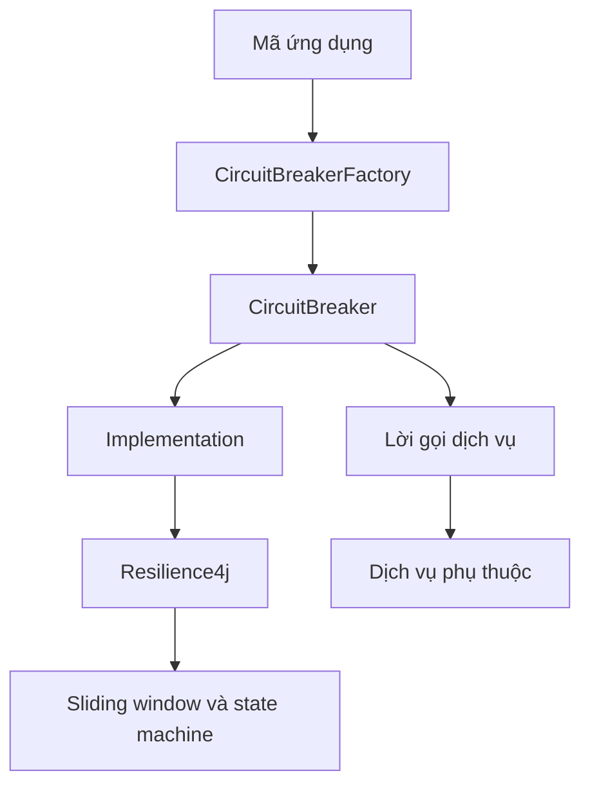

# Hợp đồng CircuitBreakerFactory và CircuitBreaker

Spring Cloud CircuitBreaker cung cấp một lớp API chung để mã ứng dụng gọi dịch vụ thông qua circuit breaker mà không phải phụ thuộc trực tiếp vào API của một thư viện triển khai. Hai thành phần trung tâm của API đồng bộ là `CircuitBreakerFactory` và `CircuitBreaker`: factory cung cấp breaker theo định danh, còn breaker bao quanh một lời gọi và quyết định cách xử lý khi lời gọi thất bại hoặc mạch đang mở.

Trong module Spring Cloud Circuit Breaker, Resilience4j là implementation thường được sử dụng. Khi hiểu đúng ranh giới giữa API chung của Spring Cloud và API riêng của Resilience4j, ứng dụng có thể giữ mã gọi dịch vụ đơn giản, cấu hình chính sách theo từng phụ thuộc và vẫn truy cập được các khả năng chuyên sâu khi cần.

## 1. Vị trí của API chung trong kiến trúc

Một lời gọi dịch vụ từ xa thường có ba phần: mã ứng dụng mô tả công việc cần thực hiện, lớp circuit breaker bảo vệ công việc đó và implementation thực hiện cơ chế thống kê/chuyển trạng thái. Spring Cloud CircuitBreaker đặt một lớp trừu tượng giữa mã ứng dụng và implementation.



Mã ứng dụng yêu cầu factory tạo hoặc cung cấp một breaker theo tên, sau đó đưa lời gọi vào phương thức `run`. Factory và breaker thuộc API Spring Cloud Commons. Resilience4j cung cấp cơ chế cụ thể như `CLOSED`, `OPEN`, `HALF_OPEN`, sliding window, sự kiện, metric và các cấu hình nâng cao.

Lớp API chung giúp mã nghiệp vụ ít phụ thuộc vào implementation. Tuy nhiên, abstraction chỉ cam kết các hành vi được định nghĩa trong hợp đồng chung. Nếu ứng dụng cần đọc trực tiếp trạng thái, đăng ký sự kiện đặc thù, thay đổi trạng thái thủ công hoặc dùng một tùy chọn riêng của Resilience4j, phần mã đó sẽ phụ thuộc vào implementation tương ứng.

## 2. Hợp đồng của CircuitBreakerFactory

`CircuitBreakerFactory` là điểm vào để ứng dụng lấy một breaker. API có dạng tổng quát:

```java
public abstract class CircuitBreakerFactory<CONF, CONFB>
        extends AbstractCircuitBreakerFactory<CONF, CONFB> {
    public abstract CircuitBreaker create(String id);
}
```

Hai tham số kiểu `CONF` và `CONFB` dành cho cơ chế cấu hình của implementation. Ứng dụng thông thường không cần tự tạo hoặc thao tác trực tiếp với chúng khi chỉ muốn lấy breaker để bảo vệ một lời gọi.

Phương thức quan trọng nhất là `create(String id)`:

- `id` là tên logic của breaker, thường đại diện cho một phụ thuộc hoặc một nhóm lời gọi cần có chính sách bảo vệ riêng.
- Giá trị trả về là đối tượng theo hợp đồng `CircuitBreaker` của Spring Cloud.
- Implementation sử dụng `id` để liên kết breaker với cấu hình tương ứng và các dữ liệu quan sát theo instance.

Ví dụ, `inventory` có thể là breaker bảo vệ lời gọi đến dịch vụ tồn kho, còn `pricing` bảo vệ lời gọi đến dịch vụ định giá. Hai ID riêng giúp cấu hình ngưỡng lỗi, timeout và fallback theo đặc tính của từng phụ thuộc.

```java
import org.springframework.cloud.client.circuitbreaker.CircuitBreaker;
import org.springframework.cloud.client.circuitbreaker.CircuitBreakerFactory;
import org.springframework.stereotype.Service;

@Service
public class InventoryGateway {
    private final InventoryClient inventoryClient;
    private final CircuitBreakerFactory<?, ?> circuitBreakerFactory;

    public InventoryGateway(
            InventoryClient inventoryClient,
            CircuitBreakerFactory<?, ?> circuitBreakerFactory) {
        this.inventoryClient = inventoryClient;
        this.circuitBreakerFactory = circuitBreakerFactory;
    }

    public InventoryView find(String sku) {
        CircuitBreaker breaker = circuitBreakerFactory.create("inventory");
        return breaker.run(
                () -> inventoryClient.find(sku),
                failure -> InventoryView.unavailable(sku)
        );
    }
}
```

`InventoryClient` và `InventoryView` là kiểu của ứng dụng trong ví dụ. Điểm quan trọng là mã gọi chỉ cần biết factory, ID và hợp đồng `run`; nó không cần biết Resilience4j đang dùng cấu trúc dữ liệu nào để tính tỷ lệ lỗi.

Không nên tạo một factory mới trong mỗi lần xử lý yêu cầu. Factory thường được Spring quản lý như một bean và được inject vào thành phần cần sử dụng. Mỗi lời gọi có thể lấy breaker theo ID tương ứng; việc quản lý instance và cấu hình cụ thể do implementation đảm nhiệm.

## 3. Hợp đồng của CircuitBreaker

`CircuitBreaker` của Spring Cloud cung cấp hai dạng gọi đồng bộ cơ bản:

```java
import java.util.function.Function;
import java.util.function.Supplier;

public interface CircuitBreaker {
    <T> T run(Supplier<T> toRun);

    <T> T run(
            Supplier<T> toRun,
            Function<Throwable, T> fallback
    );
}
```

Hai kiểu hàm sử dụng từ Java:

- `Supplier<T>` mô tả công việc cần thực hiện và tạo ra kết quả kiểu `T`.
- `Function<Throwable, T>` nhận nguyên nhân lỗi và tạo ra kết quả thay thế cùng kiểu `T`.

Phương thức `run` đưa công việc qua breaker. Khi breaker cho phép, supplier được thực thi và kết quả được trả về cho bên gọi. Implementation ghi nhận kết quả để cập nhật thống kê. Khi breaker đang mở hoặc supplier phát sinh lỗi, lời gọi có thể đi vào nhánh fallback nếu overload có fallback được sử dụng.

Hai overload phục vụ hai chính sách khác nhau:

| Phương thức | Hành vi khi có lỗi |
|---|---|
| `run(toRun)` | Không định nghĩa kết quả thay thế; lỗi được truyền về bên gọi theo hành vi của implementation |
| `run(toRun, fallback)` | Gọi hàm fallback để tạo kết quả thay thế cho lỗi mà breaker chuyển đến nhánh xử lý |

Fallback phải trả về đúng kiểu `T` mà lời gọi chính dự kiến trả về. Ví dụ, lời gọi lấy tồn kho trả `InventoryView` thì fallback cũng cần tạo `InventoryView`. Không nên trả về một đối tượng có ý nghĩa nghiệp vụ sai chỉ để tránh exception.

Fallback là một phần của luồng xử lý lỗi, không phải bằng chứng rằng lời gọi dịch vụ đã thành công. Nếu fallback cũng phát sinh lỗi, lỗi đó có thể tiếp tục được truyền lên tầng gọi. Vì vậy, fallback cần đơn giản, có giới hạn tài nguyên và tránh gọi lại chính phụ thuộc đang gặp sự cố.

## 4. Phân biệt lỗi của supplier và lời gọi bị từ chối

Có ít nhất hai tình huống khiến mã xử lý không nhận được kết quả bình thường:

1. **Supplier thất bại:** lời gọi đến dịch vụ đích được thực hiện nhưng ném exception, chẳng hạn lỗi kết nối, timeout hoặc lỗi máy chủ.
2. **Breaker từ chối lời gọi:** breaker đang ở `OPEN`, nên supplier không được chạy. Với Resilience4j, trường hợp này thường được biểu diễn bằng `CallNotPermittedException`.

Hai trường hợp đều có thể đi vào fallback của overload `run(toRun, fallback)`, nhưng ý nghĩa vận hành khác nhau. Supplier thất bại cho biết một lần gọi đã được thử và không thành công; breaker từ chối cho biết chính sách bảo vệ đã chặn lần gọi đó trước khi truy cập phụ thuộc.

Khi cần phân loại, fallback có thể ghi nhận nguyên nhân và trả kết quả suy giảm phù hợp:

```java
public InventoryView fallback(String sku, Throwable failure) {
    // Có thể ghi log/metric theo loại lỗi tại đây.
    // Không kết luận tồn kho bằng 0 khi chưa đọc được dữ liệu.
    return InventoryView.unavailable(sku);
}
```

Nếu mã cần kiểm tra cụ thể `CallNotPermittedException` hoặc một exception riêng của HTTP client, đó là logic phụ thuộc thư viện hoặc client. Nên đặt phần phân loại này tại adapter/gateway phù hợp, đồng thời giữ cho kiểu kết quả fallback phản ánh đúng trạng thái dữ liệu. Không nên bắt mọi `Throwable` rồi trả về dữ liệu mặc định mà không lưu lại nguyên nhân, vì cách đó có thể che giấu lỗi lập trình hoặc lỗi nghiệp vụ.

## 5. ID của factory và cấu hình theo instance

ID truyền vào `create` liên kết lời gọi trong mã với cấu hình của breaker. Ví dụ, cấu hình Resilience4j có thể khai báo instance `inventory` trong `application.yml`:

```yaml
resilience4j:
  circuitbreaker:
    instances:
      inventory:
        slidingWindowType: COUNT_BASED
        slidingWindowSize: 20
        minimumNumberOfCalls: 10
        failureRateThreshold: 50
        slowCallDurationThreshold: 2s
        slowCallRateThreshold: 60
        waitDurationInOpenState: 10s
        permittedNumberOfCallsInHalfOpenState: 3
```

Khi mã gọi `circuitBreakerFactory.create("inventory")`, ID `inventory` cho phép implementation chọn cấu hình tương ứng. Nếu tên trong mã và tên instance cấu hình không khớp, ứng dụng có thể dùng cấu hình mặc định hoặc hành vi cấu hình dự phòng của implementation, tùy phiên bản và cách tích hợp. Vì vậy, cần giữ ID nhất quán giữa mã nguồn, cấu hình và dashboard.

Spring Cloud CircuitBreaker với Resilience4j cũng cho phép cấu hình qua các customizer của factory. Cách này phù hợp khi cần khai báo chính sách bằng Java, áp dụng cấu hình mặc định hoặc tinh chỉnh một instance cụ thể. Chi tiết builder và loại cấu hình phụ thuộc vào implementation Resilience4j đang dùng; mã ứng dụng không nên giả định mọi factory đều hỗ trợ cùng một API cấu hình mở rộng.

Một nguyên tắc thiết kế hữu ích là đặt ID theo phụ thuộc hoặc chính sách cần bảo vệ, chẳng hạn `inventory`, `pricing` hay `recommendation`. Không nên tạo ID tùy ý theo từng request hoặc theo mã người dùng vì điều đó có thể làm số lượng breaker tăng không kiểm soát và khiến cấu hình, metric khó quản lý.

## 6. Ranh giới giữa API chung và API native của Resilience4j

Hai kiểu `CircuitBreaker` có tên giống nhau nhưng thuộc hai package và có mục tiêu khác nhau:

| Thành phần | Package | Mục đích |
|---|---|---|
| API Spring Cloud | `org.springframework.cloud.client.circuitbreaker.CircuitBreaker` | Hợp đồng chung để bao quanh lời gọi đồng bộ bằng `run` |
| API Resilience4j | `io.github.resilience4j.circuitbreaker.CircuitBreaker` | API native để truy cập trạng thái, metric, event và hành vi riêng của Resilience4j |

Trong mã ứng dụng dùng Spring Cloud CircuitBreaker, hãy import đúng kiểu của Spring Cloud:

```java
import org.springframework.cloud.client.circuitbreaker.CircuitBreaker;
import org.springframework.cloud.client.circuitbreaker.CircuitBreakerFactory;
```

Nếu cần đăng ký listener cho sự kiện chuyển trạng thái hoặc đọc metric native, có thể sử dụng API Resilience4j tại lớp tích hợp phù hợp. Chẳng hạn, native breaker cung cấp khả năng truy cập trạng thái và event publisher. Tuy nhiên, không thể thay thế trực tiếp một đối tượng native vào vị trí cần `org.springframework.cloud.client.circuitbreaker.CircuitBreaker`; hai kiểu không cùng hợp đồng.

API chung không cam kết có các phương thức như `getState()`, `getMetrics()`, `getEventPublisher()`, `transitionToOpenState()` hay `transitionToClosedState()`. Nếu mã nghiệp vụ gọi trực tiếp các phương thức đó, mã đã phụ thuộc vào Resilience4j và sẽ cần điều chỉnh khi đổi implementation.

## 7. Những điều hợp đồng chung không tự đảm bảo

Tên `CircuitBreaker` dễ khiến người dùng nghĩ rằng mọi chức năng phục hồi đều được cung cấp bởi một đối tượng. Trên thực tế, hợp đồng chung chỉ bao quanh lời gọi và cho phép cung cấp fallback. Những cơ chế khác cần được cấu hình ở tầng phù hợp:

| Nhu cầu | Vai trò của API chung | Thành phần thường cấu hình thêm |
|---|---|---|
| Ngắt lời gọi khi tỷ lệ lỗi cao | `run` đưa lời gọi qua breaker | Cấu hình circuit breaker của implementation |
| Fallback | Overload `run` nhận `Function<Throwable, T>` | Logic nghiệp vụ trong fallback |
| Timeout | Không được đảm bảo chỉ bởi chữ ký `run` | HTTP client, `TimeLimiter` hoặc deadline của request |
| Giới hạn số lời gọi đồng thời | Không được biểu diễn bởi hai overload `run` | Bulkhead hoặc giới hạn tài nguyên của client |
| Retry | Không tự động được định nghĩa bởi hợp đồng `CircuitBreaker` | Retry policy riêng với số lần và backoff có giới hạn |
| Đọc metric và sự kiện chi tiết | Không có trong hợp đồng đồng bộ tối thiểu | Actuator/Micrometer và API native của implementation |

Đặc biệt, `run` là API đồng bộ nhận `Supplier<T>`. Nếu supplier gọi một HTTP client đồng bộ, luồng hiện tại vẫn phải chờ kết quả. Chữ ký này không tự tạo thread mới và cũng không đặt timeout cho lời gọi. Cần cấu hình timeout tại HTTP client hoặc dùng cơ chế `TimeLimiter` phù hợp với loại tác vụ và implementation.

Tương tự, circuit breaker không tự retry khi supplier thất bại. Retry và circuit breaker có thể được kết hợp, nhưng thứ tự áp dụng ảnh hưởng đến số lần lỗi được ghi nhận và số lời gọi thực tế đến backend. Cần xác định rõ retry nằm bên trong hay bên ngoài breaker, giới hạn tổng thời gian và tránh retry các thao tác không idempotent.

## 8. API reactive là hợp đồng riêng

Ứng dụng dùng `WebClient` và Reactor nên dùng API reactive tương ứng thay vì gọi `block()` để chuyển một luồng bất đồng bộ thành lời gọi đồng bộ. Spring Cloud cung cấp `ReactiveCircuitBreakerFactory` và `ReactiveCircuitBreaker` riêng.

```java
import org.springframework.cloud.client.circuitbreaker.ReactiveCircuitBreaker;
import org.springframework.cloud.client.circuitbreaker.ReactiveCircuitBreakerFactory;
import org.springframework.stereotype.Service;
import org.springframework.web.reactive.function.client.WebClient;
import reactor.core.publisher.Mono;

@Service
public class ReactiveInventoryGateway {
    private final WebClient webClient;
    private final ReactiveCircuitBreakerFactory<?, ?> factory;

    public ReactiveInventoryGateway(
            WebClient.Builder builder,
            ReactiveCircuitBreakerFactory<?, ?> factory) {
        this.webClient = builder.baseUrl("http://inventory-service").build();
        this.factory = factory;
    }

    public Mono<InventoryView> find(String sku) {
        ReactiveCircuitBreaker breaker = factory.create("inventory");
        Mono<InventoryView> request = webClient.get()
                .uri("/inventory/{sku}", sku)
                .retrieve()
                .bodyToMono(InventoryView.class);

        return breaker.run(
                request,
                failure -> Mono.just(InventoryView.unavailable(sku))
        );
    }
}
```

Reactive breaker làm việc với `Mono<T>` và fallback cũng trả về `Mono<T>`. Lỗi cần được truyền đến breaker để implementation ghi nhận kết quả. Nếu xử lý mọi lỗi thành một giá trị thành công ở bên trong publisher trước khi breaker quan sát được, thống kê lỗi có thể không phản ánh đúng tình trạng phụ thuộc.

Không dùng `CircuitBreakerFactory` đồng bộ để bảo vệ một publisher bằng cách gọi `block()` trên luồng reactive. Hãy dùng đúng factory reactive và cấu hình timeout ở HTTP client nền. Cách hủy subscription không phải lúc nào cũng đồng nghĩa thao tác I/O phía dưới đã dừng ngay; cần hiểu hành vi của client đang sử dụng.

## 9. Kiểm thử hợp đồng ở tầng ứng dụng

Vì mã gọi phụ thuộc vào factory và breaker abstraction, có thể kiểm thử gateway bằng một factory giả hoặc mock để xác nhận ứng dụng đã gửi đúng supplier và fallback. Kiểm thử tầng này tập trung vào cách ứng dụng sử dụng hợp đồng; kiểm thử hành vi chuyển trạng thái của Resilience4j cần được thực hiện ở tầng tích hợp riêng.

Một số trường hợp cần kiểm tra:

1. Khi supplier thành công, gateway trả về đúng kết quả từ client.
2. Khi supplier lỗi và có fallback, gateway trả về kết quả suy giảm đúng kiểu và giữ được thông tin nguyên nhân cần thiết.
3. Khi breaker từ chối lời gọi, fallback được xử lý theo chính sách đã định nghĩa và không phát sinh một lời gọi HTTP mới ngoài ý muốn.
4. Khi không cung cấp fallback, lỗi được truyền về tầng gọi để tầng đó quyết định xử lý.
5. ID truyền vào factory khớp với ID trong cấu hình và được quan sát nhất quán trong môi trường chạy.

Ở tầng tích hợp với Resilience4j, cần kiểm tra thêm ngưỡng sliding window, `minimumNumberOfCalls`, chuyển trạng thái, thời gian `OPEN`, lời gọi thăm dò `HALF_OPEN` và cách metric/event được xuất. Không nên dùng một unit test mock `CircuitBreakerFactory` để kết luận rằng state machine của implementation đã hoạt động đúng.

## 10. Quy trình sử dụng API trong một gateway

Khi triển khai một gateway bảo vệ phụ thuộc, có thể đi theo các bước sau:

1. Inject `CircuitBreakerFactory` do Spring cung cấp vào gateway hoặc adapter gọi dịch vụ.
2. Chọn một ID ổn định cho phụ thuộc cần bảo vệ, ví dụ `inventory`.
3. Lấy breaker bằng `factory.create(id)` và đặt lời gọi từ xa trong `run`.
4. Chọn overload có hoặc không có fallback dựa trên yêu cầu nghiệp vụ; bảo đảm fallback trả về đúng kiểu và không che giấu dữ liệu bắt buộc.
5. Khai báo cấu hình cho đúng ID bằng `application.yml` hoặc customizer của implementation.
6. Cấu hình timeout, retry, bulkhead và metric ở các thành phần tương ứng; không giả định chúng tự xuất hiện từ `run`.
7. Kiểm thử cả cách gateway sử dụng hợp đồng chung lẫn state machine thực tế của implementation.

Hợp đồng `CircuitBreakerFactory` và `CircuitBreaker` tạo ra ranh giới rõ ràng giữa mã nghiệp vụ và cơ chế bảo vệ lời gọi. Factory định danh breaker, `run` bao quanh supplier và fallback cung cấp cách phản hồi khi lời gọi không thể hoàn tất bình thường. Khi cần các khả năng chuyên sâu, ứng dụng có thể mở rộng ở lớp tích hợp Resilience4j, đồng thời giữ rõ phần nào thuộc API chung và phần nào phụ thuộc vào implementation.
