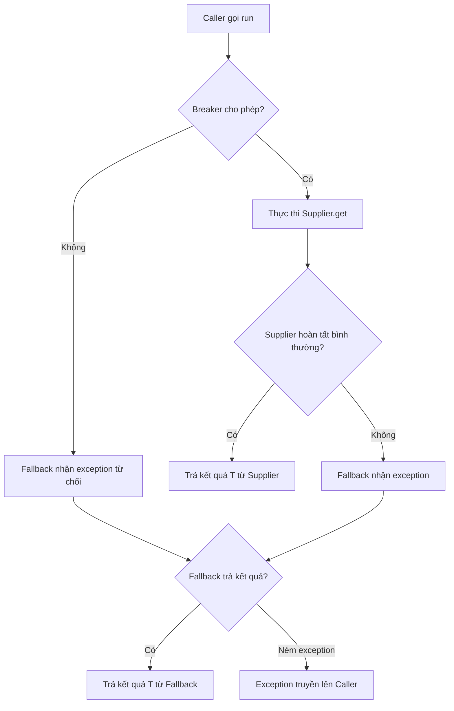

# Thực thi Supplier bằng run và đọc kết quả

Spring Cloud Circuit Breaker cung cấp API chung để bọc một lời gọi đồng bộ trong circuit breaker. Với API này, `CircuitBreaker.run(Supplier<T>)` thực thi một tác vụ không nhận tham số và trả kết quả kiểu `T` cho đoạn mã gọi. Overload `run(Supplier<T>, Function<Throwable, T>)` cho phép cung cấp hàm fallback để tạo kết quả thay thế khi lời gọi gặp lỗi hoặc breaker từ chối thực thi.

Điểm cần nắm là `run` vừa thực thi `Supplier`, vừa trả kết quả của lần thực thi đó. Ứng dụng đọc kết quả bằng giá trị trả về thông thường, chẳng hạn `Product product = circuitBreaker.run(...)`; API không trả về một đối tượng kết quả riêng chứa trạng thái và dữ liệu.

## Supplier và giá trị trả về của run

`Supplier<T>` là functional interface trong `java.util.function`. Phương thức duy nhất của nó là `get()`, không nhận đối số và trả về một giá trị kiểu `T`. Lambda có thể sử dụng biến bên ngoài để tạo request, ví dụ mã sản phẩm, URL hoặc thông tin xác thực.

```java
Supplier<Product> request = () -> catalogClient.findProduct(productId);
Product product = circuitBreaker.run(request);
```

Trong ví dụ, `request` là một tác vụ có kiểu trả về `Product`. Khi `run` cho phép thực thi, circuit breaker gọi `request.get()`. Nếu supplier trả về một `Product`, chính đối tượng đó được trả về từ `run` và gán cho biến `product`.

Kiểu dữ liệu `T` phải phù hợp giữa supplier, fallback và biến nhận kết quả. Ví dụ, nếu supplier trả `Product`, fallback cũng cần trả `Product`. Điều này giúp phần xử lý phía sau có thể sử dụng kết quả bằng kiểu tĩnh mà không cần ép kiểu.

## Tạo circuit breaker từ factory

Trong Spring Cloud Circuit Breaker, ứng dụng thường lấy instance từ `CircuitBreakerFactory` với một ID. ID này xác định circuit breaker cần dùng và được backend tích hợp sử dụng để áp dụng cấu hình tương ứng.

```java
import org.springframework.cloud.client.circuitbreaker.CircuitBreaker;
import org.springframework.cloud.client.circuitbreaker.CircuitBreakerFactory;
import org.springframework.stereotype.Service;

import java.util.function.Supplier;

@Service
public class CatalogService {

    private final CircuitBreakerFactory<?, ?> circuitBreakerFactory;
    private final CatalogClient catalogClient;

    public CatalogService(
            CircuitBreakerFactory<?, ?> circuitBreakerFactory,
            CatalogClient catalogClient) {
        this.circuitBreakerFactory = circuitBreakerFactory;
        this.catalogClient = catalogClient;
    }

    public Product findProduct(String productId) {
        CircuitBreaker circuitBreaker =
                circuitBreakerFactory.create("catalog");

        Supplier<Product> request =
                () -> catalogClient.findProduct(productId);

        return circuitBreaker.run(request);
    }
}
```

`create("catalog")` lấy circuit breaker cho lời gọi catalog. Lambda `() -> catalogClient.findProduct(productId)` được giữ trong supplier; lời gọi phụ thuộc diễn ra khi `run` thực thi supplier. Giá trị trả về từ `run` là `Product`, vì vậy phương thức `findProduct` có thể trả thẳng kết quả cho caller.

Nếu không cung cấp fallback, exception phát sinh từ supplier hoặc exception từ chối lời gọi khi breaker đang `OPEN` sẽ được truyền lên caller. Caller có thể bắt exception ở tầng phù hợp để xử lý, ghi log hoặc trả lỗi HTTP tương ứng.

## Dùng overload run với fallback

Khi muốn trả về dữ liệu dự phòng, truyền thêm một `Function<Throwable, T>`. Hàm này nhận nguyên nhân lỗi và trả về giá trị cùng kiểu `T` với supplier.

```java
public Product findProduct(String productId) {
    CircuitBreaker circuitBreaker =
            circuitBreakerFactory.create("catalog");

    Supplier<Product> request =
            () -> catalogClient.findProduct(productId);

    return circuitBreaker.run(request, error -> {
        log.warn("Không thể lấy sản phẩm {} từ catalog", productId, error);
        return Product.unavailable(productId);
    });
}
```

Luồng xử lý có thể hiểu như sau:

1. `run` yêu cầu circuit breaker thực thi supplier.
2. Nếu supplier hoàn tất bình thường, kết quả của supplier được trả về; fallback không được gọi.
3. Nếu supplier ném exception, hoặc breaker từ chối lời gọi vì đang mở, fallback nhận exception đó.
4. Giá trị do fallback trả về trở thành kết quả của `run` và được trả về caller.

Fallback có thể kiểm tra loại exception để chọn hành vi phù hợp. Chẳng hạn, `CallNotPermittedException` cho biết breaker không cho phép lời gọi đi tới dịch vụ phụ thuộc; exception timeout có thể cho thấy request đã được thực thi nhưng không hoàn tất đúng hạn. Tùy chính sách ứng dụng, fallback có thể trả dữ liệu cache, một đối tượng biểu thị dịch vụ tạm thời không khả dụng hoặc giá trị dự phòng khác.

Hàm fallback cũng có thể ném exception. Khi đó exception từ fallback được truyền lên caller. Nếu fallback trả `null`, `run` trả `null`; caller cần quyết định rõ liệu giá trị đó có hợp lệ hay không. Nên ưu tiên kiểu kết quả và quy ước fallback dễ nhận biết để tránh nhầm dữ liệu dự phòng với dữ liệu thật.

## Đọc và xử lý kết quả sau run

Vì `run` trả về `T`, ứng dụng xử lý kết quả giống một lời gọi phương thức đồng bộ thông thường. Ví dụ:

```java
Product product = circuitBreaker.run(
        () -> catalogClient.findProduct(productId),
        error -> Product.unavailable(productId)
);

if (product.isAvailable()) {
    return ProductResponse.from(product);
}

return ProductResponse.unavailable(productId);
```

Ở đây, caller không cần biết kết quả đến từ supplier hay fallback mới có thể tiếp tục xử lý theo hợp đồng của `Product`. Nếu nghiệp vụ cần phân biệt dữ liệu thật và dữ liệu dự phòng, hãy biểu diễn thông tin đó rõ ràng trong kiểu kết quả, chẳng hạn trường `source` hoặc `fallback`.

Không nên dựa vào việc fallback đã chạy để kết luận circuit breaker ghi nhận lời gọi thành công. Fallback chỉ cung cấp kết quả thay thế cho caller. Backend circuit breaker vẫn đánh giá lần thực thi gốc theo kết quả và chính sách phân loại exception của nó. Một lời gọi thất bại vẫn có thể làm tăng failure rate dù ứng dụng nhận được dữ liệu dự phòng.

## Quan hệ giữa run, timeout và trạng thái breaker

`run(Supplier<T>)` là API đồng bộ. Supplier chạy trong luồng gọi `run`, và caller nhận kết quả khi supplier hoàn tất hoặc khi fallback trả kết quả. Bản thân `run` không tự đặt thời hạn cho một lời gọi HTTP. Hãy cấu hình timeout trên HTTP client hoặc cơ chế timeout phù hợp để một supplier bị treo có thể kết thúc.

Khi circuit breaker ở `CLOSED`, các lời gọi được phép thực thi và kết quả được ghi nhận theo cấu hình backend. Khi breaker ở `OPEN`, supplier bị bỏ qua và lời gọi có thể đi vào fallback với exception từ chối. Trong `HALF_OPEN`, chỉ số lượng lời gọi thăm dò được cấu hình mới được phép đi tới supplier; những lời gọi vượt quota bị từ chối và có thể được fallback xử lý.



Sơ đồ thể hiện overload có fallback. Với overload chỉ nhận supplier, nhánh lỗi không đi qua hàm fallback mà exception được truyền lên caller.

## Lưu ý khi viết Supplier và fallback

- Đặt lời gọi phụ thuộc bên trong lambda của supplier. Nếu gọi dịch vụ trước rồi mới truyền kết quả vào `run`, circuit breaker không bảo vệ lời gọi đó.
- Không bắt exception trong supplier rồi âm thầm trả một giá trị mặc định nếu muốn circuit breaker ghi nhận lần gọi là thất bại. Khi exception bị nuốt, supplier hoàn tất bình thường và breaker có thể xem đó là thành công.
- Giữ fallback ngắn, có thể dự đoán và tránh gọi lại chính dịch vụ đang được bảo vệ. Một fallback gọi lại cùng dịch vụ có thể tạo thêm tải khi dịch vụ đang lỗi.
- Đảm bảo supplier và fallback có kiểu trả về tương thích. Fallback không có tham số nghiệp vụ tự động; nếu cần dùng ID hoặc dữ liệu request, lambda có thể đóng trên các biến đó từ phạm vi bên ngoài.
- Không dùng `run` đồng bộ để bọc một chuỗi `Mono` hoặc `Flux` bằng cách gọi `.block()`. Với luồng reactive, dùng API `ReactiveCircuitBreaker` để giữ cách thực thi bất đồng bộ.

## Thực hành kiểm tra

Với một circuit breaker tên `catalog`, hãy kiểm tra các trường hợp sau và quan sát giá trị mà caller nhận được:

1. Cho supplier trả về một `Product` hợp lệ. Xác nhận `run` trả đúng đối tượng đó và fallback không chạy.
2. Cho supplier ném exception. Với overload không có fallback, xác nhận caller nhận exception; với overload có fallback, xác nhận caller nhận sản phẩm dự phòng.
3. Chuyển breaker sang `OPEN` rồi gọi `run`. Xác nhận supplier không gọi dịch vụ catalog và fallback nhận exception từ chối lời gọi.
4. Làm cho fallback ném exception. Xác nhận exception được truyền lên caller thay vì bị biến thành kết quả dự phòng.
5. Đặt timeout cho client ngắn hơn thời gian chờ tối đa của nghiệp vụ. Xác nhận timeout kết thúc supplier và được circuit breaker phân loại theo cấu hình exception.

Khi đọc kết quả, hãy phân biệt ba điều: giá trị mà `run` trả về, exception mà caller nhận được và trạng thái/metric của circuit breaker. Chúng liên quan với nhau nhưng không đồng nhất. Giá trị dự phòng có thể giúp request của caller tiếp tục, trong khi metric vẫn phản ánh lỗi của dịch vụ phụ thuộc để breaker bảo vệ các lời gọi tiếp theo.
