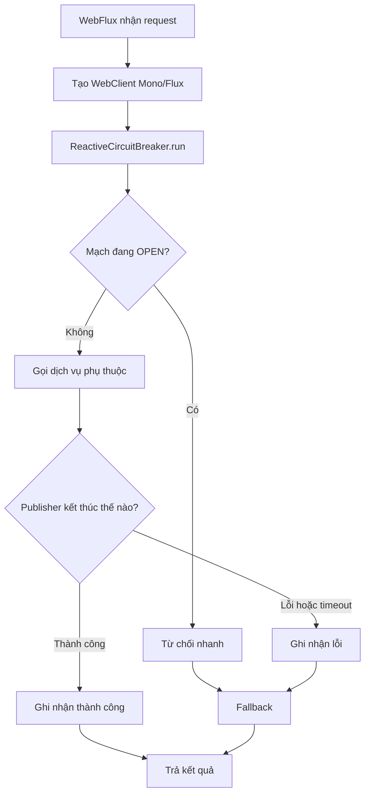

# ReactiveResilience4JCircuitBreakerFactory trong ứng dụng WebFlux

Ứng dụng Spring WebFlux thường gọi dịch vụ phụ thuộc bằng `WebClient` và trả về `Mono` hoặc `Flux`. Để bảo vệ các lời gọi này bằng Resilience4j mà vẫn giữ luồng xử lý reactive, Spring Cloud CircuitBreaker cung cấp `ReactiveResilience4JCircuitBreakerFactory`. Factory tạo `ReactiveCircuitBreaker`, một lớp bao quanh publisher của Reactor để ghi nhận kết quả, từ chối lời gọi khi mạch đang `OPEN` và gọi fallback khi cần.

Trong module Spring Cloud Circuit Breaker, cơ chế này giúp một dịch vụ WebFlux tiếp tục phản hồi có kiểm soát khi dịch vụ tồn kho, thanh toán hoặc hồ sơ chậm hay không khả dụng. Mạch chỉ đóng lại sau khi các lời gọi thăm dò trong `HALF_OPEN` cho thấy dịch vụ đã phục hồi.

## 1. Chuẩn bị dependency reactive

Ứng dụng cần Spring WebFlux và starter Resilience4j reactive của Spring Cloud. Ví dụ với Gradle:

```groovy
dependencies {
    implementation 'org.springframework.boot:spring-boot-starter-webflux'
    implementation 'org.springframework.cloud:spring-cloud-starter-circuitbreaker-reactor-resilience4j'
    implementation 'org.springframework.boot:spring-boot-starter-actuator'
    implementation 'io.github.resilience4j:resilience4j-micrometer'
}
```

Quản lý phiên bản Spring Cloud bằng Spring Cloud BOM tương thích với phiên bản Spring Boot đang dùng. Starter reactive có tọa độ `org.springframework.cloud:spring-cloud-starter-circuitbreaker-reactor-resilience4j`; starter `spring-cloud-starter-circuitbreaker-resilience4j` dành cho tích hợp không reactive. Không thêm cả hai starter chỉ để bảo vệ một lời gọi WebFlux.

Khi starter reactive nằm trên classpath, Spring Cloud tự cấu hình implementation Resilience4j và đăng ký bean `ReactiveResilience4JCircuitBreakerFactory`. Mã ứng dụng thường phụ thuộc vào abstraction `ReactiveCircuitBreakerFactory`, nhờ vậy ít gắn trực tiếp với implementation cụ thể hơn. Không cần tự tạo factory bằng `new`.

## 2. Factory và ReactiveCircuitBreaker làm việc như thế nào?

`ReactiveCircuitBreakerFactory.create(id)` tạo một `ReactiveCircuitBreaker` gắn với ID ổn định, chẳng hạn `inventory`. Phương thức `run` nhận một `Mono` hoặc `Flux` cùng một hàm fallback tùy chọn. Hàm fallback nhận `Throwable` gây ra lỗi và phải trả về publisher cùng kiểu dữ liệu tương thích.



Trong `CLOSED`, lời gọi được chuyển tới publisher của dịch vụ phụ thuộc và kết quả được ghi vào sliding window. Khi ngưỡng lỗi hoặc lời gọi chậm đạt điều kiện, mạch mở. Trong `OPEN`, lời gọi mới bị từ chối nhanh và có thể đi vào fallback. Sau thời gian chờ, mạch cho phép số lời gọi giới hạn ở `HALF_OPEN`; kết quả của các lời gọi đó quyết định mạch đóng lại hay mở lại.

Với Reactor, publisher thường chỉ thực hiện công việc khi có subscription. Vì vậy, hãy trả `Mono`/`Flux` về cho WebFlux xử lý và để Circuit Breaker bao quanh publisher đó. Không gọi `.block()` hoặc tự `subscribe()` bên trong service/controller; các thao tác này làm mất lợi ích của xử lý non-blocking và khiến việc quản lý vòng đời request khó kiểm soát.

## 3. Tích hợp với WebClient trong service

Ví dụ sau bảo vệ lời gọi lấy tồn kho. Factory được inject qua abstraction của Spring Cloud; service tạo breaker có ID `inventory` một lần và dùng lại cho các request:

```java
import org.springframework.cloud.client.circuitbreaker.ReactiveCircuitBreaker;
import org.springframework.cloud.client.circuitbreaker.ReactiveCircuitBreakerFactory;
import org.springframework.beans.factory.annotation.Qualifier;
import org.springframework.stereotype.Service;
import org.springframework.web.reactive.function.client.WebClient;
import reactor.core.publisher.Mono;

@Service
public class InventoryGateway {
    private final WebClient webClient;
    private final ReactiveCircuitBreaker inventoryBreaker;

    public InventoryGateway(
            @Qualifier("inventoryWebClient") WebClient webClient,
            ReactiveCircuitBreakerFactory<?, ?> circuitBreakerFactory) {
        this.webClient = webClient;
        this.inventoryBreaker = circuitBreakerFactory.create("inventory");
    }

    public Mono<Stock> getStock(String sku) {
        Mono<Stock> request = webClient.get()
                .uri("/stock/{sku}", sku)
                .retrieve()
                .bodyToMono(Stock.class);

        return inventoryBreaker.run(
                request,
                error -> Mono.just(Stock.unavailable(sku))
        );
    }
}
```

Đăng ký bean `WebClient` riêng cho dependency để base URL và cấu hình HTTP không bị nhầm với client của dịch vụ khác:

```java
import org.springframework.beans.factory.annotation.Value;
import org.springframework.context.annotation.Bean;
import org.springframework.context.annotation.Configuration;
import org.springframework.web.reactive.function.client.WebClient;

@Configuration
public class InventoryWebClientConfiguration {
    @Bean("inventoryWebClient")
    WebClient inventoryWebClient(
            WebClient.Builder builder,
            @Value("${clients.inventory.base-url}") String baseUrl) {
        return builder.baseUrl(baseUrl).build();
    }
}
```

Ví dụ giá trị cấu hình:

```yaml
clients:
  inventory:
    base-url: http://inventory-service
```

`Stock` là kiểu dữ liệu của ví dụ; `Stock.unavailable(sku)` biểu diễn trạng thái chưa xác định theo hợp đồng API của ứng dụng.

Đối với endpoint WebFlux, trả publisher trực tiếp:

```java
@RestController
@RequestMapping("/inventory")
public class InventoryController {
    private final InventoryGateway inventoryGateway;

    public InventoryController(InventoryGateway inventoryGateway) {
        this.inventoryGateway = inventoryGateway;
    }

    @GetMapping("/{sku}")
    public Mono<Stock> getStock(@PathVariable String sku) {
        return inventoryGateway.getStock(sku);
    }
}
```

Đối với luồng nhiều phần tử, có thể dùng `Flux<T>` theo cùng cách:

```java
public Flux<StockEvent> getStockEvents(String sku) {
    Flux<StockEvent> events = webClient.get()
            .uri("/stock/{sku}/events", sku)
            .retrieve()
            .bodyToFlux(StockEvent.class);

    return inventoryBreaker.run(
            events,
            error -> Flux.empty()
    );
}
```

Breaker ghi nhận kết quả theo vòng đời publisher. Với `Flux` hữu hạn, kết quả được đánh giá khi luồng hoàn tất hoặc phát lỗi. Không nên bọc một luồng sự kiện vô hạn hoặc kết nối streaming tồn tại lâu bằng cùng cách như một request-response ngắn: subscription có thể kéo dài và không tạo ra tín hiệu hoàn tất để đánh giá phục hồi. Với streaming dài hạn, hãy thiết kế cơ chế giám sát, reconnect và giới hạn thời gian riêng phù hợp.

## 4. Cấu hình theo ID trong application.yml

ID truyền vào `create("inventory")` phải khớp với tên instance trong cấu hình Resilience4j. Ví dụ:

```yaml
resilience4j:
  circuitbreaker:
    instances:
      inventory:
        registerHealthIndicator: true
        slidingWindowType: COUNT_BASED
        slidingWindowSize: 20
        minimumNumberOfCalls: 10
        failureRateThreshold: 50
        slowCallRateThreshold: 70
        slowCallDurationThreshold: 800ms
        waitDurationInOpenState: 10s
        permittedNumberOfCallsInHalfOpenState: 3
        automaticTransitionFromOpenToHalfOpenEnabled: false

  timelimiter:
    instances:
      inventory:
        timeoutDuration: 2s
        cancelRunningFuture: true
```

Trong ví dụ, sliding window đếm tối đa 20 kết quả và chỉ đánh giá tỷ lệ lỗi sau ít nhất 10 lời gọi. Khi tỷ lệ lỗi đạt 50% hoặc tỷ lệ lời gọi chậm đạt 70%, mạch có thể chuyển sang `OPEN`. Một lời gọi được coi là chậm khi vượt 800 ms. Sau ít nhất 10 giây, tối đa ba lời gọi được phép thăm dò trong `HALF_OPEN`.

`TimeLimiter` đặt giới hạn thời gian cho một lần thực thi được bảo vệ. Nó khác với `waitDurationInOpenState`: timeout giới hạn thời gian chờ kết quả của request hiện tại, còn thời gian mở mạch quyết định khi nào có thể thử phục hồi sau khi breaker đã mở. Starter Spring Cloud Resilience4j bật TimeLimiter theo mặc định; nên cấu hình rõ `timeoutDuration` theo SLA của dịch vụ phụ thuộc. Có thể tắt TimeLimiter toàn cục bằng `spring.cloud.circuitbreaker.resilience4j.disable-time-limiter: true` khi có lý do cụ thể.

## 5. Cấu hình bằng Customizer

Nếu cần cấu hình bằng Java, có thể tạo bean `Customizer` dành cho `ReactiveResilience4JCircuitBreakerFactory`. Ví dụ dưới đây đặt timeout và Circuit Breaker riêng cho ID `inventory`: 

```java
@Configuration
public class CircuitBreakerConfiguration {
    @Bean
    public Customizer<ReactiveResilience4JCircuitBreakerFactory> inventoryCustomizer() {
        return factory -> factory.configure(builder -> builder
                .circuitBreakerConfig(CircuitBreakerConfig.custom()
                        .slidingWindowSize(20)
                        .minimumNumberOfCalls(10)
                        .failureRateThreshold(50)
                        .waitDurationInOpenState(Duration.ofSeconds(10))
                        .build())
                .timeLimiterConfig(TimeLimiterConfig.custom()
                        .timeoutDuration(Duration.ofSeconds(2))
                        .build()),
                "inventory");
    }
}
```

Đoạn mã minh họa cần các import `Customizer`, `ReactiveResilience4JCircuitBreakerFactory`, `CircuitBreakerConfig`, `TimeLimiterConfig`, `Duration` và `Configuration`. Dùng properties hoặc Customizer theo quy ước cấu hình của dự án. Cấu hình properties có độ ưu tiên cao hơn Java `Customizer`; nếu giá trị runtime không giống bean tùy biến, hãy kiểm tra `resilience4j.circuitbreaker.instances` và `resilience4j.timelimiter.instances` theo đúng ID.

## 6. Xử lý lỗi và fallback trong luồng reactive

Fallback là một publisher thay thế khi breaker từ chối lời gọi hoặc lời gọi được bảo vệ phát sinh lỗi. Hãy trả dữ liệu dự phòng đúng hợp đồng API, chẳng hạn trạng thái tồn kho chưa xác định, cache gần nhất hoặc một lỗi nghiệp vụ có thể xử lý ở tầng gọi.

- Hàm fallback nhận `Throwable`; nguyên nhân có thể là lỗi kết nối, lỗi HTTP, timeout hoặc `CallNotPermittedException` khi mạch đang `OPEN`.
- Fallback cũng có thể phát lỗi. Khi đó lỗi fallback tiếp tục được truyền tới subscriber và WebFlux xử lý theo cơ chế lỗi của ứng dụng.
- Không biến mọi lỗi thành dữ liệu giả có vẻ hợp lệ. Phân biệt dữ liệu cache, dữ liệu chưa xác định và lỗi không thể phục hồi.
- Không gọi lại chính dịch vụ đang được bảo vệ từ fallback; điều đó có thể tạo vòng lặp hoặc tiếp tục gây tải lên dependency đang lỗi.

`WebClient.retrieve()` chuyển các response HTTP 4xx/5xx thành lỗi theo mặc định. Hãy quyết định lỗi nào phản ánh tình trạng sức khỏe của dependency và lỗi nào là lỗi nghiệp vụ của request. Có thể tùy chỉnh `onStatus` hoặc chính sách `recordExceptions`/`ignoreExceptions` để các lỗi client dự kiến không làm Circuit Breaker mở ngoài ý muốn.

Không đặt `onErrorResume` trước breaker để nuốt lỗi nếu muốn breaker ghi nhận lỗi đó. Nếu upstream đã chuyển lỗi thành kết quả thành công trước khi đi vào `run`, Circuit Breaker sẽ không còn nhìn thấy tín hiệu lỗi gốc. Hãy dùng hàm fallback của `run`, hoặc xử lý lỗi sau khi breaker đã ghi nhận kết quả.

## 7. Kết hợp timeout, retry và bulkhead

Các cơ chế bảo vệ giải quyết các vấn đề khác nhau:

| Cơ chế | Vai trò trong ứng dụng WebFlux |
| --- | --- |
| Circuit Breaker | Ngừng gửi request khi dependency liên tục lỗi hoặc chậm; thử phục hồi có giới hạn ở `HALF_OPEN`. |
| TimeLimiter / timeout | Giới hạn thời gian chờ kết quả của một request. |
| Retry | Thử lại lỗi tạm thời theo số lần và khoảng chờ đã định. |
| Bulkhead | Giới hạn số lời gọi đồng thời hoặc lượng tài nguyên dành cho dependency. |

Không đặt Retry bên ngoài Circuit Breaker một cách thiếu chủ đích. Nhiều lần thử có thể làm tăng lưu lượng khi dịch vụ đang hồi phục; cần xác định rõ mỗi lần thử có được Circuit Breaker ghi nhận hay không và tổng số request có thể phát sinh. Với WebFlux, giữ toàn bộ đường gọi non-blocking; không chuyển sang thread blocking chỉ để áp dụng timeout hoặc bulkhead.

Spring Cloud CircuitBreaker có thể tự áp dụng Resilience4j Bulkhead nếu module `resilience4j-bulkhead` có trên classpath. Tài liệu Spring Cloud nêu mặc định là `FixedThreadPoolBulkhead`; có thể chuyển sang `SemaphoreBulkhead` bằng `spring.cloud.circuitbreaker.resilience4j.enableSemaphoreDefaultBulkhead: true` hoặc tắt tích hợp Bulkhead bằng `spring.cloud.circuitbreaker.bulkhead.resilience4j.enabled: false`. Hãy đánh giá cấu hình này cùng mô hình tải reactive và tránh để thao tác blocking chạy trên event-loop.

## 8. Theo dõi trạng thái và metrics

Để quan sát breaker theo ID `inventory`, theo dõi số lần chuyển trạng thái, số lời gọi thành công/thất bại, số lời gọi bị từ chối, số lần timeout, số lần fallback và độ trễ dependency. Actuator cung cấp health endpoint; `resilience4j-micrometer` kết hợp Micrometer cho phép xuất metrics để hệ thống giám sát thu thập.

Ví dụ bật health indicator cho instance:

```yaml
resilience4j:
  circuitbreaker:
    instances:
      inventory:
        registerHealthIndicator: true

management:
  endpoints:
    web:
      exposure:
        include: health,metrics
```

Chỉ expose các endpoint Actuator cần thiết và bảo vệ chúng bằng xác thực/phân quyền trong môi trường triển khai. Health status là một tín hiệu vận hành; không nên coi việc endpoint trả `UP` là bằng chứng duy nhất rằng fallback, timeout và chuyển trạng thái đang hoạt động đúng.

## 9. Kiểm chứng bằng kịch bản reactive

Thực hiện kiểm thử với mock server hoặc dịch vụ giả lập để điều khiển response và độ trễ:

1. Trả response thành công từ dependency. Gọi endpoint WebFlux và xác nhận `Mono` trả dữ liệu thật; xác nhận không có `.block()` hoặc subscription thủ công trong service.
2. Cho dependency trả 5xx hoặc ngắt kết nối. Gửi đủ số lời gọi tối thiểu để vượt ngưỡng và xác nhận breaker chuyển sang `OPEN`.
3. Gửi request tiếp theo khi breaker đang `OPEN`. Xác nhận fallback trả kết quả dự phòng và mock server không nhận thêm request từ lời gọi bị từ chối.
4. Cho dependency phản hồi chậm hơn `timeoutDuration`. Xác nhận timeout được ghi nhận theo cấu hình và kết quả dự phòng được trả đúng kiểu reactive.
5. Sau `waitDurationInOpenState`, cho dependency hoạt động trở lại và gửi số lời gọi thăm dò không vượt `permittedNumberOfCallsInHalfOpenState`. Xác nhận breaker trở lại `CLOSED` khi kết quả đạt yêu cầu.
6. Lặp lại với lỗi ở các lời gọi thăm dò để xác nhận breaker quay về `OPEN`; kiểm tra metrics và log theo ID `inventory`.
7. Kiểm tra response 4xx riêng để bảo đảm lỗi nghiệp vụ không bị phân loại nhầm thành sự cố dependency.

Với `StepVerifier`, có thể kiểm tra publisher và fallback mà không cần gọi `.block()`:

```java
StepVerifier.create(inventoryGateway.getStock("SKU-42"))
        .expectNextMatches(stock -> stock.isUnavailable())
        .verifyComplete();
```

Để kiểm chứng chuyển trạng thái, kết hợp StepVerifier với mock server đếm số request, cấu hình sliding window nhỏ trong test và quan sát trạng thái/metrics của instance. Không chỉ kiểm tra giá trị fallback; cần xác nhận request đã bị chặn đúng lúc và dịch vụ phụ thuộc không bị gọi thêm.

## 10. Những lỗi thường gặp

- Dùng starter không reactive trong khi muốn inject `ReactiveCircuitBreakerFactory`.
- Không dùng cùng ID giữa `create("inventory")` và phần `resilience4j.circuitbreaker.instances.inventory` hoặc `resilience4j.timelimiter.instances.inventory`.
- Gọi `.block()` hoặc `.subscribe()` trong service/controller, làm đứt chuỗi xử lý reactive.
- Nuốt lỗi upstream bằng `onErrorResume` trước khi breaker quan sát lỗi, khiến tỷ lệ lỗi bị thấp hơn thực tế.
- Trả fallback có kiểu khác publisher gốc hoặc để fallback tiếp tục gọi dependency đang gặp sự cố.
- Để timeout quá ngắn khiến request bình thường bị tính là lỗi, hoặc timeout quá dài khiến tài nguyên bị giữ quá lâu.
- Dùng Circuit Breaker cho luồng vô hạn mà không tính tới vòng đời subscription và cách đánh giá tín hiệu phục hồi.
- Không phân biệt lỗi HTTP nghiệp vụ với lỗi kết nối/5xx khi cấu hình loại exception được ghi nhận.

## Tài liệu tham khảo

- [Spring Cloud Commons – Circuit Breaker trong reactive code](https://docs.spring.io/spring-cloud-commons/reference/spring-cloud-circuitbreaker.html): abstraction `ReactiveCircuitBreakerFactory`, `Mono`/`Flux` và fallback.
- [Spring Cloud CircuitBreaker – Configuring Resilience4J Circuit Breakers](https://docs.spring.io/spring-cloud-circuitbreaker/docs/current/reference/html/spring-cloud-circuitbreaker-resilience4j.html): starter reactive, auto-configuration, Customizer, TimeLimiter và Bulkhead.
- [Spring Cloud CircuitBreaker – Circuit Breaker Properties Configuration](https://docs.spring.io/spring-cloud-circuitbreaker/reference/spring-cloud-circuitbreaker-resilience4j/circuit-breaker-properties-configuration.html): cấu hình instance, group, thứ tự ưu tiên và TimeLimiter.
- [Spring Framework – WebClient](https://docs.spring.io/spring-framework/reference/web/webflux-webclient.html): HTTP client reactive, non-blocking dựa trên Reactor.
