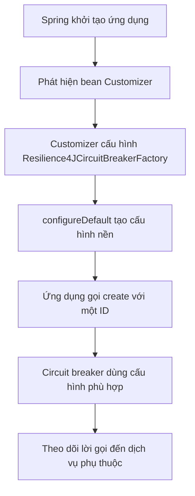

# Cấu hình mặc định bằng Customizer và configureDefault

Khi tích hợp Resilience4j qua Spring Cloud CircuitBreaker, ứng dụng thường tạo nhiều circuit breaker cho các dịch vụ phụ thuộc như `inventory`, `payment` hoặc `shipping`. Nếu mỗi circuit breaker phải lặp lại toàn bộ cấu hình, mã cấu hình sẽ khó duy trì và các dịch vụ dễ có chính sách bảo vệ không nhất quán. Spring Cloud CircuitBreaker cho phép khai báo một cấu hình nền bằng `Customizer` và phương thức `configureDefault`, sau đó áp dụng cấu hình riêng cho những định danh cần hành vi khác biệt.

`Customizer` là một bean Spring dùng để tùy chỉnh factory do Spring Cloud CircuitBreaker tự cấu hình. Với Resilience4j, factory imperative là `Resilience4JCircuitBreakerFactory`; factory reactive là `ReactiveResilience4JCircuitBreakerFactory`. Phương thức `configureDefault` nhận một hàm tạo cấu hình mặc định cho circuit breaker theo định danh được truyền vào. Nhờ vậy, ứng dụng có thể tập trung các giá trị mặc định ở một nơi và vẫn giữ khả năng tùy chỉnh theo từng phụ thuộc.

## 1. Vai trò của Customizer và configureDefault

Khi ứng dụng inject `CircuitBreakerFactory` và gọi `create("inventory")`, Spring Cloud CircuitBreaker dùng factory tương ứng để tạo circuit breaker có định danh `inventory`. Factory được tự động cấu hình bởi starter Resilience4j. Một bean `Customizer` cho phép ứng dụng điều chỉnh factory đó trong quá trình khởi tạo Spring context.

Hai thành phần có trách nhiệm khác nhau:

- **`Customizer<T>`** biểu diễn một thao tác cấu hình trên factory kiểu `T`. Spring phát hiện bean này và áp dụng nó vào factory tương ứng.
- **`configureDefault(...)`** định nghĩa cấu hình nền dùng cho circuit breaker được tạo qua factory. Hàm cấu hình nhận `id`, nhờ đó có thể xây dựng cấu hình mặc định dựa trên định danh.

Với Resilience4j, `Resilience4JConfigBuilder` gom cấu hình `CircuitBreakerConfig` và `TimeLimiterConfig` thành một cấu hình mà Spring Cloud CircuitBreaker sử dụng. Hai phần này xử lý hai vấn đề khác nhau: `CircuitBreakerConfig` quy định cách ghi nhận kết quả và chuyển trạng thái mạch; `TimeLimiterConfig` quy định giới hạn thời gian cho các lời gọi bất đồng bộ được hỗ trợ.

Sơ đồ khái quát:



Định danh phải nhất quán giữa nơi tạo circuit breaker và nơi khai báo cấu hình riêng. Ví dụ, nếu mã gọi `create("inventory")`, cấu hình riêng cũng phải gắn với ID `inventory`.

## 2. Khai báo cấu hình mặc định bằng Customizer

Ví dụ sau tạo một bean cấu hình nền cho tất cả circuit breaker được tạo từ factory imperative:

```java
import java.time.Duration;

import io.github.resilience4j.circuitbreaker.CircuitBreakerConfig;
import io.github.resilience4j.timelimiter.TimeLimiterConfig;
import org.springframework.cloud.circuitbreaker.resilience4j.Resilience4JConfigBuilder;
import org.springframework.cloud.circuitbreaker.resilience4j.Resilience4JCircuitBreakerFactory;
import org.springframework.cloud.client.circuitbreaker.Customizer;
import org.springframework.context.annotation.Bean;
import org.springframework.context.annotation.Configuration;

@Configuration
public class CircuitBreakerConfiguration {

    @Bean
    public Customizer<Resilience4JCircuitBreakerFactory> defaultCircuitBreakerConfig() {
        return factory -> factory.configureDefault(id ->
            new Resilience4JConfigBuilder(id)
                .circuitBreakerConfig(CircuitBreakerConfig.custom()
                    .slidingWindowType(CircuitBreakerConfig.SlidingWindowType.COUNT_BASED)
                    .slidingWindowSize(20)
                    .minimumNumberOfCalls(8)
                    .failureRateThreshold(50)
                    .slowCallDurationThreshold(Duration.ofSeconds(2))
                    .slowCallRateThreshold(50)
                    .waitDurationInOpenState(Duration.ofSeconds(15))
                    .permittedNumberOfCallsInHalfOpenState(3)
                    .build())
                .timeLimiterConfig(TimeLimiterConfig.custom()
                    .timeoutDuration(Duration.ofSeconds(3))
                    .build())
                .build()
        );
    }
}
```

Trong ví dụ, `configureDefault` nhận hàm có tham số `id` và trả về một cấu hình được tạo bằng `Resilience4JConfigBuilder`. Các giá trị minh họa có ý nghĩa như sau:

| Thuộc tính | Giá trị | Ý nghĩa |
|---|---:|---|
| `slidingWindowType` | `COUNT_BASED` | Đánh giá theo số lời gọi gần nhất. |
| `slidingWindowSize` | `20` | Giữ tối đa 20 kết quả trong cửa sổ trượt. |
| `minimumNumberOfCalls` | `8` | Cần ít nhất 8 kết quả trước khi đánh giá tỷ lệ. |
| `failureRateThreshold` | `50` | Mở mạch khi tỷ lệ lỗi đạt ngưỡng 50%. |
| `slowCallDurationThreshold` | `2 giây` | Xem lời gọi từ 2 giây trở lên là chậm. |
| `slowCallRateThreshold` | `50` | Mở mạch khi tỷ lệ lời gọi chậm đạt ngưỡng 50%. |
| `waitDurationInOpenState` | `15 giây` | Thời gian chờ trước khi circuit breaker cho phép thăm dò. |
| `permittedNumberOfCallsInHalfOpenState` | `3` | Số lời gọi thăm dò tối đa trong `HALF_OPEN`. |
| `timeoutDuration` | `3 giây` | Giới hạn thời gian cho thao tác bất đồng bộ được TimeLimiter hỗ trợ. |

Các con số trên chỉ là ví dụ để minh họa cơ chế. Hãy điều chỉnh theo lưu lượng, mục tiêu độ trễ và khả năng chịu tải của từng dịch vụ phụ thuộc. Đặc biệt, `TimeLimiter` không thay thế timeout kết nối và phản hồi của HTTP client. Với lời gọi đồng bộ có thể chặn luồng, vẫn cần đặt timeout tại client hoặc tầng giao tiếp mạng.

## 3. Cách configureDefault được áp dụng

`configureDefault` tạo cấu hình nền cho factory. Khi ứng dụng tạo các circuit breaker như `inventory`, `payment` và `shipping`, mỗi circuit breaker có thể nhận bộ cấu hình mặc định đó nếu không có cấu hình cụ thể hơn cho ID tương ứng.

Ví dụ service sử dụng factory:

```java
import org.springframework.cloud.client.circuitbreaker.CircuitBreakerFactory;
import org.springframework.stereotype.Service;

@Service
public class OrderService {
    private final CircuitBreakerFactory<?, ?> circuitBreakerFactory;
    private final InventoryClient inventoryClient;

    public OrderService(
            CircuitBreakerFactory<?, ?> circuitBreakerFactory,
            InventoryClient inventoryClient) {
        this.circuitBreakerFactory = circuitBreakerFactory;
        this.inventoryClient = inventoryClient;
    }

    public Stock getStock(String sku) {
        return circuitBreakerFactory.create("inventory").run(
            () -> inventoryClient.getStock(sku),
            error -> Stock.unavailable(sku)
        );
    }
}
```

Định danh `inventory` được dùng để tạo circuit breaker. Nếu chưa khai báo cấu hình riêng cho ID này, nó sử dụng cấu hình nền do `configureDefault` cung cấp. Fallback xử lý trường hợp lời gọi chính thất bại hoặc bị circuit breaker từ chối; fallback nên biểu đạt rõ trạng thái dữ liệu không sẵn có để bên gọi không hiểu nhầm đó là tồn kho bằng không.

Tham số `id` trong hàm của `configureDefault` cũng có ích khi cần tạo giá trị mặc định dựa trên tên circuit breaker. Tuy nhiên, nếu các dịch vụ có yêu cầu khác biệt rõ ràng về ngưỡng lỗi hoặc timeout, nên khai báo cấu hình theo ID để ý định được thể hiện trực tiếp và dễ rà soát.

## 4. Kết hợp cấu hình mặc định với cấu hình riêng theo ID

Không phải phụ thuộc nào cũng có cùng đặc tính. Dịch vụ tồn kho có thể chấp nhận thời gian chờ dài hơn dịch vụ xác thực; dịch vụ thanh toán có thể cần ngưỡng lỗi và chính sách fallback chặt chẽ hơn. Spring Cloud CircuitBreaker cho phép gọi `configure(...)` để đặt cấu hình cho một hoặc nhiều ID cụ thể.

Ví dụ, vẫn giữ cấu hình nền cho các circuit breaker khác, nhưng đặt cửa sổ nhỏ hơn và timeout ngắn hơn cho `payment`:

```java
@Bean
public Customizer<Resilience4JCircuitBreakerFactory> paymentCircuitBreakerConfig() {
    return factory -> factory.configure(builder -> builder
        .circuitBreakerConfig(CircuitBreakerConfig.custom()
            .slidingWindowSize(10)
            .minimumNumberOfCalls(5)
            .failureRateThreshold(40)
            .waitDurationInOpenState(Duration.ofSeconds(20))
            .build())
        .timeLimiterConfig(TimeLimiterConfig.custom()
            .timeoutDuration(Duration.ofSeconds(2))
            .build()),
        "payment");
}
```

Ở đây, `configure(...)` gắn cấu hình với ID `payment`. Mã tạo circuit breaker phải dùng đúng ID:

```java
var paymentCircuitBreaker = circuitBreakerFactory.create("payment");
```

Khi thêm cấu hình riêng, nên xác định rõ các giá trị cần thay đổi và những giá trị vẫn lấy từ cấu hình nền theo cách mà phiên bản Spring Cloud đang sử dụng hỗ trợ. Đừng giả định rằng mọi thuộc tính chưa ghi trong builder riêng luôn được kế thừa theo cách mong muốn; hãy đọc cấu hình hoàn chỉnh và kiểm tra hành vi của phiên bản đang dùng.

Một số dự án chọn cách cấu hình tập trung bằng Java `Customizer`, một số khác dùng `application.yml`. Với cấu hình properties của Resilience4j, có thể khai báo các cấu hình dùng chung trong `configs` rồi gán cho từng `instances`:

```yaml
resilience4j:
  circuitbreaker:
    configs:
      default:
        slidingWindowType: COUNT_BASED
        slidingWindowSize: 20
        minimumNumberOfCalls: 8
        failureRateThreshold: 50
        waitDurationInOpenState: 15s
    instances:
      inventory:
        baseConfig: default
      payment:
        baseConfig: default
        failureRateThreshold: 40
```

Properties phù hợp khi muốn thay đổi ngưỡng mà không sửa mã Java. Java `Customizer` phù hợp khi cần tạo cấu hình qua code, sử dụng logic hoặc tích hợp vào cấu hình Spring. Trong các phiên bản Spring Cloud CircuitBreaker hỗ trợ cả hai cơ chế, cấu hình properties có độ ưu tiên cao hơn cấu hình Java `Customizer`; hãy kiểm tra tài liệu của release train đang dùng nếu có nhiều nguồn cấu hình cùng tác động đến một ID.

## 5. Cấu hình mặc định cho ứng dụng reactive

Với ứng dụng WebFlux, dùng starter reactive và factory `ReactiveResilience4JCircuitBreakerFactory`. Cấu hình mặc định cũng được đăng ký bằng bean `Customizer`, nhưng kiểu factory khác với lời gọi imperative:

```java
import java.time.Duration;

import io.github.resilience4j.circuitbreaker.CircuitBreakerConfig;
import io.github.resilience4j.timelimiter.TimeLimiterConfig;
import org.springframework.cloud.circuitbreaker.resilience4j.ReactiveResilience4JCircuitBreakerFactory;
import org.springframework.cloud.circuitbreaker.resilience4j.Resilience4JConfigBuilder;
import org.springframework.cloud.client.circuitbreaker.Customizer;
import org.springframework.context.annotation.Bean;
import org.springframework.context.annotation.Configuration;

@Configuration
public class ReactiveCircuitBreakerConfiguration {

    @Bean
    public Customizer<ReactiveResilience4JCircuitBreakerFactory> reactiveDefaultConfig() {
        return factory -> factory.configureDefault(id ->
            new Resilience4JConfigBuilder(id)
                .circuitBreakerConfig(CircuitBreakerConfig.ofDefaults())
                .timeLimiterConfig(TimeLimiterConfig.custom()
                    .timeoutDuration(Duration.ofSeconds(3))
                    .build())
                .build()
        );
    }
}
```

Sau đó service reactive tạo circuit breaker theo ID và giữ nguyên kiểu `Mono`:

```java
import org.springframework.cloud.client.circuitbreaker.ReactiveCircuitBreakerFactory;
import org.springframework.stereotype.Service;
import reactor.core.publisher.Mono;

@Service
public class ReactiveInventoryService {
    private final ReactiveCircuitBreakerFactory<?, ?> circuitBreakerFactory;
    private final ReactiveInventoryClient inventoryClient;

    public ReactiveInventoryService(
            ReactiveCircuitBreakerFactory<?, ?> circuitBreakerFactory,
            ReactiveInventoryClient inventoryClient) {
        this.circuitBreakerFactory = circuitBreakerFactory;
        this.inventoryClient = inventoryClient;
    }

    public Mono<Stock> getStock(String sku) {
        return circuitBreakerFactory.create("inventory").run(
            inventoryClient.getStock(sku),
            error -> Mono.just(Stock.unavailable(sku))
        );
    }
}
```

Không dùng `Resilience4JCircuitBreakerFactory` cho reactive factory hoặc ngược lại. Chọn starter, factory và kiểu trả về theo mô hình thực thi của ứng dụng. Trong luồng reactive, fallback phải trả về publisher tương ứng và không nên gọi `block()` để chờ kết quả.

## 6. Khi nào nên dùng cấu hình mặc định?

`configureDefault` phù hợp để thiết lập chính sách nền nhất quán cho các phụ thuộc có đặc tính tương tự. Ví dụ, một ứng dụng có nhiều dịch vụ đọc dữ liệu có thể dùng cùng cửa sổ, ngưỡng lỗi và thời gian mở mạch. Điều này giúp nhóm phát triển tránh việc một circuit breaker bị bỏ sót cấu hình bảo vệ.

Nên dùng cấu hình riêng theo ID khi:

- Dịch vụ phụ thuộc có mục tiêu độ trễ khác biệt đáng kể.
- Mức độ quan trọng của giao dịch yêu cầu ngưỡng lỗi hoặc cách xử lý khác.
- Lưu lượng của một phụ thuộc khác xa các phụ thuộc còn lại, khiến kích thước cửa sổ mặc định không phù hợp.
- Một phụ thuộc cần chính sách timeout, fallback hoặc giới hạn đồng thời riêng.

Không nên tạo một cấu hình mặc định quá dễ mở mạch chỉ để bảo vệ mọi phụ thuộc. Ngược lại, một cấu hình quá khoan dung có thể để lời gọi tiếp tục dồn vào dịch vụ đang gặp sự cố. Hãy bắt đầu bằng cấu hình nền có lý do rõ ràng, sau đó chỉ tạo ngoại lệ khi có số liệu và yêu cầu nghiệp vụ chứng minh.

## 7. Các lưu ý về timeout và lỗi được ghi nhận

`CircuitBreakerConfig` quyết định kết quả nào được ghi nhận là thành công, thất bại hoặc lời gọi chậm. Các thuộc tính như `recordExceptions`, `ignoreExceptions`, `recordFailure` hoặc các predicate tương ứng có thể được sử dụng để tinh chỉnh phân loại lỗi tùy theo API của Resilience4j đang dùng.

Ví dụ, lỗi xác thực đầu vào do người dùng gửi thường không cho biết dịch vụ phụ thuộc bị lỗi. Nếu ghi nhận loại lỗi này vào circuit breaker, mạch có thể mở dù dịch vụ vẫn hoạt động bình thường. Ngược lại, timeout hoặc lỗi kết nối thường là tín hiệu quan trọng để đánh giá sức khỏe của phụ thuộc. Cần cấu hình danh sách lỗi theo hợp đồng của client, không ghi nhận mọi ngoại lệ một cách máy móc.

`TimeLimiterConfig` quy định thời gian chờ cho tác vụ bất đồng bộ được tích hợp. Với HTTP client, vẫn phải cấu hình timeout kết nối, timeout đọc và các giới hạn liên quan ở chính client. Nếu chỉ cấu hình TimeLimiter mà HTTP request bên dưới không thể bị hủy đúng cách, tác vụ mạng có thể tiếp tục tiêu thụ tài nguyên sau khi bên ngoài đã nhận timeout. Hãy xác minh khả năng hủy và giải phóng tài nguyên của client được sử dụng.

Fallback cần phản ánh đúng ý nghĩa nghiệp vụ. Với dữ liệu đọc, có thể trả cache còn hợp lệ hoặc trạng thái tạm thời không sẵn có. Với thao tác ghi như thanh toán, không được trả kết quả thành công giả khi chưa biết giao dịch đã được xử lý hay chưa. Circuit breaker chỉ kiểm soát lời gọi và phản ứng trước lỗi; nó không đảm bảo tính đúng đắn của giao dịch nghiệp vụ.

## 8. Kiểm thử cấu hình Customizer

Nên kiểm thử cả cấu hình nền và cấu hình riêng theo ID. Một kịch bản kiểm thử tích hợp có thể thực hiện theo trình tự:

1. Khởi động Spring context với bean `Customizer` đã khai báo.
2. Tạo circuit breaker bằng ID `inventory` và xác nhận lời gọi thành công được chuyển đến client.
3. Mô phỏng đủ số lỗi để vượt `minimumNumberOfCalls` và `failureRateThreshold`; xác nhận circuit breaker chuyển sang `OPEN`.
4. Gọi lại khi mạch đang `OPEN`; xác nhận lời gọi đến client không tiếp tục được thực hiện và fallback được kích hoạt.
5. Tạo circuit breaker `payment` và xác nhận cấu hình riêng theo ID có hiệu lực theo ngưỡng đã đặt.
6. Nếu có cấu hình reactive, kiểm tra `Mono` trả về đúng kết quả hoặc fallback và không chặn luồng xử lý.

Khi kiểm thử không nên chỉ kiểm tra rằng bean `Customizer` tồn tại. Cần kiểm tra hành vi thực tế của circuit breaker, số lần client được gọi, trạng thái chuyển đổi và kết quả fallback. Có thể dùng client giả hoặc server mô phỏng để chủ động tạo lỗi, độ trễ và phục hồi.

## 9. Lỗi cấu hình thường gặp

| Hiện tượng | Nguyên nhân cần kiểm tra |
|---|---|
| `Customizer` không được áp dụng | Bean có được khai báo trong Spring context không; kiểu generic có khớp factory đang sử dụng không? |
| Không inject được factory | Đã thêm starter Resilience4j imperative hoặc reactive tương ứng chưa; các phiên bản Spring Boot và Spring Cloud có tương thích không? |
| Cấu hình riêng không có tác dụng | ID trong `configure(...)` có trùng chính xác với ID truyền vào `create(...)` không? |
| Cấu hình mặc định không được mong đợi | Có cấu hình properties cùng ID đang có độ ưu tiên cao hơn không; có nhiều bean cùng cấu hình factory không? |
| Timeout không ngắt lời gọi mạng | HTTP client đã có timeout riêng chưa; thao tác bất đồng bộ có hỗ trợ hủy không? |
| Circuit breaker không mở khi có lỗi | Đã đủ `minimumNumberOfCalls` chưa; ngoại lệ có bị bỏ qua hoặc không được ghi nhận không? |
| Reactive service bị chặn | Có gọi `block()` hoặc dùng nhầm factory imperative trong chuỗi Reactor không? |

Khi điều tra, hãy kiểm tra định danh trước, sau đó xem cấu hình thực tế của instance, loại ngoại lệ được ghi nhận và các giá trị cửa sổ. Nếu có cả Java `Customizer` và YAML properties, xác định nguồn cấu hình đang thắng theo phiên bản Spring Cloud hiện tại thay vì điều chỉnh nhiều nơi cùng lúc.

## 10. Nguyên tắc tổ chức cấu hình

Đặt các bean `Customizer` trong một lớp cấu hình có tên rõ ràng và thuộc phạm vi component scan của ứng dụng. Dùng một cấu hình mặc định tập trung cho các circuit breaker thông thường; tách cấu hình theo ID khi một phụ thuộc cần chính sách riêng. Tên bean nên mô tả phạm vi, chẳng hạn `defaultCircuitBreakerConfig` hoặc `paymentCircuitBreakerConfig`.

Không tạo lại factory thủ công nếu starter đã tự cấu hình factory. Không khai báo nhiều cấu hình mặc định cạnh tranh mà không kiểm soát thứ tự áp dụng. Tránh đưa bí mật, URL hoặc thông tin môi trường vào `Customizer`; các giá trị thay đổi theo môi trường nên được quản lý qua cấu hình bên ngoài.

Khi triển khai, hãy ghi nhận lý do chọn `slidingWindowSize`, `minimumNumberOfCalls`, ngưỡng lỗi, ngưỡng lời gọi chậm và thời gian mở mạch. Theo dõi số liệu sau khi phát hành để biết cấu hình nền có phù hợp với lưu lượng thực tế hay cần ngoại lệ theo từng phụ thuộc. `Customizer` và `configureDefault` giúp tổ chức cấu hình nhất quán; hiệu quả bảo vệ vẫn phụ thuộc vào cách chọn ngưỡng, timeout, fallback và việc quan sát vận hành.
