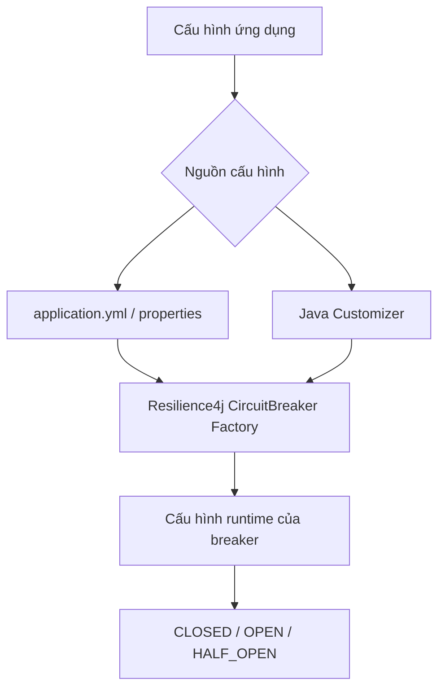

# Thứ tự ưu tiên cấu hình thuộc tính so với Java Customizer

Spring Cloud CircuitBreaker cho phép cấu hình circuit breaker bằng thuộc tính trong `application.yml` hoặc bằng Java `Customizer`. Cả hai cách đều có thể đặt chính sách cho Resilience4j, nhưng khi một breaker được cấu hình qua cả hai đường, **cấu hình thuộc tính có độ ưu tiên cao hơn Java Customizer**. Vì vậy, nếu cùng một instance có giá trị trong YAML và trong customizer, ứng dụng cần dựa vào giá trị từ cấu hình thuộc tính.

Quy tắc này quan trọng khi một dự án có cấu hình mặc định trong Java, sau đó bổ sung YAML theo môi trường hoặc theo từng dịch vụ. Nếu không hiểu thứ tự ưu tiên, người phát triển có thể thay đổi customizer nhưng không thấy hành vi runtime thay đổi vì thuộc tính đang ghi đè cấu hình đó.

## 1. Hai con đường cấu hình

Spring Cloud CircuitBreaker cung cấp API chung để ứng dụng gọi dịch vụ qua breaker. Resilience4j là implementation thực hiện việc thống kê, chuyển trạng thái và áp dụng các ngưỡng. Chính sách cho Resilience4j có thể được cung cấp bằng hai con đường chính:

- **Cấu hình thuộc tính:** khai báo trong `application.yml`, `application.properties` hoặc các nguồn thuộc tính Spring Boot khác. Cách này phù hợp với cấu hình theo môi trường và có thể thay đổi mà không cần sửa mã Java.
- **Java Customizer:** khai báo bean `Customizer` để cấu hình factory, giá trị mặc định hoặc một số ID cụ thể. Cách này phù hợp khi cấu hình cần được tạo bằng mã, dùng biểu thức hoặc phụ thuộc vào logic khởi tạo của ứng dụng.



Hai con đường này không có mức ưu tiên ngang nhau. Khi thuộc tính cấu hình và Java Customizer cùng định nghĩa cấu hình cho breaker, Spring Cloud CircuitBreaker ưu tiên cấu hình thuộc tính. Không nên thiết kế theo giả định rằng hai bộ giá trị sẽ luôn được trộn từng trường với nhau.

## 2. Cấu hình bằng Java Customizer

Để cấu hình factory Resilience4j bằng Java, ứng dụng có thể khai báo bean `Customizer<Resilience4JCircuitBreakerFactory>`. Ví dụ sau đặt chính sách mặc định cho breaker được tạo bởi factory:

```java
import java.time.Duration;

import org.springframework.cloud.circuitbreaker.resilience4j.Resilience4JCircuitBreakerFactory;
import org.springframework.cloud.circuitbreaker.resilience4j.Resilience4JConfigBuilder;
import org.springframework.cloud.client.circuitbreaker.Customizer;
import org.springframework.context.annotation.Bean;
import org.springframework.context.annotation.Configuration;

import io.github.resilience4j.circuitbreaker.CircuitBreakerConfig;
import io.github.resilience4j.timelimiter.TimeLimiterConfig;

@Configuration
public class CircuitBreakerJavaConfiguration {

    @Bean
    public Customizer<Resilience4JCircuitBreakerFactory> defaultBreakerConfig() {
        return factory -> factory.configureDefault(id ->
                new Resilience4JConfigBuilder(id)
                        .circuitBreakerConfig(CircuitBreakerConfig.custom()
                                .slidingWindowSize(30)
                                .minimumNumberOfCalls(10)
                                .failureRateThreshold(50)
                                .build())
                        .timeLimiterConfig(TimeLimiterConfig.custom()
                                .timeoutDuration(Duration.ofSeconds(2))
                                .build())
                        .build());
    }
}
```

Trong ví dụ, `configureDefault` cung cấp cấu hình mặc định cho các ID không có cấu hình cụ thể hơn. `CircuitBreakerConfig` định nghĩa các tham số của circuit breaker, còn `TimeLimiterConfig` đặt thời gian chờ cho tác vụ được hỗ trợ bởi TimeLimiter. Hai cơ chế có mục đích khác nhau: failure rate điều khiển việc mở mạch, còn TimeLimiter giới hạn thời gian chờ của tác vụ.

Để đặt chính sách cho một ID cụ thể, factory hỗ trợ `configure`:

```java
@Bean
public Customizer<Resilience4JCircuitBreakerFactory> inventoryBreakerConfig() {
    return factory -> factory.configure(builder -> builder
            .circuitBreakerConfig(CircuitBreakerConfig.custom()
                    .slidingWindowSize(20)
                    .minimumNumberOfCalls(8)
                    .failureRateThreshold(40)
                    .build())
            .timeLimiterConfig(TimeLimiterConfig.custom()
                    .timeoutDuration(Duration.ofMillis(800))
                    .build())
            .build(), "inventory");
}
```

Ở đây, cấu hình Java được gắn với ID `inventory`. Mã gọi cần sử dụng cùng ID khi tạo breaker:

```java
CircuitBreaker breaker = circuitBreakerFactory.create("inventory");
InventoryView result = breaker.run(
        () -> inventoryClient.find(sku),
        error -> InventoryView.unavailable(sku)
);
```

Các ví dụ Java minh họa API cấu hình của Resilience4j factory. Chúng cần được dùng cùng phiên bản Spring Cloud và starter Resilience4j tương thích trong dự án. `Resilience4JConfigBuilder` thuộc package `org.springframework.cloud.circuitbreaker.resilience4j`; khi viết cấu hình hoàn chỉnh, cần import builder này cùng các kiểu đã dùng trong ví dụ.

## 3. Cấu hình bằng thuộc tính

Cấu hình thuộc tính thích hợp khi muốn tập trung chính sách trong file cấu hình của ứng dụng. Resilience4j hỗ trợ cấu hình dùng chung trong `configs` và cấu hình riêng theo instance trong `instances`.

```yaml
resilience4j:
  circuitbreaker:
    configs:
      default:
        slidingWindowType: COUNT_BASED
        slidingWindowSize: 50
        minimumNumberOfCalls: 10
        failureRateThreshold: 50
        waitDurationInOpenState: 10s
      inventoryPolicy:
        slidingWindowType: COUNT_BASED
        slidingWindowSize: 20
        minimumNumberOfCalls: 8
        failureRateThreshold: 40
        waitDurationInOpenState: 15s
    instances:
      inventory:
        baseConfig: inventoryPolicy
        slowCallDurationThreshold: 1s
        slowCallRateThreshold: 50
      pricing:
        baseConfig: default
        slowCallDurationThreshold: 1500ms
        slowCallRateThreshold: 60
  timelimiter:
    configs:
      default:
        timeoutDuration: 3s
    instances:
      inventory:
        timeoutDuration: 800ms
      pricing:
        timeoutDuration: 2s
```

Trong cấu hình này:

- `configs.default` là cấu hình dùng chung có tên `default`.
- `configs.inventoryPolicy` là một cấu hình dùng chung riêng cho nhóm chính sách tồn kho.
- `instances.inventory` gắn với breaker có ID `inventory` và kế thừa cấu hình `inventoryPolicy` qua `baseConfig`.
- Các thuộc tính khai báo trực tiếp trong `instances.inventory` bổ sung hoặc ghi đè giá trị tương ứng của cấu hình dùng chung theo cơ chế cấu hình của Resilience4j.
- `timelimiter.instances.inventory` đặt timeout cho TimeLimiter cùng ID.

`baseConfig` là cơ chế tái sử dụng cấu hình trong hệ thuộc tính của Resilience4j. Nó không phải là cú pháp để chọn một Java Customizer. Cần phân biệt việc kế thừa giữa `configs` và `instances` với quy tắc ưu tiên giữa thuộc tính và Java Customizer.

## 4. Quy tắc ưu tiên khi hai cách cùng cấu hình một breaker

Quy tắc cần nhớ là cấu hình thuộc tính được ưu tiên hơn cấu hình Java Customizer. Ví dụ, Java Customizer đặt `failureRateThreshold` của `inventory` là 40, nhưng thuộc tính của instance `inventory` đặt giá trị là 60. Khi thuộc tính đó được nạp cho instance, giá trị thuộc tính được sử dụng.

| Tình huống | Cấu hình được ưu tiên |
|---|---|
| Chỉ có Java Customizer | Java Customizer |
| Chỉ có thuộc tính cấu hình | Thuộc tính cấu hình |
| Java Customizer và thuộc tính cùng cấu hình một instance | Thuộc tính cấu hình |
| Java Customizer đặt mặc định, thuộc tính khai báo cấu hình instance | Thuộc tính cho instance đó |
| Thuộc tính chỉ khai báo một số instance, không khai báo instance khác | Java Customizer vẫn có thể cung cấp cấu hình mặc định cho trường hợp không có thuộc tính tương ứng, tùy cấu hình factory và phiên bản tích hợp |

Không nên suy ra rằng thuộc tính và customizer được hợp nhất một cách đơn giản theo từng field trong mọi trường hợp. Hãy kiểm tra cấu hình hiệu lực của đúng ID và đúng loại cấu hình, đặc biệt khi một ID có cả `CircuitBreaker` và `TimeLimiter`.

Ví dụ xung đột:

```java
factory.configure(builder -> builder
        .circuitBreakerConfig(CircuitBreakerConfig.custom()
                .failureRateThreshold(40)
                .build())
        .build(), "inventory");
```

```yaml
resilience4j:
  circuitbreaker:
    instances:
      inventory:
        failureRateThreshold: 60
```

Khi cả hai cấu hình trên cùng áp dụng cho instance `inventory`, thuộc tính `failureRateThreshold: 60` có độ ưu tiên cao hơn giá trị 40 trong Java Customizer. Khi đọc mã Java đơn lẻ, người phát triển có thể tưởng breaker mở ở 40%; nhưng cấu hình runtime sẽ theo thuộc tính đã được nạp.

## 5. Phân biệt ưu tiên giữa các nguồn thuộc tính

Quy tắc thuộc tính ưu tiên hơn Java Customizer là quy tắc tích hợp của Spring Cloud CircuitBreaker. Nó không thay thế quy tắc ưu tiên giữa các nguồn cấu hình của Spring Boot.

Trong ứng dụng Spring Boot, một giá trị có thể đến từ `application.yml`, file profile như `application-prod.yml`, biến môi trường, tham số dòng lệnh hoặc các nguồn thuộc tính khác. Spring Boot có thứ tự ưu tiên riêng để xác định giá trị cuối cùng trong `Environment`. Sau khi Spring Boot giải quyết các nguồn thuộc tính, cấu hình thuộc tính được đưa vào tích hợp circuit breaker và có độ ưu tiên cao hơn Java Customizer theo quy tắc nêu trên.

Ví dụ, nếu `application.yml` đặt ngưỡng lỗi là 50 và profile production đặt là 65, giá trị hiệu lực giữa các file phụ thuộc vào profile và thứ tự nguồn cấu hình Spring Boot. Nếu Java Customizer cũng đặt 40, customizer không thắng giá trị thuộc tính đã được Spring Boot nạp.

Vì thế, khi điều tra cấu hình runtime, hãy kiểm tra cả hai lớp:

1. Spring Boot đã chọn giá trị thuộc tính nào từ các nguồn cấu hình đang hoạt động?
2. Với giá trị thuộc tính đó, Spring Cloud CircuitBreaker có áp dụng quy tắc ưu tiên cao hơn Java Customizer hay không?

Không nên chỉ tìm chuỗi `failureRateThreshold` trong một file YAML hoặc một lớp `@Configuration` rồi kết luận đó là giá trị runtime.

## 6. Phạm vi cấu hình và ID phải nhất quán

Factory tạo breaker theo ID. ID trong mã, trong `instances` của YAML và trong customizer cần nhất quán để cấu hình đúng đối tượng.

| Mã gọi | Cấu hình thuộc tính | Java Customizer |
|---|---|---|
| `create("inventory")` | `instances.inventory` | `configure(..., "inventory")` |
| `create("pricing")` | `instances.pricing` | `configure(..., "pricing")` |
| `create("recommendation")` | `instances.recommendation` | `configure(..., "recommendation")` |

Nếu mã gọi `create("inventory")` nhưng cấu hình lại khai báo `instances.stock`, instance `stock` không tự áp dụng cho `inventory`. Breaker có thể rơi về cấu hình mặc định của implementation. Sai khác tên có thể khiến một cấu hình tưởng như đã bật thực tế không được sử dụng.

Nên đặt ID theo dịch vụ hoặc nhóm lời gọi có cùng yêu cầu độ tin cậy, chẳng hạn `inventory`, `pricing` và `recommendation`. Tránh đưa mã người dùng, mã đơn hàng hoặc giá trị thay đổi theo từng request vào ID vì điều đó có thể làm số lượng breaker tăng không kiểm soát.

## 7. Khi nào nên chọn YAML và khi nào nên chọn Java Customizer?

Thuộc tính thường là lựa chọn thuận tiện khi chính sách cần thay đổi theo môi trường triển khai. Nhóm vận hành có thể đặt ngưỡng, thời gian chờ hoặc timeout theo profile mà không phải thay đổi mã nguồn. Các cấu hình dùng chung trong `configs` cũng giúp nhiều instance kế thừa một chính sách nền.

Java Customizer phù hợp khi cấu hình gắn chặt với logic khởi tạo hoặc cần tạo đối tượng cấu hình bằng Java. Nó cũng hữu ích để định nghĩa giá trị mặc định chung khi không có thuộc tính cụ thể cho instance. Tuy nhiên, nếu chính sách đã được quản lý bằng thuộc tính, tránh lặp lại cùng giá trị trong customizer vì hai nơi có thể lệch nhau và gây nhầm lẫn khi điều tra.

Một cách tổ chức dễ vận hành là:

- Dùng Java Customizer cho cấu hình mặc định thực sự dùng chung hoặc những trường hợp cần logic Java.
- Dùng thuộc tính cho chính sách của từng môi trường và từng instance.
- Đặt tên ID nhất quán giữa gateway, YAML, customizer và metric.
- Ghi lại nơi sở hữu giá trị chính thức của mỗi tham số để người thay đổi biết phải sửa ở đâu.
- Sau khi thay đổi, kiểm tra hành vi runtime thay vì chỉ xác nhận ứng dụng khởi động thành công.

Không cần khai báo cùng một giá trị ở cả YAML và Java nếu không có lý do rõ ràng. Việc giữ một nguồn cấu hình có thẩm quyền cho từng tham số giúp việc review và vận hành dễ dự đoán hơn.

## 8. Kiểm tra cấu hình hiệu lực

Khi breaker có hành vi khác kỳ vọng, hãy kiểm tra theo trình tự sau:

1. Xác nhận mã gọi dùng đúng ID trong `create(id)`.
2. Tìm `resilience4j.circuitbreaker.instances.<id>` và cấu hình dùng chung được tham chiếu bằng `baseConfig`.
3. Kiểm tra các nguồn thuộc tính Spring Boot đang hoạt động, gồm profile, biến môi trường và tham số khởi động nếu có.
4. Tìm bean `Customizer<Resilience4JCircuitBreakerFactory>` có cấu hình mặc định hoặc cấu hình riêng cho ID đó.
5. Áp dụng quy tắc ưu tiên: thuộc tính cấu hình thắng Java Customizer khi cả hai cùng định nghĩa chính sách cho breaker.
6. Kiểm tra riêng cấu hình `TimeLimiter`, vì timeout có namespace và instance cấu hình riêng.
7. Quan sát trạng thái breaker, số mẫu, tỷ lệ lỗi, lời gọi chậm và thời gian chờ trong môi trường chạy.

Actuator và Micrometer có thể giúp quan sát trạng thái, metric và health indicator khi được cấu hình phù hợp. Tuy nhiên, metric runtime không phải lúc nào cũng hiển thị đầy đủ nguồn đã cung cấp từng giá trị cấu hình. Nếu cần xác định nguồn của thuộc tính, hãy kiểm tra Spring Boot `Environment` hoặc endpoint cấu hình phù hợp đã được bảo vệ theo chính sách vận hành của ứng dụng.

## 9. Các lỗi cấu hình thường gặp

| Biểu hiện | Nguyên nhân có thể | Cách xử lý |
|---|---|---|
| Sửa Java Customizer nhưng ngưỡng runtime không đổi | Thuộc tính đang ghi đè cấu hình Java | Kiểm tra `instances.<id>` và nguồn thuộc tính đang hoạt động |
| Một breaker không nhận cấu hình mong muốn | ID trong `create(id)` khác ID trong YAML hoặc customizer | Chuẩn hóa tên instance và kiểm tra ID tại gateway |
| Nhiều instance có chính sách khác nhau ngoài dự kiến | Kế thừa `baseConfig` hoặc override ở instance chưa được xem xét | Kiểm tra cấu hình dùng chung và trường khai báo trực tiếp của instance |
| Timeout không thay đổi dù đã sửa circuit breaker config | Timeout thuộc TimeLimiter hoặc HTTP client, không phải cùng tham số với failure threshold | Kiểm tra `resilience4j.timelimiter.instances.<id>` và timeout của client |
| Cấu hình chạy khác local | Profile, biến môi trường hoặc nguồn cấu hình triển khai đang ghi đè | Kiểm tra Spring Boot Environment trong đúng môi trường |

Một lỗi phổ biến là nhầm lẫn giữa `waitDurationInOpenState` và timeout của lời gọi. `waitDurationInOpenState` xác định thời gian breaker ở `OPEN` trước khi cho phép thăm dò; timeout của HTTP client hoặc TimeLimiter giới hạn thời gian thực hiện một lời gọi. Hai tham số này không thay thế nhau và có thể được cấu hình ở các phần khác nhau.

## 10. Nguyên tắc áp dụng

Khi một breaker có cấu hình cả bằng thuộc tính và Java Customizer, hãy nhớ thuộc tính được ưu tiên. Dùng `configs` và `instances` để tổ chức chính sách Resilience4j trong YAML; dùng `configureDefault` và `configure` để thiết lập mặc định hoặc chính sách Java cho factory. Đảm bảo ID trong mã và cấu hình trùng khớp, đồng thời phân biệt thứ tự ưu tiên của Spring Boot property sources với quy tắc thuộc tính thắng Java Customizer của Spring Cloud CircuitBreaker.

Sau khi cấu hình, hãy kiểm tra giá trị và hành vi hiệu lực trên đúng môi trường triển khai. Điều này giúp tránh tình trạng mã Java thể hiện một ngưỡng nhưng ứng dụng thực tế chạy theo giá trị thuộc tính khác, đồng thời giữ cho chính sách `CLOSED`, `OPEN`, `HALF_OPEN` và timeout có thể giải thích, kiểm soát được khi hệ thống gặp lỗi.
