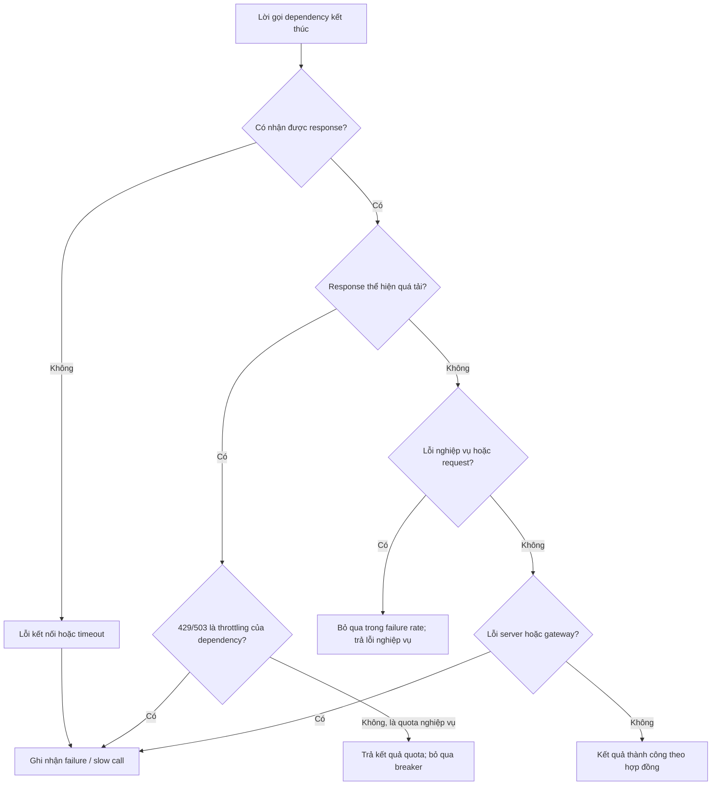

# Phân biệt lỗi hạ tầng, quá tải và lỗi nghiệp vụ

Circuit Breaker trong Spring Cloud cần biết một lời gọi thất bại vì dependency đang mất khả năng phục vụ, vì dependency bị quá tải hay vì yêu cầu nghiệp vụ không được chấp nhận. Ba nhóm tình huống này có thể cùng xuất hiện dưới dạng exception hoặc HTTP response, nhưng chúng cần cách xử lý khác nhau. Nếu phân loại sai, breaker có thể mở khi dịch vụ vẫn khỏe, hoặc tiếp tục đóng trong lúc dependency đang gặp sự cố.

Trong module `SPRING_CLOUD_CIRCUIT_BREAKER`, ta dùng Spring Cloud CircuitBreaker với Resilience4j để theo dõi kết quả lời gọi. Phân loại đúng giúp sliding window phản ánh chất lượng của dependency, giúp trạng thái CLOSED/OPEN/HALF_OPEN chuyển đúng lúc và giúp ứng dụng chọn fallback, retry, timeout hay trả lỗi nghiệp vụ phù hợp.

## 1. Ba nhóm kết quả cần phân biệt

Một lời gọi tới dịch vụ phụ thuộc thường cho ra một trong ba nhóm kết quả:

| Nhóm | Dấu hiệu | Ví dụ | Ý nghĩa đối với Circuit Breaker |
|---|---|---|---|
| Lỗi hạ tầng | Kết nối hoặc xử lý từ dependency không hoàn tất bình thường | Connection refused, DNS lỗi, socket timeout, HTTP 502/503/504, lỗi máy chủ 5xx | Thường cần ghi nhận là failure để breaker phát hiện dependency suy giảm |
| Quá tải | Dependency hoặc tài nguyên xử lý không còn đủ năng lực nhận thêm công việc | HTTP 429/503 do throttling, hàng đợi đầy, thread pool cạn, bulkhead từ chối | Cần giảm tải hoặc từ chối sớm; có thể tính là failure nếu tín hiệu đến từ dependency được bảo vệ |
| Lỗi nghiệp vụ | Request được xử lý và trả về một kết quả hợp lệ theo quy tắc nghiệp vụ | Không tìm thấy sản phẩm, thiếu tồn kho, đơn hàng đã bị hủy, dữ liệu không hợp lệ | Thường không nên làm tăng failure rate của breaker |

Điểm phân biệt quan trọng là một kết quả nghiệp vụ không nhất thiết là một lần gọi dịch vụ thất bại. Ví dụ, dịch vụ kho trả lời “không đủ hàng” có nghĩa là dịch vụ kho đã nhận và xử lý request thành công; nghiệp vụ không đạt điều kiện đặt hàng. Breaker nên ghi nhận dependency đã phản hồi, trong khi tầng nghiệp vụ quyết định không thể tiếp tục đơn hàng.

Ngược lại, nếu dịch vụ kho không phản hồi do kết nối bị từ chối, timeout hoặc máy chủ lỗi, ứng dụng chưa nhận được câu trả lời nghiệp vụ đáng tin cậy. Đây là tín hiệu về khả năng phục vụ của dependency và thường cần được ghi nhận là failure.

## 2. Nhận diện lỗi hạ tầng

Lỗi hạ tầng thường phát sinh ở ranh giới mạng, giao thức hoặc tiến trình dịch vụ phụ thuộc. Các dấu hiệu phổ biến gồm:

- Không phân giải được DNS hoặc không thiết lập được kết nối TCP.
- Connection refused, connection reset hoặc TLS handshake thất bại.
- Read timeout, response timeout hoặc request timeout.
- Dependency đóng kết nối trước khi trả response đầy đủ.
- HTTP 5xx như 500, 502, 503 hoặc 504 do lỗi xử lý phía máy chủ hoặc gateway.
- Dependency khởi động lại, mất kết nối cơ sở dữ liệu hoặc không truy cập được dịch vụ nền.

Những lỗi này có thể lặp lại trong một khoảng thời gian. Nếu ứng dụng tiếp tục gửi request và chờ vô hạn, thread, connection pool và bộ nhớ có thể bị chiếm dụng. Circuit Breaker theo dõi các kết quả này qua sliding window. Khi tỷ lệ failure hoặc slow call vượt ngưỡng sau số mẫu tối thiểu, breaker chuyển từ CLOSED sang OPEN và từ chối lời gọi mới trong thời gian chờ.

Không phải mọi lỗi 5xx đều có cùng nguyên nhân. HTTP 500 có thể do bug xử lý phía server; 502 thường liên quan gateway nhận phản hồi không hợp lệ; 503 có thể biểu thị dịch vụ tạm thời không sẵn sàng; 504 thường cho biết gateway không nhận được phản hồi đúng hạn. Đối với breaker, chúng thường là dấu hiệu dependency không cung cấp được kết quả đúng hạn. Việc điều tra nguyên nhân chi tiết vẫn cần log và trace ở phía dịch vụ.

Timeout cần được đặt ở HTTP client hoặc cơ chế TimeLimiter. Circuit Breaker chỉ có thể đánh giá kết quả sau khi lời gọi kết thúc hoặc bị timeout. Nếu không giới hạn thời gian chờ, một lời gọi bị treo có thể giữ tài nguyên quá lâu trước khi breaker nhận được failure.

## 3. Nhận diện tình trạng quá tải

Quá tải xảy ra khi lượng công việc đến vượt quá năng lực xử lý hiện tại. Dịch vụ có thể vẫn hoạt động và kết nối được, nhưng độ trễ tăng, hàng đợi dài, request bị từ chối hoặc tài nguyên cạn dần.

Quá tải có thể xuất hiện ở nhiều vị trí:

- **Dependency quá tải:** dịch vụ từ chối request, trả 429 hoặc 503, hoặc phản hồi chậm do CPU, bộ nhớ, connection pool hay hàng đợi gần chạm giới hạn.
- **Dịch vụ gọi quá tải:** ứng dụng không còn thread, connection hoặc slot xử lý để gửi thêm request.
- **Giới hạn của nền tảng:** API gateway, load balancer, nhà cung cấp bên ngoài hoặc quota của tài khoản giới hạn tốc độ request.
- **Bulkhead từ chối:** ứng dụng chủ động từ chối lời gọi mới vì số tác vụ đồng thời đã đạt giới hạn.

Cần phân biệt nơi phát sinh tín hiệu quá tải. Nếu dependency trả HTTP 503 do hết capacity, đây là failure của dependency và thường nên được tính vào breaker. Nếu bulkhead cục bộ từ chối request trước khi lời gọi tới dependency bắt đầu, đó là hành động bảo vệ tài nguyên của chính ứng dụng. Không nên tính sự từ chối cục bộ này như một lần dependency thất bại.

HTTP 429 cần được xem xét theo hợp đồng API. Nó có thể có nghĩa dependency đang throttling do vượt rate limit; trong trường hợp đó, đây là tín hiệu quá tải hoặc giới hạn năng lực. Nhưng 429 cũng có thể biểu thị quota nghiệp vụ của người dùng hoặc tài khoản. Nếu khách hàng đã dùng hết quota được cấp, đó có thể là kết quả hợp lệ của chính sách sản phẩm và không nên làm breaker mở. Đọc response body, header như `Retry-After` và tài liệu API để xác định ý nghĩa trước khi phân loại.

Quá tải thường cần phối hợp nhiều cơ chế:

- **Circuit Breaker:** ngừng gửi request mới tới dependency đang liên tục lỗi hoặc phản hồi chậm.
- **Bulkhead:** giới hạn số lời gọi đồng thời, cô lập tài nguyên cho từng dependency.
- **Rate Limiter:** giới hạn tốc độ request theo chính sách.
- **Timeout:** giới hạn thời gian chờ cho mỗi lời gọi.
- **Backpressure hoặc load shedding:** giảm tốc độ nhận việc hoặc từ chối sớm khi hệ thống không còn năng lực.

Retry không phải giải pháp mặc định cho quá tải. Nếu nhiều client đồng thời retry ngay sau 429 hoặc 503, lưu lượng có thể tăng mạnh và làm tình trạng tệ hơn. Nếu API cho phép retry, hãy tôn trọng `Retry-After`, dùng backoff và jitter, giới hạn số lần thử, đồng thời bảo đảm thao tác có thể lặp lại an toàn.

## 4. Nhận diện lỗi nghiệp vụ

Lỗi nghiệp vụ là kết quả mà hệ thống trả về sau khi đã xử lý request và xác định điều kiện nghiệp vụ không được đáp ứng. Những kết quả này thường được dự kiến trong luồng bình thường của ứng dụng.

Ví dụ:

- Mã sản phẩm không tồn tại.
- Số lượng đặt vượt tồn kho khả dụng.
- Tài khoản không đủ số dư.
- Đơn hàng đã bị hủy hoặc đã hoàn tất.
- Người dùng không đáp ứng điều kiện mua hàng.
- Yêu cầu vi phạm trạng thái hoặc quy tắc chuyển đổi nghiệp vụ.

Nếu dịch vụ trả lời những kết quả trên một cách ổn định và đúng hợp đồng, dependency vẫn đang hoạt động. Không nên tính các kết quả này vào failure rate của Circuit Breaker. Thay vào đó, trả lỗi nghiệp vụ hoặc response phù hợp cho caller.

Một số lỗi client khác cũng không phản ánh tình trạng dependency: request thiếu trường bắt buộc, sai định dạng, không xác thực được hoặc không có quyền. Tuy nhiên, cần phân biệt lỗi do caller gửi với lỗi tích hợp nội bộ. Ví dụ, HTTP 401/403 từ dịch vụ downstream có thể là credential của ứng dụng đã hết hạn hoặc cấu hình quyền sai. Đây là lỗi tích hợp cần cảnh báo và sửa cấu hình; nó không nhất thiết là dấu hiệu quá tải hay mất khả năng phục vụ tạm thời. Không nên biến nó thành lỗi nghiệp vụ của người dùng hoặc âm thầm bỏ qua.

## 5. Phân loại HTTP status theo ý nghĩa

HTTP status là tín hiệu hữu ích nhưng không đủ để quyết định loại lỗi. Cùng một mã status có thể mang ý nghĩa khác nhau tùy hợp đồng API và vị trí phát sinh.

| Status | Ý nghĩa thường gặp | Cách xem xét với Circuit Breaker |
|---|---|---|
| 400 Bad Request | Request không hợp lệ | Thường là kết quả client/validation; không tính là failure dependency |
| 401 Unauthorized | Thiếu hoặc sai thông tin xác thực | Điều tra credential; thường không xem là sự cố availability |
| 403 Forbidden | Không đủ quyền | Xử lý chính sách quyền; không tính nhầm thành lỗi hạ tầng |
| 404 Not Found | Tài nguyên không tồn tại | Thường là kết quả nghiệp vụ hợp lệ |
| 409 Conflict | Xung đột trạng thái hoặc dữ liệu | Xử lý theo quy tắc nghiệp vụ |
| 422 Unprocessable Content | Nội dung hợp lệ về cú pháp nhưng không đạt điều kiện xử lý | Thường là lỗi nghiệp vụ |
| 408 Request Timeout | Server không nhận đủ request trong thời gian quy định | Xem xét như timeout; cần hiểu timeout ở tầng nào |
| 429 Too Many Requests | Rate limit hoặc quota | Phân loại theo hợp đồng: quá tải/throttling hay quota nghiệp vụ |
| 500 Internal Server Error | Lỗi xử lý phía server | Thường tính là failure |
| 502 Bad Gateway | Gateway nhận phản hồi upstream không hợp lệ | Thường tính là failure |
| 503 Service Unavailable | Service tạm thời không sẵn sàng hoặc quá tải | Thường tính là failure |
| 504 Gateway Timeout | Gateway chờ upstream quá lâu | Thường tính là failure/slow call |

Không nên viết một quy tắc đơn giản kiểu “mọi 4xx bỏ qua, mọi 5xx ghi lỗi” cho mọi hệ thống. Ví dụ 429 có thể là quota nghiệp vụ; 401 có thể là lỗi credential của service-to-service; 408 có thể phát sinh ở nhiều tầng. Hãy chuyển response thành loại kết quả có ý nghĩa trong client adapter rồi mới áp dụng chính sách Circuit Breaker.

## 6. Phân loại exception trong Resilience4j

Resilience4j cho phép cấu hình exception được tính là failure hoặc được bỏ qua. Hai nhóm cấu hình thường dùng là:

- `ignoreExceptions(...)`: những exception này không được tính là success hoặc failure trong sliding window.
- `recordExceptions(...)`: chỉ định những loại exception được ghi nhận là failure. Khi dùng danh sách này, các exception không khớp có thể được xem là success, vì vậy cần xác định rõ toàn bộ loại lỗi cần ghi nhận.
- `recordException(predicate)` và `ignoreException(predicate)`: dùng predicate khi cần phân loại linh hoạt theo loại exception hoặc thông tin bên trong exception.

Nếu chỉ cần loại trừ một vài kết quả nghiệp vụ đã biết, `ignoreExceptions` thường dễ hiểu hơn vì các exception khác vẫn theo chính sách mặc định. Nếu dùng `recordExceptions`, phải cẩn thận để không vô tình coi một lỗi hạ tầng mới phát sinh là success chỉ vì nó chưa nằm trong danh sách.

Ví dụ cấu hình breaker cho dịch vụ danh mục:

```java
import java.time.Duration;

import io.github.resilience4j.circuitbreaker.CircuitBreakerConfig;
import io.github.resilience4j.circuitbreaker.CircuitBreakerConfig.SlidingWindowType;

CircuitBreakerConfig catalogConfig = CircuitBreakerConfig.custom()
    .slidingWindowType(SlidingWindowType.COUNT_BASED)
    .slidingWindowSize(20)
    .minimumNumberOfCalls(10)
    .failureRateThreshold(50)
    .slowCallDurationThreshold(Duration.ofSeconds(2))
    .slowCallRateThreshold(50)
    .ignoreExceptions(
        ProductNotFoundException.class,
        InvalidProductQueryException.class,
        InsufficientStockException.class
    )
    .build();
```

Trong ví dụ, lỗi không tìm thấy sản phẩm, request truy vấn không hợp lệ và thiếu hàng là các kết quả nghiệp vụ được bỏ qua trong thống kê breaker. Timeout, lỗi kết nối và exception hạ tầng khác vẫn được tính theo mặc định. Cấu hình này chỉ phù hợp khi các exception nghiệp vụ đã được phân loại rõ và chỉ phát sinh từ lời gọi được bảo vệ như dự kiến.

Có thể gắn cấu hình vào một ID bằng Spring Cloud CircuitBreaker:

```java
@Bean
Customizer<Resilience4JCircuitBreakerFactory> catalogCircuitBreaker() {
    return factory -> {
        CircuitBreakerConfig catalogConfig = CircuitBreakerConfig.custom()
            .slidingWindowType(SlidingWindowType.COUNT_BASED)
            .slidingWindowSize(20)
            .minimumNumberOfCalls(10)
            .failureRateThreshold(50)
            .slowCallDurationThreshold(Duration.ofSeconds(2))
            .slowCallRateThreshold(50)
            .ignoreExceptions(
                ProductNotFoundException.class,
                InvalidProductQueryException.class,
                InsufficientStockException.class
            )
            .build();

        factory.configure(builder -> builder
            .circuitBreakerConfig(catalogConfig),
            "catalog-read");
    };
}
```

ID `catalog-read` phải trùng với ID truyền vào `factory.create("catalog-read")`. Nếu muốn tái sử dụng cấu hình ở nhiều nơi, có thể tách `catalogConfig` thành một bean cấu hình riêng.

## 7. Chuẩn hóa lỗi ở client adapter

Một cách tổ chức rõ ràng là chuyển response và exception của HTTP client thành các exception nội bộ có ý nghĩa. Khi đó service gọi không cần biết chi tiết từng thư viện HTTP.

Ví dụ minh họa với WebClient:

```java
import org.springframework.stereotype.Component;
import org.springframework.web.reactive.function.client.WebClient;
import org.springframework.web.reactive.function.client.WebClientResponseException;

@Component
public class CatalogClient {
    private final WebClient webClient;

    public CatalogClient(WebClient webClient) {
        this.webClient = webClient;
    }

    public ProductDetails fetchProduct(String productId) {
        try {
            return webClient.get()
                .uri("/products/{id}", productId)
                .retrieve()
                .bodyToMono(ProductDetails.class)
                .block();
        } catch (WebClientResponseException ex) {
            int status = ex.getStatusCode().value();

            if (status == 404) {
                throw new ProductNotFoundException(productId, ex);
            }

            if (status == 429 || status == 503) {
                throw new CatalogOverloadedException(status, ex);
            }

            if (status >= 500) {
                throw new CatalogUnavailableException(status, ex);
            }

            if (status == 401 || status == 403) {
                throw new CatalogCredentialException(status, ex);
            }

            throw new CatalogRequestRejectedException(status, ex);
        }
    }
}
```

Đây là ví dụ đồng bộ để minh họa phân loại response; gọi `block()` chỉ phù hợp ở một ranh giới đồng bộ. Trong ứng dụng WebFlux, hãy giữ publisher reactive và ánh xạ lỗi bằng `onErrorMap` hoặc cơ chế tương ứng, không gọi `block()` trên event loop.

Ví dụ trên phân loại 404 thành kết quả nghiệp vụ, 429/503 thành tình trạng throttling hoặc quá tải, 5xx khác thành lỗi availability, 401/403 thành lỗi credential và các status còn lại thành request bị từ chối. Quy tắc thực tế cần theo hợp đồng API. Ví dụ, 429 do quota tài khoản có thể phải chuyển thành lỗi quota nghiệp vụ; 503 có thể là maintenance có lịch; 400 có thể do client adapter serialize sai dữ liệu. Không nên dùng bảng status một cách máy móc.

Vì Resilience4j mặc định ghi nhận exception trong lời gọi được bảo vệ là failure, các exception `CatalogCredentialException` và `CatalogRequestRejectedException` trong ví dụ cũng sẽ được tính nếu không có chính sách loại trừ. Nếu chúng biểu thị credential cấu hình sai hoặc request bị từ chối theo hợp đồng, hãy cân nhắc thêm chúng vào `ignoreExceptions` để không làm sai failure rate; đồng thời phát cảnh báo riêng cho lỗi credential hoặc lỗi tích hợp. Chỉ bỏ qua các loại đã hiểu rõ, không bỏ qua chung mọi exception 4xx.

Nếu WebClient được cấu hình bằng `retrieve()`, các status 4xx/5xx mặc định tạo `WebClientResponseException`. Nếu dùng `onStatus(...)`, hãy ánh xạ rõ status sang exception riêng để Circuit Breaker nhận đúng loại lỗi.

## 8. Phân loại khi client trả kết quả thay vì ném exception

Một số client không ném exception khi server trả 4xx/5xx mà trả một đối tượng response chứa status. Khi đó, Circuit Breaker có thể được cấu hình bằng `recordResult` để xác định kết quả nào phải tính là failure.

Ví dụ với một kiểu kết quả nội bộ:

```java
CircuitBreakerConfig responseConfig = CircuitBreakerConfig.custom()
    .slidingWindowSize(20)
    .minimumNumberOfCalls(10)
    .failureRateThreshold(50)
    .recordResult(result -> {
        if (!(result instanceof CatalogResponse response)) {
            return false;
        }

        int status = response.statusCode();
        return status == 429
            || status == 502
            || status == 503
            || status == 504;
    })
    .build();
```

Predicate trả về `true` khi kết quả cần được ghi nhận là failure. Kết quả khác được xem là thành công theo góc nhìn Circuit Breaker, dù đó có thể là một kết quả nghiệp vụ như không tìm thấy sản phẩm. Điều này chỉ phù hợp nếu các status còn lại thật sự là response hợp lệ của dependency. Nếu có thể, hãy chuẩn hóa kết quả thành exception có kiểu rõ ràng để chính sách dễ đọc và dễ kiểm thử hơn.

Không dùng đồng thời `recordResult` để ghi nhận mọi status lỗi và một tầng khác lại chuyển cùng status thành exception nếu điều đó làm cùng một lần gọi bị phân loại khó hiểu. Chọn một mô hình nhất quán: response-based hoặc exception-based.

## 9. Quá tải cục bộ và vai trò của Bulkhead

Không phải mọi lần từ chối request đều là lỗi của dependency. Bulkhead có thể từ chối lời gọi khi giới hạn đồng thời đã đạt. Đây là cơ chế bảo vệ chủ động của ứng dụng gọi.

Ví dụ, ứng dụng chỉ cho phép tối đa 20 lời gọi đồng thời tới dịch vụ báo cáo. Khi đủ 20 slot, lời gọi thứ 21 bị từ chối ngay bằng exception của Bulkhead. Dependency có thể vẫn hoạt động bình thường; ứng dụng đang bảo vệ thread và connection của mình.

Khi xử lý bulkhead rejection:

- Trả lỗi quá tải hoặc trạng thái thử lại sau phù hợp với hợp đồng API.
- Ghi metric riêng về số lần bulkhead từ chối và mức sử dụng slot.
- Không tính lỗi từ chối cục bộ như failure của dependency trong breaker.
- Không retry ngay tại cùng tầng nếu bulkhead vẫn đầy.
- Xem xét giảm tải, giới hạn request hoặc điều chỉnh concurrency sau khi đo đạc.

Nếu kết hợp Bulkhead và Circuit Breaker, thứ tự decorator và vị trí phát sinh exception có thể ảnh hưởng tới cơ chế ghi nhận. Hãy kiểm tra rõ lời gọi nào thực sự đi tới dependency và exception nào do lớp bảo vệ cục bộ tạo ra. Metric nên tách riêng breaker failure, breaker not permitted và bulkhead rejected.

## 10. Tác động tới fallback và trạng thái breaker

Fallback là cách cung cấp kết quả thay thế khi lời gọi được bảo vệ thất bại hoặc breaker đang OPEN. Nó không làm thay đổi ý nghĩa của kết quả ban đầu trong thống kê breaker.

Ví dụ:

- Timeout khi đọc danh mục: breaker ghi nhận failure; fallback thử cache.
- Sản phẩm không tồn tại: breaker bỏ qua exception nghiệp vụ; caller nhận lỗi 404 hoặc kết quả không tìm thấy.
- Dependency trả 503 do quá tải: breaker ghi nhận failure; fallback có thể dùng cache nếu dữ liệu còn hợp lệ.
- Bulkhead đầy: lời gọi bị từ chối cục bộ; ứng dụng trả lỗi quá tải mà không kết luận dependency bị lỗi.
- Cổng thanh toán không phản hồi: breaker bảo vệ hệ thống, nhưng fallback phải báo trạng thái giao dịch chưa xác định hoặc chưa hoàn tất; không được trả thành công giả.

Khi fallback dùng cache, cần thể hiện dữ liệu có thể cũ và có giới hạn độ tuổi. Khi không có fallback an toàn, trả lỗi dịch vụ không khả dụng rõ ràng. Không dùng fallback chung để biến tất cả exception thành response thành công, vì điều đó che khuất lỗi lập trình, lỗi credential và kết quả nghiệp vụ.

## 11. Sơ đồ quyết định phân loại kết quả

Sơ đồ sau mô tả cách phân loại trước khi cập nhật thống kê Circuit Breaker:



Nếu exception được sinh ra trước khi request rời khỏi ứng dụng, như validation cục bộ hoặc bulkhead rejection, hãy phân loại theo nơi phát sinh thay vì mặc định đó là lỗi dependency.

## 12. Quan sát và kiểm tra phân loại

Sau khi cấu hình, cần xác minh không chỉ trạng thái breaker mà cả số liệu theo từng loại kết quả. Những metric và log nên theo dõi gồm:

- Số lời gọi thành công, failure, slow call, ignored exception và lời gọi bị từ chối khi breaker OPEN.
- Số lần dependency trả 429, 503 và các lỗi 5xx khác.
- Số lần timeout, connection error và bulkhead rejection.
- Tỷ lệ fallback, cache hit, tuổi dữ liệu fallback và kết quả cuối cùng caller nhận được.
- Độ trễ p95/p99, số request đang chờ và mức sử dụng thread/connection pool.

Kịch bản kiểm tra nên bao gồm ít nhất:

1. Gọi một sản phẩm tồn tại: dependency trả dữ liệu và breaker ghi nhận success.
2. Gọi một sản phẩm không tồn tại: trả kết quả nghiệp vụ; failure rate của breaker không tăng.
3. Mô phỏng timeout hoặc connection refused: breaker ghi nhận failure.
4. Mô phỏng 503 do dependency quá tải: breaker ghi nhận failure và fallback được thực hiện nếu có.
5. Mô phỏng 429: xác nhận phân loại đúng theo ý nghĩa rate limit hoặc quota của API.
6. Làm đầy bulkhead: request bị từ chối cục bộ và metric bulkhead tăng, không quy lỗi cho dependency.
7. Khi breaker OPEN, gọi lại: request bị từ chối nhanh và không tạo thêm request tới dependency.

Không nên chỉ kiểm tra bằng log exception. Hãy đối chiếu số liệu sliding window, trạng thái breaker và request thực tế ở dependency. Nếu breaker mở khi chỉ có lỗi 404, có thể exception nghiệp vụ chưa được bỏ qua. Nếu breaker không mở khi dependency timeout liên tục, hãy kiểm tra timeout, cấu hình exception và số mẫu tối thiểu.

## Kết luận

Lỗi hạ tầng cho biết dependency không thể cung cấp kết quả bình thường; quá tải cho biết một thành phần đã chạm giới hạn năng lực; lỗi nghiệp vụ cho biết request được xử lý nhưng không thỏa điều kiện nghiệp vụ. Circuit Breaker nên phản ánh lỗi availability và suy giảm hiệu năng của dependency, trong khi lỗi nghiệp vụ được trả đúng hợp đồng và quá tải cục bộ được xử lý bằng giới hạn tài nguyên như Bulkhead. Hãy phân loại response và exception ở client adapter, kiểm tra kỹ ý nghĩa của 429/503, theo dõi metric riêng cho từng cơ chế và chỉ dùng fallback khi kết quả thay thế vẫn đúng về nghiệp vụ.

