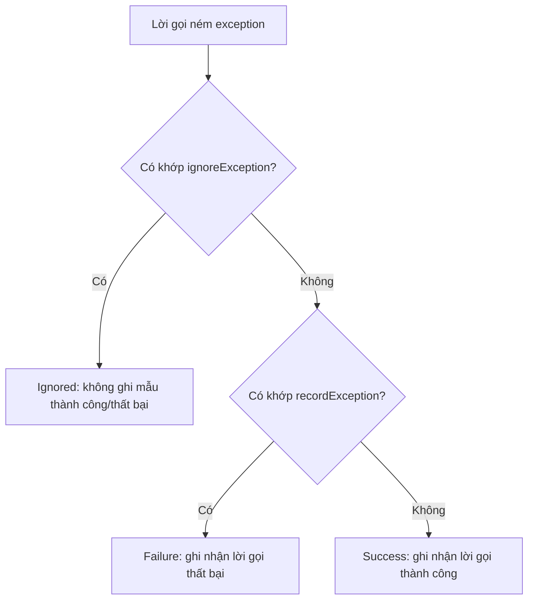

# Phân biệt ngoại lệ bị bỏ qua với lời gọi được tính thành công

Trong Resilience4j, Circuit Breaker phân loại kết quả của mỗi lời gọi để cập nhật sliding window và tính failure rate. Khi một lời gọi ném exception, exception có thể được ghi nhận là thất bại, được bỏ qua hoàn toàn, hoặc không khớp chính sách ghi nhận lỗi và vì vậy được tính như một lời gọi thành công. Ba trường hợp này có ảnh hưởng khác nhau đến quyết định mở mạch.

Điểm cần nhớ là **bỏ qua exception không giống với tính lời gọi thành công**. Exception bị bỏ qua không làm tăng số lời gọi thành công hay thất bại trong cửa sổ thống kê. Exception không bị bỏ qua nhưng không khớp danh sách hoặc predicate ghi nhận lỗi sẽ được tính như thành công. Trong cả hai trường hợp, exception vẫn được truyền ra ngoài để tầng gọi xử lý; Circuit Breaker chỉ quyết định cách thống kê nó.

## Ba kết quả phân loại

Với mỗi lời gọi đã kết thúc, Circuit Breaker cần quyết định cách xử lý kết quả:

| Kết quả | Cách Circuit Breaker ghi nhận | Ảnh hưởng đến sliding window |
|---|---|---|
| Exception được ghi nhận là lỗi | Failure | Tăng số lời gọi thất bại và có thể làm tăng failure rate |
| Exception được bỏ qua | Ignored | Không tăng số thành công hoặc thất bại; không tham gia phép tính tỷ lệ |
| Exception không bị bỏ qua và không được ghi nhận là lỗi | Success | Tăng số lời gọi thành công; có thể làm giảm failure rate |

Ví dụ với API tồn kho: `IOException` có thể cho biết dịch vụ phụ thuộc gặp lỗi kết nối nên cần tính là thất bại. `ProductNotFoundException` có thể là kết quả nghiệp vụ bình thường khi SKU không tồn tại; nếu không muốn trường hợp này làm Circuit Breaker mở mạch, hãy bỏ qua exception đó. Một exception như `IllegalStateException` nếu không nằm trong danh sách ghi nhận lỗi và chính sách đang dùng chỉ ghi nhận một số loại exception cụ thể có thể được tính là thành công, trừ khi nó cũng nằm trong danh sách bỏ qua.

## Quy tắc mặc định và thứ tự ưu tiên

Theo mặc định, Resilience4j xem exception phát sinh từ lời gọi được bảo vệ là lỗi. Có thể thay đổi hành vi bằng hai nhóm cấu hình:

- `recordExceptions` hoặc `recordException`: xác định exception nào được tính là thất bại.
- `ignoreExceptions` hoặc `ignoreException`: xác định exception nào không được tính là thành công hay thất bại.

Khi đã khai báo danh sách `recordExceptions`, những exception không khớp danh sách đó được xem là thành công, trừ các exception khớp `ignoreExceptions`. Quy tắc bỏ qua có ưu tiên: nếu một exception đồng thời khớp điều kiện ghi nhận lỗi và điều kiện bỏ qua, nó được bỏ qua và không làm tăng failure rate.

Có thể đọc quy tắc theo trình tự sau:



Nếu không cấu hình `recordExceptions` hay `recordException` tùy chỉnh, chính sách mặc định ghi nhận tất cả exception là lỗi, ngoại trừ những exception được bỏ qua. Khi dùng predicate tùy chỉnh, hãy kiểm tra cả hai nhánh `true` và `false` để tránh vô tình biến một lỗi kỹ thuật thành success.

## Cấu hình bằng application.yml

Spring Cloud CircuitBreaker với backend Resilience4j cho phép khai báo chính sách phân loại theo từng instance trong `application.yml`. Ví dụ, Circuit Breaker `inventory` ghi nhận lỗi kết nối và timeout, đồng thời bỏ qua hai exception nghiệp vụ:

```yaml
resilience4j:
  circuitbreaker:
    instances:
      inventory:
        slidingWindowType: COUNT_BASED
        slidingWindowSize: 20
        minimumNumberOfCalls: 10
        failureRateThreshold: 50
        waitDurationInOpenState: 10s
        recordExceptions:
          - java.io.IOException
          - java.util.concurrent.TimeoutException
        ignoreExceptions:
          - com.example.inventory.ProductNotFoundException
          - com.example.inventory.InvalidSkuException
```

Với cấu hình này:

- `IOException` và `TimeoutException` được tính là failure.
- `ProductNotFoundException` và `InvalidSkuException` được bỏ qua, kể cả khi chúng có thể khớp một điều kiện ghi nhận lỗi khác.
- Exception khác không khớp hai danh sách được tính là success vì đã chỉ định danh sách `recordExceptions`.

Tên class trong YAML phải là tên đầy đủ của exception thực sự được ném ra khỏi lời gọi được bảo vệ. Nếu client HTTP bọc lỗi gốc trong một exception khác, hãy phân loại theo exception mà Circuit Breaker thực sự nhận được. Kiểm tra nguyên nhân gốc (`cause`) khi cần, nhưng tránh predicate quá rộng có thể bỏ qua cả lỗi kết nối hoặc timeout.

## Cấu hình bằng Java với Resilience4j

Có thể đặt cùng chính sách bằng `CircuitBreakerConfig`:

```java
import java.io.IOException;
import java.util.concurrent.TimeoutException;

import io.github.resilience4j.circuitbreaker.CircuitBreakerConfig;

CircuitBreakerConfig config = CircuitBreakerConfig.custom()
    .slidingWindowSize(20)
    .minimumNumberOfCalls(10)
    .failureRateThreshold(50)
    .recordExceptions(IOException.class, TimeoutException.class)
    .ignoreExceptions(
        ProductNotFoundException.class,
        InvalidSkuException.class)
    .build();
```

Khi tích hợp qua Spring Cloud CircuitBreaker, có thể áp dụng cấu hình cho id cụ thể bằng factory customizer:

```java
import org.springframework.cloud.client.circuitbreaker.Customizer;
import org.springframework.cloud.circuitbreaker.resilience4j.Resilience4JCircuitBreakerFactory;
import org.springframework.context.annotation.Bean;

@Bean
Customizer<Resilience4JCircuitBreakerFactory> inventoryCircuitBreakerPolicy() {
    return factory -> factory.configure(
        builder -> builder.circuitBreakerConfig(config),
        "inventory");
}
```

Đặt biến `config` trong bean cấu hình hoặc tạo trực tiếp trong customizer theo cách phù hợp với ứng dụng. Cấu hình properties có thể có độ ưu tiên cao hơn cấu hình Java customizer; khi hành vi thực tế khác ví dụ, hãy kiểm tra cấu hình instance và group đang có hiệu lực.

## Dùng predicate khi danh sách class chưa đủ

Danh sách exception phù hợp khi chính sách chỉ phụ thuộc vào kiểu exception. Nếu cần kiểm tra nhiều điều kiện hơn, có thể dùng predicate:

```java
CircuitBreakerConfig config = CircuitBreakerConfig.custom()
    .recordException(throwable ->
        throwable instanceof IOException
            || throwable instanceof TimeoutException)
    .ignoreException(throwable ->
        throwable instanceof ProductNotFoundException
            || throwable instanceof InvalidSkuException)
    .build();
```

Predicate `recordException` trả về `true` khi exception phải được tính là failure. Predicate `ignoreException` trả về `true` khi exception phải bị loại khỏi thống kê. Nếu cả hai cùng trả về `true`, quy tắc ignore được ưu tiên.

Không nên viết predicate theo kiểu “mọi exception trừ một vài loại đều bị bỏ qua” nếu ứng dụng có nhiều client hoặc nhiều tầng bọc exception. Hãy lập danh sách exception đại diện cho lỗi phụ thuộc, lỗi nghiệp vụ và lỗi lập trình; sau đó kiểm thử từng loại để chắc chắn chính sách phản ánh đúng ý nghĩa của chúng.

## Bỏ qua exception không đồng nghĩa với xử lý thành công ở tầng ứng dụng

Phân loại của Circuit Breaker chỉ ảnh hưởng đến thống kê và quyết định trạng thái. Nó không nuốt exception, không tự tạo giá trị trả về và không thay thế logic fallback.

Giả sử `ProductNotFoundException` được cấu hình bỏ qua. Khi `inventoryClient.find("SKU-404")` ném exception này:

1. Circuit Breaker không tính lời gọi là failure hay success trong sliding window.
2. Exception vẫn được truyền ra khỏi lời gọi được bảo vệ.
3. Tầng gọi có thể bắt exception, chuyển thành HTTP 404, trả kết quả nghiệp vụ phù hợp hoặc chạy fallback đã cấu hình.

Với `CircuitBreaker.run(supplier, fallback)`, fallback được quyết định bởi exception mà lời gọi phát ra và cơ chế wrapper của API đang dùng. Việc exception được bỏ qua khỏi failure rate không tự ngăn fallback chạy. Vì vậy, cần thiết kế fallback dựa trên ngữ nghĩa lỗi và kiểm thử riêng đường đi của exception bị ignore.

Ví dụ minh họa xử lý kết quả nghiệp vụ ở service:

```java
Inventory find(String sku) {
    return circuitBreakerFactory.create("inventory").run(
        () -> inventoryClient.find(sku),
        error -> {
            if (error instanceof ProductNotFoundException) {
                throw new InventoryNotFoundException(sku, error);
            }
            return inventoryCache.find(sku)
                .orElseThrow(() -> new InventoryUnavailableException(sku, error));
        });
}
```

Trong ví dụ, exception nghiệp vụ vẫn được chuyển thành lỗi phù hợp cho caller. Lỗi phụ thuộc có thể dùng cache làm fallback. Hãy điều chỉnh kiểu trả về và exception theo hợp đồng thực tế của ứng dụng.

## Tác động đến sliding window và ngưỡng mở mạch

Giả sử Circuit Breaker đã nhận 10 lời gọi:

- 4 lời gọi ném `IOException` và được ghi nhận là failure.
- 3 lời gọi ném `ProductNotFoundException` và được ignore.
- 3 lời gọi trả kết quả bình thường và được ghi nhận là success.

Sliding window chỉ có 7 mẫu được tính: 4 failure và 3 success. Failure rate là khoảng 57,1% (4 failure trên 7 mẫu). Ba exception bị bỏ qua không được cộng vào mẫu số. Nếu cấu hình `minimumNumberOfCalls: 5` và `failureRateThreshold: 50`, mạch có đủ mẫu và tỷ lệ lỗi vượt ngưỡng, nên có thể chuyển sang `OPEN`.

Nếu nhầm exception bị ignore thành success, mẫu số sẽ thành 10 và failure rate bị tính sai thành 40%. Cách phân loại đó có thể khiến Circuit Breaker không mở mạch dù tỷ lệ lỗi trong những lời gọi thực sự cần đánh giá đang cao.

Ngược lại, nếu exception nghiệp vụ như `ProductNotFoundException` bị tính là failure, các request tra cứu SKU không tồn tại có thể làm tăng failure rate và mở mạch dù dịch vụ tồn kho vẫn hoạt động bình thường. Hãy phân loại theo ý nghĩa của exception đối với sức khỏe dịch vụ phụ thuộc, không chỉ theo việc Java có ném exception hay không.

## Quan sát và kiểm thử chính sách phân loại

Khi vận hành, theo dõi số lời gọi thành công, thất bại, bị từ chối và các sự kiện exception bị ignore nếu phiên bản Resilience4j đang dùng phát hành loại event tương ứng. Đừng suy ra rằng mọi exception bị bỏ qua đều là lỗi đã được khắc phục; chúng vẫn có thể được caller nhận và xử lý như lỗi nghiệp vụ.

Một bộ kiểm thử hữu ích nên bao gồm các trường hợp sau:

| Tình huống | Cấu hình mong đợi | Kết quả cần xác nhận |
|---|---|---|
| Dịch vụ ném `IOException` | Nằm trong `recordExceptions` | Failure count tăng; failure rate được cập nhật |
| Dịch vụ ném `ProductNotFoundException` | Nằm trong `ignoreExceptions` | Không tăng success hoặc failure count; exception vẫn đến caller/fallback |
| Dịch vụ ném exception không nằm trong hai danh sách | Đã khai báo `recordExceptions` | Được tính là success |
| Một exception khớp cả record và ignore | Có mặt trong cả hai điều kiện | Ignore được ưu tiên; không tính là failure hay success |
| Dịch vụ trả kết quả bình thường | Không có exception | Success count tăng |

Sau khi kiểm thử riêng từng loại, hãy tạo một chuỗi kết quả hỗn hợp để xác nhận failure rate và thời điểm Circuit Breaker chuyển `OPEN`. Đồng thời xác nhận fallback và HTTP response vẫn đúng hợp đồng. Đây là cách phát hiện lỗi cấu hình phổ biến: một exception nghiệp vụ vô tình bị tính là lỗi hạ tầng, hoặc một lỗi timeout vô tình bị tính như success.

## Những lỗi cấu hình thường gặp

- **Đưa exception nghiệp vụ vào `recordExceptions`:** làm tăng failure rate khi người dùng nhập dữ liệu không hợp lệ hoặc tài nguyên không tồn tại. Hãy cân nhắc ignore nếu exception đó không phản ánh sức khỏe dịch vụ phụ thuộc.
- **Dùng `ignoreExceptions` cho lỗi hạ tầng:** khiến timeout hoặc lỗi kết nối biến mất khỏi thống kê, làm mạch chậm mở dù dependency đang hỏng.
- **Khai báo `recordExceptions` nhưng quên phần còn lại được tính là success:** các exception không khớp danh sách không tự động bị ignore.
- **Cho rằng ignore sẽ nuốt exception:** caller vẫn có thể nhận exception và fallback vẫn có thể được thực thi.
- **Phân loại sai exception bọc:** client có thể ném `ResourceAccessException` thay vì `IOException`; hãy dựa trên kiểu exception thực tế mà Circuit Breaker nhận.

Chính sách tốt cần tách lỗi thể hiện dịch vụ phụ thuộc không khỏe khỏi kết quả nghiệp vụ hợp lệ và lỗi đầu vào. Khi phân biệt rõ exception bị bỏ qua với exception được tính thành công, sliding window phản ánh chính xác hơn sức khỏe dependency và Circuit Breaker có thể mở mạch đúng lúc.
