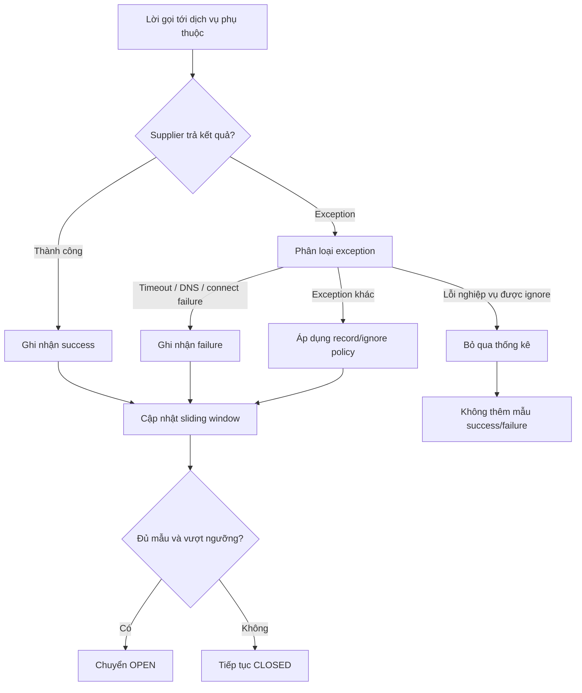

# Xử lý timeout, kết nối bị từ chối và lỗi phân giải tên

Khi một dịch vụ Spring Cloud gọi dịch vụ phụ thuộc, lỗi mạng thường xuất hiện dưới dạng exception từ HTTP client. Circuit breaker cần phân loại đúng các kết quả này để đánh giá tình trạng phụ thuộc và quyết định khi nào chuyển từ `CLOSED` sang `OPEN`. Ba nhóm lỗi thường gặp là timeout, kết nối bị từ chối và lỗi phân giải tên miền. Chúng đều có thể khiến lời gọi không hoàn thành, nhưng nguyên nhân và cách xử lý khác nhau.

Điểm quan trọng là exception mà mã ứng dụng nhìn thấy không phải lúc nào cũng là exception gốc từ mạng. HTTP client, framework hoặc Reactor có thể bọc lỗi trong một exception khác. Vì vậy, việc cấu hình circuit breaker chỉ dựa trên một lớp exception đơn lẻ có thể bỏ sót lỗi thật. Cần hiểu nguyên nhân bên trong (*cause chain*), phân biệt lỗi hạ tầng với lỗi nghiệp vụ và giữ cho retry/fallback phù hợp với tác động của lời gọi.

## 1. Phân loại ba nhóm lỗi mạng

### Timeout

Timeout xảy ra khi một bước của lời gọi vượt quá thời gian chờ được cho phép. Có thể gặp nhiều dạng:

- **Connect timeout:** không thiết lập được kết nối tới máy chủ trong thời gian quy định. Ví dụ, máy chủ không phản hồi trong quá trình bắt tay TCP.
- **Read/response timeout:** kết nối đã được thiết lập nhưng dữ liệu phản hồi không đến kịp thời.
- **Timeout ở tầng tác vụ:** một `TimeLimiter` hoặc cơ chế bất đồng bộ kết thúc việc chờ và phát ra `java.util.concurrent.TimeoutException`.
- **HTTP timeout response:** máy chủ hoặc gateway trả về mã HTTP như 408 hoặc 504. Đây là một phản hồi HTTP, khác với timeout do client tự phát sinh.

Các exception có thể gặp gồm `java.net.SocketTimeoutException`, `java.util.concurrent.TimeoutException` và exception riêng của HTTP client. Với Reactor Netty, timeout kết nối hoặc đọc dữ liệu có thể được biểu diễn bằng các kiểu exception của Netty hoặc Reactor Netty.

Timeout không chứng minh máy chủ đích chưa thực hiện thao tác. Ví dụ, dịch vụ thanh toán có thể đã ghi nhận giao dịch nhưng phản hồi bị mất hoặc đến sau thời hạn chờ. Nếu client tự động retry thao tác tạo giao dịch mà không có idempotency key, một giao dịch thứ hai có thể được tạo ra.

### Kết nối bị từ chối

Kết nối bị từ chối (*connection refused*) thường xảy ra khi client tiếp cận được địa chỉ đích nhưng không có tiến trình lắng nghe tại cổng được yêu cầu, hoặc một thành phần mạng chủ động từ chối kết nối. Trong Java, lỗi thường xuất hiện dưới dạng `java.net.ConnectException` với thông điệp như `Connection refused`.

Các nguyên nhân thường gặp gồm:

- Dịch vụ đích chưa khởi động hoặc đang khởi động lại.
- Ứng dụng đích không lắng nghe trên cổng mà client đang gọi.
- Cấu hình host/port hoặc service discovery trỏ đến endpoint sai.
- Pod hoặc instance đã bị dừng nhưng thông tin endpoint chưa được cập nhật.
- Chính sách mạng hoặc proxy từ chối kết nối.

Lỗi này thường cho thấy client không thiết lập được kết nối tới endpoint. Nó khác với read timeout: trong read timeout, kết nối có thể đã được thiết lập và client đang chờ dữ liệu phản hồi.

### Lỗi phân giải tên

Lỗi phân giải tên (*name resolution failure*) xảy ra khi client không chuyển được hostname thành địa chỉ IP. Trong Java, lỗi thường gặp là `java.net.UnknownHostException`.

Nguyên nhân có thể là:

- Tên dịch vụ hoặc hostname bị gõ sai.
- Bản ghi DNS chưa được tạo, đã hết hạn hoặc không thể truy cập.
- DNS resolver trong container hoặc node gặp sự cố.
- Cấu hình namespace, search domain hoặc service discovery không đúng.
- Endpoint chỉ tồn tại trong một môi trường nhưng ứng dụng đang chạy ở môi trường khác.

Lỗi DNS thường xảy ra trước khi client thiết lập kết nối TCP. Vì vậy, retry liên tục với cùng một hostname sai sẽ không giúp phục hồi. Nếu resolver gặp lỗi tạm thời, một lần thử lại có backoff có thể thành công; nếu tên dịch vụ không hợp lệ, cần sửa cấu hình hoặc service discovery.

## 2. So sánh nguyên nhân và hướng xử lý

| Nhóm lỗi | Exception thường gặp | Điểm xảy ra | Hướng xử lý ban đầu |
|---|---|---|---|
| Connect timeout | `ConnectTimeoutException` hoặc exception riêng của client | Trong lúc thiết lập kết nối | Kiểm tra endpoint, network path và khả năng tiếp nhận kết nối |
| Read/response timeout | `SocketTimeoutException`, timeout của client | Sau khi kết nối, trong lúc chờ phản hồi | Kiểm tra độ trễ, tải backend và deadline; xác định thao tác có thể đã hoàn tất hay chưa |
| Timeout của tác vụ | `java.util.concurrent.TimeoutException` | Khi `TimeLimiter` hoặc cơ chế bất đồng bộ hết thời gian | Kiểm tra ngân sách thời gian và hành vi hủy tác vụ |
| Connection refused | `ConnectException` | Khi mở kết nối tới host/port | Kiểm tra tiến trình đích, port, readiness và endpoint discovery |
| DNS resolution failure | `UnknownHostException` | Trước khi kết nối tới địa chỉ IP | Kiểm tra hostname, DNS resolver và service discovery |
| HTTP 408/504 | Exception phản hồi HTTP của client | Đã nhận phản hồi HTTP từ server hoặc gateway | Phân loại status theo hợp đồng dịch vụ và xác định tầng nào tạo timeout |

Các tên exception trong bảng là những dạng phổ biến, không phải danh sách đầy đủ cho mọi HTTP client. Một lỗi có thể được bọc nhiều lớp. Ví dụ, `RestTemplate` thường bọc lỗi I/O trong `org.springframework.web.client.ResourceAccessException`; `WebClient` có thể phát ra `WebClientRequestException` với exception mạng ở phần nguyên nhân. Cần kiểm tra đúng client đang dùng và cause chain thực tế khi xử lý lỗi.

## 3. Vì sao phải kiểm tra cause chain?

Circuit breaker ghi nhận exception mà supplier truyền ra ngoài. Exception đó có thể là lớp bọc của framework thay vì exception mạng gốc.

Ví dụ với client đồng bộ, một lỗi kết nối có thể có cấu trúc như sau:

```text
ResourceAccessException
  caused by ConnectException: Connection refused
```

Với client reactive, lỗi yêu cầu có thể có cấu trúc tương tự:

```text
WebClientRequestException
  caused by UnknownHostException: inventory-service
```

Nếu chỉ khai báo `ConnectException` trong danh sách exception được ghi nhận nhưng exception thực tế đưa đến breaker là `ResourceAccessException`, cấu hình theo kiểu khớp lớp exception có thể không nhận ra lỗi gốc nằm bên trong. Có hai cách tiếp cận:

1. Ghi nhận lớp wrapper mà HTTP client phát ra, ví dụ `ResourceAccessException` hoặc `WebClientRequestException`, nếu toàn bộ lỗi thuộc lớp đó đều nên được xem là lỗi phụ thuộc.
2. Dùng predicate kiểm tra chuỗi nguyên nhân để phân loại theo exception gốc, khi cần phân biệt timeout, DNS và connection refused.

Không nên chỉ dựa vào nội dung thông điệp exception như chuỗi `Connection refused` hoặc `UnknownHostException`. Thông điệp có thể khác theo hệ điều hành, runtime và HTTP client. Phân loại theo kiểu exception và cause chain ổn định hơn.

## 4. Cấu hình exception được ghi nhận bằng Resilience4j

Resilience4j cho phép xác định exception nào được tính là lỗi và exception nào cần bỏ qua. Có thể khai báo trong `application.yml`:

```yaml
resilience4j:
  circuitbreaker:
    instances:
      inventory:
        slidingWindowType: COUNT_BASED
        slidingWindowSize: 20
        minimumNumberOfCalls: 10
        failureRateThreshold: 50
        waitDurationInOpenState: 10s
        permittedNumberOfCallsInHalfOpenState: 3
        recordExceptions:
          - java.net.SocketTimeoutException
          - java.util.concurrent.TimeoutException
          - java.net.ConnectException
          - java.net.UnknownHostException
          - java.net.NoRouteToHostException
          - org.springframework.web.client.ResourceAccessException
          - org.springframework.web.reactive.function.client.WebClientRequestException
        ignoreExceptions:
          - com.example.inventory.InvalidSkuException
```

Ví dụ này minh họa cách khai báo exception theo lớp. Các kiểu Spring chỉ phù hợp nếu ứng dụng có sử dụng HTTP client tương ứng và phiên bản thư viện cung cấp các lớp đó. Danh sách cần được điều chỉnh theo exception thực tế mà supplier phát ra.

Khi dùng `recordExceptions`, Resilience4j chỉ ghi nhận những exception phù hợp với danh sách được cấu hình là failure; exception không khớp có thể được xem là kết quả thành công theo quy tắc của cấu hình. `ignoreExceptions` xác định các exception không được tính là failure cũng không được tính là success. Nếu một exception cùng khớp quy tắc ghi nhận và bỏ qua, quy tắc bỏ qua được ưu tiên.

Nếu không khai báo `recordExceptions`, hành vi mặc định của Resilience4j là ghi nhận exception phát sinh như lỗi, ngoại trừ các exception được cấu hình bỏ qua. Vì vậy, việc thêm một danh sách `recordExceptions` là thay đổi chính sách phân loại, không đơn thuần là bổ sung vài loại lỗi vào mặc định.

### Phân biệt lỗi hạ tầng và lỗi nghiệp vụ

Không phải exception nào cũng nên làm circuit breaker mở. Một `InvalidSkuException` hoặc lỗi kiểm tra dữ liệu đầu vào thường không cho thấy dịch vụ tồn kho đang suy giảm. Nếu tính những lỗi nghiệp vụ này vào failure rate, breaker có thể mở dù backend vẫn hoạt động bình thường.

Ngược lại, timeout, lỗi kết nối và lỗi DNS thường phản ánh việc phụ thuộc không thể được gọi thành công. Các lỗi này thường nên được ghi nhận để circuit breaker có thể bảo vệ dịch vụ gọi.

HTTP status cũng cần được phân loại theo hợp đồng nghiệp vụ:

- HTTP 5xx thường phản ánh lỗi phía server hoặc gateway và thường được xem là lỗi phụ thuộc.
- HTTP 404 có thể là kết quả nghiệp vụ hợp lệ, ví dụ SKU không tồn tại; không nên mặc định xem mọi 404 là sự cố hạ tầng.
- HTTP 400 hoặc 422 thường liên quan dữ liệu đầu vào và có thể không nên góp vào failure rate.
- HTTP 429 có thể báo hiệu backend đang giới hạn lưu lượng. Tùy hợp đồng, đây có thể là tín hiệu quá tải cần ghi nhận hoặc là phản hồi điều tiết cần xử lý bằng retry có `Retry-After`.
- HTTP 408 hoặc 504 thường liên quan timeout, nhưng cần xác định server, gateway hay client tạo ra phản hồi.

## 5. Phân loại theo cause chain bằng predicate

Khi wrapper của client thay đổi theo thư viện hoặc cần phân biệt nhiều loại lỗi, predicate giúp kiểm tra exception gốc. Ví dụ dưới đây minh họa một predicate nhận diện các lỗi kết nối thường gặp:

```java
import java.net.ConnectException;
import java.net.NoRouteToHostException;
import java.net.SocketTimeoutException;
import java.net.UnknownHostException;
import java.util.concurrent.TimeoutException;
import java.util.function.Predicate;

public final class NetworkFailurePredicates {
    private NetworkFailurePredicates() {
    }

    public static boolean isNetworkFailure(Throwable error) {
        for (Throwable cause = error;
             cause != null;
             cause = cause.getCause()) {
            if (cause instanceof SocketTimeoutException
                    || cause instanceof TimeoutException
                    || cause instanceof ConnectException
                    || cause instanceof UnknownHostException
                    || cause instanceof NoRouteToHostException) {
                return true;
            }
        }
        return false;
    }

    public static Predicate<Throwable> networkFailurePredicate() {
        return NetworkFailurePredicates::isNetworkFailure;
    }
}
```

Có thể sử dụng predicate khi tạo `CircuitBreakerConfig`:

```java
CircuitBreakerConfig config = CircuitBreakerConfig.custom()
        .slidingWindowSize(20)
        .minimumNumberOfCalls(10)
        .failureRateThreshold(50)
        .recordException(NetworkFailurePredicates::isNetworkFailure)
        .build();
```

Đoạn mã giả định ứng dụng đã import `io.github.resilience4j.circuitbreaker.CircuitBreakerConfig` và truyền `config` vào registry hoặc factory phù hợp. Predicate trả về `true` cho lỗi được xem là failure. Những exception không khớp cần được cân nhắc theo chính sách của ứng dụng; nếu cần bỏ qua một loại exception nghiệp vụ cụ thể, hãy cấu hình quy tắc ignore riêng và kiểm tra thứ tự áp dụng của predicate.

Ví dụ predicate trên chỉ kiểm tra một số kiểu Java chuẩn. Nếu client sử dụng exception riêng như `ConnectTimeoutException`, `ReadTimeoutException` hoặc wrapper khác, hãy bổ sung kiểu tương ứng sau khi quan sát cause chain thực tế. Không nên coi mọi `IOException` là lỗi giống nhau nếu ứng dụng cần phân biệt lỗi mạng với lỗi đọc/ghi cục bộ.

## 6. Cách lỗi được ghi nhận trong CircuitBreaker

Khi breaker ở `CLOSED`, supplier được thực thi và kết quả được ghi vào sliding window. Một exception được phân loại là failure sẽ làm tăng số lỗi trong cửa sổ. Khi đủ `minimumNumberOfCalls` và tỷ lệ lỗi đạt ngưỡng `failureRateThreshold`, breaker có thể chuyển sang `OPEN`.

Nếu exception bị ignore, nó không được tính là failure hay success trong thống kê. Điều này khác với một exception không khớp danh sách `recordExceptions` trong cấu hình chỉ định rõ các loại được ghi nhận; loại không khớp có thể được xem như một lần gọi thành công. Cần chọn chính sách có chủ đích vì việc phân loại sai có thể làm tỷ lệ lỗi thấp giả tạo.

Ví dụ, cửa sổ có 10 mẫu tối thiểu và ngưỡng failure 50%. Nếu 5 lời gọi timeout hoặc connection refused được ghi nhận là failure và đủ 10 mẫu, breaker có thể mở. Nếu 5 lỗi còn lại là `InvalidSkuException` được ignore, chúng không làm tăng số mẫu success hay failure. Nếu chúng bị tính là success, failure rate sẽ khác và có thể làm chậm thời điểm mở mạch.



## 7. Kết hợp phân loại lỗi với fallback

Fallback cho phép gateway trả một kết quả suy giảm khi lời gọi thất bại hoặc breaker đang mở. Tuy nhiên, fallback nên phản ánh đúng loại lỗi và trạng thái dữ liệu.

Ví dụ, khi dịch vụ tồn kho không thể truy cập, gateway có thể trả trạng thái `UNAVAILABLE`:

```java
public InventoryView find(String sku) {
    return circuitBreakerFactory.create("inventory").run(
            () -> inventoryClient.find(sku),
            failure -> {
                log.warn("Inventory lookup failed for sku {}", sku, failure);
                return InventoryView.unavailable(sku);
            }
    );
}
```

`UNAVAILABLE` có ý nghĩa khác `OUT_OF_STOCK`. Khi DNS lỗi hoặc kết nối bị từ chối, ứng dụng chưa biết tồn kho thực tế. Trả về số lượng 0 có thể khiến tầng nghiệp vụ từ chối đơn hàng sai. Nếu có cache, có thể trả dữ liệu cũ nhưng phải thể hiện thời điểm cập nhật và trạng thái stale để người dùng hoặc hệ thống phía trên hiểu đúng.

Fallback cũng không nên gọi lại cùng endpoint đang lỗi. Nếu fallback gọi lại dịch vụ tồn kho bằng một client khác mà không có giới hạn, hệ thống vẫn có thể tạo thêm tải vào phụ thuộc. Fallback nên là thao tác cục bộ, truy vấn cache hoặc trả trạng thái suy giảm đã được thiết kế.

Nếu cần hành vi khác nhau theo nguyên nhân, có thể phân loại `failure` trong fallback:

- Timeout: trả trạng thái tạm thời không có dữ liệu và ghi nhận latency.
- Connection refused: ghi nhận endpoint không nhận kết nối, kiểm tra readiness hoặc service discovery.
- Unknown host: ghi nhận lỗi phân giải tên và cảnh báo cấu hình DNS.
- Lỗi nghiệp vụ: trả phản hồi nghiệp vụ tương ứng, không chuyển thành trạng thái phụ thuộc không khả dụng.

Không nên bắt `Throwable` rồi trả một giá trị mặc định chung mà không lưu nguyên nhân. Cách làm đó có thể che giấu lỗi lập trình như `NullPointerException`, lỗi cấu hình hoặc vi phạm hợp đồng dữ liệu.

## 8. Retry và timeout cần có ngân sách rõ ràng

Retry có thể hữu ích khi lỗi có khả năng tạm thời, nhưng retry không thay thế circuit breaker. Nếu backend đang quá tải, retry không giới hạn sẽ nhân số lời gọi và khiến backend khó phục hồi hơn.

| Lỗi | Khả năng retry | Lưu ý |
|---|---|---|
| Connect timeout | Có thể thử lại có giới hạn | Dùng backoff và jitter; kiểm tra endpoint và network |
| Read timeout | Cần thận trọng | Máy chủ có thể đã thực hiện thao tác; yêu cầu idempotency với thao tác có tác động phụ |
| Connection refused | Có thể thử lại sau một khoảng chờ ngắn nếu dịch vụ đang khởi động | Nếu port sai hoặc không có listener, retry liên tục không giúp ích |
| Unknown host | Chỉ nên retry có giới hạn khi nghi ngờ DNS tạm thời | Hostname sai cần sửa cấu hình, không thể khắc phục bằng retry |
| HTTP 429 | Theo hợp đồng và `Retry-After` | Giới hạn retry và tôn trọng chính sách điều tiết của server |
| HTTP 5xx | Có thể retry một số lỗi tạm thời | Không retry mù quáng các thao tác không idempotent |

Timeout phải phù hợp với deadline tổng của yêu cầu. Ví dụ, nếu request phía người dùng chỉ cho phép 2 giây, không nên đặt connect timeout 2 giây, read timeout 2 giây rồi retry thêm nhiều lần. Tổng thời gian của các lần thử, backoff và các bước xử lý khác có thể vượt deadline.

Với Resilience4j, `TimeLimiter` có thể giới hạn thời gian chờ của `Future` hoặc tác vụ bất đồng bộ được hỗ trợ. HTTP client cũng cần timeout kết nối và phản hồi riêng. Khi timeout, cần kiểm tra tác vụ có thực sự bị hủy hay chỉ ngừng chờ kết quả; hủy `Future` không phải lúc nào cũng dừng được thao tác I/O ở phía dưới.

Thứ tự lồng ghép retry và circuit breaker ảnh hưởng tới cách thống kê. Nếu retry nằm bên trong breaker, một lần thực thi supplier của breaker có thể tạo nhiều lần gọi mạng nhưng breaker chỉ quan sát kết quả cuối cùng của chuỗi retry. Nếu breaker nằm bên trong retry, mỗi lần thử có thể đi qua breaker và được ghi nhận riêng. Chọn thứ tự theo mục tiêu thống kê và giới hạn tải, sau đó kiểm thử với lỗi thực tế.

## 9. Theo dõi và chẩn đoán theo loại lỗi

Một chỉ số failure rate tổng hợp cho biết breaker đang gặp nhiều lỗi, nhưng không giải thích lỗi đến từ timeout, DNS hay kết nối bị từ chối. Nên bổ sung log, metric và trace để nhận diện nhóm nguyên nhân.

Các tín hiệu nên theo dõi gồm:

- Số lượng và tỷ lệ `SocketTimeoutException`, `TimeoutException`, `ConnectException`, `UnknownHostException` hoặc wrapper tương ứng.
- Số lần breaker chuyển `CLOSED` sang `OPEN` và `OPEN` sang `HALF_OPEN`.
- Tỷ lệ lỗi và slow call rate theo từng breaker ID.
- Thời gian kết nối, thời gian chờ phản hồi và tổng latency của request.
- Số lần fallback, retry và lời gọi bị từ chối khi breaker đang mở.
- Tình trạng DNS, endpoint discovery, readiness của pod và connection pool.

Không nên đưa hostname động, mã người dùng hoặc thông tin có độ đa dạng cao vào metric label. Có thể dùng breaker ID, nhóm lỗi và tên dịch vụ phụ thuộc làm nhãn có giới hạn. Log chi tiết có thể giữ exception cùng cause chain, nhưng cần tránh ghi dữ liệu nhạy cảm hoặc thông tin xác thực trong URL và header.

Một số hướng chẩn đoán nhanh:

- Nhiều `UnknownHostException`: kiểm tra hostname, DNS resolver, namespace và service discovery.
- Nhiều `ConnectException: Connection refused`: kiểm tra tiến trình đích, cổng lắng nghe, readiness và endpoint mà client đang chọn.
- Nhiều connect timeout: kiểm tra đường mạng, firewall, tải hệ thống và thời gian thiết lập kết nối.
- Nhiều read timeout: kiểm tra độ trễ xử lý backend, dependency sâu hơn, hàng đợi, thread pool và connection pool.
- Breaker mở nhưng backend có vẻ khỏe: kiểm tra exception wrapper, record/ignore policy, lỗi nghiệp vụ bị tính nhầm và metric theo từng replica.

## 10. Kiểm thử phân loại kết quả

Để chắc chắn breaker phản ứng đúng, cần kiểm tra cả exception gốc, wrapper của client và kết quả fallback. Có thể tạo các tình huống thử nghiệm sau trong môi trường kiểm thử:

1. **Timeout:** làm endpoint phản hồi chậm hơn read timeout và xác nhận lỗi được ghi nhận là failure.
2. **Connection refused:** gọi một host/port không có listener và xác nhận supplier phát ra exception phù hợp hoặc wrapper chứa `ConnectException`.
3. **DNS failure:** dùng hostname không phân giải được trong môi trường thử nghiệm và xác nhận cause chain có `UnknownHostException`.
4. **Lỗi nghiệp vụ:** phát sinh exception được cấu hình ignore và xác nhận nó không làm tăng failure rate.
5. **Breaker OPEN:** tạo đủ mẫu lỗi để mở mạch, sau đó xác nhận supplier không được gọi và fallback được thực thi.
6. **Phục hồi:** khôi phục endpoint, chờ breaker chuyển `HALF_OPEN`, gửi số lời gọi thăm dò cho phép và xác nhận breaker đóng lại khi kết quả tốt.

Ở mỗi tình huống, kiểm tra số mẫu trong sliding window, failure rate, trạng thái breaker và số lần fallback. Nếu dùng `recordExceptions`, hãy thử cả exception nằm trong và ngoài danh sách để xác nhận chính sách không vô tình xem lỗi nghiệp vụ là success. Nếu dùng wrapper của Spring hoặc Reactor, kiểm tra exception thực sự đến breaker thay vì chỉ kiểm tra exception mà test dự kiến.

## 11. Quy trình xử lý khi gặp lỗi mạng

Khi một lời gọi phụ thuộc thất bại, có thể áp dụng quy trình sau:

1. Ghi lại exception bên ngoài và toàn bộ cause chain để xác định lỗi gốc.
2. Phân loại lỗi là connect timeout, read timeout, timeout tác vụ, connection refused, DNS failure hay HTTP response error.
3. Kiểm tra hostname, port, endpoint discovery, trạng thái dịch vụ đích và đường mạng tương ứng với loại lỗi.
4. Xác định lỗi có nên được ghi nhận vào failure rate hay được ignore theo hợp đồng nghiệp vụ.
5. Chọn fallback phản ánh dữ liệu không sẵn có, dữ liệu cũ hoặc kết quả nghiệp vụ hợp lệ.
6. Chỉ retry lỗi có khả năng tạm thời, giới hạn số lần và tổng thời gian; bảo vệ thao tác có tác động phụ bằng idempotency.
7. Theo dõi metric theo nhóm lỗi và trạng thái circuit breaker để xác nhận hệ thống ngừng gọi khi cần, rồi phục hồi có kiểm soát.

Timeout, connection refused và DNS failure đều có thể khiến một lời gọi từ xa thất bại, nhưng mỗi loại phản ánh một điểm hỏng khác nhau. Khi phân loại exception đúng theo cause chain, circuit breaker có thể ghi nhận chính xác tình trạng phụ thuộc, tránh mở mạch vì lỗi nghiệp vụ và giúp fallback cung cấp kết quả trung thực. Kết hợp với timeout, retry có giới hạn và quan sát theo loại lỗi, ứng dụng Spring Cloud có thể ngăn sự cố mạng lan rộng thành sụp đổ dây chuyền.
