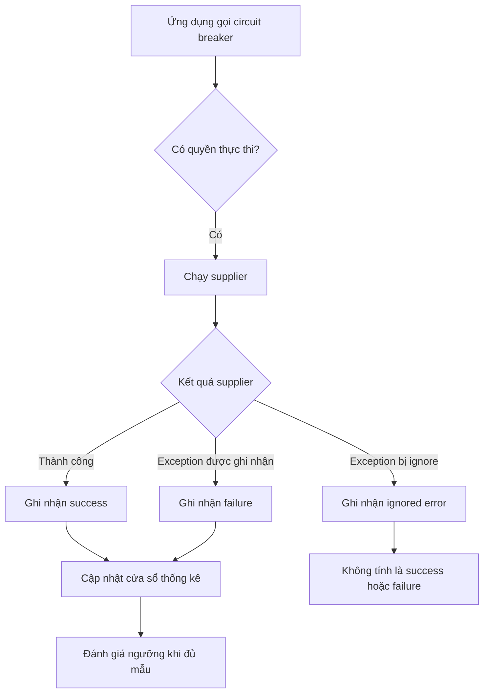
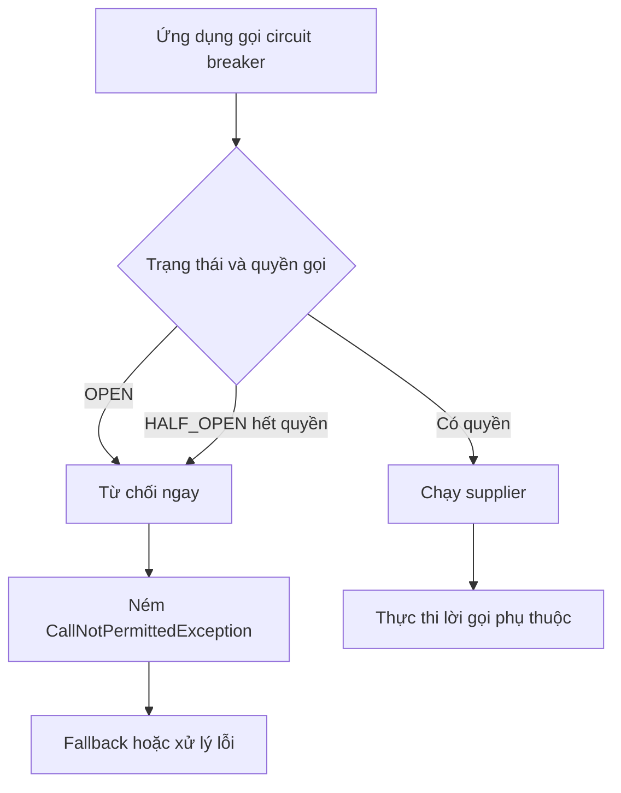

# Phân biệt lỗi khi đang thực thi với lời gọi bị từ chối ngay

Khi một lời gọi được bảo vệ bởi circuit breaker thất bại, cần xác định lỗi xuất hiện trong lúc gọi dịch vụ phụ thuộc hay circuit breaker đã từ chối lời gọi trước khi phần gọi đó bắt đầu. Hai trường hợp có thể cùng dẫn đến fallback, nhưng ý nghĩa vận hành và cách thống kê hoàn toàn khác nhau.

Trong Spring Cloud CircuitBreaker sử dụng Resilience4j, lỗi phát sinh từ supplier như timeout, lỗi kết nối hoặc phản hồi dịch vụ không hợp lệ là kết quả của một lần thực thi đã bắt đầu. Ngược lại, khi circuit breaker ở `OPEN` hoặc đã hết số quyền gọi trong `HALF_OPEN`, nó có thể từ chối lời gọi ngay bằng `CallNotPermittedException`. Khi đó supplier không được chạy và dịch vụ phụ thuộc không nhận thêm request từ lần gọi này.

Phân biệt đúng hai loại kết quả giúp nhóm phát triển đọc metrics chính xác, cấu hình fallback phù hợp và tránh retry vô ích khi circuit breaker đang bảo vệ hệ thống.

## 1. Hai tình huống có cùng biểu hiện bên ngoài nhưng khác bản chất

Giả sử `OrderService` gọi dịch vụ tồn kho thông qua circuit breaker có ID `inventory`. Có hai tình huống thường gặp:

**Lỗi trong khi thực thi:** circuit breaker cho phép lời gọi đi qua, supplier gọi `InventoryClient`, nhưng dịch vụ tồn kho không phản hồi hoặc trả lỗi. Supplier đã được chạy và phát sinh exception. Resilience4j phân loại exception theo cấu hình ghi nhận lỗi, sau đó cập nhật thống kê của cửa sổ.

**Lời gọi bị từ chối ngay:** circuit breaker đang `OPEN`, hoặc không còn quyền gọi thăm dò trong `HALF_OPEN`. Circuit breaker không cấp quyền thực thi cho supplier và ném `CallNotPermittedException`. `InventoryClient` không được gọi trong lần này. Đây là kết quả từ chối của cơ chế bảo vệ, không phải lỗi mới từ dịch vụ tồn kho.

| Đặc điểm | Lỗi khi đang thực thi | Lời gọi bị từ chối ngay |
|---|---|---|
| Supplier có chạy không? | Có | Không |
| Dịch vụ phụ thuộc có nhận request không? | Có thể có, tùy lỗi xảy ra ở bước nào | Không nhận request từ lần gọi bị từ chối |
| Ví dụ | `SocketTimeoutException`, lỗi kết nối, lỗi HTTP được client chuyển thành exception | `CallNotPermittedException` |
| Circuit breaker đang ở trạng thái nào? | Thường là `CLOSED` hoặc một lời gọi thăm dò trong `HALF_OPEN` | `OPEN` hoặc đã hết quyền gọi trong `HALF_OPEN` |
| Có ảnh hưởng thống kê lỗi của lời gọi phụ thuộc? | Có, nếu exception được cấu hình là lỗi được ghi nhận | Không được tính như một lỗi thực thi mới trong failure rate của circuit breaker |
| Mục tiêu xử lý | Điều tra sức khỏe và phản hồi của phụ thuộc | Tôn trọng quyết định ngắt mạch, trả fallback hoặc lỗi có kiểm soát |

Điểm quan trọng là `CallNotPermittedException` không chứng minh dịch vụ phụ thuộc vừa thất bại. Nó cho biết circuit breaker đã chủ động ngăn lời gọi để tránh tiếp tục tạo tải lên phụ thuộc.

## 2. Luồng xử lý khi supplier thực sự được chạy

Ở trạng thái `CLOSED`, circuit breaker thường cấp quyền thực thi cho supplier. Supplier thực hiện lời gọi đến client và trả kết quả hoặc ném exception. Resilience4j ghi nhận kết quả theo cấu hình `CircuitBreakerConfig`.



Ví dụ, dịch vụ tồn kho bị timeout:

```java
public Stock getStock(String sku) {
    return circuitBreakerFactory.create("inventory").run(
        () -> inventoryClient.getStock(sku),
        error -> Stock.unavailable(sku)
    );
}
```

Nếu `inventoryClient.getStock(sku)` ném `SocketTimeoutException` hoặc exception tương ứng từ HTTP client, supplier đã được thực thi. Với cấu hình mặc định của Resilience4j, exception thông thường được ghi nhận là failure. Có thể thay đổi quy tắc này bằng `recordExceptions`, `ignoreExceptions`, `recordException` hoặc predicate tương ứng.

Không phải mọi HTTP response lỗi đều tự động là exception. Một số HTTP client trả về response bình thường kể cả khi status là 4xx hoặc 5xx. Nếu supplier coi response đó là kết quả thành công, circuit breaker có thể ghi nhận success trừ khi ứng dụng chuyển response thành exception hoặc cấu hình predicate kết quả phù hợp. Vì vậy, cần kiểm tra hành vi của client và cách ánh xạ status code trước khi kết luận circuit breaker phân loại lỗi sai.

## 3. Luồng xử lý khi circuit breaker từ chối lời gọi

Khi mạch ở `OPEN`, circuit breaker không cấp quyền cho supplier. Resilience4j ném `CallNotPermittedException` trước khi chạy phần gọi dịch vụ. Trong `HALF_OPEN`, circuit breaker chỉ cấp số quyền thăm dò giới hạn bởi `permittedNumberOfCallsInHalfOpenState`; những lời gọi vượt quá số quyền còn lại cũng có thể bị từ chối.



Ví dụ:

```java
import io.github.resilience4j.circuitbreaker.CallNotPermittedException;

public Stock getStock(String sku) {
    return circuitBreakerFactory.create("inventory").run(
        () -> inventoryClient.getStock(sku),
        error -> {
            if (error instanceof CallNotPermittedException) {
                return Stock.temporarilyUnavailable(sku);
            }
            return Stock.unavailable(sku);
        }
    );
}
```

Fallback trong ví dụ phân biệt việc mạch từ chối lời gọi với lỗi xảy ra trong lúc supplier chạy. Cả hai đều có thể trả trạng thái tạm thời không sẵn có, nhưng thông tin nguyên nhân khác nhau giúp ghi log, hiển thị thông báo và quyết định retry chính xác hơn.

Khi circuit breaker từ chối lời gọi, không nên gọi trực tiếp lại cùng dịch vụ để “thử thêm lần nữa”. Làm như vậy sẽ bỏ qua quyết định bảo vệ và có thể tạo ra chính tải mà circuit breaker đang cố ngăn chặn. Nếu nghiệp vụ có thể chờ, hãy trả trạng thái phù hợp hoặc lên lịch thử lại sau một khoảng thời gian có kiểm soát ở tầng điều phối.

## 4. `CallNotPermittedException` và failure rate

Failure rate của Resilience4j được tính từ các kết quả thực thi được ghi nhận trong cửa sổ thống kê. `CallNotPermittedException` biểu thị việc circuit breaker không cho phép lời gọi bắt đầu. Vì supplier không chạy nên đây không phải một kết quả lỗi mới từ phụ thuộc để cộng vào failure rate.

Resilience4j vẫn có thể ghi nhận số lần từ chối qua loại metric hoặc event riêng, thường được thể hiện bằng số lời gọi `not permitted`. Số liệu này rất hữu ích để biết có bao nhiêu request bị chặn khi mạch mở hoặc khi hết quyền thăm dò. Không nên cộng số lần từ chối này vào số lỗi thực thi của dịch vụ phụ thuộc khi phân tích failure rate.

Ví dụ, một cửa sổ có 20 kết quả thực thi, trong đó 12 lỗi và 8 thành công. Failure rate là 60%. Sau khi mạch mở, có thêm 100 request bị từ chối ngay. Những lần từ chối này làm tăng số liệu `not permitted`, nhưng không biến failure rate của 20 kết quả trước đó thành 100/120 hoặc 112/120. Chúng phản ánh lượng lưu lượng đã được circuit breaker chặn, không phải 100 lần gọi phụ thuộc thất bại.

Trong `HALF_OPEN`, chỉ các lời gọi được cấp quyền thăm dò mới chạy supplier và tạo kết quả để circuit breaker quyết định có đóng mạch hay mở lại. Các request không được cấp quyền vì đã hết giới hạn thăm dò là lời gọi bị từ chối, không phải kết quả thăm dò thất bại.

## 5. Exception bị ignore là trường hợp thứ ba cần phân biệt

Ngoài failure và rejection, Resilience4j còn cho phép cấu hình một số exception là *ignored*. Supplier đã chạy và ném exception, nhưng exception được phân loại là bỏ qua. Trường hợp này không được tính là success hoặc failure trong thống kê tỷ lệ.

Ví dụ, một lỗi nghiệp vụ do dữ liệu đầu vào không hợp lệ có thể không phản ánh tình trạng sức khỏe của dịch vụ tồn kho. Nếu loại exception này được cấu hình là ignored, nó không làm tăng failure rate của circuit breaker.

Ví dụ cấu hình:

```yaml
resilience4j:
  circuitbreaker:
    instances:
      inventory:
        recordExceptions:
          - java.net.SocketTimeoutException
          - java.io.IOException
        ignoreExceptions:
          - com.example.inventory.InvalidSkuException
```

Khi cấu hình `recordExceptions`, cần hiểu rõ quy tắc phân loại của phiên bản Resilience4j đang dùng: các exception được chỉ định sẽ được ghi nhận là failure; các exception không khớp danh sách có thể được coi là success nếu không bị ignore hoặc xử lý bởi predicate khác. `ignoreExceptions` loại exception khỏi thống kê success/failure. Hãy kiểm tra thứ tự và tương tác của các predicate nếu đồng thời dùng nhiều cách phân loại.

Không nên ignore timeout hoặc lỗi kết nối chỉ để giảm failure rate. Nếu bỏ qua các tín hiệu phản ánh dịch vụ phụ thuộc không thể đáp ứng, circuit breaker có thể không mở mạch khi cần thiết.

## 6. Fallback nhận cả lỗi thực thi và lỗi từ chối

Spring Cloud CircuitBreaker cho phép truyền hàm fallback vào `run(...)`. Hàm này nhận `Throwable` và có thể được gọi khi supplier thất bại hoặc khi circuit breaker từ chối lời gọi. Do đó, không nên giả định mọi lỗi đến fallback đều xuất phát từ dịch vụ phụ thuộc.

Một cách tổ chức là tách phần phân loại nguyên nhân khỏi phần tạo phản hồi:

```java
import io.github.resilience4j.circuitbreaker.CallNotPermittedException;
import org.springframework.stereotype.Service;

@Service
public class InventoryService {
    private final CircuitBreakerFactory<?, ?> circuitBreakerFactory;
    private final InventoryClient inventoryClient;

    public InventoryService(
            CircuitBreakerFactory<?, ?> circuitBreakerFactory,
            InventoryClient inventoryClient) {
        this.circuitBreakerFactory = circuitBreakerFactory;
        this.inventoryClient = inventoryClient;
    }

    public Stock getStock(String sku) {
        return circuitBreakerFactory.create("inventory").run(
            () -> inventoryClient.getStock(sku),
            error -> fallback(sku, error)
        );
    }

    private Stock fallback(String sku, Throwable error) {
        if (error instanceof CallNotPermittedException) {
            return Stock.temporarilyUnavailable(sku);
        }
        return Stock.unavailable(sku);
    }
}
```

Trong ứng dụng thực tế, có thể phân loại sâu hơn các lỗi timeout, lỗi kết nối, lỗi 5xx và lỗi nghiệp vụ. Nên giữ nguyên nguyên nhân gốc trong log hoặc trace để điều tra; không ghi nội dung nhạy cảm của request hoặc thông tin xác thực. Nếu fallback không thể tạo kết quả an toàn, hãy để lỗi được chuyển lên tầng xử lý phù hợp thay vì giả lập thành công.

Fallback là một phần xử lý bên ngoài lời gọi được bảo vệ. Kết quả fallback không biến lần gọi phụ thuộc thất bại thành success của circuit breaker. Nếu supplier đã được chạy và exception được ghi nhận là failure, failure vẫn được tính; fallback chỉ quyết định ứng dụng phản hồi thế nào với caller.

## 7. Kiểm thử để chứng minh supplier có chạy hay không

Có thể dùng Mockito để kiểm tra số lần client được gọi. Hai ca kiểm thử cần chứng minh:

1. Khi supplier được phép chạy và client ném exception, client đã được gọi và fallback nhận lỗi thực thi.
2. Khi circuit breaker đã `OPEN`, lần gọi tiếp theo bị từ chối và client không được gọi thêm.

Ví dụ minh họa cho trường hợp bị từ chối:

```java
import static org.mockito.Mockito.never;
import static org.mockito.Mockito.verify;

import io.github.resilience4j.circuitbreaker.CallNotPermittedException;
import org.junit.jupiter.api.Test;

class InventoryServiceTest {

    @Test
    void doesNotCallClientWhenCircuitBreakerIsOpen() {
        // Arrange: tạo circuit breaker và đưa nó về trạng thái OPEN.
        // Act: gọi InventoryService.getStock(...).
        // Assert: kết quả fallback biểu thị tạm thời không sẵn có.
        verify(inventoryClient, never()).getStock("SKU-1");
    }
}
```

Phần `Arrange` cần dùng cùng circuit breaker instance mà service sử dụng, sau đó tạo đủ điều kiện mở mạch hoặc chuyển trạng thái bằng API/test fixture phù hợp. Không chỉ mock `CallNotPermittedException` ở tầng service vì cách đó không chứng minh circuit breaker thực sự chặn supplier.

Với trường hợp lỗi trong khi thực thi, kiểm tra client được gọi đúng số lần và circuit breaker ghi nhận failure nếu exception thuộc loại được cấu hình. Có thể kiểm tra trạng thái bằng API của Resilience4j hoặc quan sát event/metrics. Tránh chỉ khẳng định fallback trả về giá trị mong đợi mà không xác minh supplier có chạy hay không.

## 8. Quan sát metrics và sự kiện

Khi tích hợp Micrometer và Actuator, nên quan sát các nhóm số liệu sau:

- Số lời gọi thành công.
- Số lời gọi thất bại được ghi nhận.
- Số lời gọi bị từ chối (`not permitted`).
- Tỷ lệ lỗi và tỷ lệ lời gọi chậm.
- Trạng thái hiện tại và số lần chuyển trạng thái của circuit breaker.

Các tên meter và tag cụ thể phụ thuộc phiên bản Resilience4j, Micrometer và cấu hình binder. Hãy truy vấn `/actuator/metrics` hoặc endpoint Prometheus để xem tên meter thực tế của ứng dụng. Nếu số lời gọi bị từ chối tăng nhanh trong khi failure rate ổn định, điều đó có thể cho thấy mạch đang chặn một lượng lớn request sau khi đã mở. Nếu failure rate tăng, cần điều tra các lần supplier thực sự chạy và exception được ghi nhận.

Resilience4j cũng cung cấp event để quan sát các kết quả như thành công, lỗi, lỗi bị bỏ qua, lời gọi bị từ chối và chuyển trạng thái. Có thể đăng ký event consumer trong cấu hình phù hợp để ghi log hoặc đẩy thông tin vào hệ thống quan sát. Event rejection hữu ích để đo lượng lưu lượng bị chặn; event error hữu ích để điều tra kết quả thực thi.

Không nên tạo cảnh báo chỉ dựa trên số lần `not permitted` mà không xét lưu lượng và trạng thái mạch. Trong một sự cố lớn, số request bị chặn cao có thể là dấu hiệu circuit breaker đang bảo vệ hệ thống hiệu quả. Cần kết hợp số liệu từ circuit breaker với độ sẵn sàng và độ trễ của dịch vụ phụ thuộc để đánh giá toàn cảnh.

## 9. Retry và cách xử lý rejection

Retry có thể hữu ích khi lỗi có tính tạm thời, nhưng cần xác định thứ tự phối hợp với circuit breaker. Nếu Retry nằm bên ngoài circuit breaker, mỗi lần thử có thể gọi lại circuit breaker; khi mạch đã `OPEN`, các lần thử tiếp theo có thể đều bị từ chối ngay. Nếu Retry nằm bên trong circuit breaker, một lần thực thi được bảo vệ có thể chứa nhiều lần gọi đến phụ thuộc trước khi trả kết quả cuối cùng cho circuit breaker. Hai cách có ảnh hưởng khác nhau đến thống kê và tải.

Đặc biệt, không retry vô hạn `CallNotPermittedException`. Đây là tín hiệu circuit breaker đã từ chối lời gọi. Retry ngay lập tức chỉ lặp lại việc bị từ chối và có thể tạo tải không cần thiết trong ứng dụng. Nếu cần thử lại, hãy dùng backoff, giới hạn số lần và chỉ thực hiện sau khoảng thời gian phù hợp hoặc khi có tín hiệu phục hồi.

Với lỗi thực thi, chỉ retry các lỗi có khả năng hồi phục và thao tác có thể lặp an toàn. Không retry thao tác ghi không idempotent khi chưa biết request trước đã được xử lý hay chưa. Các quy tắc này đặc biệt quan trọng với thanh toán, tạo đơn hàng và cập nhật tồn kho.

## 10. Quy trình đọc một lỗi trong production

Khi nhận được cảnh báo hoặc log cho thấy lời gọi đến dịch vụ phụ thuộc thất bại, hãy phân tích theo trình tự:

1. **Xác định exception gốc:** xem đó là `CallNotPermittedException`, timeout, lỗi kết nối, lỗi HTTP hay exception nghiệp vụ.
2. **Kiểm tra supplier có chạy không:** đối chiếu log/trace client, số lần gọi mock trong kiểm thử hoặc telemetry của client.
3. **Kiểm tra trạng thái circuit breaker:** `CLOSED`, `OPEN` hay `HALF_OPEN`; xem số quyền thăm dò còn lại nếu có thông tin.
4. **Đối chiếu metrics:** so sánh failed calls với not-permitted calls, failure rate và slow-call rate.
5. **Kiểm tra fallback:** xác nhận fallback nhận đúng nguyên nhân và trả kết quả có ý nghĩa nghiệp vụ.
6. **Đánh giá retry:** xác minh có retry rejection hoặc lặp lại thao tác không an toàn hay không.

| Dấu hiệu quan sát | Diễn giải ban đầu | Hành động tiếp theo |
|---|---|---|
| `CallNotPermittedException`, client không có request mới | Circuit breaker từ chối trước khi supplier chạy. | Kiểm tra trạng thái `OPEN` hoặc giới hạn quyền trong `HALF_OPEN`. |
| Timeout từ HTTP client, có request đến phụ thuộc | Supplier đã chạy nhưng phụ thuộc phản hồi quá chậm hoặc không phản hồi. | Kiểm tra độ trễ, timeout và sức khỏe dịch vụ đích. |
| Exception nghiệp vụ bị ignore | Supplier chạy nhưng kết quả không được tính vào success/failure rate. | Xác nhận quy tắc ignore có đúng mục đích không. |
| Fallback được gọi nhưng không rõ nguyên nhân | Fallback đang gom nhiều loại lỗi vào cùng một đường xử lý. | Phân loại `Throwable` và bổ sung log/metrics có kiểm soát. |
| `not permitted` tăng trong khi failure rate không tăng thêm | Có nhiều request bị chặn sau khi mạch mở. | Đánh giá lưu lượng bị bảo vệ và khả năng phục hồi của phụ thuộc. |

Phân biệt lỗi thực thi và lời gọi bị từ chối ngay giúp hiểu đúng điều gì đã xảy ra ở ranh giới dịch vụ. Với Spring Cloud CircuitBreaker và Resilience4j, hãy coi `CallNotPermittedException` là tín hiệu của cơ chế bảo vệ, phân loại exception từ supplier theo hợp đồng của client, và theo dõi riêng số lần thất bại với số lần bị chặn. Cách làm này giúp fallback, retry và cảnh báo phản ánh đúng nguyên nhân thay vì che lấp tình trạng thật của hệ thống.
