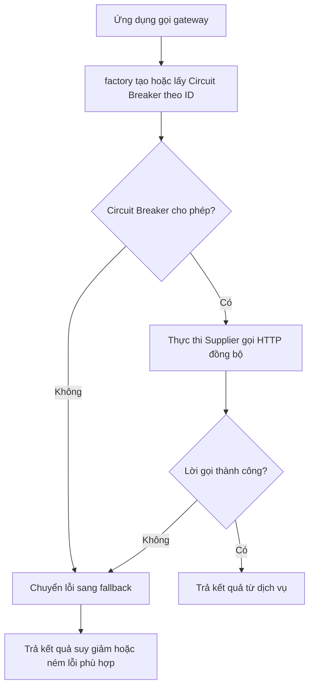

# Bao lời gọi RestClient hoặc RestTemplate bằng factory.run

## Mục tiêu

Một lời gọi HTTP đồng bộ có thể chờ lâu, ném lỗi kết nối hoặc nhận phản hồi lỗi từ dịch vụ phụ thuộc. Spring Cloud CircuitBreaker cung cấp `CircuitBreakerFactory` để ứng dụng tạo bộ ngắt mạch theo tên và dùng `run` bao quanh thao tác đồng bộ. Nhờ vậy, mã gọi dịch vụ có thể áp dụng chính sách Circuit Breaker và fallback tại cùng một ranh giới.

Sau bài học, bạn có thể:

- Tạo một Circuit Breaker ổn định bằng `CircuitBreakerFactory`.
- Bao lời gọi `RestClient` hoặc `RestTemplate` trong `factory.run`.
- Hiểu khi nào supplier được thực thi, khi nào fallback được gọi và kết quả nào được trả về.
- Cấu hình Resilience4j theo ID dependency và phối hợp timeout với timeout của HTTP client.
- Tránh biến lỗi nghiệp vụ thành lỗi hạ tầng hoặc che giấu lỗi bằng fallback không phù hợp.

## Luồng thực thi của factory.run

Với lời gọi đồng bộ, ứng dụng tạo Circuit Breaker bằng `CircuitBreakerFactory`, sau đó truyền thao tác cần thực hiện dưới dạng `Supplier<T>` vào `run`:

```java
T result = circuitBreaker.run(
        () -> callRemoteService(),
        error -> fallbackResult());
```

Hai hàm có vai trò khác nhau:

- Supplier chứa lời gọi tới dịch vụ phụ thuộc. Nó chỉ được thực thi khi Circuit Breaker cho phép lời gọi đi tiếp.
- Fallback nhận `Throwable` nếu supplier thất bại hoặc Circuit Breaker từ chối lời gọi, chẳng hạn khi mạch đang `OPEN`. Fallback phải trả về kiểu `T` tương thích với supplier.

Luồng xử lý tổng quát:



Khi mạch ở `CLOSED`, supplier được gọi và kết quả được ghi nhận theo chính sách của implementation. Khi lỗi đạt ngưỡng, mạch có thể chuyển sang `OPEN`. Trong `OPEN`, supplier không được thực thi; fallback nhận lỗi từ chối và có thể trả dữ liệu cache hoặc trạng thái không khả dụng. Khi chuyển sang `HALF_OPEN`, chỉ một số lời gọi thăm dò được phép thực hiện theo cấu hình.

`run` là điểm tích hợp API chung của Spring Cloud CircuitBreaker. Các chi tiết như sliding window, ngưỡng lỗi, TimeLimiter và loại ngoại lệ bị bỏ qua do implementation cụ thể cung cấp. Bài này dùng Resilience4j trong phần cấu hình.

## Bao RestClient bằng factory.run

`RestClient` là API gọi HTTP đồng bộ của Spring Framework, có từ Spring Framework 6.1. Ứng dụng có thể cấu hình base URL khi tạo client và inject client vào gateway.

```java
import org.springframework.context.annotation.Bean;
import org.springframework.context.annotation.Configuration;
import org.springframework.web.client.RestClient;

@Configuration
public class CatalogHttpConfiguration {
    @Bean
    RestClient catalogRestClient(RestClient.Builder builder) {
        return builder
                .baseUrl("http://catalog-service")
                .build();
    }
}
```

Gateway tạo Circuit Breaker một lần theo ID ổn định. Mỗi lần gọi phương thức, `run` nhận supplier chứa request HTTP:

```java
import org.springframework.cloud.client.circuitbreaker.CircuitBreaker;
import org.springframework.cloud.client.circuitbreaker.CircuitBreakerFactory;
import org.springframework.stereotype.Service;
import org.springframework.web.client.RestClient;

@Service
public class CatalogGateway {
    private final RestClient restClient;
    private final CircuitBreaker catalogCircuitBreaker;

    public CatalogGateway(
            RestClient catalogRestClient,
            CircuitBreakerFactory<?, ?> circuitBreakerFactory) {
        this.restClient = catalogRestClient;
        this.catalogCircuitBreaker = circuitBreakerFactory.create("catalog", "catalog");
    }

    public Product findById(String id) {
        return catalogCircuitBreaker.run(
                () -> restClient.get()
                        .uri("/products/{id}", id)
                        .retrieve()
                        .body(Product.class),
                error -> Product.unavailable(id));
    }
}
```

`Product` và `Product.unavailable` là kiểu dữ liệu ví dụ của ứng dụng. Trong thực tế, hãy định nghĩa rõ trạng thái không khả dụng, nguồn dữ liệu cache và thời điểm dữ liệu được cập nhật. Không nên trả về một đối tượng giống hệt kết quả đầy đủ nếu ứng dụng không thể bảo đảm thông tin đó chính xác.

Trong ví dụ, ID `catalog` đại diện cho ranh giới lỗi của lời gọi tới dịch vụ danh mục. Không thêm mã sản phẩm hoặc mã người dùng vào ID. Nếu mỗi request có một ID khác nhau, Circuit Breaker sẽ không tích lũy thống kê đúng theo dependency và metric sẽ bị phân mảnh.

## Bao RestTemplate bằng factory.run

Với ứng dụng hiện có dùng `RestTemplate`, cách bao lời gọi tương tự. Có thể tạo client bằng `RestTemplateBuilder` để thiết lập root URI và các tùy chọn HTTP client.

```java
import org.springframework.boot.web.client.RestTemplateBuilder;
import org.springframework.context.annotation.Bean;
import org.springframework.context.annotation.Configuration;
import org.springframework.web.client.RestTemplate;

@Configuration
public class LegacyCatalogHttpConfiguration {
    @Bean
    RestTemplate catalogRestTemplate(RestTemplateBuilder builder) {
        return builder
                .rootUri("http://catalog-service")
                .build();
    }
}
```

Gateway có thể dùng cùng factory abstraction:

```java
import org.springframework.cloud.client.circuitbreaker.CircuitBreaker;
import org.springframework.cloud.client.circuitbreaker.CircuitBreakerFactory;
import org.springframework.stereotype.Service;
import org.springframework.web.client.RestTemplate;

@Service
public class LegacyCatalogGateway {
    private final RestTemplate restTemplate;
    private final CircuitBreaker catalogCircuitBreaker;

    public LegacyCatalogGateway(
            RestTemplate catalogRestTemplate,
            CircuitBreakerFactory<?, ?> circuitBreakerFactory) {
        this.restTemplate = catalogRestTemplate;
        this.catalogCircuitBreaker = circuitBreakerFactory.create("catalog", "catalog");
    }

    public Product findById(String id) {
        return catalogCircuitBreaker.run(
                () -> restTemplate.getForObject(
                        "/products/{id}", Product.class, id),
                error -> Product.unavailable(id));
    }
}
```

`RestTemplate.getForObject` là lời gọi đồng bộ. Nếu supplier thất bại, Circuit Breaker ghi nhận kết quả theo cấu hình và `run` chuyển lỗi sang fallback. Khi mạch đang `OPEN`, supplier không được gọi; fallback vẫn có thể trả kết quả suy giảm cho tầng gọi.

Không bọc cùng một request nhiều lần bằng nhiều Circuit Breaker có cùng mục tiêu. Chọn một ranh giới bảo vệ rõ ràng ở gateway hoặc adapter gọi dịch vụ để tránh thống kê trùng và khó xác định fallback nào đã xử lý lỗi.

## Cấu hình Resilience4j theo ID

Khi dùng Spring Cloud CircuitBreaker với Resilience4j, ID truyền vào `create("catalog")` được dùng để tìm cấu hình Circuit Breaker tương ứng. Ví dụ:

```yaml
resilience4j:
  circuitbreaker:
    instances:
      catalog:
        slidingWindowType: COUNT_BASED
        slidingWindowSize: 20
        minimumNumberOfCalls: 10
        failureRateThreshold: 50
        slowCallRateThreshold: 60
        slowCallDurationThreshold: 800ms
        waitDurationInOpenState: 10s
        permittedNumberOfCallsInHalfOpenState: 3
        ignoreExceptions:
          - com.example.catalog.ProductNotFoundException
  timelimiter:
    instances:
      catalog:
        timeoutDuration: 2s
        cancelRunningFuture: true
```

Trong cấu hình này:

- `slidingWindowSize: 20` dùng 20 kết quả gần nhất để đánh giá ở `CLOSED`.
- `minimumNumberOfCalls: 10` yêu cầu tối thiểu 10 mẫu trước khi đánh giá ngưỡng.
- `failureRateThreshold: 50` mở mạch khi tỷ lệ lỗi đạt 50% trở lên sau khi đủ mẫu.
- `slowCallRateThreshold: 60` mở mạch nếu tỷ lệ lời gọi chậm đạt 60% trở lên.
- `slowCallDurationThreshold: 800ms` xác định một lời gọi chậm theo thời lượng.
- `waitDurationInOpenState: 10s` đặt thời gian chờ ở `OPEN` trước lượt kiểm tra phục hồi.
- `permittedNumberOfCallsInHalfOpenState: 3` giới hạn số lời gọi thăm dò.
- `ignoreExceptions` loại ngoại lệ nghiệp vụ được liệt kê khỏi phép tính tỷ lệ lỗi. Ví dụ giả định ứng dụng đã chuyển phản hồi không tìm thấy thành `ProductNotFoundException`.

Tên instance `catalog` phải khớp với ID trong `circuitBreakerFactory.create("catalog")`. Với Spring Cloud CircuitBreaker Resilience4j, nếu cần chọn cấu hình TimeLimiter theo group, có thể tạo bằng `create("catalog", "catalog")`; khi đó ID đầu tiên định danh Circuit Breaker và group thứ hai được dùng để tra cấu hình TimeLimiter. Kiểm tra overload và cách bind theo phiên bản Spring Cloud đang sử dụng.

## Timeout của Circuit Breaker và timeout HTTP

Circuit Breaker và timeout xử lý hai khía cạnh khác nhau:

- Circuit Breaker quyết định có cho phép lời gọi bắt đầu hay không dựa trên trạng thái và kết quả đã ghi nhận.
- TimeLimiter giới hạn thời gian chờ của thao tác theo khả năng mà integration cung cấp.
- HTTP client timeout giới hạn thời gian chờ ở tầng mạng, chẳng hạn thời gian kết nối hoặc thời gian chờ dữ liệu phản hồi.

Với lời gọi đồng bộ, cần đặc biệt chú ý cách implementation thực thi supplier. Resilience4j integration có thể dùng executor và TimeLimiter cho một số đường gọi đồng bộ; tuy nhiên việc timeout hoặc hủy future không bảo đảm socket hay thao tác I/O bên dưới dừng ngay lập tức. Hãy cấu hình connect/read/response timeout trên HTTP client để giới hạn tài nguyên thực tế và thử nghiệm hành vi hủy với client đang dùng.

Không đặt timeout HTTP dài hơn rất nhiều so với thời hạn ứng dụng có thể chờ, nếu không các luồng hoặc kết nối có thể tiếp tục bị chiếm dụng sau khi người gọi đã nhận fallback. Cũng không đặt timeout quá ngắn khiến phản hồi hợp lệ trong điều kiện tải bình thường bị xem là lỗi. Chọn thời hạn dựa trên SLA và phân bố độ trễ thực tế của dependency.

## Xử lý lỗi và fallback đúng ngữ nghĩa

`RestClient.retrieve()` và `RestTemplate` thường ném exception cho phản hồi HTTP 4xx/5xx theo error handler mặc định. Lỗi kết nối hoặc lỗi I/O cũng được biểu diễn bằng các exception của Spring Web. Không phải mọi exception đều chứng minh dịch vụ phụ thuộc đang mất khả năng phục vụ.

Ví dụ, sản phẩm không tồn tại có thể là kết quả nghiệp vụ bình thường. Nếu coi mọi HTTP 404 là lỗi hạ tầng, một đợt request tới mã sản phẩm không tồn tại có thể làm Circuit Breaker mở sai. Có thể chuyển lỗi HTTP thành exception nghiệp vụ riêng rồi cấu hình Resilience4j bỏ qua exception đó. Ngoại lệ bị bỏ qua không làm tăng tỷ lệ lỗi Circuit Breaker, nhưng vẫn có thể được truyền tới fallback function của `run`; fallback cần phân loại và giữ nguyên ngữ nghĩa nghiệp vụ.

Một fallback nên phân biệt ít nhất các trường hợp sau:

| Nguyên nhân | Cách xử lý gợi ý |
|---|---|
| Circuit Breaker đang `OPEN` | Trả cache còn hợp lệ hoặc trạng thái dependency không khả dụng. |
| Lỗi kết nối hoặc timeout | Trả dữ liệu suy giảm có ghi rõ trạng thái, hoặc báo lỗi tạm thời cho caller. |
| HTTP 5xx | Có thể dùng fallback nếu hợp đồng dịch vụ cho phép. |
| HTTP 404 hoặc lỗi nghiệp vụ | Giữ kết quả không tìm thấy; không biến thành dữ liệu cache không liên quan. |
| Lỗi lập trình hoặc cấu hình | Ghi nhận và truyền lỗi để sửa nguyên nhân, tránh che giấu bằng fallback chung. |

Fallback không nên gọi lại cùng dịch vụ đang lỗi bằng một đường đi không được bảo vệ. Nếu cần thử lại, hãy phối hợp số lần retry, backoff, timeout và Circuit Breaker để tránh nhân số request khi dịch vụ đang quá tải.

## Theo dõi kết quả của lời gọi đồng bộ

Khi tích hợp Resilience4j với Micrometer, có thể quan sát metric như:

- `resilience4j.circuitbreaker.state`: trạng thái hiện tại của instance.
- `resilience4j.circuitbreaker.calls`: số lời gọi theo kết quả.
- `resilience4j.circuitbreaker.failure.rate`: tỷ lệ lỗi.
- `resilience4j.circuitbreaker.slow.call.rate`: tỷ lệ lời gọi chậm.
- `resilience4j.circuitbreaker.not.permitted.calls`: số lời gọi bị từ chối.
- Metric của TimeLimiter nếu đã bật binder tương ứng, để theo dõi timeout.

Tên metric và tag cụ thể phụ thuộc phiên bản, registry và cấu hình. Hãy kiểm tra metric thực tế của ứng dụng trước khi tạo dashboard. Nên log ID Circuit Breaker, endpoint logic, thời lượng request, kết quả HTTP và việc fallback có được dùng hay không. Tránh ghi token, thông tin xác thực hoặc dữ liệu nhạy cảm trong log.

Khi thấy tỷ lệ fallback tăng, đối chiếu cùng lúc số lời gọi bị từ chối, tỷ lệ lỗi, tỷ lệ lời gọi chậm và độ trễ HTTP. Nếu Circuit Breaker mở nhưng HTTP client vẫn có nhiều request đang chạy, kiểm tra timeout và khả năng hủy I/O. Nếu mạch mở do lỗi 404, kiểm tra phân loại ngoại lệ và danh sách exception bị bỏ qua.

## Thực hành kiểm chứng

Thực hiện trong môi trường thử nghiệm với một dịch vụ danh mục có thể điều khiển phản hồi:

1. Khởi động ứng dụng và dịch vụ danh mục. Gọi `findById` với sản phẩm tồn tại; xác nhận supplier được thực thi và kết quả được trả về.
2. Gọi một ID không tồn tại. Xác nhận ứng dụng trả đúng trạng thái không tìm thấy và lỗi nghiệp vụ không làm tỷ lệ lỗi hạ tầng tăng nếu đã cấu hình bỏ qua.
3. Làm dịch vụ danh mục trả HTTP 5xx hoặc ngắt kết nối. Gửi đủ số lời gọi để đạt `minimumNumberOfCalls` và ngưỡng lỗi; quan sát Circuit Breaker chuyển sang `OPEN`.
4. Gửi thêm request khi mạch `OPEN`. Xác nhận supplier không gọi HTTP xuống dịch vụ danh mục và fallback trả trạng thái suy giảm.
5. Khôi phục dịch vụ, chờ hết `waitDurationInOpenState` rồi gửi request để kích hoạt `HALF_OPEN` nếu cấu hình không tự chuyển trạng thái.
6. Quan sát số lời gọi thăm dò được cấp phép và xác nhận mạch về `CLOSED` khi kết quả đạt yêu cầu. Lặp lại với probe thất bại để xác nhận mạch quay lại `OPEN`.
7. Làm dịch vụ phản hồi chậm hơn timeout. Đối chiếu thời gian caller nhận kết quả, trạng thái HTTP client, số request còn chạy và metric TimeLimiter.

Ghi lại thời gian, ID instance, trạng thái, kết quả HTTP, exception, fallback và độ trễ. Không tạo tải lớn hơn khả năng của môi trường thử nghiệm.

## Lỗi thường gặp

- **Tạo ID mới theo mỗi request:** làm phân mảnh thống kê và metric; dùng ID ổn định theo dependency.
- **Đặt toàn bộ lời gọi ngoài supplier:** nếu HTTP request được thực hiện trước `run`, Circuit Breaker không thể ngăn request khi đang `OPEN`.
- **Fallback trả dữ liệu giả:** caller có thể xem dữ liệu suy giảm là dữ liệu chính xác; hãy biểu diễn rõ trạng thái và nguồn dữ liệu.
- **Coi mọi HTTP 4xx là lỗi dịch vụ:** lỗi đầu vào hoặc không tìm thấy thường cần được phân loại riêng.
- **Cho rằng Circuit Breaker tự đặt timeout HTTP:** Circuit Breaker không thay thế timeout kết nối/đọc của client.
- **Cho rằng hủy future luôn dừng I/O:** client đồng bộ có thể tiếp tục giữ kết nối hoặc luồng; cần cấu hình timeout ở tầng HTTP.
- **Retry không giới hạn:** nhiều lần thử lại có thể khuếch đại tải và làm chậm phục hồi.
- **Bọc cùng một lời gọi qua nhiều bộ ngắt mạch:** làm khó đọc metric, trạng thái và thứ tự fallback.

Khi dùng `RestClient` hoặc `RestTemplate`, hãy giữ toàn bộ thao tác gọi HTTP bên trong supplier của `factory.run`, chọn ID đại diện cho dependency và thiết kế fallback theo hợp đồng nghiệp vụ. Kết hợp cấu hình Circuit Breaker với timeout ở tầng HTTP để giới hạn cả số lời gọi lẫn thời gian tài nguyên bị chiếm dụng.
