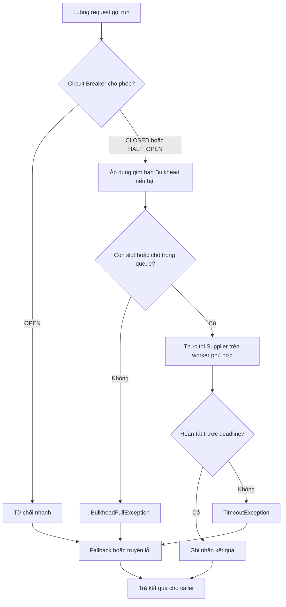

# Luồng thực thi khi có TimeLimiter hoặc thread-pool Bulkhead

Trong lời gọi đồng bộ, phương thức gọi dịch vụ phụ thuộc thường chạy trên chính luồng đang xử lý request. Nếu dịch vụ phản hồi chậm, luồng đó tiếp tục chờ cho đến khi lời gọi kết thúc hoặc client tự timeout. Spring Cloud CircuitBreaker có thể kết hợp Resilience4j `TimeLimiter` và `ThreadPoolBulkhead` để giới hạn thời gian chờ và giới hạn số tác vụ đồng thời.

Hai cơ chế có trách nhiệm khác nhau. `TimeLimiter` đặt thời hạn cho một lần thực thi. `ThreadPoolBulkhead` cách ly công việc vào một thread pool có số luồng và hàng đợi hữu hạn. Khi dùng cùng Circuit Breaker, ứng dụng có thể từ chối nhanh các lời gọi khi mạch `OPEN`, giới hạn tải lên dependency và trả fallback khi lỗi, timeout hoặc hết sức chứa.

## 1. Chuẩn bị starter cho lời gọi đồng bộ

Với ứng dụng Spring MVC hoặc mã gọi đồng bộ, sử dụng starter non-reactive:

```groovy
dependencies {
    implementation 'org.springframework.cloud:spring-cloud-starter-circuitbreaker-resilience4j'
    implementation 'org.springframework.boot:spring-boot-starter-actuator'
    implementation 'io.github.resilience4j:resilience4j-micrometer'
}
```

Quản lý phiên bản Spring Cloud bằng BOM tương thích với Spring Boot của dự án. `spring-cloud-starter-circuitbreaker-resilience4j` cung cấp tích hợp Resilience4j cho API đồng bộ. Không dùng starter Reactor chỉ vì muốn có TimeLimiter hoặc Bulkhead cho lời gọi đồng bộ.

Spring Cloud CircuitBreaker hỗ trợ Bulkhead khi `resilience4j-bulkhead` có trên classpath. Nếu module này được thêm vào dependency tree, integration Resilience4j sẽ bọc các lời gọi bằng Bulkhead theo cấu hình mặc định. Có thể tắt tính năng này bằng thuộc tính `spring.cloud.circuitbreaker.bulkhead.resilience4j.enabled=false`.

## 2. Luồng thực thi của một lời gọi đồng bộ

Ứng dụng tạo breaker theo ID rồi gọi `run` với một `Supplier<T>` đồng bộ và hàm fallback:

```java
return circuitBreakerFactory.create("inventory").run(
        () -> inventoryClient.getStock(sku),
        error -> Stock.unavailable(sku)
);
```

Ở mức khái niệm, lời gọi đi qua các bước sau:



Chi tiết cách các decorator lồng nhau phụ thuộc phiên bản Spring Cloud CircuitBreaker và cấu hình Bulkhead/TimeLimiter. Hình trên mô tả trách nhiệm của từng lớp để dễ theo dõi; khi điều tra thread hoặc exception cụ thể, cần đối chiếu phiên bản thư viện thực tế.

- **Circuit Breaker** kiểm tra trạng thái trước khi cho phép lời gọi. Khi `OPEN`, nó từ chối request mà không cần gọi dependency. Khi `HALF_OPEN`, chỉ số lời gọi thăm dò đã cấu hình được phép đi tiếp.
- **Bulkhead** giới hạn lượng công việc có thể chạy đồng thời. Thread-pool Bulkhead đưa tác vụ vào worker pool và hàng đợi có giới hạn; khi không còn chỗ, nó từ chối tác vụ.
- **TimeLimiter** đặt deadline cho lần thực thi. Với lời gọi đồng bộ, integration có thể chạy `Supplier` thông qua `ExecutorService` và chờ kết quả trong thời hạn.
- **Fallback** nhận lỗi phát sinh như lỗi dependency, timeout hoặc từ chối do giới hạn Bulkhead, rồi tạo kết quả dự phòng nếu ứng dụng cung cấp hàm fallback.

API `run` vẫn là API đồng bộ: luồng gọi chờ kết quả hoặc fallback trước khi trả về. Việc công việc được chuyển sang worker thread không biến controller hay service thành API bất đồng bộ.

## 3. Ví dụ bảo vệ một HTTP client đồng bộ

Ví dụ sau dùng `RestClient` để gọi dịch vụ tồn kho. Đây là lời gọi đồng bộ nên phương thức `getStock` trả về `Stock` trực tiếp:

```java
import org.springframework.cloud.client.circuitbreaker.CircuitBreakerFactory;
import org.springframework.stereotype.Service;
import org.springframework.web.client.RestClient;

@Service
public class InventoryGateway {
    private final CircuitBreakerFactory<?, ?> circuitBreakerFactory;
    private final RestClient inventoryRestClient;

    public InventoryGateway(
            CircuitBreakerFactory<?, ?> circuitBreakerFactory,
            RestClient inventoryRestClient) {
        this.circuitBreakerFactory = circuitBreakerFactory;
        this.inventoryRestClient = inventoryRestClient;
    }

    public Stock getStock(String sku) {
        return circuitBreakerFactory.create("inventory").run(
                () -> inventoryRestClient.get()
                        .uri("/stock/{sku}", sku)
                        .retrieve()
                        .body(Stock.class),
                error -> Stock.unavailable(sku)
        );
    }
}
```

Đăng ký client với base URL của dịch vụ:

```java
import org.springframework.beans.factory.annotation.Value;
import org.springframework.context.annotation.Bean;
import org.springframework.context.annotation.Configuration;

@Configuration
public class InventoryClientConfiguration {
    @Bean
    RestClient inventoryRestClient(
            RestClient.Builder builder,
            @Value("${clients.inventory.base-url}") String baseUrl) {
        return builder.baseUrl(baseUrl).build();
    }
}
```

```yaml
clients:
  inventory:
    base-url: http://inventory-service
```

`Stock` và `Stock.unavailable(sku)` là kiểu dữ liệu ví dụ, cần thay bằng hợp đồng của ứng dụng. Fallback nên biểu diễn rõ trạng thái chưa xác định hoặc dữ liệu cache, không nên trả số lượng tồn kho giả như thể đã xác nhận.

## 4. Cấu hình TimeLimiter theo ID

Spring Cloud CircuitBreaker Resilience4j bật TimeLimiter mặc định cho các execution. Có thể cấu hình thời hạn và chính sách hủy Future trong `application.yml`:

```yaml
resilience4j:
  circuitbreaker:
    instances:
      inventory:
        slidingWindowType: COUNT_BASED
        slidingWindowSize: 20
        minimumNumberOfCalls: 10
        failureRateThreshold: 50
        waitDurationInOpenState: 15s

  timelimiter:
    instances:
      inventory:
        timeoutDuration: 2s
        cancelRunningFuture: true
```

ID `inventory` phải khớp với ID truyền vào `circuitBreakerFactory.create("inventory")`. Trong ví dụ, một execution vượt quá hai giây sẽ bị TimeLimiter báo timeout. Nếu không cấu hình instance, TimeLimiter dùng cấu hình mặc định của Resilience4j.

`cancelRunningFuture: true` yêu cầu hủy Future khi timeout. Đây là yêu cầu hủy ở tầng Future; nó không bảo đảm mọi thư viện HTTP, JDBC hoặc đoạn mã blocking lập tức dừng công việc. Một lời gọi đang chờ I/O có thể tiếp tục chiếm worker thread nếu client không phản ứng với interrupt hoặc cancellation.

Vì vậy, vẫn cần cấu hình timeout ở HTTP client hoặc driver cơ sở dữ liệu. Timeout của client nên tương thích với deadline của TimeLimiter để socket và connection được giải phóng đúng cách. Nếu TimeLimiter kết thúc sau hai giây nhưng HTTP client vẫn chờ 30 giây, worker thread có thể tiếp tục bị giữ sau khi caller đã nhận fallback.

### Bật hoặc tắt TimeLimiter

TimeLimiter có thể bị tắt toàn cục:

```yaml
spring:
  cloud:
    circuitbreaker:
      resilience4j:
        disable-time-limiter: true
```

Có thể bật/tắt theo group hoặc instance bằng `disable-time-limiter-map`:

```yaml
spring:
  cloud:
    circuitbreaker:
      resilience4j:
        disable-time-limiter-map:
          inventory: false
          legacy-report: true
```

Độ ưu tiên của bản đồ này là instance, sau đó group, rồi giá trị toàn cục. Ví dụ `inventory: false` giữ TimeLimiter bật cho instance `inventory` ngay cả khi giá trị toàn cục tắt. Chỉ tắt TimeLimiter khi đã có timeout tương đương ở client và có lý do vận hành rõ ràng.

## 5. Cấu hình ThreadPoolBulkhead

ThreadPoolBulkhead dùng thread pool cố định và hàng đợi có giới hạn. Một cấu hình theo instance có thể đặt trong `application.yml`:

```yaml
resilience4j:
  thread-pool-bulkhead:
    instances:
      inventory:
        coreThreadPoolSize: 4
        maxThreadPoolSize: 8
        queueCapacity: 20
        keepAliveDuration: 20ms
```

Trong ví dụ, pool bắt đầu với bốn luồng, có thể tăng đến tám luồng và giữ tối đa 20 tác vụ đang chờ trong queue. Khi các worker và queue đều hết chỗ, lời gọi mới bị từ chối thay vì tạo thêm thread không giới hạn.

Spring Cloud CircuitBreaker Resilience4j mặc định chọn `FixedThreadPoolBulkhead` khi Bulkhead integration được bật và module `resilience4j-bulkhead` có trên classpath. Có thể chọn `SemaphoreBulkhead` làm implementation mặc định bằng:

```yaml
spring:
  cloud:
    circuitbreaker:
      resilience4j:
        enableSemaphoreDefaultBulkhead: true
```

`SemaphoreBulkhead` giới hạn số lời gọi đồng thời bằng semaphore nhưng không tạo worker thread pool riêng. Với bài toán cần cô lập các lời gọi blocking khỏi luồng request, `FixedThreadPoolBulkhead` thường là lựa chọn cần đánh giá; semaphore phù hợp khi ứng dụng muốn giới hạn concurrency mà vẫn giữ execution trên thread gọi.

### Tùy chỉnh bằng Java

Có thể cấu hình ThreadPoolBulkhead bằng `Customizer<Resilience4jBulkheadProvider>`:

```java
import org.springframework.cloud.client.circuitbreaker.Customizer;
import org.springframework.cloud.circuitbreaker.resilience4j.Resilience4jBulkheadConfigurationBuilder;
import org.springframework.cloud.circuitbreaker.resilience4j.Resilience4jBulkheadProvider;
import io.github.resilience4j.bulkhead.ThreadPoolBulkheadConfig;

@Bean
Customizer<Resilience4jBulkheadProvider> inventoryBulkheadCustomizer() {
    return provider -> provider.configure(builder -> builder
            .threadPoolBulkheadConfig(ThreadPoolBulkheadConfig.custom()
                    .coreThreadPoolSize(4)
                    .maxThreadPoolSize(8)
                    .queueCapacity(20)
                    .build()),
            "inventory");
}
```

Properties có độ ưu tiên cao hơn Java `Customizer`. Nếu cả hai cùng đặt cấu hình cho `inventory`, hãy kiểm tra property source và giá trị runtime để biết giá trị nào đang được áp dụng.

## 6. Điều gì xảy ra khi TimeLimiter và ThreadPoolBulkhead cùng bật?

Khi cả hai cùng bảo vệ một lời gọi, chúng giải quyết hai giới hạn khác nhau:

| Tình huống | TimeLimiter | ThreadPoolBulkhead |
| --- | --- | --- |
| Một request chạy quá lâu | Kết thúc thời gian chờ và báo timeout | Worker vẫn có thể bị chiếm cho đến khi tác vụ thực sự dừng |
| Nhiều request đồng thời | Không giới hạn tổng số tác vụ đang chạy chỉ bằng deadline | Giới hạn số worker và queue |
| Tải vượt khả năng xử lý | Có thể timeout các request chậm | Từ chối request mới khi pool và queue đầy |
| Request hoàn thành nhanh | Trả kết quả trước deadline | Giải phóng worker/slot để xử lý request khác |

Ví dụ: pool có tám worker và queue chứa tối đa 20 tác vụ. Nếu tám worker đều bận và queue đã đầy, tác vụ tiếp theo bị từ chối ngay. Nếu một tác vụ đã được nhận nhưng vượt `timeoutDuration`, TimeLimiter trả lỗi timeout và fallback có thể chạy. Worker đang thực thi chỉ được giải phóng khi tác vụ kết thúc hoặc thực sự phản ứng với cancellation.

Executor dùng để chạy `Supplier` khi TimeLimiter được bật và executor riêng của `ThreadPoolBulkhead` có thể là hai pool khác nhau. Vì vậy, khi cả hai cơ chế cùng bật, một lời gọi có thể đi qua nhiều worker boundary. Hãy kiểm tra thread name, queue và giới hạn của từng pool; `configureExecutorService(...)` trên factory tùy chỉnh executor của Circuit Breaker, không tự động thay cấu hình thread pool riêng của Bulkhead.

Khi thread-pool Bulkhead chuyển kết quả qua `Future` hoặc `CompletableFuture`, exception gốc đôi khi được bọc trong `ExecutionException` tùy phiên bản và đường thực thi. Fallback nên ghi nhận exception cùng chuỗi `cause` để không mất nguyên nhân ban đầu; hãy kiểm thử loại exception thực tế với đúng phiên bản Spring Cloud/Resilience4j đang triển khai.

Đừng tăng `queueCapacity` để che tình trạng dependency chậm. Queue lớn làm tăng thời gian chờ và có thể khiến nhiều request hết hạn trước khi được thực thi. Hãy chọn số worker theo năng lực dependency và tài nguyên máy, chọn queue theo mức chờ chấp nhận được, rồi đặt timeout theo SLA.

## 7. Thread context khi công việc chuyển sang worker

Khi lời gọi chạy trên thread khác, dữ liệu gắn với thread hiện tại có thể không tự truyền sang worker. Các ví dụ thường gặp là MDC cho log, SecurityContext, transaction context và một số giá trị lưu trong `ThreadLocal`.

Nếu request cần truyền thông tin xác thực hoặc correlation ID tới client, hãy cấu hình cơ chế truyền context phù hợp. Spring Cloud CircuitBreaker cho phép tùy chỉnh `ExecutorService` dùng để thực thi Circuit Breaker qua `Resilience4JCircuitBreakerFactory.configureExecutorService(...)`. Có thể sử dụng executor nhận biết context hoặc tích hợp cơ chế context propagation của nền tảng. ThreadPoolBulkhead có worker pool riêng; cần xác minh cách truyền context cho pool đó theo phiên bản Resilience4j đang dùng.

Không giả định transaction mở trên request thread sẽ tự tham gia vào worker thread. Tránh bao một thao tác cần transaction đồng bộ trong thread pool khác nếu không có thiết kế transaction rõ ràng. Với log, dùng correlation ID được truyền tường minh hoặc context propagation thay vì chỉ dựa vào MDC của thread gọi.

## 8. Xử lý fallback và phân loại lỗi

Fallback trong `run` nhận `Throwable`. Một số nguyên nhân có thể đi tới fallback gồm:

- Lỗi kết nối, lỗi HTTP hoặc exception do client đồng bộ ném ra.
- `TimeoutException` khi execution vượt thời hạn của TimeLimiter.
- Lỗi từ chối do Bulkhead đã hết sức chứa.
- `CallNotPermittedException` khi Circuit Breaker đang `OPEN`.

Không phải mọi lỗi đều có cùng ý nghĩa. Nên ghi nhận riêng timeout, bulkhead rejection, circuit breaker rejection và lỗi từ dependency để biết hệ thống đang chậm, quá tải hay đang mở mạch. Nếu dùng `recordExceptions`, `ignoreExceptions` hoặc `recordFailurePredicate`, hãy bảo đảm lỗi nghiệp vụ dự kiến không bị tính nhầm là lỗi sức khỏe dependency.

Fallback cần nhanh, không gọi lại dependency đang được bảo vệ và không che giấu trạng thái dữ liệu. Nếu fallback cũng thất bại, exception của fallback sẽ được trả về caller. Không nên trả một giá trị mặc định có vẻ hợp lệ khi ứng dụng không có căn cứ về dữ liệu đó.

## 9. Theo dõi hiệu quả bảo vệ

Thêm `spring-boot-starter-actuator` và `resilience4j-micrometer` để xuất metrics Resilience4j. Theo dõi tối thiểu:

- Trạng thái và số lần chuyển `CLOSED`, `OPEN`, `HALF_OPEN` của Circuit Breaker.
- Số lời gọi thành công, thất bại, timeout và bị Circuit Breaker từ chối.
- Số lần Bulkhead từ chối, số worker đang hoạt động, kích thước queue và số tác vụ chờ.
- Thời gian thực thi, độ trễ dependency và số lần fallback.

Metrics cần được gắn ID phù hợp để phân biệt từng dependency. Endpoint Actuator nên chỉ expose các chỉ số cần thiết và được bảo vệ bằng xác thực/phân quyền.

## 10. Kịch bản kiểm chứng

Kiểm thử bằng một client giả lập có thể điều khiển độ trễ và số lời gọi đồng thời:

1. Cho dependency trả kết quả trong thời hạn. Xác nhận `run` trả kết quả thật và worker/slot được giải phóng.
2. Cho dependency chậm hơn `timeoutDuration`. Xác nhận caller nhận fallback hoặc lỗi timeout đúng như thiết kế.
3. Kiểm tra tác vụ phía dependency sau timeout. Xác nhận client-side timeout/cancellation có giải phóng tài nguyên; không mặc định rằng Future bị hủy thì socket hoặc tác vụ đã dừng.
4. Gửi nhiều request đồng thời để lấp đầy worker pool và queue. Xác nhận request vượt giới hạn bị từ chối và fallback xử lý đúng.
5. Làm dependency liên tục thất bại để Circuit Breaker chuyển sang `OPEN`. Xác nhận request tiếp theo bị từ chối trước khi tạo thêm tải cho dependency.
6. Khôi phục dependency, chờ hết `waitDurationInOpenState`, rồi gửi các lời gọi thăm dò. Xác nhận breaker chuyển về `CLOSED` khi các lời gọi đạt yêu cầu.
7. Kiểm tra MDC, SecurityContext hoặc correlation ID trên worker nếu ứng dụng cần truyền các context đó.
8. Đối chiếu metrics và log với số request thực tế ở mock server để xác nhận không có tác vụ tồn đọng ngoài dự kiến.

## 11. Lỗi thường gặp

- Cho rằng TimeLimiter tự dừng mọi lời gọi blocking. Cancellation của Future không bảo đảm client HTTP hoặc driver database lập tức dừng I/O.
- Đặt `timeoutDuration` ngắn hơn thời gian bình thường của dependency, khiến request hợp lệ liên tục bị timeout.
- Để queue quá lớn, khiến request chờ lâu rồi mới được chạy và hết deadline.
- Tăng số worker vượt khả năng chịu tải của dependency, làm sự cố nặng hơn.
- Quên rằng `run` vẫn đồng bộ và caller thread chờ kết quả hoặc fallback.
- Bật Bulkhead mà không kiểm tra module `resilience4j-bulkhead` và implementation đang được chọn.
- Không truyền MDC, SecurityContext hoặc dữ liệu request cần thiết sang worker thread.
- Chỉ quan sát Circuit Breaker mà không theo dõi riêng timeout và Bulkhead rejection.

## Tài liệu tham khảo

- [Spring Cloud CircuitBreaker – Configuring Resilience4J Circuit Breakers](https://docs.spring.io/spring-cloud-circuitbreaker/docs/current/reference/html/spring-cloud-circuitbreaker-resilience4j.html): starter đồng bộ, TimeLimiter, ExecutorService, Bulkhead và metrics.
- [Spring Cloud CircuitBreaker – Bulkhead Pattern Supporting](https://docs.spring.io/spring-cloud-circuitbreaker/reference/spring-cloud-circuitbreaker-resilience4j/bulkhead-pattern-supporting.html): FixedThreadPoolBulkhead, SemaphoreBulkhead và tùy chỉnh provider.
- [Spring Cloud CircuitBreaker – Circuit Breaker Properties Configuration](https://docs.spring.io/spring-cloud-circuitbreaker/reference/spring-cloud-circuitbreaker-resilience4j/circuit-breaker-properties-configuration.html): cấu hình instance, TimeLimiter và chính sách bật/tắt.
- [Spring Cloud CircuitBreaker – Bulkhead Properties Configuration](https://docs.spring.io/spring-cloud-circuitbreaker/reference/spring-cloud-circuitbreaker-resilience4j/bulkhead-properties-configuration.html): cấu hình thread pool, semaphore và thứ tự ưu tiên properties.
- [Resilience4j – ThreadPoolBulkhead](https://resilience4j.readme.io/docs/bulkhead): giới hạn concurrency, thread pool và queue.
