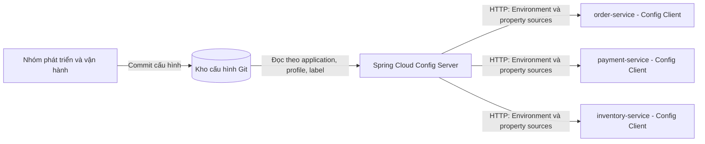

# Cấu hình tập trung là gì và giải quyết vấn đề nào

Khi một hệ thống Spring Boot có nhiều dịch vụ và nhiều môi trường chạy, cấu hình nhanh chóng trở thành một phần quan trọng của vận hành. Mỗi dịch vụ cần biết cách kết nối cơ sở dữ liệu, gọi dịch vụ khác, đặt thời gian chờ, bật tính năng và điều chỉnh mức ghi log. Các giá trị này thường khác nhau giữa môi trường phát triển, kiểm thử và sản xuất; một số còn cần thay đổi trong khi ứng dụng đang hoạt động.

Spring Cloud Config cung cấp cách tổ chức cấu hình tập trung cho hệ thống phân tán. Config Server đọc cấu hình từ một nguồn được quản lý, thường là Git, rồi cung cấp cấu hình qua HTTP cho các ứng dụng Spring Boot đóng vai trò Config Client. Nhờ vậy, nhóm phát triển có thể quản lý cấu hình theo ứng dụng, profile và phiên bản, theo dõi lịch sử thay đổi, đồng thời chủ động phân phối thay đổi đến các dịch vụ.

## 1. Mục tiêu học tập

Sau bài học, bạn có thể:

- Giải thích cấu hình tập trung là gì, vì sao cấu hình rải rác gây khó khăn khi vận hành nhiều dịch vụ và Spring Cloud Config giải quyết phần nào của vấn đề.
- Mô tả vai trò của Config Server, Config Client và kho cấu hình Git trong luồng lấy cấu hình.
- Nhận biết cách tổ chức cấu hình dùng chung, cấu hình riêng cho từng ứng dụng, profile theo môi trường và label trỏ đến phiên bản cấu hình.
- Hiểu rằng giá trị hiệu lực được hình thành từ nhiều nguồn cấu hình và cần kiểm tra thứ tự ưu tiên khi có giá trị trùng nhau.
- Phân biệt việc lấy cấu hình lúc khởi động với việc làm mới cấu hình khi ứng dụng đang chạy; nhận biết vai trò của Actuator và Spring Cloud Bus.
- Nêu được các nguyên tắc cơ bản để bảo vệ bí mật, kiểm soát quyền truy cập và quản trị thay đổi cấu hình an toàn.

## 2. Vấn đề khi cấu hình nằm rải rác

Hãy hình dung một hệ thống bán hàng có ba dịch vụ: `order-service`, `payment-service` và `inventory-service`. Mỗi dịch vụ có thể chạy ở môi trường `dev`, `staging` và `prod`. Chúng cần các nhóm cấu hình như địa chỉ cơ sở dữ liệu, URL của dịch vụ phụ thuộc, thời gian chờ, giới hạn kết nối, mức log và cờ bật tính năng.

Nếu cấu hình chỉ nằm trong từng kho mã nguồn hoặc được đóng gói cố định trong từng bản build, nhóm vận hành thường gặp những vấn đề sau:

| Vấn đề | Hệ quả khi hệ thống có nhiều dịch vụ |
| --- | --- |
| Cùng một giá trị được khai báo ở nhiều nơi | Các dịch vụ dễ lệch nhau sau một lần thay đổi; sửa thiếu một nơi có thể gây lỗi khó tìm. |
| Cấu hình môi trường bị trộn với cấu hình ứng dụng | Có nguy cơ đưa nhầm địa chỉ, cờ tính năng hoặc thông số của `dev` sang `prod`. |
| Muốn thay đổi cấu hình phải sửa mã nguồn hoặc tạo lại bản build | Một thay đổi vận hành nhỏ có thể kéo theo quy trình build và triển khai không cần thiết. |
| Không có lịch sử thay đổi tập trung | Khó xác định ai đã thay đổi giá trị nào, thay đổi vào lúc nào và cách khôi phục trạng thái trước đó. |
| Mỗi nhóm tự chọn cách lưu và phân phối cấu hình | Quy trình kiểm soát quyền, rà soát và xử lý sự cố trở nên thiếu nhất quán. |

Biến cấu hình không phải lúc nào cũng cần được quản lý tập trung. Một ứng dụng nhỏ, triển khai đơn giản có thể chỉ cần biến môi trường hoặc tệp cấu hình bên ngoài. Nhu cầu tăng lên khi nhiều ứng dụng cần dùng chung một số giá trị, có nhiều môi trường, cần lịch sử thay đổi rõ ràng hoặc cần phân phối cập nhật có kiểm soát.

## 3. Cấu hình tập trung và Spring Cloud Config

**Cấu hình tập trung** là cách lưu trữ, tổ chức và phân phối cấu hình qua một đầu mối được quản lý. Ứng dụng vẫn sử dụng các giá trị cấu hình khi chạy, nhưng không phải tự tìm và duy trì một bản sao độc lập của mọi cấu hình môi trường.

Trong mô hình Spring Cloud Config có ba thành phần chính:

1. **Kho cấu hình (configuration repository):** nơi lưu các tệp cấu hình. Git là backend thường dùng vì có lịch sử commit, nhánh, tag và cơ chế review.
2. **Spring Cloud Config Server:** ứng dụng Spring Boot cung cấp API HTTP, đọc cấu hình từ backend và tạo tập hợp thuộc tính phù hợp với tên ứng dụng, profile và label mà client yêu cầu.
3. **Spring Cloud Config Client:** thư viện tích hợp trong ứng dụng Spring Boot. Client xác định tên ứng dụng và profile, kết nối đến Config Server, sau đó đưa các nguồn thuộc tính nhận được vào môi trường cấu hình của ứng dụng.

Luồng cơ bản có thể hình dung như sau:



Config Server không cần biết nghiệp vụ của từng dịch vụ. Nó chịu trách nhiệm tìm và cung cấp các nguồn thuộc tính. Ứng dụng client vẫn quyết định cách sử dụng thuộc tính thông qua `@Value`, `@ConfigurationProperties` hoặc các cơ chế cấu hình của Spring Boot.

Điểm quan trọng là **tập trung nơi quản lý cấu hình không có nghĩa mọi ứng dụng dùng chung một bộ giá trị**. Mỗi client nhận tập hợp cấu hình dựa trên danh tính ứng dụng, profile và label của nó.

## 4. Tổ chức cấu hình theo ứng dụng, profile và label

Spring Cloud Config thường ánh xạ tên ứng dụng và profile vào tên tệp trong kho cấu hình. Ví dụ:

```text
config-repo/
├── application.yml
├── application-prod.yml
├── order-service.yml
├── order-service-dev.yml
├── order-service-prod.yml
└── payment-service.yml
```

- `application.yml` chứa các thuộc tính dùng chung cho nhiều ứng dụng.
- `application-prod.yml` chứa các thuộc tính dùng chung khi ứng dụng chạy với profile `prod`.
- `order-service.yml` chứa cấu hình riêng của `order-service`.
- `order-service-dev.yml` và `order-service-prod.yml` chứa cấu hình riêng của dịch vụ theo từng môi trường.
- `payment-service.yml` chứa cấu hình riêng của `payment-service`.

Các nguồn phù hợp được Config Server kết hợp thành một `Environment` trả về cho client. Nếu cùng một khóa xuất hiện ở nhiều nguồn, thứ tự nguồn thuộc tính sẽ quyết định giá trị hiệu lực. Vì thế, việc hiểu thứ tự ưu tiên là yêu cầu vận hành quan trọng; không nên đoán rằng cấu hình dùng chung, cấu hình riêng, cấu hình từ xa hay biến môi trường luôn thắng trong mọi trường hợp. Thứ tự cuối cùng còn phụ thuộc vào quy tắc cấu hình của Spring Boot và chính sách override được thiết lập cho Config Client. Khi có xung đột, hãy kiểm tra nguồn thuộc tính và giá trị thực tế của ứng dụng.

**Profile** mô tả nhóm cấu hình ứng với một ngữ cảnh chạy, thường là `dev`, `test`, `staging` hoặc `prod`. Profile giúp giữ các giá trị theo môi trường ở đúng nơi, nhưng bản thân tên profile không phải cơ chế bảo mật. Không nên đặt thông tin bí mật vào một tệp chỉ vì tệp đó mang tên `*-prod.yml`.

**Label** chọn phiên bản của kho cấu hình mà Config Server sẽ đọc. Với backend Git, label có thể trỏ đến nhánh, tag hoặc một commit được hỗ trợ. Ví dụ, môi trường phát triển có thể theo nhánh đang thay đổi, trong khi bản phát hành sản xuất có thể ghim vào tag hoặc commit đã được duyệt. Ghim phiên bản giúp tái tạo cấu hình của một lần triển khai và hỗ trợ quay lui khi cần.

## 5. Ví dụ kiến trúc tối thiểu

Config Server là một ứng dụng Spring Boot có thêm dependency `spring-cloud-config-server` và bật chức năng server:

```java
@SpringBootApplication
@EnableConfigServer
public class ConfigServerApplication {
    public static void main(String[] args) {
        SpringApplication.run(ConfigServerApplication.class, args);
    }
}
```

Ví dụ cấu hình để server đọc một kho Git:

```yaml
server:
  port: 8888

spring:
  cloud:
    config:
      server:
        git:
          uri: https://github.com/example/platform-config.git
          default-label: main
```

Địa chỉ kho và label trong ví dụ cần được thay bằng giá trị thực của hệ thống. Thông tin xác thực để đọc kho riêng phải được cấp qua cơ chế quản lý bí mật phù hợp, không ghi trực tiếp vào kho cấu hình dùng chung.

Ứng dụng client thêm dependency `spring-cloud-starter-config`, khai báo tên ứng dụng và địa chỉ Config Server. Với cơ chế Config Data hiện đại của Spring Boot, phần cấu hình có thể bắt đầu như sau:

```yaml
spring:
  application:
    name: order-service
  profiles:
    active: dev
  config:
    import: "optional:configserver:http://localhost:8888"
```

Khi khởi động, client sử dụng `order-service` làm tên ứng dụng, profile `dev` và gọi Config Server tại địa chỉ đã khai báo. Tùy cách triển khai, label có thể được cấu hình thêm để chọn phiên bản kho cấu hình cụ thể.

Tiền tố `optional:` cho phép ứng dụng tiếp tục khởi động nếu Config Server không truy cập được. Cách này chỉ phù hợp khi ứng dụng có giá trị mặc định hoặc nguồn cấu hình dự phòng đủ an toàn. Nếu thiếu cấu hình từ xa khiến ứng dụng chạy sai, hãy cấu hình để khởi động thất bại khi không lấy được cấu hình bắt buộc và xử lý tính sẵn sàng của Config Server như một phụ thuộc vận hành.

Config Server cung cấp các endpoint theo tên ứng dụng, profile và label. Chẳng hạn, yêu cầu `GET /order-service/dev/main` yêu cầu cấu hình của `order-service`, profile `dev`, tại label `main`. API cụ thể cần được bảo vệ bằng xác thực, phân quyền và mạng truy cập phù hợp.

## 6. Cấu hình tập trung giải quyết được những gì?

### Đồng bộ giá trị dùng chung

Một thuộc tính dùng chung, chẳng hạn mức log mặc định hoặc cấu hình kết nối đến một dịch vụ nền tảng, có thể được quản lý tại một nơi. Khi thay đổi, nhóm vận hành có thể rà soát một thay đổi có phạm vi rõ ràng và xác định những ứng dụng chịu ảnh hưởng.

### Tách cấu hình khỏi vòng đời build

Ứng dụng có thể được đóng gói một lần và nhận cấu hình phù hợp với môi trường khi khởi động. Điều này giảm nhu cầu tạo bản build riêng chỉ vì URL, thời gian chờ hoặc một thông số môi trường thay đổi. Tuy nhiên, thay đổi cấu hình vẫn cần được kiểm thử và triển khai theo quy trình của hệ thống.

### Theo dõi và khôi phục thay đổi

Khi kho cấu hình dùng Git, mỗi thay đổi có thể gắn với commit, người thực hiện, nội dung review và quy trình phê duyệt. Nếu một thay đổi gây sự cố, nhóm vận hành có thể xác định phiên bản trước đó và khôi phục bằng một thay đổi Git có kiểm soát hoặc ghim client về label đã được xác minh.

### Quản lý nhiều môi trường và nhiều dịch vụ

Tên ứng dụng và profile tạo ra cách phân chia có quy ước. Dịch vụ thanh toán có thể giữ cấu hình riêng của nó, trong khi các thuộc tính chung vẫn được tái sử dụng. Điều này giúp giảm sao chép và làm rõ phạm vi tác động của mỗi thay đổi.

### Hỗ trợ cập nhật cấu hình khi ứng dụng đang chạy

Config Client thường lấy cấu hình khi khởi động. Khi cấu hình trên Git thay đổi, ứng dụng đang chạy không mặc nhiên tự đọc lại mọi giá trị. Có thể yêu cầu từng instance làm mới thông qua Spring Boot Actuator và cơ chế refresh của Spring Cloud. Với hệ thống nhiều instance, Spring Cloud Bus có thể phát sự kiện refresh qua broker để các instance nhận sự kiện cùng làm mới. Cần cấu hình, bảo vệ endpoint và kiểm tra cách từng bean tiếp nhận giá trị mới; không phải mọi đối tượng trong ứng dụng đều tự thay đổi chỉ vì kho Git đã có commit mới.

## 7. Lấy cấu hình, làm mới và Spring Cloud Bus

Có thể chia vòng đời cấu hình thành ba thời điểm:

1. **Lúc khởi động:** client dùng tên ứng dụng, profile và label để yêu cầu cấu hình từ Config Server. Các property source nhận được tham gia vào `Environment` của ứng dụng theo quy tắc ưu tiên đã cấu hình.
2. **Khi cấu hình trong Git thay đổi:** Config Server có thể đọc phiên bản mới theo label mà client sử dụng. Các instance đang chạy vẫn có thể giữ giá trị cũ cho đến khi chúng được làm mới hoặc khởi động lại.
3. **Khi phát lệnh refresh:** một instance có thể được làm mới bằng endpoint Actuator phù hợp, ví dụ `/actuator/refresh`. Trong hệ thống có nhiều instance, Spring Cloud Bus hỗ trợ phát sự kiện chung, ví dụ qua endpoint `/actuator/busrefresh`, để các client được kết nối nhận thông báo và thực hiện refresh.

Spring Cloud Bus cần một hạ tầng truyền thông được hỗ trợ, chẳng hạn RabbitMQ hoặc Kafka, cùng cấu hình kết nối và bảo mật tương ứng. Bus phân phối sự kiện refresh; nó không thay thế kho Git, Config Server hay quy trình phê duyệt thay đổi. Endpoint quản trị phải được giới hạn truy cập vì một lệnh refresh trên diện rộng có thể ảnh hưởng đồng thời đến nhiều dịch vụ.

Một số bean cần được tạo lại hoặc đăng ký với cơ chế refresh scope để nhận giá trị mới đúng cách. Những tác động như mở lại kết nối, thay đổi pool hoặc cập nhật tài nguyên đang dùng cần được kiểm tra theo loại cấu hình. Nếu không có yêu cầu cập nhật nóng, khởi động lại theo một đợt triển khai có kiểm soát đôi khi dễ dự đoán hơn.

## 8. Bảo vệ bí mật và giới hạn của giải pháp

Config Server tập trung hóa việc phân phối cấu hình, vì vậy cũng trở thành một điểm cần bảo vệ nghiêm túc. URL cơ sở dữ liệu, mật khẩu, token, khóa ký và thông tin xác thực không được đưa vào Git ở dạng văn bản thuần. Các nguyên tắc cơ bản gồm:

- Ưu tiên hệ thống quản lý bí mật chuyên dụng như Vault hoặc dịch vụ quản lý khóa/bí mật của nền tảng triển khai. Chỉ đưa tham chiếu đến bí mật vào cấu hình nếu ứng dụng có thể lấy bí mật theo cơ chế được bảo vệ.
- Nếu sử dụng khả năng mã hóa của Spring Cloud Config, khóa giải mã phải được quản lý bên ngoài kho cấu hình, quyền truy cập phải bị giới hạn và endpoint mã hóa/giải mã phải được bảo vệ. Giá trị đã mã hóa vẫn cần quy trình xoay vòng và kiểm soát truy cập.
- Bật TLS cho kết nối client đến server và server đến các hệ thống liên quan khi phù hợp; xác thực client, giới hạn quyền đọc kho Git và giới hạn ai có thể sửa cấu hình.
- Không ghi token, mật khẩu hoặc giá trị nhạy cảm vào log, thông báo lỗi hay dữ liệu chẩn đoán. Kiểm tra nội dung cấu hình trước khi commit.
- Tách quyền đọc, quyền thay đổi và quyền phê duyệt. Một ứng dụng chỉ nên nhận các cấu hình mà nó cần.

Spring Cloud Config cũng không tự giải quyết mọi bài toán vận hành. Nó không thay thế service discovery, hệ thống quản lý bí mật, công cụ triển khai hay chính sách quản trị hạ tầng. Nó không tự xác minh rằng một giá trị mới hợp lệ với nghiệp vụ và không bảo đảm mọi instance đã áp dụng cùng một phiên bản. Nhóm vận hành vẫn cần kiểm thử, theo dõi trạng thái và có phương án khôi phục.

## 9. Nguyên tắc quản trị thay đổi cấu hình

Để cấu hình tập trung đem lại lợi ích mà không tạo ra một điểm gây lỗi diện rộng, hãy xây dựng quy trình thay đổi rõ ràng:

1. **Quy định cấu trúc:** thống nhất tên ứng dụng, profile, label và quy tắc đặt tệp; chỉ đặt thuộc tính dùng chung ở cấp chung khi nhiều ứng dụng thực sự có cùng ý nghĩa.
2. **Rà soát thay đổi:** dùng pull request hoặc cơ chế review tương đương; mô tả lý do, phạm vi ảnh hưởng, người phê duyệt và cách quay lui.
3. **Kiểm tra trước khi phân phối:** kiểm tra cú pháp YAML, kiểu dữ liệu, khóa bắt buộc và giá trị hợp lệ; chạy kiểm thử phù hợp với cấu hình mới.
4. **Ghim phiên bản khi cần tái lập:** ưu tiên tag hoặc commit đã duyệt cho triển khai cần tính ổn định; ghi nhận label mà mỗi môi trường đang sử dụng.
5. **Phân phối theo phạm vi:** thử thay đổi trên môi trường hoặc nhóm instance nhỏ trước, quan sát log, metric và hành vi nghiệp vụ, rồi mới mở rộng.
6. **Chuẩn bị khôi phục:** lưu lại phiên bản trước, theo dõi thời điểm refresh và xác định cách đưa các instance về cấu hình đã biết là tốt.
7. **Vận hành Config Server có độ tin cậy phù hợp:** giám sát sức khỏe, kết nối đến Git, độ trễ và lỗi lấy cấu hình; cân nhắc nhiều instance, xác thực và phương án khi backend không sẵn sàng.

Với thay đổi có ảnh hưởng lớn như URL dịch vụ phụ thuộc, giới hạn kết nối hoặc cờ tắt/bật luồng nghiệp vụ, hãy đánh giá tác động trước khi phát sự kiện refresh hàng loạt. Một commit hợp lệ về cú pháp vẫn có thể tạo ra hành vi không mong muốn khi áp dụng cho toàn bộ hệ thống.

## 10. Khi nào nên dùng Spring Cloud Config?

Spring Cloud Config phù hợp khi một hệ thống có nhiều ứng dụng Spring Boot, nhiều môi trường hoặc nhu cầu kiểm soát cấu hình tập trung bằng Git. Nó đặc biệt hữu ích khi nhóm cần lịch sử thay đổi, review, chọn phiên bản cấu hình và phối hợp refresh trên nhiều instance.

Nếu chỉ có một ứng dụng nhỏ với ít cấu hình thay đổi, biến môi trường và tệp cấu hình bên ngoài có thể đã đủ. Thêm Config Server cũng đồng nghĩa thêm một dịch vụ cần triển khai, bảo vệ, giám sát và duy trì. Hãy chọn giải pháp dựa trên số lượng ứng dụng, mức độ thay đổi, yêu cầu kiểm toán và khả năng vận hành của nhóm.

Khi áp dụng, hãy nhớ ba ý: kho cấu hình là nơi quản lý phiên bản; Config Server phân phối nguồn thuộc tính theo ứng dụng, profile và label; Config Client tiếp nhận và sử dụng chúng theo quy tắc cấu hình của Spring Boot. Refresh, bảo mật và quản trị thay đổi là các phần phải thiết kế cùng kiến trúc ngay từ đầu để cấu hình được phân phối nhất quán và có thể kiểm soát.
