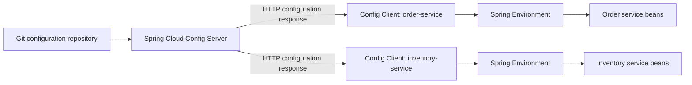

# Vị trí của Spring Cloud Config trong hệ sinh thái Spring Cloud

Spring Cloud Config là thành phần quản lý cấu hình bên ngoài cho các ứng dụng Spring Boot. Nó cung cấp một nơi tập trung để lưu trữ, phân phối và quản trị cấu hình của nhiều dịch vụ, giúp các ứng dụng dùng chung quy ước cấu hình mà vẫn có thể nhận giá trị riêng theo tên ứng dụng, môi trường chạy và phiên bản cấu hình.

Trong hệ sinh thái Spring Cloud, Config giải quyết bài toán **cấu hình phân tán**. Nó đứng cạnh các thành phần như Service Discovery, LoadBalancer, Circuit Breaker và API Gateway: mỗi thành phần xử lý một mối quan tâm khác nhau của hệ thống phân tán, còn Config giúp các dịch vụ nhận được cấu hình nhất quán để những thành phần đó hoạt động đúng.

## Mục tiêu học tập

Sau bài này, bạn có thể:

- Giải thích vì sao một hệ thống gồm nhiều ứng dụng Spring Boot cần quản lý cấu hình tập trung.
- Phân biệt vai trò của Spring Boot Externalized Configuration và Spring Cloud Config.
- Mô tả quan hệ giữa Config Server, Config Client và kho cấu hình Git.
- Giải thích cách `application`, `profile` và `label` xác định bộ cấu hình mà một client nhận được.
- Xác định vị trí của Config trong vòng đời khởi động, vận hành và thay đổi cấu hình của một dịch vụ.
- Nhận biết những vấn đề mà Config không tự giải quyết, đặc biệt là quản lý bí mật và triển khai thay đổi an toàn.

## Bài toán cấu hình trong hệ thống nhiều dịch vụ

Một ứng dụng Spring Boot thường cần nhiều giá trị để chạy: địa chỉ cơ sở dữ liệu, thông tin kết nối message broker, URL của dịch vụ phụ thuộc, giới hạn timeout, mức log và các cờ bật/tắt tính năng. Spring Boot đã có cơ chế Externalized Configuration để lấy các giá trị này từ file cấu hình, biến môi trường, tham số dòng lệnh và những nguồn được hỗ trợ khác.

Khi hệ thống chỉ có một ứng dụng, nhóm phát triển có thể quản lý cấu hình trong chính dự án đó. Khi hệ thống có nhiều dịch vụ và nhiều môi trường, cách làm này dễ phát sinh các vấn đề:

- **Cấu hình bị phân tán:** mỗi repository giữ một bản cấu hình, khiến việc tìm và cập nhật giá trị dùng chung mất thời gian.
- **Sai lệch giữa các môi trường:** cấu hình phát triển, kiểm thử và sản xuất có thể khác nhau ngoài dự kiến.
- **Thay đổi khó kiểm soát:** khó biết ai đã sửa cấu hình, sửa lúc nào và cần quay lại phiên bản nào.
- **Triển khai phụ thuộc vào đóng gói:** một thay đổi cấu hình nhỏ có thể buộc nhóm vận hành đóng gói hoặc triển khai lại nhiều ứng dụng.
- **Khó đồng bộ giữa các instance:** những instance của cùng một dịch vụ có thể chạy với các giá trị khác nhau nếu cập nhật thủ công không đồng nhất.

Spring Cloud Config bổ sung một dịch vụ chuyên trách để quản lý cấu hình bên ngoài ứng dụng. Cấu hình có thể được lưu trong Git, được phân phối qua HTTP và được chọn theo từng ứng dụng, profile và label. Nhờ đó, nhóm có thể quản trị cấu hình như một phần có lịch sử và quy trình thay đổi rõ ràng.

## Spring Cloud Config đứng ở đâu?

Spring Boot cung cấp nền tảng để xây dựng từng ứng dụng và cơ chế đọc cấu hình khi ứng dụng khởi động. Spring Cloud mở rộng nền tảng đó bằng các thư viện và dịch vụ hỗ trợ những vấn đề thường gặp khi nhiều ứng dụng phối hợp trong một hệ thống phân tán.

Spring Cloud Config nằm ở lớp **quản lý cấu hình dùng chung**. Config Server đọc cấu hình từ một hoặc nhiều backend, thường là kho Git; Config Client lấy cấu hình từ server và đưa các giá trị đó vào Spring `Environment` của ứng dụng. Các bean và thành phần khác tiếp tục sử dụng cơ chế cấu hình quen thuộc của Spring.

| Thành phần | Trách nhiệm chính | Quan hệ với Config |
|---|---|---|
| Spring Boot Externalized Configuration | Đọc và hợp nhất cấu hình từ các nguồn được hỗ trợ trong một ứng dụng | Là cơ chế nền mà Config Client đưa cấu hình từ xa vào |
| Spring Cloud Config Server | Cung cấp API để truy vấn cấu hình theo ứng dụng, profile và label | Là điểm tập trung phân phối cấu hình |
| Spring Cloud Config Client | Kết nối Config Server và nạp các property source từ xa | Tích hợp cấu hình trung tâm vào từng ứng dụng |
| Service Discovery | Giúp dịch vụ tìm địa chỉ của dịch vụ khác | Có thể hỗ trợ client tìm Config Server trong mô hình discovery-first |
| LoadBalancer | Chọn một instance trong số các instance của dịch vụ | Có thể tham gia khi truy cập một Config Server được đăng ký nhiều instance |
| Circuit Breaker | Giảm tác động dây chuyền khi lời gọi từ xa gặp lỗi | Có thể bảo vệ các lời gọi giữa dịch vụ; không thay thế việc thiết kế khả năng khởi động khi Config Server lỗi |
| API Gateway | Định tuyến và áp dụng chính sách cho lưu lượng API | Có thể tự nhận cấu hình từ Config Client như một dịch vụ khác |
| Spring Cloud Bus | Phát thông báo giữa nhiều instance để kích hoạt refresh | Bổ sung cơ chế thông báo thay đổi cấu hình trên diện rộng |

Các thành phần trên có thể được dùng cùng nhau, nhưng không phụ thuộc bắt buộc vào nhau trong mọi ứng dụng. Một hệ thống có thể dùng Config mà không dùng Gateway hoặc Service Discovery; một ứng dụng đơn giản cũng có thể chỉ dùng cấu hình của Spring Boot mà chưa cần Config Server.

## Kiến trúc Config Server và Config Client

Mô hình cơ bản gồm ba phần:

1. **Kho cấu hình:** lưu các file như YAML hoặc properties. Với backend Git, mỗi thay đổi có thể được ghi nhận thành commit, so sánh và khôi phục.
2. **Config Server:** đọc kho cấu hình và cung cấp các property source qua HTTP. Server có thể phục vụ cấu hình cho nhiều ứng dụng.
3. **Config Client:** mỗi ứng dụng cần cấu hình từ xa tích hợp Config Client để truy vấn server và nạp kết quả vào môi trường cấu hình của Spring.



Luồng điển hình diễn ra như sau:

1. Nhóm vận hành hoặc phát triển cập nhật file cấu hình trong kho Git theo quy trình của dự án.
2. Config Server đọc nội dung từ Git và xác định các property source phù hợp với yêu cầu.
3. Khi khởi động, Config Client gửi yêu cầu đến Config Server, mang theo thông tin nhận diện ứng dụng, profile và label.
4. Config Client nạp cấu hình nhận được vào Spring `Environment` cùng các nguồn cấu hình khác của ứng dụng.
5. Các thành phần như `DataSource`, HTTP client hoặc bean nghiệp vụ đọc giá trị từ `Environment` thông qua cơ chế cấu hình của Spring Boot.

Config Server không cần biết logic nghiệp vụ của từng dịch vụ. Server chỉ phân phối các cặp khóa và giá trị theo yêu cầu. Mỗi ứng dụng vẫn chịu trách nhiệm khai báo và sử dụng những thuộc tính mà nó cần.

## Ba chiều lựa chọn cấu hình: application, profile và label

Config Server dùng ba thông tin để xác định cấu hình cần trả về:

- **Application:** tên ứng dụng, thường lấy từ `spring.application.name`. Ví dụ: `order-service` hoặc `inventory-service`.
- **Profile:** môi trường hoặc biến thể chạy, thường lấy từ `spring.profiles.active`. Ví dụ: `dev`, `test` hoặc `prod`.
- **Label:** nhãn của phiên bản trong backend, thường là tên branch, tag hoặc commit trong Git. Label giúp chọn đúng phiên bản cấu hình cần phân phối.

Ví dụ một kho Git có thể được tổ chức như sau:

```text
config-repo/
├── application.yml
├── application-prod.yml
├── order-service.yml
├── order-service-dev.yml
├── order-service-prod.yml
├── inventory-service.yml
└── inventory-service-prod.yml
```

`application.yml` chứa các giá trị chung có thể áp dụng cho nhiều ứng dụng. `order-service.yml` chứa cấu hình riêng của dịch vụ đặt hàng; `order-service-prod.yml` bổ sung hoặc điều chỉnh giá trị dành cho profile `prod`. Tương tự, `inventory-service-prod.yml` dành cho dịch vụ kho trong môi trường sản xuất.

Ví dụ, yêu cầu cấu hình cho `order-service`, profile `prod`, label `release-2026-11` có thể được biểu diễn qua API theo dạng:

```text
GET /order-service/prod/release-2026-11
```

Đường dẫn này thể hiện rõ ý nghĩa của từng chiều: ứng dụng nào, profile nào và phiên bản cấu hình nào. Cấu trúc file và thứ tự property source cụ thể còn phụ thuộc cấu hình của Config Server và backend đang sử dụng. Khi có nhiều nguồn cùng khai báo một khóa, cần xác định rõ quy tắc ưu tiên thay vì dựa vào giả định.

## Tích hợp với Spring Boot

Ở phía server, ứng dụng Spring Boot bật Config Server bằng annotation `@EnableConfigServer` và khai báo backend cấu hình. Ví dụ tối giản với Git:

```yaml
# config-server/src/main/resources/application.yml
server:
  port: 8888

spring:
  application:
    name: config-server
  cloud:
    config:
      server:
        git:
          uri: https://git.example.com/platform/config-repo.git
```

```java
@SpringBootApplication
@EnableConfigServer
public class ConfigServerApplication {
    public static void main(String[] args) {
        SpringApplication.run(ConfigServerApplication.class, args);
    }
}
```

Ứng dụng server cần dependency `spring-cloud-config-server`. Ở phía client, ứng dụng thêm `spring-cloud-starter-config`. Với các phiên bản Spring Boot hiện đại sử dụng Config Data API, client có thể khai báo điểm kết nối bằng `spring.config.import`:

```yaml
# order-service/src/main/resources/application.yml
spring:
  application:
    name: order-service
  profiles:
    active: dev
  config:
    import: "optional:configserver:http://localhost:8888"
```

Từ khóa `optional:` cho phép ứng dụng tiếp tục khởi động nếu Config Server không truy cập được tại thời điểm nạp cấu hình. Nếu cấu hình từ xa là điều kiện bắt buộc để dịch vụ hoạt động đúng, hãy cân nhắc bỏ `optional:` và thiết kế cơ chế sẵn sàng của Config Server phù hợp. Cách tích hợp bằng bootstrap context vẫn xuất hiện trong các hệ thống cũ; khi bảo trì dự án, cần theo đúng phiên bản Spring Boot và Spring Cloud mà dự án đang sử dụng.

Các dependency Spring Cloud nên được quản lý bằng Spring Cloud BOM tương thích với phiên bản Spring Boot của dự án. Không nên chọn phiên bản Config Client hoặc Config Server một cách độc lập mà bỏ qua ma trận tương thích của Spring Cloud.

## Config trong vòng đời vận hành

Config tham gia ở hai thời điểm khác nhau:

**Khi khởi động:** client truy vấn Config Server để lấy cấu hình ban đầu. Vì vậy, địa chỉ Config Server và các thông tin tối thiểu cần để kết nối phải được cung cấp từ một nguồn mà client đọc được trước hoặc trong quá trình nạp cấu hình từ xa. Nếu dịch vụ phụ thuộc chặt vào cấu hình trung tâm, khả năng sẵn sàng của Config Server trở thành một phần của khả năng khởi động hệ thống.

**Sau khi khởi động:** khi file cấu hình thay đổi, một ứng dụng đang chạy không mặc nhiên tự cập nhật mọi bean. Tùy thiết kế, nhóm vận hành có thể gọi endpoint refresh của Actuator cho một instance, hoặc dùng Spring Cloud Bus để phát thông báo đến nhiều instance. Những bean cần tạo lại theo giá trị mới phải được thiết kế phù hợp, chẳng hạn dùng `@RefreshScope` ở nơi thích hợp. Một số thay đổi vẫn cần khởi động lại dịch vụ, nhất là khi thành phần sử dụng giá trị không hỗ trợ thay đổi động.

Do đó, cần phân biệt ba hành động:

- **Lưu cấu hình:** thay đổi file và ghi nhận phiên bản mới trong backend.
- **Lấy cấu hình:** client truy vấn Config Server để nhận property source tương ứng.
- **Áp dụng cấu hình:** ứng dụng cập nhật các thành phần đang chạy hoặc khởi động lại để sử dụng giá trị mới.

Ba hành động này có thể diễn ra ở các thời điểm khác nhau. Việc Git đã có commit mới không có nghĩa mọi instance đang chạy đã áp dụng cấu hình đó.

## Ranh giới trách nhiệm của Spring Cloud Config

Config giúp tập trung hóa và phân phối cấu hình, nhưng bản thân nó không thay thế toàn bộ các công cụ vận hành khác.

| Nhu cầu | Vai trò của Config | Thành phần hoặc quy trình bổ sung có thể cần |
|---|---|---|
| Lưu cấu hình theo ứng dụng và môi trường | Phân phối property source theo application và profile | Quy ước đặt tên, review và kiểm thử cấu hình |
| Theo dõi lịch sử thay đổi | Khi dùng Git, tận dụng commit, branch, tag và khả năng rollback | Quyền truy cập repository và quy trình phê duyệt |
| Chọn phiên bản cấu hình | Dùng label để truy vấn branch, tag hoặc commit phù hợp | Quy tắc phát hành và ghim phiên bản cho từng môi trường |
| Phân phối thay đổi đến instance đang chạy | Cung cấp cấu hình từ xa; có thể kết hợp refresh | Actuator, Spring Cloud Bus và thiết kế bean có thể refresh |
| Bảo vệ thông tin nhạy cảm | Có thể tích hợp cơ chế mã hóa/giải mã và kiểm soát truy cập phù hợp | Secret manager như Vault, quản lý khóa, phân quyền và luân chuyển bí mật |
| Đảm bảo dịch vụ khởi động khi server lỗi | Cung cấp điểm lấy cấu hình; không tự quyết định chính sách sẵn sàng cho toàn hệ thống | HA, health check, timeout, retry và chiến lược fallback phù hợp |

Không nên đưa mật khẩu, token hoặc khóa riêng ở dạng văn bản thuần vào repository cấu hình. Quyền đọc kho Git và quyền truy cập Config Server cần được giới hạn. Với bí mật có yêu cầu bảo vệ cao, nên dùng hệ thống quản lý secret chuyên dụng; tính năng mã hóa của Config Server chỉ là một phần trong thiết kế bảo mật tổng thể.

## Khi nào nên dùng Spring Cloud Config?

Config phù hợp khi một tổ chức có nhiều ứng dụng Spring Boot cần chia sẻ một số cấu hình, cần tách cấu hình khỏi vòng đời đóng gói ứng dụng, hoặc cần quản lý các biến thể theo môi trường và phiên bản. Giá trị của nó tăng lên khi số lượng dịch vụ, instance và nhóm vận hành cùng tăng.

Một ứng dụng đơn lẻ, ít thay đổi và chỉ có vài giá trị cấu hình có thể chưa cần triển khai Config Server. Trong trường hợp đó, cơ chế Externalized Configuration sẵn có của Spring Boot có thể đã đáp ứng đủ. Quyết định sử dụng Config nên dựa trên nhu cầu quản trị và vận hành thực tế, đồng thời tính đến chi phí duy trì một dịch vụ cấu hình trung tâm.

## Kết luận

Spring Cloud Config là lớp quản lý cấu hình tập trung trong hệ sinh thái Spring Cloud. Spring Boot cung cấp cơ chế đọc cấu hình trong từng ứng dụng; Config Server và Config Client mở rộng cơ chế đó để nhiều dịch vụ có thể lấy cấu hình từ một nguồn được quản trị chung. Git cung cấp lịch sử và phiên bản, còn application, profile và label xác định bộ cấu hình cần phân phối.

Khi đặt Config đúng vị trí, nhóm phát triển có thể tách cấu hình khỏi mã nguồn, quản lý thay đổi có kiểm soát và phối hợp cấu hình giữa các dịch vụ. Để vận hành an toàn, vẫn cần thiết kế rõ thứ tự ưu tiên, khả năng sẵn sàng, refresh, bảo vệ bí mật và quy trình phát hành cấu hình.
