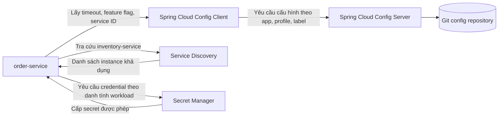

# Phân biệt cấu hình ứng dụng, Service Discovery và quản lý bí mật

Trong một hệ thống gồm nhiều ứng dụng Spring Boot, các dịch vụ thường cần biết địa chỉ của nhau, cách hoạt động theo từng môi trường và thông tin xác thực để truy cập tài nguyên. Những dữ liệu này đôi khi cùng xuất hiện trong một file YAML, nhưng chúng giải quyết ba vấn đề khác nhau:

- **Cấu hình ứng dụng** quyết định ứng dụng hoạt động như thế nào trong một môi trường.
- **Service Discovery** giúp ứng dụng tìm đúng dịch vụ và instance đang sẵn sàng ở đâu.
- **Quản lý bí mật (Secret Management)** cấp phát, bảo vệ và luân chuyển thông tin xác thực nhạy cảm.

Phân biệt đúng ba trách nhiệm giúp chọn đúng thành phần Spring Cloud, kiểm soát quyền truy cập và thay đổi hệ thống an toàn hơn. Trong phạm vi Spring Cloud Configuration, Spring Cloud Config tập trung vào cấu hình ứng dụng; nó có thể phối hợp với Service Discovery và hệ thống quản lý bí mật, nhưng không thay thế hai hệ thống đó.

## 1. Nhìn từ câu hỏi mà mỗi thành phần giải quyết

| Trách nhiệm | Câu hỏi cần trả lời | Dữ liệu thường gặp | Cơ chế phổ biến |
|---|---|---|---|
| Cấu hình ứng dụng | Ứng dụng cần chạy với hành vi và tham số nào? | Timeout, giới hạn retry, mức log, feature flag, URL hoặc tên logic của dịch vụ phụ thuộc | Spring Boot externalized configuration, Spring Cloud Config |
| Service Discovery | Dịch vụ cần gọi hiện có instance nào và địa chỉ nào? | Service ID, địa chỉ IP, port, trạng thái đăng ký, metadata của instance | Eureka, Consul, Kubernetes Service/DNS, Spring Cloud DiscoveryClient và LoadBalancer |
| Quản lý bí mật | Ứng dụng lấy và sử dụng thông tin xác thực ra sao? | Mật khẩu, token, private key, chứng thư, khóa ký hoặc khóa mã hóa | HashiCorp Vault, cloud secret manager, Kubernetes Secrets kết hợp chính sách bảo vệ phù hợp |

Có thể nhớ bằng ba câu hỏi: **cấu hình** trả lời “chạy như thế nào”, **discovery** trả lời “tìm ở đâu”, còn **secret management** trả lời “được xác thực bằng gì và ai có quyền lấy thông tin đó”.

Ranh giới này dựa trên mục đích và vòng đời của dữ liệu, không dựa trên việc dữ liệu đang nằm trong file nào. Ví dụ, `http://inventory-service` có thể là một giá trị cấu hình mô tả tên logic cần gọi; registry mới là nơi theo dõi các instance thực tế của dịch vụ đó. Mật khẩu cơ sở dữ liệu có thể được một ứng dụng cần đến khi khởi động, nhưng nó vẫn là bí mật cần được bảo vệ theo chính sách riêng.

## 2. Cấu hình ứng dụng: quyết định ứng dụng hoạt động như thế nào

Cấu hình ứng dụng là các tham số có thể thay đổi theo môi trường hoặc theo nhu cầu vận hành mà không cần sửa logic nghiệp vụ. Ví dụ:

- Cổng HTTP, mức log và giới hạn kích thước request.
- Timeout, số lần retry, connection pool và ngưỡng circuit breaker.
- Bật hoặc tắt một tính năng bằng feature flag.
- Tên logic của dịch vụ phụ thuộc hoặc địa chỉ của một tài nguyên có địa chỉ ổn định.
- Các tham số nghiệp vụ như giới hạn đơn hàng hoặc thời gian giữ chỗ.

Spring Boot hỗ trợ externalized configuration: ứng dụng có thể nhận thuộc tính từ file cấu hình, biến môi trường, tham số dòng lệnh và các nguồn thuộc tính khác. Nhờ vậy, cùng một artifact có thể được triển khai ở môi trường phát triển, kiểm thử và production với bộ tham số phù hợp.

Khi có nhiều ứng dụng, Spring Cloud Config bổ sung mô hình quản lý tập trung. Config Server đọc cấu hình từ một backend, thường là Git; Config Client lấy cấu hình dành cho ứng dụng, profile và label tương ứng. Nhóm vận hành có thể xem lại lịch sử thay đổi qua Git, tổ chức cấu hình dùng chung và cấu hình riêng cho từng dịch vụ.

Ví dụ một Config Client khai báo tên ứng dụng và địa chỉ Config Server trong `application.yml`:

```yaml
spring:
  application:
    name: order-service
  config:
    import: "optional:configserver:http://localhost:8888"
  profiles:
    active: staging
```

Với khai báo trên, client có tên `order-service`, sử dụng profile `staging` và truy vấn Config Server tại cổng `8888`. Tiền tố `optional:` cho phép ứng dụng tiếp tục khởi động khi Config Server không sẵn sàng; chỉ nên dùng khi việc khởi động với cấu hình cục bộ dự phòng là hành vi được thiết kế và chấp nhận. Nếu cấu hình tập trung là bắt buộc để ứng dụng chạy đúng, hãy cân nhắc bỏ `optional:` để lỗi kết nối được thể hiện ngay lúc khởi động.

Một repository cấu hình có thể được tổ chức theo tên ứng dụng và profile, chẳng hạn:

```text
config-repo/
├── application.yml
├── order-service.yml
├── order-service-staging.yml
├── inventory-service.yml
└── inventory-service-production.yml
```

`application.yml` thường chứa thuộc tính dùng chung; các file theo tên dịch vụ và profile chứa phần cấu hình chuyên biệt. Cách ghép các nguồn và thứ tự ưu tiên cuối cùng phụ thuộc vào cơ chế cấu hình của Spring Boot, Config Data và các tùy chọn của Config Server. Khi có nhiều nguồn cùng khai báo một thuộc tính, cần kiểm tra property source thực tế thay vì suy luận chỉ từ tên file.

Trong Spring Cloud Config, **profile** chọn nhóm cấu hình theo môi trường hoặc biến thể chạy; **label** chọn phiên bản của cấu hình ở backend, thường tương ứng branch, tag hoặc commit Git. Vì vậy, profile và label trả lời hai câu hỏi khác nhau: ứng dụng đang cần cấu hình cho trường hợp chạy nào, và cần lấy phiên bản cấu hình nào. Không nên xem profile như một cơ chế phân quyền bảo mật.

Ví dụ một phần cấu hình không nhạy cảm cho `order-service`:

```yaml
checkout:
  timeout: 2s
  retry:
    max-attempts: 3

feature:
  new-checkout: false

inventory:
  service-id: inventory-service
```

Các thuộc tính này mô tả hành vi và tên logic mà ứng dụng sử dụng. Thay đổi timeout hoặc feature flag là thay đổi cấu hình ứng dụng; thay đổi số lượng instance hay địa chỉ IP hiện tại của `inventory-service` thuộc vòng đời của Service Discovery.

## 3. Service Discovery: tìm instance của dịch vụ ở đâu

Trong môi trường container hoặc nền tảng điều phối, địa chỉ IP và port của một instance có thể thay đổi khi dịch vụ được triển khai lại, scale hoặc chuyển node. Nếu mọi ứng dụng phụ thuộc phải lưu địa chỉ IP cụ thể, cấu hình sẽ nhanh chóng lỗi thời và mỗi lần thay instance có thể kéo theo nhiều lần sửa cấu hình.

Service Discovery giải quyết việc đăng ký và tìm kiếm dịch vụ. Một service instance đăng ký thông tin của nó với registry; client tra cứu theo tên dịch vụ để nhận các instance đang khả dụng. Thành phần cân bằng tải có thể chọn một instance phù hợp cho từng request.

Trong hệ sinh thái Spring Cloud, các lựa chọn thường gặp gồm:

- **Eureka**: registry và discovery server thường dùng trong hệ thống Spring Cloud.
- **Consul**: cung cấp service registry cùng các khả năng khác như health check và key/value store.
- **Kubernetes Service và DNS**: cung cấp tên dịch vụ ổn định trong cluster; nhiều ứng dụng không cần dựng thêm registry Eureka nếu cơ chế nền tảng đã đáp ứng nhu cầu.
- **Spring Cloud DiscoveryClient và Spring Cloud LoadBalancer**: các abstraction và cơ chế phía ứng dụng để tra cứu hoặc chọn instance khi tích hợp với hệ thống discovery tương ứng.

Ví dụ, ứng dụng có thể gọi dịch vụ theo tên logic `inventory-service` thay vì ghi cố định `10.0.4.21:8080`. Discovery client và load balancer phối hợp với registry hoặc cơ chế DNS để tìm địa chỉ thực tế. Tên logic này có thể được đặt trong cấu hình ứng dụng, nhưng danh sách instance đang sống và địa chỉ hiện tại được quản lý bởi hệ thống discovery.

Không phải mọi địa chỉ đều cần Service Discovery. Một endpoint của dịch vụ bên ngoài có địa chỉ ổn định có thể được quản lý như cấu hình thông thường. Với database được cung cấp bởi nền tảng, cách kết nối thường được quản lý qua endpoint và dịch vụ hạ tầng tương ứng. Hãy dùng discovery khi hệ thống thực sự cần tìm các instance dịch vụ thay đổi theo thời gian.

## 4. Quản lý bí mật: bảo vệ thông tin xác thực

Bí mật là dữ liệu mà người không được phép biết hoặc sử dụng có thể gây ra truy cập trái phép, giả mạo hoặc mất kiểm soát hệ thống. Ví dụ:

- Mật khẩu database hoặc message broker.
- API token, OAuth client secret và credential của dịch vụ bên thứ ba.
- Private key, khóa ký JWT, khóa mã hóa và chứng thư có khóa riêng.
- Thông tin xác thực dùng giữa các dịch vụ hoặc tài khoản vận hành.

Các giá trị này khác với timeout hay feature flag vì chúng cần chính sách bảo mật riêng: ai được đọc, đọc trong bao lâu, dùng cho workload nào, ghi nhận việc truy cập ra sao và khi nào phải thu hồi hoặc luân chuyển.

Không lưu bí mật dạng rõ trong repository Git cấu hình. Git giữ lịch sử; xóa một dòng ở commit mới không làm bí mật biến mất khỏi các commit cũ, bản clone hoặc bản sao lưu. Nếu bí mật đã bị commit, cần coi nó có thể đã lộ: thu hồi hoặc rotate credential, xử lý lịch sử theo quy trình của tổ chức và rà soát nơi đã sao chép.

Các hệ thống quản lý bí mật chuyên dụng có thể lưu trữ và cấp phát bí mật theo danh tính workload, chính sách và thời hạn. Ví dụ:

- HashiCorp Vault, bao gồm tích hợp Spring Cloud Vault.
- AWS Secrets Manager, Azure Key Vault hoặc Google Cloud Secret Manager.
- Kubernetes Secrets, khi được kết hợp với RBAC, mã hóa dữ liệu lưu trữ, kiểm soát quyền của workload và quy trình luân chuyển phù hợp.

Ứng dụng nên lấy bí mật bằng danh tính runtime được cấp quyền tối thiểu, tránh nhúng credential dài hạn vào source code hoặc image. Khi nền tảng hỗ trợ, ưu tiên credential ngắn hạn và tự động luân chuyển. Hạn chế đưa giá trị bí mật vào log, thông báo lỗi, endpoint quản trị hoặc trang hiển thị environment; quyền truy cập các endpoint như Actuator cũng phải được kiểm soát.

Spring Cloud Config có hỗ trợ mã hóa và giải mã thuộc tính khi Config Server được cấu hình khóa phù hợp. Cơ chế này hữu ích trong một số kiến trúc, nhưng cần bảo vệ khóa mã hóa độc lập với repository và kiểm soát ai có thể gọi endpoint giải mã. Mã hóa một giá trị trong Git không tự động cung cấp đầy đủ các khả năng như cấp phát theo danh tính, audit truy cập, thu hồi và rotation. Với bí mật có rủi ro cao hoặc cần luân chuyển thường xuyên, hãy cân nhắc dùng secret manager chuyên dụng.

Một quy tắc thực tế là: repository cấu hình có thể chứa **tham chiếu** tới bí mật hoặc tên secret, còn giá trị bí mật được cấp từ hệ thống được phép quản lý nó. Nếu buộc phải lưu giá trị đã mã hóa, khóa giải mã phải được quản lý ngoài repository và quy trình truy cập phải được giới hạn rõ ràng.

## 5. Ba trách nhiệm phối hợp trong một hệ thống

Hãy xét `order-service` cần xử lý đơn hàng, gọi `inventory-service` và kết nối database. Mỗi thành phần tham gia vào một phần khác nhau của quá trình:



Trong ví dụ này:

1. Config Server cung cấp các tham số như timeout, retry, feature flag và tên logic `inventory-service`.
2. Service Discovery tìm các instance hiện tại của `inventory-service` để client gọi đúng đích và có thể cân bằng tải.
3. Secret Manager cấp mật khẩu database hoặc token theo danh tính và quyền đã được cấp cho `order-service`.

Ba cơ chế có thể được triển khai độc lập hoặc tích hợp với nhau. Chúng cũng có thể cùng tham gia vào thời điểm khởi động ứng dụng, nhưng việc lấy cấu hình thành công không đồng nghĩa service registry đã có instance khỏe mạnh, và việc tra cứu được một dịch vụ không có nghĩa credential truy cập tài nguyên đã hợp lệ.

## 6. Những nhầm lẫn thường gặp và cách tránh

| Nhầm lẫn | Hệ quả | Cách xử lý |
|---|---|---|
| Dùng Config Server như registry | Danh sách instance động bị đóng cứng trong repository; thay đổi hạ tầng đòi hỏi cập nhật cấu hình thủ công | Để Config Server quản lý tham số ứng dụng; dùng discovery hoặc DNS của nền tảng để tìm instance |
| Lưu password dạng rõ trong Git | Credential có thể tồn tại trong lịch sử, clone và bản sao lưu | Dùng secret manager; nếu đã lộ thì thu hồi và rotate |
| Coi profile `production` là ranh giới bảo mật | Người có thể đọc repository vẫn có thể đọc dữ liệu trong profile đó | Phân quyền ở Git, Config Server, secret manager và hạ tầng runtime |
| Cho rằng đổi cấu hình sẽ tự cập nhật mọi instance ngay lập tức | Một số client vẫn giữ giá trị cũ hoặc chỉ đọc cấu hình lúc khởi động | Thiết kế refresh có kiểm soát, kiểm tra khả năng áp dụng của từng bean và dùng Spring Cloud Bus khi cần phát thông báo tới nhiều instance |
| Đặt IP của instance vào file cấu hình | Địa chỉ dễ lỗi thời sau khi scale hoặc triển khai lại | Dùng tên dịch vụ ổn định và Service Discovery khi phù hợp |
| Cho rằng mã hóa trong Config Server đã giải quyết toàn bộ quản lý bí mật | Có thể vẫn thiếu rotation, audit, thu hồi và phân quyền theo workload | Đánh giá vòng đời bí mật và tích hợp secret manager khi cần |

Refresh cấu hình cũng cần được phân biệt với discovery. Spring Cloud Config hỗ trợ client lấy lại cấu hình; Spring Cloud Bus có thể phát sự kiện refresh tới nhiều instance. Tuy nhiên, không phải thuộc tính nào cũng có thể áp dụng nóng an toàn, và cơ chế refresh không thay thế health check hoặc đăng ký lại instance. Mỗi loại dữ liệu cần được cập nhật theo vòng đời của chính nó.

## 7. Cách chọn đúng cơ chế

Khi quyết định nơi quản lý một giá trị, hãy lần lượt hỏi:

1. **Giá trị này điều khiển hành vi của ứng dụng?** Nếu có, đó thường là cấu hình ứng dụng và có thể được quản lý bằng Spring Boot hoặc Spring Cloud Config.
2. **Giá trị này mô tả địa chỉ của một instance có thể thay đổi?** Nếu có, hãy xem xét Service Discovery hoặc DNS/service abstraction của nền tảng. Cấu hình có thể chứa tên logic, còn registry hoặc nền tảng chịu trách nhiệm phân giải instance.
3. **Giá trị này cho phép xác thực, ký hoặc giải mã?** Nếu có, hãy coi đó là bí mật và quản lý bằng cơ chế secret management có phân quyền, audit và rotation.

| Ví dụ | Phân loại chính | Lý do |
|---|---|---|
| `checkout.timeout=2s` | Cấu hình ứng dụng | Điều chỉnh hành vi xử lý request |
| `feature.new-checkout=false` | Cấu hình ứng dụng | Bật hoặc tắt tính năng |
| `inventory-service` | Tên logic trong cấu hình; được discovery phân giải | Ứng dụng biết cần gọi dịch vụ nào, registry tìm instance cụ thể |
| `10.0.4.21:8080` của một instance tạm thời | Service Discovery | Địa chỉ phụ thuộc trạng thái triển khai và có thể thay đổi |
| `DB_PASSWORD` | Bí mật | Cho phép truy cập database |
| Private key ký token | Bí mật | Có thể tạo chữ ký mà hệ thống khác tin cậy |

Một giá trị có thể cần được tham chiếu từ nhiều nơi, nhưng cần xác định một nguồn có thẩm quyền cho nó. Ví dụ, Config Server có thể cung cấp `inventory.service-id`, trong khi registry cung cấp các instance hiện tại. Ứng dụng có thể nhận tên secret từ cấu hình, sau đó dùng danh tính runtime để lấy giá trị secret từ Vault. Cách phân chia này giữ cho từng hệ thống chịu trách nhiệm đúng với dữ liệu và vòng đời của nó.

## 8. Mục tiêu cần đạt sau bài học

Sau bài này, người học cần có khả năng:

- Giải thích được khác biệt giữa cấu hình ứng dụng, Service Discovery và quản lý bí mật bằng câu hỏi mà mỗi cơ chế giải quyết.
- Nhận diện được tham số hành vi, tên logic dịch vụ, địa chỉ instance và credential trong một cấu hình Spring Boot.
- Mô tả được vai trò của Config Server, Config Client, Git, profile và label trong quản lý cấu hình tập trung.
- Chọn được trường hợp phù hợp để dùng Eureka, Consul hoặc DNS/Service của Kubernetes.
- Giải thích vì sao credential dạng rõ không nên được lưu trong Git và vì sao mã hóa thuộc tính không thay thế đầy đủ một secret manager.
- Thiết kế được luồng phối hợp: lấy cấu hình từ Config Server, tìm dịch vụ qua discovery và lấy bí mật từ nguồn được cấp quyền.

**Tự kiểm tra:** Nếu `order-service` cần đổi timeout khi tải cao, cần đổi địa chỉ một instance `inventory-service` sau khi scale, và cần rotate mật khẩu database, hãy phân loại từng thay đổi. Timeout thuộc cấu hình ứng dụng; instance thuộc Service Discovery; mật khẩu thuộc quản lý bí mật. Phân loại này giúp thay đổi đúng nơi, giới hạn phạm vi ảnh hưởng và kiểm soát quyền truy cập phù hợp.
