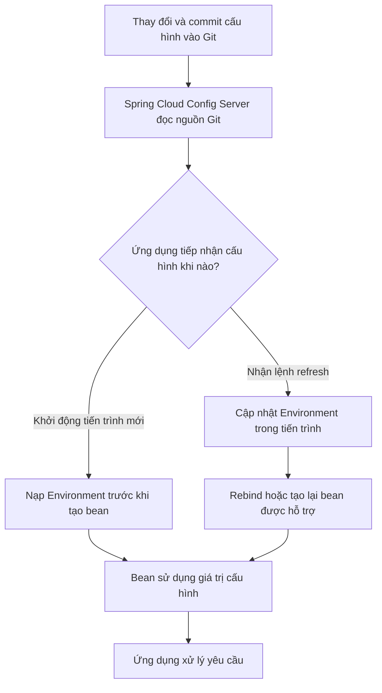

# Phân biệt thay đổi lúc khởi động, làm mới khi chạy và triển khai lại

Trong một hệ thống có nhiều ứng dụng Spring Boot, cấu hình thường được quản lý tập trung bằng Spring Cloud Config. Các ứng dụng lấy cấu hình từ Config Server; Config Server đọc dữ liệu từ một nguồn như Git và trả về các property phù hợp với tên ứng dụng, profile và label mà client yêu cầu.

Khi một giá trị trong Git thay đổi, ứng dụng đang chạy không tự động thay đổi theo. Ứng dụng chỉ sử dụng giá trị mới khi nó đọc lại cấu hình và thành phần đang sử dụng giá trị đó có khả năng nhận thay đổi. Vì vậy, trước khi áp dụng một thay đổi, cần xác định nó thuộc một trong ba thời điểm: nạp lúc khởi động, làm mới trong tiến trình đang chạy, hay cần triển khai lại.

## 1. Cấu hình đi từ Git đến ứng dụng như thế nào?

Spring Cloud Config tách nơi lưu cấu hình khỏi mã nguồn của từng ứng dụng:

- **Git** lưu các tệp cấu hình theo ứng dụng và môi trường, chẳng hạn `order-service.yml`, `order-service-prod.yml` hoặc `application-prod.yml`.
- **Config Server** lấy nội dung từ Git, kết hợp cấu hình chung với cấu hình riêng theo ứng dụng, profile và label, rồi cung cấp chúng qua HTTP.
- **Config Client** gửi yêu cầu đến Config Server và đưa các property nhận được vào `Environment` của Spring.
- **Các bean** đọc property từ `Environment` khi được tạo, được bind hoặc được làm mới.

Ví dụ, một client có thể khai báo thông tin kết nối Config Server bằng Config Data API của Spring Boot:

```properties
spring.application.name=order-service
spring.config.import=optional:configserver:http://config-server:8888
spring.cloud.config.profile=prod
spring.cloud.config.label=main
```

`spring.application.name`, profile và label quyết định bộ cấu hình mà client yêu cầu. `optional:` cho phép ứng dụng tiếp tục khởi động nếu Config Server không truy cập được; chỉ dùng tùy chọn này khi ứng dụng có giá trị dự phòng phù hợp và việc khởi động thiếu cấu hình từ xa là chấp nhận được. Nếu cấu hình từ Config Server là bắt buộc, hãy bỏ `optional:` để lỗi kết nối được phát hiện ngay khi khởi động.

Với Spring Boot 2.4 trở lên, cách khai báo phổ biến là `spring.config.import`. Các ứng dụng dùng cơ chế bootstrap cũ có thể cần `bootstrap.yml` và bootstrap starter. Cần chọn cách nạp cấu hình tương thích với phiên bản Spring Boot và Spring Cloud mà dự án đang sử dụng.

Luồng tổng quát:



Một commit chỉ cập nhật nguồn cấu hình. Nó không tự khởi động lại tiến trình, không tự gọi refresh trên mọi client và cũng không đảm bảo mọi bean đang chạy sẽ thay đổi.

## 2. Thay đổi lúc khởi động

Ở lần khởi động, Config Client đọc cấu hình từ Config Server và Spring xây dựng `Environment` trước khi hoàn tất việc tạo các bean của ứng dụng. Các bean sau đó nhận giá trị từ `Environment` thông qua `@Value`, `@ConfigurationProperties` hoặc cơ chế cấu hình khác.

Nếu cấu hình trong Git thay đổi sau khi ứng dụng đã khởi động, tiến trình hiện tại vẫn giữ trạng thái đã nạp cho đến khi có cơ chế cập nhật phù hợp. Khởi động lại tiến trình khiến client thực hiện lại bước lấy cấu hình và các bean được tạo theo giá trị mới.

Những thay đổi thường phù hợp với cách nạp lúc khởi động gồm:

- Cổng HTTP, địa chỉ bind hoặc một số thiết lập mạng được máy chủ đọc khi tạo server.
- Cấu hình SSL, chứng chỉ hoặc kết nối hạ tầng được khởi tạo một lần.
- Các lựa chọn ảnh hưởng đến việc tạo bean, auto-configuration hoặc điều kiện đăng ký bean, chẳng hạn `@ConditionalOnProperty`.
- Cấu hình của thread pool, connection pool hoặc client bên ngoài khi thư viện sử dụng không hỗ trợ cập nhật trực tiếp.
- Những property được đọc một lần trong constructor hoặc trong quá trình khởi tạo và không có cơ chế rebind hay tái cấu hình.

Đây là các ví dụ điển hình, không phải danh sách cố định. Một thành phần có thể hỗ trợ thay đổi nóng nếu ứng dụng hoặc thư viện cung cấp API cấu hình lại an toàn. Ngược lại, chỉ đổi property trong `Environment` không có nghĩa một socket, pool hay bean đã được khởi tạo sẽ tự thay đổi.

**Cách áp dụng:** cập nhật cấu hình trong Git, kiểm tra đúng ứng dụng/profile/label, sau đó khởi động lại ứng dụng hoặc thực hiện rolling restart các instance. Nếu chỉ thay đổi dữ liệu cấu hình và artifact vẫn tương thích, có thể khởi động lại cùng phiên bản ứng dụng mà không cần tạo image hay phát hành mã nguồn mới.

## 3. Làm mới cấu hình khi ứng dụng đang chạy

Làm mới khi chạy (runtime refresh) cho phép một ứng dụng đang hoạt động đọc lại cấu hình và cập nhật những bean có hỗ trợ. Cách này giảm nhu cầu khởi động lại, nhưng không áp dụng được cho mọi property.

Quá trình thường gồm các bước:

1. Thay đổi cấu hình và commit vào đúng nhánh hoặc tag Git.
2. Config Server có thể đọc được phiên bản cấu hình mới.
3. Gửi sự kiện refresh đến client hoặc phát một sự kiện qua Spring Cloud Bus.
4. Client cập nhật `Environment` và thực hiện rebind hoặc làm mới các bean thuộc phạm vi được hỗ trợ.
5. Kiểm tra hành vi thực tế của ứng dụng sau khi refresh.

### 3.1. Làm mới một ứng dụng bằng Actuator

Ứng dụng có thể sử dụng Spring Boot Actuator cùng Spring Cloud Context để cung cấp endpoint refresh. Ví dụ cấu hình expose endpoint:

```yaml
management:
  endpoints:
    web:
      exposure:
        include: health,info,refresh
```

Sau khi cấu hình endpoint và bảo vệ quyền truy cập, có thể gửi yêu cầu:

```bash
curl -X POST http://localhost:8080/actuator/refresh
```

Endpoint này yêu cầu client làm mới cấu hình trong tiến trình hiện tại. Kết quả trả về có thể liệt kê các key được nhận diện là đã thay đổi. Kết quả đó không chứng minh mọi thành phần phụ thuộc vào các key đều đã được tái cấu hình thành công; cần kiểm tra thêm log, trạng thái và hành vi của ứng dụng.

### 3.2. Bean nào nhận được thay đổi?

Với bean dùng `@Value`, giá trị thường được gán khi bean được tạo. Nếu bean là singleton thông thường, việc cập nhật `Environment` không tự gán lại field đã inject. Có thể dùng `@RefreshScope` để Spring tạo lại target của bean khi refresh:

```java
@RestController
@RefreshScope
public class WelcomeController {

    @Value("${welcome.message:Welcome}")
    private String message;

    @GetMapping("/welcome")
    public String welcome() {
        return message;
    }
}
```

Khi refresh thành công, target của bean trong refresh scope được loại khỏi cache. Lần gọi tiếp theo qua proxy sẽ tạo target mới và inject giá trị hiện tại. Vì vậy, thao tác tạo lại target có thể diễn ra khi bean được dùng tiếp, chứ không nhất thiết ngay trong thời điểm gửi yêu cầu refresh.

Với `@ConfigurationProperties`, Spring Cloud có cơ chế rebind các bean cấu hình được quản lý phù hợp. Ví dụ, một bean có setter có thể nhận lại giá trị cho các thuộc tính có thể thay đổi. Với cấu hình bất biến, constructor-bound hoặc bean có trạng thái khởi tạo phức tạp, cần kiểm tra khả năng rebind và tác động phụ trước khi dựa vào refresh. Nếu bean hoặc thư viện không hỗ trợ cập nhật an toàn, hãy khởi động lại ứng dụng.

Không nên gắn `@RefreshScope` đại trà cho mọi bean. Việc tạo lại bean có thể mở lại kết nối, khởi tạo tài nguyên hoặc làm mất trạng thái nội bộ. Chỉ áp dụng cho những thành phần có vòng đời phù hợp và đã được kiểm tra khi tái tạo.

### 3.3. Làm mới nhiều ứng dụng bằng Spring Cloud Bus

Khi nhiều instance cùng dùng Config Server, gọi `/actuator/refresh` trên từng instance sẽ khó quản lý. Spring Cloud Bus phát sự kiện qua một message broker để các ứng dụng đã tham gia bus cùng nhận sự kiện refresh.

Các bước triển khai thường gồm:

- Thêm tích hợp Bus tương ứng với broker đang dùng, chẳng hạn RabbitMQ hoặc Kafka.
- Cấu hình các client kết nối cùng hệ thống message broker.
- Expose endpoint `busrefresh` qua Actuator và bảo vệ endpoint.
- Gửi một yêu cầu refresh để phát sự kiện đến các instance tham gia bus.

Ví dụ yêu cầu gửi đến một instance có endpoint được cấu hình:

```bash
curl -X POST http://localhost:8080/actuator/busrefresh
```

Bus phân phối sự kiện refresh; mỗi client vẫn phải đọc được cấu hình mới và có bean hỗ trợ cập nhật thì thay đổi mới có hiệu lực. Bus không biến một property chỉ đọc lúc khởi động thành property có thể thay đổi nóng. Cũng cần theo dõi lỗi kết nối broker, instance không nhận sự kiện và kết quả refresh ở từng ứng dụng.

### 3.4. Bảo vệ endpoint và dữ liệu cấu hình

Các endpoint `refresh` và `busrefresh` có thể làm thay đổi hành vi của ứng dụng, do đó không nên mở công khai. Chỉ expose endpoint cần thiết, giới hạn truy cập bằng cơ chế xác thực và phân quyền, đồng thời giới hạn mạng có thể gọi endpoint. Không đưa thông tin nhạy cảm vào log hoặc response kiểm tra cấu hình.

Không lưu mật khẩu, token hay private key dạng rõ trong repository Git. Ưu tiên secret manager như Vault hoặc dịch vụ quản lý bí mật của nền tảng triển khai; nếu dùng cơ chế mã hóa của Spring Cloud Config, cần quản lý khóa mã hóa riêng và bảo vệ các endpoint liên quan. Quyền đọc repository và Config Server cũng phải được giới hạn theo môi trường và ứng dụng.

## 4. Khi nào cần triển khai lại?

Triển khai lại (redeployment) là đưa một phiên bản ứng dụng hoặc cấu hình triển khai mới vào môi trường chạy. Tùy nền tảng, thao tác này có thể tạo container mới, thay image, cập nhật manifest, thay biến môi trường hoặc thực hiện rolling deployment.

Triển khai lại thường cần thiết khi:

- Mã nguồn thay đổi, có endpoint hoặc nghiệp vụ mới, hoặc cần sửa lỗi trong ứng dụng.
- Dependency, thư viện, JDK, image hoặc artifact được nâng cấp.
- Thay đổi cấu hình triển khai do nền tảng quản lý, chẳng hạn biến môi trường, secret mount, tài nguyên CPU/bộ nhớ hoặc tham số của container.
- Thay đổi cấu hình mà ứng dụng chỉ đọc lúc khởi động và quy trình vận hành yêu cầu tạo instance mới.
- Cần thay đổi cấu trúc bean, điều kiện auto-configuration hoặc tài nguyên không thể tái cấu hình an toàn trong tiến trình hiện tại.

Triển khai lại thường kéo theo việc khởi động instance mới. Trong quá trình đó, Config Client lấy cấu hình theo application, profile và label đã khai báo. Với thay đổi chỉ nằm trong Git, không nhất thiết phải phát hành artifact mới: có thể rolling restart cùng artifact để các instance nạp lại cấu hình. Nếu thay đổi image, mã nguồn hoặc manifest, cần triển khai phiên bản tương ứng.

Nên ưu tiên rolling deployment khi hệ thống cần duy trì khả năng phục vụ. Cần kiểm tra readiness/liveness, khả năng tương thích giữa phiên bản cũ và mới, cũng như thứ tự chuyển traffic để tránh làm gián đoạn toàn bộ instance.

## 5. Bảng quyết định phương thức áp dụng

| Loại thay đổi | Phương thức thường dùng | Lý do và điểm cần kiểm tra |
|---|---|---|
| Nội dung thông báo, ngưỡng nghiệp vụ hoặc feature flag được thiết kế để cập nhật nóng | Runtime refresh | Bean phải nhận rebind hoặc nằm trong refresh scope; kiểm tra giá trị sau refresh. |
| Giá trị `@Value` trong singleton thông thường | Khởi động lại, hoặc thiết kế lại bean để hỗ trợ refresh | Field đã inject không tự đổi chỉ vì `Environment` thay đổi. |
| Cổng server, SSL hoặc tài nguyên được tạo lúc khởi động | Khởi động lại | Thành phần hạ tầng thường đã khởi tạo từ giá trị cũ. |
| Property điều khiển việc tạo bean hoặc auto-configuration | Khởi động lại | Điều kiện tạo bean thường được đánh giá trong quá trình khởi tạo context. |
| Mã nguồn, dependency hoặc image | Triển khai lại | Tiến trình cần chạy artifact mới. |
| Biến môi trường, manifest hoặc cấu hình do nền tảng triển khai quản lý | Cập nhật deployment và triển khai lại | Giá trị thường được cấp cho process/container khi tạo instance. |
| Một cấu hình runtime cần đồng bộ trên nhiều instance | Spring Cloud Bus nếu bean hỗ trợ refresh | Cần broker, endpoint được bảo vệ và theo dõi tất cả client. |

Đây là quy tắc định hướng. Quyết định cuối cùng phụ thuộc vào cách ứng dụng đọc property và khả năng cập nhật của thư viện đang sử dụng.

## 6. Ví dụ chọn đúng cách áp dụng

Giả sử `order-service` đang chạy với profile `prod`, label `main`. Config Server cung cấp tệp `order-service-prod.yml`:

```yaml
welcome:
  message: "Welcome to the order service"

checkout:
  timeout-seconds: 5

server:
  port: 8080
```

Xét ba thay đổi sau:

**Thay đổi thông báo chào mừng.** Nếu controller dùng `@RefreshScope` như ví dụ trên, có thể commit thông báo mới rồi gọi refresh. Nếu có nhiều instance và tất cả đều tham gia Bus, có thể phát sự kiện qua `busrefresh`. Sau đó gửi request đến từng instance hoặc kiểm tra qua giám sát tập trung để xác nhận thông báo đã đổi.

**Thay đổi timeout checkout.** Nếu `checkout.timeout-seconds` được bind vào bean `@ConfigurationProperties` có khả năng rebind và thành phần thực thi đọc giá trị mới từ bean đó, runtime refresh có thể đủ. Nếu timeout đã được sao chép vào một HTTP client hoặc pool chỉ khởi tạo một lần, cần tái cấu hình client bằng API phù hợp hoặc khởi động lại ứng dụng. Việc property xuất hiện trong response refresh không chứng minh timeout của client đã thay đổi.

**Đổi `server.port`.** Server thường đã bind socket vào cổng khi khởi động. Refresh `Environment` không tự chuyển socket sang cổng mới. Cần khởi động lại instance, đồng thời cập nhật health check, service discovery, load balancer hoặc cấu hình triển khai liên quan nếu chúng cũng dùng cổng đó.

Nếu thay đổi là thêm một endpoint mới vào `order-service`, cập nhật cấu hình Git không thể tạo ra mã xử lý endpoint. Cần build artifact mới và triển khai phiên bản ứng dụng mới.

## 7. Quy trình vận hành một thay đổi cấu hình

Một quy trình có kiểm soát giúp tránh trường hợp commit thành công nhưng ứng dụng vẫn dùng giá trị cũ:

1. **Xác định đích cấu hình.** Kiểm tra `spring.application.name`, profile đang hoạt động và label Git của từng client. Đảm bảo sửa đúng tệp và đúng nhánh/tag mà client đang đọc.
2. **Kiểm tra nguồn giá trị.** Xem xét cấu hình chung, cấu hình riêng theo ứng dụng và các nguồn có độ ưu tiên cao hơn như biến môi trường, JVM system property hoặc command-line argument. Property từ Config Server có thể bị ghi đè tùy thứ tự property source và chính sách override; không kết luận giá trị hiệu lực chỉ từ nội dung Git.
3. **Phân loại thay đổi.** Xác định bean hoặc thành phần nào sử dụng property. Chọn runtime refresh nếu có cơ chế rebind/tạo lại an toàn; chọn restart nếu giá trị được dùng lúc khởi tạo; chọn redeploy nếu cần artifact hoặc deployment spec mới.
4. **Áp dụng theo phạm vi.** Với runtime refresh, gửi sự kiện đến đúng client hoặc qua Bus. Với restart/redeploy, triển khai theo chiến lược phù hợp, chẳng hạn rolling update.
5. **Xác minh kết quả.** Kiểm tra log refresh, trạng thái instance, giá trị hiệu lực theo cách an toàn và hành vi nghiệp vụ. Theo dõi lỗi kết nối, readiness, tỷ lệ lỗi và độ trễ sau thay đổi.
6. **Chuẩn bị rollback.** Lưu lại commit cấu hình trước đó. Nếu thay đổi gây lỗi, đưa cấu hình về phiên bản đã biết là tốt rồi refresh hoặc restart theo đúng loại property. Nếu mã nguồn hoặc deployment spec cũng thay đổi, rollback cả phiên bản triển khai tương ứng.

## 8. Các lỗi thường gặp

- **Commit Git nhưng không thấy ứng dụng đổi:** client chưa nhận refresh, chưa khởi động lại, Config Server chưa đọc được commit mới hoặc client đang dùng profile/label khác.
- **Refresh trả về thành công nhưng hành vi không đổi:** bean không hỗ trợ rebind, singleton vẫn giữ giá trị đã inject, hoặc thư viện đã sao chép property vào tài nguyên được tạo lúc khởi động.
- **Một số instance đổi, một số instance không đổi:** chỉ refresh một phần client, message broker có sự cố, instance chưa tham gia Bus hoặc các instance đang đọc label/profile khác nhau.
- **Giá trị trong Git đúng nhưng giá trị hiệu lực khác:** biến môi trường, JVM property, command-line argument hoặc property source có độ ưu tiên cao hơn đang ghi đè.
- **Ứng dụng khởi động được khi Config Server lỗi nhưng dùng cấu hình thiếu:** client đang dùng `optional:configserver:` và không có bộ giá trị dự phòng an toàn.
- **Refresh làm gián đoạn một chức năng:** bean bị tạo lại có trạng thái hoặc tài nguyên cần đóng/mở theo trình tự riêng; cần đánh giá vòng đời trước khi dùng refresh scope.

Khi quản trị cấu hình tập trung, hãy coi Git là nơi quản lý phiên bản cấu hình, Config Server là nơi phân phối, còn refresh/restart/redeploy là các cơ chế áp dụng thay đổi có vòng đời khác nhau. Phân loại đúng property và xác minh sau khi áp dụng giúp nhiều ứng dụng Spring Boot nhận cấu hình nhất quán, có thể truy vết và có đường rollback rõ ràng.
